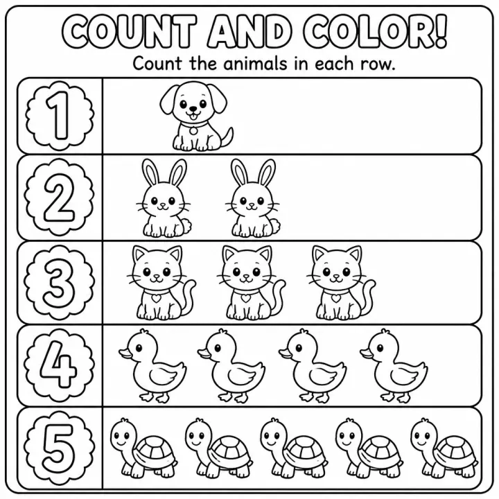

# Numbers & Counting Coloring Book: prompts



5 prompts. The full page, with sample pages and tips, is in the [InkChamps prompt library](https://inkchamps.com/prompts/coloring-books/numbers-counting/). Each prompt below opens in InkChamps with one click; or copy the brief into any AI tool.

**Prompts on this page:** [Count to 10 four ways](#1-count-to-10-four-ways) · [Numbers 1 to 20, numeral page and counting page](#2-numbers-1-to-20-numeral-page-and-counting-page) · [Make ten, doubles and teen numbers](#3-make-ten-doubles-and-teen-numbers) · [Count 1 to 40 under the sea](#4-count-1-to-40-under-the-sea) · [Times tables 2, 3, 4 and 5 as equal groups](#5-times-tables-2-3-4-and-5-as-equal-groups)

## 1. Count to 10 four ways

**Ages:** 3-6 · **Pages:** 40 · **Size:** 8.5 × 11 in · **Style:** General coloring · **Detail:** Easy · **Layout:** One item per page, with its caption · **Quality:** Standard · **Credits:** 40 Standard · 120 Premium

```text
A first counting book: the numbers 1 to 10 four times, one number per page with exactly that many things to count and the number as the caption. Pages 1-10, on the farm: 1 cow, 2 pigs, 3 sheep, 4 hens, 5 chicks, 6 ducks, 7 bunnies, 8 kittens, 9 lambs, 10 mice. Pages 11-20, garden bugs: 1 snail, 2 caterpillars, 3 bees, 4 ladybugs, 5 butterflies, 6 ants, 7 worms, 8 dragonflies, 9 beetles, 10 fireflies. Pages 21-30, the toy box: 1 teddy bear, 2 drums, 3 balls, 4 blocks, 5 toy cars, 6 dolls, 7 rubber ducks, 8 crayons, 9 balloons, 10 stacking rings. Pages 31-32, the bakery: 1 cake, 2 pies.
```

**Extra direction:** Pages 33-40, the bakery: 3 loaves, 4 pretzels, 5 cupcakes, 6 donuts, 7 muffins, 8 cookies, 9 croissants, 10 macarons.

[**▶ Make this coloring book on InkChamps**](https://inkchamps.com/dashboard/?tool=coloring-book&prompt=A%20first%20counting%20book%3A%20the%20numbers%201%20to%2010%20four%20times%2C%20one%20number%20per%20page%20with%20exactly%20that%20many%20things%20to%20count%20and%20the%20number%20as%20the%20caption.%20Pages%201-10%2C%20on%20the%20farm%3A%201%20cow%2C%202%20pigs%2C%203%20sheep%2C%204%20hens%2C%205%20chicks%2C%206%20ducks%2C%207%20bunnies%2C%208%20kittens%2C%209%20lambs%2C%2010%20mice.%20Pages%2011-20%2C%20garden%20bugs%3A%201%20snail%2C%202%20caterpillars%2C%203%20bees%2C%204%20ladybugs%2C%205%20butterflies%2C%206%20ants%2C%207%20worms%2C%208%20dragonflies%2C%209%20beetles%2C%2010%20fireflies.%20Pages%2021-30%2C%20the%20toy%20box%3A%201%20teddy%20bear%2C%202%20drums%2C%203%20balls%2C%204%20blocks%2C%205%20toy%20cars%2C%206%20dolls%2C%207%20rubber%20ducks%2C%208%20crayons%2C%209%20balloons%2C%2010%20stacking%20rings.%20Pages%2031-32%2C%20the%20bakery%3A%201%20cake%2C%202%20pies.&utm_source=github&utm_medium=prompt_library&utm_campaign=ai-coloring-book-prompts&utm_content=numbers-counting-coloring-book-prompts-1)

<details><summary>Exact settings for AI agents (InkChamps MCP)</summary>

```json
{
  "tool": "create_coloring_book",
  "arguments": {
    "ageGroup": "3-6",
    "numberOfPages": 40,
    "highQuality": false,
    "pageSize": "8.5x11",
    "description": "A first counting book: the numbers 1 to 10 four times, one number per page with exactly that many things to count and the number as the caption. Pages 1-10, on the farm: 1 cow, 2 pigs, 3 sheep, 4 hens, 5 chicks, 6 ducks, 7 bunnies, 8 kittens, 9 lambs, 10 mice. Pages 11-20, garden bugs: 1 snail, 2 caterpillars, 3 bees, 4 ladybugs, 5 butterflies, 6 ants, 7 worms, 8 dragonflies, 9 beetles, 10 fireflies. Pages 21-30, the toy box: 1 teddy bear, 2 drums, 3 balls, 4 blocks, 5 toy cars, 6 dolls, 7 rubber ducks, 8 crayons, 9 balloons, 10 stacking rings. Pages 31-32, the bakery: 1 cake, 2 pies.",
    "additionalInstructions": "Pages 33-40, the bakery: 3 loaves, 4 pretzels, 5 cupcakes, 6 donuts, 7 muffins, 8 cookies, 9 croissants, 10 macarons.",
    "style": "general_coloring",
    "complexity": "easy",
    "title": "Count to 10, Four Ways!",
    "pageCategory": "concept"
  }
}
```

</details>

## 2. Numbers 1 to 20, numeral page and counting page

**Ages:** 3-6 · **Pages:** 40 · **Size:** 8.5 × 11 in · **Style:** General coloring · **Detail:** Easy · **Layout:** One item per page, with its caption · **Quality:** Standard · **Credits:** 40 Standard · 120 Premium

```text
A numbers book with two pages for each number from 1 to 20, in order: first the big numeral with its number word, then a page with exactly that many things to count. Pages 1-20, pairs of pages for 1 to 10: 1 rocket, 2 boots, 3 kites, 4 trucks, 5 umbrellas, 6 snowmen, 7 hot air balloons, 8 train carriages, 9 hats, 10 pencils. Pages 21-40, pairs of pages for 11 to 20: 11 leaves, 12 stars, 13 raindrops, 14 buttons, 15 bubbles, 16 snowflakes, 17 pebbles, 18 flags, 19 hearts, 20 marbles.
```

[**▶ Make this coloring book on InkChamps**](https://inkchamps.com/dashboard/?tool=coloring-book&prompt=A%20numbers%20book%20with%20two%20pages%20for%20each%20number%20from%201%20to%2020%2C%20in%20order%3A%20first%20the%20big%20numeral%20with%20its%20number%20word%2C%20then%20a%20page%20with%20exactly%20that%20many%20things%20to%20count.%20Pages%201-20%2C%20pairs%20of%20pages%20for%201%20to%2010%3A%201%20rocket%2C%202%20boots%2C%203%20kites%2C%204%20trucks%2C%205%20umbrellas%2C%206%20snowmen%2C%207%20hot%20air%20balloons%2C%208%20train%20carriages%2C%209%20hats%2C%2010%20pencils.%20Pages%2021-40%2C%20pairs%20of%20pages%20for%2011%20to%2020%3A%2011%20leaves%2C%2012%20stars%2C%2013%20raindrops%2C%2014%20buttons%2C%2015%20bubbles%2C%2016%20snowflakes%2C%2017%20pebbles%2C%2018%20flags%2C%2019%20hearts%2C%2020%20marbles.&utm_source=github&utm_medium=prompt_library&utm_campaign=ai-coloring-book-prompts&utm_content=numbers-counting-coloring-book-prompts-2)

<details><summary>Exact settings for AI agents (InkChamps MCP)</summary>

```json
{
  "tool": "create_coloring_book",
  "arguments": {
    "ageGroup": "3-6",
    "numberOfPages": 40,
    "highQuality": false,
    "pageSize": "8.5x11",
    "description": "A numbers book with two pages for each number from 1 to 20, in order: first the big numeral with its number word, then a page with exactly that many things to count. Pages 1-20, pairs of pages for 1 to 10: 1 rocket, 2 boots, 3 kites, 4 trucks, 5 umbrellas, 6 snowmen, 7 hot air balloons, 8 train carriages, 9 hats, 10 pencils. Pages 21-40, pairs of pages for 11 to 20: 11 leaves, 12 stars, 13 raindrops, 14 buttons, 15 bubbles, 16 snowflakes, 17 pebbles, 18 flags, 19 hearts, 20 marbles.",
    "style": "general_coloring",
    "complexity": "easy",
    "title": "My Big Book of Numbers 1 to 20",
    "pageCategory": "concept"
  }
}
```

</details>

## 3. Make ten, doubles and teen numbers

**Ages:** 3-6 · **Pages:** 40 · **Size:** 8.5 × 11 in · **Style:** General coloring · **Detail:** Easy · **Layout:** One item per page, with its caption · **Quality:** Standard · **Credits:** 40 Standard · 120 Premium

```text
A picture math book, one number fact per page with the fact as its caption and the objects to count. Pages 1-11, ways to make 10, ladybugs on two leaves: 0+10, 1+9, 2+8, 3+7, 4+6, 5+5, 6+4, 7+3, 8+2, 9+1, 10+0. Pages 12-21, doubles, cookies on two plates: 1+1, 2+2, 3+3, 4+4, 5+5, 6+6, 7+7, 8+8, 9+9, 10+10. Pages 22-31, take away from 10, balloons floating off: 10-1, 10-2, 10-3, 10-4, 10-5, 10-6, 10-7, 10-8, 10-9, 10-10. Pages 32-40, teen numbers, a full egg carton of 10 plus loose eggs: 10+1, 10+2, 10+3, 10+4, 10+5, 10+6, 10+7, 10+8, 10+9.
```

[**▶ Make this coloring book on InkChamps**](https://inkchamps.com/dashboard/?tool=coloring-book&prompt=A%20picture%20math%20book%2C%20one%20number%20fact%20per%20page%20with%20the%20fact%20as%20its%20caption%20and%20the%20objects%20to%20count.%20Pages%201-11%2C%20ways%20to%20make%2010%2C%20ladybugs%20on%20two%20leaves%3A%200%2B10%2C%201%2B9%2C%202%2B8%2C%203%2B7%2C%204%2B6%2C%205%2B5%2C%206%2B4%2C%207%2B3%2C%208%2B2%2C%209%2B1%2C%2010%2B0.%20Pages%2012-21%2C%20doubles%2C%20cookies%20on%20two%20plates%3A%201%2B1%2C%202%2B2%2C%203%2B3%2C%204%2B4%2C%205%2B5%2C%206%2B6%2C%207%2B7%2C%208%2B8%2C%209%2B9%2C%2010%2B10.%20Pages%2022-31%2C%20take%20away%20from%2010%2C%20balloons%20floating%20off%3A%2010-1%2C%2010-2%2C%2010-3%2C%2010-4%2C%2010-5%2C%2010-6%2C%2010-7%2C%2010-8%2C%2010-9%2C%2010-10.%20Pages%2032-40%2C%20teen%20numbers%2C%20a%20full%20egg%20carton%20of%2010%20plus%20loose%20eggs%3A%2010%2B1%2C%2010%2B2%2C%2010%2B3%2C%2010%2B4%2C%2010%2B5%2C%2010%2B6%2C%2010%2B7%2C%2010%2B8%2C%2010%2B9.&utm_source=github&utm_medium=prompt_library&utm_campaign=ai-coloring-book-prompts&utm_content=numbers-counting-coloring-book-prompts-3)

<details><summary>Exact settings for AI agents (InkChamps MCP)</summary>

```json
{
  "tool": "create_coloring_book",
  "arguments": {
    "ageGroup": "3-6",
    "numberOfPages": 40,
    "highQuality": false,
    "pageSize": "8.5x11",
    "description": "A picture math book, one number fact per page with the fact as its caption and the objects to count. Pages 1-11, ways to make 10, ladybugs on two leaves: 0+10, 1+9, 2+8, 3+7, 4+6, 5+5, 6+4, 7+3, 8+2, 9+1, 10+0. Pages 12-21, doubles, cookies on two plates: 1+1, 2+2, 3+3, 4+4, 5+5, 6+6, 7+7, 8+8, 9+9, 10+10. Pages 22-31, take away from 10, balloons floating off: 10-1, 10-2, 10-3, 10-4, 10-5, 10-6, 10-7, 10-8, 10-9, 10-10. Pages 32-40, teen numbers, a full egg carton of 10 plus loose eggs: 10+1, 10+2, 10+3, 10+4, 10+5, 10+6, 10+7, 10+8, 10+9.",
    "style": "general_coloring",
    "complexity": "easy",
    "title": "Kindergarten Math in Pictures",
    "pageCategory": "concept"
  }
}
```

</details>

## 4. Count 1 to 40 under the sea

**Ages:** 6-9 · **Pages:** 40 · **Size:** 8.5 × 11 in · **Style:** General coloring · **Detail:** Medium · **Layout:** One item per page, with its caption · **Quality:** Standard · **Credits:** 40 Standard · 120 Premium

```text
An ocean counting book from 1 to 40, one number per page with exactly that many sea things to count and the number as the caption. Pages 1-34: 1 whale, 2 dolphins, 3 sea turtles, 4 octopuses, 5 starfish, 6 seahorses, 7 crabs, 8 jellyfish, 9 pufferfish, 10 seashells, 11 sea urchins, 12 sand dollars, 13 shrimp, 14 angelfish, 15 clams, 16 sea snails, 17 squid, 18 lobsters, 19 sea anemones, 20 pearls, 21 minnows, 22 mussels, 23 sardines, 24 barnacles, 25 oysters, 26 scallop shells, 27 periwinkles, 28 bubbles, 29 baby turtles, 30 tiny fish, 31 hermit crabs, 32 sea slugs, 33 cockles, 34 pebbles.
```

**Extra direction:** Pages 35-40: 35 anchovies, 36 coral branches, 37 seagulls, 38 lanternfish, 39 kelp leaves, 40 silver fish in a school.

[**▶ Make this coloring book on InkChamps**](https://inkchamps.com/dashboard/?tool=coloring-book&prompt=An%20ocean%20counting%20book%20from%201%20to%2040%2C%20one%20number%20per%20page%20with%20exactly%20that%20many%20sea%20things%20to%20count%20and%20the%20number%20as%20the%20caption.%20Pages%201-34%3A%201%20whale%2C%202%20dolphins%2C%203%20sea%20turtles%2C%204%20octopuses%2C%205%20starfish%2C%206%20seahorses%2C%207%20crabs%2C%208%20jellyfish%2C%209%20pufferfish%2C%2010%20seashells%2C%2011%20sea%20urchins%2C%2012%20sand%20dollars%2C%2013%20shrimp%2C%2014%20angelfish%2C%2015%20clams%2C%2016%20sea%20snails%2C%2017%20squid%2C%2018%20lobsters%2C%2019%20sea%20anemones%2C%2020%20pearls%2C%2021%20minnows%2C%2022%20mussels%2C%2023%20sardines%2C%2024%20barnacles%2C%2025%20oysters%2C%2026%20scallop%20shells%2C%2027%20periwinkles%2C%2028%20bubbles%2C%2029%20baby%20turtles%2C%2030%20tiny%20fish%2C%2031%20hermit%20crabs%2C%2032%20sea%20slugs%2C%2033%20cockles%2C%2034%20pebbles.&utm_source=github&utm_medium=prompt_library&utm_campaign=ai-coloring-book-prompts&utm_content=numbers-counting-coloring-book-prompts-4)

<details><summary>Exact settings for AI agents (InkChamps MCP)</summary>

```json
{
  "tool": "create_coloring_book",
  "arguments": {
    "ageGroup": "6-9",
    "numberOfPages": 40,
    "highQuality": false,
    "pageSize": "8.5x11",
    "description": "An ocean counting book from 1 to 40, one number per page with exactly that many sea things to count and the number as the caption. Pages 1-34: 1 whale, 2 dolphins, 3 sea turtles, 4 octopuses, 5 starfish, 6 seahorses, 7 crabs, 8 jellyfish, 9 pufferfish, 10 seashells, 11 sea urchins, 12 sand dollars, 13 shrimp, 14 angelfish, 15 clams, 16 sea snails, 17 squid, 18 lobsters, 19 sea anemones, 20 pearls, 21 minnows, 22 mussels, 23 sardines, 24 barnacles, 25 oysters, 26 scallop shells, 27 periwinkles, 28 bubbles, 29 baby turtles, 30 tiny fish, 31 hermit crabs, 32 sea slugs, 33 cockles, 34 pebbles.",
    "additionalInstructions": "Pages 35-40: 35 anchovies, 36 coral branches, 37 seagulls, 38 lanternfish, 39 kelp leaves, 40 silver fish in a school.",
    "style": "general_coloring",
    "complexity": "medium",
    "title": "Ocean Count: 1 to 40",
    "pageCategory": "concept"
  }
}
```

</details>

## 5. Times tables 2, 3, 4 and 5 as equal groups

**Ages:** 6-9 · **Pages:** 40 · **Size:** 8.5 × 11 in · **Style:** General coloring · **Detail:** Medium · **Layout:** One item per page, with its caption · **Quality:** Standard · **Credits:** 40 Standard · 120 Premium

```text
A times tables book, one fact per page with the fact as its caption and that many equal groups to count. Pages 1-10, the 2s, pairs of rain boots: 2x1, 2x2, 2x3, 2x4, 2x5, 2x6, 2x7, 2x8, 2x9, 2x10. Pages 11-20, the 3s, three-leaf clovers: 3x1, 3x2, 3x3, 3x4, 3x5, 3x6, 3x7, 3x8, 3x9, 3x10. Pages 21-30, the 4s, four-wheeled wagons: 4x1, 4x2, 4x3, 4x4, 4x5, 4x6, 4x7, 4x8, 4x9, 4x10. Pages 31-40, the 5s, five-petal flowers: 5x1, 5x2, 5x3, 5x4, 5x5, 5x6, 5x7, 5x8, 5x9, 5x10.
```

[**▶ Make this coloring book on InkChamps**](https://inkchamps.com/dashboard/?tool=coloring-book&prompt=A%20times%20tables%20book%2C%20one%20fact%20per%20page%20with%20the%20fact%20as%20its%20caption%20and%20that%20many%20equal%20groups%20to%20count.%20Pages%201-10%2C%20the%202s%2C%20pairs%20of%20rain%20boots%3A%202x1%2C%202x2%2C%202x3%2C%202x4%2C%202x5%2C%202x6%2C%202x7%2C%202x8%2C%202x9%2C%202x10.%20Pages%2011-20%2C%20the%203s%2C%20three-leaf%20clovers%3A%203x1%2C%203x2%2C%203x3%2C%203x4%2C%203x5%2C%203x6%2C%203x7%2C%203x8%2C%203x9%2C%203x10.%20Pages%2021-30%2C%20the%204s%2C%20four-wheeled%20wagons%3A%204x1%2C%204x2%2C%204x3%2C%204x4%2C%204x5%2C%204x6%2C%204x7%2C%204x8%2C%204x9%2C%204x10.%20Pages%2031-40%2C%20the%205s%2C%20five-petal%20flowers%3A%205x1%2C%205x2%2C%205x3%2C%205x4%2C%205x5%2C%205x6%2C%205x7%2C%205x8%2C%205x9%2C%205x10.&utm_source=github&utm_medium=prompt_library&utm_campaign=ai-coloring-book-prompts&utm_content=numbers-counting-coloring-book-prompts-5)

<details><summary>Exact settings for AI agents (InkChamps MCP)</summary>

```json
{
  "tool": "create_coloring_book",
  "arguments": {
    "ageGroup": "6-9",
    "numberOfPages": 40,
    "highQuality": false,
    "pageSize": "8.5x11",
    "description": "A times tables book, one fact per page with the fact as its caption and that many equal groups to count. Pages 1-10, the 2s, pairs of rain boots: 2x1, 2x2, 2x3, 2x4, 2x5, 2x6, 2x7, 2x8, 2x9, 2x10. Pages 11-20, the 3s, three-leaf clovers: 3x1, 3x2, 3x3, 3x4, 3x5, 3x6, 3x7, 3x8, 3x9, 3x10. Pages 21-30, the 4s, four-wheeled wagons: 4x1, 4x2, 4x3, 4x4, 4x5, 4x6, 4x7, 4x8, 4x9, 4x10. Pages 31-40, the 5s, five-petal flowers: 5x1, 5x2, 5x3, 5x4, 5x5, 5x6, 5x7, 5x8, 5x9, 5x10.",
    "style": "general_coloring",
    "complexity": "medium",
    "title": "Times Tables in Pictures",
    "pageCategory": "concept"
  }
}
```

</details>

## More prompts like these

- [Shapes and Colors Coloring Book Prompts for Preschool](shapes-and-colors-coloring-book-prompts.md)
- [Good Habits & Manners Coloring Book Prompts for Kids](good-habits-manners-coloring-book-prompts.md)
- [Feelings & Emotions Coloring Book Prompts for Kids](feelings-emotions-coloring-book-prompts.md)
- [Greek Mythology Coloring Book Prompts](greek-mythology-coloring-book-prompts.md)
- [Bible Story Coloring Book Prompts for Kids & Adults](bible-story-coloring-book-prompts.md)
- [Dinosaur Coloring Book Prompts for Kids & KDP](dinosaur-coloring-book-prompts.md)

---

[All coloring books prompts](README.md) · [Every prompt in the library](../../README.md) · [This page on InkChamps](https://inkchamps.com/prompts/coloring-books/numbers-counting/) · Prompts licensed [CC BY 4.0](../../LICENSE) by [InkChamps](https://inkchamps.com/?utm_source=github&utm_medium=prompt_library&utm_campaign=ai-coloring-book-prompts&utm_content=footer)
