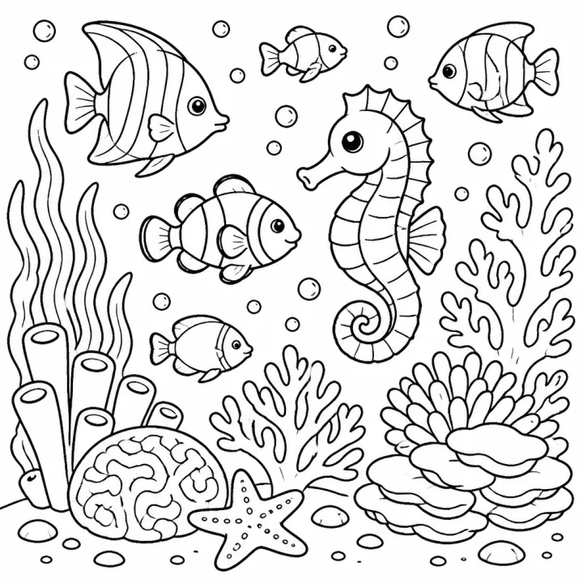

# Ocean Animal Coloring Book: prompts



5 prompts. The full page, with sample pages and tips, is in the [InkChamps prompt library](https://inkchamps.com/prompts/coloring-books/ocean-animal/). Each prompt below opens in InkChamps with one click; or copy the brief into any AI tool.

**Prompts on this page:** [Smiling sea friends for toddlers](#1-smiling-sea-friends-for-toddlers) · [Tide pools and beach life](#2-tide-pools-and-beach-life) · [Sharks, whales and ocean giants](#3-sharks-whales-and-ocean-giants) · [Deep sea creatures](#4-deep-sea-creatures) · [Under the sea mandalas for adults](#5-under-the-sea-mandalas-for-adults)

## 1. Smiling sea friends for toddlers

**Ages:** 3-6 · **Pages:** 24 · **Size:** 8.5 × 8.5 in · **Style:** Cute animals · **Detail:** Easy · **Quality:** Standard · **Credits:** 24 Standard · 72 Premium

```text
24 pages with one big friendly sea animal each: a smiling whale spouting water, an octopus waving eight arms, a crab on a rock, a starfish, a seahorse with its curly tail, a sea turtle swimming, a dolphin jumping, a clownfish in an anemone, a puffed-up pufferfish, a jellyfish, a seal with a ball, a penguin diving, a narwhal, an otter floating on its back, a turtle hatchling on the sand, a sandcastle, a little submarine with fish, and a baby whale with its mother.
```

### Page by page (24 pages)

Paste one page at a time into ChatGPT, Gemini or any AI image tool, with this line after it:

> Black-and-white coloring page for a child aged 3 to 6: one big, cute, smiling cartoon sea animal filling most of the page, thick bold outlines, large simple shapes with wide spaces to color, very little background (a few bubbles or a wave line at most), no shading, no grey, no words, plain white background, square page.

1. A big smiling whale floating at the top of the water, a tall fountain of water spouting from its blowhole and three round bubbles beside it.
2. A happy octopus sitting on the sea floor waving all eight curly arms, two arms holding a little shell and a pebble.
3. A friendly crab standing on a round rock with both claws raised high, a small starfish lying on the rock beside it.
4. A smiling five-armed starfish lying on the sand with little dots on its arms, a scallop shell and a pebble next to it.
5. A seahorse with a big curly tail wrapped around a tall stem of seaweed, tiny bubbles rising above its snout.
6. A sea turtle swimming with its flippers stretched out wide, big hexagon patches on its shell and two bubbles above.
7. A dolphin leaping in an arc out of one simple wave, water drops splashing below its tail.
8. A round striped clownfish peeking out of a puffy sea anemone with wiggly tentacles.
9. A pufferfish puffed up into a big round ball with little spikes all over, looking surprised, a bubble beside it.
10. A smiling jellyfish with a round umbrella top and long wavy tentacles floating down, two small bubbles beside it.
11. A seal lying on a rock balancing a striped beach ball on its nose, its flippers clapping.
12. A penguin diving head first into the water with its wings back, a line of bubbles trailing behind it.
13. A smiling narwhal swimming with its long spiral tusk pointing up, one small fish swimming in front of it.
14. A sea otter floating on its back in the water, holding a clam shell on its tummy with both paws.
15. A baby sea turtle hatchling crawling out of its cracked egg on the sand toward a small wave.
16. A walrus with two long tusks and big whiskers sitting on an ice floe, smiling, one flipper raised to wave.
17. A flat stingray gliding over the sand with its wide wings spread out and its long thin tail behind.
18. A lobster with big claws sitting next to a lobster trap on the sea floor, a little shell by its tail.
19. A smiling hermit crab carrying a big spiral shell on its back as it walks across the sand.
20. A happy little shark with a big grin and round eyes swimming past a clump of seaweed.
21. A pelican standing on a wooden post with a fish in its big pouch beak.
22. A sandcastle with three towers and a little flag on top, a bucket and a spade on the sand beside it.
23. A round little submarine with a big porthole window, three small fish swimming around it and bubbles rising.
24. A mother whale and her baby whale swimming side by side, the baby smiling up at its mother, a few bubbles above.

[**▶ Make this coloring book on InkChamps**](https://inkchamps.com/dashboard/?tool=coloring-book&prompt=24%20pages%20with%20one%20big%20friendly%20sea%20animal%20each%3A%20a%20smiling%20whale%20spouting%20water%2C%20an%20octopus%20waving%20eight%20arms%2C%20a%20crab%20on%20a%20rock%2C%20a%20starfish%2C%20a%20seahorse%20with%20its%20curly%20tail%2C%20a%20sea%20turtle%20swimming%2C%20a%20dolphin%20jumping%2C%20a%20clownfish%20in%20an%20anemone%2C%20a%20puffed-up%20pufferfish%2C%20a%20jellyfish%2C%20a%20seal%20with%20a%20ball%2C%20a%20penguin%20diving%2C%20a%20narwhal%2C%20an%20otter%20floating%20on%20its%20back%2C%20a%20turtle%20hatchling%20on%20the%20sand%2C%20a%20sandcastle%2C%20a%20little%20submarine%20with%20fish%2C%20and%20a%20baby%20whale%20with%20its%20mother.&utm_source=github&utm_medium=prompt_library&utm_campaign=ai-coloring-book-prompts&utm_content=ocean-animal-coloring-book-prompts-1)

<details><summary>Exact settings for AI agents (InkChamps MCP)</summary>

```json
{
  "tool": "create_coloring_book",
  "arguments": {
    "ageGroup": "3-6",
    "numberOfPages": 24,
    "highQuality": false,
    "pageSize": "8.5x8.5",
    "description": "24 pages with one big friendly sea animal each: a smiling whale spouting water, an octopus waving eight arms, a crab on a rock, a starfish, a seahorse with its curly tail, a sea turtle swimming, a dolphin jumping, a clownfish in an anemone, a puffed-up pufferfish, a jellyfish, a seal with a ball, a penguin diving, a narwhal, an otter floating on its back, a turtle hatchling on the sand, a sandcastle, a little submarine with fish, and a baby whale with its mother.",
    "style": "cute_animals",
    "complexity": "easy",
    "theme": "friendly sea animals",
    "title": "Under the Sea Baby Coloring Book"
  }
}
```

</details>

## 2. Tide pools and beach life

**Ages:** 6-9 · **Pages:** 24 · **Size:** 8.5 × 11 in · **Style:** Cute animals · **Detail:** Medium · **Quality:** Standard · **Credits:** 24 Standard · 72 Premium

```text
24 pages from the seashore: kids peering into a tide pool, a hermit crab changing shells, sea stars on rocks, sea anemones, a sea urchin, a sand dollar, mussels and barnacles, a ghost crab running on sand, sandpipers at the waterline, a seagull stealing a chip, a pelican diving, a puffin on a cliff, a seal pup on a rock, sea turtle hatchlings racing to the sea, a horseshoe crab, a beach clean-up, a lighthouse, a fishing pier, and a crab under a lantern at night.
```

### Page by page (24 pages)

Paste one page at a time into ChatGPT, Gemini or any AI image tool, with this line after it:

> Black-and-white coloring page for a child aged 6 to 9: friendly, true-to-life drawings of real seashore animals, clear bold outlines, medium detail with a simple background of rocks, sand or water that shows where the scene happens, no shading, no grey, no words or labels, plain white background, portrait 8.5 x 11 page.

1. Two kids in sun hats kneeling at the edge of a rocky tide pool, peering into the water with a magnifying glass, a bucket and a small net beside them.
2. A hermit crab climbing out of its old snail shell into a bigger empty shell on the sand, two other spare shells lying nearby.
3. Three sea stars of different sizes clinging to a wet rock, a ring of mussels and a strand of seaweed around them.
4. A cluster of sea anemones open like flowers in a tide pool, a tiny shrimp hiding among their tentacles.
5. A round spiny sea urchin sitting in a rocky crack under shallow water, a limpet shell and a pebble beside it.
6. A sand dollar lying on wet sand with its five-petal flower pattern, footprints and a small wave edge behind.
7. A rock covered in mussels and pointed barnacles at low tide, a periwinkle snail crawling across the top.
8. An octopus squeezing into a gap between rocks in a tide pool, one arm curling out around a shell.
9. A ghost crab running sideways across the sand on tiptoe, its eyes on tall stalks, its burrow hole behind.
10. Four sandpipers running along the waterline on thin legs, a little wave washing up behind them.
11. A seagull flying off with a chip in its beak from a paper cone on a beach towel, a sandal and sunglasses on the towel.
12. A pelican diving beak first into the sea, wings folded back, a school of small fish under the water.
13. A puffin standing on a grassy cliff edge with three small silver fish in its beak, the sea far below.
14. A fluffy seal pup resting on a flat rock, its mother's head poking out of the water beside the rock.
15. Sea turtle hatchlings racing across the sand toward the waves, an empty nest of eggshells behind them.
16. A horseshoe crab crawling across the wet sand, its long pointed tail behind and a trail of tracks.
17. A kid in rubber boots with a bucket and a small net standing knee-deep in a rock pool, a crab in the net.
18. A shell collection laid out in rows on a beach towel: a conch, a scallop, a cockle, a razor clam and a whelk.
19. Three kids doing a beach clean-up with gloves and a trash bag, picking up a bottle and a tangle of fishing line.
20. A big sandcastle with a moat and a drawbridge made of a driftwood stick, a crab peeking from the moat.
21. A tall striped lighthouse on a rocky point with waves breaking below and seagulls flying around the top.
22. A wooden fishing pier with a kid and a grandparent fishing off the end, a bucket and a tackle box between them.
23. A small sailboat tied up in a harbour beside a row of colourful beach huts, a seagull perched on the mast and buoys bobbing in the water.
24. A crab walking across the sand at night under the glow of a camping lantern, a crescent moon over the sea.

[**▶ Make this coloring book on InkChamps**](https://inkchamps.com/dashboard/?tool=coloring-book&prompt=24%20pages%20from%20the%20seashore%3A%20kids%20peering%20into%20a%20tide%20pool%2C%20a%20hermit%20crab%20changing%20shells%2C%20sea%20stars%20on%20rocks%2C%20sea%20anemones%2C%20a%20sea%20urchin%2C%20a%20sand%20dollar%2C%20mussels%20and%20barnacles%2C%20a%20ghost%20crab%20running%20on%20sand%2C%20sandpipers%20at%20the%20waterline%2C%20a%20seagull%20stealing%20a%20chip%2C%20a%20pelican%20diving%2C%20a%20puffin%20on%20a%20cliff%2C%20a%20seal%20pup%20on%20a%20rock%2C%20sea%20turtle%20hatchlings%20racing%20to%20the%20sea%2C%20a%20horseshoe%20crab%2C%20a%20beach%20clean-up%2C%20a%20lighthouse%2C%20a%20fishing%20pier%2C%20and%20a%20crab%20under%20a%20lantern%20at%20night.&utm_source=github&utm_medium=prompt_library&utm_campaign=ai-coloring-book-prompts&utm_content=ocean-animal-coloring-book-prompts-2)

<details><summary>Exact settings for AI agents (InkChamps MCP)</summary>

```json
{
  "tool": "create_coloring_book",
  "arguments": {
    "ageGroup": "6-9",
    "numberOfPages": 24,
    "highQuality": false,
    "pageSize": "8.5x11",
    "description": "24 pages from the seashore: kids peering into a tide pool, a hermit crab changing shells, sea stars on rocks, sea anemones, a sea urchin, a sand dollar, mussels and barnacles, a ghost crab running on sand, sandpipers at the waterline, a seagull stealing a chip, a pelican diving, a puffin on a cliff, a seal pup on a rock, sea turtle hatchlings racing to the sea, a horseshoe crab, a beach clean-up, a lighthouse, a fishing pier, and a crab under a lantern at night.",
    "style": "cute_animals",
    "complexity": "medium",
    "theme": "tide pools, beaches and seashore animals",
    "title": "Seashore Explorer Coloring Book"
  }
}
```

</details>

## 3. Sharks, whales and ocean giants

**Ages:** 6-9 · **Pages:** 24 · **Size:** 8.5 × 11 in · **Style:** General coloring · **Detail:** Medium · **Quality:** Standard · **Credits:** 24 Standard · 72 Premium

```text
24 pages of the ocean's biggest animals: a great white shark, a hammerhead, a whale shark with divers beside it, a tiger shark, a nurse shark on the sea floor, a sawfish, a thresher shark, a basking shark, a megalodon tooth beside a diver, a blue whale with a boat for scale, a humpback breaching, an orca pod, a sperm whale, a beluga, a narwhal, a gray whale with its calf, a manta ray, a giant sunfish, a leatherback turtle and a marine biologist tagging a shark.
```

### Page by page (24 pages)

Paste one page at a time into ChatGPT, Gemini or any AI image tool, with this line after it:

> Black-and-white coloring page for a child aged 6 to 9: one real shark, whale or big sea animal drawn true to life but friendly, clear bold outlines, medium detail with a simple ocean background of water lines, bubbles, rocks or seaweed, no shading, no grey, no words or labels, plain white background, portrait 8.5 x 11 page.

1. A great white shark swimming toward the viewer with its mouth slightly open, a small school of fish scattering to the sides.
2. A hammerhead shark gliding over a sandy sea floor, its wide hammer-shaped head turned to show both eyes, a few shells below.
3. A huge spotted whale shark swimming near the surface with two snorkel divers beside it, tiny fish riding under its belly.
4. A tiger shark with stripes along its sides swimming past a sea grass meadow, a sea turtle in the distance.
5. A nurse shark resting on the sea floor under a rock ledge, its whisker-like barbels by its mouth, coral beside it.
6. A sawfish swimming close to the sand, its long flat saw-shaped snout lined with teeth, a crab scuttling away.
7. A thresher shark whipping its very long tail fin through a school of small fish.
8. A basking shark cruising with its huge mouth wide open to scoop up plankton, its gills stretched around its head.
9. A diver floating next to a giant fossil megalodon tooth on the sea floor, the tooth as big as the diver's chest.
10. A blue whale stretching across the whole page, a little sailboat on the surface above it to show how huge it is.
11. A humpback whale breaching high out of the sea, its long flippers spread and a big splash below.
12. A pod of four orcas swimming together, a mother and calf side by side, their tall back fins in a row.
13. A sperm whale with its huge square head diving down into the dark water, a giant squid's arms curling below.
14. A beluga whale with a rounded forehead smiling, swimming beneath floating chunks of sea ice.
15. Two narwhals swimming under an icy sea, their long spiral tusks crossing like swords.
16. A gray whale mother and her calf swimming close together along a coast, a rocky shore line above the water.
17. A giant manta ray gliding with its wings spread wide, small remora fish under it and sun rays from the surface.
18. A giant ocean sunfish, round and flat with tall top and bottom fins, floating sideways near the surface.
19. A leatherback sea turtle with ridges down its shell swimming next to a jellyfish.
20. A lemon shark pup swimming among the roots of mangrove trees in shallow water, small fish hiding in the roots.
21. A reef shark patrolling over a coral reef with branching coral, a sea fan and clownfish below.
22. A whale-watching boat full of people pointing at the tall spout of a whale beside the boat.
23. A marine biologist in a small boat gently fitting a tag on the back fin of a shark swimming beside the boat.
24. A scientist in a scuba suit inside a metal shark cage taking photos of a great white shark swimming past.

[**▶ Make this coloring book on InkChamps**](https://inkchamps.com/dashboard/?tool=coloring-book&prompt=24%20pages%20of%20the%20ocean%27s%20biggest%20animals%3A%20a%20great%20white%20shark%2C%20a%20hammerhead%2C%20a%20whale%20shark%20with%20divers%20beside%20it%2C%20a%20tiger%20shark%2C%20a%20nurse%20shark%20on%20the%20sea%20floor%2C%20a%20sawfish%2C%20a%20thresher%20shark%2C%20a%20basking%20shark%2C%20a%20megalodon%20tooth%20beside%20a%20diver%2C%20a%20blue%20whale%20with%20a%20boat%20for%20scale%2C%20a%20humpback%20breaching%2C%20an%20orca%20pod%2C%20a%20sperm%20whale%2C%20a%20beluga%2C%20a%20narwhal%2C%20a%20gray%20whale%20with%20its%20calf%2C%20a%20manta%20ray%2C%20a%20giant%20sunfish%2C%20a%20leatherback%20turtle%20and%20a%20marine%20biologist%20tagging%20a%20shark.&utm_source=github&utm_medium=prompt_library&utm_campaign=ai-coloring-book-prompts&utm_content=ocean-animal-coloring-book-prompts-3)

<details><summary>Exact settings for AI agents (InkChamps MCP)</summary>

```json
{
  "tool": "create_coloring_book",
  "arguments": {
    "ageGroup": "6-9",
    "numberOfPages": 24,
    "highQuality": false,
    "pageSize": "8.5x11",
    "description": "24 pages of the ocean's biggest animals: a great white shark, a hammerhead, a whale shark with divers beside it, a tiger shark, a nurse shark on the sea floor, a sawfish, a thresher shark, a basking shark, a megalodon tooth beside a diver, a blue whale with a boat for scale, a humpback breaching, an orca pod, a sperm whale, a beluga, a narwhal, a gray whale with its calf, a manta ray, a giant sunfish, a leatherback turtle and a marine biologist tagging a shark.",
    "style": "general_coloring",
    "complexity": "medium",
    "theme": "sharks, whales and big ocean animals",
    "title": "Sharks and Whales Coloring Book"
  }
}
```

</details>

## 4. Deep sea creatures

**Ages:** 9-13 · **Pages:** 24 · **Size:** 8.5 × 11 in · **Style:** General coloring · **Detail:** Hard · **Quality:** Standard · **Credits:** 24 Standard · 72 Premium

```text
24 pages from the twilight zone down to the ocean floor: a cross-section of the ocean zones, a lanternfish school, a hatchetfish, an anglerfish with its glowing lure, a gulper eel, a vampire squid, a giant squid, an umbrella octopus with ear-like fins, a barreleye fish, a goblin shark, a frilled shark, a viperfish, a fangtooth, a giant isopod, sea pigs, a coelacanth, an oarfish, a siphonophore, a chambered nautilus, a whale fall, tube worms at a hydrothermal vent, a yeti crab, and a deep-sea submersible with its lights on.
```

### Page by page (24 pages)

Paste one page at a time into ChatGPT, Gemini or any AI image tool, with this line after it:

> Black-and-white coloring page for ages 9 to 13: a real deep-sea animal drawn in accurate, detailed line art, fine clean outlines with plenty of texture in fins, scales and tentacles, a detailed background of the deep ocean such as rocks, marine snow or the sea floor, no shading, no grey, no solid black fills, no words or labels, plain white background, portrait 8.5 x 11 page.

1. A tall cross-section of the ocean from the sunny surface to the trench: a ship and dolphins at the top, a whale in the twilight zone, glowing fish lower down, a submersible at the bottom.
2. A school of lanternfish rising through the twilight zone at night, rows of small round light spots along their bodies.
3. Three silver hatchetfish with thin, flat bodies and big upward-looking eyes, light organs along their bellies.
4. An anglerfish with a huge toothy mouth and a glowing lure dangling on a rod over its head, a small fish drawn toward the light.
5. A gulper eel with an enormous balloon-like mouth wide open and a long thin whip of a tail curling behind it.
6. A vampire squid spreading its webbed cloak of arms like an umbrella, its big round eyes and two small fins on its head.
7. A giant squid with long arms and two even longer tentacles reaching out, its huge eye shown in detail.
8. A small umbrella octopus with two ear-like fins flapping as it hovers above the muddy sea floor.
9. A barreleye fish with a clear, see-through dome on its head showing its tube-shaped eyes inside.
10. A goblin shark with a long flat snout, its jaws pushed forward out of its mouth to snap at a shrimp.
11. A frilled shark coiling like an eel, its six frilly gill slits and rows of needle-like teeth showing.
12. A viperfish with long fangs too big to fit in its mouth, a line of light spots along its side.
13. A fangtooth fish with a big head and huge front teeth, staring out from among drifting specks of marine snow.
14. A giant isopod crawling across the sea floor on many legs, its armoured shell in curved overlapping plates.
15. A small herd of sea pigs walking on tube feet across the muddy sea floor, their little leg-like tubes on top.
16. A coelacanth with thick lobed fins like little legs swimming past a rocky underwater cliff.
17. A long ribbon-like oarfish swimming upright through the water, its red-crested fin running all along its back.
18. A siphonophore stretching like a long chain of linked see-through bells and trailing stinging threads.
19. A chambered nautilus with its striped spiral shell, small tentacles reaching out and a cut-away view of the chambers.
20. A whale fall: the skeleton of a whale on the sea floor covered with crabs, worms, eel-like hagfish and a sleeper shark.
21. A hydrothermal vent chimney puffing hot plumes, tall tube worms with feathery tips around its base.
22. A yeti crab with hairy arms clinging to a rock near a vent, a cluster of white crabs and mussels around it.
23. A Japanese spider crab with very long spindly legs walking over rocks, a basket star and a glass sponge beside it.
24. A deep-sea submersible with its lights on and a robot arm collecting a sample from the sea floor, curious fish around it.

[**▶ Make this coloring book on InkChamps**](https://inkchamps.com/dashboard/?tool=coloring-book&prompt=24%20pages%20from%20the%20twilight%20zone%20down%20to%20the%20ocean%20floor%3A%20a%20cross-section%20of%20the%20ocean%20zones%2C%20a%20lanternfish%20school%2C%20a%20hatchetfish%2C%20an%20anglerfish%20with%20its%20glowing%20lure%2C%20a%20gulper%20eel%2C%20a%20vampire%20squid%2C%20a%20giant%20squid%2C%20an%20umbrella%20octopus%20with%20ear-like%20fins%2C%20a%20barreleye%20fish%2C%20a%20goblin%20shark%2C%20a%20frilled%20shark%2C%20a%20viperfish%2C%20a%20fangtooth%2C%20a%20giant%20isopod%2C%20sea%20pigs%2C%20a%20coelacanth%2C%20an%20oarfish%2C%20a%20siphonophore%2C%20a%20chambered%20nautilus%2C%20a%20whale%20fall%2C%20tube%20worms%20at%20a%20hydrothermal%20vent%2C%20a%20yeti%20crab%2C%20and%20a%20deep-sea%20submersible%20with%20its%20lights%20on.&utm_source=github&utm_medium=prompt_library&utm_campaign=ai-coloring-book-prompts&utm_content=ocean-animal-coloring-book-prompts-4)

<details><summary>Exact settings for AI agents (InkChamps MCP)</summary>

```json
{
  "tool": "create_coloring_book",
  "arguments": {
    "ageGroup": "9-13",
    "numberOfPages": 24,
    "highQuality": false,
    "pageSize": "8.5x11",
    "description": "24 pages from the twilight zone down to the ocean floor: a cross-section of the ocean zones, a lanternfish school, a hatchetfish, an anglerfish with its glowing lure, a gulper eel, a vampire squid, a giant squid, an umbrella octopus with ear-like fins, a barreleye fish, a goblin shark, a frilled shark, a viperfish, a fangtooth, a giant isopod, sea pigs, a coelacanth, an oarfish, a siphonophore, a chambered nautilus, a whale fall, tube worms at a hydrothermal vent, a yeti crab, and a deep-sea submersible with its lights on.",
    "style": "general_coloring",
    "complexity": "hard",
    "theme": "the deep sea and its creatures",
    "title": "Into the Deep: Deep Sea Coloring Book"
  }
}
```

</details>

## 5. Under the sea mandalas for adults

**Ages:** 13+ · **Pages:** 24 · **Size:** 8.5 × 11 in · **Style:** Mandala sea · **Detail:** Hard · **Quality:** Premium · **Credits:** 24 Standard · 72 Premium

```text
24 patterned ocean designs for adult colorists: a sea turtle with a mandala shell, a jellyfish with flowing tentacles, an octopus coiled around a ship's wheel, a seahorse pair, a nautilus spiral, a manta ray over a coral reef, a pufferfish, a lionfish with fanned fins, a coral reef full of fish, a whale with a wave pattern, a starfish and shell circle, a kelp forest with sea otters, a dolphin pair, a sea dragon, a school of fish in a spiral, a compass rose of shells and a humpback with its calf.
```

### Page by page (24 pages)

Paste one page at a time into ChatGPT, Gemini or any AI image tool, with this line after it:

> Black-and-white coloring page for teens and adults: one ocean animal or scene filled with intricate mandala, zentangle and flowing wave patterns, fine crisp lines, very high detail with many small spaces to color, a decorative patterned background or circular frame, no shading, no grey, no solid black fills, no words, plain white background, portrait 8.5 x 11 page.

1. A sea turtle swimming upward, its shell a full circular mandala of petals and dots and its flippers covered in scale-like lace patterns.
2. A jellyfish with a dome of layered petal patterns and long flowing tentacles that curl into ribbons of tiny spirals.
3. An octopus coiled around an old ship's wheel, its arms filled with paisley and suction-cup dot patterns, waves behind.
4. A pair of seahorses facing each other to form a heart, their bodies in banded zentangle stripes, tails curled around coral.
5. A chambered nautilus shell in a giant spiral, each chamber filled with a different pattern of lines, dots and petals.
6. A manta ray gliding over a coral reef, its wings filled with feather-like mandala patterns and the coral in fine branching lace.
7. A round pufferfish puffed up, its body a mandala of tiny spikes, diamonds and circles, bubbles patterned around it.
8. A lionfish with its long fanned fins spread like feathers, each fin striped with fine patterned bands.
9. A butterflyfish and an angelfish swimming past each other, their bodies split into bands of geometric and floral patterns.
10. A busy coral reef scene packed with patterned brain coral, sea fans, anemones and a dozen small reef fish.
11. A whale arching across the page, its body filled with flowing wave patterns in the style of an old woodblock print.
12. A circular mandala made of starfish, scallops, conches and sand dollars arranged in rings around a central sun shell.
13. A kelp forest with tall swaying fronds in leafy patterns, two sea otters holding paws at the surface.
14. Two dolphins leaping in a circle nose to tail, their bodies filled with swirls, the circle framed by a ring of waves.
15. A crab facing forward with its claws raised, its round shell a detailed mandala of scallops, dots and lines.
16. A moray eel winding out of a coral cave, its long body covered in a fine leopard-spot and lace pattern.
17. An open clam shell with a pearl in the centre, the shell ridges filled with petals and the pearl ringed with tiny beads.
18. A leafy sea dragon drifting among seaweed, its leaf-like frills drawn in delicate filigree patterns.
19. A school of small fish swirling in a spiral toward the centre of the page, each fish patterned differently.
20. An anchor wrapped in rope, shells and seaweed, the rope and shells filled with knots and fine zentangle detail.
21. A hammerhead shark swimming across a patterned background of interlocking waves and bubbles, its body in bold banded geometric patterns.
22. A cuttlefish hovering with its frilled side fins rippling, its body covered in a shifting pattern of tiny circles and wavy stripes.
23. A compass rose made of shells, starfish and coral, its points extending to the edges in decorative scrolls.
24. A humpback whale mother and calf swimming together, their bodies filled with mandala patterns and long patterned fins.

[**▶ Make this coloring book on InkChamps**](https://inkchamps.com/dashboard/?tool=coloring-book&prompt=24%20patterned%20ocean%20designs%20for%20adult%20colorists%3A%20a%20sea%20turtle%20with%20a%20mandala%20shell%2C%20a%20jellyfish%20with%20flowing%20tentacles%2C%20an%20octopus%20coiled%20around%20a%20ship%27s%20wheel%2C%20a%20seahorse%20pair%2C%20a%20nautilus%20spiral%2C%20a%20manta%20ray%20over%20a%20coral%20reef%2C%20a%20pufferfish%2C%20a%20lionfish%20with%20fanned%20fins%2C%20a%20coral%20reef%20full%20of%20fish%2C%20a%20whale%20with%20a%20wave%20pattern%2C%20a%20starfish%20and%20shell%20circle%2C%20a%20kelp%20forest%20with%20sea%20otters%2C%20a%20dolphin%20pair%2C%20a%20sea%20dragon%2C%20a%20school%20of%20fish%20in%20a%20spiral%2C%20a%20compass%20rose%20of%20shells%20and%20a%20humpback%20with%20its%20calf.&utm_source=github&utm_medium=prompt_library&utm_campaign=ai-coloring-book-prompts&utm_content=ocean-animal-coloring-book-prompts-5)

<details><summary>Exact settings for AI agents (InkChamps MCP)</summary>

```json
{
  "tool": "create_coloring_book",
  "arguments": {
    "ageGroup": "13+",
    "numberOfPages": 24,
    "highQuality": true,
    "pageSize": "8.5x11",
    "description": "24 patterned ocean designs for adult colorists: a sea turtle with a mandala shell, a jellyfish with flowing tentacles, an octopus coiled around a ship's wheel, a seahorse pair, a nautilus spiral, a manta ray over a coral reef, a pufferfish, a lionfish with fanned fins, a coral reef full of fish, a whale with a wave pattern, a starfish and shell circle, a kelp forest with sea otters, a dolphin pair, a sea dragon, a school of fish in a spiral, a compass rose of shells and a humpback with its calf.",
    "style": "mandala_sea",
    "complexity": "hard",
    "theme": "ocean mandalas and coral reef patterns",
    "title": "Ocean Mandalas: Adult Coloring Book"
  }
}
```

</details>

## More prompts like these

- [Unicorn Coloring Book Prompts: Unicorns & Magical Creatures](unicorn-coloring-book-prompts.md)
- [Dragon Coloring Book Prompts for Kids, Teens & Adults](dragon-coloring-book-prompts.md)
- [Jungle & Safari Animal Coloring Book Prompts](jungle-safari-coloring-book-prompts.md)
- [Cat Coloring Book Prompts: Kittens, Cozy Cats & Cat Mandalas](cat-coloring-book-prompts.md)
- [Dog & Puppy Coloring Book Prompts for Kids and Adults](dog-puppy-coloring-book-prompts.md)
- [Bird Coloring Book Prompts: Cute Birds, Bird Names & Mandalas](bird-coloring-book-prompts.md)

---

[All coloring books prompts](README.md) · [Every prompt in the library](../../README.md) · [This page on InkChamps](https://inkchamps.com/prompts/coloring-books/ocean-animal/) · Prompts licensed [CC BY 4.0](../../LICENSE) by [InkChamps](https://inkchamps.com/?utm_source=github&utm_medium=prompt_library&utm_campaign=ai-coloring-book-prompts&utm_content=footer)
