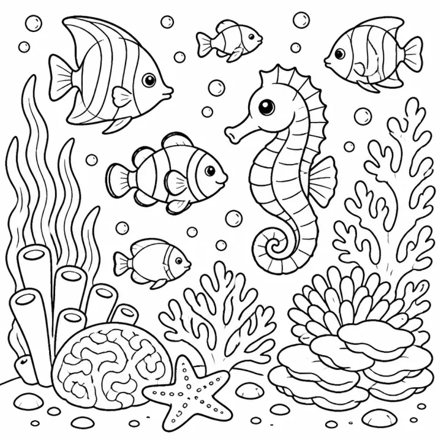

# Ocean Animal Coloring Book: prompts



5 prompts. The full page, with sample pages and tips, is in the [InkChamps prompt library](https://inkchamps.com/prompts/coloring-books/ocean-animal/). Each prompt below opens in InkChamps with one click; or copy the brief into any AI tool.

**Prompts on this page:** [Smiling sea friends for toddlers](#1-smiling-sea-friends-for-toddlers) · [Tide pools and beach life](#2-tide-pools-and-beach-life) · [Sharks, whales and ocean giants](#3-sharks-whales-and-ocean-giants) · [Deep sea creatures](#4-deep-sea-creatures) · [Under the sea mandalas for adults](#5-under-the-sea-mandalas-for-adults)

## 1. Smiling sea friends for toddlers

**Ages:** 3-6 · **Pages:** 40 · **Size:** 8.5 × 8.5 in · **Style:** Cute animals · **Detail:** Easy · **Quality:** Standard · **Credits:** 40 Standard · 120 Premium

```text
Forty pages with one big friendly sea animal each: a smiling whale spouting water, an octopus waving eight arms, a crab on a rock, a starfish, a seahorse with its curly tail, a sea turtle swimming, a dolphin jumping, a striped clownfish in an anemone, a pufferfish puffed up, a jellyfish, a stingray, a walrus, a seal with a ball, a penguin diving, a lobster, a snail shell, and a baby whale with its mother.
```

**Extra direction:** More pages: a narwhal, an otter floating on its back, a sea lion, an orca, a shark with a big grin, a squid, a crab family, a turtle hatchling on the sand, a fish with bubbles, a manatee, a pelican on a post, a seagull, a shell bucket, a sandcastle, a little submarine with fish around it.

[**▶ Make this coloring book on InkChamps**](https://inkchamps.com/dashboard/?tool=coloring-book&prompt=Forty%20pages%20with%20one%20big%20friendly%20sea%20animal%20each%3A%20a%20smiling%20whale%20spouting%20water%2C%20an%20octopus%20waving%20eight%20arms%2C%20a%20crab%20on%20a%20rock%2C%20a%20starfish%2C%20a%20seahorse%20with%20its%20curly%20tail%2C%20a%20sea%20turtle%20swimming%2C%20a%20dolphin%20jumping%2C%20a%20striped%20clownfish%20in%20an%20anemone%2C%20a%20pufferfish%20puffed%20up%2C%20a%20jellyfish%2C%20a%20stingray%2C%20a%20walrus%2C%20a%20seal%20with%20a%20ball%2C%20a%20penguin%20diving%2C%20a%20lobster%2C%20a%20snail%20shell%2C%20and%20a%20baby%20whale%20with%20its%20mother.&utm_source=github&utm_medium=prompt_library&utm_campaign=ai-coloring-book-prompts&utm_content=ocean-animal-coloring-book-prompts-1)

<details><summary>Exact settings for AI agents (InkChamps MCP)</summary>

```json
{
  "tool": "create_coloring_book",
  "arguments": {
    "ageGroup": "3-6",
    "numberOfPages": 40,
    "highQuality": false,
    "pageSize": "8.5x8.5",
    "description": "Forty pages with one big friendly sea animal each: a smiling whale spouting water, an octopus waving eight arms, a crab on a rock, a starfish, a seahorse with its curly tail, a sea turtle swimming, a dolphin jumping, a striped clownfish in an anemone, a pufferfish puffed up, a jellyfish, a stingray, a walrus, a seal with a ball, a penguin diving, a lobster, a snail shell, and a baby whale with its mother.",
    "style": "cute_animals",
    "complexity": "easy",
    "theme": "friendly sea animals",
    "title": "Under the Sea Baby Coloring Book",
    "additionalInstructions": "More pages: a narwhal, an otter floating on its back, a sea lion, an orca, a shark with a big grin, a squid, a crab family, a turtle hatchling on the sand, a fish with bubbles, a manatee, a pelican on a post, a seagull, a shell bucket, a sandcastle, a little submarine with fish around it."
  }
}
```

</details>

## 2. Tide pools and beach life

**Ages:** 6-9 · **Pages:** 40 · **Size:** 8.5 × 11 in · **Style:** Cute animals · **Detail:** Medium · **Quality:** Standard · **Credits:** 40 Standard · 120 Premium

```text
Forty pages from the seashore: kids peering into a tide pool, a hermit crab changing shells, sea stars on rocks, sea anemones, a sea urchin, a sand dollar, mussels and barnacles, a ghost crab running on sand, sandpipers at the waterline, a seagull stealing a chip, a pelican diving, a puffin on a cliff, a seal pup on a rock, sea turtle hatchlings racing to the sea, a lighthouse, and a fishing pier.
```

**Extra direction:** More pages: a beach clean-up, a kelp forest from the shore, a shell collection laid out on a towel, a kid with a bucket and net, an octopus hiding in a rock pool, a horseshoe crab, a rockpool blenny fish, a jellyfish washed up, a beach hut row, a surfer, a sandcastle with a moat, a boardwalk, a sailboat in a harbour, a whale tail seen from a boat, a crab under a lantern at night.

[**▶ Make this coloring book on InkChamps**](https://inkchamps.com/dashboard/?tool=coloring-book&prompt=Forty%20pages%20from%20the%20seashore%3A%20kids%20peering%20into%20a%20tide%20pool%2C%20a%20hermit%20crab%20changing%20shells%2C%20sea%20stars%20on%20rocks%2C%20sea%20anemones%2C%20a%20sea%20urchin%2C%20a%20sand%20dollar%2C%20mussels%20and%20barnacles%2C%20a%20ghost%20crab%20running%20on%20sand%2C%20sandpipers%20at%20the%20waterline%2C%20a%20seagull%20stealing%20a%20chip%2C%20a%20pelican%20diving%2C%20a%20puffin%20on%20a%20cliff%2C%20a%20seal%20pup%20on%20a%20rock%2C%20sea%20turtle%20hatchlings%20racing%20to%20the%20sea%2C%20a%20lighthouse%2C%20and%20a%20fishing%20pier.&utm_source=github&utm_medium=prompt_library&utm_campaign=ai-coloring-book-prompts&utm_content=ocean-animal-coloring-book-prompts-2)

<details><summary>Exact settings for AI agents (InkChamps MCP)</summary>

```json
{
  "tool": "create_coloring_book",
  "arguments": {
    "ageGroup": "6-9",
    "numberOfPages": 40,
    "highQuality": false,
    "pageSize": "8.5x11",
    "description": "Forty pages from the seashore: kids peering into a tide pool, a hermit crab changing shells, sea stars on rocks, sea anemones, a sea urchin, a sand dollar, mussels and barnacles, a ghost crab running on sand, sandpipers at the waterline, a seagull stealing a chip, a pelican diving, a puffin on a cliff, a seal pup on a rock, sea turtle hatchlings racing to the sea, a lighthouse, and a fishing pier.",
    "style": "cute_animals",
    "complexity": "medium",
    "theme": "tide pools, beaches and seashore animals",
    "title": "Seashore Explorer Coloring Book",
    "additionalInstructions": "More pages: a beach clean-up, a kelp forest from the shore, a shell collection laid out on a towel, a kid with a bucket and net, an octopus hiding in a rock pool, a horseshoe crab, a rockpool blenny fish, a jellyfish washed up, a beach hut row, a surfer, a sandcastle with a moat, a boardwalk, a sailboat in a harbour, a whale tail seen from a boat, a crab under a lantern at night."
  }
}
```

</details>

## 3. Sharks, whales and ocean giants

**Ages:** 6-9 · **Pages:** 40 · **Size:** 8.5 × 11 in · **Style:** General coloring · **Detail:** Medium · **Quality:** Standard · **Credits:** 40 Standard · 120 Premium

```text
Forty pages of the ocean's biggest animals: a great white shark, a hammerhead, a whale shark with divers beside it, a tiger shark, a nurse shark on the sea floor, a sawfish, a megalodon tooth beside a diver, a blue whale with a boat for scale, a humpback breaching, an orca pod, a sperm whale, a beluga, a narwhal, a gray whale with its calf, a manta ray, a giant oceanic sunfish, and a leatherback turtle.
```

**Extra direction:** More pages: a mako shark chasing fish, a goblin shark, a basking shark with its mouth open, a lemon shark in mangroves, a bull shark in a river, a thresher shark with its long tail, a reef shark among coral, a shark egg case, a minke whale, a bowhead whale under ice, a pilot whale, a humpback tail at sunset, a whale-watching boat, a marine biologist tagging a shark, a scientist in a shark cage.

[**▶ Make this coloring book on InkChamps**](https://inkchamps.com/dashboard/?tool=coloring-book&prompt=Forty%20pages%20of%20the%20ocean%27s%20biggest%20animals%3A%20a%20great%20white%20shark%2C%20a%20hammerhead%2C%20a%20whale%20shark%20with%20divers%20beside%20it%2C%20a%20tiger%20shark%2C%20a%20nurse%20shark%20on%20the%20sea%20floor%2C%20a%20sawfish%2C%20a%20megalodon%20tooth%20beside%20a%20diver%2C%20a%20blue%20whale%20with%20a%20boat%20for%20scale%2C%20a%20humpback%20breaching%2C%20an%20orca%20pod%2C%20a%20sperm%20whale%2C%20a%20beluga%2C%20a%20narwhal%2C%20a%20gray%20whale%20with%20its%20calf%2C%20a%20manta%20ray%2C%20a%20giant%20oceanic%20sunfish%2C%20and%20a%20leatherback%20turtle.&utm_source=github&utm_medium=prompt_library&utm_campaign=ai-coloring-book-prompts&utm_content=ocean-animal-coloring-book-prompts-3)

<details><summary>Exact settings for AI agents (InkChamps MCP)</summary>

```json
{
  "tool": "create_coloring_book",
  "arguments": {
    "ageGroup": "6-9",
    "numberOfPages": 40,
    "highQuality": false,
    "pageSize": "8.5x11",
    "description": "Forty pages of the ocean's biggest animals: a great white shark, a hammerhead, a whale shark with divers beside it, a tiger shark, a nurse shark on the sea floor, a sawfish, a megalodon tooth beside a diver, a blue whale with a boat for scale, a humpback breaching, an orca pod, a sperm whale, a beluga, a narwhal, a gray whale with its calf, a manta ray, a giant oceanic sunfish, and a leatherback turtle.",
    "style": "general_coloring",
    "complexity": "medium",
    "theme": "sharks, whales and big ocean animals",
    "title": "Sharks and Whales Coloring Book",
    "additionalInstructions": "More pages: a mako shark chasing fish, a goblin shark, a basking shark with its mouth open, a lemon shark in mangroves, a bull shark in a river, a thresher shark with its long tail, a reef shark among coral, a shark egg case, a minke whale, a bowhead whale under ice, a pilot whale, a humpback tail at sunset, a whale-watching boat, a marine biologist tagging a shark, a scientist in a shark cage."
  }
}
```

</details>

## 4. Deep sea creatures

**Ages:** 9-13 · **Pages:** 40 · **Size:** 8.5 × 11 in · **Style:** General coloring · **Detail:** Hard · **Quality:** Standard · **Credits:** 40 Standard · 120 Premium

```text
Forty pages from the twilight zone down to the ocean floor: an anglerfish with its glowing lure, a gulper eel, a vampire squid, a giant squid, a dumbo octopus, a barreleye fish, a goblin shark, a frilled shark, a viperfish, a hatchetfish, a lanternfish school, a giant isopod, a sea pig, a coelacanth, an oarfish, a siphonophore, a comb jelly, tube worms at a hydrothermal vent, and a deep-sea submersible with its lights on.
```

**Extra direction:** More pages: a whale fall on the sea floor, a remote-controlled robot sub collecting samples, a shipwreck covered in coral, a yeti crab, a Japanese spider crab, a black swallower, a fangtooth, a sea angel, a chambered nautilus, a giant tube worm field, a basket star, a glass sponge, a deep-sea dragonfish, a dive team on a research ship, a cross-section of ocean zones from surface to trench.

[**▶ Make this coloring book on InkChamps**](https://inkchamps.com/dashboard/?tool=coloring-book&prompt=Forty%20pages%20from%20the%20twilight%20zone%20down%20to%20the%20ocean%20floor%3A%20an%20anglerfish%20with%20its%20glowing%20lure%2C%20a%20gulper%20eel%2C%20a%20vampire%20squid%2C%20a%20giant%20squid%2C%20a%20dumbo%20octopus%2C%20a%20barreleye%20fish%2C%20a%20goblin%20shark%2C%20a%20frilled%20shark%2C%20a%20viperfish%2C%20a%20hatchetfish%2C%20a%20lanternfish%20school%2C%20a%20giant%20isopod%2C%20a%20sea%20pig%2C%20a%20coelacanth%2C%20an%20oarfish%2C%20a%20siphonophore%2C%20a%20comb%20jelly%2C%20tube%20worms%20at%20a%20hydrothermal%20vent%2C%20and%20a%20deep-sea%20submersible%20with%20its%20lights%20on.&utm_source=github&utm_medium=prompt_library&utm_campaign=ai-coloring-book-prompts&utm_content=ocean-animal-coloring-book-prompts-4)

<details><summary>Exact settings for AI agents (InkChamps MCP)</summary>

```json
{
  "tool": "create_coloring_book",
  "arguments": {
    "ageGroup": "9-13",
    "numberOfPages": 40,
    "highQuality": false,
    "pageSize": "8.5x11",
    "description": "Forty pages from the twilight zone down to the ocean floor: an anglerfish with its glowing lure, a gulper eel, a vampire squid, a giant squid, a dumbo octopus, a barreleye fish, a goblin shark, a frilled shark, a viperfish, a hatchetfish, a lanternfish school, a giant isopod, a sea pig, a coelacanth, an oarfish, a siphonophore, a comb jelly, tube worms at a hydrothermal vent, and a deep-sea submersible with its lights on.",
    "style": "general_coloring",
    "complexity": "hard",
    "theme": "the deep sea and its creatures",
    "title": "Into the Deep: Deep Sea Coloring Book",
    "additionalInstructions": "More pages: a whale fall on the sea floor, a remote-controlled robot sub collecting samples, a shipwreck covered in coral, a yeti crab, a Japanese spider crab, a black swallower, a fangtooth, a sea angel, a chambered nautilus, a giant tube worm field, a basket star, a glass sponge, a deep-sea dragonfish, a dive team on a research ship, a cross-section of ocean zones from surface to trench."
  }
}
```

</details>

## 5. Under the sea mandalas for adults

**Ages:** 13+ · **Pages:** 40 · **Size:** 8.5 × 11 in · **Style:** Mandala sea · **Detail:** Hard · **Quality:** Premium · **Credits:** 40 Standard · 120 Premium

```text
Forty patterned ocean designs for adult colorists: a sea turtle with a mandala shell, a jellyfish with flowing tentacles, an octopus coiled around a ship's wheel, a seahorse pair, a nautilus spiral, a manta ray over a coral reef, a pufferfish, a lionfish with fanned fins, a butterflyfish, a coral reef full of reef fish, a whale with a wave pattern, a starfish and shell circle, and a kelp forest with sea otters.
```

**Extra direction:** More pages: a dolphin pair in a circle, a crab with a patterned shell, a moray eel among coral, a parrotfish, a clam with a pearl, a sea dragon, a school of fish in a spiral, a coral branch close-up, an anchor wrapped in rope and shells, a hammerhead, a lighthouse with waves, a compass rose of shells, a giant clam, a humpback and calf, a cuttlefish.

[**▶ Make this coloring book on InkChamps**](https://inkchamps.com/dashboard/?tool=coloring-book&prompt=Forty%20patterned%20ocean%20designs%20for%20adult%20colorists%3A%20a%20sea%20turtle%20with%20a%20mandala%20shell%2C%20a%20jellyfish%20with%20flowing%20tentacles%2C%20an%20octopus%20coiled%20around%20a%20ship%27s%20wheel%2C%20a%20seahorse%20pair%2C%20a%20nautilus%20spiral%2C%20a%20manta%20ray%20over%20a%20coral%20reef%2C%20a%20pufferfish%2C%20a%20lionfish%20with%20fanned%20fins%2C%20a%20butterflyfish%2C%20a%20coral%20reef%20full%20of%20reef%20fish%2C%20a%20whale%20with%20a%20wave%20pattern%2C%20a%20starfish%20and%20shell%20circle%2C%20and%20a%20kelp%20forest%20with%20sea%20otters.&utm_source=github&utm_medium=prompt_library&utm_campaign=ai-coloring-book-prompts&utm_content=ocean-animal-coloring-book-prompts-5)

<details><summary>Exact settings for AI agents (InkChamps MCP)</summary>

```json
{
  "tool": "create_coloring_book",
  "arguments": {
    "ageGroup": "13+",
    "numberOfPages": 40,
    "highQuality": true,
    "pageSize": "8.5x11",
    "description": "Forty patterned ocean designs for adult colorists: a sea turtle with a mandala shell, a jellyfish with flowing tentacles, an octopus coiled around a ship's wheel, a seahorse pair, a nautilus spiral, a manta ray over a coral reef, a pufferfish, a lionfish with fanned fins, a butterflyfish, a coral reef full of reef fish, a whale with a wave pattern, a starfish and shell circle, and a kelp forest with sea otters.",
    "style": "mandala_sea",
    "complexity": "hard",
    "theme": "ocean mandalas and coral reef patterns",
    "title": "Ocean Mandalas: Adult Coloring Book",
    "additionalInstructions": "More pages: a dolphin pair in a circle, a crab with a patterned shell, a moray eel among coral, a parrotfish, a clam with a pearl, a sea dragon, a school of fish in a spiral, a coral branch close-up, an anchor wrapped in rope and shells, a hammerhead, a lighthouse with waves, a compass rose of shells, a giant clam, a humpback and calf, a cuttlefish."
  }
}
```

</details>

## More prompts like these

- [Unicorn Coloring Book Prompts: Unicorns & Magical Creatures](unicorn-coloring-book-prompts.md)
- [Dragon Coloring Book Prompts for Kids, Teens & Adults](dragon-coloring-book-prompts.md)
- [Jungle & Safari Animal Coloring Book Prompts](jungle-safari-coloring-book-prompts.md)
- [Cat Coloring Book Prompts: Kittens, Cozy Cats & Cat Mandalas](cat-coloring-book-prompts.md)
- [Dog & Puppy Coloring Book Prompts for Kids and Adults](dog-puppy-coloring-book-prompts.md)
- [Bird Coloring Book Prompts: Cute Birds, Bird Names & Mandalas](bird-coloring-book-prompts.md)

---

[All coloring books prompts](README.md) · [Every prompt in the library](../../README.md) · [This page on InkChamps](https://inkchamps.com/prompts/coloring-books/ocean-animal/) · Prompts licensed [CC BY 4.0](../../LICENSE) by [InkChamps](https://inkchamps.com/?utm_source=github&utm_medium=prompt_library&utm_campaign=ai-coloring-book-prompts&utm_content=footer)
