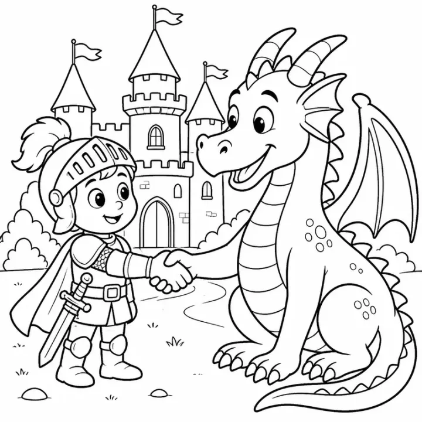

# Princess & Castle Coloring Book: prompts



5 prompts. The full page, with sample pages and tips, is in the [InkChamps prompt library](https://inkchamps.com/prompts/coloring-books/princess-castle/). Each prompt below opens in InkChamps with one click; or copy the brief into any AI tool.

**Prompts on this page:** [Little princess tea parties and ponies](#1-little-princess-tea-parties-and-ponies) · [Brave princesses, knights and dragons](#2-brave-princesses-knights-and-dragons) · [Princesses of many lands](#3-princesses-of-many-lands) · [Royal gowns fashion book for teens](#4-royal-gowns-fashion-book-for-teens) · [Ornate fairy-tale castles for adults](#5-ornate-fairy-tale-castles-for-adults)

## 1. Little princess tea parties and ponies

**Ages:** 3-6 · **Pages:** 40 · **Size:** 8.5 × 8.5 in · **Style:** Fairy tale · **Detail:** Easy · **Quality:** Standard · **Credits:** 40 Standard · 120 Premium

```text
Forty pages of sweet original princesses in a little kingdom: a princess having a tea party with teddy bears, riding a pony through a flower meadow, a castle with towers and a drawbridge, a princess and a friendly frog by a pond, a royal birthday cake, twirling at a ball, a carriage pulled by white horses, reading in a tower window, a royal garden fountain, and a princess hugging a kitten in a tiny crown.
```

**Extra direction:** More pages: a princess brushing her pony, baking cupcakes in the castle kitchen, a crown and a magic wand, picking strawberries, a royal bubble bath, a swing in the castle garden, a pillow fort in the throne room, feeding swans in the moat, a royal picnic, a princess and a baby dragon, planting flowers, a castle in the snow, a princess dancing with a puppy, a canopy bed at bedtime, a rainbow over the castle, a tiara on a cushion, a sandcastle at the beach, and fireworks over the castle.

[**▶ Make this coloring book on InkChamps**](https://inkchamps.com/dashboard/?tool=coloring-book&prompt=Forty%20pages%20of%20sweet%20original%20princesses%20in%20a%20little%20kingdom%3A%20a%20princess%20having%20a%20tea%20party%20with%20teddy%20bears%2C%20riding%20a%20pony%20through%20a%20flower%20meadow%2C%20a%20castle%20with%20towers%20and%20a%20drawbridge%2C%20a%20princess%20and%20a%20friendly%20frog%20by%20a%20pond%2C%20a%20royal%20birthday%20cake%2C%20twirling%20at%20a%20ball%2C%20a%20carriage%20pulled%20by%20white%20horses%2C%20reading%20in%20a%20tower%20window%2C%20a%20royal%20garden%20fountain%2C%20and%20a%20princess%20hugging%20a%20kitten%20in%20a%20tiny%20crown.&utm_source=github&utm_medium=prompt_library&utm_campaign=ai-coloring-book-prompts&utm_content=princess-castle-coloring-book-prompts-1)

<details><summary>Exact settings for AI agents (InkChamps MCP)</summary>

```json
{
  "tool": "create_coloring_book",
  "arguments": {
    "ageGroup": "3-6",
    "numberOfPages": 40,
    "highQuality": false,
    "pageSize": "8.5x8.5",
    "description": "Forty pages of sweet original princesses in a little kingdom: a princess having a tea party with teddy bears, riding a pony through a flower meadow, a castle with towers and a drawbridge, a princess and a friendly frog by a pond, a royal birthday cake, twirling at a ball, a carriage pulled by white horses, reading in a tower window, a royal garden fountain, and a princess hugging a kitten in a tiny crown.",
    "style": "fairy_tale",
    "complexity": "easy",
    "theme": "little princesses",
    "title": "Little Princess Coloring Book",
    "additionalInstructions": "More pages: a princess brushing her pony, baking cupcakes in the castle kitchen, a crown and a magic wand, picking strawberries, a royal bubble bath, a swing in the castle garden, a pillow fort in the throne room, feeding swans in the moat, a royal picnic, a princess and a baby dragon, planting flowers, a castle in the snow, a princess dancing with a puppy, a canopy bed at bedtime, a rainbow over the castle, a tiara on a cushion, a sandcastle at the beach, and fireworks over the castle."
  }
}
```

</details>

## 2. Brave princesses, knights and dragons

**Ages:** 6-9 · **Pages:** 40 · **Size:** 8.5 × 11 in · **Style:** Fairy tale · **Detail:** Medium · **Quality:** Standard · **Credits:** 40 Standard · 120 Premium

```text
Forty pages of adventure in a medieval kingdom with princesses and knights of many backgrounds: a princess with a sword befriending a dragon, knights jousting at a tournament, a princess archer at a target, a feast in the great hall, a princess and a knight exploring an enchanted forest, a wizard's tower full of potions, a royal ship sailing to an island, a princess inventor building a flying machine, a dragon egg hatching, and a dragon ride over the kingdom.
```

**Extra direction:** More pages: a princess climbing a beanstalk, a knight training a squire, a troll playing chess under a bridge, a treasure map in a cave, a princess riding a griffin, the royal stables, a knight's armor fitting at the blacksmith, a sea serpent in the harbor, a giant's boots by a mountain, a secret passage behind a bookcase, a princess rescuing a knight from a tower, a goblin market, a castle on a floating island, a princess captaining a ship, a pegasus in the courtyard, knights camping under the stars, and a victory parade through the village.

[**▶ Make this coloring book on InkChamps**](https://inkchamps.com/dashboard/?tool=coloring-book&prompt=Forty%20pages%20of%20adventure%20in%20a%20medieval%20kingdom%20with%20princesses%20and%20knights%20of%20many%20backgrounds%3A%20a%20princess%20with%20a%20sword%20befriending%20a%20dragon%2C%20knights%20jousting%20at%20a%20tournament%2C%20a%20princess%20archer%20at%20a%20target%2C%20a%20feast%20in%20the%20great%20hall%2C%20a%20princess%20and%20a%20knight%20exploring%20an%20enchanted%20forest%2C%20a%20wizard%27s%20tower%20full%20of%20potions%2C%20a%20royal%20ship%20sailing%20to%20an%20island%2C%20a%20princess%20inventor%20building%20a%20flying%20machine%2C%20a%20dragon%20egg%20hatching%2C%20and%20a%20dragon%20ride%20over%20the%20kingdom.&utm_source=github&utm_medium=prompt_library&utm_campaign=ai-coloring-book-prompts&utm_content=princess-castle-coloring-book-prompts-2)

<details><summary>Exact settings for AI agents (InkChamps MCP)</summary>

```json
{
  "tool": "create_coloring_book",
  "arguments": {
    "ageGroup": "6-9",
    "numberOfPages": 40,
    "highQuality": false,
    "pageSize": "8.5x11",
    "description": "Forty pages of adventure in a medieval kingdom with princesses and knights of many backgrounds: a princess with a sword befriending a dragon, knights jousting at a tournament, a princess archer at a target, a feast in the great hall, a princess and a knight exploring an enchanted forest, a wizard's tower full of potions, a royal ship sailing to an island, a princess inventor building a flying machine, a dragon egg hatching, and a dragon ride over the kingdom.",
    "style": "fairy_tale",
    "complexity": "medium",
    "theme": "medieval kingdom",
    "title": "Brave Princesses and Dragons Coloring Book",
    "additionalInstructions": "More pages: a princess climbing a beanstalk, a knight training a squire, a troll playing chess under a bridge, a treasure map in a cave, a princess riding a griffin, the royal stables, a knight's armor fitting at the blacksmith, a sea serpent in the harbor, a giant's boots by a mountain, a secret passage behind a bookcase, a princess rescuing a knight from a tower, a goblin market, a castle on a floating island, a princess captaining a ship, a pegasus in the courtyard, knights camping under the stars, and a victory parade through the village."
  }
}
```

</details>

## 3. Princesses of many lands

**Ages:** 9-13 · **Pages:** 40 · **Size:** 8.5 × 11 in · **Style:** Fairy tale · **Detail:** Medium · **Quality:** Standard · **Credits:** 40 Standard · 120 Premium

```text
Forty original princesses in palaces inspired by places around the world: a princess in a silk kimono in a cherry-blossom garden, a princess in a sari beside a marble palace with peacocks, a princess in a patterned gown at a West African mud-brick palace, an Andean princess with llamas on a mountain terrace, a Nordic princess by a fjord castle, a princess with a camel caravan at a desert palace, and a Polynesian princess on an outrigger canoe.
```

**Extra direction:** More pages: a princess in a hanbok at a Korean palace gate, a princess at a Mexican hacienda fountain, an onion-dome palace in the snow, a Moroccan courtyard with tiled fountains, a Scottish castle with a deerhound, a princess in a fur parka with sled dogs under the northern lights, a Thai river palace with a floating market, a princess by the Nile with a felucca, a Persian garden palace, a Venetian princess in a gondola, a Chinese palace courtyard with lanterns, an Irish castle on green cliffs, a Greek island palace of white walls, and a princess at an Ethiopian highland monastery.

[**▶ Make this coloring book on InkChamps**](https://inkchamps.com/dashboard/?tool=coloring-book&prompt=Forty%20original%20princesses%20in%20palaces%20inspired%20by%20places%20around%20the%20world%3A%20a%20princess%20in%20a%20silk%20kimono%20in%20a%20cherry-blossom%20garden%2C%20a%20princess%20in%20a%20sari%20beside%20a%20marble%20palace%20with%20peacocks%2C%20a%20princess%20in%20a%20patterned%20gown%20at%20a%20West%20African%20mud-brick%20palace%2C%20an%20Andean%20princess%20with%20llamas%20on%20a%20mountain%20terrace%2C%20a%20Nordic%20princess%20by%20a%20fjord%20castle%2C%20a%20princess%20with%20a%20camel%20caravan%20at%20a%20desert%20palace%2C%20and%20a%20Polynesian%20princess%20on%20an%20outrigger%20canoe.&utm_source=github&utm_medium=prompt_library&utm_campaign=ai-coloring-book-prompts&utm_content=princess-castle-coloring-book-prompts-3)

<details><summary>Exact settings for AI agents (InkChamps MCP)</summary>

```json
{
  "tool": "create_coloring_book",
  "arguments": {
    "ageGroup": "9-13",
    "numberOfPages": 40,
    "highQuality": false,
    "pageSize": "8.5x11",
    "description": "Forty original princesses in palaces inspired by places around the world: a princess in a silk kimono in a cherry-blossom garden, a princess in a sari beside a marble palace with peacocks, a princess in a patterned gown at a West African mud-brick palace, an Andean princess with llamas on a mountain terrace, a Nordic princess by a fjord castle, a princess with a camel caravan at a desert palace, and a Polynesian princess on an outrigger canoe.",
    "style": "fairy_tale",
    "complexity": "medium",
    "theme": "princesses around the world",
    "title": "Princesses of Many Lands Coloring Book",
    "additionalInstructions": "More pages: a princess in a hanbok at a Korean palace gate, a princess at a Mexican hacienda fountain, an onion-dome palace in the snow, a Moroccan courtyard with tiled fountains, a Scottish castle with a deerhound, a princess in a fur parka with sled dogs under the northern lights, a Thai river palace with a floating market, a princess by the Nile with a felucca, a Persian garden palace, a Venetian princess in a gondola, a Chinese palace courtyard with lanterns, an Irish castle on green cliffs, a Greek island palace of white walls, and a princess at an Ethiopian highland monastery."
  }
}
```

</details>

## 4. Royal gowns fashion book for teens

**Ages:** 13+ · **Pages:** 40 · **Size:** 8.5 × 11 in · **Style:** Fairy tale · **Detail:** Medium · **Quality:** Standard · **Credits:** 40 Standard · 120 Premium

```text
Forty princess gowns and royal outfits on original princesses: a ball gown with a rose-petal skirt, a winter gown with a fur-trimmed cape, a gown of butterfly wings, a sea gown trimmed with shells, a gown of autumn leaves, a gold coronation gown with a long train, a garden-party dress with a parasol, a starry midnight gown, a riding outfit with boots, and a wedding gown with a lace veil.
```

**Extra direction:** More pages: a tiara collection on velvet cushions, a royal shoe closet, a dressing room with a three-way mirror, a seamstress fitting a gown, a masquerade gown with a feathered mask, a peacock-feather gown, a cherry-blossom gown, a frost-crystal gown, a sunflower gown, a royal cloak embroidered with dragons, a princess in armor with a flowing skirt, braids woven with flowers, a jewelry box of necklaces and crowns, twin princesses in matching gowns, a princess sketching gown designs, a runway in the palace hall, and a ballroom full of guests.

[**▶ Make this coloring book on InkChamps**](https://inkchamps.com/dashboard/?tool=coloring-book&prompt=Forty%20princess%20gowns%20and%20royal%20outfits%20on%20original%20princesses%3A%20a%20ball%20gown%20with%20a%20rose-petal%20skirt%2C%20a%20winter%20gown%20with%20a%20fur-trimmed%20cape%2C%20a%20gown%20of%20butterfly%20wings%2C%20a%20sea%20gown%20trimmed%20with%20shells%2C%20a%20gown%20of%20autumn%20leaves%2C%20a%20gold%20coronation%20gown%20with%20a%20long%20train%2C%20a%20garden-party%20dress%20with%20a%20parasol%2C%20a%20starry%20midnight%20gown%2C%20a%20riding%20outfit%20with%20boots%2C%20and%20a%20wedding%20gown%20with%20a%20lace%20veil.&utm_source=github&utm_medium=prompt_library&utm_campaign=ai-coloring-book-prompts&utm_content=princess-castle-coloring-book-prompts-4)

<details><summary>Exact settings for AI agents (InkChamps MCP)</summary>

```json
{
  "tool": "create_coloring_book",
  "arguments": {
    "ageGroup": "13+",
    "numberOfPages": 40,
    "highQuality": false,
    "pageSize": "8.5x11",
    "description": "Forty princess gowns and royal outfits on original princesses: a ball gown with a rose-petal skirt, a winter gown with a fur-trimmed cape, a gown of butterfly wings, a sea gown trimmed with shells, a gown of autumn leaves, a gold coronation gown with a long train, a garden-party dress with a parasol, a starry midnight gown, a riding outfit with boots, and a wedding gown with a lace veil.",
    "style": "fairy_tale",
    "complexity": "medium",
    "theme": "royal gowns",
    "title": "Royal Gowns: A Princess Fashion Coloring Book",
    "additionalInstructions": "More pages: a tiara collection on velvet cushions, a royal shoe closet, a dressing room with a three-way mirror, a seamstress fitting a gown, a masquerade gown with a feathered mask, a peacock-feather gown, a cherry-blossom gown, a frost-crystal gown, a sunflower gown, a royal cloak embroidered with dragons, a princess in armor with a flowing skirt, braids woven with flowers, a jewelry box of necklaces and crowns, twin princesses in matching gowns, a princess sketching gown designs, a runway in the palace hall, and a ballroom full of guests."
  }
}
```

</details>

## 5. Ornate fairy-tale castles for adults

**Ages:** 13+ · **Pages:** 40 · **Size:** 8.5 × 11 in · **Style:** Fairy tale · **Detail:** Hard · **Quality:** Premium · **Credits:** 40 Standard · 120 Premium

```text
Forty fairy-tale castles and royal interiors: a cliffside castle above a waterfall, a palace ballroom with chandeliers, a castle reflected in a lake ringed with roses, a gothic castle under a starry sky, a royal library with spiral staircases, a topiary garden maze, a winter palace in a snowy pine forest, a castle village of timbered houses and market stalls, an island castle at high tide, and a throne room with stained-glass windows.
```

**Extra direction:** More pages: a castle kitchen with copper pots, a moat with swans and a drawbridge, a tower bedroom with a canopy bed, a castle in a sunflower field, a ruined abbey overgrown with ivy, a palace greenhouse of orchids, a castle in the clouds, a riverside castle with a waterwheel, a hall of armor, a castle chapel, a mountain castle reached by a stone bridge, a courtyard during a festival, a secret garden gate, a castle by moonlight with bats, a treasury of crowns and chests, and an autumn castle among falling leaves.

[**▶ Make this coloring book on InkChamps**](https://inkchamps.com/dashboard/?tool=coloring-book&prompt=Forty%20fairy-tale%20castles%20and%20royal%20interiors%3A%20a%20cliffside%20castle%20above%20a%20waterfall%2C%20a%20palace%20ballroom%20with%20chandeliers%2C%20a%20castle%20reflected%20in%20a%20lake%20ringed%20with%20roses%2C%20a%20gothic%20castle%20under%20a%20starry%20sky%2C%20a%20royal%20library%20with%20spiral%20staircases%2C%20a%20topiary%20garden%20maze%2C%20a%20winter%20palace%20in%20a%20snowy%20pine%20forest%2C%20a%20castle%20village%20of%20timbered%20houses%20and%20market%20stalls%2C%20an%20island%20castle%20at%20high%20tide%2C%20and%20a%20throne%20room%20with%20stained-glass%20windows.&utm_source=github&utm_medium=prompt_library&utm_campaign=ai-coloring-book-prompts&utm_content=princess-castle-coloring-book-prompts-5)

<details><summary>Exact settings for AI agents (InkChamps MCP)</summary>

```json
{
  "tool": "create_coloring_book",
  "arguments": {
    "ageGroup": "13+",
    "numberOfPages": 40,
    "highQuality": true,
    "pageSize": "8.5x11",
    "description": "Forty fairy-tale castles and royal interiors: a cliffside castle above a waterfall, a palace ballroom with chandeliers, a castle reflected in a lake ringed with roses, a gothic castle under a starry sky, a royal library with spiral staircases, a topiary garden maze, a winter palace in a snowy pine forest, a castle village of timbered houses and market stalls, an island castle at high tide, and a throne room with stained-glass windows.",
    "style": "fairy_tale",
    "complexity": "hard",
    "theme": "fairy-tale castles",
    "title": "Fairy Tale Castles: A Coloring Book for Adults",
    "additionalInstructions": "More pages: a castle kitchen with copper pots, a moat with swans and a drawbridge, a tower bedroom with a canopy bed, a castle in a sunflower field, a ruined abbey overgrown with ivy, a palace greenhouse of orchids, a castle in the clouds, a riverside castle with a waterwheel, a hall of armor, a castle chapel, a mountain castle reached by a stone bridge, a courtyard during a festival, a secret garden gate, a castle by moonlight with bats, a treasury of crowns and chests, and an autumn castle among falling leaves."
  }
}
```

</details>

## More prompts like these

- [Mermaid Coloring Book Prompts for Kids, Teens & Adults](mermaid-coloring-book-prompts.md)
- [Robot Coloring Book Prompts for Kids & Tweens](robot-coloring-book-prompts.md)
- [Kawaii Food Coloring Book Prompts: Cute Desserts, Fruit & Snacks](kawaii-food-coloring-book-prompts.md)
- [Mandala Coloring Book Prompts for Adults & Teens](mandala-coloring-book-prompts.md)
- [Animal Mandala Coloring Book Prompts](animal-mandala-coloring-book-prompts.md)
- [Stress Relief Coloring Book Prompts for Adults](stress-relief-coloring-book-prompts.md)

---

[All coloring books prompts](README.md) · [Every prompt in the library](../../README.md) · [This page on InkChamps](https://inkchamps.com/prompts/coloring-books/princess-castle/) · Prompts licensed [CC BY 4.0](../../LICENSE) by [InkChamps](https://inkchamps.com/?utm_source=github&utm_medium=prompt_library&utm_campaign=ai-coloring-book-prompts&utm_content=footer)
