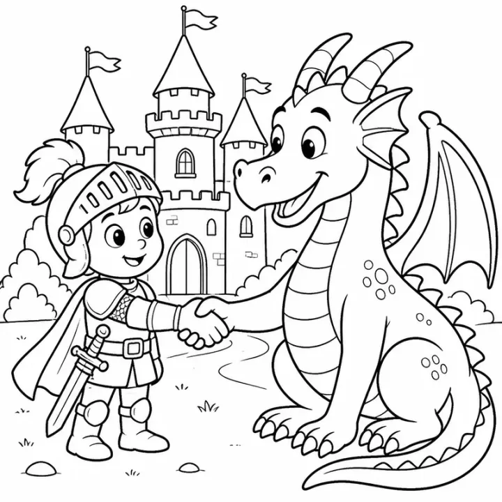

# Princess & Castle Coloring Book: prompts



5 prompts. The full page, with sample pages and tips, is in the [InkChamps prompt library](https://inkchamps.com/prompts/coloring-books/princess-castle/). Each prompt below opens in InkChamps with one click; or copy the brief into any AI tool.

**Prompts on this page:** [Little princess tea parties and ponies](#1-little-princess-tea-parties-and-ponies) · [Brave princesses, knights and dragons](#2-brave-princesses-knights-and-dragons) · [Princesses of many lands](#3-princesses-of-many-lands) · [Royal gowns fashion book for teens](#4-royal-gowns-fashion-book-for-teens) · [Ornate fairy-tale castles for adults](#5-ornate-fairy-tale-castles-for-adults)

## 1. Little princess tea parties and ponies

**Ages:** 3-6 · **Pages:** 24 · **Size:** 8.5 × 8.5 in · **Style:** Fairy tale · **Detail:** Easy · **Quality:** Standard · **Credits:** 24 Standard · 72 Premium

```text
24 pages of a sweet original little princess and her friends in a small kingdom, from morning to bedtime: a tea party with teddy bears, riding a pony through a flower meadow, a castle with towers and a drawbridge, a friendly frog by a pond, baking cupcakes, feeding swans in the moat, a royal birthday cake, twirling at a ball, a carriage pulled by white horses, a baby dragon friend, a castle in the snow and fireworks over the castle at night.
```

### Page by page (24 pages)

Paste one page at a time into ChatGPT, Gemini or any AI image tool, with this line after it:

> Black-and-white coloring page for a child aged 3 to 6: one cute cartoon little princess or castle filling most of the page, thick bold outlines, large simple shapes with wide spaces to color, very little background, no shading, no grey, no words, plain white background, square page.

1. A little princess in a small crown stretching and waking up in her canopy bed, a fluffy pillow behind her and sunshine peeking through the round tower window.
2. A little princess brushing the mane of her chubby pony in the castle stable, a bucket of carrots and a pile of hay beside them.
3. A little princess riding her pony through a meadow of big daisies and tulips, a butterfly flying beside the pony's ears.
4. A big friendly castle with three round towers, pointed roofs with flags, and a wooden drawbridge lowered over a little moat.
5. A little princess kneeling by a lily pond, smiling at a friendly frog sitting on a big lily pad, two cattails at the water's edge.
6. A little princess feeding bread to two swans swimming in the castle moat, the castle wall and a small flag behind her.
7. A little princess picking big strawberries in the castle garden, a basket on her arm already half full.
8. A little princess in an apron baking cupcakes in the castle kitchen, a mixing bowl, a wooden spoon and a tray of cupcakes on the table.
9. A little princess at a tea party with three teddy bears around a small round table, a teapot, cups and a plate of cookies.
10. A little princess swinging high on a rope swing hanging from a big oak tree in the castle garden, her crown held on with one hand.
11. A little princess planting flowers with a small watering can and a trowel, a row of tulips already growing beside her.
12. A little princess and a baby dragon sharing a picnic on a checked blanket, a basket of sandwiches and apples between them.
13. A little princess dancing with a happy puppy on its back legs in the throne room, a big throne with a heart on top behind them.
14. A little princess building a pillow fort in the throne room, cushions stacked high and a blanket draped over two chairs.
15. A little princess hugging a kitten that wears a tiny crown, sitting together on a big round cushion.
16. A royal birthday cake with three tiers, candles on top and a little crown on the very top, a princess clapping beside it.
17. A little princess twirling at the royal ball in a big puffy gown, a chandelier with candles hanging above her.
18. A round royal carriage with big wheels and a little crown on its roof, pulled by two white horses with plumes on their heads, a princess waving from the window.
19. A little princess building a sandcastle at the beach with a bucket and spade, the sandcastle shaped like her own castle with a shell on top.
20. A little princess in a bubble bath in a tub with curly feet, a rubber duck wearing a crown floating beside her.
21. A big rainbow arching over the castle towers after the rain, two puddles on the path and a little princess jumping in one.
22. A castle in the snow with icicles on the roofs, a little princess in a cape building a snowman with a crown and a carrot nose.
23. A little princess reading a picture book by the round tower window, a candle and a stuffed bunny on the windowsill.
24. Fireworks bursting over the castle at night, a big moon and stars above, a little princess in pajamas watching from the balcony.

[**▶ Make this coloring book on InkChamps**](https://inkchamps.com/dashboard/?tool=coloring-book&prompt=24%20pages%20of%20a%20sweet%20original%20little%20princess%20and%20her%20friends%20in%20a%20small%20kingdom%2C%20from%20morning%20to%20bedtime%3A%20a%20tea%20party%20with%20teddy%20bears%2C%20riding%20a%20pony%20through%20a%20flower%20meadow%2C%20a%20castle%20with%20towers%20and%20a%20drawbridge%2C%20a%20friendly%20frog%20by%20a%20pond%2C%20baking%20cupcakes%2C%20feeding%20swans%20in%20the%20moat%2C%20a%20royal%20birthday%20cake%2C%20twirling%20at%20a%20ball%2C%20a%20carriage%20pulled%20by%20white%20horses%2C%20a%20baby%20dragon%20friend%2C%20a%20castle%20in%20the%20snow%20and%20fireworks%20over%20the%20castle%20at%20night.&utm_source=github&utm_medium=prompt_library&utm_campaign=ai-coloring-book-prompts&utm_content=princess-castle-coloring-book-prompts-1)

<details><summary>Exact settings for AI agents (InkChamps MCP)</summary>

```json
{
  "tool": "create_coloring_book",
  "arguments": {
    "ageGroup": "3-6",
    "numberOfPages": 24,
    "highQuality": false,
    "pageSize": "8.5x8.5",
    "description": "24 pages of a sweet original little princess and her friends in a small kingdom, from morning to bedtime: a tea party with teddy bears, riding a pony through a flower meadow, a castle with towers and a drawbridge, a friendly frog by a pond, baking cupcakes, feeding swans in the moat, a royal birthday cake, twirling at a ball, a carriage pulled by white horses, a baby dragon friend, a castle in the snow and fireworks over the castle at night.",
    "style": "fairy_tale",
    "complexity": "easy",
    "theme": "little princesses",
    "title": "Little Princess Coloring Book"
  }
}
```

</details>

## 2. Brave princesses, knights and dragons

**Ages:** 6-9 · **Pages:** 24 · **Size:** 8.5 × 11 in · **Style:** Fairy tale · **Detail:** Medium · **Quality:** Standard · **Credits:** 24 Standard · 72 Premium

```text
24 pages of adventure in a medieval kingdom with princesses and knights of many backgrounds: a princess befriending a dragon, knights jousting at a tournament, a princess archer at a target, a princess inventor building a flying machine, a wizard's tower full of potions, a troll playing chess under a bridge, a griffin ride, a sea serpent in the harbor, a dragon egg hatching, a princess rescuing a knight from a tower, a dragon ride over the kingdom and a victory parade through the village.
```

### Page by page (24 pages)

Paste one page at a time into ChatGPT, Gemini or any AI image tool, with this line after it:

> Black-and-white coloring page for a child aged 6 to 9: a brave original princess, knight or friendly dragon as the main character, clear bold outlines, medium detail with a simple background that shows where the scene happens, no shading, no grey, no words or letters, plain white background, portrait 8.5 x 11 page.

1. A princess in a tunic and boots holding out a shiny apple to a large friendly dragon peeking out of a mountain cave, her sword resting in its sheath at her hip.
2. Two knights in armor jousting on horseback at a tournament, lances aimed at each other's shields, striped tents and pennant flags behind.
3. A princess archer drawing her bow at a round straw target on the castle green, three arrows already in the bullseye and a quiver on her back.
4. A knight showing a young squire how to hold a wooden practice sword in the castle courtyard, a straw dummy and a shield on a rack.
5. A blacksmith fitting a princess with a breastplate in a forge, an anvil, a hammer and glowing horseshoes hanging on the wall.
6. The royal stables with a knight brushing a tall horse, saddles on wooden pegs and a stable cat sleeping on a hay bale.
7. A feast in the great hall: a long wooden table with a roast, bread loaves and goblets, knights and princesses raising cups, banners on the stone walls.
8. A princess inventor in goggles hammering the last bolt into a flying machine with flapping wooden wings, blueprints and gears spread on her workbench.
9. A wizard's round tower room crowded with bubbling potion bottles, a spell book on a stand, a stuffed owl and a telescope at the window.
10. A princess and a knight walking through an enchanted forest of twisted trees, glowing mushrooms along the path and a curious fox watching from a log.
11. A grumpy but friendly troll playing chess with a princess under a stone bridge, a little stream running past their feet.
12. A princess holding a lantern and a treasure map in a dark cave, a chest overflowing with coins and crowns ahead of her.
13. A knight and a princess slipping through a secret passage behind a swinging bookcase, a candle in a holder lighting the stone steps.
14. A princess riding a griffin with eagle wings and a lion's body over a forest of pines, her cape flying out behind her.
15. A sea serpent with a curling tail rising out of the harbor beside fishing boats, a princess on the dock waving a spyglass at it.
16. A princess captaining a royal sailing ship, steering the big wooden wheel, a striped sail full of wind and a small island ahead.
17. A pair of giant's boots as tall as a house standing by a mountain path, a knight on horseback staring up at them in surprise.
18. A goblin market in a moonlit hollow: little goblins selling jars, hats and glowing stones from wooden carts, a princess browsing a stall.
19. A white pegasus landing in the castle courtyard with wings spread, a stable girl holding out a bucket of oats and a fountain behind.
20. A dragon egg cracking open on a nest of straw, a tiny baby dragon poking its head out while a princess and a knight kneel beside it.
21. A princess climbing a rope up a tall stone tower to rescue a knight waving from the window at the top, ivy growing up the walls.
22. Knights and a princess camping under the stars, a crackling campfire, a tent, their horses tied to a tree and a full moon above.
23. A princess riding on the back of a dragon high over the kingdom, the castle, a winding river and tiny fields far below.
24. A victory parade through the village: a princess and her dragon at the front, knights on horses behind, villagers cheering from timbered houses.

[**▶ Make this coloring book on InkChamps**](https://inkchamps.com/dashboard/?tool=coloring-book&prompt=24%20pages%20of%20adventure%20in%20a%20medieval%20kingdom%20with%20princesses%20and%20knights%20of%20many%20backgrounds%3A%20a%20princess%20befriending%20a%20dragon%2C%20knights%20jousting%20at%20a%20tournament%2C%20a%20princess%20archer%20at%20a%20target%2C%20a%20princess%20inventor%20building%20a%20flying%20machine%2C%20a%20wizard%27s%20tower%20full%20of%20potions%2C%20a%20troll%20playing%20chess%20under%20a%20bridge%2C%20a%20griffin%20ride%2C%20a%20sea%20serpent%20in%20the%20harbor%2C%20a%20dragon%20egg%20hatching%2C%20a%20princess%20rescuing%20a%20knight%20from%20a%20tower%2C%20a%20dragon%20ride%20over%20the%20kingdom%20and%20a%20victory%20parade%20through%20the%20village.&utm_source=github&utm_medium=prompt_library&utm_campaign=ai-coloring-book-prompts&utm_content=princess-castle-coloring-book-prompts-2)

<details><summary>Exact settings for AI agents (InkChamps MCP)</summary>

```json
{
  "tool": "create_coloring_book",
  "arguments": {
    "ageGroup": "6-9",
    "numberOfPages": 24,
    "highQuality": false,
    "pageSize": "8.5x11",
    "description": "24 pages of adventure in a medieval kingdom with princesses and knights of many backgrounds: a princess befriending a dragon, knights jousting at a tournament, a princess archer at a target, a princess inventor building a flying machine, a wizard's tower full of potions, a troll playing chess under a bridge, a griffin ride, a sea serpent in the harbor, a dragon egg hatching, a princess rescuing a knight from a tower, a dragon ride over the kingdom and a victory parade through the village.",
    "style": "fairy_tale",
    "complexity": "medium",
    "theme": "medieval kingdom",
    "title": "Brave Princesses and Dragons Coloring Book"
  }
}
```

</details>

## 3. Princesses of many lands

**Ages:** 9-13 · **Pages:** 24 · **Size:** 8.5 × 11 in · **Style:** Fairy tale · **Detail:** Medium · **Quality:** Standard · **Credits:** 24 Standard · 72 Premium

```text
24 original princesses in palaces inspired by places around the world: a princess in a silk kimono in a cherry-blossom garden, a sari beside a marble palace with peacocks, a West African mud-brick palace, an Andean mountain terrace with llamas, a Nordic fjord castle, a desert palace with a camel caravan, a Polynesian outrigger canoe, a Korean palace gate, a Moroccan tiled courtyard, a Venetian gondola, a Chinese lantern courtyard and sled dogs under the northern lights.
```

### Page by page (24 pages)

Paste one page at a time into ChatGPT, Gemini or any AI image tool, with this line after it:

> Black-and-white coloring page for ages 9 to 13: one original princess in traditional dress in front of a palace or landscape from her land, fine clean outlines, detailed clothing patterns, architecture and plants with many separate areas to color, a full background, no shading, no grey, no words, plain white background, portrait 8.5 x 11 page.

1. A princess in a silk kimono with a wide obi sash walking a curved wooden bridge in a Japanese cherry-blossom garden, a koi pond and a stone lantern beside her.
2. A princess in a hanbok with a full skirt standing at a Korean palace gate with painted roof beams, a paper lantern in her hand.
3. A princess in a flowing silk robe under red lanterns in a Chinese palace courtyard, a round moon gate and potted peonies behind her.
4. A princess in a sari and bangles beside a white marble palace with domes and arches, two peacocks fanning their tails at a long reflecting pool.
5. A princess on the deck of a Thai river palace with tiered golden roofs, boats of fruit and flowers from a floating market drifting past.
6. A Polynesian princess with a flower crown paddling an outrigger canoe across a lagoon, palm trees and a volcanic island behind her.
7. A princess in a patterned wrap gown and headwrap in front of a West African mud-brick palace with wooden beams sticking out of its towers.
8. A princess in a white embroidered dress and shawl outside a stone highland monastery in Ethiopia, terraced green hills and a eucalyptus tree around her.
9. A princess standing in a felucca sailing boat on the Nile, palm trees and a temple with tall columns on the riverbank.
10. A princess in a flowing robe leading a camel caravan toward a sandstone desert palace, dunes rolling behind and a water jar on one camel.
11. A princess in a kaftan beside a tiled fountain in a Moroccan courtyard, keyhole arches, mosaic walls and potted orange trees around her.
12. A princess in an embroidered gown walking a Persian garden palace path, long water channels, cypress trees and a domed pavilion ahead.
13. A princess in a sarafan and tall headdress before an onion-domed palace in the snow, a horse-drawn sleigh waiting at the gate.
14. A Nordic princess in a wool dress with a braided crown on a rocky shore beside a fjord castle, steep cliffs and a longboat on the water.
15. A princess in a fur parka with mittens guiding a team of sled dogs across the snow under swirling northern lights, an ice-blue mountain behind.
16. A princess in a tartan sash on the lawn of a Scottish castle, a tall deerhound at her side and misty hills with heather behind.
17. A princess in a green cloak on an Irish castle terrace high on green cliffs, waves breaking below and sheep grazing nearby.
18. A Venetian princess in a lace gown and mask riding in a gondola along a canal, arched bridges and tall palaces with balconies behind.
19. A princess in a draped white gown on the terrace of a Greek island palace of white walls and blue domes, the sea and a sailboat below.
20. A princess in an embroidered dress and rebozo beside a tiled fountain at a Mexican hacienda, bougainvillea on the arches and a parrot on the rim.
21. An Andean princess in a woven poncho and hat walking with two llamas on a stone mountain terrace, snowy peaks and a condor in the sky.
22. A princess in a ruffled lace dress on the veranda of a Brazilian palace at the rainforest edge, giant leaves, a toucan on the railing and a waterfall behind.
23. A princess in a lace cap, embroidered apron and wooden clogs beside a canal palace in the Netherlands, windmills and rows of tulips behind her.
24. Six princesses from many lands holding hands in a circle in a grand palace garden, a fountain in the middle and bunting overhead.

[**▶ Make this coloring book on InkChamps**](https://inkchamps.com/dashboard/?tool=coloring-book&prompt=24%20original%20princesses%20in%20palaces%20inspired%20by%20places%20around%20the%20world%3A%20a%20princess%20in%20a%20silk%20kimono%20in%20a%20cherry-blossom%20garden%2C%20a%20sari%20beside%20a%20marble%20palace%20with%20peacocks%2C%20a%20West%20African%20mud-brick%20palace%2C%20an%20Andean%20mountain%20terrace%20with%20llamas%2C%20a%20Nordic%20fjord%20castle%2C%20a%20desert%20palace%20with%20a%20camel%20caravan%2C%20a%20Polynesian%20outrigger%20canoe%2C%20a%20Korean%20palace%20gate%2C%20a%20Moroccan%20tiled%20courtyard%2C%20a%20Venetian%20gondola%2C%20a%20Chinese%20lantern%20courtyard%20and%20sled%20dogs%20under%20the%20northern%20lights.&utm_source=github&utm_medium=prompt_library&utm_campaign=ai-coloring-book-prompts&utm_content=princess-castle-coloring-book-prompts-3)

<details><summary>Exact settings for AI agents (InkChamps MCP)</summary>

```json
{
  "tool": "create_coloring_book",
  "arguments": {
    "ageGroup": "9-13",
    "numberOfPages": 24,
    "highQuality": false,
    "pageSize": "8.5x11",
    "description": "24 original princesses in palaces inspired by places around the world: a princess in a silk kimono in a cherry-blossom garden, a sari beside a marble palace with peacocks, a West African mud-brick palace, an Andean mountain terrace with llamas, a Nordic fjord castle, a desert palace with a camel caravan, a Polynesian outrigger canoe, a Korean palace gate, a Moroccan tiled courtyard, a Venetian gondola, a Chinese lantern courtyard and sled dogs under the northern lights.",
    "style": "fairy_tale",
    "complexity": "medium",
    "theme": "princesses around the world",
    "title": "Princesses of Many Lands Coloring Book"
  }
}
```

</details>

## 4. Royal gowns fashion book for teens

**Ages:** 13+ · **Pages:** 24 · **Size:** 8.5 × 11 in · **Style:** Fairy tale · **Detail:** Medium · **Quality:** Standard · **Credits:** 24 Standard · 72 Premium

```text
24 princess gowns and royal outfits on original princesses, one look per page: a ball gown with a rose-petal skirt, a winter gown with a fur-trimmed cape, a gown of butterfly wings, a sea gown trimmed with shells, a gown of autumn leaves, a gold coronation gown with a long train, a starry midnight gown, a peacock-feather gown, a frost-crystal gown, a masquerade gown with a feathered mask, a riding outfit with boots, a wedding gown with a lace veil, a seamstress fitting, a tiara collection and a runway in the palace hall.
```

### Page by page (24 pages)

Paste one page at a time into ChatGPT, Gemini or any AI image tool, with this line after it:

> Black-and-white fashion coloring page for teens: one elegant original princess shown full length in a detailed gown, fine clean outlines, intricate fabric, lace, embroidery and jewelry with many small areas to color, a light hint of setting, no shading, no grey, no words, plain white background, portrait 8.5 x 11 page.

1. A princess in a ball gown whose full skirt is made of layered rose petals, a fitted bodice with tiny rosebuds and a single rose tucked in her hair.
2. A princess in a winter gown of velvet with a long fur-trimmed hooded cape, snowflakes drifting around her and a muff on one hand.
3. A princess in a gown with sheer butterfly-wing sleeves and a skirt patterned with wing veins, small butterflies resting on her shoulders.
4. A princess in a sea gown with a ruffled skirt like waves, trimmed with scallop shells, pearls and starfish, standing on a rocky shore.
5. A princess in a gown made of overlapping autumn leaves, oak, maple and ginkgo, an acorn crown and leaves swirling at her feet.
6. A princess in a gold coronation gown with a long embroidered train held by two pages, a jeweled crown and a scepter in her hand.
7. A princess in a garden-party dress with a tiered lace skirt, holding an open parasol, a wide hat with ribbons and roses on a trellis behind.
8. A princess in a starry midnight gown with a skirt scattered with stars and moons, a crescent-moon tiara and a night sky behind her.
9. A princess in a peacock-feather gown with a train of fanned eye feathers spread out behind her like a tail.
10. A princess in a cherry-blossom gown with a petal-scattered skirt and a sash, a blossom branch arching over her head.
11. A princess in a frost-crystal gown with a skirt of ice-crystal patterns and a high snowflake collar, icicle earrings and a crystal tiara.
12. A princess in a sunflower gown with a skirt of petals radiating from the waist, a seed-patterned bodice and a bee on her glove.
13. A princess in a masquerade gown of brocade and ruffles holding a feathered mask on a stick, a fan in her other hand.
14. A princess in a royal cloak embroidered with dragons and clouds over a simple silk gown, a dragon clasp at her throat.
15. A warrior princess in a fitted breastplate and shoulder guards over a long flowing skirt, a sword at her side and braids down her back.
16. A princess in a riding outfit: a fitted jacket with brass buttons, a long split skirt, tall boots and a feathered riding hat, holding a crop.
17. A princess in a wedding gown with a lace bodice, a full tulle skirt and a long lace veil, holding a bouquet of lilies and roses.
18. Twin princesses in matching gowns, one with a pattern of suns and one with moons, standing back to back with joined hands.
19. Close portrait of a princess with long braids woven with daisies, ribbons and little pearls, a delicate flower crown on top.
20. A seamstress kneeling to pin the hem of a princess's gown on a round fitting stool, a pincushion, measuring tape and a dress form nearby.
21. A princess sketching gown designs at a desk by the window, fabric swatches, a sketchbook of drawings and a dress form wearing a half-made gown.
22. A tiara collection on velvet cushions in a glass display case: a pearl tiara, a floral tiara, a star tiara and a jeweled crown.
23. An open jewelry box with drawers of necklaces, rings and earrings beside a row of jeweled slippers and heeled shoes on shelves in a royal closet.
24. A runway down the palace hall with three princesses modeling gowns, chandeliers above and guests watching from gilded chairs on both sides.

[**▶ Make this coloring book on InkChamps**](https://inkchamps.com/dashboard/?tool=coloring-book&prompt=24%20princess%20gowns%20and%20royal%20outfits%20on%20original%20princesses%2C%20one%20look%20per%20page%3A%20a%20ball%20gown%20with%20a%20rose-petal%20skirt%2C%20a%20winter%20gown%20with%20a%20fur-trimmed%20cape%2C%20a%20gown%20of%20butterfly%20wings%2C%20a%20sea%20gown%20trimmed%20with%20shells%2C%20a%20gown%20of%20autumn%20leaves%2C%20a%20gold%20coronation%20gown%20with%20a%20long%20train%2C%20a%20starry%20midnight%20gown%2C%20a%20peacock-feather%20gown%2C%20a%20frost-crystal%20gown%2C%20a%20masquerade%20gown%20with%20a%20feathered%20mask%2C%20a%20riding%20outfit%20with%20boots%2C%20a%20wedding%20gown%20with%20a%20lace%20veil%2C%20a%20seamstress%20fitting%2C%20a%20tiara%20collection%20and%20a%20runway%20in%20the%20palace%20hall.&utm_source=github&utm_medium=prompt_library&utm_campaign=ai-coloring-book-prompts&utm_content=princess-castle-coloring-book-prompts-4)

<details><summary>Exact settings for AI agents (InkChamps MCP)</summary>

```json
{
  "tool": "create_coloring_book",
  "arguments": {
    "ageGroup": "13+",
    "numberOfPages": 24,
    "highQuality": false,
    "pageSize": "8.5x11",
    "description": "24 princess gowns and royal outfits on original princesses, one look per page: a ball gown with a rose-petal skirt, a winter gown with a fur-trimmed cape, a gown of butterfly wings, a sea gown trimmed with shells, a gown of autumn leaves, a gold coronation gown with a long train, a starry midnight gown, a peacock-feather gown, a frost-crystal gown, a masquerade gown with a feathered mask, a riding outfit with boots, a wedding gown with a lace veil, a seamstress fitting, a tiara collection and a runway in the palace hall.",
    "style": "fairy_tale",
    "complexity": "medium",
    "theme": "royal gowns",
    "title": "Royal Gowns: A Princess Fashion Coloring Book"
  }
}
```

</details>

## 5. Ornate fairy-tale castles for adults

**Ages:** 13+ · **Pages:** 24 · **Size:** 8.5 × 11 in · **Style:** Fairy tale · **Detail:** Hard · **Quality:** Premium · **Credits:** 24 Standard · 72 Premium

```text
24 fairy-tale castles and royal interiors for adult colorists: a cliffside castle above a waterfall, a palace ballroom with chandeliers, a castle reflected in a lake ringed with roses, a gothic castle under a starry sky, a royal library with spiral staircases, a topiary garden maze, a winter palace in a snowy pine forest, a castle village with market stalls, an island castle at high tide, a throne room with stained-glass windows, a castle in the clouds and an autumn castle among falling leaves.
```

### Page by page (24 pages)

Paste one page at a time into ChatGPT, Gemini or any AI image tool, with this line after it:

> Black-and-white adult coloring page: an ornate fairy-tale castle or royal interior with intricate architecture, fine crisp line work, detailed stonework, windows, foliage and ornament with many small areas to color, a full detailed background filling the page, no shading, no grey, no words, plain white background, portrait 8.5 x 11 page.

1. A tall castle with slender spires perched on a cliff above a roaring waterfall, a stone bridge over the gorge and pine trees clinging to the rocks.
2. A castle with round towers reflected in a still lake ringed with climbing rose bushes, a rowing boat tied at a small jetty.
3. A gothic castle with pointed arches and gargoyles under a starry sky with a crescent moon, wrought-iron gates in front.
4. An island castle at high tide, waves lapping the walls, a causeway half under water and seagulls circling the towers.
5. A mountain castle reached by a long arched stone bridge over a deep valley, snowcapped peaks behind and clouds below the bridge.
6. A riverside castle with a turning wooden waterwheel, a mill house, ducks on the river and willow trees along the bank.
7. A castle in a sunflower field, rows of sunflowers stretching to its walls, a winding lane and a hay cart in front.
8. A winter palace in a snowy pine forest, icicles on the eaves, lit lanterns at the gate and a sleigh track leading to the door.
9. An autumn castle among falling leaves, oak and maple trees around its walls, a pumpkin patch and a stone well in the foreground.
10. A castle in the clouds with towers rising from billowing cumulus, a rainbow bridge and birds flying between the spires.
11. A moat with swans and a lowered drawbridge, the portcullis raised, ivy on the gatehouse and water lilies on the water.
12. A castle village of half-timbered houses and market stalls with awnings, baskets of bread and fruit, the castle on the hill above.
13. A courtyard during a festival: bunting strung between towers, a maypole with ribbons, musicians, and a fountain in the middle.
14. A palace ballroom with crystal chandeliers, a polished checkered floor, tall arched windows with drapes and a musicians' balcony.
15. A throne room with two carved thrones on a dais, tall stained-glass windows of roses and stars, and long banners on the pillars.
16. A royal library with two spiral staircases, floor-to-ceiling bookshelves, rolling ladders, a globe and a reading table with candles.
17. A castle kitchen with copper pots hanging over a wide hearth, a long wooden table of loaves and vegetables, and strings of garlic and herbs.
18. A tower bedroom with a canopy bed hung with drapes, a round window with a window seat, a wardrobe and a rug with fringe.
19. A hall of armor with suits of armor in a row, crossed swords and shields on the walls and a long patterned carpet down the middle.
20. A treasury vault of crowns, scepters, jeweled goblets and open chests spilling coins, lit by torches in iron brackets.
21. A palace greenhouse of orchids and ferns under a glass dome of iron lattice, a tiled path and a small fountain in the center.
22. A topiary garden maze seen from above, hedges clipped into peacocks and spirals, a gazebo at the center and the castle beyond.
23. A secret garden gate in an ivy-covered wall, the wooden door ajar to reveal roses, a stone bench and a birdbath inside.
24. A ruined abbey overgrown with ivy and wildflowers, its broken arched windows open to a moonlit sky, bats flying past and an owl perched on a crumbling wall.

[**▶ Make this coloring book on InkChamps**](https://inkchamps.com/dashboard/?tool=coloring-book&prompt=24%20fairy-tale%20castles%20and%20royal%20interiors%20for%20adult%20colorists%3A%20a%20cliffside%20castle%20above%20a%20waterfall%2C%20a%20palace%20ballroom%20with%20chandeliers%2C%20a%20castle%20reflected%20in%20a%20lake%20ringed%20with%20roses%2C%20a%20gothic%20castle%20under%20a%20starry%20sky%2C%20a%20royal%20library%20with%20spiral%20staircases%2C%20a%20topiary%20garden%20maze%2C%20a%20winter%20palace%20in%20a%20snowy%20pine%20forest%2C%20a%20castle%20village%20with%20market%20stalls%2C%20an%20island%20castle%20at%20high%20tide%2C%20a%20throne%20room%20with%20stained-glass%20windows%2C%20a%20castle%20in%20the%20clouds%20and%20an%20autumn%20castle%20among%20falling%20leaves.&utm_source=github&utm_medium=prompt_library&utm_campaign=ai-coloring-book-prompts&utm_content=princess-castle-coloring-book-prompts-5)

<details><summary>Exact settings for AI agents (InkChamps MCP)</summary>

```json
{
  "tool": "create_coloring_book",
  "arguments": {
    "ageGroup": "13+",
    "numberOfPages": 24,
    "highQuality": true,
    "pageSize": "8.5x11",
    "description": "24 fairy-tale castles and royal interiors for adult colorists: a cliffside castle above a waterfall, a palace ballroom with chandeliers, a castle reflected in a lake ringed with roses, a gothic castle under a starry sky, a royal library with spiral staircases, a topiary garden maze, a winter palace in a snowy pine forest, a castle village with market stalls, an island castle at high tide, a throne room with stained-glass windows, a castle in the clouds and an autumn castle among falling leaves.",
    "style": "fairy_tale",
    "complexity": "hard",
    "theme": "fairy-tale castles",
    "title": "Fairy Tale Castles: A Coloring Book for Adults"
  }
}
```

</details>

## More prompts like these

- [Mermaid Coloring Book Prompts for Kids, Teens & Adults](mermaid-coloring-book-prompts.md)
- [Robot Coloring Book Prompts for Kids & Tweens](robot-coloring-book-prompts.md)
- [Kawaii Food Coloring Book Prompts: Cute Desserts, Fruit & Snacks](kawaii-food-coloring-book-prompts.md)
- [Mandala Coloring Book Prompts for Adults & Teens](mandala-coloring-book-prompts.md)
- [Animal Mandala Coloring Book Prompts](animal-mandala-coloring-book-prompts.md)
- [Stress Relief Coloring Book Prompts for Adults](stress-relief-coloring-book-prompts.md)

---

[All coloring books prompts](README.md) · [Every prompt in the library](../../README.md) · [This page on InkChamps](https://inkchamps.com/prompts/coloring-books/princess-castle/) · Prompts licensed [CC BY 4.0](../../LICENSE) by [InkChamps](https://inkchamps.com/?utm_source=github&utm_medium=prompt_library&utm_campaign=ai-coloring-book-prompts&utm_content=footer)
