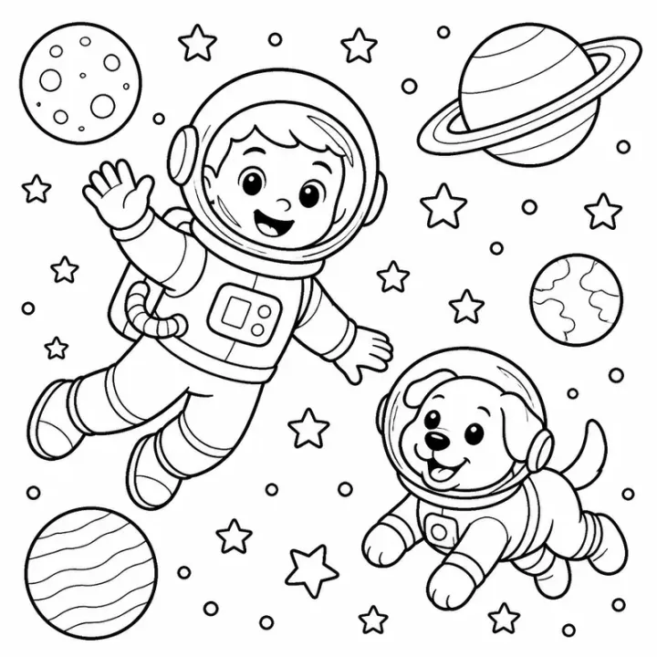

# Space Coloring Book: prompts



5 prompts. The full page, with sample pages and tips, is in the [InkChamps prompt library](https://inkchamps.com/prompts/coloring-books/space/). Each prompt below opens in InkChamps with one click; or copy the brief into any AI tool.

**Prompts on this page:** [First trip to space for toddlers](#1-first-trip-to-space-for-toddlers) · [Animal astronaut crew](#2-animal-astronaut-crew) · [40 named planets, moons and space objects](#3-40-named-planets-moons-and-space-objects) · [Alien planet explorers](#4-alien-planet-explorers) · [Retro space and cosmic scenes for adults](#5-retro-space-and-cosmic-scenes-for-adults)

## 1. First trip to space for toddlers

**Ages:** 3-6 · **Pages:** 40 · **Size:** 8.5 × 8.5 in · **Style:** Universe space · **Detail:** Easy · **Quality:** Standard · **Credits:** 40 Standard · 120 Premium

```text
Forty pages of a first trip to space: a smiling rocket blasting off, a child astronaut waving from the moon, a sleepy moon in a nightcap, a happy sun, a ringed planet with a big grin, a little alien saying hello from a round spaceship, a star with a face, an astronaut floating beside a satellite, a comet with a long tail, and a picnic in a moon crater.
```

**Extra direction:** More pages: a rocket on the launch pad, an astronaut putting on a helmet, a flag on the moon, a moon buggy ride, a space station window with a waving astronaut, a shooting star, Earth seen from space, a friendly alien pet, planets stacked like toy blocks, a telescope on a hill, a rocket landing on Mars, an astronaut bouncing on the moon, space snacks floating in a cabin, a sleeping bag in a spaceship bunk, an alien birthday party, a crescent moon swing, and a rocket flying home.

[**▶ Make this coloring book on InkChamps**](https://inkchamps.com/dashboard/?tool=coloring-book&prompt=Forty%20pages%20of%20a%20first%20trip%20to%20space%3A%20a%20smiling%20rocket%20blasting%20off%2C%20a%20child%20astronaut%20waving%20from%20the%20moon%2C%20a%20sleepy%20moon%20in%20a%20nightcap%2C%20a%20happy%20sun%2C%20a%20ringed%20planet%20with%20a%20big%20grin%2C%20a%20little%20alien%20saying%20hello%20from%20a%20round%20spaceship%2C%20a%20star%20with%20a%20face%2C%20an%20astronaut%20floating%20beside%20a%20satellite%2C%20a%20comet%20with%20a%20long%20tail%2C%20and%20a%20picnic%20in%20a%20moon%20crater.&utm_source=github&utm_medium=prompt_library&utm_campaign=ai-coloring-book-prompts&utm_content=space-coloring-book-prompts-1)

<details><summary>Exact settings for AI agents (InkChamps MCP)</summary>

```json
{
  "tool": "create_coloring_book",
  "arguments": {
    "ageGroup": "3-6",
    "numberOfPages": 40,
    "highQuality": false,
    "pageSize": "8.5x8.5",
    "description": "Forty pages of a first trip to space: a smiling rocket blasting off, a child astronaut waving from the moon, a sleepy moon in a nightcap, a happy sun, a ringed planet with a big grin, a little alien saying hello from a round spaceship, a star with a face, an astronaut floating beside a satellite, a comet with a long tail, and a picnic in a moon crater.",
    "style": "universe_space",
    "complexity": "easy",
    "theme": "space for little kids",
    "title": "My First Space Coloring Book",
    "additionalInstructions": "More pages: a rocket on the launch pad, an astronaut putting on a helmet, a flag on the moon, a moon buggy ride, a space station window with a waving astronaut, a shooting star, Earth seen from space, a friendly alien pet, planets stacked like toy blocks, a telescope on a hill, a rocket landing on Mars, an astronaut bouncing on the moon, space snacks floating in a cabin, a sleeping bag in a spaceship bunk, an alien birthday party, a crescent moon swing, and a rocket flying home."
  }
}
```

</details>

## 2. Animal astronaut crew

**Ages:** 6-9 · **Pages:** 40 · **Size:** 8.5 × 11 in · **Style:** Universe space · **Detail:** Medium · **Quality:** Standard · **Credits:** 40 Standard · 120 Premium

```text
Forty pages of animal astronauts on space missions: a cat in a space helmet planting a flag on the moon, a bear piloting a rocket, penguins floating in a space station, a monkey fixing a satellite, an elephant on a spacewalk, a rabbit driving a moon rover, a dog looking through a porthole at Earth, an owl at mission control, a giraffe in an extra-tall spacesuit, and a turtle rocket captain.
```

**Extra direction:** More pages: a lion crew at the launch pad, a pig chasing floating snacks, a fox charting stars, a koala asleep strapped to a bunk, a panda tending a space greenhouse, frogs hopping on the moon, a whale-shaped spaceship with a dolphin crew, a raccoon repairing a solar panel, a squirrel collecting moon rocks, a hippo on a treadmill in orbit, a parrot radio operator, a hedgehog in a tiny lander, a crew photo on Mars, and the animal crew splashing down in the ocean.

[**▶ Make this coloring book on InkChamps**](https://inkchamps.com/dashboard/?tool=coloring-book&prompt=Forty%20pages%20of%20animal%20astronauts%20on%20space%20missions%3A%20a%20cat%20in%20a%20space%20helmet%20planting%20a%20flag%20on%20the%20moon%2C%20a%20bear%20piloting%20a%20rocket%2C%20penguins%20floating%20in%20a%20space%20station%2C%20a%20monkey%20fixing%20a%20satellite%2C%20an%20elephant%20on%20a%20spacewalk%2C%20a%20rabbit%20driving%20a%20moon%20rover%2C%20a%20dog%20looking%20through%20a%20porthole%20at%20Earth%2C%20an%20owl%20at%20mission%20control%2C%20a%20giraffe%20in%20an%20extra-tall%20spacesuit%2C%20and%20a%20turtle%20rocket%20captain.&utm_source=github&utm_medium=prompt_library&utm_campaign=ai-coloring-book-prompts&utm_content=space-coloring-book-prompts-2)

<details><summary>Exact settings for AI agents (InkChamps MCP)</summary>

```json
{
  "tool": "create_coloring_book",
  "arguments": {
    "ageGroup": "6-9",
    "numberOfPages": 40,
    "highQuality": false,
    "pageSize": "8.5x11",
    "description": "Forty pages of animal astronauts on space missions: a cat in a space helmet planting a flag on the moon, a bear piloting a rocket, penguins floating in a space station, a monkey fixing a satellite, an elephant on a spacewalk, a rabbit driving a moon rover, a dog looking through a porthole at Earth, an owl at mission control, a giraffe in an extra-tall spacesuit, and a turtle rocket captain.",
    "style": "universe_space",
    "complexity": "medium",
    "theme": "animal astronauts",
    "title": "Animal Astronauts Coloring Book",
    "additionalInstructions": "More pages: a lion crew at the launch pad, a pig chasing floating snacks, a fox charting stars, a koala asleep strapped to a bunk, a panda tending a space greenhouse, frogs hopping on the moon, a whale-shaped spaceship with a dolphin crew, a raccoon repairing a solar panel, a squirrel collecting moon rocks, a hippo on a treadmill in orbit, a parrot radio operator, a hedgehog in a tiny lander, a crew photo on Mars, and the animal crew splashing down in the ocean."
  }
}
```

</details>

## 3. 40 named planets, moons and space objects

**Ages:** 9-13 · **Pages:** 40 · **Size:** 8.5 × 11 in · **Style:** Universe space · **Detail:** Medium · **Layout:** One item per page, with its caption · **Quality:** Standard · **Credits:** 40 Standard · 120 Premium

```text
Forty space subjects, one per page with its name: the Sun, Mercury, Venus, Earth, the Moon, Mars, Phobos, Jupiter, Io, Europa, Saturn, Titan, Uranus, Neptune, Triton, Pluto, Ceres, the asteroid belt, a comet, a meteor shower, a meteorite, an impact crater, a solar eclipse, an aurora, a spiral galaxy, the Milky Way, a nebula, a star cluster, a supernova, a black hole, a red giant, a constellation, a rocket, a space station, a satellite, a Mars rover, a lunar lander, a space telescope, a spacesuit, an observatory.
```

[**▶ Make this coloring book on InkChamps**](https://inkchamps.com/dashboard/?tool=coloring-book&prompt=Forty%20space%20subjects%2C%20one%20per%20page%20with%20its%20name%3A%20the%20Sun%2C%20Mercury%2C%20Venus%2C%20Earth%2C%20the%20Moon%2C%20Mars%2C%20Phobos%2C%20Jupiter%2C%20Io%2C%20Europa%2C%20Saturn%2C%20Titan%2C%20Uranus%2C%20Neptune%2C%20Triton%2C%20Pluto%2C%20Ceres%2C%20the%20asteroid%20belt%2C%20a%20comet%2C%20a%20meteor%20shower%2C%20a%20meteorite%2C%20an%20impact%20crater%2C%20a%20solar%20eclipse%2C%20an%20aurora%2C%20a%20spiral%20galaxy%2C%20the%20Milky%20Way%2C%20a%20nebula%2C%20a%20star%20cluster%2C%20a%20supernova%2C%20a%20black%20hole%2C%20a%20red%20giant%2C%20a%20constellation%2C%20a%20rocket%2C%20a%20space%20station%2C%20a%20satellite%2C%20a%20Mars%20rover%2C%20a%20lunar%20lander%2C%20a%20space%20telescope%2C%20a%20spacesuit%2C%20an%20observatory.&utm_source=github&utm_medium=prompt_library&utm_campaign=ai-coloring-book-prompts&utm_content=space-coloring-book-prompts-3)

<details><summary>Exact settings for AI agents (InkChamps MCP)</summary>

```json
{
  "tool": "create_coloring_book",
  "arguments": {
    "ageGroup": "9-13",
    "numberOfPages": 40,
    "highQuality": false,
    "pageSize": "8.5x11",
    "description": "Forty space subjects, one per page with its name: the Sun, Mercury, Venus, Earth, the Moon, Mars, Phobos, Jupiter, Io, Europa, Saturn, Titan, Uranus, Neptune, Triton, Pluto, Ceres, the asteroid belt, a comet, a meteor shower, a meteorite, an impact crater, a solar eclipse, an aurora, a spiral galaxy, the Milky Way, a nebula, a star cluster, a supernova, a black hole, a red giant, a constellation, a rocket, a space station, a satellite, a Mars rover, a lunar lander, a space telescope, a spacesuit, an observatory.",
    "style": "universe_space",
    "complexity": "medium",
    "theme": "planets and space",
    "title": "Planets, Moons and Missions: 40 Space Objects",
    "pageCategory": "concept"
  }
}
```

</details>

## 4. Alien planet explorers

**Ages:** 9-13 · **Pages:** 40 · **Size:** 8.5 × 11 in · **Style:** Universe space · **Detail:** Medium · **Quality:** Standard · **Credits:** 40 Standard · 120 Premium

```text
Forty pages exploring made-up alien planets: a crystal planet with gemstone mountains, a jungle world of giant glowing mushrooms, an ocean planet with floating cities, a desert planet under two suns, an ice moon with geysers, an alien market of strange fruit stalls, explorers riding six-legged alien beasts, an alien zoo, a spaceship landed in purple vines, and a city built inside a hollow asteroid.
```

**Extra direction:** More pages: alien kids at a hoverboard park, a giant space whale over a gas giant, a bridge across a planet's rings, a lava world with rock creatures, floating islands linked by vines, an alien school with tentacled teachers, a tree-house colony on a moon, a volcano launch pad, alien farmers herding fluffy creatures, a cave of glowing worms, a sandstorm on a red world, a crater lake with sea serpents, a cloud city on a storm planet, a tent camp under three moons, and the map room aboard the explorers' starship.

[**▶ Make this coloring book on InkChamps**](https://inkchamps.com/dashboard/?tool=coloring-book&prompt=Forty%20pages%20exploring%20made-up%20alien%20planets%3A%20a%20crystal%20planet%20with%20gemstone%20mountains%2C%20a%20jungle%20world%20of%20giant%20glowing%20mushrooms%2C%20an%20ocean%20planet%20with%20floating%20cities%2C%20a%20desert%20planet%20under%20two%20suns%2C%20an%20ice%20moon%20with%20geysers%2C%20an%20alien%20market%20of%20strange%20fruit%20stalls%2C%20explorers%20riding%20six-legged%20alien%20beasts%2C%20an%20alien%20zoo%2C%20a%20spaceship%20landed%20in%20purple%20vines%2C%20and%20a%20city%20built%20inside%20a%20hollow%20asteroid.&utm_source=github&utm_medium=prompt_library&utm_campaign=ai-coloring-book-prompts&utm_content=space-coloring-book-prompts-4)

<details><summary>Exact settings for AI agents (InkChamps MCP)</summary>

```json
{
  "tool": "create_coloring_book",
  "arguments": {
    "ageGroup": "9-13",
    "numberOfPages": 40,
    "highQuality": false,
    "pageSize": "8.5x11",
    "description": "Forty pages exploring made-up alien planets: a crystal planet with gemstone mountains, a jungle world of giant glowing mushrooms, an ocean planet with floating cities, a desert planet under two suns, an ice moon with geysers, an alien market of strange fruit stalls, explorers riding six-legged alien beasts, an alien zoo, a spaceship landed in purple vines, and a city built inside a hollow asteroid.",
    "style": "universe_space",
    "complexity": "medium",
    "theme": "alien worlds",
    "title": "Alien Worlds Coloring Book",
    "additionalInstructions": "More pages: alien kids at a hoverboard park, a giant space whale over a gas giant, a bridge across a planet's rings, a lava world with rock creatures, floating islands linked by vines, an alien school with tentacled teachers, a tree-house colony on a moon, a volcano launch pad, alien farmers herding fluffy creatures, a cave of glowing worms, a sandstorm on a red world, a crater lake with sea serpents, a cloud city on a storm planet, a tent camp under three moons, and the map room aboard the explorers' starship."
  }
}
```

</details>

## 5. Retro space and cosmic scenes for adults

**Ages:** 13+ · **Pages:** 40 · **Size:** 8.5 × 11 in · **Style:** Universe space · **Detail:** Hard · **Quality:** Premium · **Credits:** 40 Standard · 120 Premium

```text
Forty retro-futurist space scenes: a finned 1950s-style rocket on a launch tower, an astronaut on a swing hanging from a crescent moon, a domed moon city with monorails, Saturn rising over a canyon, an observatory under a sky of constellations, a space diner on an asteroid, a greenhouse dome on Mars, an astronaut reading on a cliff above a nebula, flowers growing from moon craters, and a whale drifting through the Milky Way.
```

**Extra direction:** More pages: a lighthouse on a tiny planet, a hot-air balloon among the planets, an astronaut fishing for stars, a steam train crossing a bridge between planets, a robot butler in a space hotel, a starship cockpit full of dials, a telescope shop, a jellyfish-shaped spaceship, a cat watching an eclipse from a windowsill, a mountain camp under the aurora, a brass orrery of the solar system, a rocket garage with tools, a comet over a sleeping village, an astronaut and a deer in a cosmic forest, moon phases arching over the sea, and a space station cutaway with rooms.

[**▶ Make this coloring book on InkChamps**](https://inkchamps.com/dashboard/?tool=coloring-book&prompt=Forty%20retro-futurist%20space%20scenes%3A%20a%20finned%201950s-style%20rocket%20on%20a%20launch%20tower%2C%20an%20astronaut%20on%20a%20swing%20hanging%20from%20a%20crescent%20moon%2C%20a%20domed%20moon%20city%20with%20monorails%2C%20Saturn%20rising%20over%20a%20canyon%2C%20an%20observatory%20under%20a%20sky%20of%20constellations%2C%20a%20space%20diner%20on%20an%20asteroid%2C%20a%20greenhouse%20dome%20on%20Mars%2C%20an%20astronaut%20reading%20on%20a%20cliff%20above%20a%20nebula%2C%20flowers%20growing%20from%20moon%20craters%2C%20and%20a%20whale%20drifting%20through%20the%20Milky%20Way.&utm_source=github&utm_medium=prompt_library&utm_campaign=ai-coloring-book-prompts&utm_content=space-coloring-book-prompts-5)

<details><summary>Exact settings for AI agents (InkChamps MCP)</summary>

```json
{
  "tool": "create_coloring_book",
  "arguments": {
    "ageGroup": "13+",
    "numberOfPages": 40,
    "highQuality": true,
    "pageSize": "8.5x11",
    "description": "Forty retro-futurist space scenes: a finned 1950s-style rocket on a launch tower, an astronaut on a swing hanging from a crescent moon, a domed moon city with monorails, Saturn rising over a canyon, an observatory under a sky of constellations, a space diner on an asteroid, a greenhouse dome on Mars, an astronaut reading on a cliff above a nebula, flowers growing from moon craters, and a whale drifting through the Milky Way.",
    "style": "universe_space",
    "complexity": "hard",
    "theme": "retro space",
    "title": "Retro Cosmos: A Space Coloring Book for Adults",
    "additionalInstructions": "More pages: a lighthouse on a tiny planet, a hot-air balloon among the planets, an astronaut fishing for stars, a steam train crossing a bridge between planets, a robot butler in a space hotel, a starship cockpit full of dials, a telescope shop, a jellyfish-shaped spaceship, a cat watching an eclipse from a windowsill, a mountain camp under the aurora, a brass orrery of the solar system, a rocket garage with tools, a comet over a sleeping village, an astronaut and a deer in a cosmic forest, moon phases arching over the sea, and a space station cutaway with rooms."
  }
}
```

</details>

## More prompts like these

- [Vehicle Coloring Book Prompts: Trucks, Diggers, Trains & Cars](vehicle-coloring-book-prompts.md)
- [Princess & Castle Coloring Book Prompts (Original Characters)](princess-castle-coloring-book-prompts.md)
- [Mermaid Coloring Book Prompts for Kids, Teens & Adults](mermaid-coloring-book-prompts.md)
- [Robot Coloring Book Prompts for Kids & Tweens](robot-coloring-book-prompts.md)
- [Kawaii Food Coloring Book Prompts: Cute Desserts, Fruit & Snacks](kawaii-food-coloring-book-prompts.md)
- [Mandala Coloring Book Prompts for Adults & Teens](mandala-coloring-book-prompts.md)

---

[All coloring books prompts](README.md) · [Every prompt in the library](../../README.md) · [This page on InkChamps](https://inkchamps.com/prompts/coloring-books/space/) · Prompts licensed [CC BY 4.0](../../LICENSE) by [InkChamps](https://inkchamps.com/?utm_source=github&utm_medium=prompt_library&utm_campaign=ai-coloring-book-prompts&utm_content=footer)
