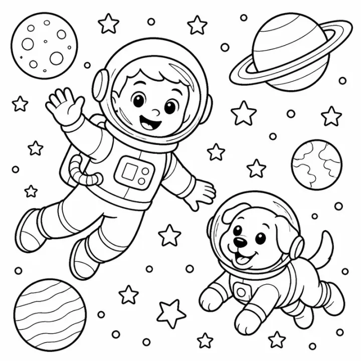

# Space Coloring Book: prompts



5 prompts. The full page, with sample pages and tips, is in the [InkChamps prompt library](https://inkchamps.com/prompts/coloring-books/space/). Each prompt below opens in InkChamps with one click; or copy the brief into any AI tool.

**Prompts on this page:** [First trip to space for toddlers](#1-first-trip-to-space-for-toddlers) · [Animal astronaut crew](#2-animal-astronaut-crew) · [24 named planets, moons and space objects](#3-24-named-planets-moons-and-space-objects) · [Alien planet explorers](#4-alien-planet-explorers) · [Retro space and cosmic scenes for adults](#5-retro-space-and-cosmic-scenes-for-adults)

## 1. First trip to space for toddlers

**Ages:** 3-6 · **Pages:** 24 · **Size:** 8.5 × 8.5 in · **Style:** Universe space · **Detail:** Easy · **Quality:** Standard · **Credits:** 24 Standard · 72 Premium

```text
24 pages of a first trip to space, from the launch pad to home again: a smiling rocket blasting off, a child astronaut on the moon, a sleepy moon in a nightcap, a happy sun, a grinning ringed planet, a little alien waving from a round spaceship, a comet with a long tail, a moon buggy ride, a picnic in a moon crater, floating space snacks, an alien birthday party, a crescent moon swing and a rocket flying home.
```

### Page by page (24 pages)

Paste one page at a time into ChatGPT, Gemini or any AI image tool, with this line after it:

> Black-and-white coloring page for a child aged 3 to 6: one big, friendly cartoon subject filling most of the page, thick bold outlines, large simple shapes with wide spaces to color, very little background, no shading, no grey, no words, plain white background, square page.

1. A smiling cartoon rocket with round windows standing on the launch pad, a little ladder beside it and puffy clouds at its base, ready to blast off.
2. A small child astronaut sitting on a bench pulling on a round space helmet, big boots on the floor and a toy rocket beside the bench.
3. A happy rocket blasting off into the sky, big round puffs of smoke below and three simple stars above.
4. A child astronaut floating inside a round rocket window, waving, with the big round Earth outside showing one cloud and an ocean.
5. A happy sun with a big smile and short, thick rays, wearing little sunglasses, with one small cloud beside it.
6. A sleepy crescent moon wearing a striped nightcap with a pom-pom, eyes closed, two small stars resting near its tip.
7. A star with a smiling face and five chubby points, holding a smaller baby star by the hand.
8. A ringed planet with a big grin, its wide ring tilted like a hula hoop, and two small round moons beside it.
9. Planets of different sizes stacked like toy blocks into a tower, a little rocket parked at the bottom.
10. A rocket landing gently on the moon on three legs, a cloud of dust under it and a few round craters around it.
11. A child astronaut bouncing high over the moon, arms up, little footprints in the dust below and a crater nearby.
12. A child astronaut planting a flag with a star on it in the moon dust, a smiling Earth in the sky behind.
13. A child astronaut driving a moon buggy with big round wheels over a bumpy crater, a small antenna on the back.
14. A family picnic on a checked blanket inside a moon crater, a basket, sandwiches and a juice box, Earth in the sky.
15. A little round alien with three eyes and two antennae waving hello from the door of a round flying saucer.
16. A friendly alien walking a pet alien on a leash, the pet shaped like a fluffy round ball with six little legs.
17. An astronaut floating beside a satellite with two big square solar panels, holding a wrench and giving a thumbs up.
18. A comet with a smiling face zooming past, its long wavy tail full of small stars.
19. A child looking through a big telescope on a grassy hill at night, a crescent moon, a ringed planet and a few stars in the sky.
20. Space snacks floating around a rocket cabin: an apple, a sandwich, a juice pouch and a cookie, with a child astronaut reaching for one.
21. A child astronaut tucked into a sleeping bag strapped to the wall of a spaceship bunk, a teddy bear floating beside it.
22. An alien birthday party on a little planet: three aliens in party hats around a round cake with candles and balloons.
23. A child sitting on a swing that hangs from a crescent moon, stars around and a small planet below.
24. A rocket flying home toward a big smiling Earth, waving hands in the windows and a trail of round stars behind it.

[**▶ Make this coloring book on InkChamps**](https://inkchamps.com/dashboard/?tool=coloring-book&prompt=24%20pages%20of%20a%20first%20trip%20to%20space%2C%20from%20the%20launch%20pad%20to%20home%20again%3A%20a%20smiling%20rocket%20blasting%20off%2C%20a%20child%20astronaut%20on%20the%20moon%2C%20a%20sleepy%20moon%20in%20a%20nightcap%2C%20a%20happy%20sun%2C%20a%20grinning%20ringed%20planet%2C%20a%20little%20alien%20waving%20from%20a%20round%20spaceship%2C%20a%20comet%20with%20a%20long%20tail%2C%20a%20moon%20buggy%20ride%2C%20a%20picnic%20in%20a%20moon%20crater%2C%20floating%20space%20snacks%2C%20an%20alien%20birthday%20party%2C%20a%20crescent%20moon%20swing%20and%20a%20rocket%20flying%20home.&utm_source=github&utm_medium=prompt_library&utm_campaign=ai-coloring-book-prompts&utm_content=space-coloring-book-prompts-1)

<details><summary>Exact settings for AI agents (InkChamps MCP)</summary>

```json
{
  "tool": "create_coloring_book",
  "arguments": {
    "ageGroup": "3-6",
    "numberOfPages": 24,
    "highQuality": false,
    "pageSize": "8.5x8.5",
    "description": "24 pages of a first trip to space, from the launch pad to home again: a smiling rocket blasting off, a child astronaut on the moon, a sleepy moon in a nightcap, a happy sun, a grinning ringed planet, a little alien waving from a round spaceship, a comet with a long tail, a moon buggy ride, a picnic in a moon crater, floating space snacks, an alien birthday party, a crescent moon swing and a rocket flying home.",
    "style": "universe_space",
    "complexity": "easy",
    "theme": "space for little kids",
    "title": "My First Space Coloring Book"
  }
}
```

</details>

## 2. Animal astronaut crew

**Ages:** 6-9 · **Pages:** 24 · **Size:** 8.5 × 11 in · **Style:** Universe space · **Detail:** Medium · **Quality:** Standard · **Credits:** 24 Standard · 72 Premium

```text
24 pages of animal astronauts on a space mission, from launch to splashdown: a lion crew at the launch pad, a bear piloting a rocket, a cat planting a flag on the moon, a rabbit driving a moon rover, penguins floating in a space station, a monkey fixing a satellite, an elephant on a spacewalk, an owl at mission control, a giraffe in an extra-tall spacesuit, a panda in a space greenhouse, a turtle rocket captain, a crew photo on Mars and a splashdown in the ocean.
```

### Page by page (24 pages)

Paste one page at a time into ChatGPT, Gemini or any AI image tool, with this line after it:

> Black-and-white coloring page for a child aged 6 to 9: a friendly cartoon animal astronaut as the main character, clear bold outlines, medium detail with a simple background that shows where the scene happens, no shading, no grey, no words or letters, plain white background, portrait 8.5 x 11 page.

1. A lion crew in spacesuits marching across the launch pad toward a tall rocket, helmets under their arms and a gantry tower beside it.
2. A bear pilot in a helmet at the controls of a rocket cockpit, pulling a big lever, dials and buttons all around.
3. A cat in a space helmet planting a flag on the moon, a lunar lander behind it and Earth hanging in the sky.
4. A rabbit driving a moon rover with big mesh wheels over craters, a small satellite dish on the back.
5. A squirrel astronaut collecting moon rocks into a sample bag with tongs, one cheek puffed out and a crater behind.
6. Frogs in round helmets hopping across the moon in big leaps, footprints trailing behind them.
7. Three penguin astronauts floating upside down and sideways inside a space station module, handrails and hatches around them.
8. A pig chasing floating snacks through a spaceship cabin: a donut, a carrot and a bag of crackers drifting out of reach.
9. A dog in a spacesuit with its nose pressed to a round porthole, looking at Earth outside with clouds and oceans.
10. A monkey on a spacewalk fixing a satellite, holding a screwdriver with one foot and a tether clipped to its belt.
11. An elephant on a spacewalk, its trunk curled out of a special trunk-shaped helmet, holding onto a handrail outside the station.
12. A raccoon repairing a broken solar panel on the outside of a space station, a toolbox floating beside it.
13. A giraffe in an extra-tall spacesuit with a long neck tube, ducking under the ceiling of a spaceship corridor.
14. An owl wearing a headset at mission control, rows of computer screens in front and a big map of the rocket's path on the wall.
15. A parrot radio operator talking into a microphone, a big radio with knobs and an antenna on the desk.
16. A fox charting stars at a round window, a star map spread on the table and a telescope pointed outside.
17. A panda tending a space greenhouse, watering lettuce and tomato plants growing in floating pots under grow lights.
18. A koala asleep in a sleeping bag strapped to a bunk wall, an eye mask on and a floating pillow nearby.
19. A hippo running on a treadmill in orbit, held down by stretchy straps, a water bottle floating by its head.
20. A turtle rocket captain in a captain's hat sitting in a command chair, a star chart and a steering wheel in front of it.
21. A whale-shaped spaceship cruising past a ringed planet, a dolphin crew waving through the round windows along its side.
22. A hedgehog in a tiny lander touching down on a rocky asteroid, its spines poking out of a round helmet.
23. The whole animal crew posing for a group photo on Mars, a rover and red hills behind them and a camera on a tripod.
24. The animal crew splashing down in the ocean in a capsule under three big parachutes, a boat coming to meet them.

[**▶ Make this coloring book on InkChamps**](https://inkchamps.com/dashboard/?tool=coloring-book&prompt=24%20pages%20of%20animal%20astronauts%20on%20a%20space%20mission%2C%20from%20launch%20to%20splashdown%3A%20a%20lion%20crew%20at%20the%20launch%20pad%2C%20a%20bear%20piloting%20a%20rocket%2C%20a%20cat%20planting%20a%20flag%20on%20the%20moon%2C%20a%20rabbit%20driving%20a%20moon%20rover%2C%20penguins%20floating%20in%20a%20space%20station%2C%20a%20monkey%20fixing%20a%20satellite%2C%20an%20elephant%20on%20a%20spacewalk%2C%20an%20owl%20at%20mission%20control%2C%20a%20giraffe%20in%20an%20extra-tall%20spacesuit%2C%20a%20panda%20in%20a%20space%20greenhouse%2C%20a%20turtle%20rocket%20captain%2C%20a%20crew%20photo%20on%20Mars%20and%20a%20splashdown%20in%20the%20ocean.&utm_source=github&utm_medium=prompt_library&utm_campaign=ai-coloring-book-prompts&utm_content=space-coloring-book-prompts-2)

<details><summary>Exact settings for AI agents (InkChamps MCP)</summary>

```json
{
  "tool": "create_coloring_book",
  "arguments": {
    "ageGroup": "6-9",
    "numberOfPages": 24,
    "highQuality": false,
    "pageSize": "8.5x11",
    "description": "24 pages of animal astronauts on a space mission, from launch to splashdown: a lion crew at the launch pad, a bear piloting a rocket, a cat planting a flag on the moon, a rabbit driving a moon rover, penguins floating in a space station, a monkey fixing a satellite, an elephant on a spacewalk, an owl at mission control, a giraffe in an extra-tall spacesuit, a panda in a space greenhouse, a turtle rocket captain, a crew photo on Mars and a splashdown in the ocean.",
    "style": "universe_space",
    "complexity": "medium",
    "theme": "animal astronauts",
    "title": "Animal Astronauts Coloring Book"
  }
}
```

</details>

## 3. 24 named planets, moons and space objects

**Ages:** 9-13 · **Pages:** 24 · **Size:** 8.5 × 11 in · **Style:** Universe space · **Detail:** Medium · **Layout:** One item per page, with its caption · **Quality:** Standard · **Credits:** 24 Standard · 72 Premium

```text
24 space subjects, one per page with its name: the Sun, Mercury, Venus, Earth, the Moon, Mars, Jupiter, Europa, Saturn, Titan, Uranus, Neptune, Pluto, the asteroid belt, a comet, a meteor shower, a solar eclipse, a constellation, a nebula, a spiral galaxy, a black hole, a space station, a Mars rover and a space telescope.
```

### Page by page (24 pages)

Paste one page at a time into ChatGPT, Gemini or any AI image tool, with this line after it:

> Black-and-white coloring page for a child aged 9 to 13: one space object drawn accurately as the main subject, clean outlines, medium detail with a simple starry background, no shading, no grey, the caption at the bottom in big outlined letters is the only words on the page, plain white background, portrait 8.5 x 11 page.

1. The Sun as a huge glowing ball with sunspots on its surface and looping solar flares rising from its edge with the caption "The Sun" in big outlined letters at the bottom.
2. Mercury, a small rocky planet covered in craters of many sizes, the Sun glowing large at the edge of the page with the caption "Mercury" in big outlined letters at the bottom.
3. Venus wrapped in thick swirling clouds, the cloud bands curling across the whole planet with the caption "Venus" in big outlined letters at the bottom.
4. Earth seen from space with continents, oceans and swirling clouds, the Moon small in the corner with the caption "Earth" in big outlined letters at the bottom.
5. The Moon up close, with large dark flat plains, bright craters with rays, and a lunar lander on its surface with the caption "The Moon" in big outlined letters at the bottom.
6. Mars with the giant volcano Olympus Mons, the long Valles Marineris canyon and a white polar ice cap, its two small moons nearby with the caption "Mars" in big outlined letters at the bottom.
7. Jupiter with wide cloud bands and the Great Red Spot storm, its volcanic moon Io passing in front with the caption "Jupiter" in big outlined letters at the bottom.
8. Europa, Jupiter's icy moon, its smooth surface criss-crossed by long cracks, a cutaway showing the hidden ocean under the ice with the caption "Europa" in big outlined letters at the bottom.
9. Saturn with its wide rings drawn as many thin bands, small moons dotted around it with the caption "Saturn" in big outlined letters at the bottom.
10. Titan, Saturn's largest moon, with a thick hazy atmosphere and dark lakes on its surface, Saturn in the sky behind with the caption "Titan" in big outlined letters at the bottom.
11. Uranus tipped over on its side, its faint thin rings standing up and down around it, a few small moons with the caption "Uranus" in big outlined letters at the bottom.
12. Neptune with streaky high clouds and a large dark storm spot, its moon Triton beside it with the caption "Neptune" in big outlined letters at the bottom.
13. Pluto showing its big heart-shaped plain, its moon Charon close by, the Sun as a tiny distant star with the caption "Pluto" in big outlined letters at the bottom.
14. The asteroid belt between Mars and Jupiter, rocky lumpy asteroids of many sizes and the dwarf planet Ceres among them with the caption "Asteroid Belt" in big outlined letters at the bottom.
15. A comet with its icy rocky center and two long tails streaming away from the Sun with the caption "Comet" in big outlined letters at the bottom.
16. A meteor shower over a hilltop campsite, many bright streaks across the night sky and a tent and telescope below with the caption "Meteor Shower" in big outlined letters at the bottom.
17. A total solar eclipse, the Moon covering the Sun with the wispy corona shining around its edge, people below in eclipse glasses with the caption "Solar Eclipse" in big outlined letters at the bottom.
18. The constellation Orion drawn as stars joined by lines above a field and a farmhouse, the three belt stars in a row with the caption "Constellation" in big outlined letters at the bottom.
19. A nebula of huge billowing gas clouds and tall dusty pillars, bright young stars shining inside them with the caption "Nebula" in big outlined letters at the bottom.
20. A spiral galaxy seen from above, curving arms full of stars winding out from a bright center with the caption "Spiral Galaxy" in big outlined letters at the bottom.
21. A black hole drawn as a dark round center circled by a swirling glowing disk of gas, nearby stars bent around it with the caption "Black Hole" in big outlined letters at the bottom.
22. A space station orbiting Earth, its long truss, big solar panels, round modules and a robotic arm with the caption "Space Station" in big outlined letters at the bottom.
23. A six-wheeled Mars rover on red rocky ground, its tall camera mast, robotic arm drilling a rock and hills behind with the caption "Mars Rover" in big outlined letters at the bottom.
24. A space telescope with a big mirror made of hexagon segments sitting on a layered sunshield, stars and a galaxy behind with the caption "Space Telescope" in big outlined letters at the bottom.

[**▶ Make this coloring book on InkChamps**](https://inkchamps.com/dashboard/?tool=coloring-book&prompt=24%20space%20subjects%2C%20one%20per%20page%20with%20its%20name%3A%20the%20Sun%2C%20Mercury%2C%20Venus%2C%20Earth%2C%20the%20Moon%2C%20Mars%2C%20Jupiter%2C%20Europa%2C%20Saturn%2C%20Titan%2C%20Uranus%2C%20Neptune%2C%20Pluto%2C%20the%20asteroid%20belt%2C%20a%20comet%2C%20a%20meteor%20shower%2C%20a%20solar%20eclipse%2C%20a%20constellation%2C%20a%20nebula%2C%20a%20spiral%20galaxy%2C%20a%20black%20hole%2C%20a%20space%20station%2C%20a%20Mars%20rover%20and%20a%20space%20telescope.&utm_source=github&utm_medium=prompt_library&utm_campaign=ai-coloring-book-prompts&utm_content=space-coloring-book-prompts-3)

<details><summary>Exact settings for AI agents (InkChamps MCP)</summary>

```json
{
  "tool": "create_coloring_book",
  "arguments": {
    "ageGroup": "9-13",
    "numberOfPages": 24,
    "highQuality": false,
    "pageSize": "8.5x11",
    "description": "24 space subjects, one per page with its name: the Sun, Mercury, Venus, Earth, the Moon, Mars, Jupiter, Europa, Saturn, Titan, Uranus, Neptune, Pluto, the asteroid belt, a comet, a meteor shower, a solar eclipse, a constellation, a nebula, a spiral galaxy, a black hole, a space station, a Mars rover and a space telescope.",
    "style": "universe_space",
    "complexity": "medium",
    "theme": "planets and space",
    "title": "Planets, Moons and Missions: 40 Space Objects",
    "pageCategory": "concept"
  }
}
```

</details>

## 4. Alien planet explorers

**Ages:** 9-13 · **Pages:** 24 · **Size:** 8.5 × 11 in · **Style:** Universe space · **Detail:** Medium · **Quality:** Standard · **Credits:** 24 Standard · 72 Premium

```text
24 pages of explorers visiting made-up alien planets: a crystal planet with gemstone mountains, a jungle of giant glowing mushrooms, an ocean world of floating cities, a desert under two suns, an ice moon with geysers, an alien market, explorers riding six-legged beasts, an alien zoo and school, a space whale over a gas giant, a lava world with rock creatures, floating islands, a cave of glowing worms, a city inside a hollow asteroid and a tent camp under three moons.
```

### Page by page (24 pages)

Paste one page at a time into ChatGPT, Gemini or any AI image tool, with this line after it:

> Black-and-white coloring page for a child aged 9 to 13: a detailed sci-fi scene with original alien creatures and explorers, clean confident outlines, plenty of small areas to color, a full background that shows the alien world, no shading, no grey, no words, plain white background, portrait 8.5 x 11 page.

1. Two explorers in the map room aboard their starship, leaning over a round table showing a glowing map of alien planets, star charts on the walls.
2. The explorers' spaceship landed in a tangle of thick purple vines with curling tendrils, the hatch open and a ramp down to the ground.
3. A crystal planet with jagged gemstone mountains, an explorer in a spacesuit climbing a ridge of pointed crystals with a rope.
4. A jungle world of giant mushrooms taller than trees, glowing spots on their caps and an explorer with a lantern walking among the stalks.
5. An ocean planet with floating cities on huge round platforms, bridges between them and boats with fin-shaped sails.
6. A desert planet under two suns, an explorer and a robot walking past tall carved rock arches with two shadows each.
7. An ice moon with tall geysers shooting water into the sky, an explorer on skis and a cracked ice field around them.
8. Explorers riding six-legged alien beasts with long necks and spotted backs across a rocky plain, saddlebags packed for a trip.
9. An alien market with stalls of strange spiky and spiral fruit, alien shopkeepers with four arms weighing goods on scales.
10. An alien zoo with enclosures for a floating jellyfish creature, a three-horned rock lizard and a long-legged bird, visitors at the fences.
11. Alien kids doing tricks at a hoverboard park, boards floating over curved ramps and loops, one alien flipping upside down.
12. An alien school classroom with a tentacled teacher writing at a board with three arms while alien students sit at curved desks.
13. A giant space whale gliding past a striped gas giant, a small shuttle flying alongside it for scale.
14. A narrow bridge built across the icy rings of a planet, explorers walking it with lanterns, the planet huge below.
15. A lava world with rivers of glowing lava and rock creatures made of boulders warming themselves by a fiery crack.
16. Floating islands drifting in the sky, linked by thick hanging vines, waterfalls pouring off their edges and a bird creature flying between them.
17. A tree-house colony on a moon, round pod houses built in giant twisting trees, rope ladders and walkways between them.
18. Alien farmers herding fluffy round creatures with long ears across a meadow of tall curly grass, a barn shaped like a dome behind.
19. A cave of glowing worms hanging from the ceiling in long threads, two explorers in a small boat on an underground river below.
20. A sandstorm sweeping across a red rocky world, an explorer leaning into the wind and holding onto a rover's door.
21. A crater lake with long-necked sea serpents rising out of the water, an explorer watching through binoculars from the rim.
22. A city built inside a hollow asteroid, stacked homes on the curved inner walls, lit windows and little ships flying through the middle.
23. A cloud city on a storm planet, towers on floating platforms, lightning in the clouds below and airships docking at a tower.
24. A tent camp under three moons of different sizes, explorers around a heat lamp, their ship parked on the hill and strange plants nearby.

[**▶ Make this coloring book on InkChamps**](https://inkchamps.com/dashboard/?tool=coloring-book&prompt=24%20pages%20of%20explorers%20visiting%20made-up%20alien%20planets%3A%20a%20crystal%20planet%20with%20gemstone%20mountains%2C%20a%20jungle%20of%20giant%20glowing%20mushrooms%2C%20an%20ocean%20world%20of%20floating%20cities%2C%20a%20desert%20under%20two%20suns%2C%20an%20ice%20moon%20with%20geysers%2C%20an%20alien%20market%2C%20explorers%20riding%20six-legged%20beasts%2C%20an%20alien%20zoo%20and%20school%2C%20a%20space%20whale%20over%20a%20gas%20giant%2C%20a%20lava%20world%20with%20rock%20creatures%2C%20floating%20islands%2C%20a%20cave%20of%20glowing%20worms%2C%20a%20city%20inside%20a%20hollow%20asteroid%20and%20a%20tent%20camp%20under%20three%20moons.&utm_source=github&utm_medium=prompt_library&utm_campaign=ai-coloring-book-prompts&utm_content=space-coloring-book-prompts-4)

<details><summary>Exact settings for AI agents (InkChamps MCP)</summary>

```json
{
  "tool": "create_coloring_book",
  "arguments": {
    "ageGroup": "9-13",
    "numberOfPages": 24,
    "highQuality": false,
    "pageSize": "8.5x11",
    "description": "24 pages of explorers visiting made-up alien planets: a crystal planet with gemstone mountains, a jungle of giant glowing mushrooms, an ocean world of floating cities, a desert under two suns, an ice moon with geysers, an alien market, explorers riding six-legged beasts, an alien zoo and school, a space whale over a gas giant, a lava world with rock creatures, floating islands, a cave of glowing worms, a city inside a hollow asteroid and a tent camp under three moons.",
    "style": "universe_space",
    "complexity": "medium",
    "theme": "alien worlds",
    "title": "Alien Worlds Coloring Book"
  }
}
```

</details>

## 5. Retro space and cosmic scenes for adults

**Ages:** 13+ · **Pages:** 24 · **Size:** 8.5 × 11 in · **Style:** Universe space · **Detail:** Hard · **Quality:** Premium · **Credits:** 24 Standard · 72 Premium

```text
24 retro-futurist space scenes for adult colorists: a finned rocket on a launch tower, a domed moon city with monorails, Saturn rising over a canyon, an astronaut on a crescent-moon swing, an observatory under the constellations, a diner on an asteroid, a greenhouse on Mars, a whale drifting through the Milky Way, a lighthouse on a tiny planet, a steam train between planets, a starship cockpit, a brass orrery, a comet over a sleeping village and a space station cutaway.
```

### Page by page (24 pages)

Paste one page at a time into ChatGPT, Gemini or any AI image tool, with this line after it:

> Black-and-white adult coloring page: a detailed retro-futurist space scene with fine, crisp line work, many small areas to color, a full background of stars, planets and texture, a balanced composition that fills the page, no shading, no grey, no words, plain white background, portrait 8.5 x 11 page.

1. A finned retro rocket with round portholes standing beside a tall steel launch tower, searchlights sweeping the night sky.
2. A domed moon city with glass bubbles, monorail tracks curving between towers and Earth rising above the horizon.
3. Saturn rising huge over a rocky canyon, its rings filling the sky, a lone explorer standing on a ledge in a vintage bubble helmet.
4. An astronaut sitting on a swing that hangs from a crescent moon, legs dangling above a field of stars and small planets.
5. A domed observatory on a hilltop with its telescope pointed out of the open roof, a sky full of constellations joined by fine lines.
6. A chrome-trimmed space diner on an asteroid with a big star-shaped sign on a pole, parked rocket cars and stools at the counter window.
7. A greenhouse dome on Mars full of tall tomato vines, sunflowers and hanging baskets, red hills outside the glass panels.
8. An astronaut reading a book on a cliff edge above a vast swirling nebula, a small lantern and a backpack beside them.
9. Flowers and vines growing out of moon craters, roses and daisies in the dust and a small retro lander in the distance.
10. A huge whale drifting through the Milky Way, its body outlined by stars, tiny planets floating among its fins.
11. A lighthouse standing on a tiny round planet, its beam sweeping across space past comets and small asteroids.
12. A striped hot-air balloon floating among the planets, a basket with two travellers waving at a ringed planet nearby.
13. An astronaut fishing from the edge of a crescent moon, the line dropping down and a star caught on the hook.
14. A steam train crossing a long trestle bridge between two small planets, puffs of smoke curling into a field of stars.
15. A robot butler with a tray of drinks in the lobby of a space hotel, a curved panoramic window looking out on Earth.
16. A retro starship cockpit full of round dials, toggle switches and blinking buttons, two pilots' chairs and a window onto a nebula.
17. A cluttered telescope shop with brass telescopes on tripods, star globes, maps pinned to the walls and a cat on the counter.
18. A jellyfish-shaped spaceship with a glowing dome and long trailing tentacles, gliding past a moon covered in craters.
19. A cat sitting on a windowsill watching a solar eclipse outside, potted plants on the sill and lace curtains drawn back.
20. A mountain campsite under a rippling aurora, two tents, a canoe on a lake and pine trees reflected in the water.
21. A brass orrery of the solar system on a wooden desk, each planet on a curved arm, gears visible in the base and books stacked nearby.
22. A rocket garage with a half-built rocket on a stand, tools on pegboards, a workbench, blueprints and a welding mask.
23. A comet streaking over a sleeping village of cottages with smoking chimneys, a church tower and a winding road.
24. A space station cutaway showing its rooms: a kitchen, sleeping bunks, a gym, a garden and a control room, astronauts in each.

[**▶ Make this coloring book on InkChamps**](https://inkchamps.com/dashboard/?tool=coloring-book&prompt=24%20retro-futurist%20space%20scenes%20for%20adult%20colorists%3A%20a%20finned%20rocket%20on%20a%20launch%20tower%2C%20a%20domed%20moon%20city%20with%20monorails%2C%20Saturn%20rising%20over%20a%20canyon%2C%20an%20astronaut%20on%20a%20crescent-moon%20swing%2C%20an%20observatory%20under%20the%20constellations%2C%20a%20diner%20on%20an%20asteroid%2C%20a%20greenhouse%20on%20Mars%2C%20a%20whale%20drifting%20through%20the%20Milky%20Way%2C%20a%20lighthouse%20on%20a%20tiny%20planet%2C%20a%20steam%20train%20between%20planets%2C%20a%20starship%20cockpit%2C%20a%20brass%20orrery%2C%20a%20comet%20over%20a%20sleeping%20village%20and%20a%20space%20station%20cutaway.&utm_source=github&utm_medium=prompt_library&utm_campaign=ai-coloring-book-prompts&utm_content=space-coloring-book-prompts-5)

<details><summary>Exact settings for AI agents (InkChamps MCP)</summary>

```json
{
  "tool": "create_coloring_book",
  "arguments": {
    "ageGroup": "13+",
    "numberOfPages": 24,
    "highQuality": true,
    "pageSize": "8.5x11",
    "description": "24 retro-futurist space scenes for adult colorists: a finned rocket on a launch tower, a domed moon city with monorails, Saturn rising over a canyon, an astronaut on a crescent-moon swing, an observatory under the constellations, a diner on an asteroid, a greenhouse on Mars, a whale drifting through the Milky Way, a lighthouse on a tiny planet, a steam train between planets, a starship cockpit, a brass orrery, a comet over a sleeping village and a space station cutaway.",
    "style": "universe_space",
    "complexity": "hard",
    "theme": "retro space",
    "title": "Retro Cosmos: A Space Coloring Book for Adults"
  }
}
```

</details>

## More prompts like these

- [Vehicle Coloring Book Prompts: Trucks, Diggers, Trains & Cars](vehicle-coloring-book-prompts.md)
- [Princess & Castle Coloring Book Prompts (Original Characters)](princess-castle-coloring-book-prompts.md)
- [Mermaid Coloring Book Prompts for Kids, Teens & Adults](mermaid-coloring-book-prompts.md)
- [Robot Coloring Book Prompts for Kids & Tweens](robot-coloring-book-prompts.md)
- [Kawaii Food Coloring Book Prompts: Cute Desserts, Fruit & Snacks](kawaii-food-coloring-book-prompts.md)
- [Mandala Coloring Book Prompts for Adults & Teens](mandala-coloring-book-prompts.md)

---

[All coloring books prompts](README.md) · [Every prompt in the library](../../README.md) · [This page on InkChamps](https://inkchamps.com/prompts/coloring-books/space/) · Prompts licensed [CC BY 4.0](../../LICENSE) by [InkChamps](https://inkchamps.com/?utm_source=github&utm_medium=prompt_library&utm_campaign=ai-coloring-book-prompts&utm_content=footer)
