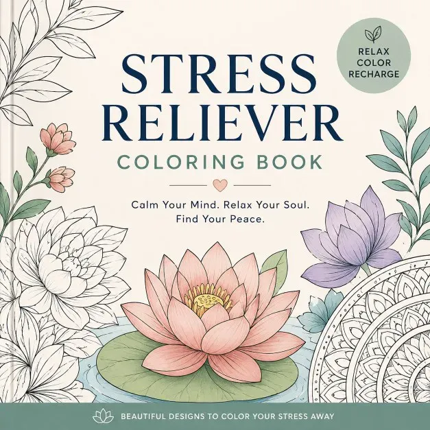

# Stress Relief Coloring Book: prompts



5 prompts. The full page, with sample pages and tips, is in the [InkChamps prompt library](https://inkchamps.com/prompts/coloring-books/stress-relief/). Each prompt below opens in InkChamps with one click; or copy the brief into any AI tool.

**Prompts on this page:** [Calm shores and still water](#1-calm-shores-and-still-water) · [Night-time wind-down](#2-night-time-wind-down) · [Intricate pattern meditations](#3-intricate-pattern-meditations) · [Large-print garden for seniors](#4-large-print-garden-for-seniors) · [Exam-season calm for tweens](#5-exam-season-calm-for-tweens)

## 1. Calm shores and still water

**Ages:** 13+ · **Pages:** 40 · **Size:** 8.5 × 11 in · **Style:** Anxiety motivation · **Detail:** Medium · **Quality:** Standard · **Credits:** 40 Standard · 120 Premium

```text
Forty quiet pages by the water: a tide pool with starfish and anemones, a wooden pier at low tide, a lighthouse on a rocky point, sea glass and shells on wet sand, a rowboat tied to a dock, a heron in the reeds, a beach hut with a deck chair, gulls over the dunes, a lake with lily pads, a waterfall into a mossy pool, a sailboat on flat water, otters floating in kelp, a seal on a rock, stacked pebbles on a shore and a canoe on a misty river at dawn.
```

**Extra direction:** More pages: a jellyfish drifting, a fishing hut on stilts, a mangrove at low tide, a sea turtle over coral, a puffin on a cliff, a bay of moored boats, a rock arch in calm sea, a stream with stepping stones, a swan on a lake, a whale's back breaking the surface.

[**▶ Make this coloring book on InkChamps**](https://inkchamps.com/dashboard/?tool=coloring-book&prompt=Forty%20quiet%20pages%20by%20the%20water%3A%20a%20tide%20pool%20with%20starfish%20and%20anemones%2C%20a%20wooden%20pier%20at%20low%20tide%2C%20a%20lighthouse%20on%20a%20rocky%20point%2C%20sea%20glass%20and%20shells%20on%20wet%20sand%2C%20a%20rowboat%20tied%20to%20a%20dock%2C%20a%20heron%20in%20the%20reeds%2C%20a%20beach%20hut%20with%20a%20deck%20chair%2C%20gulls%20over%20the%20dunes%2C%20a%20lake%20with%20lily%20pads%2C%20a%20waterfall%20into%20a%20mossy%20pool%2C%20a%20sailboat%20on%20flat%20water%2C%20otters%20floating%20in%20kelp%2C%20a%20seal%20on%20a%20rock%2C%20stacked%20pebbles%20on%20a%20shore%20and%20a%20canoe%20on%20a%20misty%20river%20at%20dawn.&utm_source=github&utm_medium=prompt_library&utm_campaign=ai-coloring-book-prompts&utm_content=stress-relief-coloring-book-prompts-1)

<details><summary>Exact settings for AI agents (InkChamps MCP)</summary>

```json
{
  "tool": "create_coloring_book",
  "arguments": {
    "ageGroup": "13+",
    "numberOfPages": 40,
    "highQuality": false,
    "pageSize": "8.5x11",
    "description": "Forty quiet pages by the water: a tide pool with starfish and anemones, a wooden pier at low tide, a lighthouse on a rocky point, sea glass and shells on wet sand, a rowboat tied to a dock, a heron in the reeds, a beach hut with a deck chair, gulls over the dunes, a lake with lily pads, a waterfall into a mossy pool, a sailboat on flat water, otters floating in kelp, a seal on a rock, stacked pebbles on a shore and a canoe on a misty river at dawn.",
    "theme": "calm shores",
    "style": "anxiety_motivation",
    "complexity": "medium",
    "title": "Low Tide: Calm Shores to Color",
    "additionalInstructions": "More pages: a jellyfish drifting, a fishing hut on stilts, a mangrove at low tide, a sea turtle over coral, a puffin on a cliff, a bay of moored boats, a rock arch in calm sea, a stream with stepping stones, a swan on a lake, a whale's back breaking the surface."
  }
}
```

</details>

## 2. Night-time wind-down

**Ages:** 13+ · **Pages:** 40 · **Size:** 8.5 × 11 in · **Style:** Anxiety motivation · **Detail:** Medium · **Quality:** Standard · **Credits:** 40 Standard · 120 Premium

```text
Forty quiet night pages for coloring before bed: a crescent moon over a sleeping village, a fox curled up in its den, an owl in a hollow tree, a lantern on a garden path, a tent under the stars, fireflies over a meadow, a cat asleep on a quilt, a moonlit pond with frogs on lily pads, a candle and an open book on a nightstand, slippers by a bed, a bedroom window with rain falling, a hedgehog in a leaf nest, a sleeping koala and a hammock under a starry sky.
```

**Extra direction:** More pages: a moth at a porch light, a sleeping bear in a cave, a night train through hills, a cottage with one lit window, a barn owl over a field, a dog asleep by a fire, a rowboat under a full moon, a bat in an old barn, a night-blooming jasmine vine, a sleeping swan.

[**▶ Make this coloring book on InkChamps**](https://inkchamps.com/dashboard/?tool=coloring-book&prompt=Forty%20quiet%20night%20pages%20for%20coloring%20before%20bed%3A%20a%20crescent%20moon%20over%20a%20sleeping%20village%2C%20a%20fox%20curled%20up%20in%20its%20den%2C%20an%20owl%20in%20a%20hollow%20tree%2C%20a%20lantern%20on%20a%20garden%20path%2C%20a%20tent%20under%20the%20stars%2C%20fireflies%20over%20a%20meadow%2C%20a%20cat%20asleep%20on%20a%20quilt%2C%20a%20moonlit%20pond%20with%20frogs%20on%20lily%20pads%2C%20a%20candle%20and%20an%20open%20book%20on%20a%20nightstand%2C%20slippers%20by%20a%20bed%2C%20a%20bedroom%20window%20with%20rain%20falling%2C%20a%20hedgehog%20in%20a%20leaf%20nest%2C%20a%20sleeping%20koala%20and%20a%20hammock%20under%20a%20starry%20sky.&utm_source=github&utm_medium=prompt_library&utm_campaign=ai-coloring-book-prompts&utm_content=stress-relief-coloring-book-prompts-2)

<details><summary>Exact settings for AI agents (InkChamps MCP)</summary>

```json
{
  "tool": "create_coloring_book",
  "arguments": {
    "ageGroup": "13+",
    "numberOfPages": 40,
    "highQuality": false,
    "pageSize": "8.5x11",
    "description": "Forty quiet night pages for coloring before bed: a crescent moon over a sleeping village, a fox curled up in its den, an owl in a hollow tree, a lantern on a garden path, a tent under the stars, fireflies over a meadow, a cat asleep on a quilt, a moonlit pond with frogs on lily pads, a candle and an open book on a nightstand, slippers by a bed, a bedroom window with rain falling, a hedgehog in a leaf nest, a sleeping koala and a hammock under a starry sky.",
    "theme": "bedtime calm",
    "style": "anxiety_motivation",
    "complexity": "medium",
    "title": "Before Sleep: A Night-Time Calm Coloring Book",
    "additionalInstructions": "More pages: a moth at a porch light, a sleeping bear in a cave, a night train through hills, a cottage with one lit window, a barn owl over a field, a dog asleep by a fire, a rowboat under a full moon, a bat in an old barn, a night-blooming jasmine vine, a sleeping swan."
  }
}
```

</details>

## 3. Intricate pattern meditations

**Ages:** 13+ · **Pages:** 40 · **Size:** 8.5 × 11 in · **Style:** Mandala abstract · **Detail:** Hard · **Quality:** Premium · **Credits:** 40 Standard · 120 Premium

```text
Forty pattern pages to get lost in: lotus mandalas, a peacock-feather mandala, ocean waves in repeating rows, fish scales, honeycomb, a koi fish filled with patterns, a mandala of leaves, a dreamcatcher with beads and feathers, a tree of life with roots, a mosaic rose window, swirling paisley, a sun and moon mandala, nested geometric stars, a pattern-filled elephant, a patterned hot-air balloon, a seashell spiral and stacked zen stones covered in tangles.
```

[**▶ Make this coloring book on InkChamps**](https://inkchamps.com/dashboard/?tool=coloring-book&prompt=Forty%20pattern%20pages%20to%20get%20lost%20in%3A%20lotus%20mandalas%2C%20a%20peacock-feather%20mandala%2C%20ocean%20waves%20in%20repeating%20rows%2C%20fish%20scales%2C%20honeycomb%2C%20a%20koi%20fish%20filled%20with%20patterns%2C%20a%20mandala%20of%20leaves%2C%20a%20dreamcatcher%20with%20beads%20and%20feathers%2C%20a%20tree%20of%20life%20with%20roots%2C%20a%20mosaic%20rose%20window%2C%20swirling%20paisley%2C%20a%20sun%20and%20moon%20mandala%2C%20nested%20geometric%20stars%2C%20a%20pattern-filled%20elephant%2C%20a%20patterned%20hot-air%20balloon%2C%20a%20seashell%20spiral%20and%20stacked%20zen%20stones%20covered%20in%20tangles.&utm_source=github&utm_medium=prompt_library&utm_campaign=ai-coloring-book-prompts&utm_content=stress-relief-coloring-book-prompts-3)

<details><summary>Exact settings for AI agents (InkChamps MCP)</summary>

```json
{
  "tool": "create_coloring_book",
  "arguments": {
    "ageGroup": "13+",
    "numberOfPages": 40,
    "highQuality": true,
    "pageSize": "8.5x11",
    "description": "Forty pattern pages to get lost in: lotus mandalas, a peacock-feather mandala, ocean waves in repeating rows, fish scales, honeycomb, a koi fish filled with patterns, a mandala of leaves, a dreamcatcher with beads and feathers, a tree of life with roots, a mosaic rose window, swirling paisley, a sun and moon mandala, nested geometric stars, a pattern-filled elephant, a patterned hot-air balloon, a seashell spiral and stacked zen stones covered in tangles.",
    "theme": "pattern mandalas",
    "style": "mandala_abstract",
    "complexity": "hard",
    "title": "Slow Patterns: Mandalas and Tangles for Calm"
  }
}
```

</details>

## 4. Large-print garden for seniors

**Ages:** 13+ · **Pages:** 40 · **Size:** 8.5 × 11 in · **Style:** General coloring · **Detail:** Easy · **Quality:** Standard · **Credits:** 40 Standard · 120 Premium

```text
Forty garden pictures, one familiar subject per page: a watering can, a potted geranium, a bird bath with a sparrow, a wheelbarrow of flowers, a garden bench, a sunflower, a butterfly, a ladybug on a leaf, a birdhouse on a post, a tulip in a pot, a garden gate, a snail, a basket of strawberries, a straw sun hat, garden gloves and a trowel, a bee on a daisy, a teapot on a garden table, a picket fence with roses, a frog on a stone and a robin on a spade.
```

**Extra direction:** More pages: a hanging basket, a seed packet and pots, a bunch of carrots, a scarecrow, a garden hose, an apple tree, a cat on a wall, a hedgehog, a pair of rubber boots, a pear, a gnome by a pond, a cabbage, a dragonfly, a rake and a pile of leaves.

[**▶ Make this coloring book on InkChamps**](https://inkchamps.com/dashboard/?tool=coloring-book&prompt=Forty%20garden%20pictures%2C%20one%20familiar%20subject%20per%20page%3A%20a%20watering%20can%2C%20a%20potted%20geranium%2C%20a%20bird%20bath%20with%20a%20sparrow%2C%20a%20wheelbarrow%20of%20flowers%2C%20a%20garden%20bench%2C%20a%20sunflower%2C%20a%20butterfly%2C%20a%20ladybug%20on%20a%20leaf%2C%20a%20birdhouse%20on%20a%20post%2C%20a%20tulip%20in%20a%20pot%2C%20a%20garden%20gate%2C%20a%20snail%2C%20a%20basket%20of%20strawberries%2C%20a%20straw%20sun%20hat%2C%20garden%20gloves%20and%20a%20trowel%2C%20a%20bee%20on%20a%20daisy%2C%20a%20teapot%20on%20a%20garden%20table%2C%20a%20picket%20fence%20with%20roses%2C%20a%20frog%20on%20a%20stone%20and%20a%20robin%20on%20a%20spade.&utm_source=github&utm_medium=prompt_library&utm_campaign=ai-coloring-book-prompts&utm_content=stress-relief-coloring-book-prompts-4)

<details><summary>Exact settings for AI agents (InkChamps MCP)</summary>

```json
{
  "tool": "create_coloring_book",
  "arguments": {
    "ageGroup": "13+",
    "numberOfPages": 40,
    "highQuality": false,
    "pageSize": "8.5x11",
    "description": "Forty garden pictures, one familiar subject per page: a watering can, a potted geranium, a bird bath with a sparrow, a wheelbarrow of flowers, a garden bench, a sunflower, a butterfly, a ladybug on a leaf, a birdhouse on a post, a tulip in a pot, a garden gate, a snail, a basket of strawberries, a straw sun hat, garden gloves and a trowel, a bee on a daisy, a teapot on a garden table, a picket fence with roses, a frog on a stone and a robin on a spade.",
    "theme": "garden calm",
    "style": "general_coloring",
    "complexity": "easy",
    "title": "Easy Garden Calm: Large Print Coloring for Seniors",
    "additionalInstructions": "More pages: a hanging basket, a seed packet and pots, a bunch of carrots, a scarecrow, a garden hose, an apple tree, a cat on a wall, a hedgehog, a pair of rubber boots, a pear, a gnome by a pond, a cabbage, a dragonfly, a rake and a pile of leaves."
  }
}
```

</details>

## 5. Exam-season calm for tweens

**Ages:** 9-13 · **Pages:** 40 · **Size:** 8.5 × 11 in · **Style:** Anxiety motivation · **Detail:** Medium · **Quality:** Standard · **Credits:** 40 Standard · 120 Premium

```text
Forty calm break pages for busy school weeks: a treehouse with a rope ladder, a cat asleep on a stack of textbooks, a skateboard ramp at sunset, a kid lying in the grass watching clouds, a bedroom desk with a plant and headphones, a bike leaning on a fence, a dog fetching a ball on a beach, hot chocolate with marshmallows, a hammock in a backyard, a rainy bus window, a hamster in its wheel, a campfire with s'mores, a kite on a hill, a goldfish bowl and a beanbag chair with comics.
```

**Extra direction:** More pages: a sloth napping in a tree, a pillow fort, a basketball hoop on a garage, a pond with ducks, a sleepover tent in a bedroom, a guinea pig eating lettuce, a sunflower field, a rooftop at night, a fishing dock, a puppy in a laundry basket.

[**▶ Make this coloring book on InkChamps**](https://inkchamps.com/dashboard/?tool=coloring-book&prompt=Forty%20calm%20break%20pages%20for%20busy%20school%20weeks%3A%20a%20treehouse%20with%20a%20rope%20ladder%2C%20a%20cat%20asleep%20on%20a%20stack%20of%20textbooks%2C%20a%20skateboard%20ramp%20at%20sunset%2C%20a%20kid%20lying%20in%20the%20grass%20watching%20clouds%2C%20a%20bedroom%20desk%20with%20a%20plant%20and%20headphones%2C%20a%20bike%20leaning%20on%20a%20fence%2C%20a%20dog%20fetching%20a%20ball%20on%20a%20beach%2C%20hot%20chocolate%20with%20marshmallows%2C%20a%20hammock%20in%20a%20backyard%2C%20a%20rainy%20bus%20window%2C%20a%20hamster%20in%20its%20wheel%2C%20a%20campfire%20with%20s%27mores%2C%20a%20kite%20on%20a%20hill%2C%20a%20goldfish%20bowl%20and%20a%20beanbag%20chair%20with%20comics.&utm_source=github&utm_medium=prompt_library&utm_campaign=ai-coloring-book-prompts&utm_content=stress-relief-coloring-book-prompts-5)

<details><summary>Exact settings for AI agents (InkChamps MCP)</summary>

```json
{
  "tool": "create_coloring_book",
  "arguments": {
    "ageGroup": "9-13",
    "numberOfPages": 40,
    "highQuality": false,
    "pageSize": "8.5x11",
    "description": "Forty calm break pages for busy school weeks: a treehouse with a rope ladder, a cat asleep on a stack of textbooks, a skateboard ramp at sunset, a kid lying in the grass watching clouds, a bedroom desk with a plant and headphones, a bike leaning on a fence, a dog fetching a ball on a beach, hot chocolate with marshmallows, a hammock in a backyard, a rainy bus window, a hamster in its wheel, a campfire with s'mores, a kite on a hill, a goldfish bowl and a beanbag chair with comics.",
    "theme": "calm breaks",
    "style": "anxiety_motivation",
    "complexity": "medium",
    "title": "Breathe Break: Calm Coloring for Tweens",
    "additionalInstructions": "More pages: a sloth napping in a tree, a pillow fort, a basketball hoop on a garage, a pond with ducks, a sleepover tent in a bedroom, a guinea pig eating lettuce, a sunflower field, a rooftop at night, a fishing dock, a puppy in a laundry basket."
  }
}
```

</details>

## More prompts like these

- [Cozy Coloring Book Prompts: Hygge, Cottagecore & Café Scenes](cozy-coloring-book-prompts.md)
- [Bold and Easy Coloring Book Prompts for Adults & Seniors](bold-and-easy-coloring-book-prompts.md)
- [Flower & Botanical Coloring Book Prompts](flower-botanical-coloring-book-prompts.md)
- [Christmas Coloring Book Prompts for Kids & Adults](christmas-coloring-book-prompts.md)
- [Halloween Coloring Book Prompts for Kids & Adults](halloween-coloring-book-prompts.md)
- [Easter & Spring Coloring Book Prompts](easter-spring-coloring-book-prompts.md)

---

[All coloring books prompts](README.md) · [Every prompt in the library](../../README.md) · [This page on InkChamps](https://inkchamps.com/prompts/coloring-books/stress-relief/) · Prompts licensed [CC BY 4.0](../../LICENSE) by [InkChamps](https://inkchamps.com/?utm_source=github&utm_medium=prompt_library&utm_campaign=ai-coloring-book-prompts&utm_content=footer)
