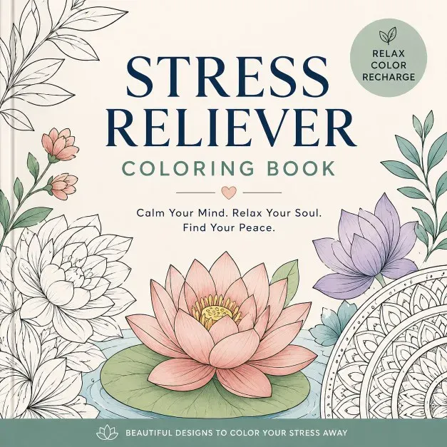

# Stress Relief Coloring Book: prompts



5 prompts. The full page, with sample pages and tips, is in the [InkChamps prompt library](https://inkchamps.com/prompts/coloring-books/stress-relief/). Each prompt below opens in InkChamps with one click; or copy the brief into any AI tool.

**Prompts on this page:** [Calm shores and still water](#1-calm-shores-and-still-water) · [Night-time wind-down](#2-night-time-wind-down) · [Intricate pattern meditations](#3-intricate-pattern-meditations) · [Large-print garden for seniors](#4-large-print-garden-for-seniors) · [Exam-season calm for tweens](#5-exam-season-calm-for-tweens)

## 1. Calm shores and still water

**Ages:** 13+ · **Pages:** 24 · **Size:** 8.5 × 11 in · **Style:** Anxiety motivation · **Detail:** Medium · **Quality:** Standard · **Credits:** 24 Standard · 72 Premium

```text
24 quiet pages by the water, from dawn on a misty river to a lighthouse at dusk: a tide pool with starfish, a wooden pier at low tide, sea glass and shells on wet sand, a rowboat tied to a dock, a heron in the reeds, a beach hut with a deck chair, a lake with lily pads, a waterfall into a mossy pool, otters floating in kelp, a sea turtle over coral, a puffin on a cliff, a swan on a lake and stacked pebbles on a calm shore.
```

### Page by page (24 pages)

Paste one page at a time into ChatGPT, Gemini or any AI image tool, with this line after it:

> Black-and-white coloring page for adults and teens: a calm, realistic water scene, clean fine-to-medium outlines, medium detail in water ripples, sand, rocks and plants, a gentle full background, no shading, no grey, no words, plain white paper, portrait 8.5 x 11 page.

1. A canoe resting on a still, misty river at dawn, its paddle laid across the seats, tall reeds along the bank and a low sun rising behind distant pine trees.
2. A rocky tide pool seen from above, filled with starfish, sea anemones with soft tentacles, a small crab, periwinkle shells and strands of seaweed.
3. A long wooden pier at low tide, its barnacled posts standing on rippled wet sand, a few gulls perched on the railing and shallow pools between the posts.
4. A close view of wet sand scattered with sea glass, scallop shells, a spiral whelk, smooth pebbles and a curl of seaweed, a thin wave edge foaming at the top.
5. A wooden rowboat tied to a small dock with a coiled rope, two oars resting inside, lily pads drifting on the flat lake water around it.
6. A grey heron standing on one leg in shallow water among tall reeds and cattails, its reflection mirrored below and a dragonfly resting on a stem.
7. A striped beach hut with its doors open, a folding deck chair and a towel on the boardwalk in front, sea grass and dunes behind.
8. Gulls gliding over grassy sand dunes, a wooden fence half buried in the sand, beach grass bending in the breeze and a calm sea on the horizon.
9. A still lake covered in lily pads and open water lilies, a frog sitting on the largest pad and a willow branch trailing into the water.
10. A waterfall pouring into a round mossy pool, ferns growing from the rocks, smooth stones in the shallows and a fallen log across the stream.
11. A single sailboat on perfectly flat water, its sail slack, soft clouds above and a gentle line of hills along the far shore.
12. Two sea otters floating on their backs in a kelp forest, holding paws, one with a clam resting on its chest, long kelp ribbons around them.
13. A seal stretched out asleep on a smooth rock above calm water, a few barnacles and limpets on the rock and a gull standing nearby.
14. A jellyfish drifting through open water, its round bell and long ribbon tentacles trailing down, tiny bubbles and a few small fish around it.
15. A sea turtle gliding over a coral reef, brain coral, fan coral and branching coral below, and a small school of fish swimming ahead.
16. A puffin standing on a grassy cliff edge with sea pinks blooming around its feet, the calm sea and a rocky stack far below.
17. A wooden fishing hut on stilts over a quiet lagoon, a ladder down to a moored skiff, fishing nets drying on a rail.
18. Mangrove trees at low tide, their tangled roots arching out of shallow water, a small crab climbing a root and a kingfisher on a branch.
19. A natural rock arch standing in a calm sea, gentle ripples passing through it, seabirds resting on top and a smooth pebble beach in front.
20. A shallow forest stream crossed by a line of flat stepping stones, ferns and moss on the banks and fallen leaves floating on the water.
21. A swan gliding across a misty lake with its wings softly raised, reeds at the water's edge and a small wooden boathouse behind.
22. The long back and small fin of a whale breaking the surface of a calm bay, a spray of mist above it and a coastline of hills behind.
23. A tall stack of smooth balanced pebbles on a quiet shore, a strand of driftwood beside it and gentle waves lapping at the sand.
24. A lighthouse on a rocky point at dusk, its beam reaching over calm water, a small cottage at its base and the first stars appearing above.

[**▶ Make this coloring book on InkChamps**](https://inkchamps.com/dashboard/?tool=coloring-book&prompt=24%20quiet%20pages%20by%20the%20water%2C%20from%20dawn%20on%20a%20misty%20river%20to%20a%20lighthouse%20at%20dusk%3A%20a%20tide%20pool%20with%20starfish%2C%20a%20wooden%20pier%20at%20low%20tide%2C%20sea%20glass%20and%20shells%20on%20wet%20sand%2C%20a%20rowboat%20tied%20to%20a%20dock%2C%20a%20heron%20in%20the%20reeds%2C%20a%20beach%20hut%20with%20a%20deck%20chair%2C%20a%20lake%20with%20lily%20pads%2C%20a%20waterfall%20into%20a%20mossy%20pool%2C%20otters%20floating%20in%20kelp%2C%20a%20sea%20turtle%20over%20coral%2C%20a%20puffin%20on%20a%20cliff%2C%20a%20swan%20on%20a%20lake%20and%20stacked%20pebbles%20on%20a%20calm%20shore.&utm_source=github&utm_medium=prompt_library&utm_campaign=ai-coloring-book-prompts&utm_content=stress-relief-coloring-book-prompts-1)

<details><summary>Exact settings for AI agents (InkChamps MCP)</summary>

```json
{
  "tool": "create_coloring_book",
  "arguments": {
    "ageGroup": "13+",
    "numberOfPages": 24,
    "highQuality": false,
    "pageSize": "8.5x11",
    "description": "24 quiet pages by the water, from dawn on a misty river to a lighthouse at dusk: a tide pool with starfish, a wooden pier at low tide, sea glass and shells on wet sand, a rowboat tied to a dock, a heron in the reeds, a beach hut with a deck chair, a lake with lily pads, a waterfall into a mossy pool, otters floating in kelp, a sea turtle over coral, a puffin on a cliff, a swan on a lake and stacked pebbles on a calm shore.",
    "theme": "calm shores",
    "style": "anxiety_motivation",
    "complexity": "medium",
    "title": "Low Tide: Calm Shores to Color"
  }
}
```

</details>

## 2. Night-time wind-down

**Ages:** 13+ · **Pages:** 24 · **Size:** 8.5 × 11 in · **Style:** Anxiety motivation · **Detail:** Medium · **Quality:** Standard · **Credits:** 24 Standard · 72 Premium

```text
24 quiet night pages for coloring before bed, from dusk to deep sleep: a crescent moon over a sleeping village, a cottage with one lit window, a lantern on a garden path, fireflies over a meadow, an owl in a hollow tree, a fox curled in its den, a moonlit pond with frogs, a tent under the stars, rain on a bedroom window, a cat asleep on a quilt, a candle and an open book on a nightstand, a hedgehog in a leaf nest, a sleeping bear in a cave and a hammock under a starry sky.
```

### Page by page (24 pages)

Paste one page at a time into ChatGPT, Gemini or any AI image tool, with this line after it:

> Black-and-white coloring page for adults and teens: a peaceful night-time scene, clean fine-to-medium outlines, medium detail with stars, moon and soft textures, a calm full background with open areas to fill, no shading, no grey, no solid black, no words, plain white paper, portrait 8.5 x 11 page.

1. A crescent moon rising over a sleeping village of small stone houses with dark windows, a church spire and rolling hills beyond.
2. A thatched cottage at the edge of a wood with just one lit window, smoke curling from its chimney and a picket gate at the front.
3. An iron lantern glowing on a winding garden path between lavender bushes and round stepping stones, moths circling the light.
4. Fireflies drifting over a summer meadow of tall grasses and wildflowers, a wooden fence along one side and a large full moon above.
5. A moth resting on a porch light beside a screen door, a rocking chair on the porch and a potted fern on the step.
6. A barn owl gliding low over a moonlit hay field, round hay bales below and a small barn on the horizon.
7. An owl with half-closed eyes sitting in the hollow of an old oak tree, ivy winding up the trunk and stars between the branches.
8. A red fox curled up asleep in its den under tree roots, its bushy tail wrapped over its nose and fallen leaves around the entrance.
9. A moonlit pond with frogs sitting on lily pads, cattails along the edge and the reflection of the moon rippling on the water.
10. A bat hanging upside down from a beam in an old wooden barn, an open hayloft door showing the night sky and a few stars.
11. A small tent pitched on a hillside under a sky full of stars and a band of the Milky Way, a lantern by the tent flap.
12. A rowboat drifting on a still lake under a full moon, its oars pulled in and a line of pine trees along the dark shore.
13. A steam train with lit carriage windows winding through quiet hills at night, a stone bridge ahead and a crescent moon above.
14. A night-blooming jasmine vine climbing a garden trellis, its star-shaped flowers open, a crescent moon peeking through the leaves.
15. A bedroom window with raindrops running down the glass, a potted plant on the sill, a folded blanket on the window seat and a cup of tea.
16. A nightstand with a lit candle, an open book, reading glasses and a small vase of chamomile flowers, the edge of a pillow beside it.
17. A pair of soft slippers set neatly by a made bed, a knitted throw folded at its foot and a small rug on the wooden floor.
18. A cat asleep on a patchwork quilt, curled into a round ball with its paws tucked in, a ball of yarn beside it.
19. A dog sleeping on a rug by a low fireplace, a basket of logs beside the hearth and a pair of boots drying nearby.
20. A hedgehog asleep in a nest of autumn leaves beneath a hedge, a few acorns and a mushroom beside it.
21. A koala asleep in the fork of a eucalyptus tree, hugging the branch, long leaves hanging around it and a crescent moon above.
22. A brown bear sleeping in a cave mouth on a bed of moss, its head on its paws, icicles at the entrance and snow outside.
23. A swan asleep on a quiet river, its head tucked under its wing, reeds and a willow tree on the bank.
24. A hammock strung between two trees under a starry sky, a soft pillow and a blanket inside, a lantern hanging from a branch.

[**▶ Make this coloring book on InkChamps**](https://inkchamps.com/dashboard/?tool=coloring-book&prompt=24%20quiet%20night%20pages%20for%20coloring%20before%20bed%2C%20from%20dusk%20to%20deep%20sleep%3A%20a%20crescent%20moon%20over%20a%20sleeping%20village%2C%20a%20cottage%20with%20one%20lit%20window%2C%20a%20lantern%20on%20a%20garden%20path%2C%20fireflies%20over%20a%20meadow%2C%20an%20owl%20in%20a%20hollow%20tree%2C%20a%20fox%20curled%20in%20its%20den%2C%20a%20moonlit%20pond%20with%20frogs%2C%20a%20tent%20under%20the%20stars%2C%20rain%20on%20a%20bedroom%20window%2C%20a%20cat%20asleep%20on%20a%20quilt%2C%20a%20candle%20and%20an%20open%20book%20on%20a%20nightstand%2C%20a%20hedgehog%20in%20a%20leaf%20nest%2C%20a%20sleeping%20bear%20in%20a%20cave%20and%20a%20hammock%20under%20a%20starry%20sky.&utm_source=github&utm_medium=prompt_library&utm_campaign=ai-coloring-book-prompts&utm_content=stress-relief-coloring-book-prompts-2)

<details><summary>Exact settings for AI agents (InkChamps MCP)</summary>

```json
{
  "tool": "create_coloring_book",
  "arguments": {
    "ageGroup": "13+",
    "numberOfPages": 24,
    "highQuality": false,
    "pageSize": "8.5x11",
    "description": "24 quiet night pages for coloring before bed, from dusk to deep sleep: a crescent moon over a sleeping village, a cottage with one lit window, a lantern on a garden path, fireflies over a meadow, an owl in a hollow tree, a fox curled in its den, a moonlit pond with frogs, a tent under the stars, rain on a bedroom window, a cat asleep on a quilt, a candle and an open book on a nightstand, a hedgehog in a leaf nest, a sleeping bear in a cave and a hammock under a starry sky.",
    "theme": "bedtime calm",
    "style": "anxiety_motivation",
    "complexity": "medium",
    "title": "Before Sleep: A Night-Time Calm Coloring Book"
  }
}
```

</details>

## 3. Intricate pattern meditations

**Ages:** 13+ · **Pages:** 24 · **Size:** 8.5 × 11 in · **Style:** Mandala abstract · **Detail:** Hard · **Quality:** Premium · **Credits:** 24 Standard · 72 Premium

```text
24 pattern pages to get lost in: a lotus mandala, a peacock-feather mandala, ocean waves in repeating rows, fish scales, honeycomb, a koi fish filled with patterns, a mandala of leaves, a dreamcatcher with beads and feathers, a tree of life with roots, a mosaic rose window, swirling paisley, a sun and moon mandala, nested geometric stars, a patterned elephant, a patterned hot-air balloon, a seashell spiral and stacked zen stones covered in tangles.
```

### Page by page (24 pages)

Paste one page at a time into ChatGPT, Gemini or any AI image tool, with this line after it:

> Black-and-white coloring page for adults: an intricate pattern design filling the whole page, fine crisp outlines, very high detail with many small enclosed spaces to color, no background scene, no shading, no grey, no solid black fills, no words, plain white paper, portrait 8.5 x 11 page.

1. A large lotus mandala filling the page, layers of pointed petals radiating from a dotted center, each petal filled with fine lines, teardrops and tiny circles.
2. A peacock-feather mandala, a ring of feathers fanning outward from a central eye, each feather filled with scales, swirls and fine strands.
3. Ocean waves in repeating rows across the whole page, each curling crest filled with spirals, dots and nested lines like a woodblock print.
4. A field of overlapping fish scales covering the page, each scale holding a smaller scale, a dot border or a tiny flower.
5. A honeycomb of hexagon cells spreading across the page, some cells filled with petals, some with stripes, two small bees resting on the comb.
6. A koi fish curving in a circle, its body filled with scale patterns, its long fins and tail flowing into swirling water lines and lotus pads.
7. A mandala made entirely of leaves, rings of oak, fern, ginkgo and willow leaves arranged around a center seed, each leaf veined with patterns.
8. A dreamcatcher with a woven web of geometric knots, beads threaded on the strings and three patterned feathers hanging below.
9. A tree of life with a round canopy of patterned leaves and spiral branches, its roots weaving into knots below the trunk.
10. A mosaic rose window of tiny tiles arranged in rings of petals and arches, a sixteen-point star at its center.
11. Swirling paisley teardrops covering the whole page, each filled with petals, scallops, dots and nested curves, small flowers between them.
12. A sun and moon mandala, a sun with flame-shaped rays on one half and a crescent moon with stars on the other, joined in one patterned ring.
13. Nested geometric stars, an eight-point star inside a twelve-point star inside a sixteen-point star, every band filled with lattice and triangles.
14. An elephant standing in profile, its body covered in paisley, lace and mandala patterns, a patterned blanket on its back and a tassel on its trunk.
15. A hot-air balloon with each panel of its envelope filled with a different pattern of stripes, scallops and flowers, a woven basket and small clouds below.
16. A nautilus seashell spiral, each chamber filled with its own pattern of dots, waves, cross-hatching and tiny shells.
17. A stack of five zen stones balanced on a flat rock, each stone covered in different tangles, ripples of patterned water around the base.
18. A circular wreath of patterned feathers, beads and leaves, the open middle filled with a small lattice mandala.
19. A folk-art flower medallion: a large stylised flower with layered petals, each layer holding a different pattern, vines curling out to the corners.
20. A patterned owl perched on a branch, its feathers made of scallops, its eyes ringed with petals and the branch covered in leaf tangles.
21. A geometric hexagon mandala built from interlocking triangles and diamonds, the outer ring edged with a fine lace border.
22. A patterned butterfly with wide open wings, each wing divided into cells of swirls, dots, leaves and tiny circles, a lattice border around it.
23. A patterned jellyfish with a lace-like bell and long tentacles that curl into spirals and beads, filling the page from top to bottom.
24. A full-page square of interlaced knotwork, ribbons weaving over and under each other around a central flower mandala.

[**▶ Make this coloring book on InkChamps**](https://inkchamps.com/dashboard/?tool=coloring-book&prompt=24%20pattern%20pages%20to%20get%20lost%20in%3A%20a%20lotus%20mandala%2C%20a%20peacock-feather%20mandala%2C%20ocean%20waves%20in%20repeating%20rows%2C%20fish%20scales%2C%20honeycomb%2C%20a%20koi%20fish%20filled%20with%20patterns%2C%20a%20mandala%20of%20leaves%2C%20a%20dreamcatcher%20with%20beads%20and%20feathers%2C%20a%20tree%20of%20life%20with%20roots%2C%20a%20mosaic%20rose%20window%2C%20swirling%20paisley%2C%20a%20sun%20and%20moon%20mandala%2C%20nested%20geometric%20stars%2C%20a%20patterned%20elephant%2C%20a%20patterned%20hot-air%20balloon%2C%20a%20seashell%20spiral%20and%20stacked%20zen%20stones%20covered%20in%20tangles.&utm_source=github&utm_medium=prompt_library&utm_campaign=ai-coloring-book-prompts&utm_content=stress-relief-coloring-book-prompts-3)

<details><summary>Exact settings for AI agents (InkChamps MCP)</summary>

```json
{
  "tool": "create_coloring_book",
  "arguments": {
    "ageGroup": "13+",
    "numberOfPages": 24,
    "highQuality": true,
    "pageSize": "8.5x11",
    "description": "24 pattern pages to get lost in: a lotus mandala, a peacock-feather mandala, ocean waves in repeating rows, fish scales, honeycomb, a koi fish filled with patterns, a mandala of leaves, a dreamcatcher with beads and feathers, a tree of life with roots, a mosaic rose window, swirling paisley, a sun and moon mandala, nested geometric stars, a patterned elephant, a patterned hot-air balloon, a seashell spiral and stacked zen stones covered in tangles.",
    "theme": "pattern mandalas",
    "style": "mandala_abstract",
    "complexity": "hard",
    "title": "Slow Patterns: Mandalas and Tangles for Calm"
  }
}
```

</details>

## 4. Large-print garden for seniors

**Ages:** 13+ · **Pages:** 24 · **Size:** 8.5 × 11 in · **Style:** General coloring · **Detail:** Easy · **Quality:** Standard · **Credits:** 24 Standard · 72 Premium

```text
24 large, simple garden pictures, one familiar subject per page: a watering can, a potted geranium, a bird bath with a sparrow, a wheelbarrow of flowers, a garden bench, a sunflower, a butterfly, a ladybug on a leaf, a birdhouse on a post, a tulip in a pot, a garden gate, a snail, a basket of strawberries, a straw sun hat, gloves and a trowel, a bee on a daisy, a teapot on a garden table, a robin on a spade, rubber boots, an apple tree, a cat on a wall and a hedgehog.
```

### Page by page (24 pages)

Paste one page at a time into ChatGPT, Gemini or any AI image tool, with this line after it:

> Black-and-white large-print coloring page for seniors and adults with low vision: one big, familiar garden subject filling most of the page, very thick bold outlines, large simple shapes with wide spaces to color, very little background, no tiny details, no shading, no grey, no words, plain white paper, portrait 8.5 x 11 page.

1. A large metal watering can with a long spout and a round rose head, a few drops of water falling onto a patch of grass.
2. A potted geranium in a clay pot, three big round flower clusters and a few broad scalloped leaves.
3. A stone bird bath on a pedestal with a sparrow perched on the rim and a little water in the bowl.
4. A wooden wheelbarrow filled with flowers in pots, its single wheel in front and two handles at the back.
5. A slatted wooden garden bench with curved armrests, a cushion on the seat and a flower pot beside one leg.
6. A tall sunflower with a big round center and wide petals, two large leaves on its sturdy stem.
7. A butterfly with wide open wings, each wing marked with a few large round spots and simple shapes.
8. A ladybug with big round spots sitting on a large leaf, the leaf's central vein curving across the page.
9. A wooden birdhouse on a post with a round hole, a little perch and a pointed roof, a bird looking out.
10. Three tulips standing tall in a round flower pot, each with a cup-shaped flower and a long smooth leaf.
11. A wooden garden gate with an arch above it, a latch on the side and a climbing rose along the arch.
12. A snail with a large spiral shell sliding along a garden path, its two feelers raised.
13. A wicker basket full of big strawberries, two leafy tops showing and a handle arching over the basket.
14. A wide-brimmed straw sun hat with a ribbon band and a single flower tucked into the band.
15. A pair of garden gloves lying beside a trowel and a small fork on the soil.
16. A bee resting on a big daisy, its striped body and wings simple and clear, the daisy petals wide and round.
17. A round teapot and two cups with saucers on a small garden table, a plate of biscuits beside them.
18. A robin perched on the handle of a garden spade pushed into the soil, its round chest puffed out.
19. A hanging basket of trailing flowers on a wall bracket, a few big blooms spilling over its edge.
20. A pair of rubber boots standing side by side by the back door, a small flower pot next to them.
21. An apple tree with a round leafy top and a few big apples, one apple lying on the grass below.
22. A cat sitting on a low brick garden wall, its tail hanging down, a single flower growing at the wall's base.
23. A hedgehog walking across the lawn, its back of simple rounded spikes, a fallen leaf beside it.
24. A scarecrow in a straw hat and patched shirt standing in a vegetable patch, a crow sitting on one arm.

[**▶ Make this coloring book on InkChamps**](https://inkchamps.com/dashboard/?tool=coloring-book&prompt=24%20large%2C%20simple%20garden%20pictures%2C%20one%20familiar%20subject%20per%20page%3A%20a%20watering%20can%2C%20a%20potted%20geranium%2C%20a%20bird%20bath%20with%20a%20sparrow%2C%20a%20wheelbarrow%20of%20flowers%2C%20a%20garden%20bench%2C%20a%20sunflower%2C%20a%20butterfly%2C%20a%20ladybug%20on%20a%20leaf%2C%20a%20birdhouse%20on%20a%20post%2C%20a%20tulip%20in%20a%20pot%2C%20a%20garden%20gate%2C%20a%20snail%2C%20a%20basket%20of%20strawberries%2C%20a%20straw%20sun%20hat%2C%20gloves%20and%20a%20trowel%2C%20a%20bee%20on%20a%20daisy%2C%20a%20teapot%20on%20a%20garden%20table%2C%20a%20robin%20on%20a%20spade%2C%20rubber%20boots%2C%20an%20apple%20tree%2C%20a%20cat%20on%20a%20wall%20and%20a%20hedgehog.&utm_source=github&utm_medium=prompt_library&utm_campaign=ai-coloring-book-prompts&utm_content=stress-relief-coloring-book-prompts-4)

<details><summary>Exact settings for AI agents (InkChamps MCP)</summary>

```json
{
  "tool": "create_coloring_book",
  "arguments": {
    "ageGroup": "13+",
    "numberOfPages": 24,
    "highQuality": false,
    "pageSize": "8.5x11",
    "description": "24 large, simple garden pictures, one familiar subject per page: a watering can, a potted geranium, a bird bath with a sparrow, a wheelbarrow of flowers, a garden bench, a sunflower, a butterfly, a ladybug on a leaf, a birdhouse on a post, a tulip in a pot, a garden gate, a snail, a basket of strawberries, a straw sun hat, gloves and a trowel, a bee on a daisy, a teapot on a garden table, a robin on a spade, rubber boots, an apple tree, a cat on a wall and a hedgehog.",
    "theme": "garden calm",
    "style": "general_coloring",
    "complexity": "easy",
    "title": "Easy Garden Calm: Large Print Coloring for Seniors"
  }
}
```

</details>

## 5. Exam-season calm for tweens

**Ages:** 9-13 · **Pages:** 24 · **Size:** 8.5 × 11 in · **Style:** Anxiety motivation · **Detail:** Medium · **Quality:** Standard · **Credits:** 24 Standard · 72 Premium

```text
24 calm break pages for busy school weeks: a treehouse with a rope ladder, a cat asleep on a stack of textbooks, a kid watching clouds in the grass, a bedroom desk with a plant and headphones, a bike leaning on a fence, a dog fetching a ball on a beach, hot chocolate with marshmallows, a hammock in a backyard, a rainy bus window, a hamster in its wheel, a campfire with toasted marshmallows, a kite on a hill, a sloth napping in a tree, a pillow fort, a pond with ducks and a puppy in a laundry basket.
```

### Page by page (24 pages)

Paste one page at a time into ChatGPT, Gemini or any AI image tool, with this line after it:

> Black-and-white coloring page for a tween aged 9 to 13: a calm, relatable everyday scene, clean medium outlines, medium detail with a simple background that shows the setting, room to color without tiny fiddly parts, no shading, no grey, no words or letters, plain white paper, portrait 8.5 x 11 page.

1. A wooden treehouse in a big oak with a rope ladder hanging down, a small window with curtains and a bucket on a pulley.
2. A cat curled up asleep on top of a stack of textbooks on a desk, a pencil cup and a desk lamp beside it.
3. A kid lying on their back in the grass watching puffy clouds, arms behind their head, a backpack and sneakers set aside.
4. A tidy bedroom desk with a potted plant, a pair of headphones, a notebook and a mug of pencils, a window with a view of trees.
5. A bicycle with a basket leaning against a wooden fence, daisies growing at the bottom of the fence and a bird on the top rail.
6. A happy dog running along the beach with a ball in its mouth, small waves, a sandcastle and a shell on the sand.
7. A big mug of hot chocolate piled with marshmallows, steam curling up, a plate of cookies and a cozy blanket beside it.
8. A hammock strung between two backyard trees, a book lying open on it and a glass of lemonade on a small stool below.
9. The view from a bus seat out of a rainy window, raindrops on the glass, wet streets and umbrellas outside, a backpack on the seat.
10. A hamster running in its wheel inside a cage with a water bottle, a little wooden house and a pile of seeds.
11. A campfire ringed with stones at dusk, marshmallows toasting on sticks, two camp chairs and a tent behind.
12. A kite with a long bow tail flying high above a grassy hill, a kid holding the string and a lone tree on the hilltop.
13. A goldfish swimming in a round bowl with pebbles and a small plant, the bowl sitting on a shelf next to a few books.
14. A beanbag chair in a cozy corner with a stack of comics, a string of round lights above and a cushion on the floor.
15. A sloth hanging from a tree branch fast asleep, its arms wrapped around the branch, leaves and a flower around it.
16. A pillow fort made of couch cushions and a draped blanket, a flashlight glowing inside and a pair of socks sticking out.
17. A basketball hoop above a garage door, a ball resting on the driveway and a chalk drawing of a sun on the ground.
18. A small pond with three ducks paddling, cattails along the edge, a wooden bench on the bank and a few bread crumbs on the path.
19. A guinea pig munching a lettuce leaf in a hay-filled hutch, a carrot and a water bowl beside it.
20. A field of sunflowers taller than a kid walking through them on a narrow path, a farmhouse far off.
21. A skateboard ramp at sunset with a skateboard resting on the top edge, a low sun and a few birds in the sky.
22. A flat rooftop at night with two folding chairs, a small telescope pointed at the stars and a crescent moon above the city.
23. A wooden fishing dock on a lake, a fishing rod propped against a bucket and a pair of sneakers left on the boards.
24. A fluffy puppy asleep in a laundry basket of clean towels, one paw hanging over the edge, a sock on the floor.

[**▶ Make this coloring book on InkChamps**](https://inkchamps.com/dashboard/?tool=coloring-book&prompt=24%20calm%20break%20pages%20for%20busy%20school%20weeks%3A%20a%20treehouse%20with%20a%20rope%20ladder%2C%20a%20cat%20asleep%20on%20a%20stack%20of%20textbooks%2C%20a%20kid%20watching%20clouds%20in%20the%20grass%2C%20a%20bedroom%20desk%20with%20a%20plant%20and%20headphones%2C%20a%20bike%20leaning%20on%20a%20fence%2C%20a%20dog%20fetching%20a%20ball%20on%20a%20beach%2C%20hot%20chocolate%20with%20marshmallows%2C%20a%20hammock%20in%20a%20backyard%2C%20a%20rainy%20bus%20window%2C%20a%20hamster%20in%20its%20wheel%2C%20a%20campfire%20with%20toasted%20marshmallows%2C%20a%20kite%20on%20a%20hill%2C%20a%20sloth%20napping%20in%20a%20tree%2C%20a%20pillow%20fort%2C%20a%20pond%20with%20ducks%20and%20a%20puppy%20in%20a%20laundry%20basket.&utm_source=github&utm_medium=prompt_library&utm_campaign=ai-coloring-book-prompts&utm_content=stress-relief-coloring-book-prompts-5)

<details><summary>Exact settings for AI agents (InkChamps MCP)</summary>

```json
{
  "tool": "create_coloring_book",
  "arguments": {
    "ageGroup": "9-13",
    "numberOfPages": 24,
    "highQuality": false,
    "pageSize": "8.5x11",
    "description": "24 calm break pages for busy school weeks: a treehouse with a rope ladder, a cat asleep on a stack of textbooks, a kid watching clouds in the grass, a bedroom desk with a plant and headphones, a bike leaning on a fence, a dog fetching a ball on a beach, hot chocolate with marshmallows, a hammock in a backyard, a rainy bus window, a hamster in its wheel, a campfire with toasted marshmallows, a kite on a hill, a sloth napping in a tree, a pillow fort, a pond with ducks and a puppy in a laundry basket.",
    "theme": "calm breaks",
    "style": "anxiety_motivation",
    "complexity": "medium",
    "title": "Breathe Break: Calm Coloring for Tweens"
  }
}
```

</details>

## More prompts like these

- [Cozy Coloring Book Prompts: Hygge, Cottagecore & Café Scenes](cozy-coloring-book-prompts.md)
- [Bold and Easy Coloring Book Prompts for Adults & Seniors](bold-and-easy-coloring-book-prompts.md)
- [Flower & Botanical Coloring Book Prompts](flower-botanical-coloring-book-prompts.md)
- [Christmas Coloring Book Prompts for Kids & Adults](christmas-coloring-book-prompts.md)
- [Halloween Coloring Book Prompts for Kids & Adults](halloween-coloring-book-prompts.md)
- [Easter & Spring Coloring Book Prompts](easter-spring-coloring-book-prompts.md)

---

[All coloring books prompts](README.md) · [Every prompt in the library](../../README.md) · [This page on InkChamps](https://inkchamps.com/prompts/coloring-books/stress-relief/) · Prompts licensed [CC BY 4.0](../../LICENSE) by [InkChamps](https://inkchamps.com/?utm_source=github&utm_medium=prompt_library&utm_campaign=ai-coloring-book-prompts&utm_content=footer)
