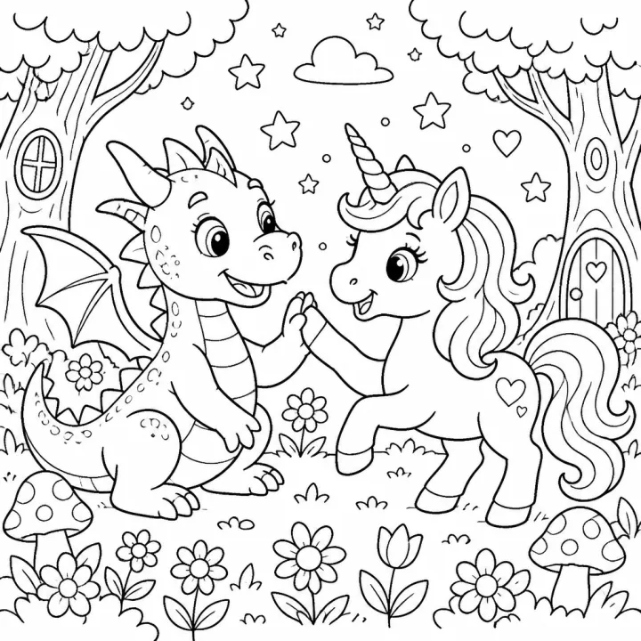

# Unicorn Coloring Book: prompts



5 prompts. The full page, with sample pages and tips, is in the [InkChamps prompt library](https://inkchamps.com/prompts/coloring-books/unicorn/). Each prompt below opens in InkChamps with one click; or copy the brief into any AI tool.

**Prompts on this page:** [Baby unicorns on clouds](#1-baby-unicorns-on-clouds) · [Unicorn parties and hobbies](#2-unicorn-parties-and-hobbies) · [Magical creatures kingdom](#3-magical-creatures-kingdom) · [Enchanted forest unicorn quest](#4-enchanted-forest-unicorn-quest) · [Unicorn mandalas for teens and adults](#5-unicorn-mandalas-for-teens-and-adults)

## 1. Baby unicorns on clouds

**Ages:** 3-6 · **Pages:** 40 · **Size:** 8.5 × 8.5 in · **Style:** Cute animals · **Detail:** Easy · **Quality:** Standard · **Credits:** 40 Standard · 120 Premium

```text
Forty pages of baby unicorns, one big one per page: a baby unicorn sleeping on a cloud, sliding down a rainbow, holding a balloon, eating a cupcake, under a crescent moon with stars, in a flower meadow, splashing in a puddle, hugging a heart, with a butterfly on its horn, in a teacup, next to a castle, with an ice cream cone, wearing a crown, and a mother unicorn nuzzling her foal.
```

**Extra direction:** More pages: a unicorn on a swing, blowing bubbles, with a star wand, riding a scooter, on a rocking horse, with a bunny friend, in a bathtub with bubbles, making a snowman, with a kite, in a hot air balloon, reading a book, hatching a rainbow egg, beside a sunflower, asleep with a teddy.

[**▶ Make this coloring book on InkChamps**](https://inkchamps.com/dashboard/?tool=coloring-book&prompt=Forty%20pages%20of%20baby%20unicorns%2C%20one%20big%20one%20per%20page%3A%20a%20baby%20unicorn%20sleeping%20on%20a%20cloud%2C%20sliding%20down%20a%20rainbow%2C%20holding%20a%20balloon%2C%20eating%20a%20cupcake%2C%20under%20a%20crescent%20moon%20with%20stars%2C%20in%20a%20flower%20meadow%2C%20splashing%20in%20a%20puddle%2C%20hugging%20a%20heart%2C%20with%20a%20butterfly%20on%20its%20horn%2C%20in%20a%20teacup%2C%20next%20to%20a%20castle%2C%20with%20an%20ice%20cream%20cone%2C%20wearing%20a%20crown%2C%20and%20a%20mother%20unicorn%20nuzzling%20her%20foal.&utm_source=github&utm_medium=prompt_library&utm_campaign=ai-coloring-book-prompts&utm_content=unicorn-coloring-book-prompts-1)

<details><summary>Exact settings for AI agents (InkChamps MCP)</summary>

```json
{
  "tool": "create_coloring_book",
  "arguments": {
    "ageGroup": "3-6",
    "numberOfPages": 40,
    "highQuality": false,
    "pageSize": "8.5x8.5",
    "description": "Forty pages of baby unicorns, one big one per page: a baby unicorn sleeping on a cloud, sliding down a rainbow, holding a balloon, eating a cupcake, under a crescent moon with stars, in a flower meadow, splashing in a puddle, hugging a heart, with a butterfly on its horn, in a teacup, next to a castle, with an ice cream cone, wearing a crown, and a mother unicorn nuzzling her foal.",
    "style": "cute_animals",
    "complexity": "easy",
    "theme": "baby unicorns",
    "title": "My First Unicorn Coloring Book",
    "additionalInstructions": "More pages: a unicorn on a swing, blowing bubbles, with a star wand, riding a scooter, on a rocking horse, with a bunny friend, in a bathtub with bubbles, making a snowman, with a kite, in a hot air balloon, reading a book, hatching a rainbow egg, beside a sunflower, asleep with a teddy."
  }
}
```

</details>

## 2. Unicorn parties and hobbies

**Ages:** 6-9 · **Pages:** 40 · **Size:** 8.5 × 11 in · **Style:** Fairy tale · **Detail:** Medium · **Quality:** Standard · **Credits:** 40 Standard · 120 Premium

```text
Forty pages of unicorns having fun: a unicorn birthday party with a layer cake, a tea party with teapots and macarons, a pajama sleepover, unicorns on a carousel, a unicorn ballet recital, baking cookies, ice skating on an icy pond, a roller-skating rink, a pool party with floats, a unicorn painting at an easel, gardening, a camping trip with marshmallows, a music band, a fashion show, and a picnic under cherry blossoms.
```

**Extra direction:** More pages: a unicorn bakery shop, a pizza night, a karaoke stage, a science fair, a soccer game, horse-riding lessons, a library visit, a lemonade stand, a dance class, a trampoline, a sandcastle, a Halloween costume party, a snowball fight, opening Christmas presents, a spa day, a unicorn school classroom.

[**▶ Make this coloring book on InkChamps**](https://inkchamps.com/dashboard/?tool=coloring-book&prompt=Forty%20pages%20of%20unicorns%20having%20fun%3A%20a%20unicorn%20birthday%20party%20with%20a%20layer%20cake%2C%20a%20tea%20party%20with%20teapots%20and%20macarons%2C%20a%20pajama%20sleepover%2C%20unicorns%20on%20a%20carousel%2C%20a%20unicorn%20ballet%20recital%2C%20baking%20cookies%2C%20ice%20skating%20on%20an%20icy%20pond%2C%20a%20roller-skating%20rink%2C%20a%20pool%20party%20with%20floats%2C%20a%20unicorn%20painting%20at%20an%20easel%2C%20gardening%2C%20a%20camping%20trip%20with%20marshmallows%2C%20a%20music%20band%2C%20a%20fashion%20show%2C%20and%20a%20picnic%20under%20cherry%20blossoms.&utm_source=github&utm_medium=prompt_library&utm_campaign=ai-coloring-book-prompts&utm_content=unicorn-coloring-book-prompts-2)

<details><summary>Exact settings for AI agents (InkChamps MCP)</summary>

```json
{
  "tool": "create_coloring_book",
  "arguments": {
    "ageGroup": "6-9",
    "numberOfPages": 40,
    "highQuality": false,
    "pageSize": "8.5x11",
    "description": "Forty pages of unicorns having fun: a unicorn birthday party with a layer cake, a tea party with teapots and macarons, a pajama sleepover, unicorns on a carousel, a unicorn ballet recital, baking cookies, ice skating on an icy pond, a roller-skating rink, a pool party with floats, a unicorn painting at an easel, gardening, a camping trip with marshmallows, a music band, a fashion show, and a picnic under cherry blossoms.",
    "style": "fairy_tale",
    "complexity": "medium",
    "theme": "unicorns at parties and doing hobbies",
    "title": "Unicorn Party Time Coloring Book",
    "additionalInstructions": "More pages: a unicorn bakery shop, a pizza night, a karaoke stage, a science fair, a soccer game, horse-riding lessons, a library visit, a lemonade stand, a dance class, a trampoline, a sandcastle, a Halloween costume party, a snowball fight, opening Christmas presents, a spa day, a unicorn school classroom."
  }
}
```

</details>

## 3. Magical creatures kingdom

**Ages:** 6-9 · **Pages:** 40 · **Size:** 8.5 × 11 in · **Style:** Fairy tale · **Detail:** Medium · **Quality:** Standard · **Credits:** 40 Standard · 120 Premium

```text
Forty pages of a magical kingdom where unicorns live with other creatures: a winged pegasus over the castle, a griffin on a cliff, a baby dragon sharing a cave, a phoenix rising from a flame, a mermaid with a sea unicorn, fairies riding on a unicorn's back, a gnome village under mushrooms, a kitsune fox, an owl wizard, a gentle troll under a bridge, a narwhal in an icy sea, and a unicorn queen on a throne.
```

**Extra direction:** More pages: an alicorn under the stars, a hippogriff, a sea serpent, a centaur archer, a jackalope, a fairy garden, a crystal waterfall, a cloud palace, a rainbow bridge, an elf market, a pixie lantern parade, a moon rabbit, a magic tree house, a potion shop, a royal ball, a dragon and unicorn race.

[**▶ Make this coloring book on InkChamps**](https://inkchamps.com/dashboard/?tool=coloring-book&prompt=Forty%20pages%20of%20a%20magical%20kingdom%20where%20unicorns%20live%20with%20other%20creatures%3A%20a%20winged%20pegasus%20over%20the%20castle%2C%20a%20griffin%20on%20a%20cliff%2C%20a%20baby%20dragon%20sharing%20a%20cave%2C%20a%20phoenix%20rising%20from%20a%20flame%2C%20a%20mermaid%20with%20a%20sea%20unicorn%2C%20fairies%20riding%20on%20a%20unicorn%27s%20back%2C%20a%20gnome%20village%20under%20mushrooms%2C%20a%20kitsune%20fox%2C%20an%20owl%20wizard%2C%20a%20gentle%20troll%20under%20a%20bridge%2C%20a%20narwhal%20in%20an%20icy%20sea%2C%20and%20a%20unicorn%20queen%20on%20a%20throne.&utm_source=github&utm_medium=prompt_library&utm_campaign=ai-coloring-book-prompts&utm_content=unicorn-coloring-book-prompts-3)

<details><summary>Exact settings for AI agents (InkChamps MCP)</summary>

```json
{
  "tool": "create_coloring_book",
  "arguments": {
    "ageGroup": "6-9",
    "numberOfPages": 40,
    "highQuality": false,
    "pageSize": "8.5x11",
    "description": "Forty pages of a magical kingdom where unicorns live with other creatures: a winged pegasus over the castle, a griffin on a cliff, a baby dragon sharing a cave, a phoenix rising from a flame, a mermaid with a sea unicorn, fairies riding on a unicorn's back, a gnome village under mushrooms, a kitsune fox, an owl wizard, a gentle troll under a bridge, a narwhal in an icy sea, and a unicorn queen on a throne.",
    "style": "fairy_tale",
    "complexity": "medium",
    "theme": "unicorns and magical creatures",
    "title": "Unicorns and Magical Creatures Kingdom",
    "additionalInstructions": "More pages: an alicorn under the stars, a hippogriff, a sea serpent, a centaur archer, a jackalope, a fairy garden, a crystal waterfall, a cloud palace, a rainbow bridge, an elf market, a pixie lantern parade, a moon rabbit, a magic tree house, a potion shop, a royal ball, a dragon and unicorn race."
  }
}
```

</details>

## 4. Enchanted forest unicorn quest

**Ages:** 9-13 · **Pages:** 40 · **Size:** 8.5 × 11 in · **Style:** Mythology · **Detail:** Hard · **Quality:** Standard · **Credits:** 40 Standard · 120 Premium

```text
Forty pages of an enchanted forest journey with a young explorer and her unicorn: setting out from a stone cottage, crossing a river on stepping stones, a giant ancient oak, a glowing mushroom grove, a hidden waterfall, a crystal cave, an old map on a tree stump, a rope bridge over a gorge, a moonlit glade, a wise stag, a sleeping stone giant, a ruined tower in vines, and a lake with a castle reflection.
```

**Extra direction:** More pages: a camp by a campfire under stars, a will-o'-the-wisp light, a fox guide, a fairy ring, a misty mountain pass, a snowy pine forest, a market in an elven village, a library of spellbooks, a hot spring, a field of moonflowers, a dragon guarding a gate, a riddle door, a sunrise over the valley, the unicorn herd reunited in a meadow.

[**▶ Make this coloring book on InkChamps**](https://inkchamps.com/dashboard/?tool=coloring-book&prompt=Forty%20pages%20of%20an%20enchanted%20forest%20journey%20with%20a%20young%20explorer%20and%20her%20unicorn%3A%20setting%20out%20from%20a%20stone%20cottage%2C%20crossing%20a%20river%20on%20stepping%20stones%2C%20a%20giant%20ancient%20oak%2C%20a%20glowing%20mushroom%20grove%2C%20a%20hidden%20waterfall%2C%20a%20crystal%20cave%2C%20an%20old%20map%20on%20a%20tree%20stump%2C%20a%20rope%20bridge%20over%20a%20gorge%2C%20a%20moonlit%20glade%2C%20a%20wise%20stag%2C%20a%20sleeping%20stone%20giant%2C%20a%20ruined%20tower%20in%20vines%2C%20and%20a%20lake%20with%20a%20castle%20reflection.&utm_source=github&utm_medium=prompt_library&utm_campaign=ai-coloring-book-prompts&utm_content=unicorn-coloring-book-prompts-4)

<details><summary>Exact settings for AI agents (InkChamps MCP)</summary>

```json
{
  "tool": "create_coloring_book",
  "arguments": {
    "ageGroup": "9-13",
    "numberOfPages": 40,
    "highQuality": false,
    "pageSize": "8.5x11",
    "description": "Forty pages of an enchanted forest journey with a young explorer and her unicorn: setting out from a stone cottage, crossing a river on stepping stones, a giant ancient oak, a glowing mushroom grove, a hidden waterfall, a crystal cave, an old map on a tree stump, a rope bridge over a gorge, a moonlit glade, a wise stag, a sleeping stone giant, a ruined tower in vines, and a lake with a castle reflection.",
    "style": "mythology",
    "complexity": "hard",
    "theme": "an enchanted forest quest with a unicorn",
    "title": "The Unicorn's Quest Coloring Book",
    "additionalInstructions": "More pages: a camp by a campfire under stars, a will-o'-the-wisp light, a fox guide, a fairy ring, a misty mountain pass, a snowy pine forest, a market in an elven village, a library of spellbooks, a hot spring, a field of moonflowers, a dragon guarding a gate, a riddle door, a sunrise over the valley, the unicorn herd reunited in a meadow."
  }
}
```

</details>

## 5. Unicorn mandalas for teens and adults

**Ages:** 13+ · **Pages:** 40 · **Size:** 8.5 × 11 in · **Style:** Mandala animal · **Detail:** Hard · **Quality:** Premium · **Credits:** 40 Standard · 120 Premium

```text
Forty ornate unicorn designs for teens and adults: a unicorn head inside a mandala, a rearing unicorn with a flowing mane of roses, a unicorn among peonies, a unicorn in a stained-glass window, a unicorn and crescent moon, a unicorn with butterfly wings, a winged unicorn over clouds, a unicorn bust with lace and jewels, a unicorn under a cherry tree, and a sleeping unicorn in a flower circle.
```

**Extra direction:** More pages: a unicorn in a dreamcatcher, a unicorn and a castle tower, a pair of unicorns facing a heart, a unicorn with a starry night mane, a unicorn in a geometric frame, a unicorn drinking at a lotus pond, a unicorn with a feather headdress, a unicorn horn of crystals, a unicorn galloping through waves, a unicorn in a hot air balloon, a unicorn among mushrooms and ferns, a unicorn with a crown of leaves.

[**▶ Make this coloring book on InkChamps**](https://inkchamps.com/dashboard/?tool=coloring-book&prompt=Forty%20ornate%20unicorn%20designs%20for%20teens%20and%20adults%3A%20a%20unicorn%20head%20inside%20a%20mandala%2C%20a%20rearing%20unicorn%20with%20a%20flowing%20mane%20of%20roses%2C%20a%20unicorn%20among%20peonies%2C%20a%20unicorn%20in%20a%20stained-glass%20window%2C%20a%20unicorn%20and%20crescent%20moon%2C%20a%20unicorn%20with%20butterfly%20wings%2C%20a%20winged%20unicorn%20over%20clouds%2C%20a%20unicorn%20bust%20with%20lace%20and%20jewels%2C%20a%20unicorn%20under%20a%20cherry%20tree%2C%20and%20a%20sleeping%20unicorn%20in%20a%20flower%20circle.&utm_source=github&utm_medium=prompt_library&utm_campaign=ai-coloring-book-prompts&utm_content=unicorn-coloring-book-prompts-5)

<details><summary>Exact settings for AI agents (InkChamps MCP)</summary>

```json
{
  "tool": "create_coloring_book",
  "arguments": {
    "ageGroup": "13+",
    "numberOfPages": 40,
    "highQuality": true,
    "pageSize": "8.5x11",
    "description": "Forty ornate unicorn designs for teens and adults: a unicorn head inside a mandala, a rearing unicorn with a flowing mane of roses, a unicorn among peonies, a unicorn in a stained-glass window, a unicorn and crescent moon, a unicorn with butterfly wings, a winged unicorn over clouds, a unicorn bust with lace and jewels, a unicorn under a cherry tree, and a sleeping unicorn in a flower circle.",
    "style": "mandala_animal",
    "complexity": "hard",
    "theme": "unicorn mandalas",
    "title": "Unicorn Mandalas: Coloring Book for Teens and Adults",
    "additionalInstructions": "More pages: a unicorn in a dreamcatcher, a unicorn and a castle tower, a pair of unicorns facing a heart, a unicorn with a starry night mane, a unicorn in a geometric frame, a unicorn drinking at a lotus pond, a unicorn with a feather headdress, a unicorn horn of crystals, a unicorn galloping through waves, a unicorn in a hot air balloon, a unicorn among mushrooms and ferns, a unicorn with a crown of leaves."
  }
}
```

</details>

## More prompts like these

- [Dragon Coloring Book Prompts for Kids, Teens & Adults](dragon-coloring-book-prompts.md)
- [Jungle & Safari Animal Coloring Book Prompts](jungle-safari-coloring-book-prompts.md)
- [Cat Coloring Book Prompts: Kittens, Cozy Cats & Cat Mandalas](cat-coloring-book-prompts.md)
- [Dog & Puppy Coloring Book Prompts for Kids and Adults](dog-puppy-coloring-book-prompts.md)
- [Bird Coloring Book Prompts: Cute Birds, Bird Names & Mandalas](bird-coloring-book-prompts.md)
- [Bug & Insect Coloring Book Prompts for Kids and Adults](bug-insect-coloring-book-prompts.md)

---

[All coloring books prompts](README.md) · [Every prompt in the library](../../README.md) · [This page on InkChamps](https://inkchamps.com/prompts/coloring-books/unicorn/) · Prompts licensed [CC BY 4.0](../../LICENSE) by [InkChamps](https://inkchamps.com/?utm_source=github&utm_medium=prompt_library&utm_campaign=ai-coloring-book-prompts&utm_content=footer)
