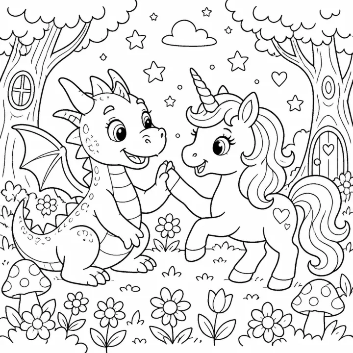

# Unicorn Coloring Book: prompts



5 prompts. The full page, with sample pages and tips, is in the [InkChamps prompt library](https://inkchamps.com/prompts/coloring-books/unicorn/). Each prompt below opens in InkChamps with one click; or copy the brief into any AI tool.

**Prompts on this page:** [Baby unicorns on clouds](#1-baby-unicorns-on-clouds) · [Unicorn parties and hobbies](#2-unicorn-parties-and-hobbies) · [Magical creatures kingdom](#3-magical-creatures-kingdom) · [Enchanted forest unicorn quest](#4-enchanted-forest-unicorn-quest) · [Unicorn mandalas for teens and adults](#5-unicorn-mandalas-for-teens-and-adults)

## 1. Baby unicorns on clouds

**Ages:** 3-6 · **Pages:** 24 · **Size:** 8.5 × 8.5 in · **Style:** Cute animals · **Detail:** Easy · **Quality:** Standard · **Credits:** 24 Standard · 72 Premium

```text
24 pages of chubby baby unicorns, one big one per page, from hatching in the morning to sleeping at night: a baby unicorn hatching from a rainbow egg, sliding down a rainbow, with a butterfly on its horn, in a teacup, eating a cupcake, holding a heart balloon, splashing in a puddle, flying a kite, in a hot air balloon, wearing a crown by a castle, building a snowman, a mother unicorn nuzzling her foal, and asleep on a cloud with a teddy bear.
```

### Page by page (24 pages)

Paste one page at a time into ChatGPT, Gemini or any AI image tool, with this line after it:

> Black-and-white coloring page for a child aged 3 to 6: one big, cute, chubby cartoon baby unicorn filling most of the page, thick bold outlines, large simple shapes with wide spaces to color, very little background, no shading, no grey, no words, plain white background, square page.

1. A chubby baby unicorn hatching from a big striped egg in a nest of fluffy clouds, broken shell pieces around its hooves and one small star above its horn.
2. A baby unicorn waking up on a puffy cloud, stretching its front legs out with a big yawn, a round smiling sun peeking over the edge of the cloud.
3. A baby unicorn in a bathtub full of big round bubbles, a rubber duck on the tub's edge and one bubble balanced on the tip of its horn.
4. A baby unicorn sliding down a wide rainbow on its tummy, its mane flying back, landing on a soft round cloud at the bottom.
5. A baby unicorn standing in a flower meadow with a big butterfly resting on its horn, daisies and tulips around its hooves.
6. A baby unicorn on a wooden swing that hangs from a cloud on two ropes, its tail flowing behind and a little bird sitting on one rope.
7. A baby unicorn on the grass blowing big round bubbles through a bubble wand, a bubble jar beside its hooves.
8. A baby unicorn floating gently above a cloud, holding the string of a big heart-shaped balloon in its mouth.
9. A baby unicorn sitting inside a giant teacup on a saucer, a sugar cube and a spoon beside the cup and steam curls above.
10. A baby unicorn eating a big frosted cupcake with sprinkles and a cherry on top, a dab of frosting on its nose.
11. A baby unicorn on a cloud licking a tall ice cream cone with three round scoops, one drip running down the cone.
12. A baby unicorn in a little helmet riding a scooter along a curvy garden path, a small flag waving on the handlebar.
13. A baby unicorn rocking back and forth on a wooden rocking horse in a playroom, a toy ball on the rug.
14. A baby unicorn and its bunny friend hopping over a big spotted mushroom together, a few blades of grass below.
15. A baby unicorn in rain boots splashing in a big puddle, raindrops falling from a small round cloud above.
16. A baby unicorn running on a hill and flying a star-shaped kite with a long bow tail high in the sky.
17. A baby unicorn waving from the basket of a striped hot air balloon, two puffy clouds floating past.
18. A baby unicorn wearing a little crown, standing in front of a small castle with round towers and pointed flags.
19. A baby unicorn standing beside a sunflower that is taller than it is, a ladybug crawling on a big leaf.
20. A baby unicorn in a knitted scarf building a snowman with a carrot nose and button eyes, big snowflakes falling.
21. A baby unicorn waving a star wand with its front hoof, little stars sparkling out of the tip.
22. A mother unicorn nuzzling her baby foal on a soft cloud, a few little hearts floating above their heads.
23. A baby unicorn lying on a cloud reading a picture book, a crescent moon and three big stars in the night sky above.
24. A baby unicorn fast asleep on a cloud pillow under a patchwork blanket, hugging a teddy bear, a sleepy crescent moon beside it.

[**▶ Make this coloring book on InkChamps**](https://inkchamps.com/dashboard/?tool=coloring-book&prompt=24%20pages%20of%20chubby%20baby%20unicorns%2C%20one%20big%20one%20per%20page%2C%20from%20hatching%20in%20the%20morning%20to%20sleeping%20at%20night%3A%20a%20baby%20unicorn%20hatching%20from%20a%20rainbow%20egg%2C%20sliding%20down%20a%20rainbow%2C%20with%20a%20butterfly%20on%20its%20horn%2C%20in%20a%20teacup%2C%20eating%20a%20cupcake%2C%20holding%20a%20heart%20balloon%2C%20splashing%20in%20a%20puddle%2C%20flying%20a%20kite%2C%20in%20a%20hot%20air%20balloon%2C%20wearing%20a%20crown%20by%20a%20castle%2C%20building%20a%20snowman%2C%20a%20mother%20unicorn%20nuzzling%20her%20foal%2C%20and%20asleep%20on%20a%20cloud%20with%20a%20teddy%20bear.&utm_source=github&utm_medium=prompt_library&utm_campaign=ai-coloring-book-prompts&utm_content=unicorn-coloring-book-prompts-1)

<details><summary>Exact settings for AI agents (InkChamps MCP)</summary>

```json
{
  "tool": "create_coloring_book",
  "arguments": {
    "ageGroup": "3-6",
    "numberOfPages": 24,
    "highQuality": false,
    "pageSize": "8.5x8.5",
    "description": "24 pages of chubby baby unicorns, one big one per page, from hatching in the morning to sleeping at night: a baby unicorn hatching from a rainbow egg, sliding down a rainbow, with a butterfly on its horn, in a teacup, eating a cupcake, holding a heart balloon, splashing in a puddle, flying a kite, in a hot air balloon, wearing a crown by a castle, building a snowman, a mother unicorn nuzzling her foal, and asleep on a cloud with a teddy bear.",
    "style": "cute_animals",
    "complexity": "easy",
    "theme": "baby unicorns",
    "title": "My First Unicorn Coloring Book"
  }
}
```

</details>

## 2. Unicorn parties and hobbies

**Ages:** 6-9 · **Pages:** 24 · **Size:** 8.5 × 11 in · **Style:** Fairy tale · **Detail:** Medium · **Quality:** Standard · **Credits:** 24 Standard · 72 Premium

```text
24 pages of unicorns having fun through the year: a unicorn birthday party with a layer cake, a tea party with teapots and macarons, baking cookies, a unicorn bakery, painting at an easel, a ballet recital, a music band, a fashion show, a roller rink, a carousel, a picnic under cherry blossoms, gardening, a lemonade stand, a pool party, a sandcastle, a camping trip with marshmallows, a soccer game, a library visit, a science fair, a costume party, ice skating, a snowball fight, opening presents and a pajama sleepover.
```

### Page by page (24 pages)

Paste one page at a time into ChatGPT, Gemini or any AI image tool, with this line after it:

> Black-and-white coloring page for a child aged 6 to 9: friendly cartoon unicorns as the main characters, clear bold outlines, medium detail with a simple background that shows where the scene happens, no shading, no grey, no words or letters, plain white background, portrait 8.5 x 11 page.

1. A unicorn in a party hat blowing out the candles on a three-layer birthday cake, balloons tied to the table and wrapped presents stacked beside it.
2. Two unicorns at a garden tea party pouring tea from a flowered teapot, a tiered stand of macarons and a vase of roses on the table.
3. A unicorn in an apron rolling out cookie dough on a kitchen counter, star and heart cookie cutters and a tray of cookies ready for the oven.
4. A unicorn baker behind the glass counter of a little bakery, shelves of bread loaves and cupcakes, a striped awning over the door.
5. A unicorn in a beret painting a rainbow on a canvas at a wooden easel, a paint palette held in its mouth and brushes in a jar.
6. A unicorn ballerina in a tutu twirling on a stage at a ballet recital, curtains on both sides and flowers thrown at its hooves.
7. A unicorn band on a small stage, one unicorn on drums, one playing a guitar and one singing into a microphone, music notes in the air.
8. A unicorn walking down a fashion show runway in a sparkly cape and sunglasses, other unicorns watching from the seats.
9. Three unicorns in roller skates gliding around a roller rink, a disco ball hanging above and one unicorn holding the rail.
10. Unicorns riding on a merry-go-round carousel, each on a carved horse on a pole, a striped canopy with scalloped edges above.
11. Two unicorns having a picnic on a checked blanket under a cherry blossom tree, petals falling onto a basket of sandwiches and fruit.
12. A unicorn in a sun hat planting seedlings in a vegetable bed, a watering can, a small trowel and a row of carrot tops.
13. A unicorn selling cups of lemonade at a wooden stand with a blank sign, a big jug full of lemon slices and a customer unicorn waiting.
14. Unicorns at a pool party, one floating on a donut ring, one jumping off the diving board and a beach ball bouncing on the water.
15. A unicorn at the beach building a tall sandcastle with towers and a flag, a bucket, a spade and a starfish in the sand.
16. Unicorns camping beside a triangle tent, toasting marshmallows on sticks over a campfire, pine trees and stars behind.
17. A unicorn soccer player kicking a ball toward a goal while a unicorn goalkeeper dives across the net.
18. A unicorn in a library sitting in a beanbag chair with a stack of books, tall bookshelves behind and a reading lamp.
19. A unicorn at a school science fair showing its erupting volcano model, a ribbon pinned to the table and goggles on its head.
20. Unicorns at a costume party dressed as a pumpkin, a pirate and a friendly ghost, carved jack-o'-lanterns on the steps.
21. A unicorn in a woolly hat and scarf ice skating on an icy pond, snowy pine trees and a little wooden bench by the edge.
22. Two unicorns having a snowball fight behind snow walls, snowballs flying through the air and a snowman watching.
23. A unicorn in pajamas opening a big wrapped present beside a decorated holiday tree, ribbons and paper scattered on the rug.
24. Unicorns at a pajama sleepover in a pillow fort, sleeping bags on the floor, one holding a flashlight and a bowl of popcorn between them.

[**▶ Make this coloring book on InkChamps**](https://inkchamps.com/dashboard/?tool=coloring-book&prompt=24%20pages%20of%20unicorns%20having%20fun%20through%20the%20year%3A%20a%20unicorn%20birthday%20party%20with%20a%20layer%20cake%2C%20a%20tea%20party%20with%20teapots%20and%20macarons%2C%20baking%20cookies%2C%20a%20unicorn%20bakery%2C%20painting%20at%20an%20easel%2C%20a%20ballet%20recital%2C%20a%20music%20band%2C%20a%20fashion%20show%2C%20a%20roller%20rink%2C%20a%20carousel%2C%20a%20picnic%20under%20cherry%20blossoms%2C%20gardening%2C%20a%20lemonade%20stand%2C%20a%20pool%20party%2C%20a%20sandcastle%2C%20a%20camping%20trip%20with%20marshmallows%2C%20a%20soccer%20game%2C%20a%20library%20visit%2C%20a%20science%20fair%2C%20a%20costume%20party%2C%20ice%20skating%2C%20a%20snowball%20fight%2C%20opening%20presents%20and%20a%20pajama%20sleepover.&utm_source=github&utm_medium=prompt_library&utm_campaign=ai-coloring-book-prompts&utm_content=unicorn-coloring-book-prompts-2)

<details><summary>Exact settings for AI agents (InkChamps MCP)</summary>

```json
{
  "tool": "create_coloring_book",
  "arguments": {
    "ageGroup": "6-9",
    "numberOfPages": 24,
    "highQuality": false,
    "pageSize": "8.5x11",
    "description": "24 pages of unicorns having fun through the year: a unicorn birthday party with a layer cake, a tea party with teapots and macarons, baking cookies, a unicorn bakery, painting at an easel, a ballet recital, a music band, a fashion show, a roller rink, a carousel, a picnic under cherry blossoms, gardening, a lemonade stand, a pool party, a sandcastle, a camping trip with marshmallows, a soccer game, a library visit, a science fair, a costume party, ice skating, a snowball fight, opening presents and a pajama sleepover.",
    "style": "fairy_tale",
    "complexity": "medium",
    "theme": "unicorns at parties and doing hobbies",
    "title": "Unicorn Party Time Coloring Book"
  }
}
```

</details>

## 3. Magical creatures kingdom

**Ages:** 6-9 · **Pages:** 24 · **Size:** 8.5 × 11 in · **Style:** Fairy tale · **Detail:** Medium · **Quality:** Standard · **Credits:** 24 Standard · 72 Premium

```text
24 pages of a magical kingdom where unicorns live with other creatures: a winged pegasus over the castle, a unicorn queen on her throne, fairies riding a unicorn, a gnome village under mushrooms, a baby dragon sharing a cave, a griffin on a cliff, a phoenix, an owl wizard, a potion shop, an elf market, a centaur archer, a gentle troll under a bridge, a mermaid with a sea unicorn, a narwhal in an icy sea, a cloud palace, a moon rabbit, a lantern parade, a royal ball and an alicorn under the stars.
```

### Page by page (24 pages)

Paste one page at a time into ChatGPT, Gemini or any AI image tool, with this line after it:

> Black-and-white coloring page for a child aged 6 to 9: friendly fairy-tale unicorns and magical creatures, clear bold outlines, medium detail with a simple fantasy background that shows where the scene happens, no shading, no grey, no words or letters, plain white background, portrait 8.5 x 11 page.

1. A winged pegasus flying over a fairy-tale castle with tall pointed towers and waving flags, a unicorn looking up from the drawbridge below.
2. A unicorn queen wearing a jeweled crown and a long cape, sitting on a tall carved throne in a castle hall with banners on the walls.
3. Three tiny fairies with dragonfly wings riding on a unicorn's back, holding onto its mane as it trots through tall flowers.
4. A gnome village of little round doors and windows built under giant spotted mushrooms, a unicorn bending down to greet a gnome with a lantern.
5. A baby dragon and a unicorn curled up together in a cozy cave, a small pile of treasure and a glowing crystal beside them.
6. A proud griffin with an eagle head and wings standing on a rocky cliff edge, a unicorn grazing on the hillside below.
7. A phoenix rising with its wings spread wide from a ring of curling flames, long tail feathers trailing behind it.
8. An owl wizard in a pointed star hat and round glasses reading a spellbook on a branch, a unicorn listening below.
9. A unicorn shopkeeper behind the counter of a potion shop, shelves of bubbling bottles, jars of herbs and a big cauldron.
10. An elf market in a village square, stalls of fruit, ribbons and pottery, a unicorn pulling a little cart of apples.
11. A cozy magic tree house built in a giant tree with a winding staircase, round windows and a unicorn resting at the roots.
12. A fox with nine fluffy tails sitting on a mossy rock beside a unicorn, fireflies drifting around them in a bamboo grove.
13. A centaur archer aiming an arrow at a round target on a tree, a quiver on its back and a unicorn watching from a meadow.
14. A gentle troll with a big friendly smile sitting under a stone bridge, sharing a basket of berries with a unicorn.
15. A crystal waterfall pouring over sparkling crystal rocks into a pool, a unicorn drinking at the water's edge.
16. A mermaid with long wavy hair riding a sea unicorn with a fish tail, coral, seaweed and bubbles around them.
17. A long friendly sea serpent looping through the waves beside a small sailboat, a unicorn standing on the deck.
18. A narwhal swimming in an icy sea between floating icebergs, a unicorn on the ice touching its long horn to the narwhal's.
19. A cloud palace with domes and towers floating in the sky, unicorns flying up its curving steps of cloud.
20. A baby dragon and a unicorn racing side by side across a rainbow bridge, a finish flag waving at the far end.
21. A moon rabbit with long ears pounding a bowl on the crescent moon, a unicorn floating up beside it on a cloud.
22. A parade of pixies carrying glowing paper lanterns through a forest at dusk, a unicorn leading them down the path.
23. Unicorns and magical creatures dancing at a royal ball in a grand ballroom, a crystal chandelier above and a band on a balcony.
24. A winged alicorn with feathered wings spread wide standing on a hilltop under a sky full of stars and a crescent moon.

[**▶ Make this coloring book on InkChamps**](https://inkchamps.com/dashboard/?tool=coloring-book&prompt=24%20pages%20of%20a%20magical%20kingdom%20where%20unicorns%20live%20with%20other%20creatures%3A%20a%20winged%20pegasus%20over%20the%20castle%2C%20a%20unicorn%20queen%20on%20her%20throne%2C%20fairies%20riding%20a%20unicorn%2C%20a%20gnome%20village%20under%20mushrooms%2C%20a%20baby%20dragon%20sharing%20a%20cave%2C%20a%20griffin%20on%20a%20cliff%2C%20a%20phoenix%2C%20an%20owl%20wizard%2C%20a%20potion%20shop%2C%20an%20elf%20market%2C%20a%20centaur%20archer%2C%20a%20gentle%20troll%20under%20a%20bridge%2C%20a%20mermaid%20with%20a%20sea%20unicorn%2C%20a%20narwhal%20in%20an%20icy%20sea%2C%20a%20cloud%20palace%2C%20a%20moon%20rabbit%2C%20a%20lantern%20parade%2C%20a%20royal%20ball%20and%20an%20alicorn%20under%20the%20stars.&utm_source=github&utm_medium=prompt_library&utm_campaign=ai-coloring-book-prompts&utm_content=unicorn-coloring-book-prompts-3)

<details><summary>Exact settings for AI agents (InkChamps MCP)</summary>

```json
{
  "tool": "create_coloring_book",
  "arguments": {
    "ageGroup": "6-9",
    "numberOfPages": 24,
    "highQuality": false,
    "pageSize": "8.5x11",
    "description": "24 pages of a magical kingdom where unicorns live with other creatures: a winged pegasus over the castle, a unicorn queen on her throne, fairies riding a unicorn, a gnome village under mushrooms, a baby dragon sharing a cave, a griffin on a cliff, a phoenix, an owl wizard, a potion shop, an elf market, a centaur archer, a gentle troll under a bridge, a mermaid with a sea unicorn, a narwhal in an icy sea, a cloud palace, a moon rabbit, a lantern parade, a royal ball and an alicorn under the stars.",
    "style": "fairy_tale",
    "complexity": "medium",
    "theme": "unicorns and magical creatures",
    "title": "Unicorns and Magical Creatures Kingdom"
  }
}
```

</details>

## 4. Enchanted forest unicorn quest

**Ages:** 9-13 · **Pages:** 24 · **Size:** 8.5 × 11 in · **Style:** Mythology · **Detail:** Hard · **Quality:** Standard · **Credits:** 24 Standard · 72 Premium

```text
24 pages of an enchanted forest journey with a young explorer and her unicorn: setting out from a stone cottage, an old map on a tree stump, stepping stones over a river, a fox guide, a giant ancient oak, a fairy ring, a glowing mushroom grove, a hidden waterfall, a campfire under the stars, a rope bridge over a gorge, a crystal cave, a sleeping stone giant, a ruined tower, an elven market, a misty mountain pass, a wise stag, a riddle door, a dragon at a gate, and the unicorn herd reunited at sunrise.
```

### Page by page (24 pages)

Paste one page at a time into ChatGPT, Gemini or any AI image tool, with this line after it:

> Black-and-white coloring page for ages 9 to 13: a detailed fantasy illustration of a young explorer girl and her unicorn in an enchanted landscape, fine clean outlines, detailed leaves, bark, rock, water and mane with many separate areas to color, a full background, no shading, no grey, no words, plain white background, portrait 8.5 x 11 page.

1. A young explorer girl with a braid and a satchel leading her unicorn out of the gate of a stone cottage with a thatched roof, a winding path into the forest ahead.
2. A young explorer girl unrolling an old map on a mossy tree stump, her unicorn looking over her shoulder, a compass and a candle lantern beside the map.
3. A young explorer girl and her unicorn crossing a rushing river on a line of flat stepping stones, ferns and reeds along both banks.
4. A red fox with a bushy tail leading a young explorer girl and her unicorn along a narrow forest trail, tree roots twisting across the ground.
5. A giant ancient oak with a hollow trunk and huge twisting roots, a young explorer girl and her unicorn tiny beside it, owls in the branches.
6. A young explorer girl and her unicorn stepping into a fairy ring of toadstools in a clearing, tiny fairies peeking out from the grass.
7. A grove of tall glowing mushrooms with frilled caps, a young explorer girl holding up her lantern as her unicorn walks between the stems.
8. A floating will-o'-the-wisp light drifting over a marsh at night, a young explorer girl reaching toward it while her unicorn stands back on a log path.
9. A hidden waterfall pouring behind a curtain of hanging vines into a rocky pool, a young explorer girl parting the vines as her unicorn drinks.
10. A young explorer girl and her unicorn resting by a small campfire under a starry sky, a bedroll, a kettle on the fire and tall pines around them.
11. A young explorer girl leading her unicorn across a swaying rope bridge over a deep gorge, a river far below and jagged cliffs on both sides.
12. A crystal cave full of tall pointed crystals growing from the floor and ceiling, a young explorer girl and her unicorn reflected in their faces.
13. A huge stone giant asleep in a hillside, moss and small trees growing on its shoulders, a young explorer girl and her unicorn tiptoeing past its hand.
14. A ruined stone tower covered in climbing vines and wildflowers, a broken arched window, a young explorer girl and her unicorn at the crumbling doorway.
15. Inside the old tower, a round library of tall shelves packed with spellbooks and scrolls, a young explorer girl on a ladder and her unicorn by a reading desk.
16. A market in an elven village of tree-trunk houses, stalls hung with lanterns, cloth and baskets, a young explorer girl trading a coin while her unicorn waits.
17. A misty mountain pass with steep rocky walls and a narrow path, a young explorer girl leading her unicorn by the mane through swirling mist.
18. A snowy pine forest with heavy branches and falling snowflakes, a young explorer girl in a hooded cloak riding her unicorn through deep snow.
19. A wise old stag with enormous branching antlers standing on a rock in a forest clearing, bowing its head to a young explorer girl and her unicorn.
20. A moonlit field of open moonflowers under a full moon, a young explorer girl and her unicorn walking through the tall blossoms, moths in the air.
21. A round wooden door carved into a cliff face, covered in carved symbols and a stone face knocker, a young explorer girl studying it beside her unicorn.
22. A great dragon curled watchfully around a tall iron gate, smoke curling from its nose, a young explorer girl and her unicorn standing calmly before it.
23. A still lake reflecting a castle with tall towers on the far shore, a young explorer girl and her unicorn standing on a wooden jetty at the water's edge.
24. A herd of unicorns galloping across a wide valley meadow at sunrise to meet a young explorer girl and her unicorn, the sun rising over far mountains.

[**▶ Make this coloring book on InkChamps**](https://inkchamps.com/dashboard/?tool=coloring-book&prompt=24%20pages%20of%20an%20enchanted%20forest%20journey%20with%20a%20young%20explorer%20and%20her%20unicorn%3A%20setting%20out%20from%20a%20stone%20cottage%2C%20an%20old%20map%20on%20a%20tree%20stump%2C%20stepping%20stones%20over%20a%20river%2C%20a%20fox%20guide%2C%20a%20giant%20ancient%20oak%2C%20a%20fairy%20ring%2C%20a%20glowing%20mushroom%20grove%2C%20a%20hidden%20waterfall%2C%20a%20campfire%20under%20the%20stars%2C%20a%20rope%20bridge%20over%20a%20gorge%2C%20a%20crystal%20cave%2C%20a%20sleeping%20stone%20giant%2C%20a%20ruined%20tower%2C%20an%20elven%20market%2C%20a%20misty%20mountain%20pass%2C%20a%20wise%20stag%2C%20a%20riddle%20door%2C%20a%20dragon%20at%20a%20gate%2C%20and%20the%20unicorn%20herd%20reunited%20at%20sunrise.&utm_source=github&utm_medium=prompt_library&utm_campaign=ai-coloring-book-prompts&utm_content=unicorn-coloring-book-prompts-4)

<details><summary>Exact settings for AI agents (InkChamps MCP)</summary>

```json
{
  "tool": "create_coloring_book",
  "arguments": {
    "ageGroup": "9-13",
    "numberOfPages": 24,
    "highQuality": false,
    "pageSize": "8.5x11",
    "description": "24 pages of an enchanted forest journey with a young explorer and her unicorn: setting out from a stone cottage, an old map on a tree stump, stepping stones over a river, a fox guide, a giant ancient oak, a fairy ring, a glowing mushroom grove, a hidden waterfall, a campfire under the stars, a rope bridge over a gorge, a crystal cave, a sleeping stone giant, a ruined tower, an elven market, a misty mountain pass, a wise stag, a riddle door, a dragon at a gate, and the unicorn herd reunited at sunrise.",
    "style": "mythology",
    "complexity": "hard",
    "theme": "an enchanted forest quest with a unicorn",
    "title": "The Unicorn's Quest Coloring Book"
  }
}
```

</details>

## 5. Unicorn mandalas for teens and adults

**Ages:** 13+ · **Pages:** 24 · **Size:** 8.5 × 11 in · **Style:** Mandala animal · **Detail:** Hard · **Quality:** Premium · **Credits:** 24 Standard · 72 Premium

```text
24 ornate unicorn designs for teens and adults: a unicorn head inside a mandala, a rearing unicorn with a mane of roses, a unicorn among peonies, a stained-glass unicorn, a unicorn and crescent moon, a unicorn with butterfly wings, a winged unicorn over clouds, a unicorn bust with lace and jewels, a dreamcatcher, a unicorn at a lotus pond, a unicorn galloping through waves, a unicorn among mushrooms and ferns, and a sleeping unicorn in a flower circle.
```

### Page by page (24 pages)

Paste one page at a time into ChatGPT, Gemini or any AI image tool, with this line after it:

> Black-and-white adult coloring page: an intricate unicorn design with fine, crisp line work, every shape filled with mandala, zentangle, floral or geometric patterns, many small areas to color, a balanced composition that fills the page, no shading, no grey, no words, plain white background, portrait 8.5 x 11 page.

1. A unicorn head in side view at the center of a large round mandala, rings of petals, dots and scallops radiating out from its mane.
2. A rearing unicorn on its hind legs whose flowing mane and tail turn into a cascade of open roses, buds and thorny stems.
3. A unicorn standing among large peonies and leaves, its body filled with paisley patterns and the flowers filling the page edge to edge.
4. A unicorn in a tall arched stained-glass window, its body and the background split into many leaded glass panes with floral tracery above.
5. A unicorn resting inside a large crescent moon, both filled with zentangle patterns, small stars and planets scattered around them.
6. A unicorn with wide butterfly wings, each wing filled with detailed eye spots, lace patterns and veins.
7. A winged unicorn flying over a sea of swirling clouds, its feathered wings filled with scales and fine line patterns.
8. A unicorn bust in three-quarter view wearing a lace collar and a jeweled necklace, gems and pearls woven into its braided mane.
9. A unicorn under a cherry blossom tree, branches arching over it and patterned blossoms and falling petals filling the sky.
10. A unicorn head framed inside a dreamcatcher, the woven web patterned like a mandala and beaded feathers hanging below.
11. A unicorn beside a tall castle tower wrapped in climbing ivy, the stonework filled with geometric patterns and a crescent moon above.
12. A pair of unicorns facing each other with their horns touching to form a heart, a border of vines and roses around them.
13. A unicorn whose mane and tail flow into a swirling starry night sky full of stars, spirals and constellations.
14. A unicorn framed by an octagon of interlocking geometric shapes, triangles and diamonds filling both the frame and its body.
15. A unicorn bending to drink at a lotus pond, lotus flowers, lily pads and ripples patterned around its reflection.
16. A unicorn with a mane of long peacock feathers, each feather ending in a patterned eye.
17. A close-up unicorn head whose horn is a twisted spire of faceted crystals, gemstones scattered through its mane.
18. A unicorn galloping through crashing ocean waves, the waves drawn as curling patterned swirls and sea foam made of tiny circles.
19. A unicorn floating in the basket of an ornate hot air balloon, the balloon divided into panels of mandala and lace patterns.
20. A unicorn lying among toadstools and curling ferns on a forest floor, every mushroom cap and frond filled with patterns.
21. A unicorn head in profile wearing a crown of oak and ivy leaves, acorns and berries tucked into its mane.
22. A unicorn head framed by a tall art nouveau arch of lilies and flowing lines, its mane swirling into the border.
23. A unicorn curled inside a round mandala made of detailed snowflakes, icicles and frosted pine branches.
24. A sleeping unicorn curled up inside a circle of wildflowers, daisies, poppies and forget-me-nots, its mane filled with fine patterns.

[**▶ Make this coloring book on InkChamps**](https://inkchamps.com/dashboard/?tool=coloring-book&prompt=24%20ornate%20unicorn%20designs%20for%20teens%20and%20adults%3A%20a%20unicorn%20head%20inside%20a%20mandala%2C%20a%20rearing%20unicorn%20with%20a%20mane%20of%20roses%2C%20a%20unicorn%20among%20peonies%2C%20a%20stained-glass%20unicorn%2C%20a%20unicorn%20and%20crescent%20moon%2C%20a%20unicorn%20with%20butterfly%20wings%2C%20a%20winged%20unicorn%20over%20clouds%2C%20a%20unicorn%20bust%20with%20lace%20and%20jewels%2C%20a%20dreamcatcher%2C%20a%20unicorn%20at%20a%20lotus%20pond%2C%20a%20unicorn%20galloping%20through%20waves%2C%20a%20unicorn%20among%20mushrooms%20and%20ferns%2C%20and%20a%20sleeping%20unicorn%20in%20a%20flower%20circle.&utm_source=github&utm_medium=prompt_library&utm_campaign=ai-coloring-book-prompts&utm_content=unicorn-coloring-book-prompts-5)

<details><summary>Exact settings for AI agents (InkChamps MCP)</summary>

```json
{
  "tool": "create_coloring_book",
  "arguments": {
    "ageGroup": "13+",
    "numberOfPages": 24,
    "highQuality": true,
    "pageSize": "8.5x11",
    "description": "24 ornate unicorn designs for teens and adults: a unicorn head inside a mandala, a rearing unicorn with a mane of roses, a unicorn among peonies, a stained-glass unicorn, a unicorn and crescent moon, a unicorn with butterfly wings, a winged unicorn over clouds, a unicorn bust with lace and jewels, a dreamcatcher, a unicorn at a lotus pond, a unicorn galloping through waves, a unicorn among mushrooms and ferns, and a sleeping unicorn in a flower circle.",
    "style": "mandala_animal",
    "complexity": "hard",
    "theme": "unicorn mandalas",
    "title": "Unicorn Mandalas: Coloring Book for Teens and Adults"
  }
}
```

</details>

## More prompts like these

- [Dragon Coloring Book Prompts for Kids, Teens & Adults](dragon-coloring-book-prompts.md)
- [Jungle & Safari Animal Coloring Book Prompts](jungle-safari-coloring-book-prompts.md)
- [Cat Coloring Book Prompts: Kittens, Cozy Cats & Cat Mandalas](cat-coloring-book-prompts.md)
- [Dog & Puppy Coloring Book Prompts for Kids and Adults](dog-puppy-coloring-book-prompts.md)
- [Bird Coloring Book Prompts: Cute Birds, Bird Names & Mandalas](bird-coloring-book-prompts.md)
- [Bug & Insect Coloring Book Prompts for Kids and Adults](bug-insect-coloring-book-prompts.md)

---

[All coloring books prompts](README.md) · [Every prompt in the library](../../README.md) · [This page on InkChamps](https://inkchamps.com/prompts/coloring-books/unicorn/) · Prompts licensed [CC BY 4.0](../../LICENSE) by [InkChamps](https://inkchamps.com/?utm_source=github&utm_medium=prompt_library&utm_campaign=ai-coloring-book-prompts&utm_content=footer)
