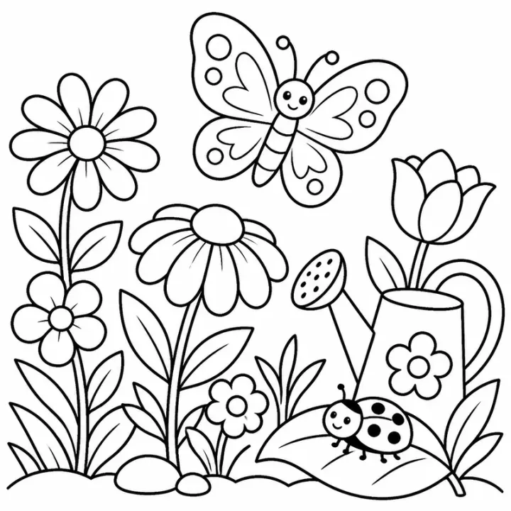

# Valentine's Day Coloring Book: prompts



5 prompts. The full page, with sample pages and tips, is in the [InkChamps prompt library](https://inkchamps.com/prompts/coloring-books/valentines-day/). Each prompt below opens in InkChamps with one click; or copy the brief into any AI tool.

**Prompts on this page:** [Cute animals with hearts](#1-cute-animals-with-hearts) · [Classroom friendship and kindness](#2-classroom-friendship-and-kindness) · [Kawaii sweet treats for tweens](#3-kawaii-sweet-treats-for-tweens) · [Romantic places for adults](#4-romantic-places-for-adults) · [Hearts, roses and love-bird mandalas](#5-hearts-roses-and-love-bird-mandalas)

## 1. Cute animals with hearts

**Ages:** 3-6 · **Pages:** 24 · **Size:** 8.5 × 11 in · **Style:** Cute animals · **Detail:** Easy · **Quality:** Standard · **Credits:** 24 Standard · 72 Premium

```text
24 sweet Valentine pictures, one big cute animal on each page: a teddy bear hugging a heart, two otters holding paws, a puppy with a heart balloon, a kitten in a basket of heart cushions, a penguin giving a tulip, a bunny with a love letter, a llama in heart sunglasses, an elephant spraying heart bubbles, two bear cubs sharing a cookie, a koala with a heart lollipop, a whale spouting hearts and a kitten and puppy asleep under a heart blanket.
```

### Page by page (24 pages)

Paste one page at a time into ChatGPT, Gemini or any AI image tool, with this line after it:

> Black-and-white coloring page for a child aged 3 to 6: one big, cute, chubby cartoon animal filling most of the page, thick bold outlines, large simple shapes and simple hearts with wide spaces to color, very little background, no shading, no grey, no words, plain white background, portrait 8.5 x 11 page.

1. A chubby teddy bear sitting on the grass hugging a big puffy heart, a small heart-shaped balloon tied to its arm.
2. Two otters floating on their backs in calm water holding paws, a little heart-shaped lily pad bobbing between them.
3. A happy floppy-eared puppy holding the string of a big heart balloon in its mouth, standing on a garden path between two daisies.
4. A fluffy kitten curled up in a wicker basket full of round heart cushions, a ball of yarn on the floor beside the basket.
5. A penguin on a snowy ice floe holding out a single tulip to a smaller penguin, a few big snowflakes in the sky.
6. A bunny hopping down a path carrying a big envelope sealed with a heart, a carrot sticking out of its little backpack.
7. A smiling llama wearing heart-shaped sunglasses and a fluffy scarf, standing in a meadow beside a short wooden fence.
8. A big ladybug with heart-shaped spots on its back sitting on a wide leaf, a round dewdrop and a flower bud beside it.
9. A sleepy sloth hanging from a branch by one arm and hugging a heart pillow with the other, two big leaves around it.
10. An elephant standing at a pond spraying a stream of heart-shaped bubbles from its trunk, a little duck watching from the water.
11. Two bear cubs sitting side by side on a log sharing one big round cookie broken in half, crumbs falling on the ground.
12. A friendly lion with a fluffy mane shaped like a heart, sitting proudly on a flat rock under a big round sun.
13. A tall giraffe wearing a long knitted scarf with hearts on it, nibbling heart-shaped leaves from the top of a tree.
14. A little hedgehog carrying three heart-shaped apples on its spines, walking through the grass past a spotted mushroom.
15. A friendly baby dinosaur holding a big heart above its head with both arms, standing beside a palm tree and a round rock.
16. A round fish blowing a line of heart bubbles up toward the water's surface, seaweed and a spiral shell on the sandy bottom.
17. A tiny mouse hugging a strawberry bigger than itself, sitting on a checkered picnic blanket next to a little teacup.
18. Two ducks swimming in a heart-shaped pond with their beaks touching, tall cattails growing along the edge.
19. A koala sitting in a eucalyptus tree licking a big swirly heart lollipop, a leaf held in its other paw.
20. A chubby striped bee landing on a flower whose petals are hearts, a little round beehive hanging from a branch nearby.
21. A happy piglet splashing in a muddy heart-shaped puddle, a small bucket and a tall flower beside the puddle.
22. A wide-eyed owl on a branch holding a love letter in its wing, a big round full moon behind it.
23. A big smiling whale in the ocean spouting a fountain of little hearts from its blowhole, small waves around it.
24. A kitten and a puppy cuddled up asleep together on a round rug, a heart-patterned blanket tucked over them.

[**▶ Make this coloring book on InkChamps**](https://inkchamps.com/dashboard/?tool=coloring-book&prompt=24%20sweet%20Valentine%20pictures%2C%20one%20big%20cute%20animal%20on%20each%20page%3A%20a%20teddy%20bear%20hugging%20a%20heart%2C%20two%20otters%20holding%20paws%2C%20a%20puppy%20with%20a%20heart%20balloon%2C%20a%20kitten%20in%20a%20basket%20of%20heart%20cushions%2C%20a%20penguin%20giving%20a%20tulip%2C%20a%20bunny%20with%20a%20love%20letter%2C%20a%20llama%20in%20heart%20sunglasses%2C%20an%20elephant%20spraying%20heart%20bubbles%2C%20two%20bear%20cubs%20sharing%20a%20cookie%2C%20a%20koala%20with%20a%20heart%20lollipop%2C%20a%20whale%20spouting%20hearts%20and%20a%20kitten%20and%20puppy%20asleep%20under%20a%20heart%20blanket.&utm_source=github&utm_medium=prompt_library&utm_campaign=ai-coloring-book-prompts&utm_content=valentines-day-coloring-book-prompts-1)

<details><summary>Exact settings for AI agents (InkChamps MCP)</summary>

```json
{
  "tool": "create_coloring_book",
  "arguments": {
    "ageGroup": "3-6",
    "numberOfPages": 24,
    "highQuality": false,
    "pageSize": "8.5x11",
    "description": "24 sweet Valentine pictures, one big cute animal on each page: a teddy bear hugging a heart, two otters holding paws, a puppy with a heart balloon, a kitten in a basket of heart cushions, a penguin giving a tulip, a bunny with a love letter, a llama in heart sunglasses, an elephant spraying heart bubbles, two bear cubs sharing a cookie, a koala with a heart lollipop, a whale spouting hearts and a kitten and puppy asleep under a heart blanket.",
    "theme": "Valentine's Day",
    "style": "cute_animals",
    "complexity": "easy",
    "title": "Hugs and Hearts: A Toddler Valentine Book"
  }
}
```

</details>

## 2. Classroom friendship and kindness

**Ages:** 6-9 · **Pages:** 24 · **Size:** 8.5 × 11 in · **Style:** General coloring · **Detail:** Medium · **Quality:** Standard · **Credits:** 24 Standard · 72 Premium

```text
24 friendship and kindness scenes for Valentine's Day: kids making cards at a craft table, a classroom valentine mailbox, a class party with paper chains, welcoming a new kid, sharing lunch, a buddy bench, helping a friend who fell off a bike, sharing an umbrella, flowers for the teacher, a blanket fort, baking heart cookies with grandpa, walking a dog together, a heart kite on a hill, a lemonade stand and a sleepover swapping homemade valentines.
```

### Page by page (24 pages)

Paste one page at a time into ChatGPT, Gemini or any AI image tool, with this line after it:

> Black-and-white coloring page for a child aged 6 to 9: friendly cartoon kids as the main characters, clear bold outlines, medium detail with a simple background that shows where the scene happens, a few small hearts as decoration, no shading, no grey, no words or letters, plain white background, portrait 8.5 x 11 page.

1. Three kids at a classroom craft table making valentine cards, cutting paper hearts with safety scissors, a glue stick and a jar of crayons on the table.
2. A classroom valentine mailbox made from a shoebox covered in paper hearts, a kid dropping a card through the slot while classmates line up behind.
3. A class Valentine's party with paper chains hanging from the ceiling, kids sharing cupcakes at their desks and a heart garland across the board.
4. A new kid standing shyly at the classroom door with a backpack while two classmates wave and point to an empty seat beside them.
5. Two friends at a school cafeteria table, one splitting a sandwich in half to share, open lunch boxes and apple slices between them.
6. A buddy bench on the playground where one kid sits alone and another kid walks over holding a ball to invite them to play.
7. Two friends laughing on a seesaw in the park, one up high and one down low, a slide and two trees behind them.
8. A kid kneeling to help a friend who fell off a bike, handing over a bandage, the bike lying on the sidewalk beside a helmet.
9. Two friends walking home under one big umbrella in the rain, splashing through a puddle in rain boots, raindrops all around.
10. A kid sitting on the school steps with an arm around a sad friend's shoulders, two backpacks resting on the step beside them.
11. Kids handing their teacher a bunch of flowers and a big handmade card at her desk, a globe and a stack of books beside her.
12. A group of kids lying on the classroom floor making a giant get-well card for a classmate, markers, stickers and paper hearts spread around.
13. Two friends peeking out of a blanket fort they built in the living room from chairs and pillows, a flashlight and a stack of books inside.
14. Two friends baking heart cookies with their grandpa in the kitchen, rolling dough and pressing heart cutters, a tray ready for the oven.
15. A kid and a little sibling filling a bird feeder in a snowy backyard, two sparrows landing on the fence nearby.
16. A kid on tiptoe dropping a letter with a heart sticker into a street mailbox, a small dog on a leash waiting beside them.
17. Friends planting a young tree in the schoolyard, one digging with a shovel and one pouring water from a watering can.
18. Two kids walking a big fluffy dog together, each holding part of the leash, on a sidewalk lined with little houses.
19. Friends flying a heart-shaped kite on a windy hill, its long tail swirling in the air, a picnic basket on the grass.
20. Three friends racing down a snowy hill on one long sled, scarves flying behind them, a snowman waiting at the bottom.
21. Kids running a lemonade stand with a striped awning, a pitcher, paper cups and a coin jar, a neighbor buying a cup.
22. An older sibling sitting on the floor reading a picture book to a baby on a play mat, a teddy bear and a rattle nearby.
23. A picnic with grandma under a big tree, kids passing sandwiches and a thermos on a checkered blanket beside a wicker basket.
24. Friends at a sleepover in sleeping bags swapping homemade valentines by flashlight, pillows and a bowl of popcorn between them.

[**▶ Make this coloring book on InkChamps**](https://inkchamps.com/dashboard/?tool=coloring-book&prompt=24%20friendship%20and%20kindness%20scenes%20for%20Valentine%27s%20Day%3A%20kids%20making%20cards%20at%20a%20craft%20table%2C%20a%20classroom%20valentine%20mailbox%2C%20a%20class%20party%20with%20paper%20chains%2C%20welcoming%20a%20new%20kid%2C%20sharing%20lunch%2C%20a%20buddy%20bench%2C%20helping%20a%20friend%20who%20fell%20off%20a%20bike%2C%20sharing%20an%20umbrella%2C%20flowers%20for%20the%20teacher%2C%20a%20blanket%20fort%2C%20baking%20heart%20cookies%20with%20grandpa%2C%20walking%20a%20dog%20together%2C%20a%20heart%20kite%20on%20a%20hill%2C%20a%20lemonade%20stand%20and%20a%20sleepover%20swapping%20homemade%20valentines.&utm_source=github&utm_medium=prompt_library&utm_campaign=ai-coloring-book-prompts&utm_content=valentines-day-coloring-book-prompts-2)

<details><summary>Exact settings for AI agents (InkChamps MCP)</summary>

```json
{
  "tool": "create_coloring_book",
  "arguments": {
    "ageGroup": "6-9",
    "numberOfPages": 24,
    "highQuality": false,
    "pageSize": "8.5x11",
    "description": "24 friendship and kindness scenes for Valentine's Day: kids making cards at a craft table, a classroom valentine mailbox, a class party with paper chains, welcoming a new kid, sharing lunch, a buddy bench, helping a friend who fell off a bike, sharing an umbrella, flowers for the teacher, a blanket fort, baking heart cookies with grandpa, walking a dog together, a heart kite on a hill, a lemonade stand and a sleepover swapping homemade valentines.",
    "theme": "friendship",
    "style": "general_coloring",
    "complexity": "medium",
    "title": "Friends Are the Best: A Kindness Valentine Book"
  }
}
```

</details>

## 3. Kawaii sweet treats for tweens

**Ages:** 9-13 · **Pages:** 24 · **Size:** 8.5 × 11 in · **Style:** Food fun · **Detail:** Medium · **Quality:** Standard · **Credits:** 24 Standard · 72 Premium

```text
24 kawaii Valentine treats with cute faces: a heart box of chocolates, strawberry macarons, boba tea with heart pearls, heart pancakes, a cherry milkshake, a heart waffle, chocolate-dipped strawberries, a heart cake, a lollipop bouquet, two mochi friends, a heart pizza, hot cocoa with heart marshmallows, a fondue pot, a sundae, a cupcake tower, heart sushi, a raspberry tart, cake pops, cotton candy and a gumball machine full of hearts.
```

### Page by page (24 pages)

Paste one page at a time into ChatGPT, Gemini or any AI image tool, with this line after it:

> Black-and-white coloring page for ages 9 to 13: kawaii food art with cute faces on the treats, clean medium-weight outlines, playful detail such as sprinkles, drips, ribbons and patterns with many separate areas to color, small hearts and sparkles around the main treat, no shading, no grey, no words, plain white background, portrait 8.5 x 11 page.

1. A heart-shaped box of chocolates with the lid open, each chocolate in its paper cup with a tiny smiling face, a satin bow on the lid.
2. A stack of strawberry macarons with happy faces, cream filling peeking out, on a little cake stand with sprinkles scattered around.
3. A tall boba tea cup with heart-shaped tapioca pearls, a wide straw and a kawaii face on the cup, two strawberries beside it.
4. A stack of heart-shaped pancakes with butter melting on top, syrup dripping down the sides and a smiling strawberry on the summit.
5. A cherry milkshake in a tall diner glass with whipped cream, a cherry on top and two striped straws, little hearts floating up.
6. A heart-shaped waffle with its grid of squares filled with berries and cream, a smiling fork and knife standing beside the plate.
7. A winking ring donut with pink icing and heart sprinkles, sitting on a plate next to a mug of tea with a heart tag.
8. A row of chocolate-dipped strawberries on a tray, each with drizzle stripes and a sleepy kawaii face, one with a bite taken out.
9. A two-layer heart-shaped cake with piped frosting swirls and a crown of cherries, a cake server leaning against the stand.
10. A bouquet of swirl lollipops tied with a ribbon, each lollipop a different spiral pattern, standing in a small striped vase.
11. A glass candy jar packed with tiny heart candies, the lid tipped to one side and a few candies tumbling out with cheeky faces.
12. Two round mochi friends holding hands on a little plate, one dusted with powder, a sprig of cherry blossom beside them.
13. A heart-shaped pizza with pepperoni hearts, melted cheese stretching from a lifted slice and a pizza cutter beside it.
14. A mug of hot cocoa topped with heart marshmallows and a swirl of cream, steam curling up in heart shapes, a cookie on the saucer.
15. A chocolate fondue pot with smiling strawberries, banana slices and marshmallows on skewers dipping in, chocolate drips on the plate.
16. An ice-cream sundae in a tulip glass with three scoops, whipped cream, sprinkles, a wafer stick and a cherry on top.
17. A tiered cupcake tower with swirled frosting and heart toppers, each cupcake with its own expression, from giggling to blushing.
18. A cookie-decorating tray of heart sugar cookies, icing piping bags, little bowls of sprinkles and one cookie half iced.
19. A plate of heart-shaped sushi rolls with tiny faces, chopsticks resting on a fish-shaped holder and a little dipping dish.
20. A raspberry tart with the berries arranged in a heart, a fluted crust and a mint leaf, sitting on a lace doily.
21. A cinnamon roll curled into a heart with icing drizzled on top, cozy in a baking tray beside a quilted oven mitt.
22. A bunch of cake pops stuck into a decorated block, each one dipped and sprinkled differently, a ribbon tied on one stick.
23. A fluffy cotton candy cloud on a paper cone, smiling and shaped like a heart, with small stars and sparkles around it.
24. A gumball machine filled with heart gumballs, a coin slot and a turning handle, two gumballs rolling out of the chute.

[**▶ Make this coloring book on InkChamps**](https://inkchamps.com/dashboard/?tool=coloring-book&prompt=24%20kawaii%20Valentine%20treats%20with%20cute%20faces%3A%20a%20heart%20box%20of%20chocolates%2C%20strawberry%20macarons%2C%20boba%20tea%20with%20heart%20pearls%2C%20heart%20pancakes%2C%20a%20cherry%20milkshake%2C%20a%20heart%20waffle%2C%20chocolate-dipped%20strawberries%2C%20a%20heart%20cake%2C%20a%20lollipop%20bouquet%2C%20two%20mochi%20friends%2C%20a%20heart%20pizza%2C%20hot%20cocoa%20with%20heart%20marshmallows%2C%20a%20fondue%20pot%2C%20a%20sundae%2C%20a%20cupcake%20tower%2C%20heart%20sushi%2C%20a%20raspberry%20tart%2C%20cake%20pops%2C%20cotton%20candy%20and%20a%20gumball%20machine%20full%20of%20hearts.&utm_source=github&utm_medium=prompt_library&utm_campaign=ai-coloring-book-prompts&utm_content=valentines-day-coloring-book-prompts-3)

<details><summary>Exact settings for AI agents (InkChamps MCP)</summary>

```json
{
  "tool": "create_coloring_book",
  "arguments": {
    "ageGroup": "9-13",
    "numberOfPages": 24,
    "highQuality": false,
    "pageSize": "8.5x11",
    "description": "24 kawaii Valentine treats with cute faces: a heart box of chocolates, strawberry macarons, boba tea with heart pearls, heart pancakes, a cherry milkshake, a heart waffle, chocolate-dipped strawberries, a heart cake, a lollipop bouquet, two mochi friends, a heart pizza, hot cocoa with heart marshmallows, a fondue pot, a sundae, a cupcake tower, heart sushi, a raspberry tart, cake pops, cotton candy and a gumball machine full of hearts.",
    "theme": "Valentine treats",
    "style": "food_fun",
    "complexity": "medium",
    "title": "Sweet on You: Kawaii Valentine Treats"
  }
}
```

</details>

## 4. Romantic places for adults

**Ages:** 13+ · **Pages:** 24 · **Size:** 8.5 × 11 in · **Style:** General coloring · **Detail:** Medium · **Quality:** Standard · **Credits:** 24 Standard · 72 Premium

```text
24 romantic places for adults to color: a café table for two on a Paris street, a gondola under a stone bridge, a clifftop picnic above the sea, a bench under a cherry tree, a rose garden arch, a candlelit balcony dinner, a vintage car trailing tin cans, a lighthouse at sunset, a carousel at night, a hot-air balloon over vineyards, a lily-pond rowboat, a love-lock bridge, dancing under lanterns, a Ferris wheel at dusk, a cabin fireplace, a train compartment for two and a lantern-lit gazebo.
```

### Page by page (24 pages)

Paste one page at a time into ChatGPT, Gemini or any AI image tool, with this line after it:

> Black-and-white coloring page for teens and adults: a romantic scene in a detailed, realistic illustration style, fine clean outlines, rich detail in buildings, plants and objects with many areas to color, people small or seen from behind, a full background that fills the page, no shading, no grey, no words or signs, plain white background, portrait 8.5 x 11 page.

1. A café table for two on a cobblestone Paris street, two coffee cups and a croissant on the table, a striped awning and flower boxes on the balconies above.
2. A gondola gliding under an arched stone bridge on a narrow canal, the gondolier with his long pole, a couple seated under a blanket, old houses rising from the water.
3. A picnic blanket on a grassy cliff above the sea, a wicker basket, two glasses and a bowl of strawberries, waves breaking on the rocks far below.
4. A wooden park bench under a cherry tree in full blossom, petals drifting down, two coats folded on the seat and an iron lamppost beside it.
5. A rose-covered garden arch over a gravel path leading to a tiered fountain, climbing roses thick with blooms and a stone urn on each side.
6. A candlelit dinner table for two on a balcony overlooking city rooftops, a candle in a glass holder, a single rose in a vase and wrought-iron railings.
7. A vintage convertible driving down a country road with tin cans trailing on strings behind it, a bouquet on the back seat and tall poplars along the road.
8. A lighthouse on a rocky point at sunset, a couple walking hand in hand on the path toward it, seagulls overhead and long grass bending in the wind.
9. A carousel at night with carved horses, a striped canopy and strings of lights, two horses side by side at the front.
10. A hot-air balloon floating over rows of vineyards and rolling hills, two passengers in the basket and a stone farmhouse below.
11. A porch swing for two on a wooden farmhouse porch, a quilt draped over the seat, hanging ferns and two glasses of lemonade on a side table.
12. A rowboat drifting on a lily pond with the oars resting, water lilies all around and a weeping willow trailing its branches into the water.
13. A bridge railing covered in hundreds of love locks, a couple fastening a new one, a river and old city towers in the distance.
14. A couple dancing in a cobbled town square under strings of paper lanterns, a stone fountain and café chairs around them.
15. One cabin of a Ferris wheel at dusk, a couple inside looking out at the city lights below, the great wheel curving overhead.
16. A log cabin interior with a stone fireplace, two steaming mugs on a woven rug, a dog asleep by the hearth and snow falling outside the window.
17. A seaside promenade with a couple walking a dog along the railing, striped beach huts, a long pier and sailboats on the water.
18. A vintage train compartment for two with velvet seats, a small table with teacups, luggage racks overhead and mountains through the window.
19. A long table set for two in an olive grove, a lace cloth, a bowl of olives and a loaf of bread, a lantern hanging from a branch.
20. A rooftop terrace under string lights, potted lemon trees, two lounge chairs and a telescope pointed at the stars above the city.
21. A flower stall on a street corner with buckets of tulips and roses, a florist wrapping a bouquet for a customer, a bicycle with a basket parked nearby.
22. A tandem bicycle on a country lane between hedgerows and wildflowers, a picnic basket on the front and a windmill on the hill.
23. A snowy evening street, a couple sharing an umbrella outside a bookshop window full of books, glowing street lamps and snowflakes falling.
24. A garden gazebo lit by lanterns at night, a small table with two chairs, wisteria climbing the posts and a crescent moon above.

[**▶ Make this coloring book on InkChamps**](https://inkchamps.com/dashboard/?tool=coloring-book&prompt=24%20romantic%20places%20for%20adults%20to%20color%3A%20a%20caf%C3%A9%20table%20for%20two%20on%20a%20Paris%20street%2C%20a%20gondola%20under%20a%20stone%20bridge%2C%20a%20clifftop%20picnic%20above%20the%20sea%2C%20a%20bench%20under%20a%20cherry%20tree%2C%20a%20rose%20garden%20arch%2C%20a%20candlelit%20balcony%20dinner%2C%20a%20vintage%20car%20trailing%20tin%20cans%2C%20a%20lighthouse%20at%20sunset%2C%20a%20carousel%20at%20night%2C%20a%20hot-air%20balloon%20over%20vineyards%2C%20a%20lily-pond%20rowboat%2C%20a%20love-lock%20bridge%2C%20dancing%20under%20lanterns%2C%20a%20Ferris%20wheel%20at%20dusk%2C%20a%20cabin%20fireplace%2C%20a%20train%20compartment%20for%20two%20and%20a%20lantern-lit%20gazebo.&utm_source=github&utm_medium=prompt_library&utm_campaign=ai-coloring-book-prompts&utm_content=valentines-day-coloring-book-prompts-4)

<details><summary>Exact settings for AI agents (InkChamps MCP)</summary>

```json
{
  "tool": "create_coloring_book",
  "arguments": {
    "ageGroup": "13+",
    "numberOfPages": 24,
    "highQuality": false,
    "pageSize": "8.5x11",
    "description": "24 romantic places for adults to color: a café table for two on a Paris street, a gondola under a stone bridge, a clifftop picnic above the sea, a bench under a cherry tree, a rose garden arch, a candlelit balcony dinner, a vintage car trailing tin cans, a lighthouse at sunset, a carousel at night, a hot-air balloon over vineyards, a lily-pond rowboat, a love-lock bridge, dancing under lanterns, a Ferris wheel at dusk, a cabin fireplace, a train compartment for two and a lantern-lit gazebo.",
    "theme": "romantic places",
    "style": "general_coloring",
    "complexity": "medium",
    "title": "Love Letters: Romantic Places to Color"
  }
}
```

</details>

## 5. Hearts, roses and love-bird mandalas

**Ages:** 13+ · **Pages:** 24 · **Size:** 8.5 × 11 in · **Style:** Mandala abstract · **Detail:** Hard · **Quality:** Premium · **Credits:** 24 Standard · 72 Premium

```text
24 intricate heart and romance patterns for adults: a lace heart mandala, two love birds on a patterned branch, a rose mandala, a heart wreath of peonies, a filigree heart padlock and key, two swans forming a heart, a heart locket, a heart tree of life, a stained-glass heart window, a wax-sealed envelope, a heart hot-air balloon, a heart of butterflies, a paisley heart teapot, interlocking knotwork hearts, a heart birdcage and a heart framed like a decorative tile.
```

### Page by page (24 pages)

Paste one page at a time into ChatGPT, Gemini or any AI image tool, with this line after it:

> Black-and-white adult coloring page: an intricate heart, rose or love-bird design with fine, crisp line work, every shape filled with mandala, lace, paisley or zentangle patterns, many small areas to color, a balanced composition that fills the page, no shading, no grey, no words, plain white background, portrait 8.5 x 11 page.

1. A large heart mandala filled with rings of lace, scallops and tiny petals radiating out from a small heart at the center.
2. Two love birds perched face to face on a curving branch, their feathers filled with paisley and dot patterns, small leaves and berries along the branch.
3. A single rose mandala seen from above, each layer of petals filled with a different geometric pattern, framed by a ring of leaves.
4. A heart-shaped wreath of peonies, ranunculus and eucalyptus leaves, every bloom drawn with layered, patterned petals.
5. A heart-shaped padlock with a keyhole, covered in filigree, an ornate vintage key beside it whose bow is a tiny mandala.
6. Two swans on a pond whose curved necks form a heart, their wings filled with feather and wave patterns, reeds and ripples below.
7. An open heart-shaped locket on a fine chain, the inside and lid covered in engraved swirls and tiny flowers.
8. A heart-shaped tree of life with roots and branches knotted in Celtic-style loops, leaves and tiny hearts filling the canopy.
9. A stained-glass heart window divided into many small panes of petals, stars and diamonds, set in a pointed stone arch.
10. A vintage envelope sealed with a patterned wax heart, its paper covered in damask, a feather quill lying across it.
11. A bow and arrow drawn in filigree, the arrow passing through a zentangle heart, swirls and small stars around them.
12. A heart-shaped hot-air balloon with each panel filled with a different pattern, a woven basket below and patterned clouds around it.
13. A heart made of dozens of butterflies, each pair of wings filled with its own mandala or lace pattern.
14. A heart-shaped teapot covered in paisley beside two patterned teacups and a sugar bowl, steam curling up in swirls.
15. A hummingbird hovering at a heart-shaped hibiscus flower, its wings and body filled with tiny geometric patterns, buds and leaves around it.
16. A zentangle heart split into sections of checks, waves, spirals and dots, surrounded by a border of small roses.
17. Two interlocking hearts made of knotwork ribbon, a mandala of petals filling the space where they overlap.
18. A heart-shaped birdcage with its door open, a songbird on the perch and roses climbing the patterned bars.
19. Two foxes curled together in the shape of a heart, their fur filled with feather-like zentangle strokes, autumn leaves around them.
20. A heart-shaped mirror with a baroque scrolled frame, roses and ribbons at the top and a patterned mandala in place of the glass.
21. A heart mandala of moon phases and stars, crescents and tiny suns circling a central patterned heart.
22. A bouquet of tulips, roses and lilies tied with a lace ribbon into a heart shape, every petal filled with pattern.
23. A heart-shaped jewelry box with its lid open, covered in henna-style patterns, a string of pearls spilling over the edge.
24. A large heart framed by a square border of repeating hearts, roses and love birds, a small mandala in each corner like a decorative tile.

[**▶ Make this coloring book on InkChamps**](https://inkchamps.com/dashboard/?tool=coloring-book&prompt=24%20intricate%20heart%20and%20romance%20patterns%20for%20adults%3A%20a%20lace%20heart%20mandala%2C%20two%20love%20birds%20on%20a%20patterned%20branch%2C%20a%20rose%20mandala%2C%20a%20heart%20wreath%20of%20peonies%2C%20a%20filigree%20heart%20padlock%20and%20key%2C%20two%20swans%20forming%20a%20heart%2C%20a%20heart%20locket%2C%20a%20heart%20tree%20of%20life%2C%20a%20stained-glass%20heart%20window%2C%20a%20wax-sealed%20envelope%2C%20a%20heart%20hot-air%20balloon%2C%20a%20heart%20of%20butterflies%2C%20a%20paisley%20heart%20teapot%2C%20interlocking%20knotwork%20hearts%2C%20a%20heart%20birdcage%20and%20a%20heart%20framed%20like%20a%20decorative%20tile.&utm_source=github&utm_medium=prompt_library&utm_campaign=ai-coloring-book-prompts&utm_content=valentines-day-coloring-book-prompts-5)

<details><summary>Exact settings for AI agents (InkChamps MCP)</summary>

```json
{
  "tool": "create_coloring_book",
  "arguments": {
    "ageGroup": "13+",
    "numberOfPages": 24,
    "highQuality": true,
    "pageSize": "8.5x11",
    "description": "24 intricate heart and romance patterns for adults: a lace heart mandala, two love birds on a patterned branch, a rose mandala, a heart wreath of peonies, a filigree heart padlock and key, two swans forming a heart, a heart locket, a heart tree of life, a stained-glass heart window, a wax-sealed envelope, a heart hot-air balloon, a heart of butterflies, a paisley heart teapot, interlocking knotwork hearts, a heart birdcage and a heart framed like a decorative tile.",
    "theme": "heart mandalas",
    "style": "mandala_abstract",
    "complexity": "hard",
    "title": "Heart Mandalas: Roses and Love Birds"
  }
}
```

</details>

## More prompts like these

- [Autumn & Thanksgiving Coloring Book Prompts](autumn-thanksgiving-coloring-book-prompts.md)
- [Alphabet ABC Coloring Book Prompts for Toddlers & Preschool](alphabet-abc-coloring-book-prompts.md)
- [Numbers & Counting Coloring Book Prompts for Kids](numbers-counting-coloring-book-prompts.md)
- [Shapes and Colors Coloring Book Prompts for Preschool](shapes-and-colors-coloring-book-prompts.md)
- [Good Habits & Manners Coloring Book Prompts for Kids](good-habits-manners-coloring-book-prompts.md)
- [Feelings & Emotions Coloring Book Prompts for Kids](feelings-emotions-coloring-book-prompts.md)

---

[All coloring books prompts](README.md) · [Every prompt in the library](../../README.md) · [This page on InkChamps](https://inkchamps.com/prompts/coloring-books/valentines-day/) · Prompts licensed [CC BY 4.0](../../LICENSE) by [InkChamps](https://inkchamps.com/?utm_source=github&utm_medium=prompt_library&utm_campaign=ai-coloring-book-prompts&utm_content=footer)
