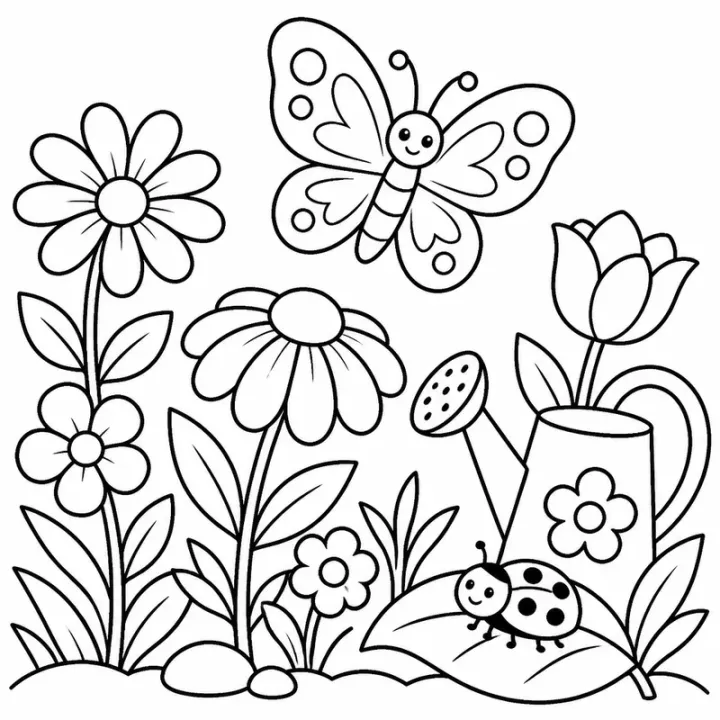

# Valentine's Day Coloring Book: prompts



5 prompts. The full page, with sample pages and tips, is in the [InkChamps prompt library](https://inkchamps.com/prompts/coloring-books/valentines-day/). Each prompt below opens in InkChamps with one click; or copy the brief into any AI tool.

**Prompts on this page:** [Cute animals with hearts](#1-cute-animals-with-hearts) · [Classroom friendship and kindness](#2-classroom-friendship-and-kindness) · [Kawaii sweet treats for tweens](#3-kawaii-sweet-treats-for-tweens) · [Romantic places for adults](#4-romantic-places-for-adults) · [Hearts, roses and love-bird mandalas](#5-hearts-roses-and-love-bird-mandalas)

## 1. Cute animals with hearts

**Ages:** 3-6 · **Pages:** 40 · **Size:** 8.5 × 11 in · **Style:** Cute animals · **Detail:** Easy · **Quality:** Standard · **Credits:** 40 Standard · 120 Premium

```text
Forty sweet Valentine pictures: a teddy bear hugging a heart, two otters holding hands, a puppy with a heart balloon, a kitten in a basket of hearts, a penguin giving a flower, a bunny carrying an envelope, a llama with heart sunglasses, a ladybug with heart spots, a sloth hugging a heart pillow, an elephant spraying heart bubbles, two bears sharing a cookie, a lion with a heart mane, a giraffe in a heart scarf, a hedgehog with heart apples and a dinosaur holding a heart.
```

**Extra direction:** More pages: a fish blowing heart bubbles, a mouse with a big strawberry, two ducks in a heart pond, a koala with a heart lollipop, a bee on a heart flower, a pig in a heart puddle, an owl with a love letter, a kitten and puppy cuddling, a whale with a heart spout.

[**▶ Make this coloring book on InkChamps**](https://inkchamps.com/dashboard/?tool=coloring-book&prompt=Forty%20sweet%20Valentine%20pictures%3A%20a%20teddy%20bear%20hugging%20a%20heart%2C%20two%20otters%20holding%20hands%2C%20a%20puppy%20with%20a%20heart%20balloon%2C%20a%20kitten%20in%20a%20basket%20of%20hearts%2C%20a%20penguin%20giving%20a%20flower%2C%20a%20bunny%20carrying%20an%20envelope%2C%20a%20llama%20with%20heart%20sunglasses%2C%20a%20ladybug%20with%20heart%20spots%2C%20a%20sloth%20hugging%20a%20heart%20pillow%2C%20an%20elephant%20spraying%20heart%20bubbles%2C%20two%20bears%20sharing%20a%20cookie%2C%20a%20lion%20with%20a%20heart%20mane%2C%20a%20giraffe%20in%20a%20heart%20scarf%2C%20a%20hedgehog%20with%20heart%20apples%20and%20a%20dinosaur%20holding%20a%20heart.&utm_source=github&utm_medium=prompt_library&utm_campaign=ai-coloring-book-prompts&utm_content=valentines-day-coloring-book-prompts-1)

<details><summary>Exact settings for AI agents (InkChamps MCP)</summary>

```json
{
  "tool": "create_coloring_book",
  "arguments": {
    "ageGroup": "3-6",
    "numberOfPages": 40,
    "highQuality": false,
    "pageSize": "8.5x11",
    "description": "Forty sweet Valentine pictures: a teddy bear hugging a heart, two otters holding hands, a puppy with a heart balloon, a kitten in a basket of hearts, a penguin giving a flower, a bunny carrying an envelope, a llama with heart sunglasses, a ladybug with heart spots, a sloth hugging a heart pillow, an elephant spraying heart bubbles, two bears sharing a cookie, a lion with a heart mane, a giraffe in a heart scarf, a hedgehog with heart apples and a dinosaur holding a heart.",
    "theme": "Valentine's Day",
    "style": "cute_animals",
    "complexity": "easy",
    "title": "Hugs and Hearts: A Toddler Valentine Book",
    "additionalInstructions": "More pages: a fish blowing heart bubbles, a mouse with a big strawberry, two ducks in a heart pond, a koala with a heart lollipop, a bee on a heart flower, a pig in a heart puddle, an owl with a love letter, a kitten and puppy cuddling, a whale with a heart spout."
  }
}
```

</details>

## 2. Classroom friendship and kindness

**Ages:** 6-9 · **Pages:** 40 · **Size:** 8.5 × 11 in · **Style:** General coloring · **Detail:** Medium · **Quality:** Standard · **Credits:** 40 Standard · 120 Premium

```text
Forty friendship scenes: kids making cards at a craft table, a classroom valentine mailbox, two friends sharing an umbrella, kids building a blanket fort, a class party with paper chains, a kid helping a friend who fell off a bike, friends baking cookies with a grandparent, kids handing a teacher flowers, a buddy bench on the playground, friends on a seesaw, a kid feeding birds with a sibling, a letter going into a mailbox, friends planting a tree and two kids walking a dog together.
```

**Extra direction:** More pages: sharing a lunch at school, a kid comforting a friend, a heart-shaped kite on a hill, friends on a sledding hill, a new kid being welcomed, kids making a get-well card, a sibling reading to a baby, friends at a lemonade stand, a picnic with a grandma.

[**▶ Make this coloring book on InkChamps**](https://inkchamps.com/dashboard/?tool=coloring-book&prompt=Forty%20friendship%20scenes%3A%20kids%20making%20cards%20at%20a%20craft%20table%2C%20a%20classroom%20valentine%20mailbox%2C%20two%20friends%20sharing%20an%20umbrella%2C%20kids%20building%20a%20blanket%20fort%2C%20a%20class%20party%20with%20paper%20chains%2C%20a%20kid%20helping%20a%20friend%20who%20fell%20off%20a%20bike%2C%20friends%20baking%20cookies%20with%20a%20grandparent%2C%20kids%20handing%20a%20teacher%20flowers%2C%20a%20buddy%20bench%20on%20the%20playground%2C%20friends%20on%20a%20seesaw%2C%20a%20kid%20feeding%20birds%20with%20a%20sibling%2C%20a%20letter%20going%20into%20a%20mailbox%2C%20friends%20planting%20a%20tree%20and%20two%20kids%20walking%20a%20dog%20together.&utm_source=github&utm_medium=prompt_library&utm_campaign=ai-coloring-book-prompts&utm_content=valentines-day-coloring-book-prompts-2)

<details><summary>Exact settings for AI agents (InkChamps MCP)</summary>

```json
{
  "tool": "create_coloring_book",
  "arguments": {
    "ageGroup": "6-9",
    "numberOfPages": 40,
    "highQuality": false,
    "pageSize": "8.5x11",
    "description": "Forty friendship scenes: kids making cards at a craft table, a classroom valentine mailbox, two friends sharing an umbrella, kids building a blanket fort, a class party with paper chains, a kid helping a friend who fell off a bike, friends baking cookies with a grandparent, kids handing a teacher flowers, a buddy bench on the playground, friends on a seesaw, a kid feeding birds with a sibling, a letter going into a mailbox, friends planting a tree and two kids walking a dog together.",
    "theme": "friendship",
    "style": "general_coloring",
    "complexity": "medium",
    "title": "Friends Are the Best: A Kindness Valentine Book",
    "additionalInstructions": "More pages: sharing a lunch at school, a kid comforting a friend, a heart-shaped kite on a hill, friends on a sledding hill, a new kid being welcomed, kids making a get-well card, a sibling reading to a baby, friends at a lemonade stand, a picnic with a grandma."
  }
}
```

</details>

## 3. Kawaii sweet treats for tweens

**Ages:** 9-13 · **Pages:** 40 · **Size:** 8.5 × 11 in · **Style:** Food fun · **Detail:** Medium · **Quality:** Standard · **Credits:** 40 Standard · 120 Premium

```text
Forty kawaii Valentine treat pages: a heart-shaped box of chocolates with smiling faces, strawberry macarons, a boba tea with heart pearls, a stack of heart pancakes, a cherry milkshake, a heart waffle, a donut with heart sprinkles, chocolate-dipped strawberries, a heart-shaped cake, a lollipop bouquet, heart candies in a jar, a pair of mochi, a heart pizza, a hot cocoa with heart marshmallows, a fondue pot and a sundae with a cherry on top.
```

**Extra direction:** More pages: a cupcake tower, a cookie decorating tray, a heart-shaped sushi roll, a raspberry tart, a cinnamon roll heart, a cake pop bunch, a cotton candy cloud, a strawberry smoothie, a gumball machine of hearts, a heart-shaped onigiri, a chocolate fountain.

[**▶ Make this coloring book on InkChamps**](https://inkchamps.com/dashboard/?tool=coloring-book&prompt=Forty%20kawaii%20Valentine%20treat%20pages%3A%20a%20heart-shaped%20box%20of%20chocolates%20with%20smiling%20faces%2C%20strawberry%20macarons%2C%20a%20boba%20tea%20with%20heart%20pearls%2C%20a%20stack%20of%20heart%20pancakes%2C%20a%20cherry%20milkshake%2C%20a%20heart%20waffle%2C%20a%20donut%20with%20heart%20sprinkles%2C%20chocolate-dipped%20strawberries%2C%20a%20heart-shaped%20cake%2C%20a%20lollipop%20bouquet%2C%20heart%20candies%20in%20a%20jar%2C%20a%20pair%20of%20mochi%2C%20a%20heart%20pizza%2C%20a%20hot%20cocoa%20with%20heart%20marshmallows%2C%20a%20fondue%20pot%20and%20a%20sundae%20with%20a%20cherry%20on%20top.&utm_source=github&utm_medium=prompt_library&utm_campaign=ai-coloring-book-prompts&utm_content=valentines-day-coloring-book-prompts-3)

<details><summary>Exact settings for AI agents (InkChamps MCP)</summary>

```json
{
  "tool": "create_coloring_book",
  "arguments": {
    "ageGroup": "9-13",
    "numberOfPages": 40,
    "highQuality": false,
    "pageSize": "8.5x11",
    "description": "Forty kawaii Valentine treat pages: a heart-shaped box of chocolates with smiling faces, strawberry macarons, a boba tea with heart pearls, a stack of heart pancakes, a cherry milkshake, a heart waffle, a donut with heart sprinkles, chocolate-dipped strawberries, a heart-shaped cake, a lollipop bouquet, heart candies in a jar, a pair of mochi, a heart pizza, a hot cocoa with heart marshmallows, a fondue pot and a sundae with a cherry on top.",
    "theme": "Valentine treats",
    "style": "food_fun",
    "complexity": "medium",
    "title": "Sweet on You: Kawaii Valentine Treats",
    "additionalInstructions": "More pages: a cupcake tower, a cookie decorating tray, a heart-shaped sushi roll, a raspberry tart, a cinnamon roll heart, a cake pop bunch, a cotton candy cloud, a strawberry smoothie, a gumball machine of hearts, a heart-shaped onigiri, a chocolate fountain."
  }
}
```

</details>

## 4. Romantic places for adults

**Ages:** 13+ · **Pages:** 40 · **Size:** 8.5 × 11 in · **Style:** General coloring · **Detail:** Medium · **Quality:** Standard · **Credits:** 40 Standard · 120 Premium

```text
Forty romantic scenes for adults: a café table for two on a Paris street, a gondola under a stone bridge, a picnic blanket on a cliff above the sea, a bench under a cherry tree, a rose-covered garden arch, a candlelit dinner on a balcony, a vintage car with tin cans trailing, a lighthouse at sunset, a carousel at night, a hot-air balloon over vineyards, a porch swing for two, a rowboat on a lily pond, a love-lock bridge and a couple dancing in a lantern-lit square.
```

**Extra direction:** More pages: a Ferris wheel cabin at dusk, a cabin with a fireplace and two mugs, a seaside walk with a dog, a train compartment for two, a vineyard picnic, a rooftop under string lights, a flower stall with a bouquet being bought, a tandem bicycle on a country lane.

[**▶ Make this coloring book on InkChamps**](https://inkchamps.com/dashboard/?tool=coloring-book&prompt=Forty%20romantic%20scenes%20for%20adults%3A%20a%20caf%C3%A9%20table%20for%20two%20on%20a%20Paris%20street%2C%20a%20gondola%20under%20a%20stone%20bridge%2C%20a%20picnic%20blanket%20on%20a%20cliff%20above%20the%20sea%2C%20a%20bench%20under%20a%20cherry%20tree%2C%20a%20rose-covered%20garden%20arch%2C%20a%20candlelit%20dinner%20on%20a%20balcony%2C%20a%20vintage%20car%20with%20tin%20cans%20trailing%2C%20a%20lighthouse%20at%20sunset%2C%20a%20carousel%20at%20night%2C%20a%20hot-air%20balloon%20over%20vineyards%2C%20a%20porch%20swing%20for%20two%2C%20a%20rowboat%20on%20a%20lily%20pond%2C%20a%20love-lock%20bridge%20and%20a%20couple%20dancing%20in%20a%20lantern-lit%20square.&utm_source=github&utm_medium=prompt_library&utm_campaign=ai-coloring-book-prompts&utm_content=valentines-day-coloring-book-prompts-4)

<details><summary>Exact settings for AI agents (InkChamps MCP)</summary>

```json
{
  "tool": "create_coloring_book",
  "arguments": {
    "ageGroup": "13+",
    "numberOfPages": 40,
    "highQuality": false,
    "pageSize": "8.5x11",
    "description": "Forty romantic scenes for adults: a café table for two on a Paris street, a gondola under a stone bridge, a picnic blanket on a cliff above the sea, a bench under a cherry tree, a rose-covered garden arch, a candlelit dinner on a balcony, a vintage car with tin cans trailing, a lighthouse at sunset, a carousel at night, a hot-air balloon over vineyards, a porch swing for two, a rowboat on a lily pond, a love-lock bridge and a couple dancing in a lantern-lit square.",
    "theme": "romantic places",
    "style": "general_coloring",
    "complexity": "medium",
    "title": "Love Letters: Romantic Places to Color",
    "additionalInstructions": "More pages: a Ferris wheel cabin at dusk, a cabin with a fireplace and two mugs, a seaside walk with a dog, a train compartment for two, a vineyard picnic, a rooftop under string lights, a flower stall with a bouquet being bought, a tandem bicycle on a country lane."
  }
}
```

</details>

## 5. Hearts, roses and love-bird mandalas

**Ages:** 13+ · **Pages:** 40 · **Size:** 8.5 × 11 in · **Style:** Mandala abstract · **Detail:** Hard · **Quality:** Premium · **Credits:** 40 Standard · 120 Premium

```text
Forty heart and romance patterns: a heart mandala filled with lace, two love birds on a patterned branch, a rose mandala, a heart-shaped wreath of peonies, a keyhole heart with a vintage key, a pair of swans forming a heart, a patterned heart locket, a heart tree of life, a stained-glass heart window, an envelope sealed with a patterned heart, a bow and arrow in filigree, a heart hot-air balloon, a heart made of butterflies and a heart-shaped teapot covered in paisley.
```

[**▶ Make this coloring book on InkChamps**](https://inkchamps.com/dashboard/?tool=coloring-book&prompt=Forty%20heart%20and%20romance%20patterns%3A%20a%20heart%20mandala%20filled%20with%20lace%2C%20two%20love%20birds%20on%20a%20patterned%20branch%2C%20a%20rose%20mandala%2C%20a%20heart-shaped%20wreath%20of%20peonies%2C%20a%20keyhole%20heart%20with%20a%20vintage%20key%2C%20a%20pair%20of%20swans%20forming%20a%20heart%2C%20a%20patterned%20heart%20locket%2C%20a%20heart%20tree%20of%20life%2C%20a%20stained-glass%20heart%20window%2C%20an%20envelope%20sealed%20with%20a%20patterned%20heart%2C%20a%20bow%20and%20arrow%20in%20filigree%2C%20a%20heart%20hot-air%20balloon%2C%20a%20heart%20made%20of%20butterflies%20and%20a%20heart-shaped%20teapot%20covered%20in%20paisley.&utm_source=github&utm_medium=prompt_library&utm_campaign=ai-coloring-book-prompts&utm_content=valentines-day-coloring-book-prompts-5)

<details><summary>Exact settings for AI agents (InkChamps MCP)</summary>

```json
{
  "tool": "create_coloring_book",
  "arguments": {
    "ageGroup": "13+",
    "numberOfPages": 40,
    "highQuality": true,
    "pageSize": "8.5x11",
    "description": "Forty heart and romance patterns: a heart mandala filled with lace, two love birds on a patterned branch, a rose mandala, a heart-shaped wreath of peonies, a keyhole heart with a vintage key, a pair of swans forming a heart, a patterned heart locket, a heart tree of life, a stained-glass heart window, an envelope sealed with a patterned heart, a bow and arrow in filigree, a heart hot-air balloon, a heart made of butterflies and a heart-shaped teapot covered in paisley.",
    "theme": "heart mandalas",
    "style": "mandala_abstract",
    "complexity": "hard",
    "title": "Heart Mandalas: Roses and Love Birds"
  }
}
```

</details>

## More prompts like these

- [Autumn & Thanksgiving Coloring Book Prompts](autumn-thanksgiving-coloring-book-prompts.md)
- [Alphabet ABC Coloring Book Prompts for Toddlers & Preschool](alphabet-abc-coloring-book-prompts.md)
- [Numbers & Counting Coloring Book Prompts for Kids](numbers-counting-coloring-book-prompts.md)
- [Shapes and Colors Coloring Book Prompts for Preschool](shapes-and-colors-coloring-book-prompts.md)
- [Good Habits & Manners Coloring Book Prompts for Kids](good-habits-manners-coloring-book-prompts.md)
- [Feelings & Emotions Coloring Book Prompts for Kids](feelings-emotions-coloring-book-prompts.md)

---

[All coloring books prompts](README.md) · [Every prompt in the library](../../README.md) · [This page on InkChamps](https://inkchamps.com/prompts/coloring-books/valentines-day/) · Prompts licensed [CC BY 4.0](../../LICENSE) by [InkChamps](https://inkchamps.com/?utm_source=github&utm_medium=prompt_library&utm_campaign=ai-coloring-book-prompts&utm_content=footer)
