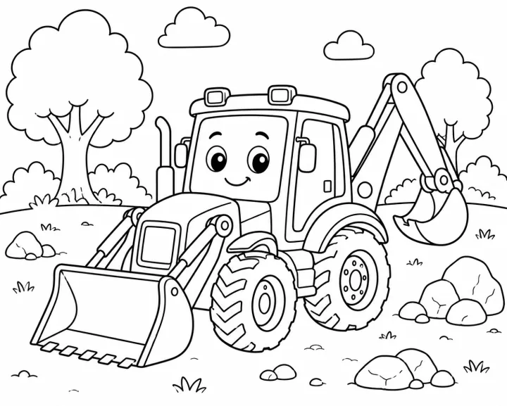

# Vehicle Coloring Book: prompts



5 prompts. The full page, with sample pages and tips, is in the [InkChamps prompt library](https://inkchamps.com/prompts/coloring-books/vehicle/). Each prompt below opens in InkChamps with one click; or copy the brief into any AI tool.

**Prompts on this page:** [Diggers and dump trucks for toddlers](#1-diggers-and-dump-trucks-for-toddlers) · [Rescue and emergency vehicles](#2-rescue-and-emergency-vehicles) · [40 named planes, boats and trains](#3-40-named-planes-boats-and-trains) · [Speed machines for big kids](#4-speed-machines-for-big-kids) · [Classic cars and vintage travel for adults](#5-classic-cars-and-vintage-travel-for-adults)

## 1. Diggers and dump trucks for toddlers

**Ages:** 3-6 · **Pages:** 40 · **Size:** 8.5 × 8.5 in · **Style:** General coloring · **Detail:** Easy · **Quality:** Standard · **Credits:** 40 Standard · 120 Premium

```text
Forty pages of a busy construction site with friendly machines: a dump truck tipping dirt, an excavator digging a hole, a bulldozer pushing a rock pile, a cement mixer turning, a tall crane lifting beams, a road roller flattening a road, a backhoe loader filling its bucket, a forklift stacking boxes, a skid steer in a mud puddle, and a wheel loader scooping sand.
```

**Extra direction:** More pages: a digger and dump truck working together, a crane lifting a roof onto a house, a tunnel boring machine, a mini excavator in a garden, a cherry picker by a street lamp, an asphalt paver, a water truck spraying dust, a pile driver, a drilling rig, a flatbed truck carrying a digger, machines parked at night, a demolition machine knocking down a wall, a tractor pulling a trailer of bricks, a dump truck in a car wash, a garbage truck lifting a bin, a street sweeper, and a playground the machines just built.

[**▶ Make this coloring book on InkChamps**](https://inkchamps.com/dashboard/?tool=coloring-book&prompt=Forty%20pages%20of%20a%20busy%20construction%20site%20with%20friendly%20machines%3A%20a%20dump%20truck%20tipping%20dirt%2C%20an%20excavator%20digging%20a%20hole%2C%20a%20bulldozer%20pushing%20a%20rock%20pile%2C%20a%20cement%20mixer%20turning%2C%20a%20tall%20crane%20lifting%20beams%2C%20a%20road%20roller%20flattening%20a%20road%2C%20a%20backhoe%20loader%20filling%20its%20bucket%2C%20a%20forklift%20stacking%20boxes%2C%20a%20skid%20steer%20in%20a%20mud%20puddle%2C%20and%20a%20wheel%20loader%20scooping%20sand.&utm_source=github&utm_medium=prompt_library&utm_campaign=ai-coloring-book-prompts&utm_content=vehicle-coloring-book-prompts-1)

<details><summary>Exact settings for AI agents (InkChamps MCP)</summary>

```json
{
  "tool": "create_coloring_book",
  "arguments": {
    "ageGroup": "3-6",
    "numberOfPages": 40,
    "highQuality": false,
    "pageSize": "8.5x8.5",
    "description": "Forty pages of a busy construction site with friendly machines: a dump truck tipping dirt, an excavator digging a hole, a bulldozer pushing a rock pile, a cement mixer turning, a tall crane lifting beams, a road roller flattening a road, a backhoe loader filling its bucket, a forklift stacking boxes, a skid steer in a mud puddle, and a wheel loader scooping sand.",
    "style": "general_coloring",
    "complexity": "easy",
    "theme": "construction vehicles",
    "title": "Diggers and Dump Trucks Coloring Book",
    "additionalInstructions": "More pages: a digger and dump truck working together, a crane lifting a roof onto a house, a tunnel boring machine, a mini excavator in a garden, a cherry picker by a street lamp, an asphalt paver, a water truck spraying dust, a pile driver, a drilling rig, a flatbed truck carrying a digger, machines parked at night, a demolition machine knocking down a wall, a tractor pulling a trailer of bricks, a dump truck in a car wash, a garbage truck lifting a bin, a street sweeper, and a playground the machines just built."
  }
}
```

</details>

## 2. Rescue and emergency vehicles

**Ages:** 6-9 · **Pages:** 40 · **Size:** 8.5 × 11 in · **Style:** General coloring · **Detail:** Medium · **Quality:** Standard · **Credits:** 40 Standard · 120 Premium

```text
Forty pages of rescue vehicles at work: a fire engine with its ladder raised to a window, a fireboat spraying water, an ambulance outside a hospital, a police car on patrol, a rescue helicopter lifting a hiker, a coast guard boat in big waves, a tow truck hauling a car, a snowplow clearing a mountain road, a lifeboat launching down a ramp, and a firefighting plane dropping water on a forest.
```

**Extra direction:** More pages: an airport fire truck, a police motorcycle, a police boat on a river, a mountain rescue snowmobile, a lifeguard buggy on the beach, an animal rescue van, a mobile command truck, a rescue hovercraft on ice, a fire station with engines parked, a ladder truck crossing a bridge, a paramedic bike, a search dog jumping from a rescue truck, a flood rescue raft, a police horse trailer, fire engine wash day, a rescue drone over a field, an off-road ambulance in the desert, and a rescue vehicle parade.

[**▶ Make this coloring book on InkChamps**](https://inkchamps.com/dashboard/?tool=coloring-book&prompt=Forty%20pages%20of%20rescue%20vehicles%20at%20work%3A%20a%20fire%20engine%20with%20its%20ladder%20raised%20to%20a%20window%2C%20a%20fireboat%20spraying%20water%2C%20an%20ambulance%20outside%20a%20hospital%2C%20a%20police%20car%20on%20patrol%2C%20a%20rescue%20helicopter%20lifting%20a%20hiker%2C%20a%20coast%20guard%20boat%20in%20big%20waves%2C%20a%20tow%20truck%20hauling%20a%20car%2C%20a%20snowplow%20clearing%20a%20mountain%20road%2C%20a%20lifeboat%20launching%20down%20a%20ramp%2C%20and%20a%20firefighting%20plane%20dropping%20water%20on%20a%20forest.&utm_source=github&utm_medium=prompt_library&utm_campaign=ai-coloring-book-prompts&utm_content=vehicle-coloring-book-prompts-2)

<details><summary>Exact settings for AI agents (InkChamps MCP)</summary>

```json
{
  "tool": "create_coloring_book",
  "arguments": {
    "ageGroup": "6-9",
    "numberOfPages": 40,
    "highQuality": false,
    "pageSize": "8.5x11",
    "description": "Forty pages of rescue vehicles at work: a fire engine with its ladder raised to a window, a fireboat spraying water, an ambulance outside a hospital, a police car on patrol, a rescue helicopter lifting a hiker, a coast guard boat in big waves, a tow truck hauling a car, a snowplow clearing a mountain road, a lifeboat launching down a ramp, and a firefighting plane dropping water on a forest.",
    "style": "general_coloring",
    "complexity": "medium",
    "theme": "rescue vehicles",
    "title": "Rescue Vehicles Coloring Book",
    "additionalInstructions": "More pages: an airport fire truck, a police motorcycle, a police boat on a river, a mountain rescue snowmobile, a lifeguard buggy on the beach, an animal rescue van, a mobile command truck, a rescue hovercraft on ice, a fire station with engines parked, a ladder truck crossing a bridge, a paramedic bike, a search dog jumping from a rescue truck, a flood rescue raft, a police horse trailer, fire engine wash day, a rescue drone over a field, an off-road ambulance in the desert, and a rescue vehicle parade."
  }
}
```

</details>

## 3. 40 named planes, boats and trains

**Ages:** 6-9 · **Pages:** 40 · **Size:** 8.5 × 11 in · **Style:** General coloring · **Detail:** Medium · **Layout:** One item per page, with its caption · **Quality:** Standard · **Credits:** 40 Standard · 120 Premium

```text
Forty vehicles of the air, water and rails, one per page with its name: biplane, jumbo jet, seaplane, glider, stunt plane, cargo plane, helicopter, hot-air balloon, blimp, space shuttle, sailboat, rowboat, canoe, kayak, tugboat, ferry, cargo ship, cruise ship, submarine, fishing trawler, tall ship, speedboat, paddle steamer, houseboat, hovercraft, jet ski, steam locomotive, freight train, bullet train, subway train, monorail, cable car, tram, funicular, maglev train, rack railway, handcar, caboose, snowcat, and gondola.
```

[**▶ Make this coloring book on InkChamps**](https://inkchamps.com/dashboard/?tool=coloring-book&prompt=Forty%20vehicles%20of%20the%20air%2C%20water%20and%20rails%2C%20one%20per%20page%20with%20its%20name%3A%20biplane%2C%20jumbo%20jet%2C%20seaplane%2C%20glider%2C%20stunt%20plane%2C%20cargo%20plane%2C%20helicopter%2C%20hot-air%20balloon%2C%20blimp%2C%20space%20shuttle%2C%20sailboat%2C%20rowboat%2C%20canoe%2C%20kayak%2C%20tugboat%2C%20ferry%2C%20cargo%20ship%2C%20cruise%20ship%2C%20submarine%2C%20fishing%20trawler%2C%20tall%20ship%2C%20speedboat%2C%20paddle%20steamer%2C%20houseboat%2C%20hovercraft%2C%20jet%20ski%2C%20steam%20locomotive%2C%20freight%20train%2C%20bullet%20train%2C%20subway%20train%2C%20monorail%2C%20cable%20car%2C%20tram%2C%20funicular%2C%20maglev%20train%2C%20rack%20railway%2C%20handcar%2C%20caboose%2C%20snowcat%2C%20and%20gondola.&utm_source=github&utm_medium=prompt_library&utm_campaign=ai-coloring-book-prompts&utm_content=vehicle-coloring-book-prompts-3)

<details><summary>Exact settings for AI agents (InkChamps MCP)</summary>

```json
{
  "tool": "create_coloring_book",
  "arguments": {
    "ageGroup": "6-9",
    "numberOfPages": 40,
    "highQuality": false,
    "pageSize": "8.5x11",
    "description": "Forty vehicles of the air, water and rails, one per page with its name: biplane, jumbo jet, seaplane, glider, stunt plane, cargo plane, helicopter, hot-air balloon, blimp, space shuttle, sailboat, rowboat, canoe, kayak, tugboat, ferry, cargo ship, cruise ship, submarine, fishing trawler, tall ship, speedboat, paddle steamer, houseboat, hovercraft, jet ski, steam locomotive, freight train, bullet train, subway train, monorail, cable car, tram, funicular, maglev train, rack railway, handcar, caboose, snowcat, and gondola.",
    "style": "general_coloring",
    "complexity": "medium",
    "theme": "planes, boats and trains",
    "title": "Planes, Boats and Trains: 40 Vehicles to Color",
    "pageCategory": "concept"
  }
}
```

</details>

## 4. Speed machines for big kids

**Ages:** 9-13 · **Pages:** 40 · **Size:** 8.5 × 11 in · **Style:** General coloring · **Detail:** Medium · **Quality:** Standard · **Credits:** 40 Standard · 120 Premium

```text
Forty pages of fast machines with no real makes: a monster truck jumping a row of cars, a dirt bike in mid-air over a ramp, a go-kart race, a rally car splashing through mud, a drag racer launching off the line, a speedboat skipping across a lake, a snowmobile racing downhill, a quad bike in desert dunes, a sidecar motorbike on a mountain road, and an open-wheel race car in the pit lane.
```

**Extra direction:** More pages: a soapbox derby, a BMX rider in a skatepark, a jet-powered car on a salt flat, a hydroplane race, a stunt plane looping, a hovercraft race, a truck-pulling contest, a demolition derby, a bobsled on an ice track, a downhill mountain bike, a racing sailboat heeling over, a trophy truck in a desert race, a motocross pack on a dirt track, a race car garage with mechanics, a checkered-flag finish, and a transporter truck carrying race cars.

[**▶ Make this coloring book on InkChamps**](https://inkchamps.com/dashboard/?tool=coloring-book&prompt=Forty%20pages%20of%20fast%20machines%20with%20no%20real%20makes%3A%20a%20monster%20truck%20jumping%20a%20row%20of%20cars%2C%20a%20dirt%20bike%20in%20mid-air%20over%20a%20ramp%2C%20a%20go-kart%20race%2C%20a%20rally%20car%20splashing%20through%20mud%2C%20a%20drag%20racer%20launching%20off%20the%20line%2C%20a%20speedboat%20skipping%20across%20a%20lake%2C%20a%20snowmobile%20racing%20downhill%2C%20a%20quad%20bike%20in%20desert%20dunes%2C%20a%20sidecar%20motorbike%20on%20a%20mountain%20road%2C%20and%20an%20open-wheel%20race%20car%20in%20the%20pit%20lane.&utm_source=github&utm_medium=prompt_library&utm_campaign=ai-coloring-book-prompts&utm_content=vehicle-coloring-book-prompts-4)

<details><summary>Exact settings for AI agents (InkChamps MCP)</summary>

```json
{
  "tool": "create_coloring_book",
  "arguments": {
    "ageGroup": "9-13",
    "numberOfPages": 40,
    "highQuality": false,
    "pageSize": "8.5x11",
    "description": "Forty pages of fast machines with no real makes: a monster truck jumping a row of cars, a dirt bike in mid-air over a ramp, a go-kart race, a rally car splashing through mud, a drag racer launching off the line, a speedboat skipping across a lake, a snowmobile racing downhill, a quad bike in desert dunes, a sidecar motorbike on a mountain road, and an open-wheel race car in the pit lane.",
    "style": "general_coloring",
    "complexity": "medium",
    "theme": "speed machines",
    "title": "Speed Machines Coloring Book",
    "additionalInstructions": "More pages: a soapbox derby, a BMX rider in a skatepark, a jet-powered car on a salt flat, a hydroplane race, a stunt plane looping, a hovercraft race, a truck-pulling contest, a demolition derby, a bobsled on an ice track, a downhill mountain bike, a racing sailboat heeling over, a trophy truck in a desert race, a motocross pack on a dirt track, a race car garage with mechanics, a checkered-flag finish, and a transporter truck carrying race cars."
  }
}
```

</details>

## 5. Classic cars and vintage travel for adults

**Ages:** 13+ · **Pages:** 40 · **Size:** 8.5 × 11 in · **Style:** General coloring · **Detail:** Hard · **Quality:** Premium · **Credits:** 40 Standard · 120 Premium

```text
Forty vintage vehicles of no real make in nostalgic settings: a 1950s-style convertible outside a roadside diner, an old pickup loaded with pumpkins, a steam locomotive crossing a mountain viaduct, a hot rod in a garage full of tools, a double-decker bus on a rainy city street, a rounded camper at the beach, a vintage motorcycle on a desert highway, a 1920s tram in an old town square, a wood-panel wagon with surfboards, and a gas station with round-top pumps.
```

**Extra direction:** More pages: a vintage fire engine at a small-town parade, a classic car at a drive-in movie, a milk float on a cobbled street, a canal boat at a lock, a biplane over farmland, a scooter outside a café, an ice-cream van on a seaside promenade, a sleeper train dining car, a 1930s limousine at a hotel entrance, an old tractor in a wheat field, a station platform with a steam train, a vintage delivery van, a car at a covered bridge in autumn, a meadow rally of classic cars, and an old car forgotten in a hay barn.

[**▶ Make this coloring book on InkChamps**](https://inkchamps.com/dashboard/?tool=coloring-book&prompt=Forty%20vintage%20vehicles%20of%20no%20real%20make%20in%20nostalgic%20settings%3A%20a%201950s-style%20convertible%20outside%20a%20roadside%20diner%2C%20an%20old%20pickup%20loaded%20with%20pumpkins%2C%20a%20steam%20locomotive%20crossing%20a%20mountain%20viaduct%2C%20a%20hot%20rod%20in%20a%20garage%20full%20of%20tools%2C%20a%20double-decker%20bus%20on%20a%20rainy%20city%20street%2C%20a%20rounded%20camper%20at%20the%20beach%2C%20a%20vintage%20motorcycle%20on%20a%20desert%20highway%2C%20a%201920s%20tram%20in%20an%20old%20town%20square%2C%20a%20wood-panel%20wagon%20with%20surfboards%2C%20and%20a%20gas%20station%20with%20round-top%20pumps.&utm_source=github&utm_medium=prompt_library&utm_campaign=ai-coloring-book-prompts&utm_content=vehicle-coloring-book-prompts-5)

<details><summary>Exact settings for AI agents (InkChamps MCP)</summary>

```json
{
  "tool": "create_coloring_book",
  "arguments": {
    "ageGroup": "13+",
    "numberOfPages": 40,
    "highQuality": true,
    "pageSize": "8.5x11",
    "description": "Forty vintage vehicles of no real make in nostalgic settings: a 1950s-style convertible outside a roadside diner, an old pickup loaded with pumpkins, a steam locomotive crossing a mountain viaduct, a hot rod in a garage full of tools, a double-decker bus on a rainy city street, a rounded camper at the beach, a vintage motorcycle on a desert highway, a 1920s tram in an old town square, a wood-panel wagon with surfboards, and a gas station with round-top pumps.",
    "style": "general_coloring",
    "complexity": "hard",
    "theme": "classic vehicles",
    "title": "Classic Cars and Vintage Travel Coloring Book",
    "additionalInstructions": "More pages: a vintage fire engine at a small-town parade, a classic car at a drive-in movie, a milk float on a cobbled street, a canal boat at a lock, a biplane over farmland, a scooter outside a café, an ice-cream van on a seaside promenade, a sleeper train dining car, a 1930s limousine at a hotel entrance, an old tractor in a wheat field, a station platform with a steam train, a vintage delivery van, a car at a covered bridge in autumn, a meadow rally of classic cars, and an old car forgotten in a hay barn."
  }
}
```

</details>

## More prompts like these

- [Princess & Castle Coloring Book Prompts (Original Characters)](princess-castle-coloring-book-prompts.md)
- [Mermaid Coloring Book Prompts for Kids, Teens & Adults](mermaid-coloring-book-prompts.md)
- [Robot Coloring Book Prompts for Kids & Tweens](robot-coloring-book-prompts.md)
- [Kawaii Food Coloring Book Prompts: Cute Desserts, Fruit & Snacks](kawaii-food-coloring-book-prompts.md)
- [Mandala Coloring Book Prompts for Adults & Teens](mandala-coloring-book-prompts.md)
- [Animal Mandala Coloring Book Prompts](animal-mandala-coloring-book-prompts.md)

---

[All coloring books prompts](README.md) · [Every prompt in the library](../../README.md) · [This page on InkChamps](https://inkchamps.com/prompts/coloring-books/vehicle/) · Prompts licensed [CC BY 4.0](../../LICENSE) by [InkChamps](https://inkchamps.com/?utm_source=github&utm_medium=prompt_library&utm_campaign=ai-coloring-book-prompts&utm_content=footer)
