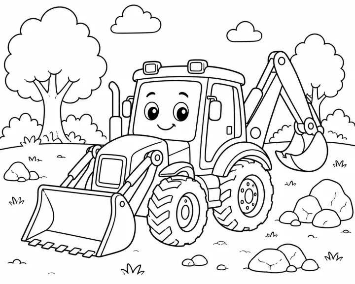

# Vehicle Coloring Book: prompts



5 prompts. The full page, with sample pages and tips, is in the [InkChamps prompt library](https://inkchamps.com/prompts/coloring-books/vehicle/). Each prompt below opens in InkChamps with one click; or copy the brief into any AI tool.

**Prompts on this page:** [Diggers and dump trucks for toddlers](#1-diggers-and-dump-trucks-for-toddlers) · [Rescue and emergency vehicles](#2-rescue-and-emergency-vehicles) · [24 named planes, boats and trains](#3-24-named-planes-boats-and-trains) · [Speed machines for big kids](#4-speed-machines-for-big-kids) · [Classic cars and vintage travel for adults](#5-classic-cars-and-vintage-travel-for-adults)

## 1. Diggers and dump trucks for toddlers

**Ages:** 3-6 · **Pages:** 24 · **Size:** 8.5 × 8.5 in · **Style:** General coloring · **Detail:** Easy · **Quality:** Standard · **Credits:** 24 Standard · 72 Premium

```text
24 pages of a busy construction site with friendly machines: a dump truck tipping dirt, an excavator digging a hole, a bulldozer pushing rocks, a cement mixer pouring, a tall crane lifting a beam, a road roller, a backhoe loader, a forklift stacking boxes, a skid steer in a mud puddle, a cherry picker fixing a street lamp, a garbage truck, a dump truck in a car wash, machines parked at night, and a playground the machines just built.
```

### Page by page (24 pages)

Paste one page at a time into ChatGPT, Gemini or any AI image tool, with this line after it:

> Black-and-white coloring page for a child aged 3 to 6: one or two big, friendly cartoon construction vehicles filling most of the page, thick bold outlines, large simple shapes with wide spaces to color, very little background, no shading, no grey, no words or logos, plain white background, square page.

1. A smiling dump truck tipping a big pile of dirt out of its tipper at a construction site, a few round rocks rolling down the pile and a traffic cone beside it.
2. A friendly excavator digging a deep hole with its toothed bucket, a heap of dirt beside the hole and a small shovel stuck in the ground.
3. A bulldozer pushing a pile of big round rocks with its wide blade, its tracks pressing into the ground and a little flag on a pole behind it.
4. A cement mixer truck with its round drum turning, pouring wet cement down a chute into a square wooden frame on the ground.
5. A tall crane lifting a long steel beam high into the sky on its hook, a half-built building frame beside it and one fluffy cloud.
6. A road roller flattening a new road with its big smooth front drum, a strip of fresh road behind it and two traffic cones at the side.
7. A backhoe loader filling its front bucket with sand, its digging arm folded at the back and a round sand pile in front of it.
8. A forklift lifting a stack of three big boxes on a wooden pallet in a warehouse doorway, a hand trolley parked nearby.
9. A small skid steer driving through a muddy puddle, mud splashing up from its wheels and a scoop full of gravel in front.
10. A wheel loader scooping a heap of sand with its big bucket, sand trickling over the edge and a wheelbarrow beside the heap.
11. A digger and a dump truck working together, the digger dropping a bucket of dirt into the dump truck's open tipper.
12. A crane gently lowering a triangle-shaped roof onto a little house, a ladder leaning against the wall and a pile of planks below.
13. A mini excavator digging a small hole in a garden for a new tree, the young tree waiting in a pot beside it and two flowers nearby.
14. A cherry picker truck raising a worker in its bucket up to fix a street lamp, a toolbox in the bucket and the lamp shining.
15. A water truck spraying a wide fan of water over a dusty dirt road at the construction site, big drops in the air and a round sun overhead.
16. A flatbed truck carrying a small digger on its back along a country road, chains holding the digger down and a tree at the roadside.
17. A garbage truck lifting a wheelie bin with its arm and tipping it into the top, two more bins waiting on the curb.
18. A street sweeper with round spinning brushes cleaning a road, a few leaves in front of it and a clean strip of road behind it.
19. A tractor pulling a trailer stacked with bricks along a farm track, a fence post beside the track with a bird sitting on top.
20. A dump truck going through a car wash, big round brushes spinning on each side and soap bubbles covering its tipper.
21. A demolition machine with a long arm knocking down an old brick wall, a few bricks tumbling and round puffs of dust.
22. A tunnel boring machine with a big round cutting wheel pushing into a hillside, rocks piled around the tunnel entrance.
23. Three construction machines parked in a row for the night at the edge of the site, a crescent moon and big stars above them.
24. A brand-new playground the machines just built, with a slide, a swing and a sandbox, and a little digger parked proudly beside it.

[**▶ Make this coloring book on InkChamps**](https://inkchamps.com/dashboard/?tool=coloring-book&prompt=24%20pages%20of%20a%20busy%20construction%20site%20with%20friendly%20machines%3A%20a%20dump%20truck%20tipping%20dirt%2C%20an%20excavator%20digging%20a%20hole%2C%20a%20bulldozer%20pushing%20rocks%2C%20a%20cement%20mixer%20pouring%2C%20a%20tall%20crane%20lifting%20a%20beam%2C%20a%20road%20roller%2C%20a%20backhoe%20loader%2C%20a%20forklift%20stacking%20boxes%2C%20a%20skid%20steer%20in%20a%20mud%20puddle%2C%20a%20cherry%20picker%20fixing%20a%20street%20lamp%2C%20a%20garbage%20truck%2C%20a%20dump%20truck%20in%20a%20car%20wash%2C%20machines%20parked%20at%20night%2C%20and%20a%20playground%20the%20machines%20just%20built.&utm_source=github&utm_medium=prompt_library&utm_campaign=ai-coloring-book-prompts&utm_content=vehicle-coloring-book-prompts-1)

<details><summary>Exact settings for AI agents (InkChamps MCP)</summary>

```json
{
  "tool": "create_coloring_book",
  "arguments": {
    "ageGroup": "3-6",
    "numberOfPages": 24,
    "highQuality": false,
    "pageSize": "8.5x8.5",
    "description": "24 pages of a busy construction site with friendly machines: a dump truck tipping dirt, an excavator digging a hole, a bulldozer pushing rocks, a cement mixer pouring, a tall crane lifting a beam, a road roller, a backhoe loader, a forklift stacking boxes, a skid steer in a mud puddle, a cherry picker fixing a street lamp, a garbage truck, a dump truck in a car wash, machines parked at night, and a playground the machines just built.",
    "style": "general_coloring",
    "complexity": "easy",
    "theme": "construction vehicles",
    "title": "Diggers and Dump Trucks Coloring Book"
  }
}
```

</details>

## 2. Rescue and emergency vehicles

**Ages:** 6-9 · **Pages:** 24 · **Size:** 8.5 × 11 in · **Style:** General coloring · **Detail:** Medium · **Quality:** Standard · **Credits:** 24 Standard · 72 Premium

```text
24 pages of rescue vehicles at work: a fire engine with its ladder raised to a window, a fireboat spraying water, an ambulance at a hospital, a police car on patrol, a rescue helicopter lifting a hiker, a coast guard boat in big waves, a tow truck, a snowplow on a mountain road, a lifeboat launching, a firefighting plane over a forest, an airport fire truck, a rescue hovercraft on ice, a search dog, a flood rescue raft, fire engine wash day and a rescue vehicle parade.
```

### Page by page (24 pages)

Paste one page at a time into ChatGPT, Gemini or any AI image tool, with this line after it:

> Black-and-white coloring page for a child aged 6 to 9: one rescue vehicle at work as the main subject, clear medium-weight outlines, moderate detail with roomy spaces to color, a simple background scene, no shading, no grey, no words, letters or logos on the vehicles, plain white background, portrait 8.5 x 11 page.

1. A fire engine parked outside a three-story apartment building with its long ladder raised to an upstairs window, a firefighter climbing up and a hose coiled on the truck.
2. A fireboat in a harbor spraying tall arcs of water from its deck cannons, a wooden pier and a lighthouse behind it.
3. An ambulance parked at the hospital entrance with its back doors open, two paramedics rolling out a stretcher and sliding glass doors behind them.
4. A police car on patrol along a quiet town street, its light bar on the roof, a row of shops and a street lamp beside it.
5. A rescue helicopter hovering over a rocky mountain ledge, lowering a rescuer on a cable to reach a hiker with a backpack.
6. A coast guard boat cutting through big curling waves, a crew member in a life jacket on deck and a life ring hanging on the rail.
7. A tow truck pulling a small car with a flat tire up onto its back, an orange cone and a warning triangle on the road.
8. A snowplow clearing a winding mountain road, a wave of snow spraying from its blade and pine trees heavy with snow on both sides.
9. A lifeboat sliding down a steep launch ramp from a seaside boathouse into the waves, its crew in helmets and life jackets.
10. A firefighting plane swooping low over a pine forest, dropping a long curtain of water onto a patch of smoke between the trees.
11. An airport fire truck spraying foam from its roof cannon beside a runway, a parked jet and a control tower in the distance.
12. A police officer in a helmet riding a police motorcycle along a highway, saddlebags on the bike and road signs at the side.
13. A mountain rescue snowmobile towing a sled with a first-aid kit across deep snow, a rescuer in goggles and tall peaks behind.
14. A lifeguard buggy with big sandy tires driving along a beach, a rescue float strapped on the back and a lifeguard tower nearby.
15. An animal rescue van with its side door open, a rescuer carrying a kitten in a carrier and a dog peeking out of a crate inside.
16. A rescue hovercraft gliding over an icy lake toward a crack in the ice where a dog waits on a floe, a coil of rope and a life ring on its deck.
17. A fire station with its big doors open, two fire engines parked inside and helmets and jackets hanging on hooks by the wall.
18. A search dog in a rescue vest jumping down from the back of a rescue truck in a forest clearing, its handler holding the leash.
19. A flood rescue raft paddling down a flooded street, rescuers in life jackets, rooftops and a mailbox poking out of the water.
20. A paramedic in a helmet riding a bike loaded with medical bags through a busy city park, a fountain, park benches and pigeons scattering behind.
21. An off-road ambulance with big tires bouncing over desert sand dunes, a tall cactus and a rocky butte in the distance.
22. A rescue drone with four propellers flying over a cornfield, lowering a small supply bag on a line toward a waving hiker below.
23. Firefighters washing their fire engine on wash day outside the station, buckets, big sponges and a hose spraying soapy suds.
24. A rescue vehicle parade down Main Street, a fire engine, an ambulance and a police car in a row, people waving flags from the sidewalk.

[**▶ Make this coloring book on InkChamps**](https://inkchamps.com/dashboard/?tool=coloring-book&prompt=24%20pages%20of%20rescue%20vehicles%20at%20work%3A%20a%20fire%20engine%20with%20its%20ladder%20raised%20to%20a%20window%2C%20a%20fireboat%20spraying%20water%2C%20an%20ambulance%20at%20a%20hospital%2C%20a%20police%20car%20on%20patrol%2C%20a%20rescue%20helicopter%20lifting%20a%20hiker%2C%20a%20coast%20guard%20boat%20in%20big%20waves%2C%20a%20tow%20truck%2C%20a%20snowplow%20on%20a%20mountain%20road%2C%20a%20lifeboat%20launching%2C%20a%20firefighting%20plane%20over%20a%20forest%2C%20an%20airport%20fire%20truck%2C%20a%20rescue%20hovercraft%20on%20ice%2C%20a%20search%20dog%2C%20a%20flood%20rescue%20raft%2C%20fire%20engine%20wash%20day%20and%20a%20rescue%20vehicle%20parade.&utm_source=github&utm_medium=prompt_library&utm_campaign=ai-coloring-book-prompts&utm_content=vehicle-coloring-book-prompts-2)

<details><summary>Exact settings for AI agents (InkChamps MCP)</summary>

```json
{
  "tool": "create_coloring_book",
  "arguments": {
    "ageGroup": "6-9",
    "numberOfPages": 24,
    "highQuality": false,
    "pageSize": "8.5x11",
    "description": "24 pages of rescue vehicles at work: a fire engine with its ladder raised to a window, a fireboat spraying water, an ambulance at a hospital, a police car on patrol, a rescue helicopter lifting a hiker, a coast guard boat in big waves, a tow truck, a snowplow on a mountain road, a lifeboat launching, a firefighting plane over a forest, an airport fire truck, a rescue hovercraft on ice, a search dog, a flood rescue raft, fire engine wash day and a rescue vehicle parade.",
    "style": "general_coloring",
    "complexity": "medium",
    "theme": "rescue vehicles",
    "title": "Rescue Vehicles Coloring Book"
  }
}
```

</details>

## 3. 24 named planes, boats and trains

**Ages:** 6-9 · **Pages:** 24 · **Size:** 8.5 × 11 in · **Style:** General coloring · **Detail:** Medium · **Layout:** One item per page, with its caption · **Quality:** Standard · **Credits:** 24 Standard · 72 Premium

```text
24 vehicles of the air, water and rails, one per page with its name as a caption: biplane, jumbo jet, seaplane, glider, cargo plane, helicopter, hot-air balloon, blimp, sailboat, rowboat, canoe, tugboat, ferry, cargo ship, submarine, tall ship, paddle steamer, hovercraft, steam locomotive, freight train, bullet train, subway train, monorail and tram.
```

### Page by page (24 pages)

Paste one page at a time into ChatGPT, Gemini or any AI image tool, with this line after it:

> Black-and-white coloring page for a child aged 6 to 9: one vehicle as the large main subject in a simple setting, clear medium-weight outlines, moderate detail with roomy spaces to color, a light background, no shading, no grey, no logos; the caption at the bottom is the only words on the page, plain white background, portrait 8.5 x 11 page.

1. A biplane with two stacked wings and a spinning propeller flying over a patchwork of fields, a pilot in goggles waving from the open cockpit, with the caption "Biplane" in big outlined letters at the bottom.
2. A jumbo jet with four engines taking off from a long runway, its wheels just leaving the ground and a control tower behind, with the caption "Jumbo jet" in big outlined letters at the bottom.
3. A seaplane with two long floats landing on a calm lake, ripples spreading behind it and pine trees on the shore, with the caption "Seaplane" in big outlined letters at the bottom.
4. A glider with long thin wings soaring silently above rolling hills, a hawk flying beside it and puffy clouds, with the caption "Glider" in big outlined letters at the bottom.
5. A big cargo plane on the ground with its nose swung open, a forklift loading crates into it, with the caption "Cargo plane" in big outlined letters at the bottom.
6. A helicopter hovering above a rooftop landing pad marked with a circle, its rotor blades spinning and a windsock on a pole, with the caption "Helicopter" in big outlined letters at the bottom.
7. A hot-air balloon with a patterned envelope floating over a valley, two people waving from its wicker basket, with the caption "Hot-air balloon" in big outlined letters at the bottom.
8. A long rounded blimp drifting slowly above a city park, its small cabin hanging underneath and kites flying below, with the caption "Blimp" in big outlined letters at the bottom.
9. A sailboat with a tall triangle sail gliding across the sea, a seagull on the mast and small waves around it, with the caption "Sailboat" in big outlined letters at the bottom.
10. A wooden rowboat on a quiet pond, a child pulling the two oars, a frog on a lily pad beside the boat, with the caption "Rowboat" in big outlined letters at the bottom.
11. A canoe paddling down a gentle river between tall trees, two paddlers in life jackets and a deer watching from the bank, with the caption "Canoe" in big outlined letters at the bottom.
12. A sturdy little tugboat pushing a huge ship into the harbor, a rope fender on its bow and smoke from its funnel, with the caption "Tugboat" in big outlined letters at the bottom.
13. A car ferry crossing a wide bay with cars parked on its deck, passengers at the rail and an island ahead, with the caption "Ferry" in big outlined letters at the bottom.
14. A long cargo ship stacked high with shipping containers, sailing past a harbor crane and a lighthouse, with the caption "Cargo ship" in big outlined letters at the bottom.
15. A submarine gliding deep underwater, its periscope up, a school of fish and a curious turtle swimming past, with the caption "Submarine" in big outlined letters at the bottom.
16. A tall ship with three masts and many square sails, a crow's nest at the top and rope ladders down the sides, with the caption "Tall ship" in big outlined letters at the bottom.
17. A paddle steamer on a wide river, its big paddle wheel turning at the back and two tall smokestacks puffing, with the caption "Paddle steamer" in big outlined letters at the bottom.
18. A hovercraft skimming from the water up onto a sandy beach on its puffed-up rubber skirt, spray flying behind it, with the caption "Hovercraft" in big outlined letters at the bottom.
19. A steam locomotive puffing clouds of smoke along a track through the countryside, a coal tender behind it, with the caption "Steam locomotive" in big outlined letters at the bottom.
20. A long freight train pulling tank cars and boxcars across a prairie, a windmill and grain silos in the distance, with the caption "Freight train" in big outlined letters at the bottom.
21. A sleek bullet train with a long pointed nose racing past a mountain, the cherry trees beside the track bending in the wind, with the caption "Bullet train" in big outlined letters at the bottom.
22. A subway train pulling into an underground station, passengers waiting on the platform and a clock hanging from the ceiling, with the caption "Subway train" in big outlined letters at the bottom.
23. A monorail train gliding along a single raised beam above a city street, trees and buildings below, with the caption "Monorail" in big outlined letters at the bottom.
24. A tram rolling along rails in the middle of a city street, its pole touching the overhead wire and people waiting at a tram stop, with the caption "Tram" in big outlined letters at the bottom.

[**▶ Make this coloring book on InkChamps**](https://inkchamps.com/dashboard/?tool=coloring-book&prompt=24%20vehicles%20of%20the%20air%2C%20water%20and%20rails%2C%20one%20per%20page%20with%20its%20name%20as%20a%20caption%3A%20biplane%2C%20jumbo%20jet%2C%20seaplane%2C%20glider%2C%20cargo%20plane%2C%20helicopter%2C%20hot-air%20balloon%2C%20blimp%2C%20sailboat%2C%20rowboat%2C%20canoe%2C%20tugboat%2C%20ferry%2C%20cargo%20ship%2C%20submarine%2C%20tall%20ship%2C%20paddle%20steamer%2C%20hovercraft%2C%20steam%20locomotive%2C%20freight%20train%2C%20bullet%20train%2C%20subway%20train%2C%20monorail%20and%20tram.&utm_source=github&utm_medium=prompt_library&utm_campaign=ai-coloring-book-prompts&utm_content=vehicle-coloring-book-prompts-3)

<details><summary>Exact settings for AI agents (InkChamps MCP)</summary>

```json
{
  "tool": "create_coloring_book",
  "arguments": {
    "ageGroup": "6-9",
    "numberOfPages": 24,
    "highQuality": false,
    "pageSize": "8.5x11",
    "description": "24 vehicles of the air, water and rails, one per page with its name as a caption: biplane, jumbo jet, seaplane, glider, cargo plane, helicopter, hot-air balloon, blimp, sailboat, rowboat, canoe, tugboat, ferry, cargo ship, submarine, tall ship, paddle steamer, hovercraft, steam locomotive, freight train, bullet train, subway train, monorail and tram.",
    "style": "general_coloring",
    "complexity": "medium",
    "theme": "planes, boats and trains",
    "title": "Planes, Boats and Trains: 40 Vehicles to Color",
    "pageCategory": "concept"
  }
}
```

</details>

## 4. Speed machines for big kids

**Ages:** 9-13 · **Pages:** 24 · **Size:** 8.5 × 11 in · **Style:** General coloring · **Detail:** Medium · **Quality:** Standard · **Credits:** 24 Standard · 72 Premium

```text
24 pages of fast machines with no real makes: a monster truck jumping a row of cars, a dirt bike in mid-air, a go-kart race, a rally car in mud, a drag racer launching, a speedboat on a lake, a snowmobile downhill, a quad bike on desert dunes, a sidecar motorbike, a pit stop, a soapbox derby, a BMX jump, a jet car on a salt flat, a stunt plane loop, a bobsled, a demolition derby, a motocross pack, a checkered-flag finish and a transporter truck carrying race cars.
```

### Page by page (24 pages)

Paste one page at a time into ChatGPT, Gemini or any AI image tool, with this line after it:

> Black-and-white coloring page for a child aged 9 to 13: a fast vehicle in dramatic action as the main subject, crisp fine-to-medium outlines, detailed mechanical parts and a full action background, no shading, no grey, no words, numbers or logos, plain white background, portrait 8.5 x 11 page.

1. A monster truck with huge tires flying high over a row of crushed old cars in a stadium arena, dirt spraying and crowds in the stands.
2. A dirt bike rider in mid-air over a tall dirt ramp, knees gripping the bike and one hand waving, rough hills and a marker flag on the track below.
3. Three go-karts racing nose to nose around a tight corner of a track lined with stacked tires and straw bales, drivers in full helmets leaning into the turn.
4. A rally car sliding through a muddy forest bend, mud thrown high from its wheels, the co-driver reading pace notes and pine trees all around.
5. A drag racer launching off the starting line, its front wheels lifting, smoke pouring from its fat rear tires and a starting light tower beside it.
6. A speedboat skipping across a mountain lake, a tall rooster tail of spray behind it, a buoy in the water and pine-covered hills.
7. A snowmobile racing downhill through deep powder, the rider leaning into a turn, snow spraying up and fir trees on the slope.
8. A quad bike cresting a tall desert dune, sand flying off its wheels, more dunes rolling behind and the sun low on the horizon.
9. A sidecar motorbike leaning around a mountain hairpin bend, the passenger hanging out of the sidecar, a stone wall and a valley far below.
10. An open-wheel race car stopped in the pit lane, mechanics changing all four tires at once, an air gun in each hand and a pit wall behind.
11. A homemade soapbox derby cart rolling fast down a steep street, its driver in a helmet, hay bales at the bend and people cheering.
12. A BMX rider doing a tabletop jump above a skatepark bowl, concrete ramps, a grind rail and stairs in the background.
13. A long jet-powered car streaking across a flat salt lake, a braking parachute opening behind it and distant mountains.
14. A hydroplane racing boat skimming a river on the tips of its hull, a huge plume of spray behind it and a bridge in the distance.
15. A stunt plane flying a loop high in the sky, a curling smoke trail behind it and a second plane rolling in the distance.
16. A demolition derby in a muddy arena, dented old cars bumping into each other, one spinning around and hay bales around the edge.
17. A four-person bobsled zooming around a high icy bend of the track, the crew tucked low inside and spectators behind the barrier.
18. A downhill mountain biker dropping off a rocky ledge on a steep forest trail, tree roots and boulders below the wheels.
19. A racing sailboat heeling far over in strong wind, the crew leaning out over the high side and waves breaking around the bow.
20. A desert race truck with long springy suspension bouncing over bumps, a cloud of dust behind it and tall cactuses beside the track.
21. A pack of motocross riders bunched together in a muddy corner of a dirt track, bikes leaning and clods of mud flying.
22. A race car raised on a lift in a busy garage, mechanics working underneath it, a rolling tool chest and stacks of spare tires.
23. A race car crossing the finish line as a marshal waves the checkered flag, the crowd jumping up in the grandstand.
24. A big transporter truck carrying race cars on its two decks along a highway at sunset, the open road stretching ahead.

[**▶ Make this coloring book on InkChamps**](https://inkchamps.com/dashboard/?tool=coloring-book&prompt=24%20pages%20of%20fast%20machines%20with%20no%20real%20makes%3A%20a%20monster%20truck%20jumping%20a%20row%20of%20cars%2C%20a%20dirt%20bike%20in%20mid-air%2C%20a%20go-kart%20race%2C%20a%20rally%20car%20in%20mud%2C%20a%20drag%20racer%20launching%2C%20a%20speedboat%20on%20a%20lake%2C%20a%20snowmobile%20downhill%2C%20a%20quad%20bike%20on%20desert%20dunes%2C%20a%20sidecar%20motorbike%2C%20a%20pit%20stop%2C%20a%20soapbox%20derby%2C%20a%20BMX%20jump%2C%20a%20jet%20car%20on%20a%20salt%20flat%2C%20a%20stunt%20plane%20loop%2C%20a%20bobsled%2C%20a%20demolition%20derby%2C%20a%20motocross%20pack%2C%20a%20checkered-flag%20finish%20and%20a%20transporter%20truck%20carrying%20race%20cars.&utm_source=github&utm_medium=prompt_library&utm_campaign=ai-coloring-book-prompts&utm_content=vehicle-coloring-book-prompts-4)

<details><summary>Exact settings for AI agents (InkChamps MCP)</summary>

```json
{
  "tool": "create_coloring_book",
  "arguments": {
    "ageGroup": "9-13",
    "numberOfPages": 24,
    "highQuality": false,
    "pageSize": "8.5x11",
    "description": "24 pages of fast machines with no real makes: a monster truck jumping a row of cars, a dirt bike in mid-air, a go-kart race, a rally car in mud, a drag racer launching, a speedboat on a lake, a snowmobile downhill, a quad bike on desert dunes, a sidecar motorbike, a pit stop, a soapbox derby, a BMX jump, a jet car on a salt flat, a stunt plane loop, a bobsled, a demolition derby, a motocross pack, a checkered-flag finish and a transporter truck carrying race cars.",
    "style": "general_coloring",
    "complexity": "medium",
    "theme": "speed machines",
    "title": "Speed Machines Coloring Book"
  }
}
```

</details>

## 5. Classic cars and vintage travel for adults

**Ages:** 13+ · **Pages:** 24 · **Size:** 8.5 × 11 in · **Style:** General coloring · **Detail:** Hard · **Quality:** Premium · **Credits:** 24 Standard · 72 Premium

```text
24 vintage vehicles of no real make in nostalgic settings: a 1950s-style convertible at a roadside diner, an old pickup loaded with pumpkins, a steam train on a mountain viaduct, a hot rod in a garage, a double-decker bus in the rain, a camper at the beach, a 1920s tram, a gas station with round-top pumps, a drive-in theater, a canal boat in a lock, a sleeper train dining car, a covered bridge in autumn and an old car forgotten in a hay barn.
```

### Page by page (24 pages)

Paste one page at a time into ChatGPT, Gemini or any AI image tool, with this line after it:

> Black-and-white coloring page for teens and adults: a detailed vintage vehicle in a nostalgic scene, fine crisp line work, realistic proportions, intricate details on the vehicle and a full background with many small areas to color, no shading, no grey, no words, signs or logos, plain white background, portrait 8.5 x 11 page.

1. A 1950s-style convertible with tailfins and chrome bumpers parked outside a roadside diner, a round clock above the door and stools seen through the window.
2. An old rounded pickup truck loaded with pumpkins and hay bales parked beside a farm stand, baskets of apples and autumn leaves on the ground.
3. A steam locomotive pulling carriages across a tall stone-arch viaduct between mountains, steam rolling from its chimney and a river far below.
4. A hot rod with its engine exposed in a garage full of hanging tools, a workbench, oil cans and a creeper board on the floor.
5. A double-decker bus on a rainy city street, wet cobblestones, people under umbrellas, a lamppost and old shopfronts.
6. A rounded vintage camper trailer hitched to an old car at the beach, a deck chair, a striped windbreak and seagulls overhead.
7. A vintage motorcycle parked on a long desert highway, telegraph poles along the road, a saguaro cactus and a mesa on the horizon.
8. A 1920s tram with a trolley pole and open platforms rolling through an old town square, a clock tower, café tables under umbrellas and flower boxes on the balconies.
9. A wood-panel station wagon with surfboards on its roof parked above a beach cove, palm trees and rolling waves below.
10. An old gas station with round-top fuel pumps, a vintage car being filled up, a rack of oil cans and a water pail by the pump.
11. A vintage fire engine with a brass bell leading a small-town parade, bunting on the shopfronts and children waving.
12. A classic car at a drive-in theater at night, a big blank screen ahead, a speaker hooked on the window and stars above.
13. A milk float delivering bottles along a cobbled street of terraced houses, crates of milk bottles and a cat on a doorstep.
14. A long decorated canal boat waiting in a lock, heavy wooden lock gates with balance beams, a brick towpath and flower pots on the boat's roof.
15. A vintage biplane with struts and wires flying low over patchwork farmland, hedgerows dividing the fields, a barn, haystacks and a windmill below.
16. A vintage scooter parked outside a sidewalk café, a striped awning, small round tables with coffee cups and a bicycle against the wall.
17. An old ice-cream van parked on a seaside promenade, iron railings, a pier stretching out to sea and a row of beach huts.
18. The dining car of a sleeper train, tables set with lamps and teacups, curtains framing mountain scenery outside the windows.
19. A 1930s limousine at a grand hotel entrance, a doorman holding the car door, revolving doors and potted palms on the steps.
20. An old tractor with big ridged rear wheels working a wheat field at harvest time, a hay wagon behind it, sheaves of wheat and a row of tall poplar trees.
21. A steam train waiting at a country station platform, a porter's trolley piled with suitcases, a station clock and hanging flower baskets.
22. A vintage delivery van with rounded fenders parked outside a bakery, crates of bread loaves and a striped awning over the window.
23. A classic car driving into a wooden covered bridge in autumn, leaves falling, a river below and hills of trees behind.
24. An old car forgotten in a hay barn, sunbeams through the gaps in the boards, chickens perched on its hood and hay bales around it.

[**▶ Make this coloring book on InkChamps**](https://inkchamps.com/dashboard/?tool=coloring-book&prompt=24%20vintage%20vehicles%20of%20no%20real%20make%20in%20nostalgic%20settings%3A%20a%201950s-style%20convertible%20at%20a%20roadside%20diner%2C%20an%20old%20pickup%20loaded%20with%20pumpkins%2C%20a%20steam%20train%20on%20a%20mountain%20viaduct%2C%20a%20hot%20rod%20in%20a%20garage%2C%20a%20double-decker%20bus%20in%20the%20rain%2C%20a%20camper%20at%20the%20beach%2C%20a%201920s%20tram%2C%20a%20gas%20station%20with%20round-top%20pumps%2C%20a%20drive-in%20theater%2C%20a%20canal%20boat%20in%20a%20lock%2C%20a%20sleeper%20train%20dining%20car%2C%20a%20covered%20bridge%20in%20autumn%20and%20an%20old%20car%20forgotten%20in%20a%20hay%20barn.&utm_source=github&utm_medium=prompt_library&utm_campaign=ai-coloring-book-prompts&utm_content=vehicle-coloring-book-prompts-5)

<details><summary>Exact settings for AI agents (InkChamps MCP)</summary>

```json
{
  "tool": "create_coloring_book",
  "arguments": {
    "ageGroup": "13+",
    "numberOfPages": 24,
    "highQuality": true,
    "pageSize": "8.5x11",
    "description": "24 vintage vehicles of no real make in nostalgic settings: a 1950s-style convertible at a roadside diner, an old pickup loaded with pumpkins, a steam train on a mountain viaduct, a hot rod in a garage, a double-decker bus in the rain, a camper at the beach, a 1920s tram, a gas station with round-top pumps, a drive-in theater, a canal boat in a lock, a sleeper train dining car, a covered bridge in autumn and an old car forgotten in a hay barn.",
    "style": "general_coloring",
    "complexity": "hard",
    "theme": "classic vehicles",
    "title": "Classic Cars and Vintage Travel Coloring Book"
  }
}
```

</details>

## More prompts like these

- [Princess & Castle Coloring Book Prompts (Original Characters)](princess-castle-coloring-book-prompts.md)
- [Mermaid Coloring Book Prompts for Kids, Teens & Adults](mermaid-coloring-book-prompts.md)
- [Robot Coloring Book Prompts for Kids & Tweens](robot-coloring-book-prompts.md)
- [Kawaii Food Coloring Book Prompts: Cute Desserts, Fruit & Snacks](kawaii-food-coloring-book-prompts.md)
- [Mandala Coloring Book Prompts for Adults & Teens](mandala-coloring-book-prompts.md)
- [Animal Mandala Coloring Book Prompts](animal-mandala-coloring-book-prompts.md)

---

[All coloring books prompts](README.md) · [Every prompt in the library](../../README.md) · [This page on InkChamps](https://inkchamps.com/prompts/coloring-books/vehicle/) · Prompts licensed [CC BY 4.0](../../LICENSE) by [InkChamps](https://inkchamps.com/?utm_source=github&utm_medium=prompt_library&utm_campaign=ai-coloring-book-prompts&utm_content=footer)
