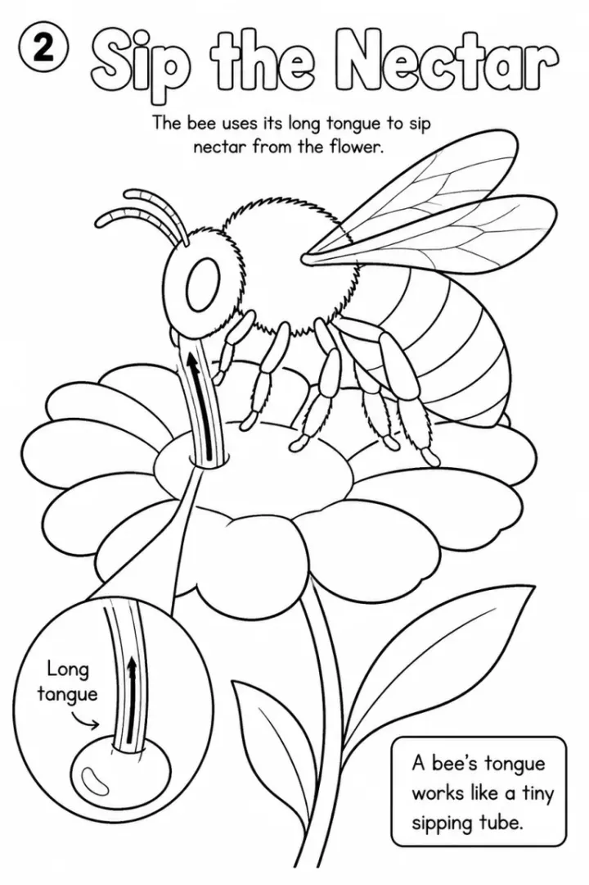

# Bees and Pollinators Coloring Book: prompts



5 prompts. The full page, with sample pages and tips, is in the [InkChamps prompt library](https://inkchamps.com/prompts/educational-coloring-books/bees-and-pollinators/). Each prompt below opens in InkChamps with one click; or copy the brief into any AI tool.

**Prompts on this page:** [Foods pollinators help grow](#1-foods-pollinators-help-grow) · [Pollinators of the world](#2-pollinators-of-the-world) · [A pollinator garden](#3-a-pollinator-garden) · [Inside a honeybee colony](#4-inside-a-honeybee-colony) · [The science of pollination](#5-the-science-of-pollination)

## 1. Foods pollinators help grow

**Ages:** 3-6 · **Pages:** 40 · **Size:** 8.5 × 11 in · **Quality:** Standard · **Credits:** 40 Standard · 120 Premium

```text
40 crops pollinators help grow, one per page: apples, pears, cherries, plums, peaches, apricots, strawberries, blueberries, raspberries, blackberries, cranberries, watermelon, cantaloupe, pumpkins, squash, zucchini, cucumbers, tomatoes, peppers, eggplant, almonds, cashews, Brazil nuts, avocados, mangoes, kiwifruit, passion fruit, figs, cocoa beans, vanilla, coffee, sunflower seeds, clover, alfalfa, cotton, onion seeds, carrot seeds, broccoli seeds, lychees, buckwheat.
```

[**▶ Make this educational coloring book on InkChamps**](https://inkchamps.com/dashboard/?tool=educational-coloring&prompt=40%20crops%20pollinators%20help%20grow%2C%20one%20per%20page%3A%20apples%2C%20pears%2C%20cherries%2C%20plums%2C%20peaches%2C%20apricots%2C%20strawberries%2C%20blueberries%2C%20raspberries%2C%20blackberries%2C%20cranberries%2C%20watermelon%2C%20cantaloupe%2C%20pumpkins%2C%20squash%2C%20zucchini%2C%20cucumbers%2C%20tomatoes%2C%20peppers%2C%20eggplant%2C%20almonds%2C%20cashews%2C%20Brazil%20nuts%2C%20avocados%2C%20mangoes%2C%20kiwifruit%2C%20passion%20fruit%2C%20figs%2C%20cocoa%20beans%2C%20vanilla%2C%20coffee%2C%20sunflower%20seeds%2C%20clover%2C%20alfalfa%2C%20cotton%2C%20onion%20seeds%2C%20carrot%20seeds%2C%20broccoli%20seeds%2C%20lychees%2C%20buckwheat.&utm_source=github&utm_medium=prompt_library&utm_campaign=ai-coloring-book-prompts&utm_content=bees-and-pollinators-coloring-book-prompts-1)

<details><summary>Exact settings for AI agents (InkChamps MCP)</summary>

```json
{
  "tool": "create_educational_coloring_book",
  "arguments": {
    "ageGroup": "3-6",
    "numberOfPages": 40,
    "highQuality": false,
    "pageSize": "8.5x11",
    "description": "40 crops pollinators help grow, one per page: apples, pears, cherries, plums, peaches, apricots, strawberries, blueberries, raspberries, blackberries, cranberries, watermelon, cantaloupe, pumpkins, squash, zucchini, cucumbers, tomatoes, peppers, eggplant, almonds, cashews, Brazil nuts, avocados, mangoes, kiwifruit, passion fruit, figs, cocoa beans, vanilla, coffee, sunflower seeds, clover, alfalfa, cotton, onion seeds, carrot seeds, broccoli seeds, lychees, buckwheat."
  }
}
```

</details>

## 2. Pollinators of the world

**Ages:** 6-9 · **Pages:** 40 · **Size:** 8.5 × 11 in · **Quality:** Standard · **Credits:** 40 Standard · 120 Premium

```text
40 pollinators, one per page: honeybee, bumblebee, mason bee, leafcutter bee, carpenter bee, sweat bee, mining bee, squash bee, orchid bee, stingless bee, monarch butterfly, swallowtail, painted lady, hawk moth, hummingbird hawk-moth, yucca moth, owlet moth, hoverfly, bee fly, cocoa midge, fig wasp, soldier beetle, scarab beetle, paper wasp, ruby-throated hummingbird, sunbird, honeyeater, white-eye, lesser long-nosed bat, flying fox, honey possum, ruffed lemur, gecko, blue-banded bee, sugar glider, carrion fly, thrips, mosquito on an orchid, bellbird, wind as a pollinator.
```

[**▶ Make this educational coloring book on InkChamps**](https://inkchamps.com/dashboard/?tool=educational-coloring&prompt=40%20pollinators%2C%20one%20per%20page%3A%20honeybee%2C%20bumblebee%2C%20mason%20bee%2C%20leafcutter%20bee%2C%20carpenter%20bee%2C%20sweat%20bee%2C%20mining%20bee%2C%20squash%20bee%2C%20orchid%20bee%2C%20stingless%20bee%2C%20monarch%20butterfly%2C%20swallowtail%2C%20painted%20lady%2C%20hawk%20moth%2C%20hummingbird%20hawk-moth%2C%20yucca%20moth%2C%20owlet%20moth%2C%20hoverfly%2C%20bee%20fly%2C%20cocoa%20midge%2C%20fig%20wasp%2C%20soldier%20beetle%2C%20scarab%20beetle%2C%20paper%20wasp%2C%20ruby-throated%20hummingbird%2C%20sunbird%2C%20honeyeater%2C%20white-eye%2C%20lesser%20long-nosed%20bat%2C%20flying%20fox%2C%20honey%20possum%2C%20ruffed%20lemur%2C%20gecko%2C%20blue-banded%20bee%2C%20sugar%20glider%2C%20carrion%20fly%2C%20thrips%2C%20mosquito%20on%20an%20orchid%2C%20bellbird%2C%20wind%20as%20a%20pollinator.&utm_source=github&utm_medium=prompt_library&utm_campaign=ai-coloring-book-prompts&utm_content=bees-and-pollinators-coloring-book-prompts-2)

<details><summary>Exact settings for AI agents (InkChamps MCP)</summary>

```json
{
  "tool": "create_educational_coloring_book",
  "arguments": {
    "ageGroup": "6-9",
    "numberOfPages": 40,
    "highQuality": false,
    "pageSize": "8.5x11",
    "description": "40 pollinators, one per page: honeybee, bumblebee, mason bee, leafcutter bee, carpenter bee, sweat bee, mining bee, squash bee, orchid bee, stingless bee, monarch butterfly, swallowtail, painted lady, hawk moth, hummingbird hawk-moth, yucca moth, owlet moth, hoverfly, bee fly, cocoa midge, fig wasp, soldier beetle, scarab beetle, paper wasp, ruby-throated hummingbird, sunbird, honeyeater, white-eye, lesser long-nosed bat, flying fox, honey possum, ruffed lemur, gecko, blue-banded bee, sugar glider, carrion fly, thrips, mosquito on an orchid, bellbird, wind as a pollinator."
  }
}
```

</details>

## 3. A pollinator garden

**Ages:** 6-9 · **Pages:** 40 · **Size:** 8.5 × 11 in · **Quality:** Standard · **Credits:** 40 Standard · 120 Premium

```text
One plant or feature per page: lavender, sunflower, purple coneflower, bee balm, milkweed, black-eyed Susan, goldenrod, aster, white clover, dandelion, borage, catmint, salvia, zinnia, cosmos, marigold, foxglove, honeysuckle, trumpet vine, phlox, evening primrose, moonflower, thyme, basil flowers, apple blossom, spring crocus, fall sedum, wildflower meadow, bee hotel, bare soil patch, water dish with stones, log pile, butterfly puddle, hollow stems in winter, no pesticides, caterpillar host plant, hummingbird feeder, bat box, blooms spring to fall, garden sign.
```

[**▶ Make this educational coloring book on InkChamps**](https://inkchamps.com/dashboard/?tool=educational-coloring&prompt=One%20plant%20or%20feature%20per%20page%3A%20lavender%2C%20sunflower%2C%20purple%20coneflower%2C%20bee%20balm%2C%20milkweed%2C%20black-eyed%20Susan%2C%20goldenrod%2C%20aster%2C%20white%20clover%2C%20dandelion%2C%20borage%2C%20catmint%2C%20salvia%2C%20zinnia%2C%20cosmos%2C%20marigold%2C%20foxglove%2C%20honeysuckle%2C%20trumpet%20vine%2C%20phlox%2C%20evening%20primrose%2C%20moonflower%2C%20thyme%2C%20basil%20flowers%2C%20apple%20blossom%2C%20spring%20crocus%2C%20fall%20sedum%2C%20wildflower%20meadow%2C%20bee%20hotel%2C%20bare%20soil%20patch%2C%20water%20dish%20with%20stones%2C%20log%20pile%2C%20butterfly%20puddle%2C%20hollow%20stems%20in%20winter%2C%20no%20pesticides%2C%20caterpillar%20host%20plant%2C%20hummingbird%20feeder%2C%20bat%20box%2C%20blooms%20spring%20to%20fall%2C%20garden%20sign.&utm_source=github&utm_medium=prompt_library&utm_campaign=ai-coloring-book-prompts&utm_content=bees-and-pollinators-coloring-book-prompts-3)

<details><summary>Exact settings for AI agents (InkChamps MCP)</summary>

```json
{
  "tool": "create_educational_coloring_book",
  "arguments": {
    "ageGroup": "6-9",
    "numberOfPages": 40,
    "highQuality": false,
    "pageSize": "8.5x11",
    "description": "One plant or feature per page: lavender, sunflower, purple coneflower, bee balm, milkweed, black-eyed Susan, goldenrod, aster, white clover, dandelion, borage, catmint, salvia, zinnia, cosmos, marigold, foxglove, honeysuckle, trumpet vine, phlox, evening primrose, moonflower, thyme, basil flowers, apple blossom, spring crocus, fall sedum, wildflower meadow, bee hotel, bare soil patch, water dish with stones, log pile, butterfly puddle, hollow stems in winter, no pesticides, caterpillar host plant, hummingbird feeder, bat box, blooms spring to fall, garden sign."
  }
}
```

</details>

## 4. Inside a honeybee colony

**Ages:** 9-13 · **Pages:** 40 · **Size:** 8.5 × 11 in · **Quality:** Standard · **Credits:** 40 Standard · 120 Premium

```text
Honeybee colony life, one idea per page: queen, workers, drones, hive, comb hexagons, wax glands, queen laying, egg, larva, royal jelly, capped cell, pupa, new bee emerging, cleaner bee, nurse bee, builder bee, undertaker bee, guard bee, fanning bee, forager, queen cell, mating flight, waggle dance, round dance, nectar collecting, honey stomach, nectar to honey, capping honey, pollen baskets, bee bread, propolis, swarm, scout bees, winter cluster, drones pushed out in fall, compound eyes, stinger, hive frame, smoker, honey harvest.
```

[**▶ Make this educational coloring book on InkChamps**](https://inkchamps.com/dashboard/?tool=educational-coloring&prompt=Honeybee%20colony%20life%2C%20one%20idea%20per%20page%3A%20queen%2C%20workers%2C%20drones%2C%20hive%2C%20comb%20hexagons%2C%20wax%20glands%2C%20queen%20laying%2C%20egg%2C%20larva%2C%20royal%20jelly%2C%20capped%20cell%2C%20pupa%2C%20new%20bee%20emerging%2C%20cleaner%20bee%2C%20nurse%20bee%2C%20builder%20bee%2C%20undertaker%20bee%2C%20guard%20bee%2C%20fanning%20bee%2C%20forager%2C%20queen%20cell%2C%20mating%20flight%2C%20waggle%20dance%2C%20round%20dance%2C%20nectar%20collecting%2C%20honey%20stomach%2C%20nectar%20to%20honey%2C%20capping%20honey%2C%20pollen%20baskets%2C%20bee%20bread%2C%20propolis%2C%20swarm%2C%20scout%20bees%2C%20winter%20cluster%2C%20drones%20pushed%20out%20in%20fall%2C%20compound%20eyes%2C%20stinger%2C%20hive%20frame%2C%20smoker%2C%20honey%20harvest.&utm_source=github&utm_medium=prompt_library&utm_campaign=ai-coloring-book-prompts&utm_content=bees-and-pollinators-coloring-book-prompts-4)

<details><summary>Exact settings for AI agents (InkChamps MCP)</summary>

```json
{
  "tool": "create_educational_coloring_book",
  "arguments": {
    "ageGroup": "9-13",
    "numberOfPages": 40,
    "highQuality": false,
    "pageSize": "8.5x11",
    "description": "Honeybee colony life, one idea per page: queen, workers, drones, hive, comb hexagons, wax glands, queen laying, egg, larva, royal jelly, capped cell, pupa, new bee emerging, cleaner bee, nurse bee, builder bee, undertaker bee, guard bee, fanning bee, forager, queen cell, mating flight, waggle dance, round dance, nectar collecting, honey stomach, nectar to honey, capping honey, pollen baskets, bee bread, propolis, swarm, scout bees, winter cluster, drones pushed out in fall, compound eyes, stinger, hive frame, smoker, honey harvest."
  }
}
```

</details>

## 5. The science of pollination

**Ages:** 13+ · **Pages:** 40 · **Size:** 8.5 × 11 in · **Quality:** Standard · **Credits:** 40 Standard · 120 Premium

```text
One idea per page: petal, sepal, stamen, anther, filament, pistil, stigma, style, ovary, ovule, nectary, pollen grain, pollen tube, fertilization, seed forming, fruit forming, self-pollination, cross-pollination, wind-pollinated grass, oak catkins, corn silks, seagrass, buzz pollination, UV nectar guides, bird flowers, moth flowers, bat flowers, beetle flowers, carrion flowers, bee orchid mimicry, fig and fig wasp, yucca and yucca moth, hand-pollinated vanilla, orchard hives, hay fever, fossil pollen, pollen limitation, colony collapse, habitat loss, pollinator corridors.
```

[**▶ Make this educational coloring book on InkChamps**](https://inkchamps.com/dashboard/?tool=educational-coloring&prompt=One%20idea%20per%20page%3A%20petal%2C%20sepal%2C%20stamen%2C%20anther%2C%20filament%2C%20pistil%2C%20stigma%2C%20style%2C%20ovary%2C%20ovule%2C%20nectary%2C%20pollen%20grain%2C%20pollen%20tube%2C%20fertilization%2C%20seed%20forming%2C%20fruit%20forming%2C%20self-pollination%2C%20cross-pollination%2C%20wind-pollinated%20grass%2C%20oak%20catkins%2C%20corn%20silks%2C%20seagrass%2C%20buzz%20pollination%2C%20UV%20nectar%20guides%2C%20bird%20flowers%2C%20moth%20flowers%2C%20bat%20flowers%2C%20beetle%20flowers%2C%20carrion%20flowers%2C%20bee%20orchid%20mimicry%2C%20fig%20and%20fig%20wasp%2C%20yucca%20and%20yucca%20moth%2C%20hand-pollinated%20vanilla%2C%20orchard%20hives%2C%20hay%20fever%2C%20fossil%20pollen%2C%20pollen%20limitation%2C%20colony%20collapse%2C%20habitat%20loss%2C%20pollinator%20corridors.&utm_source=github&utm_medium=prompt_library&utm_campaign=ai-coloring-book-prompts&utm_content=bees-and-pollinators-coloring-book-prompts-5)

<details><summary>Exact settings for AI agents (InkChamps MCP)</summary>

```json
{
  "tool": "create_educational_coloring_book",
  "arguments": {
    "ageGroup": "13+",
    "numberOfPages": 40,
    "highQuality": false,
    "pageSize": "8.5x11",
    "description": "One idea per page: petal, sepal, stamen, anther, filament, pistil, stigma, style, ovary, ovule, nectary, pollen grain, pollen tube, fertilization, seed forming, fruit forming, self-pollination, cross-pollination, wind-pollinated grass, oak catkins, corn silks, seagrass, buzz pollination, UV nectar guides, bird flowers, moth flowers, bat flowers, beetle flowers, carrion flowers, bee orchid mimicry, fig and fig wasp, yucca and yucca moth, hand-pollinated vanilla, orchard hives, hay fever, fossil pollen, pollen limitation, colony collapse, habitat loss, pollinator corridors."
  }
}
```

</details>

## More prompts like these

- [Volcano and Earth Science Coloring Book Prompts for Kids](volcanoes-earth-science-coloring-book-prompts.md)
- [World Cultures and Landmarks Coloring Book Prompts for Kids](world-cultures-landmarks-coloring-book-prompts.md)
- [Life Cycle Coloring Book Prompts: Butterfly, Frog, Chicken & Plant](life-cycle-coloring-book-prompts.md)
- [Solar System Coloring Book Prompts: Planets, Moon & Space Facts](solar-system-coloring-book-prompts.md)
- [Water Cycle and Weather Coloring Book Prompts for Kids](water-cycle-weather-coloring-book-prompts.md)
- [Human Body Coloring Book Prompts: Senses, Organs & Body Systems](human-body-coloring-book-prompts.md)

---

[All educational coloring books prompts](README.md) · [Every prompt in the library](../../README.md) · [This page on InkChamps](https://inkchamps.com/prompts/educational-coloring-books/bees-and-pollinators/) · Prompts licensed [CC BY 4.0](../../LICENSE) by [InkChamps](https://inkchamps.com/?utm_source=github&utm_medium=prompt_library&utm_campaign=ai-coloring-book-prompts&utm_content=footer)
