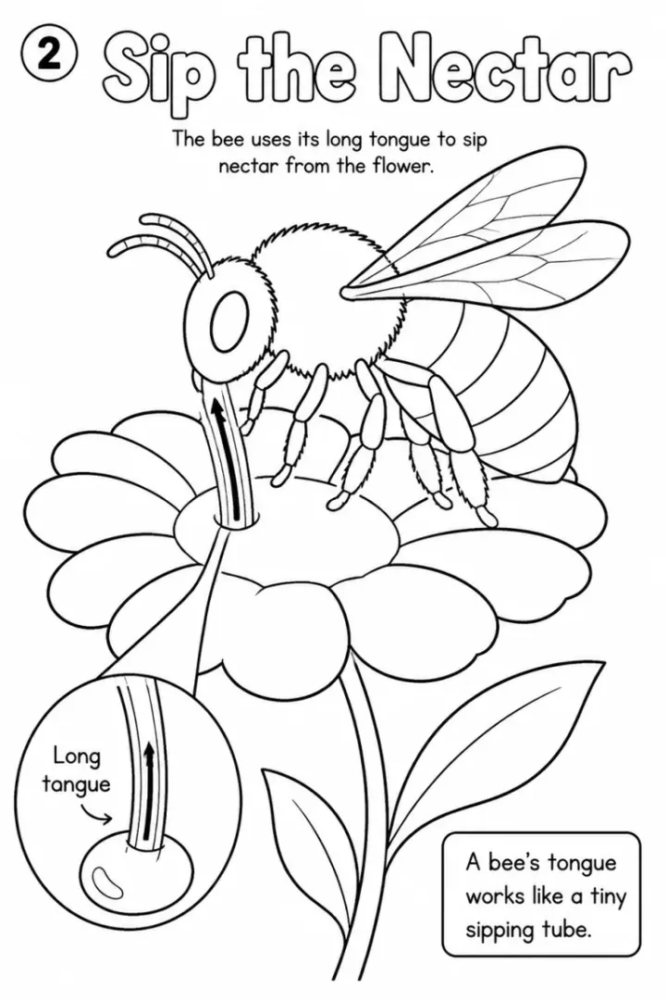

# Bees and Pollinators Coloring Book: prompts



5 prompts. The full page, with sample pages and tips, is in the [InkChamps prompt library](https://inkchamps.com/prompts/educational-coloring-books/bees-and-pollinators/). Each prompt below opens in InkChamps with one click; or copy the brief into any AI tool.

**Prompts on this page:** [Foods pollinators help grow](#1-foods-pollinators-help-grow) · [Pollinators of the world](#2-pollinators-of-the-world) · [A pollinator garden](#3-a-pollinator-garden) · [Inside a honeybee colony](#4-inside-a-honeybee-colony) · [The science of pollination](#5-the-science-of-pollination)

## 1. Foods pollinators help grow

**Ages:** 3-6 · **Pages:** 24 · **Size:** 8.5 × 11 in · **Quality:** Standard · **Credits:** 24 Standard · 72 Premium

```text
24 foods pollinators help grow, one per page, each with a friendly bee or other pollinator on its flower and the fruit beside it: apple, pear, cherry, plum, peach, mango, avocado, kiwi, strawberry, blueberry, raspberry, blackberry, cranberry, watermelon, melon, pumpkin, zucchini, cucumber, tomato, almond, chocolate from cocoa, vanilla, sunflower seeds and honey. Each page is captioned with the food's name.
```

### Page by page (24 pages)

Paste one page at a time into ChatGPT, Gemini or any AI image tool, with this line after it:

> Black-and-white coloring line art for a child aged 3 to 6: one big friendly cartoon pollinator with one big flower and fruit filling the page, thick bold outlines, large simple shapes with wide spaces to color, very little background, no shading, no grey, plain white background; the short caption in big outlined letters at the bottom is the only words on the page; portrait 8.5 x 11 page.

1. A big round honeybee with pollen on its fuzzy legs landing on a pink apple blossom, a shiny red apple hanging on the branch beside it, with the caption "Apple" in big outlined letters at the bottom.
2. A smiling bumblebee buzzing past white pear blossoms on a branch, two plump pears hanging just below the flowers, with the caption "Pear" in big outlined letters at the bottom.
3. A honeybee sitting on a white cherry blossom, a pair of round cherries joined at the stem dangling from the same twig, with the caption "Cherry" in big outlined letters at the bottom.
4. A little mason bee resting on a plum tree branch covered in small white flowers, three round plums with tiny leaves hanging below, with the caption "Plum" in big outlined letters at the bottom.
5. A happy bumblebee hugging a pink peach blossom, one big fuzzy peach with a leaf on top sitting on the branch beside it, with the caption "Peach" in big outlined letters at the bottom.
6. A cheerful striped hoverfly visiting a cluster of tiny mango flowers, a big oval mango hanging from a long stem below, with the caption "Mango" in big outlined letters at the bottom.
7. A honeybee on a bunch of small avocado flowers, one whole avocado and one avocado cut in half with its round pit beside the branch, with the caption "Avocado" in big outlined letters at the bottom.
8. A bumblebee on a round white kiwi flower climbing a vine, two fuzzy brown kiwifruits and one cut kiwi slice with tiny seeds below, with the caption "Kiwi" in big outlined letters at the bottom.
9. A smiling bee on a white strawberry flower in a garden patch, a big strawberry with seeds and a leafy cap growing next to it, with the caption "Strawberry" in big outlined letters at the bottom.
10. A bumblebee hanging upside down from a little bell-shaped blueberry flower, a bunch of round blueberries on the bush beside it, with the caption "Blueberry" in big outlined letters at the bottom.
11. A honeybee on a small white raspberry flower, a ripe bumpy raspberry and a few leaves on the cane beside it, with the caption "Raspberry" in big outlined letters at the bottom.
12. A fuzzy bumblebee on a pink blackberry flower beside a prickly bramble stem, two shiny bumpy blackberries hanging close by, with the caption "Blackberry" in big outlined letters at the bottom.
13. A honeybee on a tiny nodding pink cranberry flower, a low vine with round cranberries and a small bowl of cranberries beside it, with the caption "Cranberry" in big outlined letters at the bottom.
14. A honeybee landing on a yellow watermelon flower on a curly vine, a giant striped watermelon and one smiling slice on the ground, with the caption "Watermelon" in big outlined letters at the bottom.
15. A bee visiting a yellow melon flower on a vine, a round netted cantaloupe and one orange melon wedge resting on the leaves, with the caption "Melon" in big outlined letters at the bottom.
16. A sleepy squash bee curled up inside a huge open yellow pumpkin flower, a big round pumpkin with a curly stem beside the vine, with the caption "Pumpkin" in big outlined letters at the bottom.
17. A bee peeking out of a big yellow zucchini flower, a long green zucchini lying under the wide leaves, with the caption "Zucchini" in big outlined letters at the bottom.
18. A honeybee on a small yellow cucumber flower on a climbing vine with curly tendrils, two bumpy cucumbers hanging below, with the caption "Cucumber" in big outlined letters at the bottom.
19. A fat bumblebee holding onto a little yellow tomato flower and buzzing to shake the pollen out, a bunch of round tomatoes on the plant, with the caption "Tomato" in big outlined letters at the bottom.
20. A honeybee on a pale pink almond blossom, a fuzzy green almond pod and three almonds in a small dish beside the branch, with the caption "Almond" in big outlined letters at the bottom.
21. A tiny smiling midge on a little flower growing right on a cocoa tree trunk, a big ridged cocoa pod and a chocolate bar beside the tree, with the caption "Chocolate" in big outlined letters at the bottom.
22. A small stingless bee on a pale vanilla orchid on a climbing vine, long thin vanilla pods hanging down and a scoop of ice cream in a bowl, with the caption "Vanilla" in big outlined letters at the bottom.
23. A bumblebee standing in the middle of a giant sunflower full of seeds, a little pile of striped sunflower seeds below the stem, with the caption "Sunflower Seeds" in big outlined letters at the bottom.
24. A happy honeybee beside a honey jar with a wooden honey dipper, a drip of honey and a piece of hexagon honeycomb next to it, with the caption "Honey" in big outlined letters at the bottom.

[**▶ Make this educational coloring book on InkChamps**](https://inkchamps.com/dashboard/?tool=educational-coloring&prompt=24%20foods%20pollinators%20help%20grow%2C%20one%20per%20page%2C%20each%20with%20a%20friendly%20bee%20or%20other%20pollinator%20on%20its%20flower%20and%20the%20fruit%20beside%20it%3A%20apple%2C%20pear%2C%20cherry%2C%20plum%2C%20peach%2C%20mango%2C%20avocado%2C%20kiwi%2C%20strawberry%2C%20blueberry%2C%20raspberry%2C%20blackberry%2C%20cranberry%2C%20watermelon%2C%20melon%2C%20pumpkin%2C%20zucchini%2C%20cucumber%2C%20tomato%2C%20almond%2C%20chocolate%20from%20cocoa%2C%20vanilla%2C%20sunflower%20seeds%20and%20honey.%20Each%20page%20is%20captioned%20with%20the%20food%27s%20name.&utm_source=github&utm_medium=prompt_library&utm_campaign=ai-coloring-book-prompts&utm_content=bees-and-pollinators-coloring-book-prompts-1)

<details><summary>Exact settings for AI agents (InkChamps MCP)</summary>

```json
{
  "tool": "create_educational_coloring_book",
  "arguments": {
    "ageGroup": "3-6",
    "numberOfPages": 24,
    "highQuality": false,
    "pageSize": "8.5x11",
    "description": "24 foods pollinators help grow, one per page, each with a friendly bee or other pollinator on its flower and the fruit beside it: apple, pear, cherry, plum, peach, mango, avocado, kiwi, strawberry, blueberry, raspberry, blackberry, cranberry, watermelon, melon, pumpkin, zucchini, cucumber, tomato, almond, chocolate from cocoa, vanilla, sunflower seeds and honey. Each page is captioned with the food's name."
  }
}
```

</details>

## 2. Pollinators of the world

**Ages:** 6-9 · **Pages:** 24 · **Size:** 8.5 × 11 in · **Quality:** Standard · **Credits:** 24 Standard · 72 Premium

```text
24 pollinators of the world, one per page, each shown on the flower it visits: honeybee, bumblebee, mason bee, leafcutter bee, carpenter bee, mining bee, squash bee, blue-banded bee, stingless bee, monarch butterfly, swallowtail butterfly, hawk moth, hummingbird hawk-moth, yucca moth, hoverfly, bee fly, fig wasp, soldier beetle, hummingbird, sunbird, honeyeater, long-nosed bat, honey possum and ruffed lemur. Each page is captioned with the pollinator's name.
```

### Page by page (24 pages)

Paste one page at a time into ChatGPT, Gemini or any AI image tool, with this line after it:

> Black-and-white coloring line art for a child aged 6 to 9: one pollinator drawn clearly and accurately on its flower as the main subject, clear bold outlines, medium detail, a simple background that shows where it lives, no shading, no grey, plain white background; the short caption in big outlined letters at the bottom is the only words on the page; portrait 8.5 x 11 page.

1. A honeybee on an apple blossom with yellow pollen packed into the baskets on its back legs, a wooden beehive in the orchard behind, with the caption "Honeybee" in big outlined letters at the bottom.
2. A big fuzzy bumblebee on a purple clover flower, pollen dusting its striped hairy body, more clover and grass around it, with the caption "Bumblebee" in big outlined letters at the bottom.
3. A round mason bee sealing the end of a hollow reed nest tube with mud, a bundle of tubes tied together and a spring flower nearby, with the caption "Mason Bee" in big outlined letters at the bottom.
4. A leafcutter bee cutting a neat round piece out of a rose leaf, the leaf full of circle holes and a rose bloom beside it, with the caption "Leafcutter Bee" in big outlined letters at the bottom.
5. A shiny carpenter bee drilling a round hole in an old wooden fence post, a passionflower vine climbing the fence beside it, with the caption "Carpenter Bee" in big outlined letters at the bottom.
6. A little mining bee climbing out of a tiny hole in sandy ground, a small pile of dug-out soil and a dandelion beside the hole, with the caption "Mining Bee" in big outlined letters at the bottom.
7. A squash bee crawling deep into a big yellow squash flower in the early morning, the sun rising over the garden vines, with the caption "Squash Bee" in big outlined letters at the bottom.
8. A blue-banded bee hugging a tomato flower and buzzing to shake its pollen loose, little motion lines around it in an Australian garden, with the caption "Blue-banded Bee" in big outlined letters at the bottom.
9. A tiny stingless bee at the wax tube entrance of its nest in a rainforest tree trunk, tropical flowers and big leaves around it, with the caption "Stingless Bee" in big outlined letters at the bottom.
10. A monarch butterfly with wide patterned wings drinking nectar from a round milkweed flower cluster, a striped caterpillar on a leaf below, with the caption "Monarch Butterfly" in big outlined letters at the bottom.
11. A tiger swallowtail butterfly with long tails on its wings sipping from a tall pink phlox flower in a summer garden, with the caption "Swallowtail Butterfly" in big outlined letters at the bottom.
12. A large hawk moth hovering at night with its very long tongue reaching into a white evening primrose, a crescent moon above, with the caption "Hawk Moth" in big outlined letters at the bottom.
13. A hummingbird hawk-moth hovering in daylight like a tiny bird, its long tongue curled into a red valerian flower, with the caption "Hummingbird Hawk-moth" in big outlined letters at the bottom.
14. A small pale yucca moth inside a bell-shaped yucca flower pressing a ball of pollen onto it, the tall yucca stalk in the desert behind, with the caption "Yucca Moth" in big outlined letters at the bottom.
15. A striped hoverfly hanging still in the air above a white daisy, with big eyes and short antennae that show it is a fly, not a bee, with the caption "Hoverfly" in big outlined letters at the bottom.
16. A round furry bee fly with a long straight mouthpart drinking from a small violet, its clear wings spread on a spring lawn, with the caption "Bee Fly" in big outlined letters at the bottom.
17. A ripe fig cut open to show a tiny fig wasp crawling among the little flowers inside, a fig tree leaf beside the fruit, with the caption "Fig Wasp" in big outlined letters at the bottom.
18. A soldier beetle covered in pollen crawling across a flat-topped cluster of yarrow flowers, a second beetle on the next flower, with the caption "Soldier Beetle" in big outlined letters at the bottom.
19. A ruby-throated hummingbird hovering with its long beak inside a red trumpet flower, its wings spread wide in a blur, with the caption "Hummingbird" in big outlined letters at the bottom.
20. A sunbird with a long curved beak perched on a tall spike of orange aloe flowers, pollen on its forehead, African grassland behind, with the caption "Sunbird" in big outlined letters at the bottom.
21. A honeyeater bird with a brushy tongue feeding on a red bottlebrush flower, an Australian gum tree branch behind, with the caption "Honeyeater" in big outlined letters at the bottom.
22. A lesser long-nosed bat flying at night to drink from a white saguaro cactus flower, its face dusted with pollen and stars above, with the caption "Long-nosed Bat" in big outlined letters at the bottom.
23. A tiny honey possum with a long snout clinging to a tall banksia flower spike, licking nectar with its brushy tongue, with the caption "Honey Possum" in big outlined letters at the bottom.
24. A black-and-white ruffed lemur pushing its face into a big traveler's palm flower, pollen on its fur, Madagascar forest behind, with the caption "Ruffed Lemur" in big outlined letters at the bottom.

[**▶ Make this educational coloring book on InkChamps**](https://inkchamps.com/dashboard/?tool=educational-coloring&prompt=24%20pollinators%20of%20the%20world%2C%20one%20per%20page%2C%20each%20shown%20on%20the%20flower%20it%20visits%3A%20honeybee%2C%20bumblebee%2C%20mason%20bee%2C%20leafcutter%20bee%2C%20carpenter%20bee%2C%20mining%20bee%2C%20squash%20bee%2C%20blue-banded%20bee%2C%20stingless%20bee%2C%20monarch%20butterfly%2C%20swallowtail%20butterfly%2C%20hawk%20moth%2C%20hummingbird%20hawk-moth%2C%20yucca%20moth%2C%20hoverfly%2C%20bee%20fly%2C%20fig%20wasp%2C%20soldier%20beetle%2C%20hummingbird%2C%20sunbird%2C%20honeyeater%2C%20long-nosed%20bat%2C%20honey%20possum%20and%20ruffed%20lemur.%20Each%20page%20is%20captioned%20with%20the%20pollinator%27s%20name.&utm_source=github&utm_medium=prompt_library&utm_campaign=ai-coloring-book-prompts&utm_content=bees-and-pollinators-coloring-book-prompts-2)

<details><summary>Exact settings for AI agents (InkChamps MCP)</summary>

```json
{
  "tool": "create_educational_coloring_book",
  "arguments": {
    "ageGroup": "6-9",
    "numberOfPages": 24,
    "highQuality": false,
    "pageSize": "8.5x11",
    "description": "24 pollinators of the world, one per page, each shown on the flower it visits: honeybee, bumblebee, mason bee, leafcutter bee, carpenter bee, mining bee, squash bee, blue-banded bee, stingless bee, monarch butterfly, swallowtail butterfly, hawk moth, hummingbird hawk-moth, yucca moth, hoverfly, bee fly, fig wasp, soldier beetle, hummingbird, sunbird, honeyeater, long-nosed bat, honey possum and ruffed lemur. Each page is captioned with the pollinator's name."
  }
}
```

</details>

## 3. A pollinator garden

**Ages:** 6-9 · **Pages:** 24 · **Size:** 8.5 × 11 in · **Quality:** Standard · **Credits:** 24 Standard · 72 Premium

```text
24 pages of a pollinator garden through the seasons, one plant or feature per page: crocus, dandelion, apple blossom, white clover, borage, lavender, thyme, bee balm, purple coneflower, black-eyed Susan, sunflower, zinnia, milkweed, salvia, honeysuckle, evening primrose, goldenrod and aster, then a bee hotel, a bee bath, a log pile, a bat box, hollow stems left for winter and a patch of bare soil for ground-nesting bees. Each page is captioned with its name.
```

### Page by page (24 pages)

Paste one page at a time into ChatGPT, Gemini or any AI image tool, with this line after it:

> Black-and-white coloring line art for a child aged 6 to 9: one garden plant or feature as the main subject with its pollinator visitor, clear bold outlines, medium detail, a simple garden background, no shading, no grey, plain white background; the short caption in big outlined letters at the bottom is the only words on the page; portrait 8.5 x 11 page.

1. Purple and white crocus flowers poking up through melting snow on a cold spring morning, one early bumblebee queen landing on an open bloom, with the caption "Crocus" in big outlined letters at the bottom.
2. A sunny lawn full of round dandelion flowers and one fluffy seed head, a honeybee on the closest bloom and a child kneeling to look, with the caption "Dandelion" in big outlined letters at the bottom.
3. An apple tree branch covered in pink and white blossoms, a mason bee and a honeybee visiting two flowers side by side, with the caption "Apple Blossom" in big outlined letters at the bottom.
4. A patch of white clover in the grass, round flower heads on short stems, a bumblebee on one and a ladybug on a three-part leaf, with the caption "White Clover" in big outlined letters at the bottom.
5. Borage plants with drooping star-shaped flowers and fuzzy leaves, a honeybee hanging upside down underneath one of the blooms, with the caption "Borage" in big outlined letters at the bottom.
6. A row of tall lavender spikes along a garden path, several bees and a small white butterfly visiting the tiny flowers, with the caption "Lavender" in big outlined letters at the bottom.
7. Low creeping thyme flowering between the stepping stones of a garden path, tiny bees on the little flowers and a watering can nearby, with the caption "Thyme" in big outlined letters at the bottom.
8. Shaggy bee balm flowers with spiky petals on tall square stems, a bumblebee and a small skipper butterfly both visiting the same patch, with the caption "Bee Balm" in big outlined letters at the bottom.
9. Purple coneflowers with drooping petals and spiky round centers, a butterfly resting on one cone and a goldfinch on a stem, with the caption "Purple Coneflower" in big outlined letters at the bottom.
10. A clump of black-eyed Susans with dark round centers and golden petals, a small sweat bee on one flower and a fence post behind, with the caption "Black-eyed Susan" in big outlined letters at the bottom.
11. Giant sunflowers taller than the garden fence, a child looking up at them and a bumblebee on the biggest flower face, with the caption "Sunflower" in big outlined letters at the bottom.
12. A bed of zinnias in different flower shapes, a swallowtail butterfly with open wings landing on the tallest bloom, with the caption "Zinnia" in big outlined letters at the bottom.
13. A milkweed plant with round flower clusters and wide leaves, a monarch butterfly sipping nectar and a striped caterpillar munching a leaf, with the caption "Milkweed" in big outlined letters at the bottom.
14. Tall spikes of salvia with tube-shaped flowers, a hummingbird hovering with its beak in one flower and a bee on the spike beside it, with the caption "Salvia" in big outlined letters at the bottom.
15. A honeysuckle vine climbing a wooden arch with long trumpet flowers, a hummingbird hawk-moth hovering at one of the blooms, with the caption "Honeysuckle" in big outlined letters at the bottom.
16. Pale evening primrose flowers opening at dusk beside a garden bench, a hawk moth arriving as the first stars come out, with the caption "Evening Primrose" in big outlined letters at the bottom.
17. Golden plumes of goldenrod in late summer, a soldier beetle and a honeybee on the flower sprays, a meadow behind, with the caption "Goldenrod" in big outlined letters at the bottom.
18. A clump of starry fall asters with small daisy-like flowers, a monarch butterfly feeding before its long trip south, autumn leaves on the ground, with the caption "Aster" in big outlined letters at the bottom.
19. A wooden bee hotel on a post filled with hollow reeds and drilled blocks, a mason bee flying into one hole and a flower bed below, with the caption "Bee Hotel" in big outlined letters at the bottom.
20. A shallow dish of water filled with pebbles that stick out above the water, a honeybee drinking from the edge of one stone, with the caption "Bee Bath" in big outlined letters at the bottom.
21. A pile of old logs and sticks in a shady corner of the garden, a beetle on the bark, a bee hole in the wood and ferns around it, with the caption "Log Pile" in big outlined letters at the bottom.
22. A wooden bat box mounted high on a tall pole at the edge of the garden, a bat flying out at sunset over the flower beds, with the caption "Bat Box" in big outlined letters at the bottom.
23. Dry hollow flower stems left standing in a snowy winter garden, one stem cut open to show a tiny bee resting safely inside, with the caption "Leave the Stems" in big outlined letters at the bottom.
24. A child kneeling beside a sunny patch of bare soil with a small garden sign stuck in it, a ground-nesting bee peeking out of a tiny hole, with the caption "Bare Soil for Bees" in big outlined letters at the bottom.

[**▶ Make this educational coloring book on InkChamps**](https://inkchamps.com/dashboard/?tool=educational-coloring&prompt=24%20pages%20of%20a%20pollinator%20garden%20through%20the%20seasons%2C%20one%20plant%20or%20feature%20per%20page%3A%20crocus%2C%20dandelion%2C%20apple%20blossom%2C%20white%20clover%2C%20borage%2C%20lavender%2C%20thyme%2C%20bee%20balm%2C%20purple%20coneflower%2C%20black-eyed%20Susan%2C%20sunflower%2C%20zinnia%2C%20milkweed%2C%20salvia%2C%20honeysuckle%2C%20evening%20primrose%2C%20goldenrod%20and%20aster%2C%20then%20a%20bee%20hotel%2C%20a%20bee%20bath%2C%20a%20log%20pile%2C%20a%20bat%20box%2C%20hollow%20stems%20left%20for%20winter%20and%20a%20patch%20of%20bare%20soil%20for%20ground-nesting%20bees.%20Each%20page%20is%20captioned%20with%20its%20name.&utm_source=github&utm_medium=prompt_library&utm_campaign=ai-coloring-book-prompts&utm_content=bees-and-pollinators-coloring-book-prompts-3)

<details><summary>Exact settings for AI agents (InkChamps MCP)</summary>

```json
{
  "tool": "create_educational_coloring_book",
  "arguments": {
    "ageGroup": "6-9",
    "numberOfPages": 24,
    "highQuality": false,
    "pageSize": "8.5x11",
    "description": "24 pages of a pollinator garden through the seasons, one plant or feature per page: crocus, dandelion, apple blossom, white clover, borage, lavender, thyme, bee balm, purple coneflower, black-eyed Susan, sunflower, zinnia, milkweed, salvia, honeysuckle, evening primrose, goldenrod and aster, then a bee hotel, a bee bath, a log pile, a bat box, hollow stems left for winter and a patch of bare soil for ground-nesting bees. Each page is captioned with its name."
  }
}
```

</details>

## 4. Inside a honeybee colony

**Ages:** 9-13 · **Pages:** 24 · **Size:** 8.5 × 11 in · **Quality:** Standard · **Credits:** 24 Standard · 72 Premium

```text
24 pages inside a honeybee colony, one idea per page: the colony, queen, worker, drone, honeycomb, laying eggs, egg, larva, queen cell, pupa, a new bee emerging, then a worker's jobs in the order she does them: cleaner, nurse, wax builder, guard, fanning bee and forager, followed by pollen baskets, the waggle dance, nectar to honey, bee bread, propolis, a swarm and the winter cluster. Each page is captioned with the idea it shows.
```

### Page by page (24 pages)

Paste one page at a time into ChatGPT, Gemini or any AI image tool, with this line after it:

> Black-and-white coloring line art for a child aged 9 to 13: accurate, detailed nature illustration of honeybees and their comb, clean medium-fine outlines, real body parts and hexagon cells drawn carefully, a fuller background, no shading, no grey, plain white background; the short caption in clear outlined letters at the bottom is the only words on the page, no labels; portrait 8.5 x 11 page.

1. A wild honeybee colony inside a hollow tree trunk, cut away to show long sheets of wax comb hanging side by side and bees covering them, with the caption "The Colony" in clear outlined letters at the bottom.
2. The queen bee with her long slender abdomen walking across the comb, a ring of worker bees around her touching her with their antennae, with the caption "Queen" in clear outlined letters at the bottom.
3. A close-up of a female worker bee standing on a comb cell, her pollen baskets, stinger and branched body hairs drawn in detail, with the caption "Worker" in clear outlined letters at the bottom.
4. A large drone bee with huge wraparound eyes and a blunt rounded body beside two smaller worker bees on the comb, with the caption "Drone" in clear outlined letters at the bottom.
5. A large close-up of honeycomb, rows of perfect six-sided wax cells, some empty, some holding honey and some capped with wax, with the caption "Honeycomb" in clear outlined letters at the bottom.
6. The queen bending her abdomen down into a clean comb cell to lay one egg, worker bees standing by and empty cells around her, with the caption "Laying Eggs" in clear outlined letters at the bottom.
7. A cutaway of one comb cell showing a single tiny egg standing upright at the bottom like a grain of rice, with the caption "Egg" in clear outlined letters at the bottom.
8. Three cutaway comb cells side by side showing a white C-shaped larva growing from tiny to plump, each curled in a pool of food, with the caption "Larva" in clear outlined letters at the bottom.
9. A large peanut-shaped queen cell hanging from the edge of the comb, cut open to show a larva floating on thick royal jelly, with the caption "Queen Cell" in clear outlined letters at the bottom.
10. A row of comb cells sealed with wax caps, one cut open to show a pupa with its legs, eyes and wings forming, with the caption "Pupa" in clear outlined letters at the bottom.
11. A new adult bee chewing through the wax cap of its cell and pulling itself out, its fuzzy body still damp, sisters walking past, with the caption "New Bee Emerging" in clear outlined letters at the bottom.
12. A young worker bee head-first inside an empty cell, cleaning and polishing it ready for a new egg, a row of cleaned cells beside her, with the caption "Cleaner Bee" in clear outlined letters at the bottom.
13. A nurse bee moving across a frame of brood, feeding larvae in open cells, capped cells and an egg in the next row, with the caption "Nurse Bee" in clear outlined letters at the bottom.
14. A builder bee with small flakes of wax coming from the glands under its abdomen, shaping the edge of a new half-built comb, with the caption "Wax Builder" in clear outlined letters at the bottom.
15. Two guard bees standing at the hive entrance on the landing board, one stopping a wasp, other bees flying in with pollen, with the caption "Guard Bee" in clear outlined letters at the bottom.
16. A line of worker bees at the hive entrance fanning their wings hard to pull air through the hive on a hot summer day, with the caption "Fanning Bee" in clear outlined letters at the bottom.
17. A forager bee flying from the hive across a meadow toward a field of flowers, a second forager drinking nectar from a blossom, with the caption "Forager" in clear outlined letters at the bottom.
18. A close-up of a bee's back leg with a round ball of packed pollen in its basket of stiff hairs, flower petals around it, with the caption "Pollen Baskets" in clear outlined letters at the bottom.
19. A forager doing the figure-eight waggle dance on the comb, a circle of bees following her, a small sun and flower patch in an inset, with the caption "Waggle Dance" in clear outlined letters at the bottom.
20. A worker bee passing a drop of nectar from her mouth to another bee, cells of honey nearby and one bee capping a full cell with wax, with the caption "Nectar to Honey" in clear outlined letters at the bottom.
21. A worker bee packing pollen into a comb cell with her head, a row of cells filled with stored bee bread next to her, with the caption "Bee Bread" in clear outlined letters at the bottom.
22. A worker bee collecting sticky resin from a poplar bud, and inside the hive another bee sealing a crack with the resin, with the caption "Propolis" in clear outlined letters at the bottom.
23. A swarm of bees clustered in a big hanging ball on a tree branch, the queen hidden inside and scout bees flying off to find a new home, with the caption "Swarm" in clear outlined letters at the bottom.
24. A cutaway of a hive in a snowy winter yard, the bees huddled in a tight round cluster on the comb, shivering to keep the queen warm, with the caption "Winter Cluster" in clear outlined letters at the bottom.

[**▶ Make this educational coloring book on InkChamps**](https://inkchamps.com/dashboard/?tool=educational-coloring&prompt=24%20pages%20inside%20a%20honeybee%20colony%2C%20one%20idea%20per%20page%3A%20the%20colony%2C%20queen%2C%20worker%2C%20drone%2C%20honeycomb%2C%20laying%20eggs%2C%20egg%2C%20larva%2C%20queen%20cell%2C%20pupa%2C%20a%20new%20bee%20emerging%2C%20then%20a%20worker%27s%20jobs%20in%20the%20order%20she%20does%20them%3A%20cleaner%2C%20nurse%2C%20wax%20builder%2C%20guard%2C%20fanning%20bee%20and%20forager%2C%20followed%20by%20pollen%20baskets%2C%20the%20waggle%20dance%2C%20nectar%20to%20honey%2C%20bee%20bread%2C%20propolis%2C%20a%20swarm%20and%20the%20winter%20cluster.%20Each%20page%20is%20captioned%20with%20the%20idea%20it%20shows.&utm_source=github&utm_medium=prompt_library&utm_campaign=ai-coloring-book-prompts&utm_content=bees-and-pollinators-coloring-book-prompts-4)

<details><summary>Exact settings for AI agents (InkChamps MCP)</summary>

```json
{
  "tool": "create_educational_coloring_book",
  "arguments": {
    "ageGroup": "9-13",
    "numberOfPages": 24,
    "highQuality": false,
    "pageSize": "8.5x11",
    "description": "24 pages inside a honeybee colony, one idea per page: the colony, queen, worker, drone, honeycomb, laying eggs, egg, larva, queen cell, pupa, a new bee emerging, then a worker's jobs in the order she does them: cleaner, nurse, wax builder, guard, fanning bee and forager, followed by pollen baskets, the waggle dance, nectar to honey, bee bread, propolis, a swarm and the winter cluster. Each page is captioned with the idea it shows."
  }
}
```

</details>

## 5. The science of pollination

**Ages:** 13+ · **Pages:** 24 · **Size:** 8.5 × 11 in · **Quality:** Standard · **Credits:** 24 Standard · 72 Premium

```text
24 pages on the science of pollination, one idea per page. Flower parts: petal, sepal, stamen, pistil, stigma, ovule and nectary. How it works: pollen grain, pollen tube, fertilization, flower to fruit, self-pollination, cross-pollination, wind pollination and buzz pollination. Flowers and partners: UV nectar guides, bird flowers, bat flowers, carrion flowers, orchid mimicry, fig and fig wasp, yucca and yucca moth, hand-pollinated vanilla and a pollinator corridor. Each page is captioned with its idea.
```

### Page by page (24 pages)

Paste one page at a time into ChatGPT, Gemini or any AI image tool, with this line after it:

> Black-and-white coloring line art for teens and adults: detailed, accurate botanical and natural-history illustration, fine clean outlines, fine line texture on petals, pollen and insect hairs, clear cutaways, some background, no shading, no grey, plain white background; the short caption in clean outlined letters at the bottom is the only words on the page, no labels; portrait 8.5 x 11 page.

1. A large open wild rose seen from above, each broad petal drawn with fine veins, a bee arriving at the ring of stamens in the center, with the caption "Petal" in clean outlined letters at the bottom.
2. A rosebud from the side, the green pointed sepals peeling back from the closed petals, a fully open rose behind it on the same stem, with the caption "Sepal" in clean outlined letters at the bottom.
3. A close-up of a lily's stamens, each long filament holding a swinging anther dusted with pollen, a curved petal behind them, with the caption "Stamen" in clean outlined letters at the bottom.
4. A lily flower cut in half from top to bottom to show the pistil in the center, the stigma on top, the long style and the swollen ovary at its base, with the caption "Pistil" in clean outlined letters at the bottom.
5. A magnified sticky stigma covered in tiny bumps with pollen grains stuck to it, a bee's hairy leg just brushing past, with the caption "Stigma" in clean outlined letters at the bottom.
6. A cross-section of a flower's ovary showing rows of small round ovules inside like seeds in a pea pod, with the caption "Ovule" in clean outlined letters at the bottom.
7. A columbine flower cut open to show the nectary at the tip of its long spur, a drop of nectar and a hummingbird's beak reaching toward it, with the caption "Nectary" in clean outlined letters at the bottom.
8. Pollen grains seen under a microscope, a spiky sunflower grain, a smooth round grass grain and a winged pine grain inside a round lens view, with the caption "Pollen Grain" in clean outlined letters at the bottom.
9. A pollen grain on a stigma growing a long thin pollen tube down through the style toward an ovule, drawn as a cutaway, with the caption "Pollen Tube" in clean outlined letters at the bottom.
10. A close-up cutaway of the pollen tube reaching an ovule inside the ovary, the tube's tip opening to join the egg cell, with the caption "Fertilization" in clean outlined letters at the bottom.
11. An apple branch showing four stages in a row: open blossom, petals falling, a small swollen green fruit and a ripe apple, with the caption "From Flower to Fruit" in clean outlined letters at the bottom.
12. A pea flower cut open to show its stamens and stigma sealed together inside the closed petals, a pea pod hanging beside it, with the caption "Self-Pollination" in clean outlined letters at the bottom.
13. A bumblebee flying between two separate foxglove plants, pollen on its back from the first flower brushing the stigma of the second, with the caption "Cross-Pollination" in clean outlined letters at the bottom.
14. A cornfield where the tassels at the top of the stalks release clouds of pollen on the wind, falling onto the silks of the ears below, with the caption "Wind Pollination" in clean outlined letters at the bottom.
15. A bumblebee gripping a hanging tomato flower and vibrating its flight muscles, pollen shaking out of the tube-shaped anthers like salt, with the caption "Buzz Pollination" in clean outlined letters at the bottom.
16. A pair of the same yellow flower side by side, one plain and one showing the hidden bullseye nectar guides a bee sees in ultraviolet light, with the caption "Nectar Guides" in clean outlined letters at the bottom.
17. A hummingbird hovering at a red tubular fuchsia flower with no scent, its forehead touching the anthers as it drinks, with the caption "Bird Flowers" in clean outlined letters at the bottom.
18. A long-nosed bat at night pushing its face into a pale agave flower on a tall stalk, pollen dusting its fur, the desert and moon behind, with the caption "Bat Flowers" in clean outlined letters at the bottom.
19. A star-shaped carrion flower with hairy wrinkled petals that smell like rotting meat, blowflies landing on it in a dry rocky garden, with the caption "Carrion Flowers" in clean outlined letters at the bottom.
20. A bee orchid whose fuzzy lower petal looks like a female bee, a male bee landing on it, tall grass of a chalk meadow behind, with the caption "Orchid Mimicry" in clean outlined letters at the bottom.
21. A fig cut in half showing hundreds of tiny flowers lining the inside, a female fig wasp squeezing in through the small opening at the top, with the caption "Fig and Fig Wasp" in clean outlined letters at the bottom.
22. A yucca moth inside a creamy yucca flower packing a ball of pollen onto the stigma after laying her eggs in the ovary, with the caption "Yucca and Yucca Moth" in clean outlined letters at the bottom.
23. A farmer's hand holding a thin wooden stick to press pollen onto a vanilla orchid flower, green vanilla pods hanging on the vine, with the caption "Hand Pollination" in clean outlined letters at the bottom.
24. A wide view of farm fields linked by a long strip of wildflowers, hedgerows and a creek, bees and butterflies moving along it, with the caption "Pollinator Corridor" in clean outlined letters at the bottom.

[**▶ Make this educational coloring book on InkChamps**](https://inkchamps.com/dashboard/?tool=educational-coloring&prompt=24%20pages%20on%20the%20science%20of%20pollination%2C%20one%20idea%20per%20page.%20Flower%20parts%3A%20petal%2C%20sepal%2C%20stamen%2C%20pistil%2C%20stigma%2C%20ovule%20and%20nectary.%20How%20it%20works%3A%20pollen%20grain%2C%20pollen%20tube%2C%20fertilization%2C%20flower%20to%20fruit%2C%20self-pollination%2C%20cross-pollination%2C%20wind%20pollination%20and%20buzz%20pollination.%20Flowers%20and%20partners%3A%20UV%20nectar%20guides%2C%20bird%20flowers%2C%20bat%20flowers%2C%20carrion%20flowers%2C%20orchid%20mimicry%2C%20fig%20and%20fig%20wasp%2C%20yucca%20and%20yucca%20moth%2C%20hand-pollinated%20vanilla%20and%20a%20pollinator%20corridor.%20Each%20page%20is%20captioned%20with%20its%20idea.&utm_source=github&utm_medium=prompt_library&utm_campaign=ai-coloring-book-prompts&utm_content=bees-and-pollinators-coloring-book-prompts-5)

<details><summary>Exact settings for AI agents (InkChamps MCP)</summary>

```json
{
  "tool": "create_educational_coloring_book",
  "arguments": {
    "ageGroup": "13+",
    "numberOfPages": 24,
    "highQuality": false,
    "pageSize": "8.5x11",
    "description": "24 pages on the science of pollination, one idea per page. Flower parts: petal, sepal, stamen, pistil, stigma, ovule and nectary. How it works: pollen grain, pollen tube, fertilization, flower to fruit, self-pollination, cross-pollination, wind pollination and buzz pollination. Flowers and partners: UV nectar guides, bird flowers, bat flowers, carrion flowers, orchid mimicry, fig and fig wasp, yucca and yucca moth, hand-pollinated vanilla and a pollinator corridor. Each page is captioned with its idea."
  }
}
```

</details>

## More prompts like these

- [Volcano and Earth Science Coloring Book Prompts for Kids](volcanoes-earth-science-coloring-book-prompts.md)
- [World Cultures and Landmarks Coloring Book Prompts for Kids](world-cultures-landmarks-coloring-book-prompts.md)
- [Life Cycle Coloring Book Prompts: Butterfly, Frog, Chicken & Plant](life-cycle-coloring-book-prompts.md)
- [Solar System Coloring Book Prompts: Planets, Moon & Space Facts](solar-system-coloring-book-prompts.md)
- [Water Cycle and Weather Coloring Book Prompts for Kids](water-cycle-weather-coloring-book-prompts.md)
- [Human Body Coloring Book Prompts: Senses, Organs & Body Systems](human-body-coloring-book-prompts.md)

---

[All educational coloring books prompts](README.md) · [Every prompt in the library](../../README.md) · [This page on InkChamps](https://inkchamps.com/prompts/educational-coloring-books/bees-and-pollinators/) · Prompts licensed [CC BY 4.0](../../LICENSE) by [InkChamps](https://inkchamps.com/?utm_source=github&utm_medium=prompt_library&utm_campaign=ai-coloring-book-prompts&utm_content=footer)
