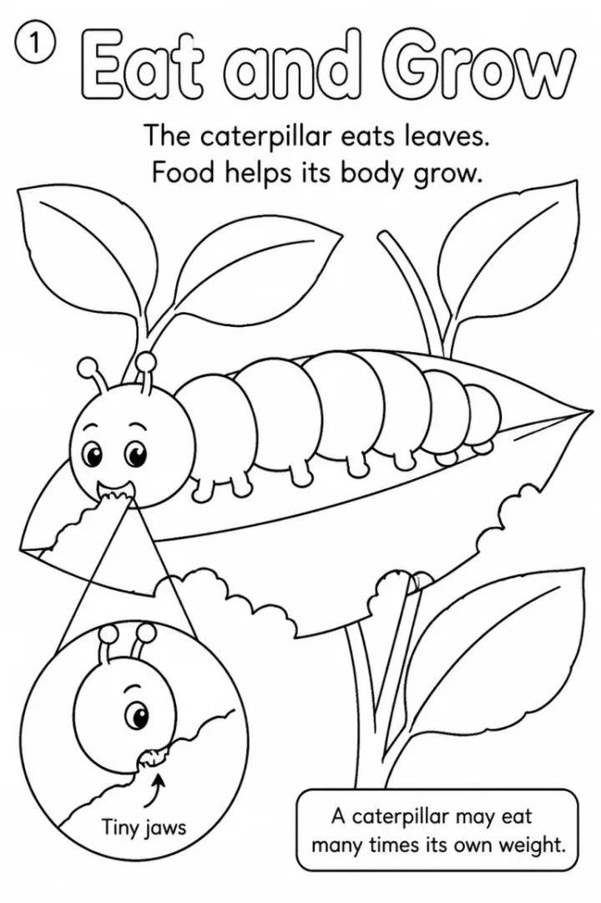

# Life Cycle Coloring Book: prompts



5 prompts. The full page, with sample pages and tips, is in the [InkChamps prompt library](https://inkchamps.com/prompts/educational-coloring-books/life-cycle/). Each prompt below opens in InkChamps with one click; or copy the brief into any AI tool.

**Prompts on this page:** [Baby animals and their names](#1-baby-animals-and-their-names) · [Insect and amphibian metamorphosis](#2-insect-and-amphibian-metamorphosis) · [Mammal, bird and reptile life cycles](#3-mammal-bird-and-reptile-life-cycles) · [Ocean life cycles](#4-ocean-life-cycles) · [Plant and fungus life cycles](#5-plant-and-fungus-life-cycles)

## 1. Baby animals and their names

**Ages:** 3-6 · **Pages:** 24 · **Size:** 8.5 × 11 in · **Quality:** Standard · **Credits:** 24 Standard · 72 Premium

```text
24 baby animals with their grown-up, one per page, each captioned with the baby's name. Farm: puppy, kitten, calf, foal, lamb, piglet, goat kid, alpaca cria. Birds: chick, duckling, gosling, turkey poult, cygnet, owlet, eaglet. Wild: lion cub, kangaroo joey, fox kit, fawn, hedgehog hoglet, seal pup. Little creatures: tadpole, caterpillar, sea turtle hatchling.
```

### Page by page (24 pages)

Paste one page at a time into ChatGPT, Gemini or any AI image tool, with this line after it:

> Black-and-white coloring line art for a child aged 3 to 6: one big cute baby animal with its grown-up filling most of the page, thick bold outlines, large simple shapes with wide spaces to color, very little background, no shading, no grey, plain white background; the short caption in big outlined letters at the bottom is the only words on the page; portrait 8.5 x 11 page.

1. A floppy-eared puppy curled up against its big mother dog on a round pet bed, a chew bone and a squeaky ball beside them, with the caption "Puppy" in big outlined letters at the bottom.
2. A fluffy kitten batting a ball of yarn on a rug while its mother cat sits beside it with her tail curled around her paws, with the caption "Kitten" in big outlined letters at the bottom.
3. A wobbly-legged calf standing next to its mother cow in a grassy field, a wooden fence and one big flower behind them, with the caption "Calf" in big outlined letters at the bottom.
4. A long-legged foal trotting beside its mother horse in a meadow, a barn roof and a round tree in the distance, with the caption "Foal" in big outlined letters at the bottom.
5. A curly-wooled lamb snuggling against its woolly mother sheep on a gentle hill, two round bushes behind them, with the caption "Lamb" in big outlined letters at the bottom.
6. A round little piglet splashing in a mud puddle while its mother pig rests nearby, a wooden feeding trough behind them, with the caption "Piglet" in big outlined letters at the bottom.
7. A baby goat jumping onto a hay bale while its bearded mother goat watches from beside the barn door, with the caption "Kid" in big outlined letters at the bottom.
8. A baby alpaca with a fluffy topknot standing close to its tall mother alpaca by a farm fence, with the caption "Cria" in big outlined letters at the bottom.
9. A tiny fluffy chick peeking out from under its mother hen's wing in a straw nest, a broken eggshell beside them, with the caption "Chick" in big outlined letters at the bottom.
10. A little duckling paddling behind its mother duck on a pond, round lily pads and a cattail beside them, with the caption "Duckling" in big outlined letters at the bottom.
11. A fuzzy gosling waddling through the grass beside its long-necked mother goose, a small pond in the corner, with the caption "Gosling" in big outlined letters at the bottom.
12. A small turkey poult pecking at seeds beside its big mother turkey, who has her tail feathers fanned out, with the caption "Poult" in big outlined letters at the bottom.
13. A fluffy cygnet riding on the back of its mother swan as she glides across a calm lake, with the caption "Cygnet" in big outlined letters at the bottom.
14. A round, fluffy owlet sitting on a tree branch next to its big-eyed mother owl, a full moon behind them, with the caption "Owlet" in big outlined letters at the bottom.
15. A fluffy eaglet in a big nest of sticks high on a cliff, its mother eagle landing beside it with wings spread, with the caption "Eaglet" in big outlined letters at the bottom.
16. A playful lion cub pouncing on its mother lion's tail on the grassy savanna, one flat-topped tree behind, with the caption "Cub" in big outlined letters at the bottom.
17. A little kangaroo joey peeking out of its mother kangaroo's pouch, a rock and a small bush beside them, with the caption "Joey" in big outlined letters at the bottom.
18. A small fox kit with a bushy tail sitting at the mouth of a den under a tree root, its mother fox beside it, with the caption "Kit" in big outlined letters at the bottom.
19. A spotted fawn lying in soft grass at the edge of the woods while its mother deer stands over it, with the caption "Fawn" in big outlined letters at the bottom.
20. A tiny spiky hoglet sniffing a fallen leaf beside its mother hedgehog in a garden, a mushroom by their feet, with the caption "Hoglet" in big outlined letters at the bottom.
21. A round seal pup lying on the ice next to its mother seal, a small ice hole and a snowbank beside them, with the caption "Pup" in big outlined letters at the bottom.
22. A wiggly tadpole swimming in a pond under a big frog that sits on a lily pad above it, with the caption "Tadpole" in big outlined letters at the bottom.
23. A chubby caterpillar munching a big leaf while a butterfly rests on a flower beside it, with the caption "Caterpillar" in big outlined letters at the bottom.
24. A baby sea turtle crawling out of its egg on the sand toward the waves, a grown-up sea turtle swimming in the sea ahead, with the caption "Hatchling" in big outlined letters at the bottom.

[**▶ Make this educational coloring book on InkChamps**](https://inkchamps.com/dashboard/?tool=educational-coloring&prompt=24%20baby%20animals%20with%20their%20grown-up%2C%20one%20per%20page%2C%20each%20captioned%20with%20the%20baby%27s%20name.%20Farm%3A%20puppy%2C%20kitten%2C%20calf%2C%20foal%2C%20lamb%2C%20piglet%2C%20goat%20kid%2C%20alpaca%20cria.%20Birds%3A%20chick%2C%20duckling%2C%20gosling%2C%20turkey%20poult%2C%20cygnet%2C%20owlet%2C%20eaglet.%20Wild%3A%20lion%20cub%2C%20kangaroo%20joey%2C%20fox%20kit%2C%20fawn%2C%20hedgehog%20hoglet%2C%20seal%20pup.%20Little%20creatures%3A%20tadpole%2C%20caterpillar%2C%20sea%20turtle%20hatchling.&utm_source=github&utm_medium=prompt_library&utm_campaign=ai-coloring-book-prompts&utm_content=life-cycle-coloring-book-prompts-1)

<details><summary>Exact settings for AI agents (InkChamps MCP)</summary>

```json
{
  "tool": "create_educational_coloring_book",
  "arguments": {
    "ageGroup": "3-6",
    "numberOfPages": 24,
    "highQuality": false,
    "pageSize": "8.5x11",
    "description": "24 baby animals with their grown-up, one per page, each captioned with the baby's name. Farm: puppy, kitten, calf, foal, lamb, piglet, goat kid, alpaca cria. Birds: chick, duckling, gosling, turkey poult, cygnet, owlet, eaglet. Wild: lion cub, kangaroo joey, fox kit, fawn, hedgehog hoglet, seal pup. Little creatures: tadpole, caterpillar, sea turtle hatchling."
  }
}
```

</details>

## 2. Insect and amphibian metamorphosis

**Ages:** 6-9 · **Pages:** 24 · **Size:** 8.5 × 11 in · **Quality:** Standard · **Credits:** 24 Standard · 72 Premium

```text
24 pages of metamorphosis, one stage per page with its name as the caption. Complete metamorphosis: egg, caterpillar, chrysalis and butterfly; egg, larva, pupa and adult of a ladybug and a honeybee. Incomplete metamorphosis: eggs, nymph and adult grasshopper; eggs, nymph, emerging adult and dragonfly. Then the frog: frogspawn, tadpole, tadpole with back legs, froglet and frog.
```

### Page by page (24 pages)

Paste one page at a time into ChatGPT, Gemini or any AI image tool, with this line after it:

> Black-and-white science coloring line art for a child aged 6 to 9: one life cycle stage as the large main subject, clean bold outlines, medium detail, a simple habitat background such as a leaf, hive or pond, no shading, no grey, plain white background; the short caption in big outlined letters at the bottom is the only words on the page; portrait 8.5 x 11 page.

1. A cluster of tiny round butterfly eggs stuck under a milkweed leaf, a magnifying-glass circle showing one ridged egg up close, with the caption "Butterfly egg" in big outlined letters at the bottom.
2. A striped caterpillar munching through a milkweed leaf, bite marks along the leaf edge and its empty eggshell behind it, with the caption "Caterpillar" in big outlined letters at the bottom.
3. A smooth chrysalis dotted with a ring of tiny spots hanging from a twig, the caterpillar's old skin crumpled above it, with the caption "Chrysalis" in big outlined letters at the bottom.
4. A butterfly just out of its split chrysalis, clinging to the twig as its patterned wings dry, flowers below, with the caption "Butterfly" in big outlined letters at the bottom.
5. A neat group of tiny oval ladybug eggs standing on end on a leaf, a few aphids on the stem beside them, with the caption "Ladybug eggs" in big outlined letters at the bottom.
6. A spiky, long-bodied ladybug larva crawling along a rose stem and eating an aphid, thorns and leaves around it, with the caption "Ladybug larva" in big outlined letters at the bottom.
7. A rounded ladybug pupa stuck to a leaf, the larva's old spiky skin bunched up at its base, with the caption "Ladybug pupa" in big outlined letters at the bottom.
8. A spotted ladybug climbing out of its empty pupa case and opening its wings on a leaf tip, with the caption "Ladybug" in big outlined letters at the bottom.
9. A honeycomb with one cell cut open to show a tiny rice-shaped egg standing at the bottom, a worker bee peeking in, with the caption "Bee egg" in big outlined letters at the bottom.
10. A plump curled bee larva lying in its honeycomb cell while a nurse bee feeds it, more larvae in the cells next to it, with the caption "Bee larva" in big outlined letters at the bottom.
11. A wax-capped honeycomb cell cut open to show a bee pupa with folded legs, big eyes and wing buds forming, with the caption "Bee pupa" in big outlined letters at the bottom.
12. A young honeybee chewing its way out through the wax cap of its cell, older bees walking across the comb, with the caption "Honeybee" in big outlined letters at the bottom.
13. A grasshopper pushing its tail into the soil to lay eggs, a cutaway of the ground showing the egg pod underneath, with the caption "Grasshopper eggs" in big outlined letters at the bottom.
14. A small wingless grasshopper nymph hopping on a blade of grass, its old shed skin hanging from a stem beside it, with the caption "Grasshopper nymph" in big outlined letters at the bottom.
15. A grown grasshopper with long wings and strong back legs perched on a wheat stalk in a sunny field, with the caption "Grasshopper" in big outlined letters at the bottom.
16. A dragonfly dipping the tip of its tail into a pond among reeds to lay eggs, ripples spreading on the water, with the caption "Dragonfly eggs" in big outlined letters at the bottom.
17. An underwater dragonfly nymph with big eyes creeping through pond weeds, a pebble bed and a small snail nearby, with the caption "Dragonfly nymph" in big outlined letters at the bottom.
18. A dragonfly pulling itself out of its old nymph skin on a reed above the water, its crumpled wings unfolding, with the caption "Dragonfly emerging" in big outlined letters at the bottom.
19. A grown dragonfly with four long veined see-through wings resting on a cattail at the edge of the pond, with the caption "Dragonfly" in big outlined letters at the bottom.
20. A floating clump of round jelly frogspawn among pond weeds, each egg with a tiny dot in its middle, with the caption "Frogspawn" in big outlined letters at the bottom.
21. Tiny tadpoles with long tails wriggling out of the frogspawn they hatched from and nibbling pond weed, with the caption "Tadpole" in big outlined letters at the bottom.
22. A bigger tadpole with two little back legs swimming past the stem of a water lily, with the caption "Tadpole with legs" in big outlined letters at the bottom.
23. A froglet with four legs and a short stubby tail climbing out of the water onto a lily pad, with the caption "Froglet" in big outlined letters at the bottom.
24. A grown frog sitting on a rock at the pond's edge, catching a fly with its long sticky tongue, with the caption "Frog" in big outlined letters at the bottom.

[**▶ Make this educational coloring book on InkChamps**](https://inkchamps.com/dashboard/?tool=educational-coloring&prompt=24%20pages%20of%20metamorphosis%2C%20one%20stage%20per%20page%20with%20its%20name%20as%20the%20caption.%20Complete%20metamorphosis%3A%20egg%2C%20caterpillar%2C%20chrysalis%20and%20butterfly%3B%20egg%2C%20larva%2C%20pupa%20and%20adult%20of%20a%20ladybug%20and%20a%20honeybee.%20Incomplete%20metamorphosis%3A%20eggs%2C%20nymph%20and%20adult%20grasshopper%3B%20eggs%2C%20nymph%2C%20emerging%20adult%20and%20dragonfly.%20Then%20the%20frog%3A%20frogspawn%2C%20tadpole%2C%20tadpole%20with%20back%20legs%2C%20froglet%20and%20frog.&utm_source=github&utm_medium=prompt_library&utm_campaign=ai-coloring-book-prompts&utm_content=life-cycle-coloring-book-prompts-2)

<details><summary>Exact settings for AI agents (InkChamps MCP)</summary>

```json
{
  "tool": "create_educational_coloring_book",
  "arguments": {
    "ageGroup": "6-9",
    "numberOfPages": 24,
    "highQuality": false,
    "pageSize": "8.5x11",
    "description": "24 pages of metamorphosis, one stage per page with its name as the caption. Complete metamorphosis: egg, caterpillar, chrysalis and butterfly; egg, larva, pupa and adult of a ladybug and a honeybee. Incomplete metamorphosis: eggs, nymph and adult grasshopper; eggs, nymph, emerging adult and dragonfly. Then the frog: frogspawn, tadpole, tadpole with back legs, froglet and frog."
  }
}
```

</details>

## 3. Mammal, bird and reptile life cycles

**Ages:** 6-9 · **Pages:** 24 · **Size:** 8.5 × 11 in · **Quality:** Standard · **Credits:** 24 Standard · 72 Premium

```text
24 pages, one life stage per page with a caption. Birds: chicken egg, hatching, chick, hen; robin eggs, hatchlings, fledgling. Reptiles: crocodile nest, hatchling, carried to the water in its mother's jaws, adult; snake eggs, baby snake, shedding skin. Mammals: platypus eggs and baby drinking milk; kangaroo joey in the pouch, joey peeking out, adult; opossum babies on mother's back; fawn and buck; newborn elephant calf and the herd.
```

### Page by page (24 pages)

Paste one page at a time into ChatGPT, Gemini or any AI image tool, with this line after it:

> Black-and-white science coloring line art for a child aged 6 to 9: one animal at one life stage as the large main subject, clean bold outlines, medium detail, a simple background showing its nest, burrow or habitat, no shading, no grey, plain white background; the short caption in big outlined letters at the bottom is the only words on the page; portrait 8.5 x 11 page.

1. A single chicken egg in a straw nest, a cutaway window showing a tiny chick curled up inside beside its yolk, with the caption "Chicken egg" in big outlined letters at the bottom.
2. A damp chick pecking its way out of a cracked egg with its egg tooth, shell pieces scattered on the straw, with the caption "Hatching" in big outlined letters at the bottom.
3. A fluffy chick pecking at grain on the barnyard ground, a feeder and two more chicks behind it, with the caption "Chick" in big outlined letters at the bottom.
4. A grown hen with a comb and wattle sitting on a nest of eggs inside a wooden henhouse, with the caption "Hen" in big outlined letters at the bottom.
5. Four smooth robin eggs in a cup-shaped nest of twigs and mud resting in the fork of a tree branch, with the caption "Robin eggs" in big outlined letters at the bottom.
6. Bare, wide-mouthed baby robins stretching up out of the nest as a parent robin drops a worm into one beak, with the caption "Hatchlings" in big outlined letters at the bottom.
7. A speckled young robin hopping on the grass under the tree and flapping its short wings, a parent watching from a branch, with the caption "Fledgling" in big outlined letters at the bottom.
8. A mother crocodile lying beside her mound nest of leaves and mud on a riverbank, a cutaway showing the eggs inside, with the caption "Crocodile nest" in big outlined letters at the bottom.
9. A tiny crocodile breaking out of its leathery egg with its snout first, little teeth showing, more eggs around it, with the caption "Crocodile hatchling" in big outlined letters at the bottom.
10. A mother crocodile gently carrying three hatchlings in her open jaws down to the river, reeds along the bank, with the caption "Carried to the water" in big outlined letters at the bottom.
11. A grown crocodile basking with its mouth open on a sandy riverbank, a small bird standing near its tail, with the caption "Crocodile" in big outlined letters at the bottom.
12. A clutch of leathery snake eggs hidden in a warm pile of leaves under a fallen log, one egg slit open, with the caption "Snake eggs" in big outlined letters at the bottom.
13. A baby snake poking its head out of a slit in its egg and flicking its tongue, the other eggs around it, with the caption "Baby snake" in big outlined letters at the bottom.
14. A grown snake sliding out of its old skin on a rock, the inside-out shed skin trailing behind it, with the caption "Shedding skin" in big outlined letters at the bottom.
15. A platypus curled around two small round eggs in a burrow, a cutaway of the stream bank around the nest, with the caption "Platypus eggs" in big outlined letters at the bottom.
16. A tiny baby platypus lapping milk from its mother's fur inside their burrow, a bed of leaves beneath them, with the caption "Drinking milk" in big outlined letters at the bottom.
17. A cutaway of a mother kangaroo's pouch showing a bean-sized newborn joey holding on tight and drinking milk, with the caption "Joey in the pouch" in big outlined letters at the bottom.
18. A furry joey poking its head and front paws out of its mother kangaroo's pouch in the outback, with the caption "Joey peeking out" in big outlined letters at the bottom.
19. A grown kangaroo bounding across the outback on its strong back legs, its long tail out behind for balance, with the caption "Kangaroo" in big outlined letters at the bottom.
20. A mother opossum walking along a branch with six babies riding on her back and gripping her fur, with the caption "Opossum babies" in big outlined letters at the bottom.
21. A spotted fawn curled up and hiding in tall grass at the edge of a forest, ears up and listening, with the caption "Fawn" in big outlined letters at the bottom.
22. A grown buck deer with branching antlers standing in a forest clearing, ferns and a fallen log around it, with the caption "Buck" in big outlined letters at the bottom.
23. A newborn elephant calf standing on wobbly legs under its mother's belly, the legs of the herd around them, with the caption "Elephant calf" in big outlined letters at the bottom.
24. A young elephant holding its mother's tail with its trunk as the herd walks to a watering hole, a big elephant leading, with the caption "Elephant herd" in big outlined letters at the bottom.

[**▶ Make this educational coloring book on InkChamps**](https://inkchamps.com/dashboard/?tool=educational-coloring&prompt=24%20pages%2C%20one%20life%20stage%20per%20page%20with%20a%20caption.%20Birds%3A%20chicken%20egg%2C%20hatching%2C%20chick%2C%20hen%3B%20robin%20eggs%2C%20hatchlings%2C%20fledgling.%20Reptiles%3A%20crocodile%20nest%2C%20hatchling%2C%20carried%20to%20the%20water%20in%20its%20mother%27s%20jaws%2C%20adult%3B%20snake%20eggs%2C%20baby%20snake%2C%20shedding%20skin.%20Mammals%3A%20platypus%20eggs%20and%20baby%20drinking%20milk%3B%20kangaroo%20joey%20in%20the%20pouch%2C%20joey%20peeking%20out%2C%20adult%3B%20opossum%20babies%20on%20mother%27s%20back%3B%20fawn%20and%20buck%3B%20newborn%20elephant%20calf%20and%20the%20herd.&utm_source=github&utm_medium=prompt_library&utm_campaign=ai-coloring-book-prompts&utm_content=life-cycle-coloring-book-prompts-3)

<details><summary>Exact settings for AI agents (InkChamps MCP)</summary>

```json
{
  "tool": "create_educational_coloring_book",
  "arguments": {
    "ageGroup": "6-9",
    "numberOfPages": 24,
    "highQuality": false,
    "pageSize": "8.5x11",
    "description": "24 pages, one life stage per page with a caption. Birds: chicken egg, hatching, chick, hen; robin eggs, hatchlings, fledgling. Reptiles: crocodile nest, hatchling, carried to the water in its mother's jaws, adult; snake eggs, baby snake, shedding skin. Mammals: platypus eggs and baby drinking milk; kangaroo joey in the pouch, joey peeking out, adult; opossum babies on mother's back; fawn and buck; newborn elephant calf and the herd."
  }
}
```

</details>

## 4. Ocean life cycles

**Ages:** 9-13 · **Pages:** 24 · **Size:** 8.5 × 11 in · **Quality:** Standard · **Credits:** 24 Standard · 72 Premium

```text
24 pages of ocean life cycles, one stage per page with its real name as the caption. Salmon: egg, alevin, fry, parr, smolt, spawner. Seahorse: eggs in the male's pouch, birth. Sea turtle: eggs, hatchling, juvenile in seaweed, nesting female. Crab: eggs, zoea, megalopa, adult. Moon jellyfish: planula, polyp, strobila, ephyra, medusa. Coral: spawning, polyp settling, colony.
```

### Page by page (24 pages)

Paste one page at a time into ChatGPT, Gemini or any AI image tool, with this line after it:

> Black-and-white science coloring line art for a child aged 9 to 13: one ocean life stage drawn accurately and large, fine clean outlines, detailed body parts and a light underwater or shore background, no shading, no grey, plain white background; the short caption in big outlined letters at the bottom is the only words on the page; portrait 8.5 x 11 page.

1. A nest of round salmon eggs tucked among gravel on a cold stream bed, a close-up circle showing the tiny eyes inside, with the caption "Salmon egg" in big outlined letters at the bottom.
2. A salmon alevin hiding between pebbles on the stream bed, its round yolk sac still hanging under its belly, with the caption "Alevin" in big outlined letters at the bottom.
3. A group of tiny salmon fry rising from the gravel to snap at insects drifting in the current, a mossy rock beside them, with the caption "Fry" in big outlined letters at the bottom.
4. A young salmon parr with a row of finger-shaped marks along its side holding its place in a shallow, rocky riffle, with the caption "Parr" in big outlined letters at the bottom.
5. A sleek salmon smolt swimming downstream past an estuary marker post toward the open sea, with the caption "Smolt" in big outlined letters at the bottom.
6. A grown spawning salmon with a hooked jaw leaping up a waterfall on its way back to the stream where it hatched, with the caption "Spawner" in big outlined letters at the bottom.
7. A female seahorse passing her eggs into the pouch of a male seahorse, their tails curled around a strand of seagrass, with the caption "Eggs in the pouch" in big outlined letters at the bottom.
8. A male seahorse pushing out a cloud of tiny baby seahorses from his pouch among swaying seagrass, with the caption "Seahorse birth" in big outlined letters at the bottom.
9. A cutaway of a sandy beach showing a clutch of round sea turtle eggs buried deep in the nest, dune grass above, with the caption "Turtle eggs" in big outlined letters at the bottom.
10. Sea turtle hatchlings scrambling out of the sand at night and racing toward the moonlit waves, crab burrows on the beach, with the caption "Turtle hatchling" in big outlined letters at the bottom.
11. A young sea turtle hiding in a floating mat of seaweed in the open ocean, tiny fish and a crab sharing the raft, with the caption "Juvenile turtle" in big outlined letters at the bottom.
12. A grown female sea turtle on a beach at night digging a nest with her back flippers, her flipper tracks behind her, with the caption "Nesting female" in big outlined letters at the bottom.
13. A mother crab on the sea floor holding a mass of thousands of tiny eggs under her tail flap, seaweed around her, with the caption "Crab eggs" in big outlined letters at the bottom.
14. A tiny see-through crab zoea larva with a long spine, big eyes and feathery legs drifting among plankton, shown large, with the caption "Zoea" in big outlined letters at the bottom.
15. A crab megalopa, half shrimp and half crab with small claws and a short tail, settling onto the sandy sea floor, with the caption "Megalopa" in big outlined letters at the bottom.
16. A grown crab with a broad shell and raised claws standing in a rocky tide pool, barnacles and a starfish nearby, with the caption "Adult crab" in big outlined letters at the bottom.
17. A tiny oval moon jellyfish planula covered in fine hairs swimming toward a rock, shown large in a magnified circle, with the caption "Planula" in big outlined letters at the bottom.
18. A cluster of small moon jellyfish polyps fixed to the underside of a rock, their tentacles spread to catch food, with the caption "Polyp" in big outlined letters at the bottom.
19. A moon jellyfish strobila, a polyp stacked like a pile of fringed saucers, the top disc just breaking free, with the caption "Strobila" in big outlined letters at the bottom.
20. A tiny star-shaped ephyra with eight arms pulsing away through the water, the stacked strobila it came from behind it, with the caption "Ephyra" in big outlined letters at the bottom.
21. A grown moon jellyfish drifting in the sea, four horseshoe-shaped rings in its see-through bell and a fringe of tentacles, with the caption "Medusa" in big outlined letters at the bottom.
22. A coral reef on a full-moon night releasing clouds of tiny round egg and sperm bundles that float up to the surface, with the caption "Coral spawning" in big outlined letters at the bottom.
23. A tiny coral larva landing on a bare rock and growing into a single polyp with a ring of tentacles, shown large, with the caption "Polyp settling" in big outlined letters at the bottom.
24. A branching coral colony made of hundreds of polyps, a close-up circle of their tentacles and reef fish swimming past, with the caption "Coral colony" in big outlined letters at the bottom.

[**▶ Make this educational coloring book on InkChamps**](https://inkchamps.com/dashboard/?tool=educational-coloring&prompt=24%20pages%20of%20ocean%20life%20cycles%2C%20one%20stage%20per%20page%20with%20its%20real%20name%20as%20the%20caption.%20Salmon%3A%20egg%2C%20alevin%2C%20fry%2C%20parr%2C%20smolt%2C%20spawner.%20Seahorse%3A%20eggs%20in%20the%20male%27s%20pouch%2C%20birth.%20Sea%20turtle%3A%20eggs%2C%20hatchling%2C%20juvenile%20in%20seaweed%2C%20nesting%20female.%20Crab%3A%20eggs%2C%20zoea%2C%20megalopa%2C%20adult.%20Moon%20jellyfish%3A%20planula%2C%20polyp%2C%20strobila%2C%20ephyra%2C%20medusa.%20Coral%3A%20spawning%2C%20polyp%20settling%2C%20colony.&utm_source=github&utm_medium=prompt_library&utm_campaign=ai-coloring-book-prompts&utm_content=life-cycle-coloring-book-prompts-4)

<details><summary>Exact settings for AI agents (InkChamps MCP)</summary>

```json
{
  "tool": "create_educational_coloring_book",
  "arguments": {
    "ageGroup": "9-13",
    "numberOfPages": 24,
    "highQuality": false,
    "pageSize": "8.5x11",
    "description": "24 pages of ocean life cycles, one stage per page with its real name as the caption. Salmon: egg, alevin, fry, parr, smolt, spawner. Seahorse: eggs in the male's pouch, birth. Sea turtle: eggs, hatchling, juvenile in seaweed, nesting female. Crab: eggs, zoea, megalopa, adult. Moon jellyfish: planula, polyp, strobila, ephyra, medusa. Coral: spawning, polyp settling, colony."
  }
}
```

</details>

## 5. Plant and fungus life cycles

**Ages:** 9-13 · **Pages:** 24 · **Size:** 8.5 × 11 in · **Quality:** Standard · **Credits:** 24 Standard · 72 Premium

```text
24 pages of plant and fungus life cycles, one stage per page with a caption. Bean: seed, germination, seedling, flower, seed pod. Sunflower: sprout, bloom, seed head. Apple tree: pollination, young apples, ripe apple. Oak: acorn, seedling, mature oak. Dandelion: seed head, seeds on the wind. Fern: spores, prothallus, fiddlehead, adult fern. Mushroom: spores, mycelium, pinhead, mushroom.
```

### Page by page (24 pages)

Paste one page at a time into ChatGPT, Gemini or any AI image tool, with this line after it:

> Black-and-white science coloring line art for a child aged 9 to 13: one plant or fungus stage drawn accurately and large, fine clean outlines, detailed leaves, roots or cutaways with a light soil, garden or forest background, no shading, no grey, plain white background; the short caption in big outlined letters at the bottom is the only words on the page; portrait 8.5 x 11 page.

1. A bean seed cut open to show its seed coat, two cotyledons and the tiny embryo plant tucked between them, a whole bean lying beside it, with the caption "Bean seed" in big outlined letters at the bottom.
2. A bean seed in a cutaway of soil splitting its coat as its root pushes down and its hooked shoot pushes up, with the caption "Germination" in big outlined letters at the bottom.
3. A bean seedling opening its first two leaves above the soil, the shrinking cotyledons and roots shown in a cutaway below, with the caption "Seedling" in big outlined letters at the bottom.
4. A climbing bean plant twisting around a garden pole, small curled flowers opening among its leaves, with the caption "Bean flower" in big outlined letters at the bottom.
5. Long bean pods hanging from the vine, one pod split open to show a row of new seeds inside, with the caption "Seed pod" in big outlined letters at the bottom.
6. A sunflower sprout pushing up out of the soil with its striped seed shell still caught on its first two leaves, with the caption "Sunflower sprout" in big outlined letters at the bottom.
7. A tall sunflower bloom turned toward the sun, a bee on the tiny florets in its center and big leaves along its stem, with the caption "Sunflower bloom" in big outlined letters at the bottom.
8. A heavy, drooping sunflower head packed with seeds in a spiral pattern, a small bird pecking out a seed, with the caption "Sunflower seed head" in big outlined letters at the bottom.
9. A branch of apple blossoms with a honeybee carrying pollen from one open flower to the next, with the caption "Pollination" in big outlined letters at the bottom.
10. Small young apples swelling on an apple branch where the blossoms fell, dried petal tips still on their ends, with the caption "Young apples" in big outlined letters at the bottom.
11. A ripe apple hanging on the tree beside a second apple cut in half to show its star-shaped core of seeds, with the caption "Ripe apple" in big outlined letters at the bottom.
12. An acorn in the leaf litter with its first root pushing into the soil, a squirrel burying another acorn nearby, with the caption "Acorn" in big outlined letters at the bottom.
13. A small oak seedling with lobed leaves growing from a split acorn on the forest floor, the cap lying beside it, with the caption "Oak seedling" in big outlined letters at the bottom.
14. A huge mature oak tree with spreading branches, acorns on its twigs and a cutaway of its deep roots below, with the caption "Mature oak" in big outlined letters at the bottom.
15. A round dandelion seed head on a tall stalk, each seed with a tiny umbrella-like tuft, a close-up circle of one seed, with the caption "Dandelion seed head" in big outlined letters at the bottom.
16. Dandelion seeds blowing away on the wind over a meadow, one landing on a patch of bare soil, with the caption "Seeds on the wind" in big outlined letters at the bottom.
17. The underside of a fern frond lined with rows of round spore cases, a magnified circle showing spores bursting out, with the caption "Fern spores" in big outlined letters at the bottom.
18. A tiny heart-shaped prothallus lying flat on damp soil with fine root hairs, seen large under a magnifying glass, with the caption "Prothallus" in big outlined letters at the bottom.
19. A tightly curled fern fiddlehead uncoiling from the forest floor beside a mossy log, with the caption "Fiddlehead" in big outlined letters at the bottom.
20. A grown fern with long feathery fronds in a shady woodland, new fiddleheads curled at its base, with the caption "Adult fern" in big outlined letters at the bottom.
21. A mushroom cap seen from below, its gills dropping a fine cloud of tiny spores onto the forest floor, with the caption "Mushroom spores" in big outlined letters at the bottom.
22. A cutaway of the forest floor showing a web of thread-like mycelium spreading through soil and rotting leaves, with the caption "Mycelium" in big outlined letters at the bottom.
23. Tiny round pinhead mushrooms pushing up through wet leaf litter from the mycelium after a rain shower, with the caption "Pinhead" in big outlined letters at the bottom.
24. A cluster of grown mushrooms with caps, gills and stems on a fallen log in a damp forest, with the caption "Mushroom" in big outlined letters at the bottom.

[**▶ Make this educational coloring book on InkChamps**](https://inkchamps.com/dashboard/?tool=educational-coloring&prompt=24%20pages%20of%20plant%20and%20fungus%20life%20cycles%2C%20one%20stage%20per%20page%20with%20a%20caption.%20Bean%3A%20seed%2C%20germination%2C%20seedling%2C%20flower%2C%20seed%20pod.%20Sunflower%3A%20sprout%2C%20bloom%2C%20seed%20head.%20Apple%20tree%3A%20pollination%2C%20young%20apples%2C%20ripe%20apple.%20Oak%3A%20acorn%2C%20seedling%2C%20mature%20oak.%20Dandelion%3A%20seed%20head%2C%20seeds%20on%20the%20wind.%20Fern%3A%20spores%2C%20prothallus%2C%20fiddlehead%2C%20adult%20fern.%20Mushroom%3A%20spores%2C%20mycelium%2C%20pinhead%2C%20mushroom.&utm_source=github&utm_medium=prompt_library&utm_campaign=ai-coloring-book-prompts&utm_content=life-cycle-coloring-book-prompts-5)

<details><summary>Exact settings for AI agents (InkChamps MCP)</summary>

```json
{
  "tool": "create_educational_coloring_book",
  "arguments": {
    "ageGroup": "9-13",
    "numberOfPages": 24,
    "highQuality": false,
    "pageSize": "8.5x11",
    "description": "24 pages of plant and fungus life cycles, one stage per page with a caption. Bean: seed, germination, seedling, flower, seed pod. Sunflower: sprout, bloom, seed head. Apple tree: pollination, young apples, ripe apple. Oak: acorn, seedling, mature oak. Dandelion: seed head, seeds on the wind. Fern: spores, prothallus, fiddlehead, adult fern. Mushroom: spores, mycelium, pinhead, mushroom."
  }
}
```

</details>

## More prompts like these

- [Solar System Coloring Book Prompts: Planets, Moon & Space Facts](solar-system-coloring-book-prompts.md)
- [Water Cycle and Weather Coloring Book Prompts for Kids](water-cycle-weather-coloring-book-prompts.md)
- [Human Body Coloring Book Prompts: Senses, Organs & Body Systems](human-body-coloring-book-prompts.md)
- [How Plants Grow Coloring Book Prompts: Seeds, Roots & Photosynthesis](how-plants-grow-coloring-book-prompts.md)
- [Community Helpers Coloring Book Prompts for Preschool and Up](community-helpers-coloring-book-prompts.md)
- [Recycling and Earth Day Coloring Book Prompts for Kids](recycling-earth-day-coloring-book-prompts.md)

---

[All educational coloring books prompts](README.md) · [Every prompt in the library](../../README.md) · [This page on InkChamps](https://inkchamps.com/prompts/educational-coloring-books/life-cycle/) · Prompts licensed [CC BY 4.0](../../LICENSE) by [InkChamps](https://inkchamps.com/?utm_source=github&utm_medium=prompt_library&utm_campaign=ai-coloring-book-prompts&utm_content=footer)
