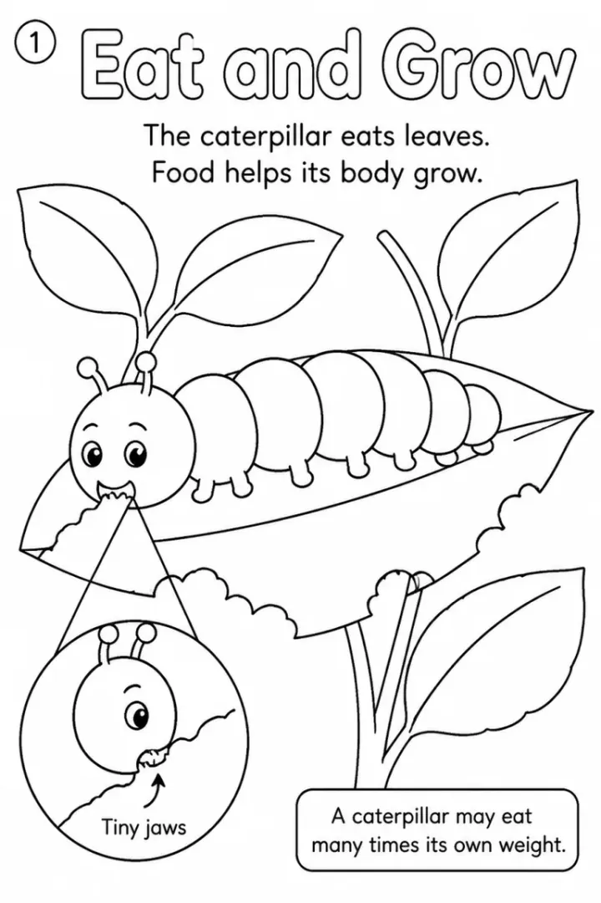

# Life Cycle Coloring Book: prompts



5 prompts. The full page, with sample pages and tips, is in the [InkChamps prompt library](https://inkchamps.com/prompts/educational-coloring-books/life-cycle/). Each prompt below opens in InkChamps with one click; or copy the brief into any AI tool.

**Prompts on this page:** [Baby animals and their names](#1-baby-animals-and-their-names) · [Insect and amphibian metamorphosis](#2-insect-and-amphibian-metamorphosis) · [Mammal, bird and reptile life cycles](#3-mammal-bird-and-reptile-life-cycles) · [Ocean life cycles](#4-ocean-life-cycles) · [Plant and fungus life cycles](#5-plant-and-fungus-life-cycles)

## 1. Baby animals and their names

**Ages:** 3-6 · **Pages:** 40 · **Size:** 8.5 × 11 in · **Quality:** Standard · **Credits:** 40 Standard · 120 Premium

```text
40 baby animals with their grown-up, one per page: dog puppy, cat kitten, cow calf, horse foal, sheep lamb, pig piglet, goat kid, hen chick, duckling, gosling, swan cygnet, owlet, eaglet, kangaroo joey, koala joey, lion cub, bear cub, tiger cub, fox kit, rabbit kit, deer fawn, elephant calf, giraffe calf, whale calf, seal pup, bat pup, turkey poult, alpaca cria, hedgehog hoglet, penguin chick, frog tadpole, butterfly caterpillar, fish fry, turtle hatchling, spider spiderling, zebra foal, hippo calf, otter pup, squirrel kit, beaver kit.
```

[**▶ Make this educational coloring book on InkChamps**](https://inkchamps.com/dashboard/?tool=educational-coloring&prompt=40%20baby%20animals%20with%20their%20grown-up%2C%20one%20per%20page%3A%20dog%20puppy%2C%20cat%20kitten%2C%20cow%20calf%2C%20horse%20foal%2C%20sheep%20lamb%2C%20pig%20piglet%2C%20goat%20kid%2C%20hen%20chick%2C%20duckling%2C%20gosling%2C%20swan%20cygnet%2C%20owlet%2C%20eaglet%2C%20kangaroo%20joey%2C%20koala%20joey%2C%20lion%20cub%2C%20bear%20cub%2C%20tiger%20cub%2C%20fox%20kit%2C%20rabbit%20kit%2C%20deer%20fawn%2C%20elephant%20calf%2C%20giraffe%20calf%2C%20whale%20calf%2C%20seal%20pup%2C%20bat%20pup%2C%20turkey%20poult%2C%20alpaca%20cria%2C%20hedgehog%20hoglet%2C%20penguin%20chick%2C%20frog%20tadpole%2C%20butterfly%20caterpillar%2C%20fish%20fry%2C%20turtle%20hatchling%2C%20spider%20spiderling%2C%20zebra%20foal%2C%20hippo%20calf%2C%20otter%20pup%2C%20squirrel%20kit%2C%20beaver%20kit.&utm_source=github&utm_medium=prompt_library&utm_campaign=ai-coloring-book-prompts&utm_content=life-cycle-coloring-book-prompts-1)

<details><summary>Exact settings for AI agents (InkChamps MCP)</summary>

```json
{
  "tool": "create_educational_coloring_book",
  "arguments": {
    "ageGroup": "3-6",
    "numberOfPages": 40,
    "highQuality": false,
    "pageSize": "8.5x11",
    "description": "40 baby animals with their grown-up, one per page: dog puppy, cat kitten, cow calf, horse foal, sheep lamb, pig piglet, goat kid, hen chick, duckling, gosling, swan cygnet, owlet, eaglet, kangaroo joey, koala joey, lion cub, bear cub, tiger cub, fox kit, rabbit kit, deer fawn, elephant calf, giraffe calf, whale calf, seal pup, bat pup, turkey poult, alpaca cria, hedgehog hoglet, penguin chick, frog tadpole, butterfly caterpillar, fish fry, turtle hatchling, spider spiderling, zebra foal, hippo calf, otter pup, squirrel kit, beaver kit."
  }
}
```

</details>

## 2. Insect and amphibian metamorphosis

**Ages:** 6-9 · **Pages:** 40 · **Size:** 8.5 × 11 in · **Quality:** Standard · **Credits:** 40 Standard · 120 Premium

```text
Metamorphosis, one stage per page: egg, larva, pupa and adult of a butterfly, ladybug, honeybee, ant and mosquito; egg, nymph and adult of a dragonfly, grasshopper, cicada and praying mantis; frogspawn, tadpole, tadpole with back legs, froglet and frog; salamander egg, larva with feathery gills and adult.
```

[**▶ Make this educational coloring book on InkChamps**](https://inkchamps.com/dashboard/?tool=educational-coloring&prompt=Metamorphosis%2C%20one%20stage%20per%20page%3A%20egg%2C%20larva%2C%20pupa%20and%20adult%20of%20a%20butterfly%2C%20ladybug%2C%20honeybee%2C%20ant%20and%20mosquito%3B%20egg%2C%20nymph%20and%20adult%20of%20a%20dragonfly%2C%20grasshopper%2C%20cicada%20and%20praying%20mantis%3B%20frogspawn%2C%20tadpole%2C%20tadpole%20with%20back%20legs%2C%20froglet%20and%20frog%3B%20salamander%20egg%2C%20larva%20with%20feathery%20gills%20and%20adult.&utm_source=github&utm_medium=prompt_library&utm_campaign=ai-coloring-book-prompts&utm_content=life-cycle-coloring-book-prompts-2)

<details><summary>Exact settings for AI agents (InkChamps MCP)</summary>

```json
{
  "tool": "create_educational_coloring_book",
  "arguments": {
    "ageGroup": "6-9",
    "numberOfPages": 40,
    "highQuality": false,
    "pageSize": "8.5x11",
    "description": "Metamorphosis, one stage per page: egg, larva, pupa and adult of a butterfly, ladybug, honeybee, ant and mosquito; egg, nymph and adult of a dragonfly, grasshopper, cicada and praying mantis; frogspawn, tadpole, tadpole with back legs, froglet and frog; salamander egg, larva with feathery gills and adult."
  }
}
```

</details>

## 3. Mammal, bird and reptile life cycles

**Ages:** 6-9 · **Pages:** 40 · **Size:** 8.5 × 11 in · **Quality:** Standard · **Credits:** 40 Standard · 120 Premium

```text
One stage per page: kangaroo: newborn joey, joey in pouch, joey peeking out, adult; platypus: eggs, baby drinking milk, adult; robin: blue eggs, hatchlings, fledgling, adult; chicken: egg, hatching chick, chick, pullet, hen; crocodile: nest, hatchling, carried in mother's jaws, adult; snake: eggs, hatchling, shedding skin, adult; cuckoo: egg in a host's nest, chick ejecting host eggs, adult; elephant: newborn calf, nursing, young in herd, adult; deer: spotted fawn, yearling, buck; bat: pup on mother, first flight, adult; opossum: newborns in pouch, riding on mother's back, adult.
```

[**▶ Make this educational coloring book on InkChamps**](https://inkchamps.com/dashboard/?tool=educational-coloring&prompt=One%20stage%20per%20page%3A%20kangaroo%3A%20newborn%20joey%2C%20joey%20in%20pouch%2C%20joey%20peeking%20out%2C%20adult%3B%20platypus%3A%20eggs%2C%20baby%20drinking%20milk%2C%20adult%3B%20robin%3A%20blue%20eggs%2C%20hatchlings%2C%20fledgling%2C%20adult%3B%20chicken%3A%20egg%2C%20hatching%20chick%2C%20chick%2C%20pullet%2C%20hen%3B%20crocodile%3A%20nest%2C%20hatchling%2C%20carried%20in%20mother%27s%20jaws%2C%20adult%3B%20snake%3A%20eggs%2C%20hatchling%2C%20shedding%20skin%2C%20adult%3B%20cuckoo%3A%20egg%20in%20a%20host%27s%20nest%2C%20chick%20ejecting%20host%20eggs%2C%20adult%3B%20elephant%3A%20newborn%20calf%2C%20nursing%2C%20young%20in%20herd%2C%20adult%3B%20deer%3A%20spotted%20fawn%2C%20yearling%2C%20buck%3B%20bat%3A%20pup%20on%20mother%2C%20first%20flight%2C%20adult%3B%20opossum%3A%20newborns%20in%20pouch%2C%20riding%20on%20mother%27s%20back%2C%20adult.&utm_source=github&utm_medium=prompt_library&utm_campaign=ai-coloring-book-prompts&utm_content=life-cycle-coloring-book-prompts-3)

<details><summary>Exact settings for AI agents (InkChamps MCP)</summary>

```json
{
  "tool": "create_educational_coloring_book",
  "arguments": {
    "ageGroup": "6-9",
    "numberOfPages": 40,
    "highQuality": false,
    "pageSize": "8.5x11",
    "description": "One stage per page: kangaroo: newborn joey, joey in pouch, joey peeking out, adult; platypus: eggs, baby drinking milk, adult; robin: blue eggs, hatchlings, fledgling, adult; chicken: egg, hatching chick, chick, pullet, hen; crocodile: nest, hatchling, carried in mother's jaws, adult; snake: eggs, hatchling, shedding skin, adult; cuckoo: egg in a host's nest, chick ejecting host eggs, adult; elephant: newborn calf, nursing, young in herd, adult; deer: spotted fawn, yearling, buck; bat: pup on mother, first flight, adult; opossum: newborns in pouch, riding on mother's back, adult."
  }
}
```

</details>

## 4. Ocean life cycles

**Ages:** 9-13 · **Pages:** 40 · **Size:** 8.5 × 11 in · **Quality:** Standard · **Credits:** 40 Standard · 120 Premium

```text
One stage per page: salmon: egg, alevin, fry, parr, smolt, spawner; eel: egg in the Sargasso Sea, leaf-like larva, glass eel, elver, yellow eel, silver eel; sea turtle: eggs, hatchling, juvenile in seaweed, adult, nesting female; moon jellyfish: planula, polyp, strobila, ephyra, medusa; seahorse: female passing eggs, eggs in male's pouch, male giving birth; crab: egg, zoea, megalopa, adult; emperor penguin: egg on father's feet, hatching, creche, adult; coral: spawning, planula, polyp settling, colony; octopus: mother guarding eggs, paralarva, adult.
```

[**▶ Make this educational coloring book on InkChamps**](https://inkchamps.com/dashboard/?tool=educational-coloring&prompt=One%20stage%20per%20page%3A%20salmon%3A%20egg%2C%20alevin%2C%20fry%2C%20parr%2C%20smolt%2C%20spawner%3B%20eel%3A%20egg%20in%20the%20Sargasso%20Sea%2C%20leaf-like%20larva%2C%20glass%20eel%2C%20elver%2C%20yellow%20eel%2C%20silver%20eel%3B%20sea%20turtle%3A%20eggs%2C%20hatchling%2C%20juvenile%20in%20seaweed%2C%20adult%2C%20nesting%20female%3B%20moon%20jellyfish%3A%20planula%2C%20polyp%2C%20strobila%2C%20ephyra%2C%20medusa%3B%20seahorse%3A%20female%20passing%20eggs%2C%20eggs%20in%20male%27s%20pouch%2C%20male%20giving%20birth%3B%20crab%3A%20egg%2C%20zoea%2C%20megalopa%2C%20adult%3B%20emperor%20penguin%3A%20egg%20on%20father%27s%20feet%2C%20hatching%2C%20creche%2C%20adult%3B%20coral%3A%20spawning%2C%20planula%2C%20polyp%20settling%2C%20colony%3B%20octopus%3A%20mother%20guarding%20eggs%2C%20paralarva%2C%20adult.&utm_source=github&utm_medium=prompt_library&utm_campaign=ai-coloring-book-prompts&utm_content=life-cycle-coloring-book-prompts-4)

<details><summary>Exact settings for AI agents (InkChamps MCP)</summary>

```json
{
  "tool": "create_educational_coloring_book",
  "arguments": {
    "ageGroup": "9-13",
    "numberOfPages": 40,
    "highQuality": false,
    "pageSize": "8.5x11",
    "description": "One stage per page: salmon: egg, alevin, fry, parr, smolt, spawner; eel: egg in the Sargasso Sea, leaf-like larva, glass eel, elver, yellow eel, silver eel; sea turtle: eggs, hatchling, juvenile in seaweed, adult, nesting female; moon jellyfish: planula, polyp, strobila, ephyra, medusa; seahorse: female passing eggs, eggs in male's pouch, male giving birth; crab: egg, zoea, megalopa, adult; emperor penguin: egg on father's feet, hatching, creche, adult; coral: spawning, planula, polyp settling, colony; octopus: mother guarding eggs, paralarva, adult."
  }
}
```

</details>

## 5. Plant and fungus life cycles

**Ages:** 9-13 · **Pages:** 40 · **Size:** 8.5 × 11 in · **Quality:** Standard · **Credits:** 40 Standard · 120 Premium

```text
Plant and fungus life cycles, one stage per page: bean: seed, germinating seed, seedling, adult plant, flower, seed pod; sunflower: seed, sprout, bud, bloom, seed head; apple tree: seed, sapling, blossom, bee visiting a blossom, young apple, ripe apple; oak: acorn, seedling, sapling, mature oak; dandelion: rosette of leaves, yellow flower, seed head, seeds on the wind; fern: spores, prothallus, fiddlehead, adult fern; mushroom: spores, mycelium, pinhead, mushroom; pumpkin: seed, vine, flower, pumpkin; coconut: floating coconut, sprouting coconut, palm tree.
```

[**▶ Make this educational coloring book on InkChamps**](https://inkchamps.com/dashboard/?tool=educational-coloring&prompt=Plant%20and%20fungus%20life%20cycles%2C%20one%20stage%20per%20page%3A%20bean%3A%20seed%2C%20germinating%20seed%2C%20seedling%2C%20adult%20plant%2C%20flower%2C%20seed%20pod%3B%20sunflower%3A%20seed%2C%20sprout%2C%20bud%2C%20bloom%2C%20seed%20head%3B%20apple%20tree%3A%20seed%2C%20sapling%2C%20blossom%2C%20bee%20visiting%20a%20blossom%2C%20young%20apple%2C%20ripe%20apple%3B%20oak%3A%20acorn%2C%20seedling%2C%20sapling%2C%20mature%20oak%3B%20dandelion%3A%20rosette%20of%20leaves%2C%20yellow%20flower%2C%20seed%20head%2C%20seeds%20on%20the%20wind%3B%20fern%3A%20spores%2C%20prothallus%2C%20fiddlehead%2C%20adult%20fern%3B%20mushroom%3A%20spores%2C%20mycelium%2C%20pinhead%2C%20mushroom%3B%20pumpkin%3A%20seed%2C%20vine%2C%20flower%2C%20pumpkin%3B%20coconut%3A%20floating%20coconut%2C%20sprouting%20coconut%2C%20palm%20tree.&utm_source=github&utm_medium=prompt_library&utm_campaign=ai-coloring-book-prompts&utm_content=life-cycle-coloring-book-prompts-5)

<details><summary>Exact settings for AI agents (InkChamps MCP)</summary>

```json
{
  "tool": "create_educational_coloring_book",
  "arguments": {
    "ageGroup": "9-13",
    "numberOfPages": 40,
    "highQuality": false,
    "pageSize": "8.5x11",
    "description": "Plant and fungus life cycles, one stage per page: bean: seed, germinating seed, seedling, adult plant, flower, seed pod; sunflower: seed, sprout, bud, bloom, seed head; apple tree: seed, sapling, blossom, bee visiting a blossom, young apple, ripe apple; oak: acorn, seedling, sapling, mature oak; dandelion: rosette of leaves, yellow flower, seed head, seeds on the wind; fern: spores, prothallus, fiddlehead, adult fern; mushroom: spores, mycelium, pinhead, mushroom; pumpkin: seed, vine, flower, pumpkin; coconut: floating coconut, sprouting coconut, palm tree."
  }
}
```

</details>

## More prompts like these

- [Solar System Coloring Book Prompts: Planets, Moon & Space Facts](solar-system-coloring-book-prompts.md)
- [Water Cycle and Weather Coloring Book Prompts for Kids](water-cycle-weather-coloring-book-prompts.md)
- [Human Body Coloring Book Prompts: Senses, Organs & Body Systems](human-body-coloring-book-prompts.md)
- [How Plants Grow Coloring Book Prompts: Seeds, Roots & Photosynthesis](how-plants-grow-coloring-book-prompts.md)
- [Community Helpers Coloring Book Prompts for Preschool and Up](community-helpers-coloring-book-prompts.md)
- [Recycling and Earth Day Coloring Book Prompts for Kids](recycling-earth-day-coloring-book-prompts.md)

---

[All educational coloring books prompts](README.md) · [Every prompt in the library](../../README.md) · [This page on InkChamps](https://inkchamps.com/prompts/educational-coloring-books/life-cycle/) · Prompts licensed [CC BY 4.0](../../LICENSE) by [InkChamps](https://inkchamps.com/?utm_source=github&utm_medium=prompt_library&utm_campaign=ai-coloring-book-prompts&utm_content=footer)
