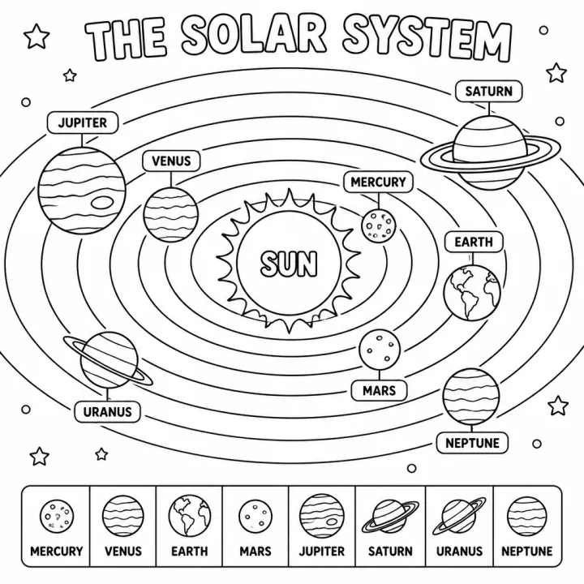

# Solar System Coloring Book: prompts



5 prompts. The full page, with sample pages and tips, is in the [InkChamps prompt library](https://inkchamps.com/prompts/educational-coloring-books/solar-system/). Each prompt below opens in InkChamps with one click; or copy the brief into any AI tool.

**Prompts on this page:** [First space words for preschoolers](#1-first-space-words-for-preschoolers) · [A day on the space station](#2-a-day-on-the-space-station) · [Moons and small worlds](#3-moons-and-small-worlds) · [24 constellations of the night sky](#4-24-constellations-of-the-night-sky) · [Space missions in launch order](#5-space-missions-in-launch-order)

## 1. First space words for preschoolers

**Ages:** 3-6 · **Pages:** 24 · **Size:** 8.5 × 11 in · **Quality:** Standard · **Credits:** 24 Standard · 72 Premium

```text
A first space book of 24 pages, one thing per page with its name as the caption: the Sun, Mercury, Venus, Earth, Mars, Jupiter, Saturn, Uranus and Neptune in order from the Sun, Pluto the dwarf planet, the Moon, a crescent Moon, day, night, a star, a shooting star, a comet, an asteroid, a telescope, a rocket, an astronaut, a Moon buggy, a Mars rover and a satellite.
```

### Page by page (24 pages)

Paste one page at a time into ChatGPT, Gemini or any AI image tool, with this line after it:

> Black-and-white coloring page for a child aged 3 to 6: one big, simple space object or friendly scene filling most of the page, thick bold outlines, large spaces to color, very little background, no shading, no grey, the caption in big outlined letters at the bottom as the only words on the page, plain white background, portrait 8.5 x 11 page.

1. The Sun as a huge round ball with wavy flames all around its edge, filling most of the page, a tiny rocket flying past to show how big it is, with the caption "Sun" in big outlined letters at the bottom.
2. Mercury, a small round rocky planet covered in round craters, sitting close to a big curve of the Sun peeking in from the corner, with the caption "Mercury" in big outlined letters at the bottom.
3. Venus, a round planet wrapped in thick swirly clouds, a small space probe floating beside it and a few simple stars around, with the caption "Venus" in big outlined letters at the bottom.
4. Earth, a big round planet with simple continents, wavy ocean lines and a few puffy clouds, the small round Moon to one side, with the caption "Earth" in big outlined letters at the bottom.
5. Mars, a round rocky planet with one big volcano bump and a long canyon line across its middle, two tiny lumpy moons beside it, with the caption "Mars" in big outlined letters at the bottom.
6. Jupiter, the biggest planet, a huge round ball with wide wavy stripes and one big oval storm spot, three small round moons in a row beside it, with the caption "Jupiter" in big outlined letters at the bottom.
7. Saturn, a round striped planet with wide flat rings around its middle, a small moon and a few simple stars nearby, with the caption "Saturn" in big outlined letters at the bottom.
8. Uranus, a round planet tipped over on its side with thin rings going up and down around it, two small moons beside it, with the caption "Uranus" in big outlined letters at the bottom.
9. Neptune, a round planet with wavy windy stripes and one dark oval spot, curly wind lines swirling around it, with the caption "Neptune" in big outlined letters at the bottom.
10. Pluto, a small round dwarf planet with a big heart shape on its front, its round moon Charon floating close beside it, with the caption "Dwarf Planet Pluto" in big outlined letters at the bottom.
11. The Moon as a big full round ball covered with craters of all sizes, a little flag standing on top and a smiling star beside it, with the caption "Moon" in big outlined letters at the bottom.
12. A thin curved crescent Moon hanging in the night sky above a little house, a cat sitting on the roof looking up at it, with the caption "Crescent Moon" in big outlined letters at the bottom.
13. A bright Sun shining over a park, a child on a swing, a big leafy tree and one fluffy cloud, with the caption "Day" in big outlined letters at the bottom.
14. A little house at night with a round Moon and stars above, a child in pajamas looking out of the lit window, with the caption "Night" in big outlined letters at the bottom.
15. One big five-pointed star with smaller twinkling stars around it, above a grassy hill where a child is pointing up, with the caption "Star" in big outlined letters at the bottom.
16. A shooting star zooming across the sky with a long sparkly tail, two children lying on a blanket on the grass watching it, with the caption "Shooting Star" in big outlined letters at the bottom.
17. A comet with a round icy head and a long, wide, flowing tail streaming across the whole page, a few stars around it, with the caption "Comet" in big outlined letters at the bottom.
18. A big lumpy potato-shaped space rock with craters and bumps, smaller rocks tumbling through space beside it, with the caption "Asteroid" in big outlined letters at the bottom.
19. A child looking through a big telescope on three legs in the backyard at night, the Moon and stars in the sky above, with the caption "Telescope" in big outlined letters at the bottom.
20. A tall rocket standing on the launch pad with round windows and three fins, a puffy cloud of smoke at its base, with the caption "Rocket" in big outlined letters at the bottom.
21. A smiling child astronaut in a puffy space suit and round helmet floating with arms out, a small star and a planet nearby, with the caption "Astronaut" in big outlined letters at the bottom.
22. A little four-wheeled Moon buggy with big round wheels driving over craters, an astronaut at the wheel waving, with the caption "Moon Buggy" in big outlined letters at the bottom.
23. A six-wheeled robot rover with a camera head on a long neck rolling over rocks and sand dunes on Mars, with the caption "Mars Rover" in big outlined letters at the bottom.
24. A satellite with two big flat solar panels and a round dish antenna, floating above a big curve of the Earth, with the caption "Satellite" in big outlined letters at the bottom.

[**▶ Make this educational coloring book on InkChamps**](https://inkchamps.com/dashboard/?tool=educational-coloring&prompt=A%20first%20space%20book%20of%2024%20pages%2C%20one%20thing%20per%20page%20with%20its%20name%20as%20the%20caption%3A%20the%20Sun%2C%20Mercury%2C%20Venus%2C%20Earth%2C%20Mars%2C%20Jupiter%2C%20Saturn%2C%20Uranus%20and%20Neptune%20in%20order%20from%20the%20Sun%2C%20Pluto%20the%20dwarf%20planet%2C%20the%20Moon%2C%20a%20crescent%20Moon%2C%20day%2C%20night%2C%20a%20star%2C%20a%20shooting%20star%2C%20a%20comet%2C%20an%20asteroid%2C%20a%20telescope%2C%20a%20rocket%2C%20an%20astronaut%2C%20a%20Moon%20buggy%2C%20a%20Mars%20rover%20and%20a%20satellite.&utm_source=github&utm_medium=prompt_library&utm_campaign=ai-coloring-book-prompts&utm_content=solar-system-coloring-book-prompts-1)

<details><summary>Exact settings for AI agents (InkChamps MCP)</summary>

```json
{
  "tool": "create_educational_coloring_book",
  "arguments": {
    "ageGroup": "3-6",
    "numberOfPages": 24,
    "highQuality": false,
    "pageSize": "8.5x11",
    "description": "A first space book of 24 pages, one thing per page with its name as the caption: the Sun, Mercury, Venus, Earth, Mars, Jupiter, Saturn, Uranus and Neptune in order from the Sun, Pluto the dwarf planet, the Moon, a crescent Moon, day, night, a star, a shooting star, a comet, an asteroid, a telescope, a rocket, an astronaut, a Moon buggy, a Mars rover and a satellite."
  }
}
```

</details>

## 2. A day on the space station

**Ages:** 6-9 · **Pages:** 24 · **Size:** 8.5 × 11 in · **Quality:** Standard · **Credits:** 24 Standard · 72 Premium

```text
A day of life on the space station in 24 pages, one idea per page with a short caption: rocket launch, docking, floating, the cupola window, food pouches, tortillas, a water ball, brushing teeth, the treadmill, experiments, growing lettuce, the robotic arm, the cargo ship, the spacesuit, a spacewalk, solar panels, mission control, a radio call to a school, a vacuum haircut, sixteen sunrises a day, Earth at night, crew dinner, the sleeping bag on the wall and landing in the sea.
```

### Page by page (24 pages)

Paste one page at a time into ChatGPT, Gemini or any AI image tool, with this line after it:

> Black-and-white coloring page for a child aged 6 to 9: clear bold outlines, friendly realistic drawings of astronauts and the space station, medium detail with a simple background, no shading, no grey, the caption in big outlined letters at the bottom as the only words on the page, plain white background, portrait 8.5 x 11 page.

1. A tall rocket lifting off from the launch pad with flames and a huge cloud of smoke below, the launch tower beside it and birds flying away, with the caption "Rocket Launch" in big outlined letters at the bottom.
2. A small crew capsule slowly docking with the space station's round docking port, long solar panels behind and the curve of Earth below, with the caption "Docking" in big outlined letters at the bottom.
3. Three astronauts floating upside down and sideways inside a tube-shaped module, one doing a somersault, a pen and a notebook drifting in the air, with the caption "Floating" in big outlined letters at the bottom.
4. An astronaut looking out of a dome of seven windows on the space station, Earth's clouds and coastline filling the view, a camera on a strap, with the caption "Cupola Window" in big outlined letters at the bottom.
5. An astronaut at a small table with food pouches stuck to it by strips of hook-and-loop tape, squeezing pasta out of a pouch, a spoon floating nearby, with the caption "Food Pouches" in big outlined letters at the bottom.
6. An astronaut spreading peanut butter on a tortilla instead of bread so no crumbs float away, a jar and a knife drifting beside her, with the caption "Tortillas" in big outlined letters at the bottom.
7. An astronaut gently blowing at a round, wobbly ball of water floating in front of his face, a drink pouch with a straw in his hand, with the caption "Water Ball" in big outlined letters at the bottom.
8. An astronaut brushing her teeth by a small mirror, a tube of toothpaste floating beside her and a towel held to the wall with a clip, with the caption "Brushing Teeth" in big outlined letters at the bottom.
9. An astronaut running on a treadmill, held down by bungee straps at the waist, drops of sweat floating off and a water pouch clipped nearby, with the caption "Treadmill" in big outlined letters at the bottom.
10. Two astronauts in safety goggles working at a wall of experiment drawers, one holding a test tube with a round bubble floating inside, with the caption "Experiments" in big outlined letters at the bottom.
11. An astronaut checking rows of lettuce growing in a small plant box under lamps, one leaf held up to her nose, with the caption "Growing Lettuce" in big outlined letters at the bottom.
12. The station's long robotic arm with elbow and wrist joints reaching out to grab an arriving cargo ship, Earth far below, with the caption "Robotic Arm" in big outlined letters at the bottom.
13. Astronauts unpacking soft cargo bags from a newly arrived supply ship, a bag of fresh apples floating out of one, with the caption "Cargo Ship" in big outlined letters at the bottom.
14. An astronaut being helped into a bulky spacesuit with a big backpack, the helmet with its visor floating beside him and gloves on a hook, with the caption "Spacesuit" in big outlined letters at the bottom.
15. An astronaut on a spacewalk outside the station, clipped on with a tether, holding a wrench beside a handrail, Earth below, with the caption "Spacewalk" in big outlined letters at the bottom.
16. Long rows of solar panels stretching out from the station like giant wings, an astronaut tiny beside them, the Sun shining at one side, with the caption "Solar Panels" in big outlined letters at the bottom.
17. Mission control on Earth: rows of desks with computer screens, people in headsets waving at a big wall screen showing the station's path, with the caption "Mission Control" in big outlined letters at the bottom.
18. An astronaut floating by a microphone, talking by radio to a classroom on Earth, a small screen showing children raising their hands, with the caption "Radio Call to School" in big outlined letters at the bottom.
19. One astronaut cutting another's hair with scissors while a vacuum hose sucks up the floating bits of hair, with the caption "Vacuum Haircut" in big outlined letters at the bottom.
20. The Sun rising over the curved edge of Earth with rays fanning out, the station passing above; it circles Earth so fast it sees sixteen sunrises a day, with the caption "Sixteen Sunrises" in big outlined letters at the bottom.
21. Earth at night seen through a station window, city lights as glowing dots along the coastlines and a wavy ribbon of aurora over the top, with the caption "Earth at Night" in big outlined letters at the bottom.
22. Four astronauts around a table eating dinner together, food trays and floating forks, one laughing as a pea drifts away, with the caption "Crew Dinner" in big outlined letters at the bottom.
23. An astronaut zipped into a sleeping bag tied to the wall of a tiny cabin, a laptop and family photos clipped beside him, with the caption "Sleeping Bag" in big outlined letters at the bottom.
24. A crew capsule floating down under four big striped parachutes toward the sea, a recovery boat waiting on the waves, with the caption "Landing" in big outlined letters at the bottom.

[**▶ Make this educational coloring book on InkChamps**](https://inkchamps.com/dashboard/?tool=educational-coloring&prompt=A%20day%20of%20life%20on%20the%20space%20station%20in%2024%20pages%2C%20one%20idea%20per%20page%20with%20a%20short%20caption%3A%20rocket%20launch%2C%20docking%2C%20floating%2C%20the%20cupola%20window%2C%20food%20pouches%2C%20tortillas%2C%20a%20water%20ball%2C%20brushing%20teeth%2C%20the%20treadmill%2C%20experiments%2C%20growing%20lettuce%2C%20the%20robotic%20arm%2C%20the%20cargo%20ship%2C%20the%20spacesuit%2C%20a%20spacewalk%2C%20solar%20panels%2C%20mission%20control%2C%20a%20radio%20call%20to%20a%20school%2C%20a%20vacuum%20haircut%2C%20sixteen%20sunrises%20a%20day%2C%20Earth%20at%20night%2C%20crew%20dinner%2C%20the%20sleeping%20bag%20on%20the%20wall%20and%20landing%20in%20the%20sea.&utm_source=github&utm_medium=prompt_library&utm_campaign=ai-coloring-book-prompts&utm_content=solar-system-coloring-book-prompts-2)

<details><summary>Exact settings for AI agents (InkChamps MCP)</summary>

```json
{
  "tool": "create_educational_coloring_book",
  "arguments": {
    "ageGroup": "6-9",
    "numberOfPages": 24,
    "highQuality": false,
    "pageSize": "8.5x11",
    "description": "A day of life on the space station in 24 pages, one idea per page with a short caption: rocket launch, docking, floating, the cupola window, food pouches, tortillas, a water ball, brushing teeth, the treadmill, experiments, growing lettuce, the robotic arm, the cargo ship, the spacesuit, a spacewalk, solar panels, mission control, a radio call to a school, a vacuum haircut, sixteen sunrises a day, Earth at night, crew dinner, the sleeping bag on the wall and landing in the sea."
  }
}
```

</details>

## 3. Moons and small worlds

**Ages:** 9-13 · **Pages:** 24 · **Size:** 8.5 × 11 in · **Quality:** Standard · **Credits:** 24 Standard · 72 Premium

```text
Moons and small worlds of the solar system in 24 pages, outward from the Sun, one world and one fact per page, captioned with its name and its planet: the Moon, Phobos and Deimos, the asteroid belt, dwarf planet Ceres, Vesta, Io, Europa, Ganymede, Callisto, Titan, Enceladus, Mimas, Iapetus, Miranda, Titania, Triton, dwarf planet Pluto, Charon, the Kuiper Belt, Arrokoth, dwarf planets Haumea and Eris, Halley's Comet and the Oort Cloud.
```

### Page by page (24 pages)

Paste one page at a time into ChatGPT, Gemini or any AI image tool, with this line after it:

> Black-and-white coloring page for a child aged 9 to 13: detailed, realistic line art of one moon or small world and its surface features, fine-to-medium outlines, a simple starry background with its planet or the Sun where it helps, no shading, no grey, the caption in clear outlined letters at the bottom as the only words on the page, plain white background, portrait 8.5 x 11 page.

1. Earth's Moon filling the page, its smooth dark seas and bright craters with long rays, the round Earth rising behind it, with the caption "The Moon, Moon of Earth" in clear outlined letters at the bottom.
2. Mars's two small lumpy moons: potato-shaped Phobos in front with its giant Stickney crater, tiny Deimos behind, the curved edge of Mars in the corner, with the caption "Phobos and Deimos, Moons of Mars" in clear outlined letters at the bottom.
3. The asteroid belt between Mars and Jupiter: rocks of every size scattered in a wide band, the small Sun on one side and striped Jupiter on the other, with the caption "The Asteroid Belt" in clear outlined letters at the bottom.
4. Ceres, the dwarf planet in the asteroid belt, a round cratered world with two bright salt spots inside one big crater, a spacecraft with solar panels orbiting it, with the caption "Ceres, Dwarf Planet" in clear outlined letters at the bottom.
5. Vesta, a lumpy giant asteroid with a huge crater at its south pole and a tall mountain in the middle of it, long grooves circling its middle, with the caption "Vesta, Asteroid" in clear outlined letters at the bottom.
6. Io, its surface spotted with volcanoes, one umbrella-shaped plume of gas shooting high into space, Jupiter's striped edge behind, with the caption "Io, Moon of Jupiter" in clear outlined letters at the bottom.
7. Europa, a smooth icy moon criss-crossed with long cracks, a cut-away slice showing the deep ocean hidden under its ice shell, with the caption "Europa, Moon of Jupiter" in clear outlined letters at the bottom.
8. Ganymede, the largest moon in the solar system, with grooved light and dark patches, little Mercury drawn beside it to show the moon is bigger, with the caption "Ganymede, Moon of Jupiter" in clear outlined letters at the bottom.
9. Callisto, covered edge to edge in craters, the giant ring-shaped Valhalla basin spreading across it like ripples in a pond, with the caption "Callisto, Moon of Jupiter" in clear outlined letters at the bottom.
10. Titan wrapped in thick hazy layers, a cut-away showing lakes and rivers of liquid methane on its surface and a probe floating down on a parachute, with the caption "Titan, Moon of Saturn" in clear outlined letters at the bottom.
11. Enceladus, a bright icy moon with tall fountains of water spraying from four long cracks at its south pole, Saturn's rings in the background, with the caption "Enceladus, Moon of Saturn" in clear outlined letters at the bottom.
12. Mimas, a small round icy moon with one enormous crater about a third as wide as the moon itself, a mountain peak at the crater's center, with the caption "Mimas, Moon of Saturn" in clear outlined letters at the bottom.
13. Iapetus, a two-faced moon with a clear line between its dark half and its bright half, a tall ridge of mountains running around its middle like a seam, with the caption "Iapetus, Moon of Saturn" in clear outlined letters at the bottom.
14. Miranda, a small moon that looks stitched together from patches of grooves and ridges, with a giant cliff about 20 km tall, Uranus tipped on its side behind, with the caption "Miranda, Moon of Uranus" in clear outlined letters at the bottom.
15. Titania, the largest moon of Uranus, long deep canyons cutting across its icy face, scattered craters and the thin rings of Uranus in the distance, with the caption "Titania, Moon of Uranus" in clear outlined letters at the bottom.
16. Triton, which orbits Neptune backwards, its bumpy surface like a melon skin and dark streaks trailing from geysers at its south pole, Neptune behind, with the caption "Triton, Moon of Neptune" in clear outlined letters at the bottom.
17. Pluto, with its large heart-shaped plain of nitrogen ice, jagged icy mountains along the heart's edge and thin layers of haze above, with the caption "Pluto, Dwarf Planet" in clear outlined letters at the bottom.
18. Charon, Pluto's biggest moon at about half Pluto's size, a dark cap at its north pole and a long belt of canyons, Pluto in the background, with the caption "Charon, Moon of Pluto" in clear outlined letters at the bottom.
19. The Kuiper Belt: a wide ring of icy bodies far beyond Neptune, Neptune's orbit drawn as a circle inside it, Pluto and other icy worlds as small balls, with the caption "The Kuiper Belt" in clear outlined letters at the bottom.
20. Arrokoth, a snowman-shaped icy object made of two flattened lumps stuck together, the farthest world a spacecraft has visited, a probe passing by, with the caption "Arrokoth" in clear outlined letters at the bottom.
21. Haumea, a stretched egg-shaped dwarf planet that spins once every four hours, a thin ring around it and its two small moons, with the caption "Haumea, Dwarf Planet" in clear outlined letters at the bottom.
22. Eris, a round icy dwarf planet about the size of Pluto, its small moon Dysnomia beside it and the distant Sun shrunk to a bright star, with the caption "Eris, Dwarf Planet" in clear outlined letters at the bottom.
23. Halley's Comet with a bright icy head and two long tails streaming away from the Sun, the small Earth below; it comes back about every 76 years, with the caption "Halley's Comet" in clear outlined letters at the bottom.
24. The Oort Cloud: a huge round shell of icy comets around the whole solar system, the planets' orbits a tiny circle in the middle, a few comets falling inward, with the caption "The Oort Cloud" in clear outlined letters at the bottom.

[**▶ Make this educational coloring book on InkChamps**](https://inkchamps.com/dashboard/?tool=educational-coloring&prompt=Moons%20and%20small%20worlds%20of%20the%20solar%20system%20in%2024%20pages%2C%20outward%20from%20the%20Sun%2C%20one%20world%20and%20one%20fact%20per%20page%2C%20captioned%20with%20its%20name%20and%20its%20planet%3A%20the%20Moon%2C%20Phobos%20and%20Deimos%2C%20the%20asteroid%20belt%2C%20dwarf%20planet%20Ceres%2C%20Vesta%2C%20Io%2C%20Europa%2C%20Ganymede%2C%20Callisto%2C%20Titan%2C%20Enceladus%2C%20Mimas%2C%20Iapetus%2C%20Miranda%2C%20Titania%2C%20Triton%2C%20dwarf%20planet%20Pluto%2C%20Charon%2C%20the%20Kuiper%20Belt%2C%20Arrokoth%2C%20dwarf%20planets%20Haumea%20and%20Eris%2C%20Halley%27s%20Comet%20and%20the%20Oort%20Cloud.&utm_source=github&utm_medium=prompt_library&utm_campaign=ai-coloring-book-prompts&utm_content=solar-system-coloring-book-prompts-3)

<details><summary>Exact settings for AI agents (InkChamps MCP)</summary>

```json
{
  "tool": "create_educational_coloring_book",
  "arguments": {
    "ageGroup": "9-13",
    "numberOfPages": 24,
    "highQuality": false,
    "pageSize": "8.5x11",
    "description": "Moons and small worlds of the solar system in 24 pages, outward from the Sun, one world and one fact per page, captioned with its name and its planet: the Moon, Phobos and Deimos, the asteroid belt, dwarf planet Ceres, Vesta, Io, Europa, Ganymede, Callisto, Titan, Enceladus, Mimas, Iapetus, Miranda, Titania, Triton, dwarf planet Pluto, Charon, the Kuiper Belt, Arrokoth, dwarf planets Haumea and Eris, Halley's Comet and the Oort Cloud."
  }
}
```

</details>

## 4. 24 constellations of the night sky

**Ages:** 9-13 · **Pages:** 24 · **Size:** 8.5 × 11 in · **Quality:** Standard · **Credits:** 24 Standard · 72 Premium

```text
24 constellations through the year, one per page, its star pattern drawn with its figure and captioned with its name and season: Ursa Major, Ursa Minor and Cassiopeia all year; Cancer, Leo and Virgo in spring; Libra, Scorpius, Sagittarius, Lyra and Cygnus in summer; Capricornus, Aquarius, Pisces, Pegasus, Andromeda and Aries in autumn; Taurus, Gemini, Orion, Canis Major and Perseus in winter; Crux and Centaurus in the southern sky.
```

### Page by page (24 pages)

Paste one page at a time into ChatGPT, Gemini or any AI image tool, with this line after it:

> Black-and-white coloring page for a child aged 9 to 13: one constellation, its stars drawn as clear outlined star shapes joined by thin lines, with its figure in elegant outline around them, medium detail, a few scattered background stars, no shading, no grey, the caption in clear outlined letters at the bottom as the only words on the page, plain white background, portrait 8.5 x 11 page.

1. A great bear walking across the sky, the seven stars of the Big Dipper forming its back and long tail, two pointer stars lined up toward the North Star, with the caption "Ursa Major, All Year" in clear outlined letters at the bottom.
2. A little bear with the seven stars of the Little Dipper along its back and tail, the North Star, Polaris, shining at the tip of its tail, with the caption "Ursa Minor, All Year" in clear outlined letters at the bottom.
3. A queen seated on a tall throne, five bright stars forming a W across her chair, the edge of the Milky Way drifting behind her, with the caption "Cassiopeia, All Year" in clear outlined letters at the bottom.
4. A crab with raised claws, its faint stars shaped like an upside-down Y, the Beehive star cluster as a small swarm of dots in its middle, with the caption "Cancer, Spring Sky" in clear outlined letters at the bottom.
5. A resting lion, a backwards question mark of stars outlining its mane with the bright star Regulus at its heart, a triangle of stars for its hips, with the caption "Leo, Spring Sky" in clear outlined letters at the bottom.
6. A maiden in a long gown holding an ear of wheat, the bright star Spica in her hand and her figure traced by the star pattern, with the caption "Virgo, Spring Sky" in clear outlined letters at the bottom.
7. A pair of balancing scales hanging from a beam, four stars marking the ends of the beam and the two pans, with the caption "Libra, Summer Sky" in clear outlined letters at the bottom.
8. A scorpion with raised pincers and a curled stinging tail, the red giant star Antares as its heart, a long hook of stars sweeping down, with the caption "Scorpius, Summer Sky" in clear outlined letters at the bottom.
9. An archer centaur drawing a bow, eight stars making a teapot shape at its center, the thick Milky Way rising like steam from the spout, with the caption "Sagittarius, Summer Sky" in clear outlined letters at the bottom.
10. A small stringed harp, the bright star Vega at its top and a little parallelogram of stars forming its frame, with the caption "Lyra, Summer Sky" in clear outlined letters at the bottom.
11. A swan flying with wings spread along the Milky Way, its stars forming the Northern Cross, bright Deneb at its tail, with the caption "Cygnus, Summer Sky" in clear outlined letters at the bottom.
12. A sea-goat with a goat's horns and front legs and a curling fish tail, its stars making a wide triangle, with the caption "Capricornus, Autumn Sky" in clear outlined letters at the bottom.
13. A water carrier tipping a big jar, a stream of stars pouring down from it like water, with the caption "Aquarius, Autumn Sky" in clear outlined letters at the bottom.
14. Two fish swimming in opposite directions, tied together by two long ribbons of stars that meet in a knot, with the caption "Pisces, Autumn Sky" in clear outlined letters at the bottom.
15. A winged horse leaping through the sky, four bright stars forming the Great Square on its body, with the caption "Pegasus, Autumn Sky" in clear outlined letters at the bottom.
16. A princess with her arms outstretched, a chain of stars running from the corner of the Great Square, the Andromeda Galaxy as a small oval swirl near her knee, with the caption "Andromeda, Autumn Sky" in clear outlined letters at the bottom.
17. A ram with big curled horns lying down, three stars in a bent line across its head, the brightest one named Hamal, with the caption "Aries, Autumn Sky" in clear outlined letters at the bottom.
18. A charging bull with long horns, red Aldebaran as its eye in a V of stars, the tiny Pleiades cluster sitting on its shoulder, with the caption "Taurus, Winter Sky" in clear outlined letters at the bottom.
19. Twin brothers standing side by side with arms linked, the bright stars Castor and Pollux as their heads, with the caption "Gemini, Winter Sky" in clear outlined letters at the bottom.
20. A hunter raising a club and holding a shield, three stars in a row for his belt, Betelgeuse at his shoulder, Rigel at his foot and the Orion Nebula in his sword, with the caption "Orion, Winter Sky" in clear outlined letters at the bottom.
21. A big dog standing on its hind legs with its head raised, Sirius, the brightest star in the night sky, shining on its collar, with the caption "Canis Major, Winter Sky" in clear outlined letters at the bottom.
22. A hero holding a curved sword above his head, the winking star Algol marked at his side and Perseid meteors streaking out from him, with the caption "Perseus, Winter Sky" in clear outlined letters at the bottom.
23. The Southern Cross, four bright stars and one fainter one in a small kite-shaped cross, the dark Coalsack nebula beside it, above a beach with palm trees, with the caption "Crux, Southern Sky" in clear outlined letters at the bottom.
24. A centaur holding a spear, two bright stars at its front hooves, one of them Alpha Centauri, the closest star system to the Sun, with the caption "Centaurus, Southern Sky" in clear outlined letters at the bottom.

[**▶ Make this educational coloring book on InkChamps**](https://inkchamps.com/dashboard/?tool=educational-coloring&prompt=24%20constellations%20through%20the%20year%2C%20one%20per%20page%2C%20its%20star%20pattern%20drawn%20with%20its%20figure%20and%20captioned%20with%20its%20name%20and%20season%3A%20Ursa%20Major%2C%20Ursa%20Minor%20and%20Cassiopeia%20all%20year%3B%20Cancer%2C%20Leo%20and%20Virgo%20in%20spring%3B%20Libra%2C%20Scorpius%2C%20Sagittarius%2C%20Lyra%20and%20Cygnus%20in%20summer%3B%20Capricornus%2C%20Aquarius%2C%20Pisces%2C%20Pegasus%2C%20Andromeda%20and%20Aries%20in%20autumn%3B%20Taurus%2C%20Gemini%2C%20Orion%2C%20Canis%20Major%20and%20Perseus%20in%20winter%3B%20Crux%20and%20Centaurus%20in%20the%20southern%20sky.&utm_source=github&utm_medium=prompt_library&utm_campaign=ai-coloring-book-prompts&utm_content=solar-system-coloring-book-prompts-4)

<details><summary>Exact settings for AI agents (InkChamps MCP)</summary>

```json
{
  "tool": "create_educational_coloring_book",
  "arguments": {
    "ageGroup": "9-13",
    "numberOfPages": 24,
    "highQuality": false,
    "pageSize": "8.5x11",
    "description": "24 constellations through the year, one per page, its star pattern drawn with its figure and captioned with its name and season: Ursa Major, Ursa Minor and Cassiopeia all year; Cancer, Leo and Virgo in spring; Libra, Scorpius, Sagittarius, Lyra and Cygnus in summer; Capricornus, Aquarius, Pisces, Pegasus, Andromeda and Aries in autumn; Taurus, Gemini, Orion, Canis Major and Perseus in winter; Crux and Centaurus in the southern sky."
  }
}
```

</details>

## 5. Space missions in launch order

**Ages:** 13+ · **Pages:** 24 · **Size:** 8.5 × 11 in · **Quality:** Standard · **Credits:** 24 Standard · 72 Premium

```text
24 space missions in launch order, one per page, captioned with its name and launch year: Sputnik 1, Vostok 1, Mariner 4, Apollo 8, Apollo 11, Venera 7, Pioneer 10, Viking 1, Voyager 2, Voyager 1, the first Space Shuttle flight, Hubble, Mars Pathfinder, Cassini-Huygens, the space station's first module, Rosetta, New Horizons, Curiosity, Parker Solar Probe, Perseverance and Ingenuity, DART, the James Webb Space Telescope, Chandrayaan-3 and Europa Clipper.
```

### Page by page (24 pages)

Paste one page at a time into ChatGPT, Gemini or any AI image tool, with this line after it:

> Black-and-white coloring page for teens and adults: detailed, accurate technical line art of one spacecraft or mission moment, fine clean outlines with intricate panels, antennas and surface detail, a simple setting of stars, planet or launch pad, no shading, no grey, the caption in clean outlined letters at the bottom as the only words on the page, plain white background, portrait 8.5 x 11 page.

1. Sputnik 1, the first artificial satellite: a polished metal sphere with four long antennas sweeping back, orbiting above the curve of Earth, radio waves rippling out, with the caption "Sputnik 1, 1957" in clear outlined letters at the bottom.
2. Vostok 1, the first human spaceflight: the round crew capsule atop its tall rocket on the launch pad, service arms swinging away, with the caption "Vostok 1, 1961" in clear outlined letters at the bottom.
3. Mariner 4 flying past Mars with its four cross-shaped solar panels and dish antenna, taking the first close-up photos of another planet's craters, with the caption "Mariner 4, 1964" in clear outlined letters at the bottom.
4. Apollo 8, the first crew to orbit the Moon: the command and service module above the cratered lunar surface, Earth rising over the horizon, with the caption "Apollo 8, 1968" in clear outlined letters at the bottom.
5. Apollo 11: the lunar module standing on its four legs on the Moon, an astronaut in a spacesuit beside a flag, boot prints in the dust, with the caption "Apollo 11, 1969" in clear outlined letters at the bottom.
6. Venera 7, the first spacecraft to send data from the surface of another planet: a round lander parachuting down through Venus's thick swirling clouds, with the caption "Venera 7, 1970" in clear outlined letters at the bottom.
7. Pioneer 10, first through the asteroid belt and past Jupiter: the probe with its big dish antenna passing Jupiter's stripes and Great Red Spot, its message plaque on its side, with the caption "Pioneer 10, 1972" in clear outlined letters at the bottom.
8. Viking 1 lander on Mars: a three-legged lander with its scoop arm digging into the soil, boulders scattered across the dusty plain, with the caption "Viking 1, 1975" in clear outlined letters at the bottom.
9. Voyager 2 flying past Neptune and its moon Triton, its big dish antenna and long instrument boom, the only spacecraft to visit Uranus and Neptune, with the caption "Voyager 2, 1977" in clear outlined letters at the bottom.
10. Voyager 1, the farthest human-made object, sailing into interstellar space with its golden record mounted on the side, the Sun a faint dot far behind, with the caption "Voyager 1, 1977" in clear outlined letters at the bottom.
11. The first Space Shuttle flight: the winged orbiter strapped to its giant fuel tank and two rocket boosters, lifting off on a column of smoke, with the caption "Space Shuttle, 1981" in clear outlined letters at the bottom.
12. The Hubble Space Telescope, a long tube with its aperture door open and two wing-like solar panels, released from the shuttle's arm above Earth, with the caption "Hubble, 1990" in clear outlined letters at the bottom.
13. Mars Pathfinder: the lander resting on deflated airbags with its petals open, the little six-wheeled Sojourner rover rolling down a ramp onto Mars, with the caption "Mars Pathfinder, 1996" in clear outlined letters at the bottom.
14. Cassini-Huygens: the large spacecraft with its dish antenna in front of Saturn's rings, the Huygens probe separating to descend to Titan, with the caption "Cassini-Huygens, 1997" in clear outlined letters at the bottom.
15. The first module of the space station: a long cylinder with two solar panels above Earth, the finished station sketched behind it in thin dotted lines, with the caption "Space Station, 1998" in clear outlined letters at the bottom.
16. Rosetta orbiting comet 67P, a two-lobed comet with jets of dust, the small three-legged Philae lander touching down on its surface, with the caption "Rosetta, 2004" in clear outlined letters at the bottom.
17. New Horizons flying past Pluto, its triangular body and dish antenna, Pluto's heart-shaped plain and its moon Charon in the background, with the caption "New Horizons, 2006" in clear outlined letters at the bottom.
18. Curiosity, a car-sized six-wheeled rover in Gale Crater, its mast camera raised and robotic arm drilling a rock, Mount Sharp rising behind, with the caption "Curiosity, 2011" in clear outlined letters at the bottom.
19. Parker Solar Probe, the spacecraft that flies closest to the Sun, its thick round heat shield facing the Sun's flares and looping prominences, with the caption "Parker Solar Probe, 2018" in clear outlined letters at the bottom.
20. The Perseverance rover in Jezero Crater, the small Ingenuity helicopter with two stacked rotors hovering above, the first powered flight on another planet, with the caption "Perseverance, 2020" in clear outlined letters at the bottom.
21. DART, a spacecraft with long roll-out solar arrays heading straight for the small moonlet Dimorphos circling the larger asteroid Didymos, about to nudge its orbit, with the caption "DART, 2021" in clear outlined letters at the bottom.
22. The James Webb Space Telescope: 18 hexagonal gold mirror segments in a honeycomb, standing above its five-layer sunshield the size of a tennis court, with the caption "James Webb Space Telescope, 2021" in clear outlined letters at the bottom.
23. Chandrayaan-3: a four-legged lander near the Moon's south pole, its ramp lowered and a small six-wheeled rover rolling onto the dusty ground, with the caption "Chandrayaan-3, 2023" in clear outlined letters at the bottom.
24. Europa Clipper, a spacecraft with enormous solar arrays and a large dish antenna, flying over icy, cracked Europa with striped Jupiter behind, with the caption "Europa Clipper, 2024" in clear outlined letters at the bottom.

[**▶ Make this educational coloring book on InkChamps**](https://inkchamps.com/dashboard/?tool=educational-coloring&prompt=24%20space%20missions%20in%20launch%20order%2C%20one%20per%20page%2C%20captioned%20with%20its%20name%20and%20launch%20year%3A%20Sputnik%201%2C%20Vostok%201%2C%20Mariner%204%2C%20Apollo%208%2C%20Apollo%2011%2C%20Venera%207%2C%20Pioneer%2010%2C%20Viking%201%2C%20Voyager%202%2C%20Voyager%201%2C%20the%20first%20Space%20Shuttle%20flight%2C%20Hubble%2C%20Mars%20Pathfinder%2C%20Cassini-Huygens%2C%20the%20space%20station%27s%20first%20module%2C%20Rosetta%2C%20New%20Horizons%2C%20Curiosity%2C%20Parker%20Solar%20Probe%2C%20Perseverance%20and%20Ingenuity%2C%20DART%2C%20the%20James%20Webb%20Space%20Telescope%2C%20Chandrayaan-3%20and%20Europa%20Clipper.&utm_source=github&utm_medium=prompt_library&utm_campaign=ai-coloring-book-prompts&utm_content=solar-system-coloring-book-prompts-5)

<details><summary>Exact settings for AI agents (InkChamps MCP)</summary>

```json
{
  "tool": "create_educational_coloring_book",
  "arguments": {
    "ageGroup": "13+",
    "numberOfPages": 24,
    "highQuality": false,
    "pageSize": "8.5x11",
    "description": "24 space missions in launch order, one per page, captioned with its name and launch year: Sputnik 1, Vostok 1, Mariner 4, Apollo 8, Apollo 11, Venera 7, Pioneer 10, Viking 1, Voyager 2, Voyager 1, the first Space Shuttle flight, Hubble, Mars Pathfinder, Cassini-Huygens, the space station's first module, Rosetta, New Horizons, Curiosity, Parker Solar Probe, Perseverance and Ingenuity, DART, the James Webb Space Telescope, Chandrayaan-3 and Europa Clipper."
  }
}
```

</details>

## More prompts like these

- [Water Cycle and Weather Coloring Book Prompts for Kids](water-cycle-weather-coloring-book-prompts.md)
- [Human Body Coloring Book Prompts: Senses, Organs & Body Systems](human-body-coloring-book-prompts.md)
- [How Plants Grow Coloring Book Prompts: Seeds, Roots & Photosynthesis](how-plants-grow-coloring-book-prompts.md)
- [Community Helpers Coloring Book Prompts for Preschool and Up](community-helpers-coloring-book-prompts.md)
- [Recycling and Earth Day Coloring Book Prompts for Kids](recycling-earth-day-coloring-book-prompts.md)
- [Bees and Pollinators Coloring Book Prompts for Kids](bees-and-pollinators-coloring-book-prompts.md)

---

[All educational coloring books prompts](README.md) · [Every prompt in the library](../../README.md) · [This page on InkChamps](https://inkchamps.com/prompts/educational-coloring-books/solar-system/) · Prompts licensed [CC BY 4.0](../../LICENSE) by [InkChamps](https://inkchamps.com/?utm_source=github&utm_medium=prompt_library&utm_campaign=ai-coloring-book-prompts&utm_content=footer)
