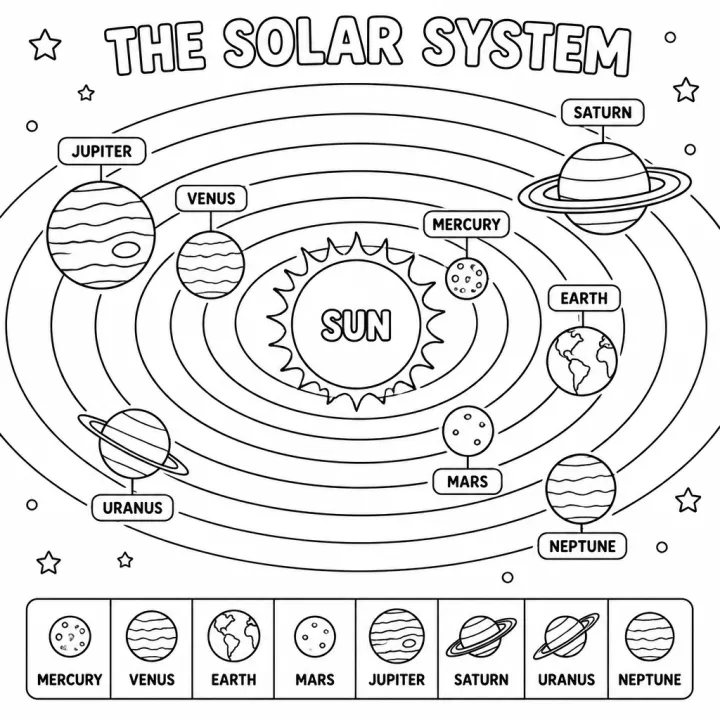

# Solar System Coloring Book: prompts



5 prompts. The full page, with sample pages and tips, is in the [InkChamps prompt library](https://inkchamps.com/prompts/educational-coloring-books/solar-system/). Each prompt below opens in InkChamps with one click; or copy the brief into any AI tool.

**Prompts on this page:** [First space words for preschoolers](#1-first-space-words-for-preschoolers) · [A day on the space station](#2-a-day-on-the-space-station) · [Moons and small worlds](#3-moons-and-small-worlds) · [40 constellations of the night sky](#4-40-constellations-of-the-night-sky) · [Space missions in launch order](#5-space-missions-in-launch-order)

## 1. First space words for preschoolers

**Ages:** 3-6 · **Pages:** 40 · **Size:** 8.5 × 11 in · **Quality:** Standard · **Credits:** 40 Standard · 120 Premium

```text
First space book, one thing per page: the Sun, Mercury, Venus, Earth, Mars, Jupiter, Saturn, Uranus and Neptune in order, Pluto the dwarf planet, Saturn's rings, Jupiter's Great Red Spot, the Moon, crescent, half and full Moon, day, night, sunrise, sunset, a star, the Big Dipper, the Milky Way, a shooting star, a comet, an asteroid, a meteor crater, a rocket, a rocket launch, an astronaut, a space suit, a space helmet, a footprint on the Moon, a Moon buggy, a Mars rover, a satellite, a telescope, an observatory, Earth seen from space, a solar eclipse.
```

[**▶ Make this educational coloring book on InkChamps**](https://inkchamps.com/dashboard/?tool=educational-coloring&prompt=First%20space%20book%2C%20one%20thing%20per%20page%3A%20the%20Sun%2C%20Mercury%2C%20Venus%2C%20Earth%2C%20Mars%2C%20Jupiter%2C%20Saturn%2C%20Uranus%20and%20Neptune%20in%20order%2C%20Pluto%20the%20dwarf%20planet%2C%20Saturn%27s%20rings%2C%20Jupiter%27s%20Great%20Red%20Spot%2C%20the%20Moon%2C%20crescent%2C%20half%20and%20full%20Moon%2C%20day%2C%20night%2C%20sunrise%2C%20sunset%2C%20a%20star%2C%20the%20Big%20Dipper%2C%20the%20Milky%20Way%2C%20a%20shooting%20star%2C%20a%20comet%2C%20an%20asteroid%2C%20a%20meteor%20crater%2C%20a%20rocket%2C%20a%20rocket%20launch%2C%20an%20astronaut%2C%20a%20space%20suit%2C%20a%20space%20helmet%2C%20a%20footprint%20on%20the%20Moon%2C%20a%20Moon%20buggy%2C%20a%20Mars%20rover%2C%20a%20satellite%2C%20a%20telescope%2C%20an%20observatory%2C%20Earth%20seen%20from%20space%2C%20a%20solar%20eclipse.&utm_source=github&utm_medium=prompt_library&utm_campaign=ai-coloring-book-prompts&utm_content=solar-system-coloring-book-prompts-1)

<details><summary>Exact settings for AI agents (InkChamps MCP)</summary>

```json
{
  "tool": "create_educational_coloring_book",
  "arguments": {
    "ageGroup": "3-6",
    "numberOfPages": 40,
    "highQuality": false,
    "pageSize": "8.5x11",
    "description": "First space book, one thing per page: the Sun, Mercury, Venus, Earth, Mars, Jupiter, Saturn, Uranus and Neptune in order, Pluto the dwarf planet, Saturn's rings, Jupiter's Great Red Spot, the Moon, crescent, half and full Moon, day, night, sunrise, sunset, a star, the Big Dipper, the Milky Way, a shooting star, a comet, an asteroid, a meteor crater, a rocket, a rocket launch, an astronaut, a space suit, a space helmet, a footprint on the Moon, a Moon buggy, a Mars rover, a satellite, a telescope, an observatory, Earth seen from space, a solar eclipse."
  }
}
```

</details>

## 2. A day on the space station

**Ages:** 6-9 · **Pages:** 40 · **Size:** 8.5 × 11 in · **Quality:** Standard · **Credits:** 40 Standard · 120 Premium

```text
Life on the space station, one per page: rocket launch, docking, airlock, cupola window, floating, sleeping bag on the wall, food pouches, tortillas, water ball, drink pouch, space toilet, no-rinse shampoo, brushing teeth, treadmill, exercise bike, weight machine, experiments, growing lettuce, roots in zero-g, fire drill, robotic arm, spacesuit, spacewalk, tethers, solar panels, 16 sunrises a day, Earth at night, aurora, hurricanes, mission control, school radio call, cargo ship, unpacking, vacuum haircut, repairs, photos of Earth, medical check, crew dinner, undocking, landing.
```

[**▶ Make this educational coloring book on InkChamps**](https://inkchamps.com/dashboard/?tool=educational-coloring&prompt=Life%20on%20the%20space%20station%2C%20one%20per%20page%3A%20rocket%20launch%2C%20docking%2C%20airlock%2C%20cupola%20window%2C%20floating%2C%20sleeping%20bag%20on%20the%20wall%2C%20food%20pouches%2C%20tortillas%2C%20water%20ball%2C%20drink%20pouch%2C%20space%20toilet%2C%20no-rinse%20shampoo%2C%20brushing%20teeth%2C%20treadmill%2C%20exercise%20bike%2C%20weight%20machine%2C%20experiments%2C%20growing%20lettuce%2C%20roots%20in%20zero-g%2C%20fire%20drill%2C%20robotic%20arm%2C%20spacesuit%2C%20spacewalk%2C%20tethers%2C%20solar%20panels%2C%2016%20sunrises%20a%20day%2C%20Earth%20at%20night%2C%20aurora%2C%20hurricanes%2C%20mission%20control%2C%20school%20radio%20call%2C%20cargo%20ship%2C%20unpacking%2C%20vacuum%20haircut%2C%20repairs%2C%20photos%20of%20Earth%2C%20medical%20check%2C%20crew%20dinner%2C%20undocking%2C%20landing.&utm_source=github&utm_medium=prompt_library&utm_campaign=ai-coloring-book-prompts&utm_content=solar-system-coloring-book-prompts-2)

<details><summary>Exact settings for AI agents (InkChamps MCP)</summary>

```json
{
  "tool": "create_educational_coloring_book",
  "arguments": {
    "ageGroup": "6-9",
    "numberOfPages": 40,
    "highQuality": false,
    "pageSize": "8.5x11",
    "description": "Life on the space station, one per page: rocket launch, docking, airlock, cupola window, floating, sleeping bag on the wall, food pouches, tortillas, water ball, drink pouch, space toilet, no-rinse shampoo, brushing teeth, treadmill, exercise bike, weight machine, experiments, growing lettuce, roots in zero-g, fire drill, robotic arm, spacesuit, spacewalk, tethers, solar panels, 16 sunrises a day, Earth at night, aurora, hurricanes, mission control, school radio call, cargo ship, unpacking, vacuum haircut, repairs, photos of Earth, medical check, crew dinner, undocking, landing."
  }
}
```

</details>

## 3. Moons and small worlds

**Ages:** 9-13 · **Pages:** 40 · **Size:** 8.5 × 11 in · **Quality:** Standard · **Credits:** 40 Standard · 120 Premium

```text
Moons and small worlds of the solar system, one per page: Earth's Moon, Phobos and Deimos, Io, Europa, Ganymede and Callisto, Titan, Enceladus, Mimas, Iapetus, Rhea, Dione, Tethys and Hyperion, Miranda, Ariel, Umbriel, Titania and Oberon, Triton, Nereid and Proteus, Charon, dwarf planets Ceres, Pluto, Haumea, Makemake and Eris, Eris's moon Dysnomia, asteroids Vesta, Eros, Bennu and Ryugu, Arrokoth, Halley's Comet, comet 67P, the asteroid belt, the Kuiper Belt, the Oort Cloud.
```

[**▶ Make this educational coloring book on InkChamps**](https://inkchamps.com/dashboard/?tool=educational-coloring&prompt=Moons%20and%20small%20worlds%20of%20the%20solar%20system%2C%20one%20per%20page%3A%20Earth%27s%20Moon%2C%20Phobos%20and%20Deimos%2C%20Io%2C%20Europa%2C%20Ganymede%20and%20Callisto%2C%20Titan%2C%20Enceladus%2C%20Mimas%2C%20Iapetus%2C%20Rhea%2C%20Dione%2C%20Tethys%20and%20Hyperion%2C%20Miranda%2C%20Ariel%2C%20Umbriel%2C%20Titania%20and%20Oberon%2C%20Triton%2C%20Nereid%20and%20Proteus%2C%20Charon%2C%20dwarf%20planets%20Ceres%2C%20Pluto%2C%20Haumea%2C%20Makemake%20and%20Eris%2C%20Eris%27s%20moon%20Dysnomia%2C%20asteroids%20Vesta%2C%20Eros%2C%20Bennu%20and%20Ryugu%2C%20Arrokoth%2C%20Halley%27s%20Comet%2C%20comet%2067P%2C%20the%20asteroid%20belt%2C%20the%20Kuiper%20Belt%2C%20the%20Oort%20Cloud.&utm_source=github&utm_medium=prompt_library&utm_campaign=ai-coloring-book-prompts&utm_content=solar-system-coloring-book-prompts-3)

<details><summary>Exact settings for AI agents (InkChamps MCP)</summary>

```json
{
  "tool": "create_educational_coloring_book",
  "arguments": {
    "ageGroup": "9-13",
    "numberOfPages": 40,
    "highQuality": false,
    "pageSize": "8.5x11",
    "description": "Moons and small worlds of the solar system, one per page: Earth's Moon, Phobos and Deimos, Io, Europa, Ganymede and Callisto, Titan, Enceladus, Mimas, Iapetus, Rhea, Dione, Tethys and Hyperion, Miranda, Ariel, Umbriel, Titania and Oberon, Triton, Nereid and Proteus, Charon, dwarf planets Ceres, Pluto, Haumea, Makemake and Eris, Eris's moon Dysnomia, asteroids Vesta, Eros, Bennu and Ryugu, Arrokoth, Halley's Comet, comet 67P, the asteroid belt, the Kuiper Belt, the Oort Cloud."
  }
}
```

</details>

## 4. 40 constellations of the night sky

**Ages:** 9-13 · **Pages:** 40 · **Size:** 8.5 × 11 in · **Quality:** Standard · **Credits:** 40 Standard · 120 Premium

```text
40 constellations, one per page, star pattern with its figure: Aries, Taurus, Gemini, Cancer, Leo, Virgo, Libra, Scorpius, Sagittarius, Capricornus, Aquarius, Pisces; Ursa Major, Ursa Minor, Orion, Cassiopeia, Cygnus, Lyra, Aquila, Canis Major, Canis Minor, Perseus, Andromeda, Pegasus, Draco, Cepheus, Bootes, Hercules, Auriga, Corona Borealis, Crux, Centaurus, Carina, Lepus, Delphinus, Eridanus, Hydra, Ophiuchus, Monoceros, Corvus.
```

[**▶ Make this educational coloring book on InkChamps**](https://inkchamps.com/dashboard/?tool=educational-coloring&prompt=40%20constellations%2C%20one%20per%20page%2C%20star%20pattern%20with%20its%20figure%3A%20Aries%2C%20Taurus%2C%20Gemini%2C%20Cancer%2C%20Leo%2C%20Virgo%2C%20Libra%2C%20Scorpius%2C%20Sagittarius%2C%20Capricornus%2C%20Aquarius%2C%20Pisces%3B%20Ursa%20Major%2C%20Ursa%20Minor%2C%20Orion%2C%20Cassiopeia%2C%20Cygnus%2C%20Lyra%2C%20Aquila%2C%20Canis%20Major%2C%20Canis%20Minor%2C%20Perseus%2C%20Andromeda%2C%20Pegasus%2C%20Draco%2C%20Cepheus%2C%20Bootes%2C%20Hercules%2C%20Auriga%2C%20Corona%20Borealis%2C%20Crux%2C%20Centaurus%2C%20Carina%2C%20Lepus%2C%20Delphinus%2C%20Eridanus%2C%20Hydra%2C%20Ophiuchus%2C%20Monoceros%2C%20Corvus.&utm_source=github&utm_medium=prompt_library&utm_campaign=ai-coloring-book-prompts&utm_content=solar-system-coloring-book-prompts-4)

<details><summary>Exact settings for AI agents (InkChamps MCP)</summary>

```json
{
  "tool": "create_educational_coloring_book",
  "arguments": {
    "ageGroup": "9-13",
    "numberOfPages": 40,
    "highQuality": false,
    "pageSize": "8.5x11",
    "description": "40 constellations, one per page, star pattern with its figure: Aries, Taurus, Gemini, Cancer, Leo, Virgo, Libra, Scorpius, Sagittarius, Capricornus, Aquarius, Pisces; Ursa Major, Ursa Minor, Orion, Cassiopeia, Cygnus, Lyra, Aquila, Canis Major, Canis Minor, Perseus, Andromeda, Pegasus, Draco, Cepheus, Bootes, Hercules, Auriga, Corona Borealis, Crux, Centaurus, Carina, Lepus, Delphinus, Eridanus, Hydra, Ophiuchus, Monoceros, Corvus."
  }
}
```

</details>

## 5. Space missions in launch order

**Ages:** 13+ · **Pages:** 40 · **Size:** 8.5 × 11 in · **Quality:** Standard · **Credits:** 40 Standard · 120 Premium

```text
40 space missions in launch order, one per page: Sputnik 1, Explorer 1, Vostok 1, Mariner 4, Luna 9, Apollo 8, Apollo 11, Venera 7, Lunokhod 1, Mariner 9, Pioneer 10, Skylab, Mariner 10, Viking 1, Voyager 2, Voyager 1, the first Space Shuttle flight, Mir, Galileo, Hubble, Mars Pathfinder, Cassini-Huygens, the ISS, Spirit and Opportunity, Rosetta, MESSENGER, New Horizons, Dawn, Juno, Curiosity, Hayabusa2, OSIRIS-REx, Parker Solar Probe, Chang'e 4, Perseverance and Ingenuity, DART, James Webb Space Telescope, Artemis I, Chandrayaan-3, Europa Clipper.
```

[**▶ Make this educational coloring book on InkChamps**](https://inkchamps.com/dashboard/?tool=educational-coloring&prompt=40%20space%20missions%20in%20launch%20order%2C%20one%20per%20page%3A%20Sputnik%201%2C%20Explorer%201%2C%20Vostok%201%2C%20Mariner%204%2C%20Luna%209%2C%20Apollo%208%2C%20Apollo%2011%2C%20Venera%207%2C%20Lunokhod%201%2C%20Mariner%209%2C%20Pioneer%2010%2C%20Skylab%2C%20Mariner%2010%2C%20Viking%201%2C%20Voyager%202%2C%20Voyager%201%2C%20the%20first%20Space%20Shuttle%20flight%2C%20Mir%2C%20Galileo%2C%20Hubble%2C%20Mars%20Pathfinder%2C%20Cassini-Huygens%2C%20the%20ISS%2C%20Spirit%20and%20Opportunity%2C%20Rosetta%2C%20MESSENGER%2C%20New%20Horizons%2C%20Dawn%2C%20Juno%2C%20Curiosity%2C%20Hayabusa2%2C%20OSIRIS-REx%2C%20Parker%20Solar%20Probe%2C%20Chang%27e%204%2C%20Perseverance%20and%20Ingenuity%2C%20DART%2C%20James%20Webb%20Space%20Telescope%2C%20Artemis%20I%2C%20Chandrayaan-3%2C%20Europa%20Clipper.&utm_source=github&utm_medium=prompt_library&utm_campaign=ai-coloring-book-prompts&utm_content=solar-system-coloring-book-prompts-5)

<details><summary>Exact settings for AI agents (InkChamps MCP)</summary>

```json
{
  "tool": "create_educational_coloring_book",
  "arguments": {
    "ageGroup": "13+",
    "numberOfPages": 40,
    "highQuality": false,
    "pageSize": "8.5x11",
    "description": "40 space missions in launch order, one per page: Sputnik 1, Explorer 1, Vostok 1, Mariner 4, Luna 9, Apollo 8, Apollo 11, Venera 7, Lunokhod 1, Mariner 9, Pioneer 10, Skylab, Mariner 10, Viking 1, Voyager 2, Voyager 1, the first Space Shuttle flight, Mir, Galileo, Hubble, Mars Pathfinder, Cassini-Huygens, the ISS, Spirit and Opportunity, Rosetta, MESSENGER, New Horizons, Dawn, Juno, Curiosity, Hayabusa2, OSIRIS-REx, Parker Solar Probe, Chang'e 4, Perseverance and Ingenuity, DART, James Webb Space Telescope, Artemis I, Chandrayaan-3, Europa Clipper."
  }
}
```

</details>

## More prompts like these

- [Water Cycle and Weather Coloring Book Prompts for Kids](water-cycle-weather-coloring-book-prompts.md)
- [Human Body Coloring Book Prompts: Senses, Organs & Body Systems](human-body-coloring-book-prompts.md)
- [How Plants Grow Coloring Book Prompts: Seeds, Roots & Photosynthesis](how-plants-grow-coloring-book-prompts.md)
- [Community Helpers Coloring Book Prompts for Preschool and Up](community-helpers-coloring-book-prompts.md)
- [Recycling and Earth Day Coloring Book Prompts for Kids](recycling-earth-day-coloring-book-prompts.md)
- [Bees and Pollinators Coloring Book Prompts for Kids](bees-and-pollinators-coloring-book-prompts.md)

---

[All educational coloring books prompts](README.md) · [Every prompt in the library](../../README.md) · [This page on InkChamps](https://inkchamps.com/prompts/educational-coloring-books/solar-system/) · Prompts licensed [CC BY 4.0](../../LICENSE) by [InkChamps](https://inkchamps.com/?utm_source=github&utm_medium=prompt_library&utm_campaign=ai-coloring-book-prompts&utm_content=footer)
