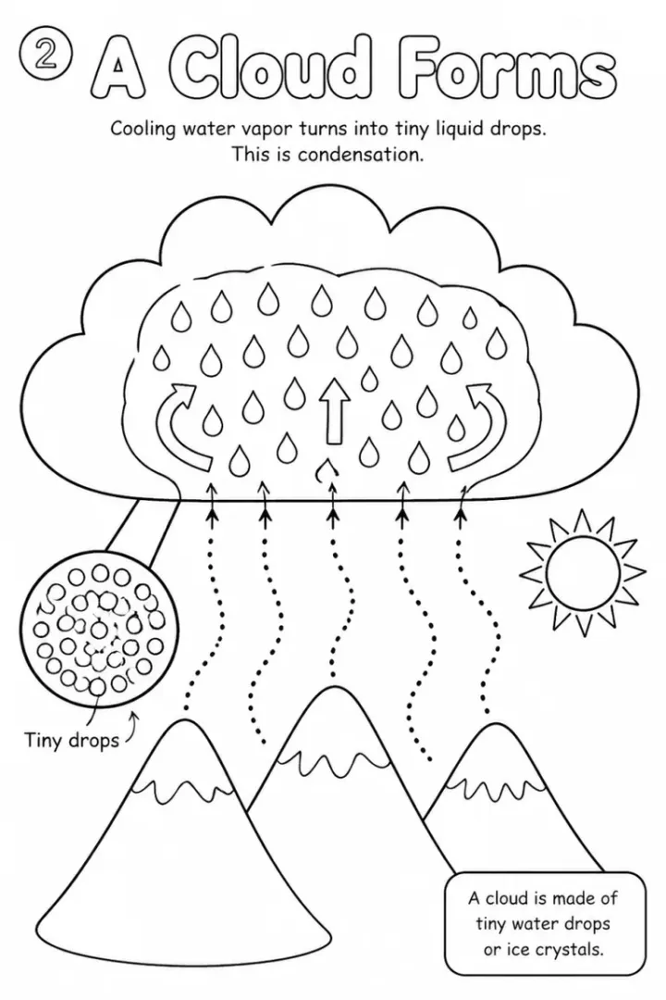

# Water Cycle and Weather Coloring Book: prompts



5 prompts. The full page, with sample pages and tips, is in the [InkChamps prompt library](https://inkchamps.com/prompts/educational-coloring-books/water-cycle-weather/). Each prompt below opens in InkChamps with one click; or copy the brief into any AI tool.

**Prompts on this page:** [Weather and what to wear](#1-weather-and-what-to-wear) · [The water cycle step by step](#2-the-water-cycle-step-by-step) · [Clouds and sky light shows](#3-clouds-and-sky-light-shows) · [Forecasting tools and weather maps](#4-forecasting-tools-and-weather-maps) · [Extreme weather science](#5-extreme-weather-science)

## 1. Weather and what to wear

**Ages:** 3-6 · **Pages:** 40 · **Size:** 8.5 × 11 in · **Quality:** Standard · **Credits:** 40 Standard · 120 Premium

```text
Weather for preschoolers, one idea per page: a sunny day, a cloudy day, a rainy day, a windy day, a snowy day, a foggy morning, a thunderstorm, lightning, a rainbow, hail, frost on a window, icicles, dew on grass, a puddle, a snowflake, an umbrella, rain boots, a raincoat, a sun hat, sunglasses, sunscreen, mittens, a scarf, a winter coat, a snowman, sledding, flying a kite, leaves blowing, jumping in puddles, a wind sock, a weathervane, a thermometer, hot weather, cold weather, spring, summer, autumn, winter, a weather chart, the Sun after rain.
```

[**▶ Make this educational coloring book on InkChamps**](https://inkchamps.com/dashboard/?tool=educational-coloring&prompt=Weather%20for%20preschoolers%2C%20one%20idea%20per%20page%3A%20a%20sunny%20day%2C%20a%20cloudy%20day%2C%20a%20rainy%20day%2C%20a%20windy%20day%2C%20a%20snowy%20day%2C%20a%20foggy%20morning%2C%20a%20thunderstorm%2C%20lightning%2C%20a%20rainbow%2C%20hail%2C%20frost%20on%20a%20window%2C%20icicles%2C%20dew%20on%20grass%2C%20a%20puddle%2C%20a%20snowflake%2C%20an%20umbrella%2C%20rain%20boots%2C%20a%20raincoat%2C%20a%20sun%20hat%2C%20sunglasses%2C%20sunscreen%2C%20mittens%2C%20a%20scarf%2C%20a%20winter%20coat%2C%20a%20snowman%2C%20sledding%2C%20flying%20a%20kite%2C%20leaves%20blowing%2C%20jumping%20in%20puddles%2C%20a%20wind%20sock%2C%20a%20weathervane%2C%20a%20thermometer%2C%20hot%20weather%2C%20cold%20weather%2C%20spring%2C%20summer%2C%20autumn%2C%20winter%2C%20a%20weather%20chart%2C%20the%20Sun%20after%20rain.&utm_source=github&utm_medium=prompt_library&utm_campaign=ai-coloring-book-prompts&utm_content=water-cycle-weather-coloring-book-prompts-1)

<details><summary>Exact settings for AI agents (InkChamps MCP)</summary>

```json
{
  "tool": "create_educational_coloring_book",
  "arguments": {
    "ageGroup": "3-6",
    "numberOfPages": 40,
    "highQuality": false,
    "pageSize": "8.5x11",
    "description": "Weather for preschoolers, one idea per page: a sunny day, a cloudy day, a rainy day, a windy day, a snowy day, a foggy morning, a thunderstorm, lightning, a rainbow, hail, frost on a window, icicles, dew on grass, a puddle, a snowflake, an umbrella, rain boots, a raincoat, a sun hat, sunglasses, sunscreen, mittens, a scarf, a winter coat, a snowman, sledding, flying a kite, leaves blowing, jumping in puddles, a wind sock, a weathervane, a thermometer, hot weather, cold weather, spring, summer, autumn, winter, a weather chart, the Sun after rain."
  }
}
```

</details>

## 2. The water cycle step by step

**Ages:** 6-9 · **Pages:** 40 · **Size:** 8.5 × 11 in · **Quality:** Standard · **Credits:** 40 Standard · 120 Premium

```text
The journey of water, one step or place per page: ocean, Sun warming water, evaporation from the sea, evaporation from a puddle, transpiration, water vapor rising, cooling air, condensation, cloud forming, droplets joining, rain cloud, precipitation, rain, snow, sleet, hail, fog, dew, frost, mountain snow, glacier, snowmelt, mountain stream, waterfall, river, lake, pond, wetland, runoff, storm drain, infiltration, groundwater, aquifer, spring, well, roots drinking, animal drinking, river meeting the sea, collection, the cycle repeating.
```

[**▶ Make this educational coloring book on InkChamps**](https://inkchamps.com/dashboard/?tool=educational-coloring&prompt=The%20journey%20of%20water%2C%20one%20step%20or%20place%20per%20page%3A%20ocean%2C%20Sun%20warming%20water%2C%20evaporation%20from%20the%20sea%2C%20evaporation%20from%20a%20puddle%2C%20transpiration%2C%20water%20vapor%20rising%2C%20cooling%20air%2C%20condensation%2C%20cloud%20forming%2C%20droplets%20joining%2C%20rain%20cloud%2C%20precipitation%2C%20rain%2C%20snow%2C%20sleet%2C%20hail%2C%20fog%2C%20dew%2C%20frost%2C%20mountain%20snow%2C%20glacier%2C%20snowmelt%2C%20mountain%20stream%2C%20waterfall%2C%20river%2C%20lake%2C%20pond%2C%20wetland%2C%20runoff%2C%20storm%20drain%2C%20infiltration%2C%20groundwater%2C%20aquifer%2C%20spring%2C%20well%2C%20roots%20drinking%2C%20animal%20drinking%2C%20river%20meeting%20the%20sea%2C%20collection%2C%20the%20cycle%20repeating.&utm_source=github&utm_medium=prompt_library&utm_campaign=ai-coloring-book-prompts&utm_content=water-cycle-weather-coloring-book-prompts-2)

<details><summary>Exact settings for AI agents (InkChamps MCP)</summary>

```json
{
  "tool": "create_educational_coloring_book",
  "arguments": {
    "ageGroup": "6-9",
    "numberOfPages": 40,
    "highQuality": false,
    "pageSize": "8.5x11",
    "description": "The journey of water, one step or place per page: ocean, Sun warming water, evaporation from the sea, evaporation from a puddle, transpiration, water vapor rising, cooling air, condensation, cloud forming, droplets joining, rain cloud, precipitation, rain, snow, sleet, hail, fog, dew, frost, mountain snow, glacier, snowmelt, mountain stream, waterfall, river, lake, pond, wetland, runoff, storm drain, infiltration, groundwater, aquifer, spring, well, roots drinking, animal drinking, river meeting the sea, collection, the cycle repeating."
  }
}
```

</details>

## 3. Clouds and sky light shows

**Ages:** 9-13 · **Pages:** 40 · **Size:** 8.5 × 11 in · **Quality:** Standard · **Credits:** 40 Standard · 120 Premium

```text
Clouds and sky optics, one per page: cirrus, cirrocumulus, cirrostratus, altocumulus, altostratus, nimbostratus, stratocumulus, stratus, cumulus, cumulonimbus, anvil cloud, mammatus, lenticular cloud, shelf cloud, wall cloud, pileus, Kelvin-Helmholtz waves, asperitas, noctilucent clouds, nacreous clouds, contrails, fog, cap cloud, virga, fallstreak hole, roll cloud, rainbow, double rainbow, supernumerary bows, fogbow, moonbow, 22-degree halo, sun dog, glory, corona, crepuscular rays, green flash, aurora, Belt of Venus, red sunset.
```

[**▶ Make this educational coloring book on InkChamps**](https://inkchamps.com/dashboard/?tool=educational-coloring&prompt=Clouds%20and%20sky%20optics%2C%20one%20per%20page%3A%20cirrus%2C%20cirrocumulus%2C%20cirrostratus%2C%20altocumulus%2C%20altostratus%2C%20nimbostratus%2C%20stratocumulus%2C%20stratus%2C%20cumulus%2C%20cumulonimbus%2C%20anvil%20cloud%2C%20mammatus%2C%20lenticular%20cloud%2C%20shelf%20cloud%2C%20wall%20cloud%2C%20pileus%2C%20Kelvin-Helmholtz%20waves%2C%20asperitas%2C%20noctilucent%20clouds%2C%20nacreous%20clouds%2C%20contrails%2C%20fog%2C%20cap%20cloud%2C%20virga%2C%20fallstreak%20hole%2C%20roll%20cloud%2C%20rainbow%2C%20double%20rainbow%2C%20supernumerary%20bows%2C%20fogbow%2C%20moonbow%2C%2022-degree%20halo%2C%20sun%20dog%2C%20glory%2C%20corona%2C%20crepuscular%20rays%2C%20green%20flash%2C%20aurora%2C%20Belt%20of%20Venus%2C%20red%20sunset.&utm_source=github&utm_medium=prompt_library&utm_campaign=ai-coloring-book-prompts&utm_content=water-cycle-weather-coloring-book-prompts-3)

<details><summary>Exact settings for AI agents (InkChamps MCP)</summary>

```json
{
  "tool": "create_educational_coloring_book",
  "arguments": {
    "ageGroup": "9-13",
    "numberOfPages": 40,
    "highQuality": false,
    "pageSize": "8.5x11",
    "description": "Clouds and sky optics, one per page: cirrus, cirrocumulus, cirrostratus, altocumulus, altostratus, nimbostratus, stratocumulus, stratus, cumulus, cumulonimbus, anvil cloud, mammatus, lenticular cloud, shelf cloud, wall cloud, pileus, Kelvin-Helmholtz waves, asperitas, noctilucent clouds, nacreous clouds, contrails, fog, cap cloud, virga, fallstreak hole, roll cloud, rainbow, double rainbow, supernumerary bows, fogbow, moonbow, 22-degree halo, sun dog, glory, corona, crepuscular rays, green flash, aurora, Belt of Venus, red sunset."
  }
}
```

</details>

## 4. Forecasting tools and weather maps

**Ages:** 9-13 · **Pages:** 40 · **Size:** 8.5 × 11 in · **Quality:** Standard · **Credits:** 40 Standard · 120 Premium

```text
Weather tools and maps, one each: thermometer, barometer, anemometer, wind vane, rain gauge, hygrometer, snow gauge, weather station, instrument shelter, weather balloon, radiosonde, weather buoy, weather satellite, Doppler radar, hurricane hunter plane, lightning detector, Celsius and Fahrenheit, air pressure, humidity, dew point, wind speed, Beaufort scale, wind chill, heat index, high pressure, low pressure, isobars, cold front, warm front, stationary front, occluded front, jet stream, air masses, sea breeze, land breeze, radar map, satellite image, forecast map, UV index, weather symbols.
```

[**▶ Make this educational coloring book on InkChamps**](https://inkchamps.com/dashboard/?tool=educational-coloring&prompt=Weather%20tools%20and%20maps%2C%20one%20each%3A%20thermometer%2C%20barometer%2C%20anemometer%2C%20wind%20vane%2C%20rain%20gauge%2C%20hygrometer%2C%20snow%20gauge%2C%20weather%20station%2C%20instrument%20shelter%2C%20weather%20balloon%2C%20radiosonde%2C%20weather%20buoy%2C%20weather%20satellite%2C%20Doppler%20radar%2C%20hurricane%20hunter%20plane%2C%20lightning%20detector%2C%20Celsius%20and%20Fahrenheit%2C%20air%20pressure%2C%20humidity%2C%20dew%20point%2C%20wind%20speed%2C%20Beaufort%20scale%2C%20wind%20chill%2C%20heat%20index%2C%20high%20pressure%2C%20low%20pressure%2C%20isobars%2C%20cold%20front%2C%20warm%20front%2C%20stationary%20front%2C%20occluded%20front%2C%20jet%20stream%2C%20air%20masses%2C%20sea%20breeze%2C%20land%20breeze%2C%20radar%20map%2C%20satellite%20image%2C%20forecast%20map%2C%20UV%20index%2C%20weather%20symbols.&utm_source=github&utm_medium=prompt_library&utm_campaign=ai-coloring-book-prompts&utm_content=water-cycle-weather-coloring-book-prompts-4)

<details><summary>Exact settings for AI agents (InkChamps MCP)</summary>

```json
{
  "tool": "create_educational_coloring_book",
  "arguments": {
    "ageGroup": "9-13",
    "numberOfPages": 40,
    "highQuality": false,
    "pageSize": "8.5x11",
    "description": "Weather tools and maps, one each: thermometer, barometer, anemometer, wind vane, rain gauge, hygrometer, snow gauge, weather station, instrument shelter, weather balloon, radiosonde, weather buoy, weather satellite, Doppler radar, hurricane hunter plane, lightning detector, Celsius and Fahrenheit, air pressure, humidity, dew point, wind speed, Beaufort scale, wind chill, heat index, high pressure, low pressure, isobars, cold front, warm front, stationary front, occluded front, jet stream, air masses, sea breeze, land breeze, radar map, satellite image, forecast map, UV index, weather symbols."
  }
}
```

</details>

## 5. Extreme weather science

**Ages:** 13+ · **Pages:** 40 · **Size:** 8.5 × 11 in · **Quality:** Standard · **Credits:** 40 Standard · 120 Premium

```text
Extreme weather, one event or idea per page: supercell, mesocyclone, tornado, EF scale, waterspout, dust devil, hailstorm, giant hailstone, downburst, derecho, lightning strike, ball lightning, thunder, hurricane, the eye, the eyewall, rain bands, Saffir-Simpson scale, storm surge, typhoon, cyclone, monsoon, flash flood, river flood, blizzard, whiteout, ice storm, polar vortex, lake-effect snow, heat wave, drought, wildfire weather, pyrocumulus, dust storm, haboob, atmospheric river, landspout, El Nino, La Nina, heat dome.
```

[**▶ Make this educational coloring book on InkChamps**](https://inkchamps.com/dashboard/?tool=educational-coloring&prompt=Extreme%20weather%2C%20one%20event%20or%20idea%20per%20page%3A%20supercell%2C%20mesocyclone%2C%20tornado%2C%20EF%20scale%2C%20waterspout%2C%20dust%20devil%2C%20hailstorm%2C%20giant%20hailstone%2C%20downburst%2C%20derecho%2C%20lightning%20strike%2C%20ball%20lightning%2C%20thunder%2C%20hurricane%2C%20the%20eye%2C%20the%20eyewall%2C%20rain%20bands%2C%20Saffir-Simpson%20scale%2C%20storm%20surge%2C%20typhoon%2C%20cyclone%2C%20monsoon%2C%20flash%20flood%2C%20river%20flood%2C%20blizzard%2C%20whiteout%2C%20ice%20storm%2C%20polar%20vortex%2C%20lake-effect%20snow%2C%20heat%20wave%2C%20drought%2C%20wildfire%20weather%2C%20pyrocumulus%2C%20dust%20storm%2C%20haboob%2C%20atmospheric%20river%2C%20landspout%2C%20El%20Nino%2C%20La%20Nina%2C%20heat%20dome.&utm_source=github&utm_medium=prompt_library&utm_campaign=ai-coloring-book-prompts&utm_content=water-cycle-weather-coloring-book-prompts-5)

<details><summary>Exact settings for AI agents (InkChamps MCP)</summary>

```json
{
  "tool": "create_educational_coloring_book",
  "arguments": {
    "ageGroup": "13+",
    "numberOfPages": 40,
    "highQuality": false,
    "pageSize": "8.5x11",
    "description": "Extreme weather, one event or idea per page: supercell, mesocyclone, tornado, EF scale, waterspout, dust devil, hailstorm, giant hailstone, downburst, derecho, lightning strike, ball lightning, thunder, hurricane, the eye, the eyewall, rain bands, Saffir-Simpson scale, storm surge, typhoon, cyclone, monsoon, flash flood, river flood, blizzard, whiteout, ice storm, polar vortex, lake-effect snow, heat wave, drought, wildfire weather, pyrocumulus, dust storm, haboob, atmospheric river, landspout, El Nino, La Nina, heat dome."
  }
}
```

</details>

## More prompts like these

- [Human Body Coloring Book Prompts: Senses, Organs & Body Systems](human-body-coloring-book-prompts.md)
- [How Plants Grow Coloring Book Prompts: Seeds, Roots & Photosynthesis](how-plants-grow-coloring-book-prompts.md)
- [Community Helpers Coloring Book Prompts for Preschool and Up](community-helpers-coloring-book-prompts.md)
- [Recycling and Earth Day Coloring Book Prompts for Kids](recycling-earth-day-coloring-book-prompts.md)
- [Bees and Pollinators Coloring Book Prompts for Kids](bees-and-pollinators-coloring-book-prompts.md)
- [Volcano and Earth Science Coloring Book Prompts for Kids](volcanoes-earth-science-coloring-book-prompts.md)

---

[All educational coloring books prompts](README.md) · [Every prompt in the library](../../README.md) · [This page on InkChamps](https://inkchamps.com/prompts/educational-coloring-books/water-cycle-weather/) · Prompts licensed [CC BY 4.0](../../LICENSE) by [InkChamps](https://inkchamps.com/?utm_source=github&utm_medium=prompt_library&utm_campaign=ai-coloring-book-prompts&utm_content=footer)
