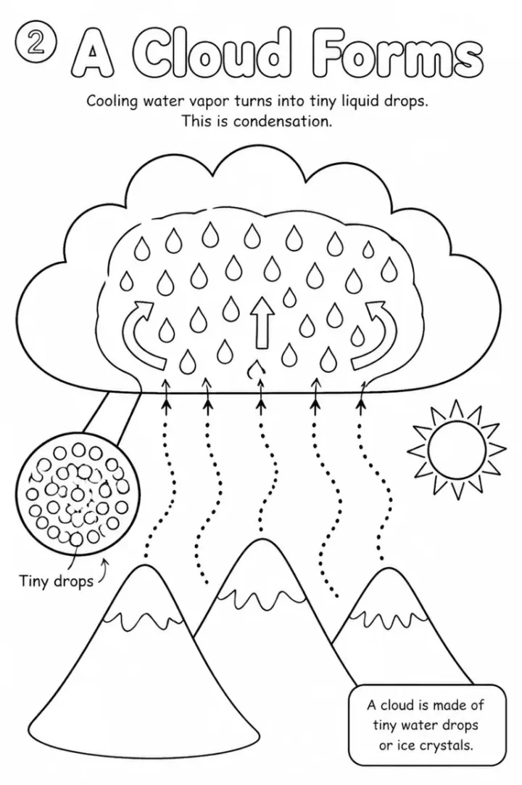

# Water Cycle and Weather Coloring Book: prompts



5 prompts. The full page, with sample pages and tips, is in the [InkChamps prompt library](https://inkchamps.com/prompts/educational-coloring-books/water-cycle-weather/). Each prompt below opens in InkChamps with one click; or copy the brief into any AI tool.

**Prompts on this page:** [Weather and what to wear](#1-weather-and-what-to-wear) · [The water cycle step by step](#2-the-water-cycle-step-by-step) · [Clouds and sky light shows](#3-clouds-and-sky-light-shows) · [Forecasting tools and weather maps](#4-forecasting-tools-and-weather-maps) · [Extreme weather science](#5-extreme-weather-science)

## 1. Weather and what to wear

**Ages:** 3-6 · **Pages:** 24 · **Size:** 8.5 × 11 in · **Quality:** Standard · **Credits:** 24 Standard · 72 Premium

```text
Weather for preschoolers, one idea per page across 24 pages: sunny, cloudy, rainy, windy, snowy, foggy, a thunderstorm and a rainbow, then what we wear and do in each: an umbrella, rain boots, a raincoat, jumping in a puddle, a sun hat, sunglasses, mittens, a scarf, a snowman, sledding and flying a kite, then a thermometer and the four seasons, spring, summer, autumn and winter.
```

### Page by page (24 pages)

Paste one page at a time into ChatGPT, Gemini or any AI image tool, with this line after it:

> Black-and-white educational coloring page for a child aged 3 to 6: one big simple scene, thick bold outlines, large shapes with wide spaces to color, very little background, no shading, no grey, plain white background, the caption in big outlined letters at the bottom is the only words on the page, portrait 8.5 x 11 page.

1. A smiling little girl in shorts standing on green grass under a big round sun with long rays, a daisy and a butterfly beside her, with the caption "Sunny" in big outlined letters at the bottom.
2. A small boy walking his puppy in the park under three big puffy clouds that hide the sun, a tree and a bench behind them, with the caption "Cloudy" in big outlined letters at the bottom.
3. A little bear looking out of a window at fat raindrops falling from a big cloud, drops running down the glass and a toy boat on the sill, with the caption "Rainy" in big outlined letters at the bottom.
4. A girl holding onto her hat as swirly wind lines blow across the page, leaves and a paper cup flying past and a tree bending, with the caption "Windy" in big outlined letters at the bottom.
5. A boy in a puffy coat catching big snowflakes on his tongue, snow piled on the ground and along the top of a fence, with the caption "Snowy" in big outlined letters at the bottom.
6. A mother duck and three ducklings walking along a pond edge on a foggy morning, soft wavy fog lines hiding the trees behind, with the caption "Foggy" in big outlined letters at the bottom.
7. A child and a cat snuggled safely on a sofa under a blanket, a big window showing a storm cloud and a zigzag lightning bolt outside, with the caption "Thunderstorm" in big outlined letters at the bottom.
8. A rainbow with five wide bands arching over two round hills, a small cloud at each end and a girl pointing up at it, with the caption "Rainbow" in big outlined letters at the bottom.
9. A little rabbit holding a big open umbrella while raindrops bounce off the top, a small puddle at its feet, with the caption "Umbrella" in big outlined letters at the bottom.
10. A pair of tall polka-dot rain boots standing on a doormat by a front door, a few raindrops dripping off them, with the caption "Rain Boots" in big outlined letters at the bottom.
11. A boy in a hooded raincoat with big buttons walking to school in the rain, a backpack on his back and a puddle ahead, with the caption "Raincoat" in big outlined letters at the bottom.
12. A girl in rain boots jumping into a big puddle, the splash flying up in big round drops on both sides, with the caption "Puddle" in big outlined letters at the bottom.
13. A girl at the beach in a wide floppy sun hat with a ribbon, building a sandcastle with a bucket and spade, with the caption "Sun Hat" in big outlined letters at the bottom.
14. A smiling frog wearing big round sunglasses, lying back on a lily pad under a bright sun, with the caption "Sunglasses" in big outlined letters at the bottom.
15. Two hands in thick knitted mittens holding a snowball, a string joining the mittens and snowflakes falling around them, with the caption "Mittens" in big outlined letters at the bottom.
16. A little penguin wrapped in a long striped scarf, the ends flapping in the cold wind, snow on the ground, with the caption "Scarf" in big outlined letters at the bottom.
17. A round snowman with a carrot nose, coal buttons, stick arms and a hat, a child tying a scarf around its neck, with the caption "Snowman" in big outlined letters at the bottom.
18. Two kids riding a wooden sled down a snowy hill, snow spraying behind them and a pine tree at the bottom, with the caption "Sledding" in big outlined letters at the bottom.
19. A boy running across a field flying a diamond kite with a bow tail high in the wind, the grass blowing, with the caption "Kite" in big outlined letters at the bottom.
20. A big outdoor thermometer on a fence post with a sun drawn on one side and a snowflake on the other, a bird perched on top, with the caption "Thermometer" in big outlined letters at the bottom.
21. A girl planting a flower in a garden while tulips bloom, a bird's nest with eggs in a tree and a light shower falling, with the caption "Spring" in big outlined letters at the bottom.
22. A boy eating an ice-cream cone beside a paddling pool in a sunny garden, a beach ball and a sprinkler nearby, with the caption "Summer" in big outlined letters at the bottom.
23. A child and a squirrel beside a big pile of falling leaves under a tree, a rake leaning on it and a pumpkin by the fence, with the caption "Autumn" in big outlined letters at the bottom.
24. A child in a winter coat and hat by an iced-over pond, icicles hanging from a bare branch and snow on the ground, with the caption "Winter" in big outlined letters at the bottom.

[**▶ Make this educational coloring book on InkChamps**](https://inkchamps.com/dashboard/?tool=educational-coloring&prompt=Weather%20for%20preschoolers%2C%20one%20idea%20per%20page%20across%2024%20pages%3A%20sunny%2C%20cloudy%2C%20rainy%2C%20windy%2C%20snowy%2C%20foggy%2C%20a%20thunderstorm%20and%20a%20rainbow%2C%20then%20what%20we%20wear%20and%20do%20in%20each%3A%20an%20umbrella%2C%20rain%20boots%2C%20a%20raincoat%2C%20jumping%20in%20a%20puddle%2C%20a%20sun%20hat%2C%20sunglasses%2C%20mittens%2C%20a%20scarf%2C%20a%20snowman%2C%20sledding%20and%20flying%20a%20kite%2C%20then%20a%20thermometer%20and%20the%20four%20seasons%2C%20spring%2C%20summer%2C%20autumn%20and%20winter.&utm_source=github&utm_medium=prompt_library&utm_campaign=ai-coloring-book-prompts&utm_content=water-cycle-weather-coloring-book-prompts-1)

<details><summary>Exact settings for AI agents (InkChamps MCP)</summary>

```json
{
  "tool": "create_educational_coloring_book",
  "arguments": {
    "ageGroup": "3-6",
    "numberOfPages": 24,
    "highQuality": false,
    "pageSize": "8.5x11",
    "description": "Weather for preschoolers, one idea per page across 24 pages: sunny, cloudy, rainy, windy, snowy, foggy, a thunderstorm and a rainbow, then what we wear and do in each: an umbrella, rain boots, a raincoat, jumping in a puddle, a sun hat, sunglasses, mittens, a scarf, a snowman, sledding and flying a kite, then a thermometer and the four seasons, spring, summer, autumn and winter."
  }
}
```

</details>

## 2. The water cycle step by step

**Ages:** 6-9 · **Pages:** 24 · **Size:** 8.5 × 11 in · **Quality:** Standard · **Credits:** 24 Standard · 72 Premium

```text
The journey of water in 24 steps, one per page: the ocean, the Sun warming the water, evaporation from the sea and from a puddle, transpiration from plants, water vapor rising, air cooling, condensation, a cloud forming, droplets joining, precipitation, rain, snow, hail and dew, then a glacier, snowmelt, a mountain stream, a river, runoff, infiltration, groundwater, collection in a lake and the whole cycle repeating.
```

### Page by page (24 pages)

Paste one page at a time into ChatGPT, Gemini or any AI image tool, with this line after it:

> Black-and-white educational coloring page for a child aged 6 to 9: clear bold outlines, medium detail, a simple background that shows where the water is, outlined arrows where they show the water moving, no shading, no grey, plain white background, the short caption in big outlined letters at the bottom is the only words on the page, portrait 8.5 x 11 page.

1. A wide ocean with rolling waves, a sailboat, a leaping dolphin and a lighthouse on a rocky shore, with the caption "The Ocean" in big outlined letters at the bottom.
2. A big smiling sun with long rays shining down on the sea, wavy heat lines rising off the water and a seagull gliding, with the caption "The Sun Warms the Water" in big outlined letters at the bottom.
3. Tiny wavy lines and dots of water rising from the ocean surface toward the sky, outlined arrows pointing up and a crab on a rock, with the caption "Evaporation" in big outlined letters at the bottom.
4. A puddle on a sidewalk shown twice side by side, big in the morning and small in the afternoon sun, a clock above each one, with the caption "A Puddle Dries Up" in big outlined letters at the bottom.
5. A leafy tree and a tall sunflower giving off tiny water drops from their leaves, upward arrows above and roots drinking from the soil below, with the caption "Transpiration" in big outlined letters at the bottom.
6. Invisible water vapor drawn as dotted swirls rising high above a beach and a forest, a hot-air balloon floating beside the swirls, with the caption "Water Vapor Rises" in big outlined letters at the bottom.
7. A tall mountain with a thermometer on each side, warm at the bottom and cold near the snowy top, vapor swirls climbing up its slope, with the caption "Air Cools as It Rises" in big outlined letters at the bottom.
8. A cold glass of lemonade on a picnic table with water drops forming on the outside, a child pointing at the drops, with the caption "Condensation" in big outlined letters at the bottom.
9. Tiny droplets gathering around specks of dust high in the sky and joining into a fluffy cumulus cloud, a bird flying below, with the caption "A Cloud Forms" in big outlined letters at the bottom.
10. A close-up circle showing small cloud droplets bumping and joining into bigger, heavier drops, a thick rain cloud growing behind, with the caption "Droplets Join Together" in big outlined letters at the bottom.
11. A big rain cloud over a small town split into three parts, one dropping rain, one snow and one hail, with the caption "Precipitation" in big outlined letters at the bottom.
12. Rain falling on a farm field, a farmer under an umbrella, rows of corn plants and a rain barrel filling up, with the caption "Rain" in big outlined letters at the bottom.
13. Snowflakes falling on a pine forest, three large six-sided snowflakes drawn close up in the corner and a fox leaving tracks, with the caption "Snow" in big outlined letters at the bottom.
14. Round hailstones bouncing on a garden path and a car roof, a cut-open hailstone in the corner showing its rings of ice, with the caption "Hail" in big outlined letters at the bottom.
15. Morning dew drops beaded on blades of grass and a spider web, a snail on a leaf and the sun rising behind, with the caption "Dew" in big outlined letters at the bottom.
16. A huge glacier of packed ice flowing slowly down between two mountains, cracks across its surface and a mountain goat on a ledge, with the caption "Glacier" in big outlined letters at the bottom.
17. Snow on a mountainside melting in spring sunshine, little trickles running down between rocks and early flowers poking through, with the caption "Snowmelt" in big outlined letters at the bottom.
18. A rushing mountain stream tumbling over stones and down a small waterfall, a trout jumping and ferns on the banks, with the caption "Mountain Stream" in big outlined letters at the bottom.
19. A wide river winding through farmland and under a stone bridge, a heron standing in the shallows and a rowboat tied up, with the caption "River" in big outlined letters at the bottom.
20. Rain running down a sloped street and a hillside into a storm drain and a creek, outlined arrows showing the water's path, with the caption "Runoff" in big outlined letters at the bottom.
21. A cut-away view of a garden showing rainwater soaking down through the soil layers, an earthworm and plant roots in the ground, with the caption "Infiltration" in big outlined letters at the bottom.
22. A cut-away view underground showing water filling the spaces between rocks in an aquifer, a well with a bucket on a rope above, with the caption "Groundwater" in big outlined letters at the bottom.
23. A big lake fed by two streams and a river, a beaver lodge, cattails along the shore and a canoe on the water, with the caption "Collection" in big outlined letters at the bottom.
24. The whole water cycle in one big circle: the sun, the sea, rising vapor, a cloud, falling rain and a river flowing back to the sea, with outlined arrows joining every step, with the caption "The Cycle Repeats" in big outlined letters at the bottom.

[**▶ Make this educational coloring book on InkChamps**](https://inkchamps.com/dashboard/?tool=educational-coloring&prompt=The%20journey%20of%20water%20in%2024%20steps%2C%20one%20per%20page%3A%20the%20ocean%2C%20the%20Sun%20warming%20the%20water%2C%20evaporation%20from%20the%20sea%20and%20from%20a%20puddle%2C%20transpiration%20from%20plants%2C%20water%20vapor%20rising%2C%20air%20cooling%2C%20condensation%2C%20a%20cloud%20forming%2C%20droplets%20joining%2C%20precipitation%2C%20rain%2C%20snow%2C%20hail%20and%20dew%2C%20then%20a%20glacier%2C%20snowmelt%2C%20a%20mountain%20stream%2C%20a%20river%2C%20runoff%2C%20infiltration%2C%20groundwater%2C%20collection%20in%20a%20lake%20and%20the%20whole%20cycle%20repeating.&utm_source=github&utm_medium=prompt_library&utm_campaign=ai-coloring-book-prompts&utm_content=water-cycle-weather-coloring-book-prompts-2)

<details><summary>Exact settings for AI agents (InkChamps MCP)</summary>

```json
{
  "tool": "create_educational_coloring_book",
  "arguments": {
    "ageGroup": "6-9",
    "numberOfPages": 24,
    "highQuality": false,
    "pageSize": "8.5x11",
    "description": "The journey of water in 24 steps, one per page: the ocean, the Sun warming the water, evaporation from the sea and from a puddle, transpiration from plants, water vapor rising, air cooling, condensation, a cloud forming, droplets joining, precipitation, rain, snow, hail and dew, then a glacier, snowmelt, a mountain stream, a river, runoff, infiltration, groundwater, collection in a lake and the whole cycle repeating."
  }
}
```

</details>

## 3. Clouds and sky light shows

**Ages:** 9-13 · **Pages:** 24 · **Size:** 8.5 × 11 in · **Quality:** Standard · **Credits:** 24 Standard · 72 Premium

```text
Clouds and sky optics, one per page across 24 pages: the ten main cloud types (cirrus, cirrocumulus, cirrostratus, altocumulus, altostratus, nimbostratus, stratocumulus, stratus, cumulus, cumulonimbus), seven rarer clouds (mammatus, lenticular, shelf cloud, Kelvin-Helmholtz waves, noctilucent clouds, virga, contrails) and seven light shows (rainbow, double rainbow, 22-degree halo, sun dog, crepuscular rays, green flash, aurora).
```

### Page by page (24 pages)

Paste one page at a time into ChatGPT, Gemini or any AI image tool, with this line after it:

> Black-and-white educational coloring page for ages 9 to 13: the cloud or sky effect drawn large and true to life with fine clean outlines and detailed shapes, a simple landscape at the bottom for scale, no shading, no grey, plain white background, the caption in clear outlined letters at the bottom is the only words on the page, portrait 8.5 x 11 page.

1. Thin, wispy cirrus clouds streaking high across the sky like brush strokes and mares' tails, a wheat field and a lone windmill far below, with the caption "Cirrus" in clear outlined letters at the bottom.
2. Rows of tiny cirrocumulus cloudlets rippling across the high sky like fish scales, a calm lake reflecting them and a rowing boat, with the caption "Cirrocumulus" in clear outlined letters at the bottom.
3. A thin sheet of cirrostratus veiling the whole sky, the sun showing through it as a pale disc, a hiker on a rocky ridge looking up, with the caption "Cirrostratus" in clear outlined letters at the bottom.
4. Patches of puffy altocumulus in neat rows across the middle of the sky, each with a rounded top, village rooftops and a water tower below, with the caption "Altocumulus" in clear outlined letters at the bottom.
5. A flat, even layer of altostratus spread across the sky, the sun faint behind it as if through frosted glass, two kids flying a kite on a hill, with the caption "Altostratus" in clear outlined letters at the bottom.
6. A thick, low nimbostratus layer covering the sky with steady rain falling in long lines, a city street with umbrellas and a bus below, with the caption "Nimbostratus" in clear outlined letters at the bottom.
7. Lumpy stratocumulus clouds in a low patchwork with gaps of open sky between them, a seaside pier and a fishing boat below, with the caption "Stratocumulus" in clear outlined letters at the bottom.
8. A low, flat stratus layer hiding the tops of tall city buildings and a suspension bridge, a ferry crossing the river below, with the caption "Stratus" in clear outlined letters at the bottom.
9. Puffy cumulus clouds with flat bottoms and rounded, cauliflower tops over a summer meadow, a girl lying in the grass watching them, with the caption "Cumulus" in clear outlined letters at the bottom.
10. A towering cumulonimbus storm cloud rising over the prairie to a flat anvil top, rain shafts and a lightning bolt at its base, with the caption "Cumulonimbus" in clear outlined letters at the bottom.
11. Rounded pouches of mammatus hanging from the underside of a storm cloud like rows of bubbles, a farmhouse and a wooden fence below, with the caption "Mammatus" in clear outlined letters at the bottom.
12. Smooth, lens-shaped lenticular clouds stacked like plates over a snowy mountain peak, a mountain lake and pine trees below, with the caption "Lenticular Cloud" in clear outlined letters at the bottom.
13. A long, wedge-shaped shelf cloud rolling in at the front of a thunderstorm over a beach, a lifeguard tower and breaking waves below, with the caption "Shelf Cloud" in clear outlined letters at the bottom.
14. A row of Kelvin-Helmholtz cloud waves curling over like breaking ocean waves along the top of a cloud layer, rolling hills and a barn below, with the caption "Kelvin-Helmholtz Waves" in clear outlined letters at the bottom.
15. Glowing, rippled noctilucent clouds high in a twilight sky after sunset, a few stars above and the outline of a pine forest and a cabin below, with the caption "Noctilucent Clouds" in clear outlined letters at the bottom.
16. Streaks of virga trailing down from a cloud and fading away before they reach the ground, a desert with tall cacti and a flat-topped mesa below, with the caption "Virga" in clear outlined letters at the bottom.
17. Long straight contrails crisscrossing the sky behind two jets, one fresh and thin and one older and spreading wide, an airport runway below, with the caption "Contrails" in clear outlined letters at the bottom.
18. A full rainbow arching over a valley after a storm, each band drawn as its own outlined stripe, the low sun behind a boy who is watching it, with the caption "Rainbow" in clear outlined letters at the bottom.
19. A double rainbow with a bright inner bow and a fainter outer bow whose colors run in reverse order, a waterfall in the valley below, with the caption "Double Rainbow" in clear outlined letters at the bottom.
20. A large circular halo ringing the sun through thin high clouds, a skier on a snowy slope below looking up at it, with the caption "22-Degree Halo" in clear outlined letters at the bottom.
21. Two bright sun dogs glowing on either side of a low winter sun, part of a halo arc between them, an ice-covered lake and an ice-fishing hut below, with the caption "Sun Dog" in clear outlined letters at the bottom.
22. Crepuscular rays fanning down through gaps in the clouds onto rolling fields, a farmhouse and a row of round hay bales below, with the caption "Crepuscular Rays" in clear outlined letters at the bottom.
23. The sun sinking into a flat ocean horizon with a thin green flash on its top edge, a sailboat and the end of a wooden pier in front, with the caption "Green Flash" in clear outlined letters at the bottom.
24. Curtains and ribbons of an aurora swirling across a starry polar sky, a snowy forest, an iced-over river and a small cabin below, with the caption "Aurora" in clear outlined letters at the bottom.

[**▶ Make this educational coloring book on InkChamps**](https://inkchamps.com/dashboard/?tool=educational-coloring&prompt=Clouds%20and%20sky%20optics%2C%20one%20per%20page%20across%2024%20pages%3A%20the%20ten%20main%20cloud%20types%20%28cirrus%2C%20cirrocumulus%2C%20cirrostratus%2C%20altocumulus%2C%20altostratus%2C%20nimbostratus%2C%20stratocumulus%2C%20stratus%2C%20cumulus%2C%20cumulonimbus%29%2C%20seven%20rarer%20clouds%20%28mammatus%2C%20lenticular%2C%20shelf%20cloud%2C%20Kelvin-Helmholtz%20waves%2C%20noctilucent%20clouds%2C%20virga%2C%20contrails%29%20and%20seven%20light%20shows%20%28rainbow%2C%20double%20rainbow%2C%2022-degree%20halo%2C%20sun%20dog%2C%20crepuscular%20rays%2C%20green%20flash%2C%20aurora%29.&utm_source=github&utm_medium=prompt_library&utm_campaign=ai-coloring-book-prompts&utm_content=water-cycle-weather-coloring-book-prompts-3)

<details><summary>Exact settings for AI agents (InkChamps MCP)</summary>

```json
{
  "tool": "create_educational_coloring_book",
  "arguments": {
    "ageGroup": "9-13",
    "numberOfPages": 24,
    "highQuality": false,
    "pageSize": "8.5x11",
    "description": "Clouds and sky optics, one per page across 24 pages: the ten main cloud types (cirrus, cirrocumulus, cirrostratus, altocumulus, altostratus, nimbostratus, stratocumulus, stratus, cumulus, cumulonimbus), seven rarer clouds (mammatus, lenticular, shelf cloud, Kelvin-Helmholtz waves, noctilucent clouds, virga, contrails) and seven light shows (rainbow, double rainbow, 22-degree halo, sun dog, crepuscular rays, green flash, aurora)."
  }
}
```

</details>

## 4. Forecasting tools and weather maps

**Ages:** 9-13 · **Pages:** 24 · **Size:** 8.5 × 11 in · **Quality:** Standard · **Credits:** 24 Standard · 72 Premium

```text
Weather tools and maps over 24 pages, one each: thermometer, barometer, anemometer, wind vane, rain gauge, hygrometer, weather station, weather balloon, weather buoy, weather satellite, Doppler radar and a hurricane hunter plane, then humidity, dew point, the Beaufort wind scale, high pressure, low pressure, isobars, cold front, warm front, the jet stream, a sea breeze, a forecast map and weather symbols.
```

### Page by page (24 pages)

Paste one page at a time into ChatGPT, Gemini or any AI image tool, with this line after it:

> Black-and-white educational coloring page for ages 9 to 13: the instrument, map or weather idea drawn large and clear with fine clean outlines and accurate detail, a simple setting behind it, no shading, no grey, plain white background, the caption in clear outlined letters at the bottom is the only words on the page, no other labels or numbers, portrait 8.5 x 11 page.

1. A tall glass liquid thermometer mounted on a wooden post in a schoolyard, tick marks along its side and the sun shining on it, with the caption "Thermometer" in clear outlined letters at the bottom.
2. A brass aneroid barometer with a round dial and pointer hanging on a study wall, a window beside it showing clouds gathering outside, with the caption "Barometer" in clear outlined letters at the bottom.
3. A cup anemometer spinning on top of a tall pole, its three cups catching the wind, curved motion lines and a flag flapping nearby, with the caption "Anemometer" in clear outlined letters at the bottom.
4. An arrow-shaped wind vane on a barn roof with four compass arms below it, the arrow pointing into the wind and leaves blowing past, with the caption "Wind Vane" in clear outlined letters at the bottom.
5. A clear rain gauge cylinder in a vegetable garden filled up to a marked line, raindrops falling and a student in a raincoat checking it, with the caption "Rain Gauge" in clear outlined letters at the bottom.
6. A hygrometer with a round dial on a greenhouse wall, ferns, potted orchids and misted glass panes around it, with the caption "Hygrometer" in clear outlined letters at the bottom.
7. An automatic weather station on a grassy hill with a solar panel, an anemometer, a wind vane, a rain gauge and a slatted instrument shelter, with the caption "Weather Station" in clear outlined letters at the bottom.
8. Two meteorologists releasing a big weather balloon from a field, a small radiosonde box hanging below it on a long line, with the caption "Weather Balloon" in clear outlined letters at the bottom.
9. A weather buoy bobbing on ocean waves with a mast of sensors and a solar panel, a gull perched on top and a container ship far away, with the caption "Weather Buoy" in clear outlined letters at the bottom.
10. A weather satellite with wide solar panels orbiting above the Earth, swirling cloud patterns on the planet below and stars behind, with the caption "Weather Satellite" in clear outlined letters at the bottom.
11. A Doppler radar dome on a tall tower beside a field, curved radar waves reaching out toward a distant thunderstorm, with the caption "Doppler Radar" in clear outlined letters at the bottom.
12. A four-propeller hurricane hunter plane flying into the swirling cloud bands of a hurricane, the calm eye opening up ahead, with the caption "Hurricane Hunter Plane" in clear outlined letters at the bottom.
13. A muggy summer afternoon on a porch, a dog panting in the shade, a glass of iced water sweating and tiny vapor dots floating in the air, with the caption "Humidity" in clear outlined letters at the bottom.
14. Early-morning grass and a parked bicycle covered in dew as the air cools, a thermometer on a fence and the sun just rising, with the caption "Dew Point" in clear outlined letters at the bottom.
15. Six panels along a coast showing the wind growing stronger: smoke rising straight up, leaves rustling, branches swaying, trees bending, waves crashing and a gale, with the caption "Beaufort Wind Scale" in clear outlined letters at the bottom.
16. Outlined arrows of sinking air pressing down in a dome over a sunny countryside, clear skies, a picnic blanket and a still lake, with the caption "High Pressure" in clear outlined letters at the bottom.
17. Air spiraling inward and rising over a coastal town, outlined arrows curling up into a cluster of storm clouds with rain below, with the caption "Low Pressure" in clear outlined letters at the bottom.
18. A weather map of a continent covered in curving isobar lines that circle one center marked with a sun and one marked with a cloud, wind arrows between them, with the caption "Isobars" in clear outlined letters at the bottom.
19. A cut-away side view of a cold front, a wedge of cold air pushing under warm air and lifting it into tall storm clouds, the map line with triangles drawn above, with the caption "Cold Front" in clear outlined letters at the bottom.
20. A cut-away side view of a warm front, warm air sliding gently up over cold air into long layered clouds and drizzle, the map line with half-circles drawn above, with the caption "Warm Front" in clear outlined letters at the bottom.
21. The globe seen from space with a long, wavy jet stream ribbon looping around its northern half, a passenger jet riding along it, with the caption "Jet Stream" in clear outlined letters at the bottom.
22. A beach on a sunny afternoon with outlined arrows showing cool air blowing from the sea onto the warm land and rising over it, kites flying, with the caption "Sea Breeze" in clear outlined letters at the bottom.
23. A weather forecaster pointing at a big forecast map of a coastline, sun, cloud, rain and snow icons over different regions and a front crossing it, with the caption "Forecast Map" in clear outlined letters at the bottom.
24. A grid of twelve weather map symbols drawn large: sun, partly cloudy, cloud, rain, showers, snow, sleet, thunderstorm, fog, wind, hail and hurricane, with the caption "Weather Symbols" in clear outlined letters at the bottom.

[**▶ Make this educational coloring book on InkChamps**](https://inkchamps.com/dashboard/?tool=educational-coloring&prompt=Weather%20tools%20and%20maps%20over%2024%20pages%2C%20one%20each%3A%20thermometer%2C%20barometer%2C%20anemometer%2C%20wind%20vane%2C%20rain%20gauge%2C%20hygrometer%2C%20weather%20station%2C%20weather%20balloon%2C%20weather%20buoy%2C%20weather%20satellite%2C%20Doppler%20radar%20and%20a%20hurricane%20hunter%20plane%2C%20then%20humidity%2C%20dew%20point%2C%20the%20Beaufort%20wind%20scale%2C%20high%20pressure%2C%20low%20pressure%2C%20isobars%2C%20cold%20front%2C%20warm%20front%2C%20the%20jet%20stream%2C%20a%20sea%20breeze%2C%20a%20forecast%20map%20and%20weather%20symbols.&utm_source=github&utm_medium=prompt_library&utm_campaign=ai-coloring-book-prompts&utm_content=water-cycle-weather-coloring-book-prompts-4)

<details><summary>Exact settings for AI agents (InkChamps MCP)</summary>

```json
{
  "tool": "create_educational_coloring_book",
  "arguments": {
    "ageGroup": "9-13",
    "numberOfPages": 24,
    "highQuality": false,
    "pageSize": "8.5x11",
    "description": "Weather tools and maps over 24 pages, one each: thermometer, barometer, anemometer, wind vane, rain gauge, hygrometer, weather station, weather balloon, weather buoy, weather satellite, Doppler radar and a hurricane hunter plane, then humidity, dew point, the Beaufort wind scale, high pressure, low pressure, isobars, cold front, warm front, the jet stream, a sea breeze, a forecast map and weather symbols."
  }
}
```

</details>

## 5. Extreme weather science

**Ages:** 13+ · **Pages:** 24 · **Size:** 8.5 × 11 in · **Quality:** Standard · **Credits:** 24 Standard · 72 Premium

```text
Extreme weather in 24 pages, one event or idea each: supercell, mesocyclone, tornado, the Enhanced Fujita scale, waterspout, giant hailstone, downburst, derecho, lightning strike, hurricane, the eye, the eyewall, storm surge, monsoon, flash flood, blizzard, ice storm, lake-effect snow, heat wave, drought, pyrocumulus, haboob, atmospheric river and El Nino.
```

### Page by page (24 pages)

Paste one page at a time into ChatGPT, Gemini or any AI image tool, with this line after it:

> Black-and-white educational coloring page for teens and adults: a dramatic, realistic weather scene that fills the page, fine detailed outlines, intricate cloud, wind and landscape texture drawn as lines, no people in danger, no shading, no grey, white paper, the caption in clear outlined letters at the bottom is the only words on the page, portrait 8.5 x 11 page.

1. A massive supercell thunderstorm over the Great Plains, its striped, rotating mothership shape and flat anvil above a lone farm road and grain silo, with the caption "Supercell" in clear outlined letters at the bottom.
2. The rotating updraft of a mesocyclone seen from below, a corkscrew of cloud bands spiraling up into the storm and a lowered wall cloud over a cornfield, with the caption "Mesocyclone" in clear outlined letters at the bottom.
3. A tornado funnel touching down in open farmland, a debris cloud swirling at its base and a storm-chaser van parked safely on a distant road, with the caption "Tornado" in clear outlined letters at the bottom.
4. Six panels in a grid showing tornado damage from weakest to strongest: broken branches, lost shingles, a torn-off roof, a collapsed barn, a flattened house and a bare foundation, with the caption "Enhanced Fujita Scale" in clear outlined letters at the bottom.
5. A slender waterspout spinning up from a calm tropical sea to a line of cumulus, a ring of spray at its base and a sailboat keeping well away, with the caption "Waterspout" in clear outlined letters at the bottom.
6. A giant hailstone cut in half beside a baseball for scale, showing its onion-like rings of ice, hail bouncing on a dented car hood behind, with the caption "Hailstone" in clear outlined letters at the bottom.
7. A downburst plunging out of a storm cloud and spreading outward in a ring of dust at the ground, trees bending away from its center, with the caption "Downburst" in clear outlined letters at the bottom.
8. A long, bow-shaped line of storms racing across farmland, its curved shelf cloud stretching to the horizon and wheat flattened ahead of it, with the caption "Derecho" in clear outlined letters at the bottom.
9. A branching cloud-to-ground lightning bolt striking the lightning rod of a tall radio tower, forked side branches and rain falling over a town, with the caption "Lightning Strike" in clear outlined letters at the bottom.
10. A hurricane seen from space, spiral rain bands wrapping around a clear round eye over the ocean and a coastline at the edge of the frame, with the caption "Hurricane" in clear outlined letters at the bottom.
11. Inside the eye of a hurricane, a calm circle of open sky ringed by towering cloud walls like a stadium, a research plane circling inside, with the caption "The Eye" in clear outlined letters at the bottom.
12. A cut-away side view of a hurricane, towering eyewall clouds around the calm eye and outlined arrows showing air rushing in, up and out, with the caption "The Eyewall" in clear outlined letters at the bottom.
13. A cut-away coastal view of a hurricane pushing a dome of seawater onto the shore, waves spilling over a seawall and homes raised on stilts, with the caption "Storm Surge" in clear outlined letters at the bottom.
14. Monsoon rains sweeping across terraced rice fields, a river swelling below, palm trees bending and water buffalo sheltering under a tin-roofed shed, with the caption "Monsoon" in clear outlined letters at the bottom.
15. A flash flood roaring through a narrow desert canyon, a wall of muddy water carrying branches and a hiking trail high on the canyon rim, with the caption "Flash Flood" in clear outlined letters at the bottom.
16. A blizzard blowing snow sideways across a prairie highway, drifts burying the fence posts and a snowplow pushing through with its lights on, with the caption "Blizzard" in clear outlined letters at the bottom.
17. The morning after an ice storm, tree branches, power lines and a picket fence coated in thick clear ice and hung with long icicles, with the caption "Ice Storm" in clear outlined letters at the bottom.
18. Cold wind blowing across a large lake, bands of snow clouds forming over the water and dropping heavy snow on a shoreline town, outlined arrows showing the wind, with the caption "Lake-Effect Snow" in clear outlined letters at the bottom.
19. A city street in a heat wave, shimmering heat lines rising off the asphalt, a drooping street tree, pulled-down shop awnings and a drinking fountain, with the caption "Heat Wave" in clear outlined letters at the bottom.
20. Cracked dry earth in a shrunken reservoir, an old rowboat stranded on the mud, dead grass and a windmill under a cloudless sky, with the caption "Drought" in clear outlined letters at the bottom.
21. A towering pyrocumulus cloud boiling up from the smoke column of a distant wildfire above a forested ridge, a fire lookout tower on a far hill, with the caption "Pyrocumulus" in clear outlined letters at the bottom.
22. A haboob rolling toward a desert town as a towering wall of dust, palm trees, flat-roofed houses and a highway in front of it, with the caption "Haboob" in clear outlined letters at the bottom.
23. The Pacific seen from space with a long, narrow ribbon of moisture streaming from the tropics to a mountainous coastline, clouds piling against the peaks, with the caption "Atmospheric River" in clear outlined letters at the bottom.
24. A cut-away view of the Pacific Ocean with a pool of warm water spreading east toward South America, weakening trade-wind arrows and storm clouds over the coast, with the caption "El Nino" in clear outlined letters at the bottom.

[**▶ Make this educational coloring book on InkChamps**](https://inkchamps.com/dashboard/?tool=educational-coloring&prompt=Extreme%20weather%20in%2024%20pages%2C%20one%20event%20or%20idea%20each%3A%20supercell%2C%20mesocyclone%2C%20tornado%2C%20the%20Enhanced%20Fujita%20scale%2C%20waterspout%2C%20giant%20hailstone%2C%20downburst%2C%20derecho%2C%20lightning%20strike%2C%20hurricane%2C%20the%20eye%2C%20the%20eyewall%2C%20storm%20surge%2C%20monsoon%2C%20flash%20flood%2C%20blizzard%2C%20ice%20storm%2C%20lake-effect%20snow%2C%20heat%20wave%2C%20drought%2C%20pyrocumulus%2C%20haboob%2C%20atmospheric%20river%20and%20El%20Nino.&utm_source=github&utm_medium=prompt_library&utm_campaign=ai-coloring-book-prompts&utm_content=water-cycle-weather-coloring-book-prompts-5)

<details><summary>Exact settings for AI agents (InkChamps MCP)</summary>

```json
{
  "tool": "create_educational_coloring_book",
  "arguments": {
    "ageGroup": "13+",
    "numberOfPages": 24,
    "highQuality": false,
    "pageSize": "8.5x11",
    "description": "Extreme weather in 24 pages, one event or idea each: supercell, mesocyclone, tornado, the Enhanced Fujita scale, waterspout, giant hailstone, downburst, derecho, lightning strike, hurricane, the eye, the eyewall, storm surge, monsoon, flash flood, blizzard, ice storm, lake-effect snow, heat wave, drought, pyrocumulus, haboob, atmospheric river and El Nino."
  }
}
```

</details>

## More prompts like these

- [Human Body Coloring Book Prompts: Senses, Organs & Body Systems](human-body-coloring-book-prompts.md)
- [How Plants Grow Coloring Book Prompts: Seeds, Roots & Photosynthesis](how-plants-grow-coloring-book-prompts.md)
- [Community Helpers Coloring Book Prompts for Preschool and Up](community-helpers-coloring-book-prompts.md)
- [Recycling and Earth Day Coloring Book Prompts for Kids](recycling-earth-day-coloring-book-prompts.md)
- [Bees and Pollinators Coloring Book Prompts for Kids](bees-and-pollinators-coloring-book-prompts.md)
- [Volcano and Earth Science Coloring Book Prompts for Kids](volcanoes-earth-science-coloring-book-prompts.md)

---

[All educational coloring books prompts](README.md) · [Every prompt in the library](../../README.md) · [This page on InkChamps](https://inkchamps.com/prompts/educational-coloring-books/water-cycle-weather/) · Prompts licensed [CC BY 4.0](../../LICENSE) by [InkChamps](https://inkchamps.com/?utm_source=github&utm_medium=prompt_library&utm_campaign=ai-coloring-book-prompts&utm_content=footer)
