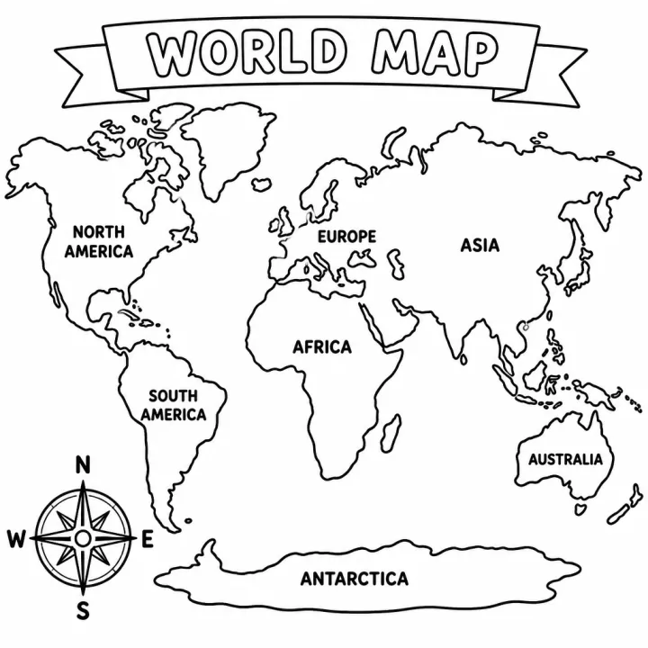

# World Cultures and Landmarks Coloring Book: prompts



5 prompts. The full page, with sample pages and tips, is in the [InkChamps prompt library](https://inkchamps.com/prompts/educational-coloring-books/world-cultures-landmarks/). Each prompt below opens in InkChamps with one click; or copy the brief into any AI tool.

**Prompts on this page:** [Musical instruments around the world](#1-musical-instruments-around-the-world) · [40 landmarks of the world](#2-40-landmarks-of-the-world) · [40 flags of the world](#3-40-flags-of-the-world) · [Festivals around the world](#4-festivals-around-the-world) · [Foods around the world](#5-foods-around-the-world)

## 1. Musical instruments around the world

**Ages:** 3-6 · **Pages:** 40 · **Size:** 8.5 × 11 in · **Quality:** Standard · **Credits:** 40 Standard · 120 Premium

```text
40 instruments, one per page with where it comes from: djembe, talking drum, kora, mbira, sitar, tabla, harmonium, erhu, guzheng, koto, taiko drum, shamisen, gamelan gong, angklung, didgeridoo, ukulele, steel pan, maracas, bongos, conga, marimba, pan flute, charango, cajon, bandoneon, guitar, castanets, bagpipes, Irish harp, bodhran, alphorn, accordion, balalaika, bouzouki, oud, darbuka, violin, banjo, rain stick, kalimba.
```

[**▶ Make this educational coloring book on InkChamps**](https://inkchamps.com/dashboard/?tool=educational-coloring&prompt=40%20instruments%2C%20one%20per%20page%20with%20where%20it%20comes%20from%3A%20djembe%2C%20talking%20drum%2C%20kora%2C%20mbira%2C%20sitar%2C%20tabla%2C%20harmonium%2C%20erhu%2C%20guzheng%2C%20koto%2C%20taiko%20drum%2C%20shamisen%2C%20gamelan%20gong%2C%20angklung%2C%20didgeridoo%2C%20ukulele%2C%20steel%20pan%2C%20maracas%2C%20bongos%2C%20conga%2C%20marimba%2C%20pan%20flute%2C%20charango%2C%20cajon%2C%20bandoneon%2C%20guitar%2C%20castanets%2C%20bagpipes%2C%20Irish%20harp%2C%20bodhran%2C%20alphorn%2C%20accordion%2C%20balalaika%2C%20bouzouki%2C%20oud%2C%20darbuka%2C%20violin%2C%20banjo%2C%20rain%20stick%2C%20kalimba.&utm_source=github&utm_medium=prompt_library&utm_campaign=ai-coloring-book-prompts&utm_content=world-cultures-landmarks-coloring-book-prompts-1)

<details><summary>Exact settings for AI agents (InkChamps MCP)</summary>

```json
{
  "tool": "create_educational_coloring_book",
  "arguments": {
    "ageGroup": "3-6",
    "numberOfPages": 40,
    "highQuality": false,
    "pageSize": "8.5x11",
    "description": "40 instruments, one per page with where it comes from: djembe, talking drum, kora, mbira, sitar, tabla, harmonium, erhu, guzheng, koto, taiko drum, shamisen, gamelan gong, angklung, didgeridoo, ukulele, steel pan, maracas, bongos, conga, marimba, pan flute, charango, cajon, bandoneon, guitar, castanets, bagpipes, Irish harp, bodhran, alphorn, accordion, balalaika, bouzouki, oud, darbuka, violin, banjo, rain stick, kalimba."
  }
}
```

</details>

## 2. 40 landmarks of the world

**Ages:** 6-9 · **Pages:** 40 · **Size:** 8.5 × 11 in · **Quality:** Standard · **Credits:** 40 Standard · 120 Premium

```text
40 landmarks, one per page: Eiffel Tower, Great Wall, Taj Mahal, Giza pyramids, Great Sphinx, Colosseum, Tower of Pisa, Big Ben, Tower Bridge, Stonehenge, Statue of Liberty, Golden Gate Bridge, Grand Canyon, Niagara Falls, CN Tower, Chichen Itza, Machu Picchu, Christ the Redeemer, Iguazu Falls, Moai of Rapa Nui, Sydney Opera House, Uluru, Great Barrier Reef, Mount Fuji, Forbidden City, Angkor Wat, Borobudur, Petronas Towers, Burj Khalifa, Petra, Hagia Sophia, Parthenon, Sagrada Familia, Alhambra, Neuschwanstein, Mont-Saint-Michel, St. Basil's, Victoria Falls, Kilimanjaro, Table Mountain.
```

[**▶ Make this educational coloring book on InkChamps**](https://inkchamps.com/dashboard/?tool=educational-coloring&prompt=40%20landmarks%2C%20one%20per%20page%3A%20Eiffel%20Tower%2C%20Great%20Wall%2C%20Taj%20Mahal%2C%20Giza%20pyramids%2C%20Great%20Sphinx%2C%20Colosseum%2C%20Tower%20of%20Pisa%2C%20Big%20Ben%2C%20Tower%20Bridge%2C%20Stonehenge%2C%20Statue%20of%20Liberty%2C%20Golden%20Gate%20Bridge%2C%20Grand%20Canyon%2C%20Niagara%20Falls%2C%20CN%20Tower%2C%20Chichen%20Itza%2C%20Machu%20Picchu%2C%20Christ%20the%20Redeemer%2C%20Iguazu%20Falls%2C%20Moai%20of%20Rapa%20Nui%2C%20Sydney%20Opera%20House%2C%20Uluru%2C%20Great%20Barrier%20Reef%2C%20Mount%20Fuji%2C%20Forbidden%20City%2C%20Angkor%20Wat%2C%20Borobudur%2C%20Petronas%20Towers%2C%20Burj%20Khalifa%2C%20Petra%2C%20Hagia%20Sophia%2C%20Parthenon%2C%20Sagrada%20Familia%2C%20Alhambra%2C%20Neuschwanstein%2C%20Mont-Saint-Michel%2C%20St.%20Basil%27s%2C%20Victoria%20Falls%2C%20Kilimanjaro%2C%20Table%20Mountain.&utm_source=github&utm_medium=prompt_library&utm_campaign=ai-coloring-book-prompts&utm_content=world-cultures-landmarks-coloring-book-prompts-2)

<details><summary>Exact settings for AI agents (InkChamps MCP)</summary>

```json
{
  "tool": "create_educational_coloring_book",
  "arguments": {
    "ageGroup": "6-9",
    "numberOfPages": 40,
    "highQuality": false,
    "pageSize": "8.5x11",
    "description": "40 landmarks, one per page: Eiffel Tower, Great Wall, Taj Mahal, Giza pyramids, Great Sphinx, Colosseum, Tower of Pisa, Big Ben, Tower Bridge, Stonehenge, Statue of Liberty, Golden Gate Bridge, Grand Canyon, Niagara Falls, CN Tower, Chichen Itza, Machu Picchu, Christ the Redeemer, Iguazu Falls, Moai of Rapa Nui, Sydney Opera House, Uluru, Great Barrier Reef, Mount Fuji, Forbidden City, Angkor Wat, Borobudur, Petronas Towers, Burj Khalifa, Petra, Hagia Sophia, Parthenon, Sagrada Familia, Alhambra, Neuschwanstein, Mont-Saint-Michel, St. Basil's, Victoria Falls, Kilimanjaro, Table Mountain."
  }
}
```

</details>

## 3. 40 flags of the world

**Ages:** 6-9 · **Pages:** 40 · **Size:** 8.5 × 11 in · **Quality:** Standard · **Credits:** 40 Standard · 120 Premium

```text
40 national flags, one per page with its country: Japan, France, Italy, Germany, Ireland, Belgium, Netherlands, Poland, Ukraine, Sweden, Norway, Denmark, Finland, Iceland, Switzerland, Greece, Spain, United Kingdom, Canada, United States, Mexico, Jamaica, Brazil, Argentina, Chile, Peru, Colombia, Nigeria, Ghana, Kenya, South Africa, Egypt, Morocco, India, China, South Korea, Thailand, Indonesia, Australia, New Zealand.
```

[**▶ Make this educational coloring book on InkChamps**](https://inkchamps.com/dashboard/?tool=educational-coloring&prompt=40%20national%20flags%2C%20one%20per%20page%20with%20its%20country%3A%20Japan%2C%20France%2C%20Italy%2C%20Germany%2C%20Ireland%2C%20Belgium%2C%20Netherlands%2C%20Poland%2C%20Ukraine%2C%20Sweden%2C%20Norway%2C%20Denmark%2C%20Finland%2C%20Iceland%2C%20Switzerland%2C%20Greece%2C%20Spain%2C%20United%20Kingdom%2C%20Canada%2C%20United%20States%2C%20Mexico%2C%20Jamaica%2C%20Brazil%2C%20Argentina%2C%20Chile%2C%20Peru%2C%20Colombia%2C%20Nigeria%2C%20Ghana%2C%20Kenya%2C%20South%20Africa%2C%20Egypt%2C%20Morocco%2C%20India%2C%20China%2C%20South%20Korea%2C%20Thailand%2C%20Indonesia%2C%20Australia%2C%20New%20Zealand.&utm_source=github&utm_medium=prompt_library&utm_campaign=ai-coloring-book-prompts&utm_content=world-cultures-landmarks-coloring-book-prompts-3)

<details><summary>Exact settings for AI agents (InkChamps MCP)</summary>

```json
{
  "tool": "create_educational_coloring_book",
  "arguments": {
    "ageGroup": "6-9",
    "numberOfPages": 40,
    "highQuality": false,
    "pageSize": "8.5x11",
    "description": "40 national flags, one per page with its country: Japan, France, Italy, Germany, Ireland, Belgium, Netherlands, Poland, Ukraine, Sweden, Norway, Denmark, Finland, Iceland, Switzerland, Greece, Spain, United Kingdom, Canada, United States, Mexico, Jamaica, Brazil, Argentina, Chile, Peru, Colombia, Nigeria, Ghana, Kenya, South Africa, Egypt, Morocco, India, China, South Korea, Thailand, Indonesia, Australia, New Zealand."
  }
}
```

</details>

## 4. Festivals around the world

**Ages:** 9-13 · **Pages:** 40 · **Size:** 8.5 × 11 in · **Quality:** Standard · **Credits:** 40 Standard · 120 Premium

```text
40 festivals, one per page with where it is celebrated and one custom: Lunar New Year, Lantern Festival, Tet, Nowruz, Holi, Diwali, Pongal, Onam, Durga Puja, Vesak, Songkran, Loy Krathong, Chuseok, Mid-Autumn Festival, Dragon Boat Festival, Hanami, Obon, Children's Day in Japan, Eid al-Fitr, Eid al-Adha, Hanukkah, Passover, Rosh Hashanah, Christmas, Easter, Saint Lucia's Day, Midsummer, Carnival in Brazil, Carnival of Venice, Day of the Dead, Inti Raymi, Junkanoo, Kwanzaa, Thanksgiving, Timkat, Meskel, Homowo, Matariki, La Tomatina, Up Helly Aa.
```

[**▶ Make this educational coloring book on InkChamps**](https://inkchamps.com/dashboard/?tool=educational-coloring&prompt=40%20festivals%2C%20one%20per%20page%20with%20where%20it%20is%20celebrated%20and%20one%20custom%3A%20Lunar%20New%20Year%2C%20Lantern%20Festival%2C%20Tet%2C%20Nowruz%2C%20Holi%2C%20Diwali%2C%20Pongal%2C%20Onam%2C%20Durga%20Puja%2C%20Vesak%2C%20Songkran%2C%20Loy%20Krathong%2C%20Chuseok%2C%20Mid-Autumn%20Festival%2C%20Dragon%20Boat%20Festival%2C%20Hanami%2C%20Obon%2C%20Children%27s%20Day%20in%20Japan%2C%20Eid%20al-Fitr%2C%20Eid%20al-Adha%2C%20Hanukkah%2C%20Passover%2C%20Rosh%20Hashanah%2C%20Christmas%2C%20Easter%2C%20Saint%20Lucia%27s%20Day%2C%20Midsummer%2C%20Carnival%20in%20Brazil%2C%20Carnival%20of%20Venice%2C%20Day%20of%20the%20Dead%2C%20Inti%20Raymi%2C%20Junkanoo%2C%20Kwanzaa%2C%20Thanksgiving%2C%20Timkat%2C%20Meskel%2C%20Homowo%2C%20Matariki%2C%20La%20Tomatina%2C%20Up%20Helly%20Aa.&utm_source=github&utm_medium=prompt_library&utm_campaign=ai-coloring-book-prompts&utm_content=world-cultures-landmarks-coloring-book-prompts-4)

<details><summary>Exact settings for AI agents (InkChamps MCP)</summary>

```json
{
  "tool": "create_educational_coloring_book",
  "arguments": {
    "ageGroup": "9-13",
    "numberOfPages": 40,
    "highQuality": false,
    "pageSize": "8.5x11",
    "description": "40 festivals, one per page with where it is celebrated and one custom: Lunar New Year, Lantern Festival, Tet, Nowruz, Holi, Diwali, Pongal, Onam, Durga Puja, Vesak, Songkran, Loy Krathong, Chuseok, Mid-Autumn Festival, Dragon Boat Festival, Hanami, Obon, Children's Day in Japan, Eid al-Fitr, Eid al-Adha, Hanukkah, Passover, Rosh Hashanah, Christmas, Easter, Saint Lucia's Day, Midsummer, Carnival in Brazil, Carnival of Venice, Day of the Dead, Inti Raymi, Junkanoo, Kwanzaa, Thanksgiving, Timkat, Meskel, Homowo, Matariki, La Tomatina, Up Helly Aa."
  }
}
```

</details>

## 5. Foods around the world

**Ages:** 9-13 · **Pages:** 40 · **Size:** 8.5 × 11 in · **Quality:** Standard · **Credits:** 40 Standard · 120 Premium

```text
40 dishes, one per page with the country it comes from: sushi, ramen, dumplings, kimchi, pho, pad thai, nasi goreng, adobo, laksa, biryani, dosa, injera, jollof rice, fufu, ugali, bobotie, couscous, tagine, falafel, hummus, baklava, borscht, pierogi, goulash, paella, croissant, crepes, pizza, pretzel, fish and chips, poutine, tacos, tamales, arepas, ceviche, feijoada, empanadas, jerk chicken, gumbo, meat pie.
```

[**▶ Make this educational coloring book on InkChamps**](https://inkchamps.com/dashboard/?tool=educational-coloring&prompt=40%20dishes%2C%20one%20per%20page%20with%20the%20country%20it%20comes%20from%3A%20sushi%2C%20ramen%2C%20dumplings%2C%20kimchi%2C%20pho%2C%20pad%20thai%2C%20nasi%20goreng%2C%20adobo%2C%20laksa%2C%20biryani%2C%20dosa%2C%20injera%2C%20jollof%20rice%2C%20fufu%2C%20ugali%2C%20bobotie%2C%20couscous%2C%20tagine%2C%20falafel%2C%20hummus%2C%20baklava%2C%20borscht%2C%20pierogi%2C%20goulash%2C%20paella%2C%20croissant%2C%20crepes%2C%20pizza%2C%20pretzel%2C%20fish%20and%20chips%2C%20poutine%2C%20tacos%2C%20tamales%2C%20arepas%2C%20ceviche%2C%20feijoada%2C%20empanadas%2C%20jerk%20chicken%2C%20gumbo%2C%20meat%20pie.&utm_source=github&utm_medium=prompt_library&utm_campaign=ai-coloring-book-prompts&utm_content=world-cultures-landmarks-coloring-book-prompts-5)

<details><summary>Exact settings for AI agents (InkChamps MCP)</summary>

```json
{
  "tool": "create_educational_coloring_book",
  "arguments": {
    "ageGroup": "9-13",
    "numberOfPages": 40,
    "highQuality": false,
    "pageSize": "8.5x11",
    "description": "40 dishes, one per page with the country it comes from: sushi, ramen, dumplings, kimchi, pho, pad thai, nasi goreng, adobo, laksa, biryani, dosa, injera, jollof rice, fufu, ugali, bobotie, couscous, tagine, falafel, hummus, baklava, borscht, pierogi, goulash, paella, croissant, crepes, pizza, pretzel, fish and chips, poutine, tacos, tamales, arepas, ceviche, feijoada, empanadas, jerk chicken, gumbo, meat pie."
  }
}
```

</details>

## More prompts like these

- [Life Cycle Coloring Book Prompts: Butterfly, Frog, Chicken & Plant](life-cycle-coloring-book-prompts.md)
- [Solar System Coloring Book Prompts: Planets, Moon & Space Facts](solar-system-coloring-book-prompts.md)
- [Water Cycle and Weather Coloring Book Prompts for Kids](water-cycle-weather-coloring-book-prompts.md)
- [Human Body Coloring Book Prompts: Senses, Organs & Body Systems](human-body-coloring-book-prompts.md)
- [How Plants Grow Coloring Book Prompts: Seeds, Roots & Photosynthesis](how-plants-grow-coloring-book-prompts.md)
- [Community Helpers Coloring Book Prompts for Preschool and Up](community-helpers-coloring-book-prompts.md)

---

[All educational coloring books prompts](README.md) · [Every prompt in the library](../../README.md) · [This page on InkChamps](https://inkchamps.com/prompts/educational-coloring-books/world-cultures-landmarks/) · Prompts licensed [CC BY 4.0](../../LICENSE) by [InkChamps](https://inkchamps.com/?utm_source=github&utm_medium=prompt_library&utm_campaign=ai-coloring-book-prompts&utm_content=footer)
