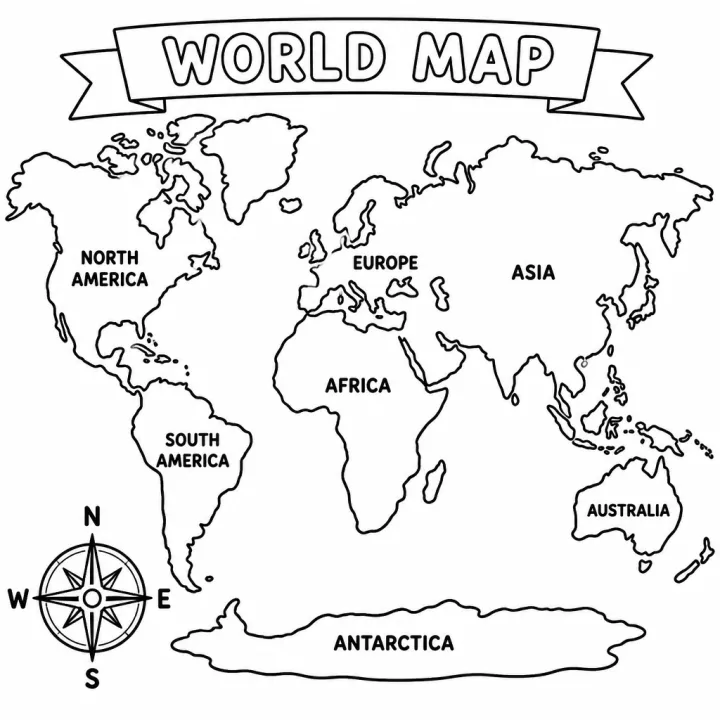

# World Cultures and Landmarks Coloring Book: prompts



5 prompts. The full page, with sample pages and tips, is in the [InkChamps prompt library](https://inkchamps.com/prompts/educational-coloring-books/world-cultures-landmarks/). Each prompt below opens in InkChamps with one click; or copy the brief into any AI tool.

**Prompts on this page:** [Musical instruments around the world](#1-musical-instruments-around-the-world) · [24 landmarks of the world](#2-24-landmarks-of-the-world) · [24 flags of the world](#3-24-flags-of-the-world) · [Festivals around the world](#4-festivals-around-the-world) · [Foods around the world](#5-foods-around-the-world)

## 1. Musical instruments around the world

**Ages:** 3-6 · **Pages:** 24 · **Size:** 8.5 × 11 in · **Quality:** Standard · **Credits:** 24 Standard · 72 Premium

```text
24 musical instruments from around the world, one per page, each played by a smiling child and captioned with its name and where it comes from. Africa: djembe, talking drum, kora, mbira, darbuka. Asia: sitar, tabla, erhu, koto, taiko drum, gamelan gong, angklung. Oceania: didgeridoo, ukulele. The Americas: steel pan, marimba, pan flute, charango, rain stick, banjo. Europe: bagpipes, alphorn, balalaika, castanets.
```

### Page by page (24 pages)

Paste one page at a time into ChatGPT, Gemini or any AI image tool, with this line after it:

> Black-and-white coloring line art for a child aged 3 to 6: one big instrument played by a smiling child in everyday clothes, filling most of the page, thick bold outlines, large simple shapes with wide spaces to color, very little background, no shading, no grey, white background; the short caption in big outlined letters at the bottom is the only words on the page; portrait 8.5 x 11 page.

1. A smiling girl in a T-shirt and shorts sitting on a low stool with a tall goblet-shaped djembe drum between her knees, slapping the round drum skin with both hands, ropes laced down its sides, with the caption "Djembe, Guinea" in big outlined letters at the bottom.
2. A boy holding an hourglass-shaped talking drum under his arm and tapping it with a curved stick, strings running from top to bottom of the drum, music notes floating up, with the caption "Talking drum, Nigeria" in big outlined letters at the bottom.
3. A girl sitting on a woven mat under a big baobab tree, plucking the many strings of a kora, a harp with a big round gourd body and a long wooden neck, with the caption "Kora, Mali" in big outlined letters at the bottom.
4. A boy pressing the metal keys of a small mbira with both thumbs, the wooden board of keys set inside a round gourd, a little bird listening on a branch, with the caption "Mbira, Zimbabwe" in big outlined letters at the bottom.
5. A girl with a goblet-shaped darbuka drum tucked under one arm, tapping its top with her fingertips, a zigzag pattern around the drum and a floor cushion beside her, with the caption "Darbuka, Egypt" in big outlined letters at the bottom.
6. A boy sitting cross-legged on a rug holding a long-necked sitar with a round pumpkin-shaped bottom, plucking its strings, a cushion and a small lamp beside him, with the caption "Sitar, India" in big outlined letters at the bottom.
7. A girl tapping a pair of tabla drums, one small wooden drum and one bigger round metal drum, each resting on a little cloth ring on the floor, with the caption "Tabla, India" in big outlined letters at the bottom.
8. A boy on a park bench drawing a bow across the two strings of an erhu, its small round body resting on his knee and its long thin neck pointing up, his grandpa clapping beside him, with the caption "Erhu, China" in big outlined letters at the bottom.
9. A girl kneeling beside a long wooden koto lying on the floor, plucking its strings with finger picks, little bridges standing under each string, with the caption "Koto, Japan" in big outlined letters at the bottom.
10. A boy in a headband swinging two thick sticks high over a huge barrel-shaped taiko drum on a wooden stand, sound lines bursting from the drum, with the caption "Taiko drum, Japan" in big outlined letters at the bottom.
11. A girl striking a big round gong with a bump in its middle, hanging in a carved wooden frame, using a padded mallet as sound rings spread out, with the caption "Gamelan gong, Indonesia" in big outlined letters at the bottom.
12. A boy shaking an angklung, a wooden frame holding bamboo tubes of different sizes, two more angklungs standing on a table beside him, with the caption "Angklung, Indonesia" in big outlined letters at the bottom.
13. A boy blowing into a long wooden didgeridoo resting on the ground, rows of dots painted along it, a kangaroo hopping in the distance, with the caption "Didgeridoo, Australia" in big outlined letters at the bottom.
14. A girl sitting on a beach strumming a small four-string ukulele, a palm tree, a seashell and a sandcastle beside her, with the caption "Ukulele, Hawaii" in big outlined letters at the bottom.
15. A boy tapping a shiny steel pan drum on a stand with two rubber-tipped sticks, the top of the pan dented into round note shapes, with the caption "Steel pan, Trinidad and Tobago" in big outlined letters at the bottom.
16. Two children standing side by side at a long wooden marimba, hitting its bars with soft round mallets, long tubes hanging under every bar, with the caption "Marimba, Guatemala" in big outlined letters at the bottom.
17. A girl blowing across a pan flute, a row of bamboo pipes tied together from long to short, a fluffy llama standing behind her, with the caption "Pan flute, Peru" in big outlined letters at the bottom.
18. A boy sitting on a stone wall strumming a charango, a small guitar with a rounded back and ten strings, tall mountains behind him, with the caption "Charango, Bolivia" in big outlined letters at the bottom.
19. A girl tipping a long rain stick made from a dried cactus upside down to hear it patter, a cactus with flowers beside her and little dots falling inside the stick, with the caption "Rain stick, Chile" in big outlined letters at the bottom.
20. A boy on a porch step playing a banjo with a round drum-like body and a long neck, a rocking chair and a sleepy dog beside him, with the caption "Banjo, United States" in big outlined letters at the bottom.
21. A girl marching on a green hill playing the bagpipes, a puffy bag under her arm and three long pipes resting over her shoulder, with the caption "Bagpipes, Scotland" in big outlined letters at the bottom.
22. A boy blowing into a very long wooden alphorn whose curved end rests on a grassy hillside, a cow with a bell and snowy mountains behind, with the caption "Alphorn, Switzerland" in big outlined letters at the bottom.
23. A girl on a bench outside a snowy wooden house strumming a balalaika, a guitar with a triangle-shaped body and three strings, with the caption "Balalaika, Russia" in big outlined letters at the bottom.
24. A girl twirling in a sundress with her arms raised, clicking a pair of shell-shaped wooden castanets tied to her thumbs, a guitar resting on a chair behind her, with the caption "Castanets, Spain" in big outlined letters at the bottom.

[**▶ Make this educational coloring book on InkChamps**](https://inkchamps.com/dashboard/?tool=educational-coloring&prompt=24%20musical%20instruments%20from%20around%20the%20world%2C%20one%20per%20page%2C%20each%20played%20by%20a%20smiling%20child%20and%20captioned%20with%20its%20name%20and%20where%20it%20comes%20from.%20Africa%3A%20djembe%2C%20talking%20drum%2C%20kora%2C%20mbira%2C%20darbuka.%20Asia%3A%20sitar%2C%20tabla%2C%20erhu%2C%20koto%2C%20taiko%20drum%2C%20gamelan%20gong%2C%20angklung.%20Oceania%3A%20didgeridoo%2C%20ukulele.%20The%20Americas%3A%20steel%20pan%2C%20marimba%2C%20pan%20flute%2C%20charango%2C%20rain%20stick%2C%20banjo.%20Europe%3A%20bagpipes%2C%20alphorn%2C%20balalaika%2C%20castanets.&utm_source=github&utm_medium=prompt_library&utm_campaign=ai-coloring-book-prompts&utm_content=world-cultures-landmarks-coloring-book-prompts-1)

<details><summary>Exact settings for AI agents (InkChamps MCP)</summary>

```json
{
  "tool": "create_educational_coloring_book",
  "arguments": {
    "ageGroup": "3-6",
    "numberOfPages": 24,
    "highQuality": false,
    "pageSize": "8.5x11",
    "description": "24 musical instruments from around the world, one per page, each played by a smiling child and captioned with its name and where it comes from. Africa: djembe, talking drum, kora, mbira, darbuka. Asia: sitar, tabla, erhu, koto, taiko drum, gamelan gong, angklung. Oceania: didgeridoo, ukulele. The Americas: steel pan, marimba, pan flute, charango, rain stick, banjo. Europe: bagpipes, alphorn, balalaika, castanets."
  }
}
```

</details>

## 2. 24 landmarks of the world

**Ages:** 6-9 · **Pages:** 24 · **Size:** 8.5 × 11 in · **Quality:** Standard · **Credits:** 24 Standard · 72 Premium

```text
24 landmarks of the world, one per page, on a tour from Europe through Africa and Asia to Oceania and the Americas, each captioned with its name and country: Eiffel Tower, Big Ben, Colosseum, Parthenon, Sagrada Familia, Neuschwanstein Castle, Pyramids of Giza, Victoria Falls, Mount Kilimanjaro, Table Mountain, Petra, Burj Khalifa, Taj Mahal, Great Wall, Mount Fuji, Angkor Wat, Sydney Opera House, Uluru, Moai of Rapa Nui, Machu Picchu, Christ the Redeemer, Chichen Itza, Niagara Falls, Statue of Liberty.
```

### Page by page (24 pages)

Paste one page at a time into ChatGPT, Gemini or any AI image tool, with this line after it:

> Black-and-white coloring line art for a child aged 6 to 9: one world landmark as the large main subject, easy to recognise, clean bold outlines, medium detail, a simple setting with sky, ground and one or two small visitors, no shading, no grey, white background; the short caption in big outlined letters at the bottom is the only words on the page; portrait 8.5 x 11 page.

1. The Eiffel Tower rising tall from a park lawn in Paris, its iron lattice criss-crossing up to a pointed top, two children with a picnic blanket and a balloon on the grass below, with the caption "Eiffel Tower, France" in big outlined letters at the bottom.
2. The Big Ben clock tower standing beside a river in London, its huge round clock face below a pointed spire, a double-decker bus crossing the bridge in front, with the caption "Big Ben, United Kingdom" in big outlined letters at the bottom.
3. The round stone Colosseum in Rome with rows of arched windows, one side broken lower than the other, a family taking a photo in front and a scooter parked nearby, with the caption "Colosseum, Italy" in big outlined letters at the bottom.
4. The Parthenon on a rocky hilltop in Athens, a long row of tall stone columns under a triangle roof edge, olive trees on the slope and a cat sitting on a step, with the caption "Parthenon, Greece" in big outlined letters at the bottom.
5. The Sagrada Familia church in Barcelona with its tall spiky towers covered in carved leaves and shapes, a row of palm trees and a cyclist on the street in front, with the caption "Sagrada Familia, Spain" in big outlined letters at the bottom.
6. A white castle with pointed turrets perched on a forested hill in the mountains of southern Germany, a horse-drawn carriage on the winding road below, with the caption "Neuschwanstein Castle, Germany" in big outlined letters at the bottom.
7. The three Pyramids of Giza on the desert sand, built from huge stacked stone blocks, a camel with a rider in front and palm trees at the edge, the sun overhead, with the caption "Pyramids of Giza, Egypt" in big outlined letters at the bottom.
8. A wide waterfall pouring over a long cliff edge into a deep gorge, a rainbow arching through the spray and a steel arch bridge crossing the gorge, with the caption "Victoria Falls, Zambia and Zimbabwe" in big outlined letters at the bottom.
9. Mount Kilimanjaro with its flat snowy top rising over grassy plains, a giraffe and two zebras walking under a flat-topped acacia tree, with the caption "Mount Kilimanjaro, Tanzania" in big outlined letters at the bottom.
10. Table Mountain with its long flat top above the city of Cape Town, a cable car gliding up the cliff and sailing boats in the bay below, with the caption "Table Mountain, South Africa" in big outlined letters at the bottom.
11. The Treasury at Petra, a tall building with columns carved right into a rock cliff, seen at the end of a narrow canyon path with a family walking toward it, with the caption "Petra, Jordan" in big outlined letters at the bottom.
12. The Burj Khalifa, the tallest building in the world, rising in steps to a needle-thin top above a city of skyscrapers, a fountain spraying in the lake in front, with the caption "Burj Khalifa, United Arab Emirates" in big outlined letters at the bottom.
13. The white marble Taj Mahal with its big onion-shaped dome and four tall slim towers at its corners, a long reflecting pool with fountains leading up to it, with the caption "Taj Mahal, India" in big outlined letters at the bottom.
14. The Great Wall of China winding over green mountain ridges, square watchtowers along it and two hikers with backpacks walking along the top, with the caption "Great Wall, China" in big outlined letters at the bottom.
15. Cone-shaped Mount Fuji with a snowy top, a five-storey pagoda on a hillside and branches of cherry blossoms in front, with the caption "Mount Fuji, Japan" in big outlined letters at the bottom.
16. The temple of Angkor Wat with its five tall towers shaped like lotus buds, reflected in a pond full of lotus flowers, visitors walking the long stone path, with the caption "Angkor Wat, Cambodia" in big outlined letters at the bottom.
17. The Sydney Opera House with its roofs shaped like white sails beside the harbour, the arched Harbour Bridge behind and a ferry passing in front, with the caption "Sydney Opera House, Australia" in big outlined letters at the bottom.
18. The giant rock of Uluru rising from a flat desert plain, its rounded sides lined with grooves, spiky grass clumps and a kangaroo in front, with the caption "Uluru, Australia" in big outlined letters at the bottom.
19. A row of giant stone moai statues with huge heads, long noses and heavy brows standing on a grassy island slope, the ocean and waves behind them, with the caption "Moai of Rapa Nui, Chile" in big outlined letters at the bottom.
20. The stone ruins of Machu Picchu on terraces along a mountain ridge, a tall pointed peak rising behind and a llama standing on a grassy terrace, with the caption "Machu Picchu, Peru" in big outlined letters at the bottom.
21. The tall statue of Christ the Redeemer with arms stretched wide on top of a steep mountain over Rio de Janeiro, Sugarloaf Mountain and the bay below, with the caption "Christ the Redeemer, Brazil" in big outlined letters at the bottom.
22. The stepped stone pyramid at Chichen Itza with a staircase up each of its four sides to a small temple on top, jungle trees around its base, with the caption "Chichen Itza, Mexico" in big outlined letters at the bottom.
23. The curved Horseshoe Falls at Niagara thundering into the river, a tour boat full of passengers in rain ponchos sailing close to the spray, with the caption "Niagara Falls, Canada" in big outlined letters at the bottom.
24. The Statue of Liberty holding a torch high and a tablet in her other arm, standing on her tall base on an island, a ferry and seagulls passing, with the caption "Statue of Liberty, United States" in big outlined letters at the bottom.

[**▶ Make this educational coloring book on InkChamps**](https://inkchamps.com/dashboard/?tool=educational-coloring&prompt=24%20landmarks%20of%20the%20world%2C%20one%20per%20page%2C%20on%20a%20tour%20from%20Europe%20through%20Africa%20and%20Asia%20to%20Oceania%20and%20the%20Americas%2C%20each%20captioned%20with%20its%20name%20and%20country%3A%20Eiffel%20Tower%2C%20Big%20Ben%2C%20Colosseum%2C%20Parthenon%2C%20Sagrada%20Familia%2C%20Neuschwanstein%20Castle%2C%20Pyramids%20of%20Giza%2C%20Victoria%20Falls%2C%20Mount%20Kilimanjaro%2C%20Table%20Mountain%2C%20Petra%2C%20Burj%20Khalifa%2C%20Taj%20Mahal%2C%20Great%20Wall%2C%20Mount%20Fuji%2C%20Angkor%20Wat%2C%20Sydney%20Opera%20House%2C%20Uluru%2C%20Moai%20of%20Rapa%20Nui%2C%20Machu%20Picchu%2C%20Christ%20the%20Redeemer%2C%20Chichen%20Itza%2C%20Niagara%20Falls%2C%20Statue%20of%20Liberty.&utm_source=github&utm_medium=prompt_library&utm_campaign=ai-coloring-book-prompts&utm_content=world-cultures-landmarks-coloring-book-prompts-2)

<details><summary>Exact settings for AI agents (InkChamps MCP)</summary>

```json
{
  "tool": "create_educational_coloring_book",
  "arguments": {
    "ageGroup": "6-9",
    "numberOfPages": 24,
    "highQuality": false,
    "pageSize": "8.5x11",
    "description": "24 landmarks of the world, one per page, on a tour from Europe through Africa and Asia to Oceania and the Americas, each captioned with its name and country: Eiffel Tower, Big Ben, Colosseum, Parthenon, Sagrada Familia, Neuschwanstein Castle, Pyramids of Giza, Victoria Falls, Mount Kilimanjaro, Table Mountain, Petra, Burj Khalifa, Taj Mahal, Great Wall, Mount Fuji, Angkor Wat, Sydney Opera House, Uluru, Moai of Rapa Nui, Machu Picchu, Christ the Redeemer, Chichen Itza, Niagara Falls, Statue of Liberty."
  }
}
```

</details>

## 3. 24 flags of the world

**Ages:** 6-9 · **Pages:** 24 · **Size:** 8.5 × 11 in · **Quality:** Standard · **Credits:** 24 Standard · 72 Premium

```text
24 national flags, one per page, each drawn large to color with a scene from its country and captioned with the country's name. Europe: United Kingdom, Ireland, France, Germany, Italy, Sweden, Greece. The Americas: Canada, United States, Mexico, Jamaica, Brazil, Argentina. Africa: Nigeria, Ghana, Kenya, South Africa, Egypt. Asia: India, China, Japan, South Korea. Oceania: Australia, New Zealand.
```

### Page by page (24 pages)

Paste one page at a time into ChatGPT, Gemini or any AI image tool, with this line after it:

> Black-and-white coloring line art for a child aged 6 to 9: one national flag drawn large and flat with every stripe, star and emblem outlined and left blank, clean bold outlines, medium detail, a simple scene from that country around it, no shading, no grey, white background; the short caption in big outlined letters at the bottom is the only words on the page; portrait 8.5 x 11 page.

1. A large Union Flag flying from a pole, an upright cross laid over two diagonal crosses with a thin border around each cross, a double-decker bus and a clock tower in the background, with the caption "United Kingdom" in big outlined letters at the bottom.
2. A girl on a green hill waving a big flag with three equal upright stripes, stone walls criss-crossing the fields behind her and two sheep grazing, with the caption "Ireland" in big outlined letters at the bottom.
3. A big flag with three equal upright stripes hanging from a balcony with flower boxes, a bakery with a striped awning below and the Eiffel Tower in the distance, with the caption "France" in big outlined letters at the bottom.
4. A large flag with three equal stripes running across, flying in front of the Brandenburg Gate with its row of tall columns, a boy riding past on a bicycle, with the caption "Germany" in big outlined letters at the bottom.
5. A big flag with three equal upright stripes hanging from a window over a canal in Venice, a gondola gliding underneath and a little stone bridge behind, with the caption "Italy" in big outlined letters at the bottom.
6. A flag with a cross whose upright bar sits closer to the pole flying on a tall pole beside a small wooden cottage by a lake, a rowboat tied at the dock, with the caption "Sweden" in big outlined letters at the bottom.
7. A flag with nine stripes running across and a square in the top corner holding a plain cross, flying above white houses with round domed roofs on a seaside cliff, with the caption "Greece" in big outlined letters at the bottom.
8. A child in a canoe on a lake waving a flag with a wide band on each side and a big pointed maple leaf in the middle square, pine trees along the shore, with the caption "Canada" in big outlined letters at the bottom.
9. A big flag with thirteen stripes and a box in the top corner filled with rows of small stars, flying on a pole in front of a school, a bald eagle soaring overhead, with the caption "United States" in big outlined letters at the bottom.
10. A large flag with three upright stripes and an eagle perched on a cactus holding a snake in its beak in the middle stripe, flying over a town square with a fountain, with the caption "Mexico" in big outlined letters at the bottom.
11. A flag with a diagonal cross from corner to corner splitting it into four triangles, flying on a beach with palm trees, a hummingbird with long tail streamers nearby, with the caption "Jamaica" in big outlined letters at the bottom.
12. A child in a rainforest holding up a flag with a diamond inside the rectangle and a circle in the diamond crossed by a curved band and dotted with small stars, a toucan on a branch, with the caption "Brazil" in big outlined letters at the bottom.
13. A big flag with three stripes running across and a sun with a face and wavy rays in the middle stripe, flying at a ranch with the Andes mountains and a condor behind, with the caption "Argentina" in big outlined letters at the bottom.
14. Students in school uniforms at a morning assembly beside a flag with three equal upright stripes, the giant dome of Zuma Rock rising in the distance, with the caption "Nigeria" in big outlined letters at the bottom.
15. A girl standing beside a cocoa tree with big ridged pods growing on its trunk, holding a flag with three stripes running across and a five-pointed star in the middle, with the caption "Ghana" in big outlined letters at the bottom.
16. A flag with three wide stripes running across, two thin stripes between them and a shield with two crossed spears in the middle, flying over a savanna with a giraffe and acacia tree, with the caption "Kenya" in big outlined letters at the bottom.
17. A flag with a sideways Y shape that starts as two arms at the pole and joins into one band across, a triangle in the fork, waved by a boy on a sandy beach where a group of penguins waddles by the rocks, with the caption "South Africa" in big outlined letters at the bottom.
18. A flag with three stripes running across and an eagle emblem in the middle stripe flying from the mast of a sailboat on the Nile, pyramids on the far bank, with the caption "Egypt" in big outlined letters at the bottom.
19. A flag with three stripes running across and a round wheel of 24 spokes in the middle stripe, flying on a rooftop where children fly kites on Independence Day, with the caption "India" in big outlined letters at the bottom.
20. A flag with one large five-pointed star and four smaller stars curving around it in the top corner, flying at the gate of a nature park, a panda munching bamboo stalks in the grove beside it, with the caption "China" in big outlined letters at the bottom.
21. A plain flag with one big circle in the middle flying over a train station platform as a sleek bullet train glides in, a cherry blossom branch in front, with the caption "Japan" in big outlined letters at the bottom.
22. A flag with a circle split by an S-shaped wave in the middle and a set of short bars in each corner, waved by a child at a palace gate with a curved tiled roof, with the caption "South Korea" in big outlined letters at the bottom.
23. A flag with a small Union Flag in the top corner, a big seven-pointed star below it and five stars on the right, a kangaroo in front and the Sydney Opera House behind, with the caption "Australia" in big outlined letters at the bottom.
24. A flag with a small Union Flag in the top corner and four five-pointed stars on the right, flying over green hills with sheep and a kiwi bird in the grass, with the caption "New Zealand" in big outlined letters at the bottom.

[**▶ Make this educational coloring book on InkChamps**](https://inkchamps.com/dashboard/?tool=educational-coloring&prompt=24%20national%20flags%2C%20one%20per%20page%2C%20each%20drawn%20large%20to%20color%20with%20a%20scene%20from%20its%20country%20and%20captioned%20with%20the%20country%27s%20name.%20Europe%3A%20United%20Kingdom%2C%20Ireland%2C%20France%2C%20Germany%2C%20Italy%2C%20Sweden%2C%20Greece.%20The%20Americas%3A%20Canada%2C%20United%20States%2C%20Mexico%2C%20Jamaica%2C%20Brazil%2C%20Argentina.%20Africa%3A%20Nigeria%2C%20Ghana%2C%20Kenya%2C%20South%20Africa%2C%20Egypt.%20Asia%3A%20India%2C%20China%2C%20Japan%2C%20South%20Korea.%20Oceania%3A%20Australia%2C%20New%20Zealand.&utm_source=github&utm_medium=prompt_library&utm_campaign=ai-coloring-book-prompts&utm_content=world-cultures-landmarks-coloring-book-prompts-3)

<details><summary>Exact settings for AI agents (InkChamps MCP)</summary>

```json
{
  "tool": "create_educational_coloring_book",
  "arguments": {
    "ageGroup": "6-9",
    "numberOfPages": 24,
    "highQuality": false,
    "pageSize": "8.5x11",
    "description": "24 national flags, one per page, each drawn large to color with a scene from its country and captioned with the country's name. Europe: United Kingdom, Ireland, France, Germany, Italy, Sweden, Greece. The Americas: Canada, United States, Mexico, Jamaica, Brazil, Argentina. Africa: Nigeria, Ghana, Kenya, South Africa, Egypt. Asia: India, China, Japan, South Korea. Oceania: Australia, New Zealand."
  }
}
```

</details>

## 4. Festivals around the world

**Ages:** 9-13 · **Pages:** 24 · **Size:** 8.5 × 11 in · **Quality:** Standard · **Credits:** 24 Standard · 72 Premium

```text
24 festivals roughly in calendar order, one per page, each showing one real custom and captioned with where it is celebrated: Lunar New Year, Pongal, Timkat, Carnival in Brazil, Holi, Nowruz, Hanami, Passover, Easter in Greece, Songkran, Vesak, Eid al-Fitr, Dragon Boat Festival, Midsummer, Inti Raymi, Matariki, Homowo, Chuseok, Diwali, Day of the Dead, Thanksgiving, Hanukkah, Christmas in Germany and Kwanzaa. People wear everyday modern clothes, with festive dress only where the custom calls for it.
```

### Page by page (24 pages)

Paste one page at a time into ChatGPT, Gemini or any AI image tool, with this line after it:

> Black-and-white coloring line art for ages 9 to 13: one festival scene, people in everyday modern clothes or festive dress where the custom needs it, fine clean outlines, rich detail in decorations and crowds, a full background showing where it happens, no shading, no grey, white background; the short caption in outlined letters at the bottom is the only words on the page; portrait 8.5 x 11 page.

1. A long dragon puppet carried on poles by a team of dancers weaving down a street in China hung with round paper lanterns, firecrackers popping and a child holding a gift envelope, with the caption "Lunar New Year, China" in outlined letters at the bottom.
2. A family in a courtyard in South India boiling rice and milk in a clay pot until it bubbles over, sugarcane stalks leaning beside them and a dotted kolam pattern drawn on the ground, with the caption "Pongal, India" in outlined letters at the bottom.
3. A procession in Ethiopia with priests holding ornate fringed umbrellas, crowds wrapped in white cotton shawls and people splashed with blessed water beside a pool, with the caption "Timkat, Ethiopia" in outlined letters at the bottom.
4. A samba parade in Rio de Janeiro with a huge float shaped like a parrot, dancers in feathered headdresses and sequined costumes and drummers marching in rows, with the caption "Carnival, Brazil" in outlined letters at the bottom.
5. Friends in white T-shirts throwing clouds of colored powder at each other in a narrow street in India, water squirters in their hands and bowls of powder on a cart, with the caption "Holi, India" in outlined letters at the bottom.
6. A family in Iran gathered around a spring table set with sprouted wheat grass, apples, garlic, painted eggs, a mirror and a goldfish bowl, blossoms at the window, with the caption "Nowruz, Iran" in outlined letters at the bottom.
7. Friends having a picnic on a mat under blossoming cherry trees in a park in Japan, bento boxes open between them and petals drifting down, with the caption "Hanami, Japan" in outlined letters at the bottom.
8. A family at a seder table with a seder plate divided into six small dishes, a stack of matzah under an embroidered cloth and a child reading questions from a booklet, with the caption "Passover" in outlined letters at the bottom.
9. A family in Greece playing the egg-cracking game with dyed eggs, a braided sweet bread ring with eggs baked into it on the table and a whitewashed church outside, with the caption "Easter, Greece" in outlined letters at the bottom.
10. Kids on a street in Thailand splashing each other with buckets and water squirters, a pickup truck carrying people and barrels of water rolling past, with the caption "Songkran, Thailand" in outlined letters at the bottom.
11. Paper lanterns shaped like stars and many-sided boxes hanging along a street in Sri Lanka, a family lighting rows of small oil lamps on a wall below, with the caption "Vesak, Sri Lanka" in outlined letters at the bottom.
12. A family in Indonesia visiting grandparents on Eid morning, children in new clothes greeting their elders, a table of rice cakes in woven palm-leaf cases and a mosque dome in the distance, with the caption "Eid al-Fitr, Indonesia" in outlined letters at the bottom.
13. Long narrow dragon boats with carved dragon heads racing on a river in China, rowers paddling in time to a drummer and leaf-wrapped rice dumplings piled on the bank, with the caption "Dragon Boat Festival, China" in outlined letters at the bottom.
14. Friends in Sweden with flower crowns dancing in a ring around a tall pole wrapped in leaves and flowers, a long outdoor table with bowls of strawberries, with the caption "Midsummer, Sweden" in outlined letters at the bottom.
15. The Festival of the Sun at the giant stone walls above Cusco, performers in costumes with sun-shaped headpieces in the middle and crowds watching from the hillside, with the caption "Inti Raymi, Peru" in outlined letters at the bottom.
16. A family in New Zealand on a hillside before dawn watching a small cluster of stars rise, kids flying homemade kites and a shared meal laid out on a blanket, with the caption "Matariki, New Zealand" in outlined letters at the bottom.
17. Families in Accra sprinkling a steamed cornmeal dish along the street from bowls, drummers and dancers following them in a cheerful crowd, with the caption "Homowo, Ghana" in outlined letters at the bottom.
18. A family in Korea kneeling at a low table pinching half-moon rice cakes into shape, a steamer lined with pine needles and a big full moon in the window, with the caption "Chuseok, South Korea" in outlined letters at the bottom.
19. A girl drawing a rangoli pattern of flowers and dots on a doorstep, rows of small clay oil lamps glowing along the steps and fireworks bursting in the sky, with the caption "Diwali, India" in outlined letters at the bottom.
20. A family in Mexico arranging an ofrenda with marigold flowers, candles, framed photos and decorated sugar skulls, cut-paper banners strung overhead, with the caption "Day of the Dead, Mexico" in outlined letters at the bottom.
21. A family around a long table with a roast turkey, a pumpkin pie and bowls of side dishes, a basket of corn and gourds and autumn leaves outside the window, with the caption "Thanksgiving, United States" in outlined letters at the bottom.
22. A family lighting a nine-branched menorah in a window at night, children spinning dreidels on the table beside a plate of potato pancakes, with the caption "Hanukkah" in outlined letters at the bottom.
23. A snowy Christmas market in a town square in Germany, wooden stalls hung with gingerbread hearts and wooden toys, a tall decorated tree and a family with warm mugs, with the caption "Christmas, Germany" in outlined letters at the bottom.
24. A family lighting a candle holder with seven candles on a table set with a woven mat, ears of corn, a cup and a bowl of fruit, with the caption "Kwanzaa, United States" in outlined letters at the bottom.

[**▶ Make this educational coloring book on InkChamps**](https://inkchamps.com/dashboard/?tool=educational-coloring&prompt=24%20festivals%20roughly%20in%20calendar%20order%2C%20one%20per%20page%2C%20each%20showing%20one%20real%20custom%20and%20captioned%20with%20where%20it%20is%20celebrated%3A%20Lunar%20New%20Year%2C%20Pongal%2C%20Timkat%2C%20Carnival%20in%20Brazil%2C%20Holi%2C%20Nowruz%2C%20Hanami%2C%20Passover%2C%20Easter%20in%20Greece%2C%20Songkran%2C%20Vesak%2C%20Eid%20al-Fitr%2C%20Dragon%20Boat%20Festival%2C%20Midsummer%2C%20Inti%20Raymi%2C%20Matariki%2C%20Homowo%2C%20Chuseok%2C%20Diwali%2C%20Day%20of%20the%20Dead%2C%20Thanksgiving%2C%20Hanukkah%2C%20Christmas%20in%20Germany%20and%20Kwanzaa.%20People%20wear%20everyday%20modern%20clothes%2C%20with%20festive%20dress%20only%20where%20the%20custom%20calls%20for%20it.&utm_source=github&utm_medium=prompt_library&utm_campaign=ai-coloring-book-prompts&utm_content=world-cultures-landmarks-coloring-book-prompts-4)

<details><summary>Exact settings for AI agents (InkChamps MCP)</summary>

```json
{
  "tool": "create_educational_coloring_book",
  "arguments": {
    "ageGroup": "9-13",
    "numberOfPages": 24,
    "highQuality": false,
    "pageSize": "8.5x11",
    "description": "24 festivals roughly in calendar order, one per page, each showing one real custom and captioned with where it is celebrated: Lunar New Year, Pongal, Timkat, Carnival in Brazil, Holi, Nowruz, Hanami, Passover, Easter in Greece, Songkran, Vesak, Eid al-Fitr, Dragon Boat Festival, Midsummer, Inti Raymi, Matariki, Homowo, Chuseok, Diwali, Day of the Dead, Thanksgiving, Hanukkah, Christmas in Germany and Kwanzaa. People wear everyday modern clothes, with festive dress only where the custom calls for it."
  }
}
```

</details>

## 5. Foods around the world

**Ages:** 9-13 · **Pages:** 24 · **Size:** 8.5 × 11 in · **Quality:** Standard · **Credits:** 24 Standard · 72 Premium

```text
24 dishes from around the world, one per page, each shown being cooked or served and captioned with the dish and where it comes from. Asia: sushi, dumplings, kimchi, pho, pad thai, adobo, biryani. Middle East and Africa: baklava, tagine, injera, jollof rice, fufu, bobotie. Europe: paella, croissant, pizza, pierogi, fish and chips. The Americas: poutine, tacos, ceviche, feijoada, jerk chicken. Oceania: meat pie.
```

### Page by page (24 pages)

Paste one page at a time into ChatGPT, Gemini or any AI image tool, with this line after it:

> Black-and-white coloring line art for ages 9 to 13: one dish as the large main subject, cooked or served by people in everyday modern clothes, fine clean outlines, rich detail in ingredients and textures, a full kitchen, market or table background, no shading, no grey, white background; the short caption in outlined letters at the bottom is the only words on the page; portrait 8.5 x 11 page.

1. A chef at a wooden sushi counter rolling sushi with a bamboo mat, a platter of sliced rolls and fish-topped rice pieces, chopsticks and a small dish of soy sauce, with the caption "Sushi, Japan" in outlined letters at the bottom.
2. A grandmother and two kids folding dumplings at a kitchen table, a bowl of filling, a stack of round wrappers and a bamboo steamer stacked high, with the caption "Dumplings, China" in outlined letters at the bottom.
3. A family in Korea rubbing chili paste into cabbage leaves in a big bowl, rows of round clay jars waiting to be filled in the courtyard, with the caption "Kimchi, South Korea" in outlined letters at the bottom.
4. A steaming bowl of pho noodle soup with sliced beef, bean sprouts, basil and lime at a street stall in Vietnam, small stools and a big pot of broth behind, with the caption "Pho, Vietnam" in outlined letters at the bottom.
5. A street cook in Thailand tossing rice noodles in a wide wok over a flame, a plate of pad thai topped with crushed peanuts, a lime wedge and bean sprouts, with the caption "Pad thai, Thailand" in outlined letters at the bottom.
6. A family in the Philippines at dinner with a pot of chicken adobo simmered in vinegar, soy sauce and garlic, a big bowl of rice and bay leaves on the table, with the caption "Adobo, Philippines" in outlined letters at the bottom.
7. A cook in a family kitchen in India lifting the lid off a big pot of biryani, layered rice and spiced chicken topped with fried onions and mint, a bowl of yogurt beside it, with the caption "Biryani, India" in outlined letters at the bottom.
8. A baker in Turkey pouring syrup over a tray of baklava cut into diamonds, layers of thin pastry and chopped pistachios, small glasses of tea on the counter, with the caption "Baklava, Turkey" in outlined letters at the bottom.
9. A clay tagine pot with a tall cone-shaped lid on a charcoal stove in a market in Morocco, the lid lifted to show chicken with olives and lemon slices, with the caption "Tagine, Morocco" in outlined letters at the bottom.
10. A family in Ethiopia sharing a big round flatbread covered in spoonfuls of stews, tearing off pieces by hand around a tall woven basket table, with the caption "Injera, Ethiopia" in outlined letters at the bottom.
11. A cook at a party stirring a huge pot of rice cooked in tomato sauce, plates with fried plantain and chicken ready on a table and guests waiting, with the caption "Jollof rice, West Africa" in outlined letters at the bottom.
12. A woman and a boy in Ghana pounding fufu in a tall wooden mortar with a long pestle, a bowl of fufu sitting in peanut soup beside them, with the caption "Fufu, Ghana" in outlined letters at the bottom.
13. A baked dish of bobotie, spiced minced meat under an egg topping with bay leaves, served with yellow rice and chutney on a family table in South Africa, with the caption "Bobotie, South Africa" in outlined letters at the bottom.
14. A huge flat paella pan cooking over an open fire at a family gathering in Spain, rice with prawns, mussels and lemon wedges, a wooden spoon resting on the rim, with the caption "Paella, Spain" in outlined letters at the bottom.
15. A baker in France pulling a tray of curved croissants from the oven, a basket of long baguettes and a little cafe table by the shop window, with the caption "Croissant, France" in outlined letters at the bottom.
16. A pizza maker in Italy sliding a pizza with tomato, round cheese slices and basil leaves into a domed wood-fired oven on a long wooden paddle, with the caption "Pizza, Italy" in outlined letters at the bottom.
17. A grandmother and granddaughter in Poland pinching the edges of half-moon dumplings, a bowl of potato filling and a pan of fried onions on the stove, with the caption "Pierogi, Poland" in outlined letters at the bottom.
18. A seaside shop in Britain serving battered fish and thick chips in paper, a bottle of vinegar on the counter and seagulls perched on the railing outside, with the caption "Fish and chips, United Kingdom" in outlined letters at the bottom.
19. A bowl of fries topped with cheese curds and gravy on the table of a cozy roadside diner in Canada, snow falling outside the window and a pair of skates by the door, with the caption "Poutine, Canada" in outlined letters at the bottom.
20. A taco stand in Mexico, a cook slicing meat onto small corn tortillas, bowls of salsa, chopped onion and herbs and a pile of lime halves, with the caption "Tacos, Mexico" in outlined letters at the bottom.
21. A plate of ceviche in Peru, cubes of fish soaked in lime juice with sliced onion, sweet potato and big corn kernels, fishing boats in the harbour behind, with the caption "Ceviche, Peru" in outlined letters at the bottom.
22. A big clay pot of black bean and pork stew on a family table in Brazil, served with rice, orange slices and chopped greens, with the caption "Feijoada, Brazil" in outlined letters at the bottom.
23. Chicken cooking on a grill made from an oil drum at a roadside stand in Jamaica, smoke curling up, hot peppers in a basket and a cook turning the pieces, with the caption "Jerk chicken, Jamaica" in outlined letters at the bottom.
24. A hand-sized meat pie with flaky pastry and a dollop of tomato sauce held up by a fan at a sports match in Australia, crowds cheering in the stands behind, with the caption "Meat pie, Australia" in outlined letters at the bottom.

[**▶ Make this educational coloring book on InkChamps**](https://inkchamps.com/dashboard/?tool=educational-coloring&prompt=24%20dishes%20from%20around%20the%20world%2C%20one%20per%20page%2C%20each%20shown%20being%20cooked%20or%20served%20and%20captioned%20with%20the%20dish%20and%20where%20it%20comes%20from.%20Asia%3A%20sushi%2C%20dumplings%2C%20kimchi%2C%20pho%2C%20pad%20thai%2C%20adobo%2C%20biryani.%20Middle%20East%20and%20Africa%3A%20baklava%2C%20tagine%2C%20injera%2C%20jollof%20rice%2C%20fufu%2C%20bobotie.%20Europe%3A%20paella%2C%20croissant%2C%20pizza%2C%20pierogi%2C%20fish%20and%20chips.%20The%20Americas%3A%20poutine%2C%20tacos%2C%20ceviche%2C%20feijoada%2C%20jerk%20chicken.%20Oceania%3A%20meat%20pie.&utm_source=github&utm_medium=prompt_library&utm_campaign=ai-coloring-book-prompts&utm_content=world-cultures-landmarks-coloring-book-prompts-5)

<details><summary>Exact settings for AI agents (InkChamps MCP)</summary>

```json
{
  "tool": "create_educational_coloring_book",
  "arguments": {
    "ageGroup": "9-13",
    "numberOfPages": 24,
    "highQuality": false,
    "pageSize": "8.5x11",
    "description": "24 dishes from around the world, one per page, each shown being cooked or served and captioned with the dish and where it comes from. Asia: sushi, dumplings, kimchi, pho, pad thai, adobo, biryani. Middle East and Africa: baklava, tagine, injera, jollof rice, fufu, bobotie. Europe: paella, croissant, pizza, pierogi, fish and chips. The Americas: poutine, tacos, ceviche, feijoada, jerk chicken. Oceania: meat pie."
  }
}
```

</details>

## More prompts like these

- [Life Cycle Coloring Book Prompts: Butterfly, Frog, Chicken & Plant](life-cycle-coloring-book-prompts.md)
- [Solar System Coloring Book Prompts: Planets, Moon & Space Facts](solar-system-coloring-book-prompts.md)
- [Water Cycle and Weather Coloring Book Prompts for Kids](water-cycle-weather-coloring-book-prompts.md)
- [Human Body Coloring Book Prompts: Senses, Organs & Body Systems](human-body-coloring-book-prompts.md)
- [How Plants Grow Coloring Book Prompts: Seeds, Roots & Photosynthesis](how-plants-grow-coloring-book-prompts.md)
- [Community Helpers Coloring Book Prompts for Preschool and Up](community-helpers-coloring-book-prompts.md)

---

[All educational coloring books prompts](README.md) · [Every prompt in the library](../../README.md) · [This page on InkChamps](https://inkchamps.com/prompts/educational-coloring-books/world-cultures-landmarks/) · Prompts licensed [CC BY 4.0](../../LICENSE) by [InkChamps](https://inkchamps.com/?utm_source=github&utm_medium=prompt_library&utm_campaign=ai-coloring-book-prompts&utm_content=footer)
