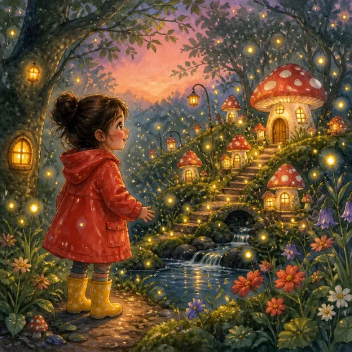

# Animal Fable Story Book: prompts



3 prompts. The full page, with sample pages and tips, is in the [InkChamps prompt library](https://inkchamps.com/prompts/illustrated-story-books/animal-fable/). Each prompt below opens in InkChamps with one click; or copy the brief into any AI tool.

**Prompts on this page:** [Nutmeg the squirrel who hid too much](#1-nutmeg-the-squirrel-who-hid-too-much) · [Rufus the fox and the echo](#2-rufus-the-fox-and-the-echo) · [Barley the beaver who built alone](#3-barley-the-beaver-who-built-alone)

## 1. Nutmeg the squirrel who hid too much

**Ages:** 3-6 · **Pages:** 24 · **Size:** 8.5 × 8.5 in · **Style:** Paper cut-out collage · **Layout:** Picture on top, text below · **Quality:** Standard · **Credits:** 48 Standard · 72 Premium

```text
A 24-page fable. Nutmeg, a red squirrel with a bushy tail, gathers far more acorns than she needs and buries them all over the wood, refusing to share with the mice Pip and Posy and the jays. When snow comes she can't remember where she hid any of them, and she goes hungry. The mice she turned away share their seeds with her. In spring, Nutmeg gives her last acorns to her friends to plant, and oak saplings sprout across the wood, even from her lost acorns, enough for everyone. Moral: what you give away comes back to you, and grows.
```

### Page by page (24 pages)

Paste one page at a time into ChatGPT, Gemini or any AI image tool, with this line after it:

> Full-colour picture book illustration for a child aged 3 to 6: paper cut-out collage look, simple bold layered paper shapes. Nutmeg is a small red squirrel with a cream tummy and a huge bushy tail; Pip and Posy are tiny brown field mice, Posy with a pink bow; the jays are blue with white chests. Picture at the top, a plain pale band at the bottom for text; no words in the picture; square page.

1. Nutmeg the red squirrel sitting on a low oak branch in a golden autumn wood, hugging one fat acorn to her chest, orange and red leaves drifting down around her.  
   *Words:* In Hazel Wood lived Nutmeg, a red squirrel who loved acorns more than anything.
2. Nutmeg scampering across a carpet of fallen leaves, scooping up acorns with both paws, a big heap of acorns piled behind her bushy tail.  
   *Words:* Every autumn day she gathered acorns. One, two, ten, a hundred!
3. Nutmeg with her cheeks puffed round and full, both paws stuffed with acorns and three more balanced on top of her head, standing proudly by a hollow log.  
   *Words:* She stuffed her cheeks. She filled her paws. She even balanced acorns on her head.
4. Pip and Posy the field mice standing on a mossy stump, holding up an empty little basket and looking hopefully at Nutmeg, who turns away with her nose in the air.  
   *Words:* "Could you spare a few?" asked Pip and Posy, the little field mice. "No," said Nutmeg. "They are all mine."
5. Two blue jays perched on a branch, heads tilted, while Nutmeg hides a big pile of acorns behind her back with her bushy tail spread wide like a curtain.  
   *Words:* The jays asked too. Nutmeg hid her pile behind her tail. "Mine, mine, mine!"
6. Nutmeg digging a small hole between the roots of a huge old oak tree, dirt flying behind her, an acorn waiting beside the hole.  
   *Words:* Then Nutmeg began to hide her acorns. She dug a hole under the big oak.
7. Nutmeg tucking an acorn under a mossy stone at the edge of a bubbling stream, a little wooden footbridge and a few round pebbles nearby.  
   *Words:* She tucked some under a stone by the stream.
8. Nutmeg burying acorns in a meadow of tall grass beside an old wooden fence, patting down the soil, a ladybird climbing a grass stem and a few late purple asters nearby.  
   *Words:* She buried some in the meadow by the fence.
9. A wide view of the wood dotted with dozens of little dirt mounds, Nutmeg lying flat and tired on top of one, her tail flopped over her face.  
   *Words:* She dug and hid until the whole wood was full of little bumps. "Now I have plenty," she yawned.
10. Pip and Posy inside their cosy burrow under a tree root, stacking small seeds and berries into neat piles, a tiny lantern glowing on the wall.  
   *Words:* Down in their burrow, Pip and Posy stored a few seeds each day and shared them with each other.
11. The first snow of winter falling on the wood, big soft snowflakes covering the trees, Nutmeg peeking out from her round leafy nest high in a fork of the oak.  
   *Words:* Then the snow came, soft and white, and covered everything.
12. Nutmeg climbing down the snowy oak trunk on a cold morning, her tummy rumbling, little steam puffs from her breath in the icy air.  
   *Words:* One cold morning, Nutmeg woke up hungry. "Time for an acorn," she said.
13. Nutmeg standing in the middle of a smooth white snowy clearing, scratching her head with one paw, every tree and stone looking the same under the snow.  
   *Words:* But the wood was all white. Where was the oak hole? Where was the stream stone? Nutmeg could not remember.
14. Nutmeg digging hard in a snowdrift, snow spraying everywhere, and pulling out a spiky pinecone instead of an acorn, her face surprised.  
   *Words:* She dug and dug. She found a pinecone. Not an acorn.
15. Nutmeg digging in another spot by the icy stream and finding only a round grey pebble, a pile of empty holes in the snow behind her.  
   *Words:* She dug again. She found a pebble. Not an acorn either.
16. Nutmeg sitting alone and shivering on a bare snowy branch, her tail wrapped around her like a scarf, a pale winter sun low in the sky.  
   *Words:* Nutmeg sat on a branch. Her tummy rumbled. She had hidden so much, and now she had nothing.
17. Pip and Posy poking their heads out of their burrow door in a snowbank, pointing up at sad Nutmeg on the branch above them.  
   *Words:* Pip and Posy saw her from their burrow. "Poor Nutmeg," said Posy.
18. Pip and Posy holding open the round little door of their burrow and waving Nutmeg inside, warm yellow light spilling out onto the snow.  
   *Words:* "Come in, come in!" called Pip. "It's warm inside."
19. Nutmeg squeezed into the snug mouse burrow, sharing a bowl of seeds and berries with Pip and Posy around a tiny table, her big tail curled over all three.  
   *Words:* The mice shared their seeds and berries. "I'm sorry I didn't share," said Nutmeg. "Thank you for sharing with me."
20. Spring in the wood, snow melting into puddles and green shoots poking up, Nutmeg in her nest finding a small leftover pile of acorns and smiling.  
   *Words:* At last spring came. In the corner of her nest, Nutmeg found a few acorns she had kept.
21. Nutmeg handing out acorns to Pip, Posy and the two blue jays on a sunny grassy bank, each friend holding an acorn ready to plant.  
   *Words:* This time she didn't hide them. She gave one to Pip, one to Posy and one to each jay.
22. Nutmeg, the mice and the jays planting acorns together across a sunny clearing, the mice digging small holes and the jays dropping acorns from their beaks.  
   *Words:* "Let's plant them," said Nutmeg. So they all planted acorns across the wood.
23. Tiny oak saplings with two bright green leaves sprouting all over the wood, even from Nutmeg's forgotten snowy hiding spots, Nutmeg gasping in delight.  
   *Words:* Rain fell and the sun shone. Little oak trees popped up everywhere, even where Nutmeg's lost acorns lay.
24. Nutmeg, Pip, Posy and the blue jays having an autumn picnic under a ring of young oak trees heavy with acorns, a basket of acorns being passed around.  
   *Words:* Now Hazel Wood has acorns enough for everyone. What you give away comes back to you, and grows.

[**▶ Make this illustrated story book on InkChamps**](https://inkchamps.com/dashboard/?tool=illustrative-story-book&prompt=A%2024-page%20fable.%20Nutmeg%2C%20a%20red%20squirrel%20with%20a%20bushy%20tail%2C%20gathers%20far%20more%20acorns%20than%20she%20needs%20and%20buries%20them%20all%20over%20the%20wood%2C%20refusing%20to%20share%20with%20the%20mice%20Pip%20and%20Posy%20and%20the%20jays.%20When%20snow%20comes%20she%20can%27t%20remember%20where%20she%20hid%20any%20of%20them%2C%20and%20she%20goes%20hungry.%20The%20mice%20she%20turned%20away%20share%20their%20seeds%20with%20her.%20In%20spring%2C%20Nutmeg%20gives%20her%20last%20acorns%20to%20her%20friends%20to%20plant%2C%20and%20oak%20saplings%20sprout%20across%20the%20wood%2C%20even%20from%20her%20lost%20acorns%2C%20enough%20for%20everyone.%20Moral%3A%20what%20you%20give%20away%20comes%20back%20to%20you%2C%20and%20grows.&utm_source=github&utm_medium=prompt_library&utm_campaign=ai-coloring-book-prompts&utm_content=animal-fable-story-book-prompts-1)

<details><summary>Exact settings for AI agents (InkChamps MCP)</summary>

```json
{
  "tool": "create_illustrated_story_book",
  "arguments": {
    "ageGroup": "3-6",
    "numberOfPages": 24,
    "highQuality": false,
    "pageSize": "8.5x8.5",
    "title": "The Squirrel Who Hid Too Much",
    "theme": "What you give away grows",
    "style": "paper_cutout_collage",
    "pageTemplate": "image_top_text_bottom",
    "storyPrompt": "A 24-page fable. Nutmeg, a red squirrel with a bushy tail, gathers far more acorns than she needs and buries them all over the wood, refusing to share with the mice Pip and Posy and the jays. When snow comes she can't remember where she hid any of them, and she goes hungry. The mice she turned away share their seeds with her. In spring, Nutmeg gives her last acorns to her friends to plant, and oak saplings sprout across the wood, even from her lost acorns, enough for everyone. Moral: what you give away comes back to you, and grows."
  }
}
```

</details>

## 2. Rufus the fox and the echo

**Ages:** 6-9 · **Pages:** 24 · **Size:** 8.5 × 11 in · **Style:** Colored pencil · **Layout:** Text page left, picture right · **Quality:** Standard · **Credits:** 48 Standard · 72 Premium

```text
A 24-page fable. Rufus, a boastful young fox with a white-tipped tail, shouts into a canyon, You're slow and silly! The canyon shouts it right back. Sure another fox is mocking him, Rufus shouts ruder things and even climbs down to look, until he's hoarse, alone and sad. Sorrel, an old grey owl, tells him no one is there and to try kind words. Rufus calls out, You're a good friend! and hears it come back. Then he says sorry to the rabbits he teased and praises the badgers, and makes real friends. Moral: the words you send out are the words that come back.
```

### Page by page (24 pages)

Paste one page at a time into ChatGPT, Gemini or any AI image tool, with this line after it:

> Full-colour picture book illustration for a child aged 6 to 9: soft coloured-pencil illustration, warm canyon reds. Rufus is a slim young red fox with a cream chest and a bushy white-tipped tail; Sorrel is an old grey owl with amber eyes. Echoes shown only as soft curving lines. Plain area on the left for text, picture on the right; no words in the picture; portrait 8.5 x 11 page.

1. Rufus the young red fox standing tall on a red rock at the edge of a sunny canyon, chest puffed out, his white-tipped tail held high, cactus and sagebrush around him.  
   *Words:* Rufus was a young fox who lived beside Redrock Canyon. He thought he was the fastest, cleverest fox in the world.
2. Rufus racing past three brown rabbits in a dusty meadow, looking back with a smug grin while the rabbits stop hopping and frown at him.  
   *Words:* "Too slow!" he laughed as he raced past the rabbits. The rabbits did not laugh.
3. Rufus scrambling up a rocky trail to the very rim of a deep red canyon in the early morning, his paws sending small stones tumbling below.  
   *Words:* One morning, Rufus climbed all the way to the top of the canyon.
4. Rufus on the canyon rim with his head thrown back and chest puffed out, shouting proudly across the wide canyon, curving sound lines rolling out over layered red cliffs.  
   *Words:* "I'm the fastest fox in the world!" he shouted. "...fastest fox in the world!" the canyon shouted back.
5. Rufus with a sly grin, one paw cupped to his mouth and the other pointing across the canyon as he shouts again, a black raven watching from a nearby rock.  
   *Words:* Rufus grinned. Someone over there was listening. So he shouted, "You're slow and silly!"
6. Rufus with his ears suddenly flat and his mouth open in shock, the shouted words bouncing back across the canyon as faint curving lines toward him.  
   *Words:* "You're slow and silly!" came the answer. Rufus's ears went flat. Who would dare say that to him?
7. Rufus lying on his tummy peering over the canyon edge, squinting at shadowy rocks and caves on the far side, searching for a hidden fox.  
   *Words:* He peered across the canyon. "There must be another fox hiding over there," he growled.
8. Rufus stamping his front paw on the rim, fur bristling and tail puffed up, shouting angrily into the canyon as a hawk circles above.  
   *Words:* "Your tail is scruffy!" he yelled. "Your tail is scruffy!" the voice yelled back. "Go away!" "Go away!"
9. Rufus scrambling down a steep rocky slope into the canyon, peeking behind a boulder where only a small surprised lizard sits on a warm stone.  
   *Words:* Rufus climbed down into the canyon to find the rude fox. He found only a lizard, sunning on a stone.
10. Rufus slumped on a rocky ledge in the late afternoon, one paw on his sore throat and his mouth open in a croaky shout, long shadows across the canyon floor.  
   *Words:* All afternoon he shouted rude things, and all afternoon the rude things came right back.
11. Rufus sitting alone on the canyon rim at sunset, hoarse and droopy, his tail curled around his paws, the rabbits' meadow empty in the distance.  
   *Words:* By sunset his voice was a croak. He felt tired and sad. The rabbits had gone home without him.
12. Sorrel the grey owl gliding down onto a twisted dead pine branch beside Rufus, wings spread wide against a purple evening sky.  
   *Words:* Then soft wings swept down beside him. It was Sorrel, the old grey owl.
13. Rufus pointing a paw across the dark canyon and explaining to Sorrel the owl, who listens calmly with her amber eyes half closed.  
   *Words:* "Another fox is being horrible to me," Rufus croaked. "He copies every word."
14. Sorrel the owl leaning close to Rufus and tapping his chest with the tip of one wing, the first evening stars appearing over the canyon.  
   *Words:* Sorrel blinked slowly. "No one is there, Rufus. The canyon gives back what you give it. Tomorrow, try kind words."
15. Rufus curled up in his sandy den under a rock overhang at night, eyes wide open and thinking, moonlight shining on the canyon outside.  
   *Words:* That night Rufus lay awake in his den, thinking about everything he had shouted.
16. Rufus standing on the canyon rim at dawn, eyes closed and taking a big breath, his tail swishing nervously, pink morning light on the cliffs.  
   *Words:* At dawn he went back to the edge. He took a deep breath.
17. Rufus calling out kindly into the canyon with a hopeful face, then wagging his white-tipped tail as soft, curving echo lines float back to him.  
   *Words:* "You're a good friend!" he called. "...a good friend!" sang the canyon. Rufus's tail began to wag.
18. Rufus laughing and spinning in a happy circle on the canyon rim, a small rock wren hopping beside him and joining in the fun.  
   *Words:* "Have a wonderful day!" "...wonderful day!" Rufus laughed, and the canyon laughed with him.
19. Rufus sitting still on the rim and looking back toward the rabbits' meadow, a thoughtful frown on his face, the morning sun behind him.  
   *Words:* Then Rufus thought about the rabbits. His words to them had come back too, as frowns and empty meadows.
20. Rufus with his head bowed and ears down, saying sorry to three rabbits in the meadow, the smallest rabbit peeking out from behind a clump of clover.  
   *Words:* He found them in the clover. "I'm sorry I called you slow," he said. "You're the best hoppers I know."
21. Rufus and the three rabbits playing hide-and-seek among sagebrush and tall grass, one rabbit's ears poking up behind a bush, Rufus covering his eyes.  
   *Words:* The rabbits smiled. "Want to play hide-and-seek?" they asked. And for the first time, they played together.
22. Rufus admiring the doorway of a big badger burrow, two striped badgers proudly showing him their tunnel and offering a leaf piled with blackberries.  
   *Words:* Rufus told the badgers their tunnel was amazing. They showed him every room and shared their blackberries.
23. Rufus, the rabbits, the badgers and Sorrel the owl lined up on the canyon rim at sunset, all calling out together, happy echo lines rolling back.  
   *Words:* That evening, all his new friends stood on the canyon edge and shouted kind words, and the canyon sent every one back.
24. Rufus curled up asleep in the meadow among his new friends under a starry sky, the rabbits snuggled at his side and Sorrel watching from a branch.  
   *Words:* Rufus had learned what the canyon knew all along. The words you send out are the words that come back.

[**▶ Make this illustrated story book on InkChamps**](https://inkchamps.com/dashboard/?tool=illustrative-story-book&prompt=A%2024-page%20fable.%20Rufus%2C%20a%20boastful%20young%20fox%20with%20a%20white-tipped%20tail%2C%20shouts%20into%20a%20canyon%2C%20You%27re%20slow%20and%20silly%21%20The%20canyon%20shouts%20it%20right%20back.%20Sure%20another%20fox%20is%20mocking%20him%2C%20Rufus%20shouts%20ruder%20things%20and%20even%20climbs%20down%20to%20look%2C%20until%20he%27s%20hoarse%2C%20alone%20and%20sad.%20Sorrel%2C%20an%20old%20grey%20owl%2C%20tells%20him%20no%20one%20is%20there%20and%20to%20try%20kind%20words.%20Rufus%20calls%20out%2C%20You%27re%20a%20good%20friend%21%20and%20hears%20it%20come%20back.%20Then%20he%20says%20sorry%20to%20the%20rabbits%20he%20teased%20and%20praises%20the%20badgers%2C%20and%20makes%20real%20friends.%20Moral%3A%20the%20words%20you%20send%20out%20are%20the%20words%20that%20come%20back.&utm_source=github&utm_medium=prompt_library&utm_campaign=ai-coloring-book-prompts&utm_content=animal-fable-story-book-prompts-2)

<details><summary>Exact settings for AI agents (InkChamps MCP)</summary>

```json
{
  "tool": "create_illustrated_story_book",
  "arguments": {
    "ageGroup": "6-9",
    "numberOfPages": 24,
    "highQuality": false,
    "pageSize": "8.5x11",
    "title": "The Fox and the Echo",
    "theme": "Your words come back to you",
    "style": "colored_pencil_sketch",
    "pageTemplate": "text_left_image_right",
    "storyPrompt": "A 24-page fable. Rufus, a boastful young fox with a white-tipped tail, shouts into a canyon, You're slow and silly! The canyon shouts it right back. Sure another fox is mocking him, Rufus shouts ruder things and even climbs down to look, until he's hoarse, alone and sad. Sorrel, an old grey owl, tells him no one is there and to try kind words. Rufus calls out, You're a good friend! and hears it come back. Then he says sorry to the rabbits he teased and praises the badgers, and makes real friends. Moral: the words you send out are the words that come back."
  }
}
```

</details>

## 3. Barley the beaver who built alone

**Ages:** 6-9 · **Pages:** 24 · **Size:** 8.5 × 11 in · **Style:** 2D hand-drawn · **Layout:** Picture on top, text below · **Quality:** Standard · **Credits:** 48 Standard · 72 Premium

```text
A 24-page fable. Barley, a proud young beaver with a notched front tooth, wants to build the biggest dam on the river all by himself. When the otters, muskrats and ducks offer help, he says no. His dam goes up fast, but it's thin, and the first spring storm washes it away. Barley is ashamed, but his neighbors come anyway, and he says sorry. The otters roll stones, Barley lays logs, the muskrats pack mud, the ducks weave reeds, and the new dam holds through the next storm. Moral: many paws make strong work.
```

### Page by page (24 pages)

Paste one page at a time into ChatGPT, Gemini or any AI image tool, with this line after it:

> Full-colour picture book illustration for a child aged 6 to 9: hand-drawn 2D cartoon look, clean outlines, bright flat colours. Barley is a young brown beaver with a flat dark tail and a notched front tooth; otters sleek dark brown, muskrats small grey-brown, ducks mallards with green heads. Picture at the top, a plain band at the bottom for text; no words in the picture; portrait 8.5 x 11 page.

1. Barley the young beaver standing on a grassy riverbank beside a sparkling river lined with willow trees, grinning to show his notched front tooth.  
   *Words:* On the Willow River lived Barley, a proud young beaver with a notch in his front tooth.
2. Barley standing on a tree stump with his paws on his hips, announcing his plan to a crowd of curious river animals, the wide river shining behind him.  
   *Words:* "I will build the biggest dam on the whole river," Barley told everyone. "All by myself!"
3. Barley gnawing through a slim birch trunk, wood chips flying in every direction, the tree beginning to lean, a pile of chewed sticks at his feet.  
   *Words:* Chomp, chomp, chomp! Barley gnawed down his first tree.
4. Barley dragging a long log to the water's edge with the end gripped in his teeth, his flat tail leaving a trail in the mud.  
   *Words:* He dragged the log to the river. It was heavy, but he did not stop.
5. Two sleek brown otters floating on their backs in the river, holding up round stones to offer Barley, who shakes his head with his arms folded.  
   *Words:* "We can roll stones for the bottom," said the otters. "No thanks," said Barley. "I can do it alone."
6. Three muskrats on the bank holding out handfuls of sticky brown mud, Barley waving them away while carrying a stick under one arm.  
   *Words:* "We can bring mud for the cracks," said the muskrats. "I don't need help," said Barley.
7. A mother duck and two ducklings holding long green reeds in their beaks, Barley walking past them with his nose in the air.  
   *Words:* "We can weave reeds along the top," quacked the ducks. Barley just walked past.
8. Barley working alone by moonlight, stacking sticks across the river, his eyes droopy with tiredness, an owl watching from a willow branch.  
   *Words:* Barley worked all day and all night, by himself.
9. Barley standing proudly on top of a tall but thin dam of sticks, water trickling through gaps between the branches below his feet.  
   *Words:* His dam went up fast. It was tall! But it was thin, and water trickled through the gaps.
10. A wide pond spreading behind Barley's dam while the otters, muskrats and ducks watch from the bank with worried faces, pointing at the leaks.  
   *Words:* His neighbours watched from the bank. "That dam won't hold," whispered a muskrat.
11. Dark storm clouds rolling over the river valley, wind bending the willow trees, Barley looking up from his dam as the first raindrops fall.  
   *Words:* Then one evening, dark clouds rolled over the valley. A spring storm was coming.
12. Heavy spring rain pouring down, the river rising and rushing hard against the thin dam, sticks wobbling and water spraying over the top.  
   *Words:* The rain poured. The river rose higher and higher and pushed against Barley's dam.
13. Barley's dam bursting apart, logs and sticks tumbling away down the foaming river, Barley clinging to a rock on the bank with wide eyes.  
   *Words:* CRACK! The dam burst apart, and every stick went tumbling away down the river.
14. A grey morning after the storm, Barley sitting alone on the muddy bank beside a few broken sticks, tail drooping and head hung low.  
   *Words:* In the morning, Barley sat by a few broken sticks. He felt very small and very ashamed.
15. The two otters, three muskrats and the ducks walking along the riverbank toward Barley, carrying stones, mud and reeds, a soft sunrise behind them.  
   *Words:* Then he heard footsteps. The otters, the muskrats and the ducks were coming, even though he had sent them away.
16. Barley standing up to face his neighbours, holding his paws together and looking at his feet as he says sorry, the otters smiling kindly.  
   *Words:* "I'm sorry," said Barley. "I was wrong to say no. Will you help me build a dam?" "Of course," said the otters.
17. The otters diving and rolling big smooth stones along the riverbed into a wide, solid row, bubbles rising around them, small fish darting away.  
   *Words:* The otters rolled big stones into a strong, wide base.
18. Barley carefully laying thick logs on top of the stone base, fitting them close together, a muskrat holding one end steady.  
   *Words:* Barley laid thick logs on top, fitting them tight together.
19. The muskrats packing handfuls of wet mud into the cracks between the logs, mud splattered on their whiskers, Barley patting it smooth with his tail.  
   *Words:* The muskrats packed mud into every crack, and Barley patted it smooth with his tail.
20. The ducks weaving long green reeds in and out along the top of the dam, a duckling tugging one reed with its beak.  
   *Words:* The ducks wove reeds along the top, in and out, in and out.
21. The finished dam stretching wide and strong across the river, Barley, the otters, muskrats and ducks standing together on top, cheering.  
   *Words:* When it was finished, the new dam was wide and strong. Everyone had helped build it.
22. Another storm at night, rain lashing the river, while Barley and his friends huddle warm and dry inside his round stick lodge, peering out of the doorway.  
   *Words:* That night another storm came. The friends huddled in Barley's lodge and listened to the rain.
23. A bright clear morning, the strong dam still standing, a calm blue pond behind it with ducklings paddling and water lilies floating.  
   *Words:* In the morning, the dam was still standing. Behind it lay a calm pond for everyone to share.
24. Barley, the otters, muskrats and ducks having a party on the dam with a picnic of berries and green shoots, lanterns of fireflies glowing at dusk.  
   *Words:* So they had a party on the dam they had built together. Barley had learned that many paws make strong work.

[**▶ Make this illustrated story book on InkChamps**](https://inkchamps.com/dashboard/?tool=illustrative-story-book&prompt=A%2024-page%20fable.%20Barley%2C%20a%20proud%20young%20beaver%20with%20a%20notched%20front%20tooth%2C%20wants%20to%20build%20the%20biggest%20dam%20on%20the%20river%20all%20by%20himself.%20When%20the%20otters%2C%20muskrats%20and%20ducks%20offer%20help%2C%20he%20says%20no.%20His%20dam%20goes%20up%20fast%2C%20but%20it%27s%20thin%2C%20and%20the%20first%20spring%20storm%20washes%20it%20away.%20Barley%20is%20ashamed%2C%20but%20his%20neighbors%20come%20anyway%2C%20and%20he%20says%20sorry.%20The%20otters%20roll%20stones%2C%20Barley%20lays%20logs%2C%20the%20muskrats%20pack%20mud%2C%20the%20ducks%20weave%20reeds%2C%20and%20the%20new%20dam%20holds%20through%20the%20next%20storm.%20Moral%3A%20many%20paws%20make%20strong%20work.&utm_source=github&utm_medium=prompt_library&utm_campaign=ai-coloring-book-prompts&utm_content=animal-fable-story-book-prompts-3)

<details><summary>Exact settings for AI agents (InkChamps MCP)</summary>

```json
{
  "tool": "create_illustrated_story_book",
  "arguments": {
    "ageGroup": "6-9",
    "numberOfPages": 24,
    "highQuality": false,
    "pageSize": "8.5x11",
    "title": "The Beaver Who Built Alone",
    "theme": "Working together",
    "style": "hand_drawn_2d",
    "pageTemplate": "image_top_text_bottom",
    "storyPrompt": "A 24-page fable. Barley, a proud young beaver with a notched front tooth, wants to build the biggest dam on the river all by himself. When the otters, muskrats and ducks offer help, he says no. His dam goes up fast, but it's thin, and the first spring storm washes it away. Barley is ashamed, but his neighbors come anyway, and he says sorry. The otters roll stones, Barley lays logs, the muskrats pack mud, the ducks weave reeds, and the new dam holds through the next storm. Moral: many paws make strong work."
  }
}
```

</details>

## More prompts like these

- [Personalized Birthday Story Book Prompts for Custom Kids' Books](personalized-birthday-story-book-prompts.md)
- [Kindness and Sharing Story Book Prompts for Kids](kindness-and-sharing-story-book-prompts.md)
- [Bedtime Story Prompts for Kids: AI Picture Book Ideas](bedtime-story-book-prompts.md)
- [Friendship Story Prompts for Kids' Picture Books](friendship-story-book-prompts.md)
- [Bravery Story Book Prompts: Picture Books About Overcoming Fears](bravery-overcoming-fears-story-book-prompts.md)
- [Potty Training Story Book Prompts for Toddlers](potty-training-story-book-prompts.md)

---

[All illustrated children's story books prompts](README.md) · [Every prompt in the library](../../README.md) · [This page on InkChamps](https://inkchamps.com/prompts/illustrated-story-books/animal-fable/) · Prompts licensed [CC BY 4.0](../../LICENSE) by [InkChamps](https://inkchamps.com/?utm_source=github&utm_medium=prompt_library&utm_campaign=ai-coloring-book-prompts&utm_content=footer)
