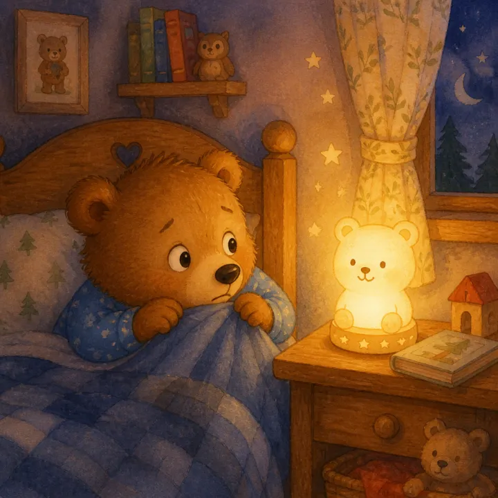

# Bedtime Story Book: prompts



3 prompts. The full page, with sample pages and tips, is in the [InkChamps prompt library](https://inkchamps.com/prompts/illustrated-story-books/bedtime/). Each prompt below opens in InkChamps with one click; or copy the brief into any AI tool.

**Prompts on this page:** [Bramble and the moonflowers](#1-bramble-and-the-moonflowers) · [Ten sheep who would not sleep](#2-ten-sheep-who-would-not-sleep) · [The boy who borrowed the moon](#3-the-boy-who-borrowed-the-moon)

## 1. Bramble and the moonflowers

**Ages:** 3-6 · **Pages:** 24 · **Size:** 8.5 × 8.5 in · **Style:** Colored pencil · **Layout:** Picture on top, text below · **Quality:** Standard · **Credits:** 48 Standard · 72 Premium

```text
A 24-page bedtime story. Every night after the village falls asleep, Mrs. Fernsby, a tall old badger in a patched blue apron, waters the moonflowers that open only in the dark. Tonight her helper Bramble, a sleepy hedgehog with a tiny lantern, wants to stay up to see the very last one bloom. He yawns through every chore: the well, the weeds, a snail moved to the lettuce. The last flower opens just for him. Bramble curls up among the glowing petals, and Mrs. Fernsby carries him home to bed. Hushed, slow and gentle.
```

### Page by page (24 pages)

Paste one page at a time into ChatGPT, Gemini or any AI image tool, with this line after it:

> Full-colour picture book illustration for a child aged 3 to 6: soft coloured-pencil look, night blues and glowing silver-white moonflowers. Mrs. Fernsby is a tall old grey badger with a striped face in a patched blue apron; Bramble is a small brown hedgehog with a tiny brass lantern. Picture at the top, a plain pale band at the bottom for text; no words in the picture; square page.

1. A tiny village of round-roofed cottages at dusk, the last window lights going out one by one, while Mrs. Fernsby the badger steps out of her green door holding a tin watering can.  
   *Words:* When the last light in the village goes out, Mrs. Fernsby puts on her patched blue apron. It is time to tend the night garden.
2. Bramble the little hedgehog trotting down a cottage path after Mrs. Fernsby, holding up his tiny brass lantern, his mouth open in a big yawn, a few fireflies drifting by.  
   *Words:* Bramble trots behind her with his tiny lantern. "Tonight I'm staying up," he says, and then he yawns.
3. Mrs. Fernsby pushing open a mossy wooden garden gate under a starry sky, rows of tall moonflower plants inside with their pale buds still tightly closed.  
   *Words:* The garden gate creaks open. Row after row of moonflowers wait in the dark, every bud shut tight.
4. Mrs. Fernsby kneeling beside Bramble and pointing to one closed moonflower bud, the moon peeking over the garden wall and a curious snail on a leaf.  
   *Words:* "Moonflowers open only in the dark," says Mrs. Fernsby. "And the very last one waits for the deepest part of the night."
5. Bramble standing up straight with his lantern held high and his chest puffed out, looking determined, Mrs. Fernsby smiling down at him with her paws folded on her apron.  
   *Words:* "Then I will see the very last one," says Bramble. He stands up tall to show how awake he is.
6. Mrs. Fernsby turning the handle of an old stone well to pull up a bucket of water, Bramble holding the watering can underneath, eyes half closed, a frog sitting on the well's edge.  
   *Words:* First they fill the watering can at the old stone well. Bramble holds it steady. His eyes close, just for a moment.
7. Mrs. Fernsby watering a long row of moonflowers, silver drops falling from the spout, Bramble walking beside her lighting the way with his lantern held low.  
   *Words:* Splish, splash, down the long rows. Bramble lights the way, and his lantern swings slow and low.
8. Bramble sitting in the soil pulling a small weed from between two moonflower plants, a little pile of weeds beside him and his lantern set down on a flat stone.  
   *Words:* Next come the weeds, one little tug at a time. Bramble yawns so wide that his whiskers wobble.
9. Bramble gently carrying a sleepy snail on a leaf away from the moonflowers toward a patch of lettuce by the garden wall, Mrs. Fernsby watching with a smile.  
   *Words:* A snail is nibbling a moonflower leaf. Bramble carries it, very gently, to the lettuce patch instead.
10. The first moonflower opening wide with a soft silver glow, Bramble and Mrs. Fernsby leaning close to watch, the light shining on their faces.  
   *Words:* Then, with a tiny sigh, the first moonflower opens. It glows like a little moon of its own.
11. Three pale moths fluttering around a cluster of open glowing moonflowers, Bramble pointing up at them, his lantern resting at his feet.  
   *Words:* One by one more flowers open. Soft white moths come to visit, quiet as whispers.
12. Bramble sitting on an upturned clay flowerpot, chin propped on his paws, eyelids drooping, his lantern flickering beside him among the glowing flowers.  
   *Words:* Bramble sits down on a flowerpot to rest. Only for a moment, he tells himself.
13. Mrs. Fernsby humming as she ties a tall moonflower stem to a bamboo cane with garden string, a ball of string in her apron pocket, Bramble nodding sleepily nearby.  
   *Words:* Mrs. Fernsby hums an old, slow tune as she ties up the tallest stems. Hum, hum, goes the night.
14. A round brown owl perched on a branch of an old apple tree above the garden wall, looking down at Bramble, a crescent moon behind the branches.  
   *Words:* Hoo, hoo, says the owl in the apple tree. Even the owl sounds sleepy tonight.
15. A wide view of the night garden with dozens of open moonflowers glowing in rows, and one single closed bud at the end of the last row, Bramble walking toward it.  
   *Words:* Now the whole garden shines silver. All the moonflowers are open, all but one.
16. Bramble lying on his tummy in the soft grass beside the last closed moonflower bud, chin in his paws, watching it very closely, his lantern set beside him.  
   *Words:* Bramble lies down beside the last bud to watch. He will not miss it. Not this one.
17. Bramble's lantern burning low and dim as his head sinks onto his paws, the last bud still shut, a single firefly resting on the bud's tip.  
   *Words:* His lantern burns low. His head sinks lower. The last bud stays shut tight.
18. Bramble with his nose almost touching the closed bud, whispering, his eyes nearly shut, a dewdrop hanging from a leaf beside him.  
   *Words:* "Please," Bramble whispers, very softly. "I stayed up just for you."
19. The last moonflower slowly unfolding its petals right in front of Bramble, the brightest glow in the garden, sparkles of silver light floating up into the dark.  
   *Words:* And slowly, slowly, the very last moonflower opens, just for him.
20. Close-up of Bramble's small face lit silver by the glowing open flower, his eyes shining and a tiny sleepy smile, his paws clasped together.  
   *Words:* It is the brightest, softest flower of all. Bramble smiles the sleepiest smile.
21. Bramble curled up in a little ball inside the wide glowing petals of the last moonflower, his lantern gone out beside the stem, a moth resting on a leaf.  
   *Words:* He curls up among the glowing petals. They are warm, and they smell like sweet milk.
22. Mrs. Fernsby bending over the last moonflower and finding Bramble fast asleep inside it, her paw on her heart, her watering can set down on the path.  
   *Words:* Mrs. Fernsby finds him there, fast asleep. "You saw it," she whispers. "You stayed up after all."
23. Mrs. Fernsby walking home along the garden path carrying the sleeping Bramble in the crook of one arm and his lantern in her other paw, the glowing garden behind her.  
   *Words:* She carries him home past the sleeping rows, the garden glowing softly behind them.
24. Bramble fast asleep in a little basket bed with a patchwork quilt by a round cottage window, the moonflower garden glowing silver outside, Mrs. Fernsby blowing out a candle.  
   *Words:* She tucks him into bed and blows out the candle. Outside, the moonflowers keep watch. Goodnight, Bramble.

[**▶ Make this illustrated story book on InkChamps**](https://inkchamps.com/dashboard/?tool=illustrative-story-book&prompt=A%2024-page%20bedtime%20story.%20Every%20night%20after%20the%20village%20falls%20asleep%2C%20Mrs.%20Fernsby%2C%20a%20tall%20old%20badger%20in%20a%20patched%20blue%20apron%2C%20waters%20the%20moonflowers%20that%20open%20only%20in%20the%20dark.%20Tonight%20her%20helper%20Bramble%2C%20a%20sleepy%20hedgehog%20with%20a%20tiny%20lantern%2C%20wants%20to%20stay%20up%20to%20see%20the%20very%20last%20one%20bloom.%20He%20yawns%20through%20every%20chore%3A%20the%20well%2C%20the%20weeds%2C%20a%20snail%20moved%20to%20the%20lettuce.%20The%20last%20flower%20opens%20just%20for%20him.%20Bramble%20curls%20up%20among%20the%20glowing%20petals%2C%20and%20Mrs.%20Fernsby%20carries%20him%20home%20to%20bed.%20Hushed%2C%20slow%20and%20gentle.&utm_source=github&utm_medium=prompt_library&utm_campaign=ai-coloring-book-prompts&utm_content=bedtime-story-book-prompts-1)

<details><summary>Exact settings for AI agents (InkChamps MCP)</summary>

```json
{
  "tool": "create_illustrated_story_book",
  "arguments": {
    "ageGroup": "3-6",
    "numberOfPages": 24,
    "highQuality": false,
    "pageSize": "8.5x8.5",
    "title": "The Night Gardener",
    "theme": "A calm night-time garden",
    "style": "colored_pencil_sketch",
    "pageTemplate": "image_top_text_bottom",
    "storyPrompt": "A 24-page bedtime story. Every night after the village falls asleep, Mrs. Fernsby, a tall old badger in a patched blue apron, waters the moonflowers that open only in the dark. Tonight her helper Bramble, a sleepy hedgehog with a tiny lantern, wants to stay up to see the very last one bloom. He yawns through every chore: the well, the weeds, a snail moved to the lettuce. The last flower opens just for him. Bramble curls up among the glowing petals, and Mrs. Fernsby carries him home to bed. Hushed, slow and gentle."
  }
}
```

</details>

## 2. Ten sheep who would not sleep

**Ages:** 3-6 · **Pages:** 24 · **Size:** 8.5 × 8.5 in · **Style:** 2D hand-drawn · **Layout:** Words lettered into the art · **Quality:** Standard · **Credits:** 48 Standard · 72 Premium

```text
A 24-page counting bedtime story. Pim, a little girl in yellow rain boots and a nightgown, can't fall asleep, so she tries counting sheep. But her ten sheep won't jump the fence: Clover wants a snack, Wooly lost her bell, the twins want one more game of tag, Hiccup has hiccups, Tuft is cold, Mumble wants a story, Little Lou wants a song, Puff's bed is lumpy and Big Bertha is scared of the dark. Pim helps each one settle, counting up to ten, until all ten snore in a woolly pile. Then Pim climbs onto the softest sheep and falls asleep too.
```

### Page by page (24 pages)

Paste one page at a time into ChatGPT, Gemini or any AI image tool, with this line after it:

> Full-colour picture book illustration for a child aged 3 to 6: hand-drawn 2D look, simple rounded shapes, soft moonlit meadow colours. Pim is a small girl with curly black hair, a pale blue nightgown and yellow rain boots; the sheep are round, fluffy and white with black faces and legs, Big Bertha the biggest. Leave a calm empty patch of sky for the words; no words in the picture; square page.

1. Pim lying wide awake in her bed with the covers pulled up to her chin, eyes open wide, a ticking clock on the nightstand and her yellow rain boots on the rug.  
   *Words:* Pim is not sleepy. Not one bit. The clock goes tick, tock, tick.
2. Pim with her eyes squeezed shut in bed, and above her head a dreamy cloud showing a moonlit meadow with a little wooden fence.  
   *Words:* "I know," says Pim. "I'll count sheep!" She shuts her eyes tight.
3. Pim in her nightgown and yellow rain boots standing in a moonlit meadow beside a low wooden fence, ten fluffy sheep lined up in a row looking back at her.  
   *Words:* There is the meadow. There is the fence. And there are ten sheep, all in a row.
4. Pim pointing at the fence and the ten sheep not moving, some sitting down, one looking away, one scratching its ear with a hoof.  
   *Words:* "Jump!" says Pim. But not one sheep jumps. Not even a little hop.
5. Clover the sheep looking hungrily at a patch of clover, Pim kneeling to pick a handful of the leaves, a little moth fluttering by.  
   *Words:* "I'm hungry," says Clover. So Pim picks her a snack of sweet green clover.
6. Clover the sheep curled up asleep after her snack, a tiny clover leaf on her nose, Pim holding up one finger with a smile.  
   *Words:* Crunch, munch, yawn. Clover curls up and closes her eyes. One!
7. Wooly the sheep sniffing sadly through tall grass, her neck ribbon empty, Pim crouching beside her searching with her hands.  
   *Words:* "I lost my bell," says Wooly. "I can't sleep without my bell."
8. Pim holding up a little silver bell she has found in a patch of daisies, tying it back on Wooly's red ribbon while Wooly smiles.  
   *Words:* Pim finds it in the daisies, ting-a-ling. Wooly snuggles down. Two!
9. The twin sheep Dot and Dash running in a big circle around Pim, kicking up their hooves, Pim laughing with her arms out.  
   *Words:* "One more game of tag!" shout the twins, Dot and Dash. Round and round they run.
10. Pim tagging Dot and Dash at the same time, both twins flopping down onto the grass in a tired, giggling heap.  
   *Words:* Tag, you're it, and tag, you're it! The twins flop down, puffing and giggling. Three, four!
11. Hiccup the sheep jumping up in surprise with a hiccup, little bubbles popping above her head, Pim watching with a hand over her mouth.  
   *Words:* "Hic!" says Hiccup. "Hic! I can't stop!" Each hic makes her bounce.
12. Pim holding a little cup of water while Hiccup sips slowly with her eyes closed, the hiccup bubbles gone, the moon shining above.  
   *Words:* Pim gives her slow, slow sips of water. The hiccups float away. Five!
13. Tuft the sheep shivering in the breeze with her wool standing on end, a few leaves blowing past, Pim rubbing her own arms.  
   *Words:* "Brrr," says Tuft. "The night is too chilly for me."
14. Pim tucking a small patchwork quilt around Tuft, who is snug and smiling with only her nose and ears showing.  
   *Words:* Pim tucks a little quilt around her, snug as a bun. Six!
15. Mumble the sheep sitting up with her hooves folded, asking for a story, Pim sitting cross-legged on the grass in front of her.  
   *Words:* "I need a story," mumbles Mumble. "Just a short one, please."
16. Pim telling a story with her hands making a little shape in the air, Mumble's eyes closing and her head nodding forward.  
   *Words:* Pim tells the shortest story ever: once upon a time, a sheep fell asleep. The end. Seven!
17. Little Lou, the smallest sheep, looking up at Pim with big eyes, Pim cupping her hands as if about to sing, fireflies glowing nearby.  
   *Words:* "Sing me a song?" asks Little Lou, the smallest sheep of all.
18. Pim softly singing with musical notes floating over Little Lou, who is fast asleep against a fence post.  
   *Words:* Pim sings la-la-lullaby, soft and low. Little Lou is asleep before the end. Eight!
19. Puff, a very round fluffy sheep, turning around and around in the grass trying to get comfy, Pim patting a soft pile of hay.  
   *Words:* Puff turns round and round. "My bed is too lumpy!" Pim fluffs a pile of soft hay. Nine!
20. Big Bertha, the biggest sheep, peeking out from behind a fence post and trembling, looking up at the dark sky, Pim walking toward her.  
   *Words:* But Big Bertha is hiding behind the fence. "I'm scared of the dark," she whispers.
21. Pim and Big Bertha sitting side by side on the grass looking up at a big round moon, bright stars and glowing fireflies, Pim pointing up.  
   *Words:* "Look," says Pim. "The moon is our night-light, and the stars are on too." Big Bertha looks up.
22. All ten sheep snoring together in one big woolly pile under the moon, little sleepy breath clouds above them, Pim standing beside with her arms up.  
   *Words:* Big Bertha sighs and settles down with the others. Ten! Ten sheep, snoring in a woolly pile.
23. Pim yawning a huge yawn and climbing onto Big Bertha's soft woolly back, her yellow rain boots dangling, the other sheep asleep around her.  
   *Words:* Pim yawns the biggest yawn of all. She climbs onto Big Bertha, the softest sheep.
24. Pim fast asleep back in her own bed, smiling, hugging a small toy sheep, her yellow rain boots by the bed and moonlight on the floor.  
   *Words:* Snore, snore, goes the meadow. And Pim? Pim is fast asleep too. Goodnight.

[**▶ Make this illustrated story book on InkChamps**](https://inkchamps.com/dashboard/?tool=illustrative-story-book&prompt=A%2024-page%20counting%20bedtime%20story.%20Pim%2C%20a%20little%20girl%20in%20yellow%20rain%20boots%20and%20a%20nightgown%2C%20can%27t%20fall%20asleep%2C%20so%20she%20tries%20counting%20sheep.%20But%20her%20ten%20sheep%20won%27t%20jump%20the%20fence%3A%20Clover%20wants%20a%20snack%2C%20Wooly%20lost%20her%20bell%2C%20the%20twins%20want%20one%20more%20game%20of%20tag%2C%20Hiccup%20has%20hiccups%2C%20Tuft%20is%20cold%2C%20Mumble%20wants%20a%20story%2C%20Little%20Lou%20wants%20a%20song%2C%20Puff%27s%20bed%20is%20lumpy%20and%20Big%20Bertha%20is%20scared%20of%20the%20dark.%20Pim%20helps%20each%20one%20settle%2C%20counting%20up%20to%20ten%2C%20until%20all%20ten%20snore%20in%20a%20woolly%20pile.%20Then%20Pim%20climbs%20onto%20the%20softest%20sheep%20and%20falls%20asleep%20too.&utm_source=github&utm_medium=prompt_library&utm_campaign=ai-coloring-book-prompts&utm_content=bedtime-story-book-prompts-2)

<details><summary>Exact settings for AI agents (InkChamps MCP)</summary>

```json
{
  "tool": "create_illustrated_story_book",
  "arguments": {
    "ageGroup": "3-6",
    "numberOfPages": 24,
    "highQuality": false,
    "pageSize": "8.5x8.5",
    "title": "Ten Sheep Who Would Not Sleep",
    "theme": "Counting to ten at bedtime",
    "style": "hand_drawn_2d",
    "pageTemplate": "text_in_image",
    "storyPrompt": "A 24-page counting bedtime story. Pim, a little girl in yellow rain boots and a nightgown, can't fall asleep, so she tries counting sheep. But her ten sheep won't jump the fence: Clover wants a snack, Wooly lost her bell, the twins want one more game of tag, Hiccup has hiccups, Tuft is cold, Mumble wants a story, Little Lou wants a song, Puff's bed is lumpy and Big Bertha is scared of the dark. Pim helps each one settle, counting up to ten, until all ten snore in a woolly pile. Then Pim climbs onto the softest sheep and falls asleep too."
  }
}
```

</details>

## 3. The boy who borrowed the moon

**Ages:** 6-9 · **Pages:** 24 · **Size:** 8.5 × 11 in · **Style:** Paper cut-out collage · **Layout:** Text page left, picture right · **Quality:** Standard · **Credits:** 48 Standard · 72 Premium

```text
A 24-page bedtime story about fear of the dark. Arlo, a boy with messy red hair who wears his blanket as a cape, is scared of the shadows in his room. One night he climbs a very tall ladder and borrows the moon as his night-light. But without the moon the owl can't hunt, the tide forgets to come in, the fireflies get lost and a fox cub can't find its way home. Arlo sees the night needs its moon more than he does. He carries it back up the ladder, and from then on the moon slips a silver beam through his window every night to keep him company.
```

### Page by page (24 pages)

Paste one page at a time into ChatGPT, Gemini or any AI image tool, with this line after it:

> Full-colour picture book illustration for a child aged 6 to 9: layered paper cut-out collage look, deep night blues. Arlo is a boy with messy red hair and striped pyjamas who wears a dark blue star-patterned blanket as a cape; the moon is round and pale silver with a gentle sleepy face. Plain left side for text, picture on the right; no words in the picture; portrait 8.5 x 11 page.

1. Arlo sitting up in bed with his blanket wrapped around his shoulders like a cape, eyes wide, staring into the dark corners of his small bedroom.  
   *Words:* Arlo was not afraid of spiders, or thunder, or big dogs. But he was very afraid of the dark.
2. Arlo's dark bedroom where a coat on a hook casts a shadow shaped like a bear and a chair casts a shadow like a crouching monster, Arlo peeking over his blanket.  
   *Words:* At night his coat on the hook looked like a bear. His chair looked like it might creep across the floor.
3. Arlo standing at his bedroom window in his blanket cape, gazing up at a huge round glowing moon over the rooftops, his hand pressed to the glass.  
   *Words:* One night he looked out of his window at the moon, so round and bright. And Arlo had an idea.
4. Arlo tiptoeing across a moonlit back garden, dragging a long wooden ladder out of a garden shed, his blanket cape trailing on the grass.  
   *Words:* He tiptoed into the garden and pulled the longest ladder out of the shed.
5. Arlo climbing a very tall ladder that reaches past chimneys, treetops and wispy clouds, the town small and dark far below him.  
   *Words:* Up he climbed, past the chimneys, past the treetops, past the sleepy clouds.
6. Arlo at the top of the ladder talking politely to the large round moon, which has a gentle sleepy face, a few stars twinkling around them.  
   *Words:* "Excuse me, Moon," said Arlo. "May I borrow you, just for tonight? I need a night-light."
7. Arlo climbing down the ladder with the glowing moon tucked under one arm like a big ball, silver light spilling onto the clouds around him.  
   *Words:* The moon was surprised, but it said yes. Arlo tucked it under his arm and climbed carefully down.
8. The moon resting on Arlo's bedroom shelf filling the room with silver light, Arlo asleep in bed smiling, the coat on its hook now just a coat.  
   *Words:* He set the moon on his shelf. His whole room glowed silver, and there were no bears and no monsters at all.
9. A pitch-dark night sky over the town with no moon, only a few faint stars, an owl on a bare branch squinting down at a dark field.  
   *Words:* But outside, the sky was black. Without the moon, the owl could not see a thing in the fields below.
10. A harbour at night with small fishing boats sitting on wet sand, the sea far away, crabs wandering about looking confused and a lighthouse in the distance.  
   *Words:* Down by the harbour, the tide forgot to come in. The little boats sat stuck on the sand.
11. A dark meadow where tiny fireflies bump into each other and into tall grass stems, some flying in loops, a hedgehog looking up at them.  
   *Words:* In the meadow, the fireflies got lost. They bumped into grass, and into each other, and into a very cross hedgehog.
12. A small fox cub sitting alone on a dark forest path where it splits two ways, looking left and right, its ears drooping.  
   *Words:* A fox cub could not find the path home. Which way? Which way? It was much too dark to tell.
13. The owl tapping its beak on Arlo's bedroom window at night, Arlo sitting up in bed rubbing his eyes, the moon glowing on the shelf.  
   *Words:* Tap, tap, tap. Arlo woke to find the owl at his window. "Where has the moon gone?" it hooted.
14. Arlo standing in his pyjamas with his blanket cape, looking from the owl at the window to the moon on his shelf, his cheeks pink with guilt.  
   *Words:* Arlo looked at the moon on his shelf. His cheeks went hot. "I borrowed it," he said in a small voice.
15. Arlo walking down to the moonless harbour carrying the glowing moon in both arms, its light showing the stuck boats and a crab waving its claw at him.  
   *Words:* He carried the moon outside to see. There were the boats, stuck on the sand, waiting for the sea.
16. Arlo standing in the dark meadow holding up the moon, its light showing fireflies tangled in the grass and the fox cub finding its path.  
   *Words:* In the meadow, the lost fireflies blinked at him, and the fox cub was still looking for its way home.
17. Arlo sitting on a stone wall hugging the moon close, looking thoughtful, the owl perched beside him on the wall and the dark town behind them.  
   *Words:* Arlo hugged the moon tight. Then he understood. The night needed its moon more than he did.
18. Arlo climbing back up the very tall ladder with the heavy moon on his back, the owl flying alongside him, clouds drifting below.  
   *Words:* So up the ladder he went again. The moon was heavy, and his arms were tired, but Arlo did not stop.
19. Arlo at the top of the ladder lifting the moon back into its place in the sky, the moon smiling as its light spreads out across the stars.  
   *Words:* At the very top, he lifted the moon back into its place in the sky. "Thank you for lending me your light," he said.
20. The town at night lit by the moon again: the tide rolling into the harbour lifting the boats, fireflies flying in neat rows, the fox cub trotting home.  
   *Words:* At once, the tide rushed in and lifted the boats. The fireflies found their way, and the fox cub ran home.
21. The owl swooping over a silver moonlit field with its wings spread wide, the moon shining behind it and a small mouse hiding under a leaf.  
   *Words:* The owl swooped happily over the fields. The night was itself again.
22. Arlo climbing back into his bed in his blanket cape, looking a little nervous at the dark corners of his room, the ladder leaning outside his window.  
   *Words:* Arlo climbed back into bed. The corners of his room were dark again, and he felt a little bit scared.
23. A long silver moonbeam slipping through Arlo's window and lying across his bed and blanket, Arlo reaching out to touch it in wonder.  
   *Words:* Then a long silver moonbeam slipped through his window and lay across his blanket, soft and bright.
24. Arlo fast asleep in bed with a moonbeam resting on him, the coat on the hook and the chair plainly ordinary, the smiling moon outside the window.  
   *Words:* From then on, every night, the moon sent Arlo a moonbeam to keep him company. And Arlo was never afraid of the dark again.

[**▶ Make this illustrated story book on InkChamps**](https://inkchamps.com/dashboard/?tool=illustrative-story-book&prompt=A%2024-page%20bedtime%20story%20about%20fear%20of%20the%20dark.%20Arlo%2C%20a%20boy%20with%20messy%20red%20hair%20who%20wears%20his%20blanket%20as%20a%20cape%2C%20is%20scared%20of%20the%20shadows%20in%20his%20room.%20One%20night%20he%20climbs%20a%20very%20tall%20ladder%20and%20borrows%20the%20moon%20as%20his%20night-light.%20But%20without%20the%20moon%20the%20owl%20can%27t%20hunt%2C%20the%20tide%20forgets%20to%20come%20in%2C%20the%20fireflies%20get%20lost%20and%20a%20fox%20cub%20can%27t%20find%20its%20way%20home.%20Arlo%20sees%20the%20night%20needs%20its%20moon%20more%20than%20he%20does.%20He%20carries%20it%20back%20up%20the%20ladder%2C%20and%20from%20then%20on%20the%20moon%20slips%20a%20silver%20beam%20through%20his%20window%20every%20night%20to%20keep%20him%20company.&utm_source=github&utm_medium=prompt_library&utm_campaign=ai-coloring-book-prompts&utm_content=bedtime-story-book-prompts-3)

<details><summary>Exact settings for AI agents (InkChamps MCP)</summary>

```json
{
  "tool": "create_illustrated_story_book",
  "arguments": {
    "ageGroup": "6-9",
    "numberOfPages": 24,
    "highQuality": false,
    "pageSize": "8.5x11",
    "title": "The Boy Who Borrowed the Moon",
    "theme": "Being afraid of the dark",
    "style": "paper_cutout_collage",
    "pageTemplate": "text_left_image_right",
    "storyPrompt": "A 24-page bedtime story about fear of the dark. Arlo, a boy with messy red hair who wears his blanket as a cape, is scared of the shadows in his room. One night he climbs a very tall ladder and borrows the moon as his night-light. But without the moon the owl can't hunt, the tide forgets to come in, the fireflies get lost and a fox cub can't find its way home. Arlo sees the night needs its moon more than he does. He carries it back up the ladder, and from then on the moon slips a silver beam through his window every night to keep him company."
  }
}
```

</details>

## More prompts like these

- [Friendship Story Prompts for Kids' Picture Books](friendship-story-book-prompts.md)
- [Bravery Story Book Prompts: Picture Books About Overcoming Fears](bravery-overcoming-fears-story-book-prompts.md)
- [Potty Training Story Book Prompts for Toddlers](potty-training-story-book-prompts.md)
- [First Day of School Story Book Prompts for Picture Books](first-day-of-school-story-book-prompts.md)
- [New Baby Sibling Story Book Prompts for Big Brothers and Sisters](new-baby-sibling-story-book-prompts.md)
- [Dragon Story Prompts for Kids' Picture Books](dragon-story-book-prompts.md)

---

[All illustrated children's story books prompts](README.md) · [Every prompt in the library](../../README.md) · [This page on InkChamps](https://inkchamps.com/prompts/illustrated-story-books/bedtime/) · Prompts licensed [CC BY 4.0](../../LICENSE) by [InkChamps](https://inkchamps.com/?utm_source=github&utm_medium=prompt_library&utm_campaign=ai-coloring-book-prompts&utm_content=footer)
