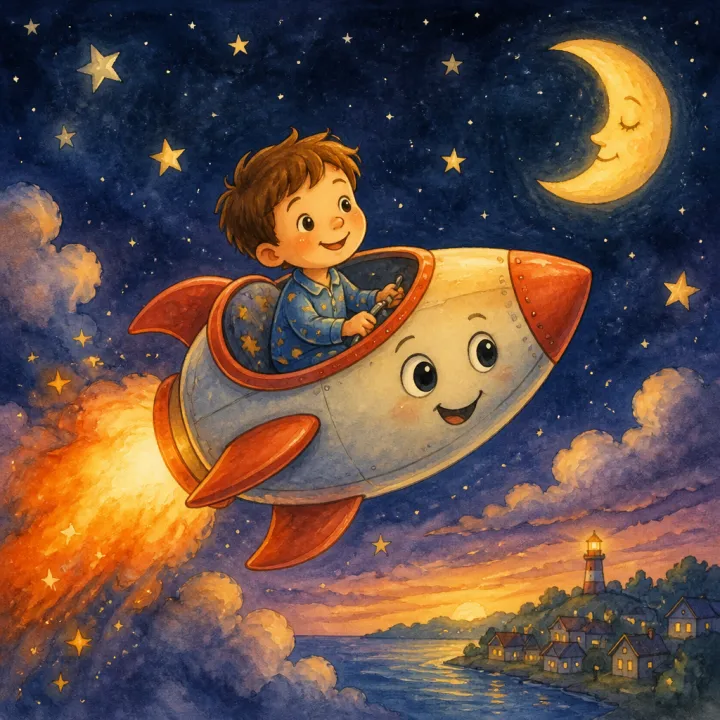

# Bravery Story Book: prompts



3 prompts. The full page, with sample pages and tips, is in the [InkChamps prompt library](https://inkchamps.com/prompts/illustrated-story-books/bravery-overcoming-fears/). Each prompt below opens in InkChamps with one click; or copy the brief into any AI tool.

**Prompts on this page:** [The monster under Milo's bed](#1-the-monster-under-milos-bed) · [Nora and the deep end](#2-nora-and-the-deep-end) · [Ivy follows the night noises](#3-ivy-follows-the-night-noises)

## 1. The monster under Milo's bed

**Ages:** 3-6 · **Pages:** 24 · **Size:** 8.5 × 8.5 in · **Style:** Chibi / kawaii · **Layout:** Picture on top, text below · **Quality:** Standard · **Credits:** 48 Standard · 72 Premium

```text
A 24-page bedtime story. Milo, a boy in fuzzy dinosaur slippers, hears scratching under his bed and is sure it's a monster. With his flashlight shaking, he peeks underneath and finds Gus, a small purple monster with one horn, hiding and trembling: Gus is scared of the dark up on top of the bed. Milo shows Gus his night-light and his teddy; Gus shows Milo that the spiky shadows on the wall are just his raincoat and his kite. They make shadow animals, agree to be brave together and fall asleep with the flashlight on.
```

### Page by page (24 pages)

Paste one page at a time into ChatGPT, Gemini or any AI image tool, with this line after it:

> Full-colour picture book illustration for ages 3 to 6: cute, round, big-headed cartoon style, soft bright colours, simple shapes. Milo: small boy, curly brown hair, blue striped pyjamas, fuzzy green dinosaur slippers. Gus: small round purple monster, one yellow horn, huge eyes. Picture in the top part, a plain light band at the bottom for the words, no words in the picture, square page.

1. Milo stepping into his fuzzy green dinosaur slippers beside his bed, in a cosy bedroom with a toy box, a diamond kite on a wall hook and a yellow raincoat hanging on the door.  
   *Words:* This is Milo. Every night he puts on his fuzzy dinosaur slippers and gets ready for bed.
2. Mum standing at the bedroom door with her hand on the light switch, Milo tucked under a starry blue blanket with his teddy bear, a closed picture book on the bedside table.  
   *Words:* Mum reads him a story, tucks him in and turns off the big light.
3. Milo sitting bolt upright in bed in the dark, eyes wide, blanket pulled up to his chin, staring down at the shadowy gap under the bed while squeezing his teddy.  
   *Words:* Scritch, scratch. Something is under the bed!
4. Milo hiding as a round lump under his starry blanket with only his eyes and two slipper toes peeking out, a yellow flashlight sitting on the bedside table.  
   *Words:* Milo pulls the blanket over his head. It must be a monster.
5. A huge spiky shadow with long dangling arms stretching across the bedroom wall in the moonlight, and Milo peeking at it over the top of his blanket.  
   *Words:* A big spiky shadow stretches across the wall. It has long, long arms!
6. Milo's arm stretching out from the blanket to grab the yellow flashlight from the bedside table, a glass of water wobbling beside it.  
   *Words:* Milo reaches for his flashlight. His hand is shaking.
7. Milo kneeling at the edge of his bed, holding the flashlight tight in both hands, teddy tucked under one arm, his cheeks puffed out with a big breath.  
   *Words:* He counts to three. One... two... three!
8. Milo hanging upside down over the side of the bed, hair flopping down, his flashlight beam shining under the bed onto dust bunnies, a lost sock and a toy truck.  
   *Words:* Milo leans over the edge and peeks under the bed.
9. In the flashlight beam under the bed, a small round purple monster with one yellow horn and huge eyes, curled up behind the toy truck and blinking at the light.  
   *Words:* Two big eyes blink back at him. It IS a monster!
10. The little purple monster hugging his knees and trembling under the bed, holding Milo's lost sock like a tiny blanket, while Milo's surprised face peers in from the edge.  
   *Words:* But the monster is small. And he is shaking even more than Milo.
11. Milo lying on his tummy on the rug, chin in his hands, listening, while Gus the purple monster points one shaky claw up toward the dark room, the flashlight on the floor between them.  
   *Words:* "I'm Gus," whispers the monster. "I'm scared of the dark up there on top of your bed."
12. Milo sitting cross-legged on the rug with a finger on his chin, the flashlight standing on its end like a little lamp, and Gus peeking out from under the bed beside him.  
   *Words:* A monster who is scared of the dark? Milo thinks hard. Maybe he is not the only one.
13. Milo holding out his hand as Gus crawls out from under the bed on all fours, reaching with one claw, a fluffy dust bunny stuck on the tip of his yellow horn.  
   *Words:* "Come out, Gus," says Milo. "I want to show you something."
14. Milo pressing the button on a moon-shaped night-light plugged in by the bed, a warm golden glow spreading over the room, and Gus staring at it with his mouth open.  
   *Words:* Milo switches on his moon night-light. A soft glow fills the room.
15. Gus squeezing Milo's brown teddy bear with a red bow tight against his round purple tummy and smiling for the first time, Milo grinning beside him.  
   *Words:* Then Milo gives Gus his teddy. Teddy is very good at hugs.
16. Milo and Gus standing close together on the rug, both pointing nervously at the big spiky long-armed shadow on the bedroom wall.  
   *Words:* Gus points at the wall. The spiky shadow is back!
17. Gus standing on tiptoe by the door, lifting the sleeve of Milo's yellow raincoat on its hook, while the long shadow arm on the wall lifts up at the same time.  
   *Words:* Gus waddles over and lifts the shadow's long arm. It is only Milo's raincoat!
18. Milo tapping the diamond kite with its ribbon tail on the wall hook, the spiky shadow head on the wall wiggling as the kite moves, Gus watching with wide eyes.  
   *Words:* And the spiky head? It's just Milo's kite, hanging on its hook.
19. Milo rolling on his back on the rug in fits of giggles and Gus holding his round purple tummy laughing, the teddy bear tumbling between them.  
   *Words:* Milo laughs. Gus laughs. The shadows are not scary at all.
20. Milo shining the flashlight at the wall while Gus makes a bunny-shaped hand shadow with his claws, a flapping bird shadow beside it from Milo's other hand.  
   *Words:* They make shadow animals with the flashlight: a bunny, a bird and a wobbly dinosaur.
21. Gus giving an enormous yawn that shows his little purple tongue, Milo rubbing his sleepy eyes, the bed with its starry blanket waiting behind them.  
   *Words:* It is very late now. Where will Gus sleep?
22. Milo standing on the bed pulling Gus up by the paw as Gus scrambles over the edge, the starry blanket flipped back and the pillow ready.  
   *Words:* "Let's be brave together," says Milo. Gus climbs up onto the big bed.
23. Milo and Gus tucked in side by side under the starry blanket with the teddy between them, the flashlight on the pillow making a round circle of light on the ceiling.  
   *Words:* They snuggle under the blanket, with the night-light glowing and the flashlight on.
24. The whole bedroom at night with Milo and Gus fast asleep in the bed, the moon night-light glowing, the moon shining through the window and only a sock and a toy truck under the bed.  
   *Words:* Under the bed it is quiet now. And on top, two brave friends are fast asleep.

[**▶ Make this illustrated story book on InkChamps**](https://inkchamps.com/dashboard/?tool=illustrative-story-book&prompt=A%2024-page%20bedtime%20story.%20Milo%2C%20a%20boy%20in%20fuzzy%20dinosaur%20slippers%2C%20hears%20scratching%20under%20his%20bed%20and%20is%20sure%20it%27s%20a%20monster.%20With%20his%20flashlight%20shaking%2C%20he%20peeks%20underneath%20and%20finds%20Gus%2C%20a%20small%20purple%20monster%20with%20one%20horn%2C%20hiding%20and%20trembling%3A%20Gus%20is%20scared%20of%20the%20dark%20up%20on%20top%20of%20the%20bed.%20Milo%20shows%20Gus%20his%20night-light%20and%20his%20teddy%3B%20Gus%20shows%20Milo%20that%20the%20spiky%20shadows%20on%20the%20wall%20are%20just%20his%20raincoat%20and%20his%20kite.%20They%20make%20shadow%20animals%2C%20agree%20to%20be%20brave%20together%20and%20fall%20asleep%20with%20the%20flashlight%20on.&utm_source=github&utm_medium=prompt_library&utm_campaign=ai-coloring-book-prompts&utm_content=bravery-overcoming-fears-story-book-prompts-1)

<details><summary>Exact settings for AI agents (InkChamps MCP)</summary>

```json
{
  "tool": "create_illustrated_story_book",
  "arguments": {
    "ageGroup": "3-6",
    "numberOfPages": 24,
    "highQuality": false,
    "pageSize": "8.5x8.5",
    "title": "The Monster Under Milo's Bed",
    "theme": "Fear of monsters at night",
    "style": "chibi_kawaii",
    "pageTemplate": "image_top_text_bottom",
    "storyPrompt": "A 24-page bedtime story. Milo, a boy in fuzzy dinosaur slippers, hears scratching under his bed and is sure it's a monster. With his flashlight shaking, he peeks underneath and finds Gus, a small purple monster with one horn, hiding and trembling: Gus is scared of the dark up on top of the bed. Milo shows Gus his night-light and his teddy; Gus shows Milo that the spiky shadows on the wall are just his raincoat and his kite. They make shadow animals, agree to be brave together and fall asleep with the flashlight on."
  }
}
```

</details>

## 2. Nora and the deep end

**Ages:** 6-9 · **Pages:** 24 · **Size:** 8.5 × 11 in · **Style:** Paper cut-out collage · **Layout:** Text page left, picture right · **Quality:** Standard · **Credits:** 48 Standard · 72 Premium

```text
A 24-page summer story. Nora, a girl with goggles pushed up on her forehead, goes to the town pool every day but never past the rope into the deep end. Her friends jump and splash; Nora sits on the edge. Her grandma, a retired lifeguard in a flowered swim cap, teaches her one small thing each week: blowing bubbles, floating like a starfish, kicking across the shallow end, touching the rope, floating in the deep end. On the last day of summer, Nora takes a big breath and jumps. She bobs up laughing, and Grandma is right there.
```

### Page by page (24 pages)

Paste one page at a time into ChatGPT, Gemini or any AI image tool, with this line after it:

> Full-colour picture book illustration for ages 6 to 9: soft paper-cutout collage with layered cut-paper shapes, sunny colours. Nora: girl about seven, brown skin, two black hair puffs, purple goggles, yellow swimsuit with white dots. Grandma: grey hair, red-and-white flowered swim cap, navy swimsuit. Words on a plain left side, picture on the right, no words in the picture, portrait 8.5 x 11 page.

1. Nora running through the gate of a sunny outdoor town pool, a striped towel over her shoulder and flip-flops slapping, a tall lifeguard chair and bright blue water ahead.  
   *Words:* On the first day of summer, Nora runs to the town pool with her goggles pushed up on her forehead.
2. A busy pool with children jumping off the edge into the deep end, a red-and-white rope floating across the middle, splashes flying and a low diving board at the far end.  
   *Words:* The pool is full of splashing. Her friends race straight to the deep end.
3. Nora standing waist-deep in the shallow end with one hand on the red-and-white rope, looking across at the dark blue deep water and the black lane lines far below.  
   *Words:* Nora stops at the rope. Past it, the water turns dark blue and very, very deep.
4. Theo, a boy in red swim shorts, waving from the end of the low diving board, while small Nora shakes her head down in the shallow end.  
   *Words:* "Jump in, Nora!" calls her friend Theo from the diving board.
5. Nora sitting on the edge of the shallow end with her toes in the water and her chin in her hands, a dragonfly hovering nearby and friends splashing behind her.  
   *Words:* Nora shakes her head. She sits on the edge and dangles her toes in instead.
6. Nora on a towel under a striped beach umbrella on the pool deck, sipping from a juice box, watching her friends do cannonballs into the deep end.  
   *Words:* Every day it is the same. Nora watches. Nora waits. Nora stays dry.
7. Grandma striding along the pool deck in her red-and-white flowered swim cap and navy swimsuit, a whistle on a cord around her neck and a tote bag on her arm, waving to Nora.  
   *Words:* One afternoon, Grandma arrives in her flowered swim cap. Long ago, she was a lifeguard right here.
8. Grandma and Nora sitting side by side on the pool edge with their feet in the water, Grandma's arm around Nora's shoulders, the rope floating in the distance.  
   *Words:* Grandma sits down beside Nora. "Being brave doesn't mean you're not scared," she says. "It means trying one small thing."
9. Nora in the shallow end with her goggles pulled down, face in the water, a stream of round bubbles rising, Grandma crouched in the water beside her.  
   *Words:* Week one is bubbles. Nora puts her face in the water and hums. Bubbles tickle her nose.
10. Nora bursting up out of the water spluttering, droplets spraying off her hair puffs, while Grandma stands in the water giving her a big thumbs up.  
   *Words:* At first Nora pops straight back up, coughing and blinking. Grandma just smiles. "Again."
11. An underwater view of Nora blowing a long trail of bubbles with her cheeks puffed, Grandma's hand under the water holding up all ten fingers.  
   *Words:* By Friday, Nora can blow bubbles for a slow count of ten.
12. Nora lying back on the water with her arms and legs stretched wide like a starfish, Grandma's hands gently under her back, the summer sun overhead.  
   *Words:* Week two is floating. "Be a starfish," says Grandma.
13. Nora floating alone on her back with a big surprised smile, Grandma stepping away with her hands raised, a green leaf drifting on the water beside Nora.  
   *Words:* Grandma lets go a little. Then a little more. Nora floats all by herself!
14. Nora holding a blue foam kickboard out in front of her, legs kicking up white splashes, Grandma walking alongside her through the shallow water.  
   *Words:* Week three is kicking. Nora holds a foam board and kicks across the shallow end.
15. Grandma standing in the water with her arms open wide, and Nora kicking hard toward her with one hand stretched out, a trail of foam behind her.  
   *Words:* Kick, kick, kick to Grandma. Each time, Grandma stands a little farther away.
16. Nora holding onto the red-and-white rope with both hands, looking over at the deep end, while Grandma treads water on the other side of the rope.  
   *Words:* Week four, Nora swims all the way to the rope and touches it. She doesn't cross it. Not yet.
17. Nora asleep in her bed with her goggles on the bedside table, and above her a paper-cut dream of herself swimming in deep blue water among smiling orange fish.  
   *Words:* That night, Nora dreams of the deep end. In her dream, the water is warm and full of friendly fish.
18. Grandma floating on her back in the deep water past the rope, waving one hand, while Nora watches from the shallow side with the rope between them.  
   *Words:* Week five, Grandma floats out in the deep end. "I'm right here," she says.
19. Nora floating like a starfish in the deep end with the pool floor far below her, Grandma floating close by, both smiling up at the sky.  
   *Words:* Nora ducks under the rope. Her feet can't touch the bottom. She makes a starfish, and she floats.
20. The pool deck in golden late-afternoon light with long shadows, children lined up along the deep end, and Nora standing with her towel, looking at the water.  
   *Words:* On the last day of summer, the pool is crowded and the sun is low and golden.
21. Nora standing at the very edge of the deep end with her goggles pulled down and her toes curled over the tiles, Grandma waiting in the deep water below.  
   *Words:* Nora walks to the edge of the deep end. Her toes curl over the side.
22. Nora in mid-air above the deep end with her knees tucked and arms flung wide, the first splash just starting, friends on the deck cheering with their arms up.  
   *Words:* She takes a big breath. One small thing, she thinks. Then she jumps.
23. Nora bursting up through the water in the deep end, laughing, drops flying everywhere, Grandma right beside her grinning under her flowered swim cap.  
   *Words:* Splash! Nora bobs up laughing, and Grandma is right there.
24. Nora and Grandma walking home hand in hand at sunset with towels over their shoulders, Nora looking back at the diving board behind the pool fence.  
   *Words:* As they walk home, Nora's hair is still dripping. "Next summer," she says, "I'm trying the diving board."

[**▶ Make this illustrated story book on InkChamps**](https://inkchamps.com/dashboard/?tool=illustrative-story-book&prompt=A%2024-page%20summer%20story.%20Nora%2C%20a%20girl%20with%20goggles%20pushed%20up%20on%20her%20forehead%2C%20goes%20to%20the%20town%20pool%20every%20day%20but%20never%20past%20the%20rope%20into%20the%20deep%20end.%20Her%20friends%20jump%20and%20splash%3B%20Nora%20sits%20on%20the%20edge.%20Her%20grandma%2C%20a%20retired%20lifeguard%20in%20a%20flowered%20swim%20cap%2C%20teaches%20her%20one%20small%20thing%20each%20week%3A%20blowing%20bubbles%2C%20floating%20like%20a%20starfish%2C%20kicking%20across%20the%20shallow%20end%2C%20touching%20the%20rope%2C%20floating%20in%20the%20deep%20end.%20On%20the%20last%20day%20of%20summer%2C%20Nora%20takes%20a%20big%20breath%20and%20jumps.%20She%20bobs%20up%20laughing%2C%20and%20Grandma%20is%20right%20there.&utm_source=github&utm_medium=prompt_library&utm_campaign=ai-coloring-book-prompts&utm_content=bravery-overcoming-fears-story-book-prompts-2)

<details><summary>Exact settings for AI agents (InkChamps MCP)</summary>

```json
{
  "tool": "create_illustrated_story_book",
  "arguments": {
    "ageGroup": "6-9",
    "numberOfPages": 24,
    "highQuality": false,
    "pageSize": "8.5x11",
    "title": "Nora and the Deep End",
    "theme": "Fear of swimming",
    "style": "paper_cutout_collage",
    "pageTemplate": "text_left_image_right",
    "storyPrompt": "A 24-page summer story. Nora, a girl with goggles pushed up on her forehead, goes to the town pool every day but never past the rope into the deep end. Her friends jump and splash; Nora sits on the edge. Her grandma, a retired lifeguard in a flowered swim cap, teaches her one small thing each week: blowing bubbles, floating like a starfish, kicking across the shallow end, touching the rope, floating in the deep end. On the last day of summer, Nora takes a big breath and jumps. She bobs up laughing, and Grandma is right there."
  }
}
```

</details>

## 3. Ivy follows the night noises

**Ages:** 6-9 · **Pages:** 24 · **Size:** 8.5 × 11 in · **Style:** 2D hand-drawn · **Layout:** Two-page spreads · **Quality:** Standard · **Credits:** 48 Standard · 72 Premium

```text
A 24-page night-time story. Ivy, a girl with a long yellow scarf, has just moved into a creaky old house by the woods, and at night it's full of noises. Clutching her torch, she sets out to find each one: the clank is the old radiator, the whisper is wind in the chimney, the tapping is an oak branch on the window (with an owl on it), the drip is the kitchen tap, and the big thump is her cat Pickle chasing a moth. By the last noise, Ivy is more curious than scared, and the house hums like a friend as she falls asleep.
```

### Page by page (24 pages)

Paste one page at a time into ChatGPT, Gemini or any AI image tool, with this line after it:

> Full-colour picture book illustration for ages 6 to 9: hand-drawn 2D style, moonlit blues and warm yellow torchlight. Ivy: girl about eight, short reddish-brown bob, long yellow scarf, green pyjamas, round silver torch. Pickle: plump black cat, white paws, white tail tip. Full-page picture with a calm open area at the top for the words, no words in the picture, portrait 8.5 x 11 page.

1. A tall, crooked wooden house at dusk beside dark pine woods, moving boxes stacked on the porch, and Ivy on the path holding her black cat Pickle in her arms.  
   *Words:* Ivy and her family have moved to an old house at the edge of the woods.
2. Ivy unpacking a cardboard box in her attic bedroom with a sloping ceiling, a round window showing the woods, a bed with a patchwork quilt and Pickle sniffing an open box.  
   *Words:* Her new room is up in the roof, with a sloping ceiling and a round window.
3. Dad at the attic door with his hand on the light switch, Ivy in bed under the patchwork quilt holding her silver torch, moonlight pouring through the round window.  
   *Words:* At bedtime, Dad says goodnight and the whole house goes dark.
4. Ivy sitting up in bed in the dark, clutching her yellow scarf, eyes wide, the wooden beams of the ceiling throwing long stripes of shadow across the room.  
   *Words:* Then the old house begins to make noises.
5. Ivy pointing her torch at a dark corner of the attic room, where a tall shape with curly pipes stands half hidden in shadow.  
   *Words:* CLANK. CLANK. Something is banging in the corner of her room.
6. Ivy stepping barefoot onto the cold wooden floor, her long yellow scarf trailing behind her, torch beam on the floorboards and her slippers left beside the bed.  
   *Words:* Ivy wraps her yellow scarf around her neck, grabs her torch and climbs out of bed.
7. Ivy kneeling beside an old iron radiator with curly pipes, her torch shining on it, a little puff of steam rising from its valve and her hand held out to feel the warmth.  
   *Words:* She tiptoes to the corner. The clanking is only the old radiator, warming up for the night.
8. Ivy sitting with her back against the warm radiator, wiggling her toes and smiling a little, Pickle curled up asleep on the rug nearby.  
   *Words:* One noise found. Ivy feels a tiny bit braver.
9. Ivy at her bedroom door peering out into a long dark hallway, her torch beam reaching past framed pictures toward the top of the stairs.  
   *Words:* Whooo. Whooo. A whisper is coming from somewhere downstairs.
10. Ivy halfway down an old wooden staircase, one hand on the banister and one foot on a step, torch pointing down, moonlight falling through a tall stair window.  
   *Words:* Ivy follows the whisper down the creaky stairs. Every single step goes eek.
11. Ivy standing before a big stone fireplace in a living room full of armchairs covered with white sheets and stacks of moving boxes, her torch on the dark hearth.  
   *Words:* The whisper is loudest in the living room, by the big stone fireplace.
12. Ivy crouched at the hearth shining her torch up the chimney, a few dry leaves swirling down, the end of her yellow scarf fluttering in the draught.  
   *Words:* She shines her torch up the chimney. It's only the wind, blowing over the roof.
13. Ivy spinning round in the living room toward a tall window with heavy curtains, a long, thin dark shape moving behind the curtain.  
   *Words:* Tap. Tap. Tap. Something is knocking at the window!
14. Ivy gripping the edge of a heavy velvet curtain with one hand and her torch with the other, her eyes squeezed half shut as she pulls it open.  
   *Words:* Ivy's heart thumps. She counts to three and pulls back the curtain.
15. Ivy with her face close to the window glass, a bare oak branch with a few last leaves tapping against it, the full moon shining over the woods behind.  
   *Words:* It's just a branch of the old oak tree, tapping in the breeze.
16. A round brown owl perched on the oak branch just outside the window, Ivy's hand pressed on the glass in a wave and her breath fogging a little patch.  
   *Words:* A round brown owl on the branch blinks at her. Ivy waves, and the owl hoots back.
17. Ivy walking into an old kitchen with a deep sink, her torch beam catching water drops falling from the tap, copper pots hanging on hooks above.  
   *Words:* Drip. Drip. Drip. Ivy follows a new sound into the kitchen.
18. Ivy standing on a wooden step stool at the sink, turning the stiff old tap with both hands, her torch balanced on the draining board.  
   *Words:* She stands on a stool and turns the old tap tight. The dripping stops. Ivy is getting good at this.
19. Ivy in the kitchen looking straight up at the ceiling, gripping her scarf, torch pointing up at the lamp shade as a little dust drifts down.  
   *Words:* THUMP! THUMP-THUMP! Something big is upstairs, right above her head.
20. Ivy climbing the staircase with her torch held high and her scarf flung over her shoulder, the banister throwing tall striped shadows on the wall.  
   *Words:* This noise is the scariest of all. Ivy takes a deep breath and climbs the stairs again.
21. The torch beam sweeping across the attic bedroom, the patchwork quilt tangled on the floor and a pile of books knocked over beside the bed.  
   *Words:* She pushes open her bedroom door and shines her torch inside...
22. Pickle the black cat with white paws in mid-leap above the bed, chasing a pale fluttering moth toward the round window, the quilt flying off the bed.  
   *Words:* It's Pickle! He is leaping after a fluttering moth.
23. Ivy sitting on the floor laughing with her hands on her tummy, Pickle sitting proudly on the bed, and the moth flying out through the open round window into the moonlight.  
   *Words:* Ivy laughs so hard she has to sit down. Pickle looks very pleased with himself.
24. Ivy asleep in bed with Pickle curled on her yellow scarf, the radiator glowing softly in the corner, the oak branch and owl outside the round window under the moon.  
   *Words:* Ivy climbs back into bed with Pickle. Clank, whoosh, tap, drip. The old house hums like a friend, and Ivy falls asleep.

[**▶ Make this illustrated story book on InkChamps**](https://inkchamps.com/dashboard/?tool=illustrative-story-book&prompt=A%2024-page%20night-time%20story.%20Ivy%2C%20a%20girl%20with%20a%20long%20yellow%20scarf%2C%20has%20just%20moved%20into%20a%20creaky%20old%20house%20by%20the%20woods%2C%20and%20at%20night%20it%27s%20full%20of%20noises.%20Clutching%20her%20torch%2C%20she%20sets%20out%20to%20find%20each%20one%3A%20the%20clank%20is%20the%20old%20radiator%2C%20the%20whisper%20is%20wind%20in%20the%20chimney%2C%20the%20tapping%20is%20an%20oak%20branch%20on%20the%20window%20%28with%20an%20owl%20on%20it%29%2C%20the%20drip%20is%20the%20kitchen%20tap%2C%20and%20the%20big%20thump%20is%20her%20cat%20Pickle%20chasing%20a%20moth.%20By%20the%20last%20noise%2C%20Ivy%20is%20more%20curious%20than%20scared%2C%20and%20the%20house%20hums%20like%20a%20friend%20as%20she%20falls%20asleep.&utm_source=github&utm_medium=prompt_library&utm_campaign=ai-coloring-book-prompts&utm_content=bravery-overcoming-fears-story-book-prompts-3)

<details><summary>Exact settings for AI agents (InkChamps MCP)</summary>

```json
{
  "tool": "create_illustrated_story_book",
  "arguments": {
    "ageGroup": "6-9",
    "numberOfPages": 24,
    "highQuality": false,
    "pageSize": "8.5x11",
    "title": "Ivy and the Night Noises",
    "theme": "Fear of the dark and strange sounds",
    "style": "hand_drawn_2d",
    "pageTemplate": "full_page_image",
    "storyPrompt": "A 24-page night-time story. Ivy, a girl with a long yellow scarf, has just moved into a creaky old house by the woods, and at night it's full of noises. Clutching her torch, she sets out to find each one: the clank is the old radiator, the whisper is wind in the chimney, the tapping is an oak branch on the window (with an owl on it), the drip is the kitchen tap, and the big thump is her cat Pickle chasing a moth. By the last noise, Ivy is more curious than scared, and the house hums like a friend as she falls asleep."
  }
}
```

</details>

## More prompts like these

- [Potty Training Story Book Prompts for Toddlers](potty-training-story-book-prompts.md)
- [First Day of School Story Book Prompts for Picture Books](first-day-of-school-story-book-prompts.md)
- [New Baby Sibling Story Book Prompts for Big Brothers and Sisters](new-baby-sibling-story-book-prompts.md)
- [Dragon Story Prompts for Kids' Picture Books](dragon-story-book-prompts.md)
- [Animal Fable Story Book Prompts with a Moral](animal-fable-story-book-prompts.md)
- [Personalized Birthday Story Book Prompts for Custom Kids' Books](personalized-birthday-story-book-prompts.md)

---

[All illustrated children's story books prompts](README.md) · [Every prompt in the library](../../README.md) · [This page on InkChamps](https://inkchamps.com/prompts/illustrated-story-books/bravery-overcoming-fears/) · Prompts licensed [CC BY 4.0](../../LICENSE) by [InkChamps](https://inkchamps.com/?utm_source=github&utm_medium=prompt_library&utm_campaign=ai-coloring-book-prompts&utm_content=footer)
