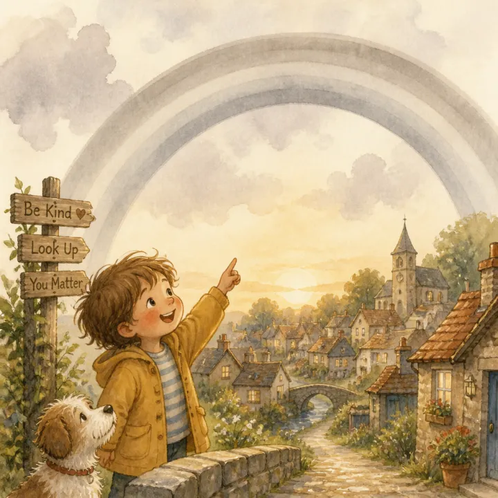

# Dragon Story Book: prompts



3 prompts. The full page, with sample pages and tips, is in the [InkChamps prompt library](https://inkchamps.com/prompts/illustrated-story-books/dragon/). Each prompt below opens in InkChamps with one click; or copy the brief into any AI tool.

**Prompts on this page:** [Saffron the dragon who feared fire](#1-saffron-the-dragon-who-feared-fire) · [Sir Wobbles and the dragon's toothache](#2-sir-wobbles-and-the-dragons-toothache) · [Saskia and the last dragon egg](#3-saskia-and-the-last-dragon-egg)

## 1. Saffron the dragon who feared fire

**Ages:** 3-6 · **Pages:** 24 · **Size:** 8.5 × 8.5 in · **Style:** Chibi / kawaii · **Layout:** Picture on top, text below · **Quality:** Standard · **Credits:** 48 Standard · 72 Premium

```text
Saffron, a small teal dragon with stubby wings and big amber eyes, is afraid of fire. When she sneezes, sparks fly out, so she hides in her cave. Toby, a village boy in a red knitted hat, helps her practice: a teeny flame to toast one marshmallow, then warming the cold bakery oven, then melting the ice on the duck pond. On the night of the Winter Lantern Festival, the wind blows every lantern out, and Saffron lights them all with her gentle flame. The village cheers for her, and she is not afraid anymore.
```

### Page by page (24 pages)

Paste one page at a time into ChatGPT, Gemini or any AI image tool, with this line after it:

> Full-colour picture-book illustration for ages 3 to 6: soft, round, cute style with big heads, big eyes and bright colours. Saffron is a small teal dragon with stubby wings, big amber eyes and a curly tail; Toby is a little boy in a red knitted hat and blue coat. Picture at the top, plain pale band at the bottom for the words, no words in the picture, square page.

1. Saffron peeking out of a round cave on a snowy hillside, the rooftops of a small village far below with smoke curling from the chimneys, a few pine trees dusted with snow.  
   *Words:* High on a snowy hill, in a cosy cave, lived a little teal dragon named Saffron.
2. Saffron standing proudly inside her cave with her stubby wings stretched out, a pile of soft patchwork blankets behind her and a row of shiny pebbles on a rocky shelf.  
   *Words:* Saffron had stubby wings, big amber eyes and a tail that curled like a snail shell.
3. Saffron covering her eyes with her claws and peeking nervously through them at a single candle flickering on a flat rock in her cave, her tail curled tight around her.  
   *Words:* But Saffron had a secret. She was afraid of fire.
4. Saffron in the middle of a big sneeze outside her cave, a shower of little orange sparks bursting from her nose, a feather floating away and startled snowflakes swirling.  
   *Words:* Whenever she sneezed, sparks flew out of her nose. Ah... ah... ACHOO!
5. Saffron curled up under a patchwork blanket on the cave floor with only one amber eye and the tip of her tail showing, a few tiny scorch marks on the rocks beside her.  
   *Words:* The sparks scared her so much that she hid under her blanket all day long.
6. Toby in his red knitted hat and blue coat trudging up a snowy path carrying a wicker basket, a line of small boot prints behind him and Saffron's cave at the top of the hill.  
   *Words:* One morning, a boy named Toby came up the hill with a basket.
7. Toby kneeling at the mouth of the cave and waving hello, while Saffron peeks out shyly from behind her blanket, the wicker basket set down in the snow.  
   *Words:* "Hello! I heard a sneeze," said Toby. "Are you all right?"
8. Saffron and Toby sitting side by side on a snowy log outside the cave, Saffron looking down sadly with drooping wings, Toby resting a mittened hand on her back.  
   *Words:* "I'm scared of my own fire," whispered Saffron. "It's too hot and too big."
9. Toby holding out a long stick with one fluffy white marshmallow on the end, a bag of marshmallows poking out of his basket, Saffron staring at it with wide worried eyes.  
   *Words:* Toby smiled. "Let's start teeny-tiny. Can you toast just one marshmallow?"
10. Saffron with her eyes squeezed shut, puffing a tiny careful flame at the marshmallow on Toby's stick, Toby leaning in excitedly with his mouth open in a big O.  
   *Words:* Saffron took a deep breath and puffed. Out came a flame as small as a candle.
11. Saffron holding the stick with a golden toasted marshmallow and grinning from ear to ear, Toby clapping his mittens together, snowflakes drifting down around them.  
   *Words:* The marshmallow turned golden brown. "I did it!" cheered Saffron.
12. Inside a warm wooden bakery with shelves of bread rolls, the round baker in a flour-dusted apron pointing sadly at a cold brick oven, Toby and Saffron standing by the door.  
   *Words:* The next day, Toby took Saffron to the village bakery. The big oven had gone cold.
13. Saffron breathing a gentle stream of flame into the arched opening of the brick oven, the baker holding a tray of round dough loaves and Toby cheering beside her.  
   *Words:* Saffron blew a soft, steady flame, and soon the oven glowed warm and orange.
14. The baker sliding golden loaves out of the glowing oven on a long wooden paddle, Saffron sniffing the air happily with her eyes closed, Toby holding a sticky bun.  
   *Words:* Out came warm loaves and sticky buns. The whole bakery smelled sweet.
15. An iced-over pond with three ducks standing on the ice looking glum, bare trees around the edge, Toby and Saffron arriving at the bank and looking at the ducks.  
   *Words:* Then they went to the pond, where the ice was too thick for the ducks to swim.
16. Saffron leaning over the pond edge breathing a soft warm flame, a round circle of blue water opening in the ice, two ducks already flapping toward it.  
   *Words:* Saffron breathed a warm, gentle flame, and the ice melted into a round pool.
17. The three ducks paddling happily in the melted pool, one lifting a wing like a wave, Saffron puffing out her chest with a proud smile and Toby laughing on the bank.  
   *Words:* "Quack, quack!" said the ducks. Saffron felt a little bit brave.
18. The village square at dusk, villagers on little ladders hanging round paper lanterns from strings between the houses, a tall decorated pine tree, Saffron peeking from behind a cart.  
   *Words:* That night was the Winter Lantern Festival. Everyone hung paper lanterns in the square.
19. Swirling gusts of wind sweeping through the square, the paper lanterns swinging dark on their strings, villagers holding onto their hats and scarves flying sideways.  
   *Words:* Then a big, cold wind went WHOOSH! Every single lantern blew out.
20. The dark square under a starry night sky, a group of children huddled together in their coats, Toby turning to look hopefully at Saffron.  
   *Words:* The square was dark, and the children were scared. "Who can help?" they asked.
21. Saffron standing alone in the dark square taking a deep breath, a cloud-shaped thought bubble above her showing a toasted marshmallow, a loaf of bread and a happy duck.  
   *Words:* Saffron's knees shook. Then she remembered the marshmallow, the oven and the pond.
22. Saffron flapping her stubby wings in the air and lighting a round paper lantern with a small flame, a row of lanterns behind her already glowing warm yellow.  
   *Words:* She flew from lantern to lantern, puffing a tiny flame into each one.
23. The village square glowing with dozens of lit lanterns, villagers cheering with their arms in the air, children dancing in a ring and Toby hugging Saffron tight.  
   *Words:* Soon the whole square glowed gold. "Hooray for Saffron!" everyone cheered.
24. Saffron and Toby sitting together on a snowy rooftop beside a glowing lantern, toasting marshmallows on sticks, the sleeping village and a big round moon behind them.  
   *Words:* Now Saffron lights the lanterns every winter, and she isn't afraid anymore.

[**▶ Make this illustrated story book on InkChamps**](https://inkchamps.com/dashboard/?tool=illustrative-story-book&prompt=Saffron%2C%20a%20small%20teal%20dragon%20with%20stubby%20wings%20and%20big%20amber%20eyes%2C%20is%20afraid%20of%20fire.%20When%20she%20sneezes%2C%20sparks%20fly%20out%2C%20so%20she%20hides%20in%20her%20cave.%20Toby%2C%20a%20village%20boy%20in%20a%20red%20knitted%20hat%2C%20helps%20her%20practice%3A%20a%20teeny%20flame%20to%20toast%20one%20marshmallow%2C%20then%20warming%20the%20cold%20bakery%20oven%2C%20then%20melting%20the%20ice%20on%20the%20duck%20pond.%20On%20the%20night%20of%20the%20Winter%20Lantern%20Festival%2C%20the%20wind%20blows%20every%20lantern%20out%2C%20and%20Saffron%20lights%20them%20all%20with%20her%20gentle%20flame.%20The%20village%20cheers%20for%20her%2C%20and%20she%20is%20not%20afraid%20anymore.&utm_source=github&utm_medium=prompt_library&utm_campaign=ai-coloring-book-prompts&utm_content=dragon-story-book-prompts-1)

<details><summary>Exact settings for AI agents (InkChamps MCP)</summary>

```json
{
  "tool": "create_illustrated_story_book",
  "arguments": {
    "ageGroup": "3-6",
    "numberOfPages": 24,
    "highQuality": false,
    "pageSize": "8.5x8.5",
    "title": "The Dragon Who Was Afraid of Fire",
    "theme": "Turning a fear into a gift",
    "style": "chibi_kawaii",
    "pageTemplate": "image_top_text_bottom",
    "storyPrompt": "Saffron, a small teal dragon with stubby wings and big amber eyes, is afraid of fire. When she sneezes, sparks fly out, so she hides in her cave. Toby, a village boy in a red knitted hat, helps her practice: a teeny flame to toast one marshmallow, then warming the cold bakery oven, then melting the ice on the duck pond. On the night of the Winter Lantern Festival, the wind blows every lantern out, and Saffron lights them all with her gentle flame. The village cheers for her, and she is not afraid anymore."
  }
}
```

</details>

## 2. Sir Wobbles and the dragon's toothache

**Ages:** 6-9 · **Pages:** 24 · **Size:** 8.5 × 11 in · **Style:** Comic book · **Layout:** Picture on top, text below · **Quality:** Standard · **Credits:** 48 Standard · 72 Premium

```text
Sir Wobbles, a clumsy young knight whose armor is three sizes too big, is sent to stop the dragon roaring on the mountain. He clanks up the path on his round pony, trips over his sword and lands right on the dragon's nose. But the dragon, a big red fellow named Grumbold, isn't angry. He has a terrible toothache from eating the baker's toffee. Sir Wobbles fetches Dr. Molar, the castle dentist, they tie a rope to the tooth, the whole kingdom pulls, and pop! Grumbold becomes the kingdom's best friend.
```

### Page by page (24 pages)

Paste one page at a time into ChatGPT, Gemini or any AI image tool, with this line after it:

> Full-colour comic-style picture-book illustration for ages 6 to 9: bold ink outlines, bright flat colours, funny faces. Sir Wobbles is a skinny boy knight in shiny silver armor three sizes too big and a red-plumed helmet; Grumbold is a huge red dragon with a yellow belly. Picture at the top, plain band at the bottom for the words, no words or speech bubbles, portrait 8.5 x 11 page.

1. Sir Wobbles standing in a sunny castle courtyard in his oversized armor, his helmet slipped down over his eyes and his lance held upside down, chickens scattering around his feet.  
   *Words:* In the kingdom of Crumblewick, there lived a young knight named Sir Wobbles.
2. Sir Wobbles clanking down a spiral stone staircase, one metal glove flying off his hand and a ginger cat leaping out of the way, his red plume bouncing.  
   *Words:* His armor was three sizes too big, so he clanked, clonked and wobbled wherever he went.
3. A castle town with rattling windows and swinging shop signs, villagers covering their ears, a tall rocky mountain behind with puffs of smoke rising from the top.  
   *Words:* One morning, a terrible ROAR rolled down from the mountain. Every window in the castle rattled.
4. The throne room, a line of big knights all stepping backward, Sir Wobbles stumbling forward on a loose boot, the round King with a long white beard raising his eyebrows.  
   *Words:* The King called his knights. "Who will stop the dragon?" Everyone stepped back, except Sir Wobbles, who tripped forward.
5. The King tapping Sir Wobbles' helmet with a golden scepter so the helmet clangs down over his nose, a court jester in a jingly hat giggling behind his hand.  
   *Words:* "Sir Wobbles it is!" said the King. Sir Wobbles gulped.
6. Sir Wobbles riding a short, round brown pony out through the castle gate, a sandwich bag hanging from the saddle, villagers waving and a little girl holding up a flag.  
   *Words:* He set off on his pony, Pudding, with his sword, his shield and a bag of jam sandwiches.
7. Sir Wobbles climbing a zigzag rocky path up the mountain, his long sword catching on a rock, the round pony plodding behind him chewing a tuft of grass.  
   *Words:* The mountain path was steep and twisty. Clank. Clonk. Oops!
8. Pine trees shaking and birds flying off in a hurry, Sir Wobbles peeking around a big boulder with his knees knocking and his shield held up like a door.  
   *Words:* The roars grew louder. The trees shook. Sir Wobbles' knees knocked together.
9. Sir Wobbles flying through the air with his arms flailing, his sword spinning below him and his helmet popping off, the dark opening of a dragon's cave just ahead.  
   *Words:* At the top, he tripped over his own sword and flew through the air...
10. Sir Wobbles sitting on the snout of an enormous red dragon, the dragon gone cross-eyed looking up at him, a cloud of dust around the cave entrance.  
   *Words:* ...and landed right on the dragon's nose. BONK!
11. Grumbold lying in front of his cave with one cheek swollen up like a giant melon, a big tear rolling down his face, Sir Wobbles still perched on his nose.  
   *Words:* The dragon was huge and red, with a yellow belly. But he didn't look fierce. He looked miserable.
12. Grumbold holding his swollen cheek with one claw and groaning, a knitted scarf tied around his head and jaw, Sir Wobbles sliding down his long snout to the ground.  
   *Words:* "Ow, ow, owwww," moaned the dragon. "I'm Grumbold, and I have a terrible toothache."
13. A heap of empty toffee wrappers and a giant empty toffee tin beside the cave, Grumbold looking guilty, Sir Wobbles standing on tiptoe to peer into his open jaws.  
   *Words:* "I ate all of the baker's toffee," sniffed Grumbold. "Now my tooth wobbles even more than you do."
14. Sir Wobbles clanking downhill as fast as he can with the round pony galloping beside him, Grumbold waving a sad claw from the cave above.  
   *Words:* Sir Wobbles had an idea. "Wait right here. I know just who can help!"
15. Dr. Molar, a short dentist with tiny round glasses, a white apron and a grey bun, riding behind Sir Wobbles on the pony, holding huge pliers and a little mirror on a stick.  
   *Words:* He fetched Dr. Molar, the castle dentist, with her giant pliers and her tiny round glasses.
16. A long parade climbing the mountain path: the King, the baker in his white hat, children with coils of rope, a farmer carrying a tall ladder and Sir Wobbles in front.  
   *Words:* When the kingdom heard the roar was only a toothache, everyone came along with ropes and ladders.
17. Dr. Molar at the top of a tall ladder leaning into Grumbold's wide-open mouth with a lantern and her little mirror, rows of huge white teeth, Sir Wobbles holding the ladder steady.  
   *Words:* Dr. Molar climbed a ladder and peered into Grumbold's mouth. "There's the wobbly one!"
18. Dr. Molar holding her pliers up beside a dragon tooth as tall as she is and shrugging, while Sir Wobbles holds up a big coil of rope with a hopeful grin.  
   *Words:* But the pliers were far too small for a dragon tooth. "We need a rope!" said Dr. Molar.
19. Sir Wobbles balancing on Grumbold's lower lip, tying a huge loopy knot around one giant tooth, his helmet tipped sideways and Grumbold's eyes watering.  
   *Words:* Sir Wobbles tied the rope around the tooth with a big, wobbly knot.
20. A long line of people holding the rope down the hillside like a tug-of-war, the King at the front, the baker and the children behind, the pony gripping the end in its teeth.  
   *Words:* The whole kingdom grabbed the rope: the King, the baker, the children and even Pudding the pony.
21. Everyone leaning far back on the rope with their heels dug into the ground and their cheeks puffed out, Grumbold squeezing his eyes shut and gripping a rock with his claws.  
   *Words:* "One, two, three... PULL!" They pulled and pulled and PULLED.
22. The big tooth flying through the air in an arc, a tumbled heap of people, legs and hats at the bottom of the hill, Sir Wobbles on top with his helmet on backward.  
   *Words:* POP! Out came the tooth, and everyone tumbled into a giant heap.
23. Grumbold grinning a wide smile with a gap in his front teeth, gently scooping Sir Wobbles into a hug with one claw, the villagers laughing and Dr. Molar giving a thumbs-up.  
   *Words:* Grumbold smiled a gappy smile. "Thank you! I feel wonderful!"
24. A festival in the castle courtyard, children riding on Grumbold's back, Sir Wobbles waving from his nose, Grumbold's giant tooth shown on a stand and a basket of apples nearby.  
   *Words:* From then on, Grumbold was the kingdom's best friend. He gave rides on Sundays and never ate toffee again.

[**▶ Make this illustrated story book on InkChamps**](https://inkchamps.com/dashboard/?tool=illustrative-story-book&prompt=Sir%20Wobbles%2C%20a%20clumsy%20young%20knight%20whose%20armor%20is%20three%20sizes%20too%20big%2C%20is%20sent%20to%20stop%20the%20dragon%20roaring%20on%20the%20mountain.%20He%20clanks%20up%20the%20path%20on%20his%20round%20pony%2C%20trips%20over%20his%20sword%20and%20lands%20right%20on%20the%20dragon%27s%20nose.%20But%20the%20dragon%2C%20a%20big%20red%20fellow%20named%20Grumbold%2C%20isn%27t%20angry.%20He%20has%20a%20terrible%20toothache%20from%20eating%20the%20baker%27s%20toffee.%20Sir%20Wobbles%20fetches%20Dr.%20Molar%2C%20the%20castle%20dentist%2C%20they%20tie%20a%20rope%20to%20the%20tooth%2C%20the%20whole%20kingdom%20pulls%2C%20and%20pop%21%20Grumbold%20becomes%20the%20kingdom%27s%20best%20friend.&utm_source=github&utm_medium=prompt_library&utm_campaign=ai-coloring-book-prompts&utm_content=dragon-story-book-prompts-2)

<details><summary>Exact settings for AI agents (InkChamps MCP)</summary>

```json
{
  "tool": "create_illustrated_story_book",
  "arguments": {
    "ageGroup": "6-9",
    "numberOfPages": 24,
    "highQuality": false,
    "pageSize": "8.5x11",
    "title": "Sir Wobbles and the Dragon's Toothache",
    "theme": "A funny knight-and-dragon tale",
    "style": "comic_book",
    "pageTemplate": "image_top_text_bottom",
    "storyPrompt": "Sir Wobbles, a clumsy young knight whose armor is three sizes too big, is sent to stop the dragon roaring on the mountain. He clanks up the path on his round pony, trips over his sword and lands right on the dragon's nose. But the dragon, a big red fellow named Grumbold, isn't angry. He has a terrible toothache from eating the baker's toffee. Sir Wobbles fetches Dr. Molar, the castle dentist, they tie a rope to the tooth, the whole kingdom pulls, and pop! Grumbold becomes the kingdom's best friend."
  }
}
```

</details>

## 3. Saskia and the last dragon egg

**Ages:** 6-9 · **Pages:** 24 · **Size:** 8.5 × 11 in · **Style:** Anime · **Layout:** Two-page spreads · **Quality:** Premium · **Credits:** 48 Standard · 72 Premium

```text
Saskia, a girl from a snowy mountain village with a fur-trimmed red cloak, finds an egg glowing warm in the snow. It hatches into a silver dragon she names Cinder. She feeds him, teaches him to fly on the icy lake and hides him in the barn, but he grows too big, and the villagers grow afraid. Saskia knows Cinder belongs with the dragons above the clouds. She rides him to the highest peak and says goodbye. Every spring after, a silver dragon circles the village, and the snow melts early.
```

### Page by page (24 pages)

Paste one page at a time into ChatGPT, Gemini or any AI image tool, with this line after it:

> Full-colour cinematic picture-book illustration for ages 6 to 9: expressive characters with large eyes, glowing light, soft painted skies. Saskia is a girl with a long dark braid and a red cloak trimmed with white fur; Cinder is a silver dragon with pale blue eyes. Picture fills the whole page, with a calm patch of sky or snow for the words, no words in the picture, portrait 8.5 x 11 page.

1. A snowy mountain village of wooden houses with steep roofs and glowing windows, Saskia in her red cloak pulling a wooden sled down the lane, tall white peaks behind.  
   *Words:* In a mountain village where winter lasted half the year, there lived a girl named Saskia.
2. Saskia in a pine forest at dusk with an armful of sticks, turning toward a soft golden glow beneath a snowdrift, long blue shadows across the snow.  
   *Words:* One evening, while she was gathering firewood, she saw something glowing in the snow.
3. Close view of Saskia kneeling in the snow with her mittens off, cradling a large silver speckled egg that glows in her hands, snowflakes melting as they touch it.  
   *Words:* It was an egg, silver and speckled, and as warm as fresh bread.
4. A cosy cottage room with a stone hearth, the egg nestled in a basket of wool by the fire, Saskia lying on the rug with her chin in her hands and a grey cat sniffing the basket.  
   *Words:* She carried it home, wrapped it in wool and set it beside the fire.
5. A tiny silver dragon with pale blue eyes poking out of the cracked shell, pieces of shell on the rug, Saskia in her nightgown holding a candle and gasping with delight.  
   *Words:* At midnight, the egg cracked. Out tumbled a tiny silver dragon.
6. Saskia sitting by the fire holding the kitten-sized dragon in her arms as he sneezes a small ring of smoke, her braid falling over her shoulder, both of them laughing.  
   *Words:* He sneezed a puff of warm smoke. "I'll call you Cinder," she whispered.
7. Saskia walking through the snowy village with little Cinder peeking out of her red hood, a roasted chestnut in his claws and a small jug of milk in her hand.  
   *Words:* Cinder loved warm goat's milk, roasted chestnuts and sleeping inside Saskia's hood.
8. Inside an old wooden barn lit by a hanging lantern, Cinder curled in a nest of hay behind the bales, Saskia putting a finger to her lips and two goats watching.  
   *Words:* Saskia hid him in the old barn behind the hay bales, where no one ever looked.
9. Pony-sized Cinder squeezed into a barn stall with his tail knocking over a milk bucket, Saskia standing on a stool to measure his neck with a long ribbon.  
   *Words:* Every day, Cinder grew bigger. Soon he was the size of a goat, and then the size of a pony.
10. Cinder sliding across an icy lake with his wings spread and his legs splayed, Saskia running beside him with her arms out like wings, snowy pines around the shore.  
   *Words:* On the icy lake, Saskia taught him to fly. He flapped, he slid, and he flopped.
11. Cinder rising into a clear blue sky above the white lake, sunlight sparkling on his silver scales, Saskia jumping below with both arms in the air.  
   *Words:* Then one bright morning, Cinder lifted into the sky, and Saskia cheered until her voice was hoarse.
12. Saskia riding on Cinder's back high above the village, her red cloak streaming behind her, tiny golden windows far below and ribbons of green light across the starry sky.  
   *Words:* At night, they flew together above the sleeping village, under a sky full of stars.
13. The old barn with Cinder's big head and long neck sticking up through broken roof boards, snow sliding off the roof, Saskia in the doorway with her hands over her mouth.  
   *Words:* But Cinder kept on growing. One morning, his head poked straight through the barn roof.
14. Villagers hurrying children indoors and banging wooden shutters closed, a man holding a broom in front of him, Cinder standing by the barn looking hurt and confused.  
   *Words:* The villagers saw him. "A dragon!" they cried, and they slammed their doors and shutters.
15. Cinder curled up in the snowy field beside the broken barn with his wings folded over his head, Saskia hugging his neck and pressing her cheek to his scales.  
   *Words:* Cinder hid his face under his wings. He did not understand why they were afraid of him.
16. Cinder and Saskia sitting on a hilltop at night, looking up at a full moon where faint dragon shapes glide among the clouds, the village dark below.  
   *Words:* That night, Cinder stared at the clouds, where shapes like dragons drifted across the moon.
17. Saskia resting her forehead against Cinder's nose with a tear on her cheek, a small lantern glowing in the snow beside them, his pale blue eyes half closed.  
   *Words:* Saskia's heart ached, but she knew. "You belong up there, with the other dragons."
18. A pink and gold dawn sky, Cinder flying past jagged snowy peaks with Saskia holding on tight, the village a tiny cluster of roofs far below.  
   *Words:* At dawn, she climbed onto his back, and they flew toward the highest peak.
19. A sea of soft clouds with sunlit peaks rising out of it, huge dragons in gold, deep blue and white resting on the summits, Cinder gliding down to land among them.  
   *Words:* Above the clouds was a land of ice and gold, where great dragons slept on the mountaintops.
20. An enormous old golden dragon with a long curled beard lowering her head toward small Saskia, Cinder standing between them on the ice with his wings folded.  
   *Words:* An old golden dragon bowed her head to Saskia. "Thank you for keeping him warm."
21. Saskia hugging Cinder's neck with her eyes closed while he wraps one silver wing around her, the wind blowing her red cloak and the golden dragons watching quietly.  
   *Words:* Saskia hugged Cinder one last time. "Don't forget me," she said.
22. Saskia standing at her cottage door at sunset holding a shining silver scale in her open palm, Cinder flying away toward the clouds, his shadow sweeping over the snow.  
   *Words:* Cinder carried her home and left a single silver scale in her hand.
23. Saskia sitting at a frosted cottage window at night with the silver scale hanging on a string around her neck, a candle on the sill and snow falling outside.  
   *Words:* The winter was long, and Saskia missed him every single day.
24. A spring meadow where snow is melting into green grass and yellow flowers, villagers waving at a silver dragon circling overhead, Saskia waving with both arms.  
   *Words:* But every spring, a silver dragon circles the village, and wherever his shadow falls, the snow melts early.

[**▶ Make this illustrated story book on InkChamps**](https://inkchamps.com/dashboard/?tool=illustrative-story-book&prompt=Saskia%2C%20a%20girl%20from%20a%20snowy%20mountain%20village%20with%20a%20fur-trimmed%20red%20cloak%2C%20finds%20an%20egg%20glowing%20warm%20in%20the%20snow.%20It%20hatches%20into%20a%20silver%20dragon%20she%20names%20Cinder.%20She%20feeds%20him%2C%20teaches%20him%20to%20fly%20on%20the%20icy%20lake%20and%20hides%20him%20in%20the%20barn%2C%20but%20he%20grows%20too%20big%2C%20and%20the%20villagers%20grow%20afraid.%20Saskia%20knows%20Cinder%20belongs%20with%20the%20dragons%20above%20the%20clouds.%20She%20rides%20him%20to%20the%20highest%20peak%20and%20says%20goodbye.%20Every%20spring%20after%2C%20a%20silver%20dragon%20circles%20the%20village%2C%20and%20the%20snow%20melts%20early.&utm_source=github&utm_medium=prompt_library&utm_campaign=ai-coloring-book-prompts&utm_content=dragon-story-book-prompts-3)

<details><summary>Exact settings for AI agents (InkChamps MCP)</summary>

```json
{
  "tool": "create_illustrated_story_book",
  "arguments": {
    "ageGroup": "6-9",
    "numberOfPages": 24,
    "highQuality": true,
    "pageSize": "8.5x11",
    "title": "The Last Dragon Egg",
    "theme": "Love and letting go",
    "style": "anime",
    "pageTemplate": "full_page_image",
    "storyPrompt": "Saskia, a girl from a snowy mountain village with a fur-trimmed red cloak, finds an egg glowing warm in the snow. It hatches into a silver dragon she names Cinder. She feeds him, teaches him to fly on the icy lake and hides him in the barn, but he grows too big, and the villagers grow afraid. Saskia knows Cinder belongs with the dragons above the clouds. She rides him to the highest peak and says goodbye. Every spring after, a silver dragon circles the village, and the snow melts early."
  }
}
```

</details>

## More prompts like these

- [Animal Fable Story Book Prompts with a Moral](animal-fable-story-book-prompts.md)
- [Personalized Birthday Story Book Prompts for Custom Kids' Books](personalized-birthday-story-book-prompts.md)
- [Kindness and Sharing Story Book Prompts for Kids](kindness-and-sharing-story-book-prompts.md)
- [Bedtime Story Prompts for Kids: AI Picture Book Ideas](bedtime-story-book-prompts.md)
- [Friendship Story Prompts for Kids' Picture Books](friendship-story-book-prompts.md)
- [Bravery Story Book Prompts: Picture Books About Overcoming Fears](bravery-overcoming-fears-story-book-prompts.md)

---

[All illustrated children's story books prompts](README.md) · [Every prompt in the library](../../README.md) · [This page on InkChamps](https://inkchamps.com/prompts/illustrated-story-books/dragon/) · Prompts licensed [CC BY 4.0](../../LICENSE) by [InkChamps](https://inkchamps.com/?utm_source=github&utm_medium=prompt_library&utm_campaign=ai-coloring-book-prompts&utm_content=footer)
