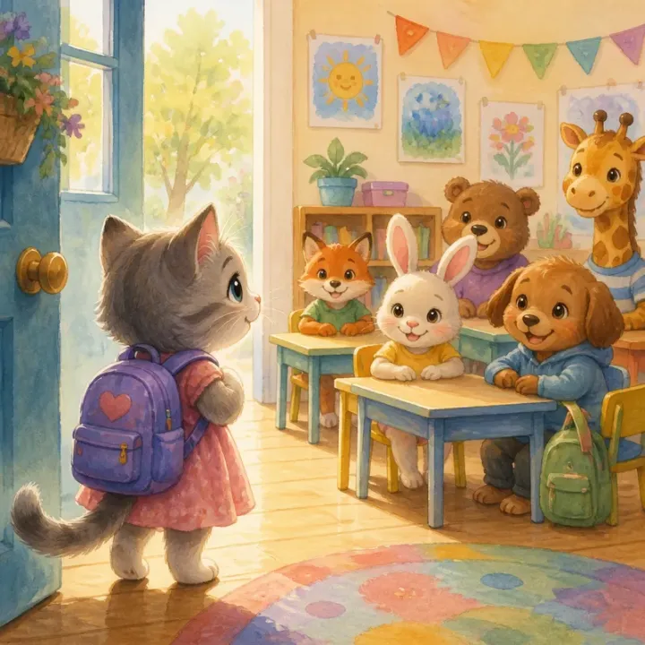

# First Day of School Story Book: prompts



3 prompts. The full page, with sample pages and tips, is in the [InkChamps prompt library](https://inkchamps.com/prompts/illustrated-story-books/first-day-of-school/). Each prompt below opens in InkChamps with one click; or copy the brief into any AI tool.

**Prompts on this page:** [Kit's lunchbox note](#1-kits-lunchbox-note) · [Gemma the very tall giraffe](#2-gemma-the-very-tall-giraffe) · [The teacher who was nervous too](#3-the-teacher-who-was-nervous-too)

## 1. Kit's lunchbox note

**Ages:** 3-6 · **Pages:** 24 · **Size:** 8.5 × 8.5 in · **Style:** 2D hand-drawn · **Layout:** Picture on top, text below · **Quality:** Standard · **Credits:** 48 Standard · 72 Premium

```text
A 24-page story. Kit, a little fox cub with a too-big blue backpack, starts school at Hollow Oak, a school inside a giant oak tree. She holds her dad's paw until the very last second. All morning Kit feels wobbly: the classroom is loud, she doesn't know the songs, and she misses home. At lunch she opens her box and finds a note from Dad with a drawing of two foxes holding paws. Kit feels warm inside, shares her crackers with a shy owlet named Wren, and at pickup she has a drawing of her own for Dad.
```

### Page by page (24 pages)

Paste one page at a time into ChatGPT, Gemini or any AI image tool, with this line after it:

> Full-colour picture book illustration for ages 3 to 6, warm hand-drawn 2D style, soft outlines, simple shapes. Kit: small orange fox cub, white chest and tail tip, yellow striped T-shirt, too-big blue backpack. Dad: tall orange fox, grey sweater, round glasses. Wren: tiny brown owlet, green knitted hat. Plain area at the bottom for text, no words in the picture, square page.

1. Kit, the little fox cub, waking up in her cosy den bedroom, rubbing her eyes in a patchwork bed, her too-big blue backpack waiting by the round wooden door.  
   *Words:* Today is Kit's very first day at Hollow Oak School.
2. Kit sitting at the kitchen table in the den, nibbling one corner of her toast, a full cup of milk and a bowl of berries untouched beside her.  
   *Words:* Kit's tummy feels wobbly. She can only eat half her toast.
3. Dad fox at the kitchen counter packing Kit's red lunchbox with crackers and apple slices, secretly tucking in a folded paper note while Kit looks the other way.  
   *Words:* Dad packs her lunch: crackers, apple slices, and something else Kit doesn't see.
4. Kit by the front door putting on her huge blue backpack, leaning backwards and almost tipping over, Dad catching her with one paw and laughing.  
   *Words:* Her new blue backpack is so big it nearly tips her over.
5. Kit holding Dad's paw tightly as they walk down a winding forest path, autumn leaves on the ground and a rabbit family with backpacks walking ahead.  
   *Words:* Kit holds Dad's paw all the way down the forest path.
6. Hollow Oak School: a giant old oak tree with a round red door, little windows in its trunk, a brass bell over the door and young animals arriving below.  
   *Words:* There it is: Hollow Oak School, inside the biggest tree in the whole wood.
7. Kit at the school door clinging to Dad's paw with both of hers, while Mrs. Burrow, a kind grey badger teacher in a flowered apron, smiles and waits.  
   *Words:* Kit holds on until the very last second. "I'll be back at pickup," says Dad.
8. Kit inside the classroom pressing her nose to the window glass, waving to Dad, who waves back from the path as he walks away under the trees.  
   *Words:* Dad waves. Kit waves back. Then he is gone.
9. A busy, noisy classroom inside the tree: bunnies hopping, two squirrels chattering on a bench, a hedgehog dropping blocks, and Kit standing alone in the middle.  
   *Words:* The classroom is loud. Bunnies hop, squirrels chatter, and Kit doesn't know anyone.
10. Mrs. Burrow showing Kit a row of wooden coat hooks, pointing to one with a little fox sticker above it, Kit hanging up her big blue backpack.  
   *Words:* Mrs. Burrow shows Kit her very own hook, with a little fox sticker above it.
11. The class sitting in a circle on a leaf-shaped rug singing with open mouths and clapping paws, Kit sitting quietly in the circle with her paws in her lap.  
   *Words:* Everyone sings the morning song. Kit doesn't know the words, so she just listens.
12. Kit at a paint table with jars of bright paint, painting a picture of her den with a round door, a single tear on her cheek, her brush dripping orange.  
   *Words:* At the painting table, Kit paints her den. It makes her miss home even more.
13. Wren, a tiny brown owlet, sitting alone in the reading corner on a big cushion, peeking out shyly from behind a picture book, Kit noticing her from across the room.  
   *Words:* In the corner sits a tiny owlet. She looks wobbly too.
14. The school playground under the oak's branches, classmates on a rope swing and a log seesaw, Kit standing by the wooden fence looking down the path toward home.  
   *Words:* At playtime, Kit stands by the fence and thinks about Dad.
15. Everyone sitting along a long log table for lunch with their lunchboxes, a bunny with a carrot and a squirrel with nuts, Kit setting her red lunchbox down.  
   *Words:* Then the lunch bell rings. Everyone sits at the long log table.
16. Kit opening her red lunchbox, a folded paper note lying on top of the crackers and apple slices, her ears perked up in surprise.  
   *Words:* Kit opens her lunchbox. On top of the crackers is a folded note.
17. Close-up of Kit's paws holding open the paper note, which shows a simple crayon drawing of a big fox and a little fox holding paws under a red heart.  
   *Words:* Inside is a drawing of two foxes holding paws. Kit knows exactly who drew it.
18. Kit hugging the note to her chest with her eyes closed and a big smile, a soft warm glow around her at the lunch table.  
   *Words:* Kit feels warm all over, like a hug from Dad.
19. Kit holding out her crackers to Wren, who sits next to her at the log table looking sadly into an empty lunch bag.  
   *Words:* Wren has forgotten her snack. Kit holds out her crackers. "Want to share?"
20. Kit and Wren side by side at the log table munching crackers and giggling, crumbs on the table and Wren's wings fluffed up happily.  
   *Words:* Wren takes one and smiles. Crunch, crunch. Soon they are both giggling.
21. Kit and Wren at a low table drawing with fat crayons, Kit carefully drawing a picture of two foxes and an owl, Wren drawing a tree beside her.  
   *Words:* In the afternoon, Kit draws a picture of her own, just for Dad.
22. Story time on the leaf rug, Mrs. Burrow in a rocking chair reading a big picture book aloud, Kit and Wren sitting close together at the front.  
   *Words:* At story time, Kit and Wren sit side by side on the rug.
23. Afternoon at the school gate, Dad fox waiting with open arms, Kit running toward him with her drawing held high and her blue backpack bouncing.  
   *Words:* At pickup, there is Dad, right where he said he'd be!
24. Kit and Dad walking home along the forest path at sunset, paws held, Dad holding up Kit's drawing, Wren waving goodbye from a branch behind them.  
   *Words:* Kit gives Dad her drawing: two foxes and one new friend. "Can I come back tomorrow?" she asks.

[**▶ Make this illustrated story book on InkChamps**](https://inkchamps.com/dashboard/?tool=illustrative-story-book&prompt=A%2024-page%20story.%20Kit%2C%20a%20little%20fox%20cub%20with%20a%20too-big%20blue%20backpack%2C%20starts%20school%20at%20Hollow%20Oak%2C%20a%20school%20inside%20a%20giant%20oak%20tree.%20She%20holds%20her%20dad%27s%20paw%20until%20the%20very%20last%20second.%20All%20morning%20Kit%20feels%20wobbly%3A%20the%20classroom%20is%20loud%2C%20she%20doesn%27t%20know%20the%20songs%2C%20and%20she%20misses%20home.%20At%20lunch%20she%20opens%20her%20box%20and%20finds%20a%20note%20from%20Dad%20with%20a%20drawing%20of%20two%20foxes%20holding%20paws.%20Kit%20feels%20warm%20inside%2C%20shares%20her%20crackers%20with%20a%20shy%20owlet%20named%20Wren%2C%20and%20at%20pickup%20she%20has%20a%20drawing%20of%20her%20own%20for%20Dad.&utm_source=github&utm_medium=prompt_library&utm_campaign=ai-coloring-book-prompts&utm_content=first-day-of-school-story-book-prompts-1)

<details><summary>Exact settings for AI agents (InkChamps MCP)</summary>

```json
{
  "tool": "create_illustrated_story_book",
  "arguments": {
    "ageGroup": "3-6",
    "numberOfPages": 24,
    "highQuality": false,
    "pageSize": "8.5x8.5",
    "title": "Kit's Lunchbox Note",
    "theme": "Missing home on the first day",
    "style": "hand_drawn_2d",
    "pageTemplate": "image_top_text_bottom",
    "storyPrompt": "A 24-page story. Kit, a little fox cub with a too-big blue backpack, starts school at Hollow Oak, a school inside a giant oak tree. She holds her dad's paw until the very last second. All morning Kit feels wobbly: the classroom is loud, she doesn't know the songs, and she misses home. At lunch she opens her box and finds a note from Dad with a drawing of two foxes holding paws. Kit feels warm inside, shares her crackers with a shy owlet named Wren, and at pickup she has a drawing of her own for Dad."
  }
}
```

</details>

## 2. Gemma the very tall giraffe

**Ages:** 3-6 · **Pages:** 24 · **Size:** 8.5 × 8.5 in · **Style:** Chibi / kawaii · **Layout:** Picture on top, text below · **Quality:** Standard · **Credits:** 48 Standard · 72 Premium

```text
A 24-page story. Gemma, a young giraffe with a purple neck scarf, is so tall she has to duck through the classroom door. Her desk is too small, her knees knock the table, crayons fly and the other animals giggle. At recess Gemma hides behind a tree. Then Pip the zebra kicks the class ball over the hedge, and nobody can find it, except Gemma, who spots it from way up high. Her classmates cheer, the elephant teacher Mr. Tusk gives her the window seat, and Gemma decides being tall is just right.
```

### Page by page (24 pages)

Paste one page at a time into ChatGPT, Gemini or any AI image tool, with this line after it:

> Full-colour picture book illustration for ages 3 to 6, cute rounded kawaii style with big heads and big shiny eyes. Gemma: young yellow giraffe, brown patches, purple scarf. Mr. Tusk: grey elephant, red bow tie. Pip: baby zebra. Bo: round hippo. Lulu: small brown monkey. Plain area at the bottom for text, no words in the picture, square page.

1. Gemma, a young giraffe, standing in front of a mirror at home tying her purple scarf around her long neck, a new yellow book bag on the floor beside her.  
   *Words:* Gemma the giraffe ties on her purple scarf. Today is her first day of school.
2. Gemma and Mama giraffe walking across the sunny savanna toward school, past flat-topped acacia trees that only reach up to Gemma's shoulders.  
   *Words:* She walks to school with Mama, past the acacia trees. Gemma is taller than all of them.
3. Sunny Plains School, a small round hut with a grass roof, a very low doorway and flower pots by the step, Gemma looking down at it from way up high.  
   *Words:* Sunny Plains School is small and round, with a very low door.
4. Gemma bending her long neck almost to the floor to squeeze through the low doorway, her purple scarf trailing on the ground behind her.  
   *Words:* Gemma has to duck way, way down to get inside.
5. Mr. Tusk, a big grey elephant teacher in a red bow tie, waving his trunk in welcome at the classroom door, a little chalkboard and a globe behind him.  
   *Words:* "Welcome, Gemma!" says Mr. Tusk, the elephant teacher, with a great big smile.
6. A classroom full of tiny wooden desks and chairs, little classmates already seated: a baby zebra, a round hippo, a monkey and a meerkat, all looking up at Gemma.  
   *Words:* Everyone else is little. Their desks are little. Their chairs are little too.
7. Gemma folded up at a tiny desk, her knees poking up past her chin and her neck bent sideways under the ceiling, a pencil cup in front of her.  
   *Words:* Gemma squeezes into her desk. Her knees poke up past her chin.
8. Gemma's knees bumping the desk, crayons flying into the air and rolling across the floor, the zebra, hippo and monkey giggling behind their hooves and hands.  
   *Words:* Bump! Her knees knock the table. Crayons roll everywhere, and the class giggles.
9. Gemma with pink cheeks and droopy ears, looking down at her hooves, a small tear in one big shiny eye, her scarf pulled up over her chin.  
   *Words:* Gemma's cheeks go pink. She wishes she were small.
10. Story time on a round rug, Mr. Tusk holding up a picture book, Gemma's long neck in the way and the little meerkat behind her standing on tiptoe to see.  
   *Words:* At story time, nobody behind her can see the pictures. "Sorry," whispers Gemma.
11. The classmates rushing out of the hut toward a grassy playground with a red ball, Gemma stepping out slowly last, a school bell swinging by the door.  
   *Words:* Ring, ring! It's time to play outside.
12. Gemma trying to hide behind a skinny tree, her spotted body covered but her long neck and head sticking out above the leaves.  
   *Words:* Gemma hides behind a tree. Well, most of her does.
13. Pip the zebra kicking a red ball high into the air on the playground, Bo the hippo and Lulu the monkey cheering beside him.  
   *Words:* Pip the zebra gives the red ball a mighty kick.
14. The red ball sailing high over a tall green hedge at the edge of the playground, the classmates watching with open mouths.  
   *Words:* Whoosh! The ball flies right over the tall hedge.
15. The little classmates searching at the bottom of the hedge, the meerkat peering under it, Pip jumping up, Bo looking puzzled.  
   *Words:* Everyone looks and looks. Nobody can see over the hedge.
16. Lulu the monkey standing on top of Bo the hippo's head, stretching up on tiptoes, still not tall enough to see over the hedge.  
   *Words:* Lulu the monkey climbs onto Bo the hippo. Still too short!
17. Gemma peeking out from behind her tree, then stretching her long neck up, up, up, her purple scarf fluttering in the breeze.  
   *Words:* Gemma peeks out from her tree. Then she stretches up, up, up.
18. The view over the hedge from Gemma's height: long golden grass, a small pond and the red ball nestled in the grass beside a sleepy tortoise.  
   *Words:* From way up high, she spots the red ball, hiding in the long grass.
19. Gemma leaning her long neck over the hedge and gently nudging the red ball back toward the playground with her nose.  
   *Words:* Gemma leans right over the hedge and nudges the ball back.
20. The classmates jumping and cheering around Gemma's legs, Bo hugging one of her legs, Lulu swinging from her scarf, the red ball safe in Pip's hooves.  
   *Words:* "Hooray for Gemma!" everyone cheers.
21. Gemma playing catch with her classmates, stretching high to catch a ball nobody else can reach, Pip and the meerkat laughing below.  
   *Words:* "Play with us!" says Pip. Gemma catches every high ball.
22. Back in the classroom, Mr. Tusk placing a big round cushion under the tall window just for Gemma, a little potted plant on the sill.  
   *Words:* Back inside, Mr. Tusk gives Gemma a special seat by the tall window.
23. Gemma looking out of the tall window and calling to the class, who crowd below her, Mama giraffe's head visible far away on the savanna.  
   *Words:* "I can see Mama coming!" Gemma tells everyone.
24. Gemma and Mama walking home across the savanna at sunset, Gemma holding her head high, her friends waving goodbye from the school door.  
   *Words:* Gemma walks home with her head held high. Being tall, she decides, is just right.

[**▶ Make this illustrated story book on InkChamps**](https://inkchamps.com/dashboard/?tool=illustrative-story-book&prompt=A%2024-page%20story.%20Gemma%2C%20a%20young%20giraffe%20with%20a%20purple%20neck%20scarf%2C%20is%20so%20tall%20she%20has%20to%20duck%20through%20the%20classroom%20door.%20Her%20desk%20is%20too%20small%2C%20her%20knees%20knock%20the%20table%2C%20crayons%20fly%20and%20the%20other%20animals%20giggle.%20At%20recess%20Gemma%20hides%20behind%20a%20tree.%20Then%20Pip%20the%20zebra%20kicks%20the%20class%20ball%20over%20the%20hedge%2C%20and%20nobody%20can%20find%20it%2C%20except%20Gemma%2C%20who%20spots%20it%20from%20way%20up%20high.%20Her%20classmates%20cheer%2C%20the%20elephant%20teacher%20Mr.%20Tusk%20gives%20her%20the%20window%20seat%2C%20and%20Gemma%20decides%20being%20tall%20is%20just%20right.&utm_source=github&utm_medium=prompt_library&utm_campaign=ai-coloring-book-prompts&utm_content=first-day-of-school-story-book-prompts-2)

<details><summary>Exact settings for AI agents (InkChamps MCP)</summary>

```json
{
  "tool": "create_illustrated_story_book",
  "arguments": {
    "ageGroup": "3-6",
    "numberOfPages": 24,
    "highQuality": false,
    "pageSize": "8.5x8.5",
    "title": "Gemma Goes to School",
    "theme": "Feeling different on the first day",
    "style": "chibi_kawaii",
    "pageTemplate": "image_top_text_bottom",
    "storyPrompt": "A 24-page story. Gemma, a young giraffe with a purple neck scarf, is so tall she has to duck through the classroom door. Her desk is too small, her knees knock the table, crayons fly and the other animals giggle. At recess Gemma hides behind a tree. Then Pip the zebra kicks the class ball over the hedge, and nobody can find it, except Gemma, who spots it from way up high. Her classmates cheer, the elephant teacher Mr. Tusk gives her the window seat, and Gemma decides being tall is just right."
  }
}
```

</details>

## 3. The teacher who was nervous too

**Ages:** 6-9 · **Pages:** 24 · **Size:** 8.5 × 11 in · **Style:** Colored pencil · **Layout:** Text page left, picture right · **Quality:** Standard · **Credits:** 48 Standard · 72 Premium

```text
A 24-page story. Jayden, a boy with a brand-new rocket backpack, is nervous about first grade. So is his teacher, Ms. Okafor, who has bright braids and polka-dot glasses. It's her first day at this school too. Pages switch between them: both can't eat breakfast, both check their bags three times, both have butterflies. When Jayden finds Ms. Okafor's lost name badge in the hallway, they share a secret: they're both nervous. She makes him her helper, and by home time they've decided first days are better together.
```

### Page by page (24 pages)

Paste one page at a time into ChatGPT, Gemini or any AI image tool, with this line after it:

> Full-colour picture book illustration for ages 6 to 9, soft coloured-pencil style. Jayden: 6-year-old boy, brown skin, short curly black hair, green hoodie, red rocket backpack. Ms. Okafor: young woman, dark skin, long braids with bright beads, polka-dot glasses, orange dress. Plain area on the left for text, picture on the right, no words in the picture, portrait 8.5 x 11 page.

1. Jayden sitting up in bed at dawn in his space-themed bedroom, wide awake before his alarm clock rings, his new rocket backpack waiting on a chair.  
   *Words:* Jayden woke up before his alarm. Today he was starting first grade, and his tummy already felt fizzy.
2. Ms. Okafor in her small apartment at dawn, standing at a mirror practising a smile, her lesson notes and a tote bag on the bed behind her.  
   *Words:* Across town, Ms. Okafor was awake early too. It was her first day teaching at Maple Street School.
3. Jayden at the kitchen table pushing cereal around his bowl with a spoon, his mom in a work shirt pouring juice and watching him kindly.  
   *Words:* Jayden stared at his cereal. "I'm not hungry," he told Mom.
4. Ms. Okafor at her own kitchen table, a slice of toast untouched on her plate, both hands wrapped around a steaming mug, a potted plant on the sill.  
   *Words:* Ms. Okafor stared at her toast. She wasn't hungry either.
5. Jayden kneeling on his bedroom floor with the rocket backpack open, lining up pencils, a lunchbox and a water bottle to check them one more time.  
   *Words:* Jayden checked his rocket backpack. Pencils, lunch, water bottle. Then he checked it again. And again.
6. Ms. Okafor at her front door rummaging in her tote bag, holding up a pack of markers, a roll of star stickers and her shiny new name badge.  
   *Words:* Ms. Okafor checked her bag three times: markers, stickers and her shiny new name badge.
7. Jayden walking to school holding Mom's hand along a tree-lined sidewalk, a swirl of small colourful butterflies drawn around his tummy.  
   *Words:* On the walk to school, Jayden's tummy was full of butterflies.
8. Ms. Okafor walking up the same street with her tote bag on her shoulder, the same kind of colourful butterflies swirling around her tummy.  
   *Words:* A few streets away, so was Ms. Okafor's.
9. The big red-brick front of Maple Street School with wide steps and a flagpole, crowds of children and parents, Jayden looking up at it with Mom.  
   *Words:* Maple Street School looked enormous. There were so many kids, and Jayden didn't know a single one.
10. Ms. Okafor in an empty, sunny classroom setting name cards on small desks, an alphabet border and a solar-system poster on the wall behind her.  
   *Words:* In Room 4, Ms. Okafor set out name cards. Her hands were a little shaky.
11. Ms. Okafor hurrying down a school hallway carrying a tall box of books, her name badge slipping off her tote bag and falling to the floor behind her.  
   *Words:* She hurried down the hallway with a box of books. She didn't notice something slip from her bag.
12. Jayden in the busy hallway, lined with coat hooks and lockers, bending down to pick up something shiny from the floor while other kids rush past.  
   *Words:* Jayden was looking for Room 4 when he spotted something shiny on the floor.
13. Close-up of Jayden's hands holding the name badge, which shows a small photo of a smiling woman with bright braids and polka-dot glasses.  
   *Words:* It was a name badge, with a photo of a lady with bright braids and polka-dot glasses.
14. Jayden peeking through the doorway of Room 4, where Ms. Okafor is searching through her desk drawers with a worried face, papers everywhere.  
   *Words:* In Room 4, the very same lady was searching her desk. "Oh no," she said. "Where is it?"
15. Jayden standing by the teacher's desk holding out the badge, Ms. Okafor turning around with her hand on her heart in relief.  
   *Words:* Jayden held out the badge. "Is this yours?"
16. Ms. Okafor kneeling down to Jayden's height and whispering behind her hand, Jayden leaning in to listen, the empty desks around them.  
   *Words:* Ms. Okafor knelt down. "Thank you," she whispered. "Can I tell you a secret? It's my first day here too."
17. Jayden and Ms. Okafor laughing together by the desk, Jayden pointing at his tummy, Ms. Okafor pointing at hers, two little butterflies flying away.  
   *Words:* "Mine too," said Jayden. "I couldn't eat my breakfast." "Neither could I!" laughed Ms. Okafor.
18. Ms. Okafor handing Jayden the stack of name cards and pinning a small star sticker on his hoodie, Jayden standing tall and proud.  
   *Words:* She asked Jayden to be her special helper and gave him a star sticker for his hoodie.
19. The classroom filling with new first graders, Jayden handing a name card to a girl with puffy pigtails while a boy in a striped shirt waits his turn.  
   *Words:* Jayden gave each new classmate their card. He learned everyone's name first.
20. Ms. Okafor at the front of the class pointing to a planet on the solar-system poster, Jayden in the front row with his hand shooting up eagerly.  
   *Words:* Then Ms. Okafor began a lesson about space. Jayden knew all about rockets, and his hand shot right up.
21. The school cafeteria, Jayden at a table with two new friends, Mia and Sam, sharing apple slices and drawing rockets on a napkin together.  
   *Words:* At lunch, Jayden sat with Mia and Sam, who loved space just as much as he did.
22. Ms. Okafor in the staff room laughing with two other teachers over cups of tea, a plate of cookies on the table, her tote bag at her feet.  
   *Words:* In the staff room, Ms. Okafor laughed with the other teachers. Her butterflies were gone.
23. At home time, Ms. Okafor standing at the classroom door saying goodbye to the class, giving Jayden a wink while he grins back with his rocket backpack on.  
   *Words:* At home time, Ms. Okafor and Jayden shared a secret smile.
24. Jayden walking home with Mom on the tree-lined sidewalk in the afternoon sun, talking excitedly with his arms spread wide like a rocket.  
   *Words:* "How was your first day?" asked Mom. "Great," said Jayden. "First days are better together."

[**▶ Make this illustrated story book on InkChamps**](https://inkchamps.com/dashboard/?tool=illustrative-story-book&prompt=A%2024-page%20story.%20Jayden%2C%20a%20boy%20with%20a%20brand-new%20rocket%20backpack%2C%20is%20nervous%20about%20first%20grade.%20So%20is%20his%20teacher%2C%20Ms.%20Okafor%2C%20who%20has%20bright%20braids%20and%20polka-dot%20glasses.%20It%27s%20her%20first%20day%20at%20this%20school%20too.%20Pages%20switch%20between%20them%3A%20both%20can%27t%20eat%20breakfast%2C%20both%20check%20their%20bags%20three%20times%2C%20both%20have%20butterflies.%20When%20Jayden%20finds%20Ms.%20Okafor%27s%20lost%20name%20badge%20in%20the%20hallway%2C%20they%20share%20a%20secret%3A%20they%27re%20both%20nervous.%20She%20makes%20him%20her%20helper%2C%20and%20by%20home%20time%20they%27ve%20decided%20first%20days%20are%20better%20together.&utm_source=github&utm_medium=prompt_library&utm_campaign=ai-coloring-book-prompts&utm_content=first-day-of-school-story-book-prompts-3)

<details><summary>Exact settings for AI agents (InkChamps MCP)</summary>

```json
{
  "tool": "create_illustrated_story_book",
  "arguments": {
    "ageGroup": "6-9",
    "numberOfPages": 24,
    "highQuality": false,
    "pageSize": "8.5x11",
    "title": "Ms. Okafor's First Day Too",
    "theme": "Everyone feels nervous sometimes",
    "style": "colored_pencil_sketch",
    "pageTemplate": "text_left_image_right",
    "storyPrompt": "A 24-page story. Jayden, a boy with a brand-new rocket backpack, is nervous about first grade. So is his teacher, Ms. Okafor, who has bright braids and polka-dot glasses. It's her first day at this school too. Pages switch between them: both can't eat breakfast, both check their bags three times, both have butterflies. When Jayden finds Ms. Okafor's lost name badge in the hallway, they share a secret: they're both nervous. She makes him her helper, and by home time they've decided first days are better together."
  }
}
```

</details>

## More prompts like these

- [New Baby Sibling Story Book Prompts for Big Brothers and Sisters](new-baby-sibling-story-book-prompts.md)
- [Dragon Story Prompts for Kids' Picture Books](dragon-story-book-prompts.md)
- [Animal Fable Story Book Prompts with a Moral](animal-fable-story-book-prompts.md)
- [Personalized Birthday Story Book Prompts for Custom Kids' Books](personalized-birthday-story-book-prompts.md)
- [Kindness and Sharing Story Book Prompts for Kids](kindness-and-sharing-story-book-prompts.md)
- [Bedtime Story Prompts for Kids: AI Picture Book Ideas](bedtime-story-book-prompts.md)

---

[All illustrated children's story books prompts](README.md) · [Every prompt in the library](../../README.md) · [This page on InkChamps](https://inkchamps.com/prompts/illustrated-story-books/first-day-of-school/) · Prompts licensed [CC BY 4.0](../../LICENSE) by [InkChamps](https://inkchamps.com/?utm_source=github&utm_medium=prompt_library&utm_campaign=ai-coloring-book-prompts&utm_content=footer)
