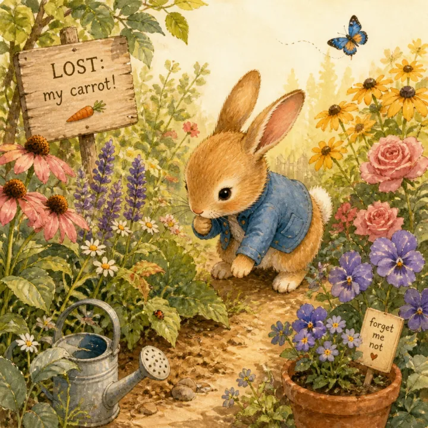

# Friendship Story Book: prompts



3 prompts. The full page, with sample pages and tips, is in the [InkChamps prompt library](https://inkchamps.com/prompts/illustrated-story-books/friendship/). Each prompt below opens in InkChamps with one click; or copy the brief into any AI tool.

**Prompts on this page:** [Pebble the tortoise and Dabble the duckling](#1-pebble-the-tortoise-and-dabble-the-duckling) · [Cog the clock-shop robot](#2-cog-the-clock-shop-robot) · [Mateo and Hana's balcony pulley](#3-mateo-and-hanas-balcony-pulley)

## 1. Pebble the tortoise and Dabble the duckling

**Ages:** 3-6 · **Pages:** 24 · **Size:** 8.5 × 8.5 in · **Style:** 2D hand-drawn · **Layout:** Picture on top, text below · **Quality:** Standard · **Credits:** 48 Standard · 72 Premium

```text
A 24-page picture book. Pebble, a careful tortoise with a moss-green shell, and Dabble, a splashy yellow duckling with one wonky feather, disagree about everything: Pebble likes slow walks and quiet, Dabble likes racing and quacking. When a storm floods the meadow, Dabble can swim but can't find the way home, and Pebble knows every path but can't swim. Pebble rides on Dabble's back and gives directions while she paddles past the fence post, the oak tree and the bridge. They get home together under a rainbow and decide being different is the best part.
```

### Page by page (24 pages)

Paste one page at a time into ChatGPT, Gemini or any AI image tool, with this line after it:

> Full-colour children's picture book illustration for ages 3 to 6, hand-drawn 2D style, soft flat colours, gentle outlines, simple scenes. Pebble: a small tortoise with a moss-green shell and brown eyes. Dabble: a fluffy yellow duckling with an orange beak and one wonky feather on her head. Picture at the top, plain light area at the bottom for the words, no words in the picture, square page.

1. Pebble the tortoise walking slowly along a grassy path through a sunny meadow, daisies and buttercups around him, a small round pond behind and a snail inching along beside him.  
   *Words:* Pebble the tortoise lived at the edge of a sunny meadow. He liked to take things slowly.
2. Dabble the duckling diving into the pond with a big splash, water drops flying everywhere, green reeds and round lily pads around her.  
   *Words:* Dabble the duckling lived by the pond. She liked to do everything fast!
3. Dabble tumbling head over tail into Pebble on the meadow path, a few yellow feathers floating in the air, Pebble peeking out of his shell with surprised eyes.  
   *Words:* One morning, Dabble zoomed around a bush and bumped right into Pebble. Bump! "Oops!" said Dabble.
4. Dabble flapping her little wings and pointing at a big oak tree on top of a green hill, while Pebble looks up the long path with a worried smile.  
   *Words:* "Let's be friends!" said Dabble. "Let's race to the big oak tree!"
5. Dabble asleep under the big oak tree with her head tucked under a wing, Pebble just arriving up the path, acorns on the ground and the sun lower in the sky.  
   *Words:* Dabble raced. Pebble walked. By the time Pebble got there, Dabble was fast asleep.
6. Dabble quacking loudly with her beak wide open and musical notes bouncing around her, Pebble beside her with his eyes squeezed shut, a ladybug on a nearby leaf.  
   *Words:* "Let's sing loud songs!" quacked Dabble. "I like quiet," said Pebble.
7. Pebble chewing a big yellow dandelion on the grass while Dabble dips her beak into the pond for green pondweed, a frog watching from a lily pad between them.  
   *Words:* Pebble liked to munch dandelions. Dabble liked to gobble pondweed.
8. Pebble napping on a flat warm rock with his eyes closed, while Dabble hops all around the rock chasing a blue butterfly.  
   *Words:* Pebble liked to nap in the warm sun. Dabble could not sit still for one minute.
9. Pebble and Dabble sitting back to back on a fallen log, both looking sad, Dabble's wonky feather drooping, a grey cloud far away over the hills.  
   *Words:* "We are too different to be friends," sighed Pebble. Dabble's wonky feather drooped.
10. Dark clouds rolling over the meadow, the wind bending the tall grass and flowers, Dabble alone by the reeds looking up at the sky and Pebble small in the distance.  
   *Words:* That afternoon, big dark clouds rolled over the meadow. Whoosh went the wind.
11. Heavy rain falling on the meadow, puddles joining into one big pool around the flowers, Dabble sheltering under a wide leaf with water rising around her feet.  
   *Words:* Rain poured down. Drip, drop, splash! The meadow began to fill with water.
12. Dabble swimming alone in the flooded meadow, only the tops of flowers and old fence posts poking out of the water, looking left and right with a lost face.  
   *Words:* Dabble swam round and round. The water had covered every path. Which way was home?
13. Pebble sitting on a rock on a tiny grassy hill with water all around it, raindrops falling, his front feet tucked in and a worried look on his face.  
   *Words:* On a little hill, Pebble sat on a rock. He knew every path in the meadow, but he could not swim.
14. Dabble paddling hard across the flooded meadow toward Pebble's little hill, a trail of ripples behind her, the rain getting lighter.  
   *Words:* "Pebble!" called Dabble. She paddled as fast as she could toward the hill.
15. Dabble floating at the edge of the hill and Pebble on his rock, nose to beak, both thinking hard, a raindrop dripping from a leaf above them.  
   *Words:* "I can swim, but I am lost," said Dabble. "I know the way, but I can't swim," said Pebble.
16. Pebble carefully stepping onto Dabble's fluffy back while she holds very still in the water, her wings spread out to keep them steady.  
   *Words:* Then Dabble had an idea. "Climb on my back!"
17. Dabble swimming with Pebble riding on her back, Pebble pointing with one foot toward a wooden fence post sticking out of the water, a dragonfly flying by.  
   *Words:* "Left at the old fence post!" said Pebble. Dabble paddled left.
18. Pebble and Dabble gliding past the big oak tree, its trunk standing in the floodwater, a squirrel watching them from a dry branch.  
   *Words:* "Now straight past the big oak tree!" Dabble paddled and paddled.
19. Dabble paddling under a small wooden footbridge with Pebble on her back, tall brown bulrushes ahead and the last few raindrops falling.  
   *Words:* "Under the little bridge, then right at the bulrushes!" The rain began to stop.
20. A high dry riverbank with a round burrow entrance and a soft reed nest beside it, Pebble and Dabble swimming toward it, the clouds parting.  
   *Words:* At last they saw home: Pebble's cozy burrow and Dabble's nest, high and dry on the bank.
21. Pebble and Dabble on the dry bank shaking off the water, sparkling droplets flying, a bright rainbow arching over the shining meadow behind them.  
   *Words:* The sun came out, and a rainbow stretched over the meadow.
22. Pebble and Dabble hugging on the riverbank, Dabble's wing wrapped around Pebble's shell, wildflowers around them and the rainbow fading.  
   *Words:* "You were fast when we needed fast," said Pebble. "And you were careful when we needed careful," said Dabble.
23. Pebble walking along the edge of the pond while Dabble swims beside him, both humming with tiny musical notes, cattails and a lily flower nearby.  
   *Words:* The next day, they took a slow walk and a quick swim. Then they sang a very quiet song together.
24. Pebble and Dabble sitting side by side on a log at sunset, Dabble resting her head on Pebble's shell, fireflies glowing over the meadow.  
   *Words:* Pebble and Dabble were as different as can be. And that was the best part.

[**▶ Make this illustrated story book on InkChamps**](https://inkchamps.com/dashboard/?tool=illustrative-story-book&prompt=A%2024-page%20picture%20book.%20Pebble%2C%20a%20careful%20tortoise%20with%20a%20moss-green%20shell%2C%20and%20Dabble%2C%20a%20splashy%20yellow%20duckling%20with%20one%20wonky%20feather%2C%20disagree%20about%20everything%3A%20Pebble%20likes%20slow%20walks%20and%20quiet%2C%20Dabble%20likes%20racing%20and%20quacking.%20When%20a%20storm%20floods%20the%20meadow%2C%20Dabble%20can%20swim%20but%20can%27t%20find%20the%20way%20home%2C%20and%20Pebble%20knows%20every%20path%20but%20can%27t%20swim.%20Pebble%20rides%20on%20Dabble%27s%20back%20and%20gives%20directions%20while%20she%20paddles%20past%20the%20fence%20post%2C%20the%20oak%20tree%20and%20the%20bridge.%20They%20get%20home%20together%20under%20a%20rainbow%20and%20decide%20being%20different%20is%20the%20best%20part.&utm_source=github&utm_medium=prompt_library&utm_campaign=ai-coloring-book-prompts&utm_content=friendship-story-book-prompts-1)

<details><summary>Exact settings for AI agents (InkChamps MCP)</summary>

```json
{
  "tool": "create_illustrated_story_book",
  "arguments": {
    "ageGroup": "3-6",
    "numberOfPages": 24,
    "highQuality": false,
    "pageSize": "8.5x8.5",
    "title": "Pebble and Dabble",
    "theme": "Friends who are opposites",
    "style": "hand_drawn_2d",
    "pageTemplate": "image_top_text_bottom",
    "storyPrompt": "A 24-page picture book. Pebble, a careful tortoise with a moss-green shell, and Dabble, a splashy yellow duckling with one wonky feather, disagree about everything: Pebble likes slow walks and quiet, Dabble likes racing and quacking. When a storm floods the meadow, Dabble can swim but can't find the way home, and Pebble knows every path but can't swim. Pebble rides on Dabble's back and gives directions while she paddles past the fence post, the oak tree and the bridge. They get home together under a rainbow and decide being different is the best part."
  }
}
```

</details>

## 2. Cog the clock-shop robot

**Ages:** 6-9 · **Pages:** 24 · **Size:** 8.5 × 11 in · **Style:** 2D hand-drawn · **Layout:** Picture on top, text below · **Quality:** Standard · **Credits:** 48 Standard · 72 Premium

```text
A 24-page picture book. Cog, a small rusty robot with one wobbly wheel and a lightbulb antenna, lives alone in a dusty clock-repair shop after the old clockmaker retires. He builds friends from springs and gears: a teapot dog, a pocket-watch bird, a toaster with a smile. None of them can talk back. Then Nell, a girl with a red toolbox and orange overalls, comes in looking for spare parts. She fixes Cog's wheel; he helps her finish her go-kart and fixes its steering. Cog learns a friend isn't something you build. It's someone who listens and helps.
```

### Page by page (24 pages)

Paste one page at a time into ChatGPT, Gemini or any AI image tool, with this line after it:

> Full-colour children's picture book illustration for ages 6 to 9, hand-drawn 2D style, warm flat colours, clear outlines. Cog: a small rusty-orange robot with one wobbly wheel, round blue eyes and a lightbulb antenna. Nell: a girl with two short black braids and orange overalls. Picture at the top, plain light area at the bottom for the words, no words in the picture, portrait 8.5 x 11 page.

1. The outside of a narrow old clock-repair shop on a cobbled street, a big round clock hanging over the door and the window crowded with cuckoo clocks and pocket watches.  
   *Words:* At the end of a crooked street stood a little clock-repair shop, full of ticking clocks.
2. Cog handing a tiny screwdriver to the old clockmaker at a cluttered workbench, the clockmaker peering through a magnifying glass at an open pocket watch, a cuckoo clock on the wall.  
   *Words:* Inside lived Cog, a small rusty robot with one wobbly wheel. Every day he helped the old clockmaker.
3. The old clockmaker in the shop doorway with a suitcase and a walking stick, his apron hanging on a hook, Cog waving goodbye from the middle of the shop.  
   *Words:* Then the clockmaker grew too old to work. He hung up his apron, patted Cog's head and said goodbye.
4. Cog sitting alone in the dusty shop, a sunbeam full of floating dust, stopped clocks on the shelves and a cobweb in the corner of the window.  
   *Words:* Now the shop was quiet. Dust settled on the clocks. Cog felt very alone.
5. Cog with his lightbulb antenna glowing bright, pulling open a big drawer full of springs, gears and bolts, a pencil sketch of a dog pinned to the wall.  
   *Words:* Cog's lightbulb antenna flickered. "I know," he said. "I will build a friend!"
6. Cog at the workbench bolting four coiled springs onto a round teapot, a feather duster, a wrench and loose screws spread across the bench.  
   *Words:* He found an old teapot, four springs and a feather duster. Clank, twist, bolt!
7. A teapot dog on springy legs with a spout for a tail, steam puffing out of its lid, Cog leaning down to say hello with one hand raised.  
   *Words:* He made a teapot dog that wagged its spout. But when Cog said hello, it only whistled.
8. A shiny brass pocket-watch bird with paper-clip wings flying in circles under a hanging lamp, Cog watching from below with his head tilted.  
   *Words:* Next he made a pocket-watch bird with paper-clip wings. It flapped in circles, but it could not talk back.
9. A toaster with a painted smile and bolt arms sitting on the workbench, two slices of toast popping out of it, Cog laughing at his own joke.  
   *Words:* Then he built a toaster with a big painted smile. Cog told it a joke. Pop! went the toast.
10. Cog on a stool, his antenna dim, surrounded by the teapot dog, the pocket-watch bird and the smiling toaster, all staring blankly into space.  
   *Words:* Cog had a shop full of friends. But none of them could listen, and none of them could help.
11. Nell standing in the open shop doorway holding her red toolbox, the brass bell above the door swinging, Cog peeking out from behind a tall grandfather clock.  
   *Words:* Ding-a-ling! The shop bell rang. In walked a girl in orange overalls, carrying a red toolbox.
12. Nell holding up her pencil drawing of a go-kart for Cog to see, Cog rolling shyly toward her across the wooden floor, shelves of clocks behind.  
   *Words:* "Hi, I'm Nell," she said. "I'm building a go-kart. Do you have any spare wheels?"
13. Cog tipping over sideways while his wheel rolls away across the floor, Nell gasping and reaching out to catch him, a few bolts bouncing.  
   *Words:* Cog rolled forward to help. Wobble, wobble, CLUNK! His wheel fell right off.
14. Nell kneeling on the floor beside Cog with her red toolbox open, pulling out a wrench and an oil can, the runaway wheel resting against her knee.  
   *Words:* "Don't worry," said Nell, opening her toolbox. "I can fix that."
15. Cog zooming around the shop floor in a happy circle with his antenna glowing, Nell clapping, the oil can and wrench on the floor.  
   *Words:* She oiled the axle, tightened a bolt and gave the wheel a spin. Cog rolled in a perfect circle!
16. Cog reaching into a tall cabinet of tiny drawers and handing Nell four round wheels, the toaster and the teapot dog watching from a shelf.  
   *Words:* "Thank you!" said Cog. "Now let me help you." Cog knew where every gear and spring was hiding.
17. A sunny backyard with a wooden go-kart frame on the grass, Nell hammering a nail, Cog holding a board steady, an apple tree and a washing line behind.  
   *Words:* They worked in Nell's backyard all afternoon. Nell hammered. Cog held the boards steady.
18. The go-kart stuck nose-first in a leafy hedge with Nell sitting in it, leaves flying, Cog rolling up quickly with a worried face.  
   *Words:* But when Nell tried it, the go-kart would not steer. It rolled straight into the hedge. Crunch!
19. Cog lying under the go-kart fitting a coiled clock spring to the front wheels, Nell kneeling beside him holding a flashlight, tools on the grass.  
   *Words:* Cog thought hard. His lightbulb glowed. "It needs a clock spring for the steering!"
20. The go-kart racing down a grassy hill, Nell steering and grinning, Cog holding on at the back with his antenna glowing, wind streaming past them.  
   *Words:* Nell climbed in. Cog hopped on the back. Down the hill they went, steering left and right!
21. Nell and Cog lying in the grass at the bottom of the hill laughing, the go-kart parked beside them and daisies all around.  
   *Words:* At the bottom, they laughed until they fell over. "We make a good team," said Nell.
22. The clock shop doorway at dusk, Nell waving as she walks away with her toolbox, Cog in the doorway with his antenna shining like a little lamp.  
   *Words:* That evening, Nell asked, "Can I come back tomorrow?" Cog's antenna glowed its brightest ever.
23. Cog dusting his three invented friends on a shelf with a soft cloth, smiling gently, a crescent moon showing through the shop window.  
   *Words:* Cog looked at his teapot dog, his watch bird and his smiling toaster. They were fun. But Nell was different.
24. Cog and Nell at the workbench the next morning fixing a cuckoo clock together, sunlight pouring in and all the clocks in the shop ticking again.  
   *Words:* A friend isn't something you build. A friend is someone who listens and helps. And now Cog had one.

[**▶ Make this illustrated story book on InkChamps**](https://inkchamps.com/dashboard/?tool=illustrative-story-book&prompt=A%2024-page%20picture%20book.%20Cog%2C%20a%20small%20rusty%20robot%20with%20one%20wobbly%20wheel%20and%20a%20lightbulb%20antenna%2C%20lives%20alone%20in%20a%20dusty%20clock-repair%20shop%20after%20the%20old%20clockmaker%20retires.%20He%20builds%20friends%20from%20springs%20and%20gears%3A%20a%20teapot%20dog%2C%20a%20pocket-watch%20bird%2C%20a%20toaster%20with%20a%20smile.%20None%20of%20them%20can%20talk%20back.%20Then%20Nell%2C%20a%20girl%20with%20a%20red%20toolbox%20and%20orange%20overalls%2C%20comes%20in%20looking%20for%20spare%20parts.%20She%20fixes%20Cog%27s%20wheel%3B%20he%20helps%20her%20finish%20her%20go-kart%20and%20fixes%20its%20steering.%20Cog%20learns%20a%20friend%20isn%27t%20something%20you%20build.%20It%27s%20someone%20who%20listens%20and%20helps.&utm_source=github&utm_medium=prompt_library&utm_campaign=ai-coloring-book-prompts&utm_content=friendship-story-book-prompts-2)

<details><summary>Exact settings for AI agents (InkChamps MCP)</summary>

```json
{
  "tool": "create_illustrated_story_book",
  "arguments": {
    "ageGroup": "6-9",
    "numberOfPages": 24,
    "highQuality": false,
    "pageSize": "8.5x11",
    "title": "Cog Builds a Friend",
    "theme": "What a friend really is",
    "style": "hand_drawn_2d",
    "pageTemplate": "image_top_text_bottom",
    "storyPrompt": "A 24-page picture book. Cog, a small rusty robot with one wobbly wheel and a lightbulb antenna, lives alone in a dusty clock-repair shop after the old clockmaker retires. He builds friends from springs and gears: a teapot dog, a pocket-watch bird, a toaster with a smile. None of them can talk back. Then Nell, a girl with a red toolbox and orange overalls, comes in looking for spare parts. She fixes Cog's wheel; he helps her finish her go-kart and fixes its steering. Cog learns a friend isn't something you build. It's someone who listens and helps."
  }
}
```

</details>

## 3. Mateo and Hana's balcony pulley

**Ages:** 6-9 · **Pages:** 24 · **Size:** 8.5 × 11 in · **Style:** Colored pencil · **Layout:** Text page left, picture right · **Quality:** Standard · **Credits:** 48 Standard · 72 Premium

```text
A 24-page picture book. Mateo, a boy with round glasses, lives on a fourth-floor balcony across a narrow street from Hana, a new girl with a red hair clip who doesn't speak his language yet. Mateo strings a rope and pulley between the balconies and sends a drawing over in a basket. Hana sends one back. All spring they trade pictures, cookies, oranges and paper boats, learning each other's words. When Hana is sick for a few days, Mateo sends his scarf. At last they meet at the bakery downstairs, too shy to talk, so they draw together on a napkin.
```

### Page by page (24 pages)

Paste one page at a time into ChatGPT, Gemini or any AI image tool, with this line after it:

> Full-colour children's picture book illustration for ages 6 to 9, soft coloured-pencil style with gentle textured colour. Mateo: a boy with round glasses, curly dark hair and a yellow sweater. Hana: a girl with straight black hair, a red hair clip and a blue striped shirt. Plain area on the left for the words, picture on the right, no words in the picture, portrait 8.5 x 11 page.

1. Mateo leaning on his balcony railing beside pots of red geraniums, a narrow street far below with a bakery's striped awning, and an apartment building close across the way.  
   *Words:* Mateo lived on the fourth floor. From his balcony he could see the whole narrow street.
2. A moving van parked on the street below, two movers carrying a sofa and boxes into the building opposite, Mateo watching from his balcony with his chin on the railing.  
   *Words:* One windy morning, a moving van stopped across the street.
3. Hana on the balcony across the street holding an empty flowerpot and waving shyly, Mateo waving back from his balcony, pigeons sitting on a wire between them.  
   *Words:* Soon a girl with a red hair clip stepped onto the balcony opposite. Mateo waved. She waved back.
4. Mateo and Hana calling across the street from their balconies with hands cupped around their mouths, both looking puzzled, laundry hanging on a line nearby.  
   *Words:* "Hello!" called Mateo. The girl called something back, but Mateo didn't know her words.
5. Mateo and Hana on their facing balconies both shrugging with their hands up and laughing, Mateo's small brown dog Pepe peeking through the railing.  
   *Words:* She didn't know his words either. They both shrugged, and then they both laughed.
6. Mateo on his bedroom floor at night with a coil of rope, a small wicker basket and two metal pulley wheels, an open toolbox and a desk lamp beside him.  
   *Words:* That night, Mateo had an idea. He found a long rope, a basket and two pulley wheels in Grandpa's toolbox.
7. A rope arcing across the street between the two balconies, Mateo's grey-bearded grandpa helping him throw it, Hana reaching out to catch the end.  
   *Words:* Grandpa helped him send the rope across. Hana caught it and tied it to her railing.
8. The little wicker basket gliding along the rope high above the street with a folded drawing inside, a cat on a windowsill below watching it pass.  
   *Words:* Mateo drew a picture of himself with a big smile. He put it in the basket and pulled. Squeak, squeak, squeak.
9. Hana at a small table on her balcony drawing with coloured crayons, Mateo's drawing beside her, the empty basket waiting on the rope.  
   *Words:* Hana unfolded the drawing and smiled. Then she drew one back, with her name underneath: Hana.
10. The basket swinging along the rope over the busy street, a bicycle, a fruit stall and children with backpacks passing underneath.  
   *Words:* After that, the basket went back and forth every day after school.
11. Mateo holding up a drawing of his dog with Pepe barking beside him, and across the street Hana holding up a drawing of a goldfish next to her round fishbowl.  
   *Words:* Mateo sent a picture of Pepe. Hana sent a picture of her goldfish, Bubbles.
12. The basket crossing the street piled with bright oranges, Hana waiting on her balcony holding a plate of round almond cookies.  
   *Words:* Hana sent almond cookies wrapped in paper. Mateo sent oranges from his mother's market bag.
13. Both balcony railings lined with colourful folded paper boats, the basket in the middle of the rope carrying one more boat, Mateo and Hana cheering.  
   *Words:* They folded paper boats and sent a whole fleet across the street.
14. Mateo pointing up at the bright sun while holding up a drawing of it, Hana across the street nodding and pointing at the sun too, flowerpots sprouting green shoots.  
   *Words:* Mateo drew a sun and wrote his word for it. Hana wrote her word underneath. Now they had two words for sun.
15. A rainy day with Mateo and Hana each under an umbrella on their balconies, the basket crossing the street wrapped in a plastic bag, puddles on the street below.  
   *Words:* Every day they learned new words: rain, cat, bread, friend.
16. Mateo alone on his balcony looking across, the basket hanging still on the rope, the curtains on Hana's balcony door pulled closed.  
   *Words:* One morning, the basket did not come back. Hana's balcony was empty.
17. Mateo sitting on his balcony floor hugging his knees in the evening light, Pepe curled up beside him, the empty basket on the rope above.  
   *Words:* Mateo waited all day. What if she had moved away?
18. Mateo opening a drawing from the basket with a big relieved smile, the rope still swaying, Pepe jumping up to see.  
   *Words:* The next day, the basket squeaked over. Inside was a drawing of Hana in bed with a thermometer. She had a cold!
19. Mateo packing the basket with a folded striped scarf and a drawing, his mother handing him a small jar of honey, potted flowers beside the door.  
   *Words:* Mateo sent a get-well drawing, his warm striped scarf and a little jar of honey from Mom.
20. Hana on her balcony wrapped in Mateo's striped scarf and waving with both hands, her flowerpot now full of pink spring tulips.  
   *Words:* A few days later, Hana came back out, smiling and wearing his scarf.
21. Mateo holding Hana's drawing of the bakery and a clock, looking down at the real bakery below, Hana across the street pointing down at it too.  
   *Words:* Then Hana sent a new drawing: the bakery downstairs, and a clock pointing to four.
22. Inside a warm bakery with shelves of loaves and a glass case of pastries, Mateo and Hana standing a few steps apart staring at their shoes, the baker smiling behind the counter.  
   *Words:* At four o'clock, they both walked into the bakery. They stood by the bread and felt very, very shy.
23. Mateo and Hana sitting at a little round bakery table with two cups of hot chocolate, Hana holding out a pencil and Mateo smoothing a paper napkin flat.  
   *Words:* Then Hana took a pencil from her pocket, and Mateo grabbed a paper napkin.
24. Mateo and Hana leaning over the napkin drawing and laughing together, crumbs on the table, and through the bakery window their two balconies and the rope high above the street.  
   *Words:* Together they drew two balconies, one rope, and two friends in the middle. They didn't need any words at all.

[**▶ Make this illustrated story book on InkChamps**](https://inkchamps.com/dashboard/?tool=illustrative-story-book&prompt=A%2024-page%20picture%20book.%20Mateo%2C%20a%20boy%20with%20round%20glasses%2C%20lives%20on%20a%20fourth-floor%20balcony%20across%20a%20narrow%20street%20from%20Hana%2C%20a%20new%20girl%20with%20a%20red%20hair%20clip%20who%20doesn%27t%20speak%20his%20language%20yet.%20Mateo%20strings%20a%20rope%20and%20pulley%20between%20the%20balconies%20and%20sends%20a%20drawing%20over%20in%20a%20basket.%20Hana%20sends%20one%20back.%20All%20spring%20they%20trade%20pictures%2C%20cookies%2C%20oranges%20and%20paper%20boats%2C%20learning%20each%20other%27s%20words.%20When%20Hana%20is%20sick%20for%20a%20few%20days%2C%20Mateo%20sends%20his%20scarf.%20At%20last%20they%20meet%20at%20the%20bakery%20downstairs%2C%20too%20shy%20to%20talk%2C%20so%20they%20draw%20together%20on%20a%20napkin.&utm_source=github&utm_medium=prompt_library&utm_campaign=ai-coloring-book-prompts&utm_content=friendship-story-book-prompts-3)

<details><summary>Exact settings for AI agents (InkChamps MCP)</summary>

```json
{
  "tool": "create_illustrated_story_book",
  "arguments": {
    "ageGroup": "6-9",
    "numberOfPages": 24,
    "highQuality": false,
    "pageSize": "8.5x11",
    "title": "Notes Across the Street",
    "theme": "Friendship without shared words",
    "style": "colored_pencil_sketch",
    "pageTemplate": "text_left_image_right",
    "storyPrompt": "A 24-page picture book. Mateo, a boy with round glasses, lives on a fourth-floor balcony across a narrow street from Hana, a new girl with a red hair clip who doesn't speak his language yet. Mateo strings a rope and pulley between the balconies and sends a drawing over in a basket. Hana sends one back. All spring they trade pictures, cookies, oranges and paper boats, learning each other's words. When Hana is sick for a few days, Mateo sends his scarf. At last they meet at the bakery downstairs, too shy to talk, so they draw together on a napkin."
  }
}
```

</details>

## More prompts like these

- [Bravery Story Book Prompts: Picture Books About Overcoming Fears](bravery-overcoming-fears-story-book-prompts.md)
- [Potty Training Story Book Prompts for Toddlers](potty-training-story-book-prompts.md)
- [First Day of School Story Book Prompts for Picture Books](first-day-of-school-story-book-prompts.md)
- [New Baby Sibling Story Book Prompts for Big Brothers and Sisters](new-baby-sibling-story-book-prompts.md)
- [Dragon Story Prompts for Kids' Picture Books](dragon-story-book-prompts.md)
- [Animal Fable Story Book Prompts with a Moral](animal-fable-story-book-prompts.md)

---

[All illustrated children's story books prompts](README.md) · [Every prompt in the library](../../README.md) · [This page on InkChamps](https://inkchamps.com/prompts/illustrated-story-books/friendship/) · Prompts licensed [CC BY 4.0](../../LICENSE) by [InkChamps](https://inkchamps.com/?utm_source=github&utm_medium=prompt_library&utm_campaign=ai-coloring-book-prompts&utm_content=footer)
