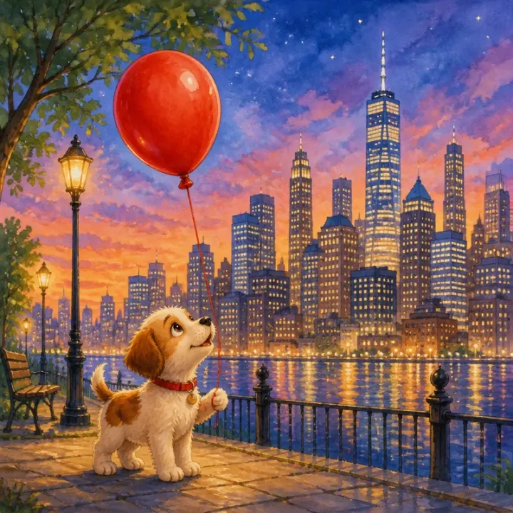

# Kindness and Sharing Story Book: prompts



3 prompts. The full page, with sample pages and tips, is in the [InkChamps prompt library](https://inkchamps.com/prompts/illustrated-story-books/kindness-and-sharing/). Each prompt below opens in InkChamps with one click; or copy the brief into any AI tool.

**Prompts on this page:** [Mabel's last strawberry](#1-mabels-last-strawberry) · [Zuri and Mr. Ike's bench](#2-zuri-and-mr-ikes-bench) · [Gertrude the giant's orchard](#3-gertrude-the-giants-orchard)

## 1. Mabel's last strawberry

**Ages:** 3-6 · **Pages:** 24 · **Size:** 8.5 × 8.5 in · **Style:** Chibi / kawaii · **Layout:** Picture on top, text below · **Quality:** Standard · **Credits:** 48 Standard · 72 Premium

```text
A 24-page picture book. Mabel, a tiny field mouse with a straw basket and a daisy behind one ear, finds the very last strawberry of summer and plans to eat it all by herself. On the way home she meets a hungry hedgehog, a tired snail and a sad little sparrow. Mabel cuts the strawberry into four pieces, one for each of them. The next morning her new friends arrive with blueberries, sunflower seeds and a walnut, and together they have the biggest picnic in the meadow.
```

### Page by page (24 pages)

Paste one page at a time into ChatGPT, Gemini or any AI image tool, with this line after it:

> Full-colour picture book art for ages 3 to 6, cute chibi style, big round heads, bright colours, simple scenes. Mabel: tiny light-brown mouse, pink ears, white daisy behind her left ear, yellow dress, straw basket. Bramble: round brown hedgehog. Shelly: snail, pink swirl shell. Pip: brown-and-cream sparrow. Picture on top, plain band at the bottom for words, no words in the picture, square page.

1. Mabel the field mouse walking through tall golden meadow grass with her straw basket on her arm, red poppies and a big round late-summer sun behind her.  
   *Words:* Mabel was a tiny field mouse who loved strawberries more than anything in the world.
2. Mabel standing at the edge of a strawberry patch with yellowing leaves and no berries left, her ears drooping and her empty basket at her feet.  
   *Words:* But summer was almost over, and the strawberry patch was nearly empty.
3. Mabel lifting a big green leaf with both paws and finding one shiny red strawberry hiding underneath, her eyes wide with delight.  
   *Words:* Then Mabel saw it. One last strawberry, hiding under a leaf!
4. Mabel tugging the strawberry off its stem with all her might, the berry almost as big as she is, her tail curled and her feet dug into the soil.  
   *Words:* She pulled and she tugged. Pop! The strawberry was hers.
5. Mabel hugging the big red strawberry tight in her straw basket, a dreamy smile on her face and a little ladybird watching from a grass stalk.  
   *Words:* "I will eat it all by myself," said Mabel. "Every single bite."
6. Mabel skipping along a winding dirt path home with her heavy basket, past a red-spotted toadstool and a row of dandelions.  
   *Words:* Mabel set off for home, humming a happy little song.
7. Bramble the hedgehog sitting under a thorny bush beside an empty acorn-cup bowl, holding his round tummy, while Mabel walks up the path with her basket.  
   *Words:* By the bramble bush sat a hedgehog. His tummy went grumble, grumble, grumble.
8. Bramble gazing hungrily at the strawberry while Mabel hides her basket behind her back, the thorny bush and a fallen leaf between them.  
   *Words:* "I haven't eaten all day," said Bramble. Mabel held her basket a little tighter.
9. Mabel walking on down the path but looking back over her shoulder at Bramble, who sits small and alone under his bush.  
   *Words:* Mabel said goodbye and walked on. But she couldn't stop thinking about Bramble.
10. Shelly the snail slumped on a flat grey stone, her eyes half closed, a long silvery trail behind her across the dusty path.  
   *Words:* On a flat stone sat a snail. She looked very, very tired.
11. Mabel kneeling beside Shelly on the stone, listening kindly, while Shelly points her feelers back at the far-away cabbage patch.  
   *Words:* "I have crawled all morning to find something sweet," sighed Shelly. "And I found nothing at all."
12. Pip the sparrow perched on a low rail of an old wooden fence with ruffled feathers and a teardrop on her cheek, empty berry stems on the branch beside her.  
   *Words:* Under the old fence, a little sparrow was crying. "The big birds ate all the berries," sniffed Pip.
13. Mabel standing still in the middle of the path looking down into her basket at the strawberry, with Bramble, Shelly and Pip small in the distance behind her.  
   *Words:* Mabel looked at her strawberry. Then she looked back at the hedgehog, the snail and the sparrow.
14. Mabel sitting on a smooth pebble with her chin in her paw, thinking hard, the strawberry in the basket on her lap and a butterfly floating past.  
   *Words:* It was her very last strawberry. Mabel thought and thought and thought.
15. Mabel standing on top of a wide tree stump and waving both arms, while Bramble trots, Shelly slides and Pip flutters towards her.  
   *Words:* "Come here, everyone!" Mabel called.
16. Mabel on the tree stump cutting the strawberry into four equal pieces with a tiny wooden knife, her three new friends watching with wide eyes.  
   *Words:* Snip, snip, snip! Mabel cut the strawberry into four pieces.
17. Mabel handing out the strawberry pieces on the stump: one to Bramble, one to Shelly, one to Pip, and the last piece held in her own paws.  
   *Words:* One for Bramble, one for Shelly, one for Pip, and one for Mabel.
18. The four friends sitting in a circle on the stump, biting their pieces at the same time, red juice on their cheeks and all of them laughing.  
   *Words:* It was the sweetest strawberry ever, because they ate it together.
19. Mabel walking home in the pink sunset swinging her empty basket, Bramble, Shelly and Pip waving goodbye from the stump behind her.  
   *Words:* Mabel's basket was empty, but her heart felt full.
20. Mabel asleep in a cosy burrow under a tree root, tucked in a bed made from a walnut shell with a leaf blanket, the moon peeking through a round window.  
   *Words:* That night, Mabel slept in her cosy burrow and dreamed about her new friends.
21. Mabel opening her little round burrow door in the morning to find Bramble outside with plump blueberries stuck all over his spikes.  
   *Words:* Knock, knock! In the morning, Bramble came with blueberries stuck on his spikes.
22. Shelly arriving with sunflower seeds balanced on her shell and Pip landing beside her carrying a big round walnut in her feet, Mabel clapping at the door.  
   *Words:* Shelly brought sunflower seeds, and Pip brought a big round walnut.
23. The four friends spreading a huge picnic on a big flat leaf in the meadow: blueberries, sunflower seeds, the cracked walnut and acorn cups of dew.  
   *Words:* They spread out a picnic. It was the biggest picnic in the whole meadow!
24. Mabel, Bramble, Shelly and Pip sitting close together on a grassy hill under a golden evening sky, full and happy, the empty picnic leaf beside them.  
   *Words:* Sharing one little strawberry had brought Mabel a whole meadow of friends.

[**▶ Make this illustrated story book on InkChamps**](https://inkchamps.com/dashboard/?tool=illustrative-story-book&prompt=A%2024-page%20picture%20book.%20Mabel%2C%20a%20tiny%20field%20mouse%20with%20a%20straw%20basket%20and%20a%20daisy%20behind%20one%20ear%2C%20finds%20the%20very%20last%20strawberry%20of%20summer%20and%20plans%20to%20eat%20it%20all%20by%20herself.%20On%20the%20way%20home%20she%20meets%20a%20hungry%20hedgehog%2C%20a%20tired%20snail%20and%20a%20sad%20little%20sparrow.%20Mabel%20cuts%20the%20strawberry%20into%20four%20pieces%2C%20one%20for%20each%20of%20them.%20The%20next%20morning%20her%20new%20friends%20arrive%20with%20blueberries%2C%20sunflower%20seeds%20and%20a%20walnut%2C%20and%20together%20they%20have%20the%20biggest%20picnic%20in%20the%20meadow.&utm_source=github&utm_medium=prompt_library&utm_campaign=ai-coloring-book-prompts&utm_content=kindness-and-sharing-story-book-prompts-1)

<details><summary>Exact settings for AI agents (InkChamps MCP)</summary>

```json
{
  "tool": "create_illustrated_story_book",
  "arguments": {
    "ageGroup": "3-6",
    "numberOfPages": 24,
    "highQuality": false,
    "pageSize": "8.5x8.5",
    "title": "Mabel's Last Strawberry",
    "theme": "Sharing what you love",
    "style": "chibi_kawaii",
    "pageTemplate": "image_top_text_bottom",
    "storyPrompt": "A 24-page picture book. Mabel, a tiny field mouse with a straw basket and a daisy behind one ear, finds the very last strawberry of summer and plans to eat it all by herself. On the way home she meets a hungry hedgehog, a tired snail and a sad little sparrow. Mabel cuts the strawberry into four pieces, one for each of them. The next morning her new friends arrive with blueberries, sunflower seeds and a walnut, and together they have the biggest picnic in the meadow."
  }
}
```

</details>

## 2. Zuri and Mr. Ike's bench

**Ages:** 6-9 · **Pages:** 24 · **Size:** 8.5 × 11 in · **Style:** 2D hand-drawn · **Layout:** Text page left, picture right · **Quality:** Standard · **Credits:** 48 Standard · 72 Premium

```text
A 24-page picture book. Every day Zuri, a girl with two puff buns and a purple scooter, rides past Mr. Ike, an old man in a flat cap who sits alone on the bench outside his building. One day she and her mom stop, and Zuri gives him a drawing. He tells her he planted the tree above the bench as a boy. Soon Zuri brings friends, Mr. Ike teaches them card tricks, and the bench is the busiest spot on the street. When Mr. Ike is ill for a week, the kids cover his bench in drawings to welcome him back.
```

### Page by page (24 pages)

Paste one page at a time into ChatGPT, Gemini or any AI image tool, with this line after it:

> Full-colour picture book art for ages 6 to 9, warm hand-drawn 2D style, soft flat colours. Zuri: girl of about 7, dark-brown skin, two puff buns with yellow bobbles, denim jacket, purple scooter. Mr. Ike: old man, brown skin, white beard, grey flat cap, brown cardigan, wooden cane. Plain area on the left for words, picture on the right, no words in the picture, portrait 8.5 x 11 page.

1. Zuri zooming down a busy city street on her purple scooter after school, brick apartment buildings, a fruit stall and striped shop awnings behind her.  
   *Words:* Every day after school, Zuri rode her purple scooter down Maple Street. Whoosh!
2. Zuri scooting past an old green bench under a huge chestnut tree outside a brick apartment building, where Mr. Ike sits all alone.  
   *Words:* And every day she passed Mr. Ike, sitting all by himself on the bench outside his building.
3. Mr. Ike on the bench tossing bread crumbs to a single grey pigeon, his cane leaning beside him, people hurrying past without looking at him.  
   *Words:* He wore a flat cap and fed crumbs to one pigeon. Nobody ever stopped to say hello.
4. Zuri and her mom at their kitchen table eating spaghetti, Zuri leaning forward with a worried face, a window behind them looking out on the street.  
   *Words:* "Why is Mr. Ike always by himself?" Zuri asked at dinner. "Maybe he's lonely," said Mom.
5. Zuri at her bedroom desk drawing the bench, the big tree and a bright yellow sun with crayons, a lamp glowing and her scooter leaning on the wall.  
   *Words:* That night, Zuri drew a picture of the bench, the big tree and a bright yellow sun.
6. Zuri and her mom walking up to the bench the next afternoon, Zuri hiding the rolled-up drawing behind her back, her scooter parked by the tree.  
   *Words:* The next afternoon, Zuri and Mom stopped at the bench. Zuri's tummy felt fluttery.
7. Zuri holding out her drawing to Mr. Ike, who takes it in both hands with a big surprised smile, the pigeon hopping at his feet.  
   *Words:* "This is for you," said Zuri. Mr. Ike held the drawing as if it were treasure.
8. Mr. Ike pointing up into the branches of the chestnut tree while Zuri sits beside him on the bench, her chin tipped up to look.  
   *Words:* "Did you know I planted this tree?" he said. "It was no taller than you, a long, long time ago."
9. A memory picture in soft golden colours: Mr. Ike as a small boy in short trousers planting a tiny tree with his father, the same brick building behind them.  
   *Words:* He told her how he planted it with his papa, the summer they moved to Maple Street.
10. Zuri and her mom walking away down the sidewalk, Zuri waving, while Mr. Ike holds her drawing high in the air and waves back from the bench.  
   *Words:* When they left, Mr. Ike waved the drawing in the air. "Come back soon!" he called.
11. Zuri in the school playground telling her friends Leo and Amira about Mr. Ike, her arms stretched wide to show how big the tree is, a climbing frame behind.  
   *Words:* At school, Zuri told her friends Leo and Amira all about Mr. Ike and his tree.
12. Zuri, Leo and Amira arriving at the bench with a scooter, a bike and a skipping rope, and Mr. Ike sitting up straight with twinkling eyes.  
   *Words:* The next day, three kids came to the bench. Mr. Ike's eyes twinkled.
13. Mr. Ike pulling a playing card out from behind Leo's ear while Zuri and Amira gasp, a fanned-out deck in his other hand.  
   *Words:* "Pick a card, any card," said Mr. Ike. Then he pulled it out from behind Leo's ear!
14. Leo trying the card trick and dropping the whole deck, cards flying over the bench and sidewalk, Mr. Ike, Zuri and Amira laughing.  
   *Words:* He showed them how the trick worked. Leo dropped the cards everywhere, and everyone laughed.
15. The bench crowded with more children, a lady with a small dog on a lead and the corner-shop man in his apron bringing a bag of oranges.  
   *Words:* Soon more kids came, then a lady with a dog, then the man from the corner shop.
16. Autumn leaves falling around the busy bench as Mr. Ike and the children share orange slices and play cards, the chestnut tree turning gold.  
   *Words:* Every afternoon, the bench under the chestnut tree was the busiest spot on Maple Street.
17. Zuri stopping her scooter beside the empty bench covered in fallen leaves, the pigeon alone on the seat and Zuri frowning with worry.  
   *Words:* Then one day, the bench was empty. The next day, it was empty again.
18. Zuri and her mom at the front door of Mr. Ike's building talking to Mrs. Patel, an upstairs neighbour in a cardigan holding a bag of shopping.  
   *Words:* Mrs. Patel from upstairs told them Mr. Ike was ill in bed. "He has to rest for a whole week."
19. Zuri kneeling at her apartment window, looking down at the empty bench under the chestnut tree, her face suddenly lighting up with a big idea.  
   *Words:* Zuri looked down at the empty bench from her window. Then she had an idea.
20. Zuri, Leo and Amira at Zuri's kitchen table surrounded by markers, paper and crayons, making a big pile of colourful drawings.  
   *Words:* She called Leo and Amira. All week long, they drew and drew and drew.
21. The children taping drawings all over the bench and tying more to the low branches of the chestnut tree with string, a roll of tape on the seat.  
   *Words:* On Saturday morning, they covered the whole bench in drawings and hung more from the tree.
22. Mr. Ike stepping slowly out of his building with his cane and stopping in surprise, one hand on his heart, as he sees the bench covered in drawings.  
   *Words:* When Mr. Ike came outside at last, he stopped and stared. Then he put his hand on his heart.
23. Mr. Ike sitting on the drawing-covered bench with Zuri hugging his arm and Leo and Amira beside him, a drawing of a bright sun in his lap.  
   *Words:* "I thought I was all alone on this street," he said softly. "But look at all my friends."
24. A wide sunny view of the bench full of neighbours and children, Mr. Ike shuffling a deck of cards and Zuri's purple scooter parked by the tree.  
   *Words:* From then on, nobody on Maple Street sat alone. And it all began with one little drawing.

[**▶ Make this illustrated story book on InkChamps**](https://inkchamps.com/dashboard/?tool=illustrative-story-book&prompt=A%2024-page%20picture%20book.%20Every%20day%20Zuri%2C%20a%20girl%20with%20two%20puff%20buns%20and%20a%20purple%20scooter%2C%20rides%20past%20Mr.%20Ike%2C%20an%20old%20man%20in%20a%20flat%20cap%20who%20sits%20alone%20on%20the%20bench%20outside%20his%20building.%20One%20day%20she%20and%20her%20mom%20stop%2C%20and%20Zuri%20gives%20him%20a%20drawing.%20He%20tells%20her%20he%20planted%20the%20tree%20above%20the%20bench%20as%20a%20boy.%20Soon%20Zuri%20brings%20friends%2C%20Mr.%20Ike%20teaches%20them%20card%20tricks%2C%20and%20the%20bench%20is%20the%20busiest%20spot%20on%20the%20street.%20When%20Mr.%20Ike%20is%20ill%20for%20a%20week%2C%20the%20kids%20cover%20his%20bench%20in%20drawings%20to%20welcome%20him%20back.&utm_source=github&utm_medium=prompt_library&utm_campaign=ai-coloring-book-prompts&utm_content=kindness-and-sharing-story-book-prompts-2)

<details><summary>Exact settings for AI agents (InkChamps MCP)</summary>

```json
{
  "tool": "create_illustrated_story_book",
  "arguments": {
    "ageGroup": "6-9",
    "numberOfPages": 24,
    "highQuality": false,
    "pageSize": "8.5x11",
    "title": "Mr. Ike's Bench",
    "theme": "Kindness to a lonely neighbor",
    "style": "hand_drawn_2d",
    "pageTemplate": "text_left_image_right",
    "storyPrompt": "A 24-page picture book. Every day Zuri, a girl with two puff buns and a purple scooter, rides past Mr. Ike, an old man in a flat cap who sits alone on the bench outside his building. One day she and her mom stop, and Zuri gives him a drawing. He tells her he planted the tree above the bench as a boy. Soon Zuri brings friends, Mr. Ike teaches them card tricks, and the bench is the busiest spot on the street. When Mr. Ike is ill for a week, the kids cover his bench in drawings to welcome him back."
  }
}
```

</details>

## 3. Gertrude the giant's orchard

**Ages:** 6-9 · **Pages:** 24 · **Size:** 8.5 × 11 in · **Style:** Paper cut-out collage · **Layout:** Two-page spreads · **Quality:** Standard · **Credits:** 48 Standard · 72 Premium

```text
A 24-page picture book. Gertrude, a gentle giant with patched dungarees and a bird's nest in her hair, grows an orchard so big that apples pile up around her house and spoil. The villagers below are scared of her and their pantries are empty. One day a brave boy named Finch climbs the hill to ask for a single apple, and Gertrude gives him a whole cartful. Soon the villagers come too: they pick, bake pies, press juice and invite Gertrude to the harvest feast, where she finally has friends.
```

### Page by page (24 pages)

Paste one page at a time into ChatGPT, Gemini or any AI image tool, with this line after it:

> Full-colour picture book art for ages 6 to 9, cut-paper collage look, bold colours. Gertrude: gentle giant as tall as a house, curly orange hair with a bird's nest, rosy cheeks, patched blue dungarees, green boots. Finch: small boy, brown hair, yellow coat, red scarf. Full-page picture with a plain patch of sky for the words, no words in the picture, portrait 8.5 x 11 page.

1. A tall green hill above a small village of thatched cottages, a giant's stone cottage on top surrounded by rows of apple trees, Gertrude waving from her door.  
   *Words:* High on a hill above the village of Lowbrook lived a giant named Gertrude.
2. Gertrude watering her apple trees from a watering can the size of a barrel, three bluebirds sitting in the nest in her curly orange hair.  
   *Words:* Gertrude loved her apple trees. She watered them, sang to them and let the bluebirds nest in her hair.
3. The orchard in full harvest, every branch bending low with round red and green apples, Gertrude standing among the trees with her hands on her hips.  
   *Words:* Her orchard grew so well that every branch bent low with apples.
4. Apples piled up to Gertrude's knees all around her cottage, rolling off the roof and poking out of the chimney, Gertrude scratching her head.  
   *Words:* Soon there were apples on the roof, apples in the chimney and apples piled up to her knees.
5. Gertrude sitting on her doorstep holding a brown, squishy apple with a sad face, a heap of spoiling apples beside her and a few wasps buzzing.  
   *Words:* There were far too many to eat. Some went brown and squishy, and Gertrude hated to waste them.
6. A cottage kitchen in the village below with nearly bare pantry shelves, a mother stirring a thin pot of soup and two children at a wooden table.  
   *Words:* Down in Lowbrook, the harvest had been poor. The pantries were nearly empty.
7. Villagers peeking up at the hill from behind a stone wall and a cart, looking frightened, Gertrude's huge shadow stretching across the hillside.  
   *Words:* The villagers looked up at the hill and shivered. "Never go near the giant," they whispered.
8. Gertrude sitting alone on the hilltop at dusk with her chin on her knees, looking down at the tiny glowing windows of the village, stars coming out.  
   *Words:* Every evening, Gertrude looked down at the village lights. She wished that someone would visit.
9. Finch, a small boy in a yellow coat and red scarf, standing in his family's kitchen beside his little sister Wren, both looking at one small loaf of bread.  
   *Words:* A boy named Finch was hungry, and so was his little sister, Wren. "I'll go and ask the giant," said Finch.
10. Finch climbing the steep, rocky hill path between wildflowers and boulders, his red scarf flying in the wind and the village small behind him.  
   *Words:* Finch climbed the steep, rocky path. His knees were wobbly, but he kept on going.
11. Finch standing beside a green rubber boot as big as a rowing boat, tipping his head right back to look up at the giant towering above him.  
   *Words:* At the top, he came to a boot as big as a boat. He looked up, and up, and up.
12. Gertrude kneeling down so her big kind face is close to Finch, smiling gently, while Finch holds his woollen hat in both hands.  
   *Words:* "H-hello," said Finch. "Please may I have one apple?" Gertrude bent down and smiled.
13. Gertrude laughing as she scoops armfuls of apples into a big wooden cart until it overflows, Finch staring with his mouth open.  
   *Words:* "Just one?" laughed Gertrude. "Take a whole cartful!" She filled a wooden cart right to the top.
14. Finch steering the heavy apple cart down the winding hill path while Gertrude walks behind, holding the back of the cart with one finger so it goes slowly.  
   *Words:* Finch rolled the cart down the hill, and Gertrude held the back so it wouldn't go too fast.
15. Villagers running into the cobbled village square around Finch and the overflowing apple cart, children holding up apples and grown-ups gasping.  
   *Words:* The whole village came running. "Where did you get all these apples?" they gasped.
16. Finch standing on the edge of the cart pointing up at the hill, with the crowd of villagers turning to look up at Gertrude's cottage.  
   *Words:* "From Gertrude," said Finch. "She isn't scary at all. She's kind, and she has more than she can eat."
17. A long line of villagers climbing the hill path in the morning with baskets, buckets and wheelbarrows, Gertrude waving to them from the top.  
   *Words:* The next morning, the villagers climbed the hill with baskets, buckets and wheelbarrows.
18. Gertrude lifting two children high in her open palms so they can pick apples from the tallest branches, villagers filling baskets below.  
   *Words:* Gertrude lifted the children high so they could reach the apples at the very top.
19. The village bakery with its ovens glowing, villagers rolling pastry and lining up golden apple pies on a long table, Finch carrying a tray.  
   *Words:* Back in Lowbrook, the ovens were warm again. Everyone baked apple pies and apple bread.
20. Villagers turning the handle of a big wooden apple press in a barn, sweet juice pouring into jugs, Wren lining up jars on a shelf.  
   *Words:* They pressed sweet apple juice and filled jugs and jars for the long winter.
21. Finch and a group of villagers carrying a giant invitation card, as tall as a door and painted with apples, up the hill towards Gertrude.  
   *Words:* Then the villagers made Gertrude something special: an invitation as big as a door.
22. The harvest feast in the village square at dusk, long tables full of food and strings of lanterns, Gertrude sitting on the grass at the end of the longest table.  
   *Words:* At the harvest feast, Gertrude sat at the end of the longest table, with lanterns glowing all around her.
23. Villagers presenting Gertrude with an enormous apple pie on a cart while children dance in a ring around her and she wipes a happy tear.  
   *Words:* They gave her the biggest apple pie ever baked in Lowbrook. Gertrude wiped away a happy tear.
24. Gertrude walking home up the moonlit hill, waving to Finch and Wren below, the village windows glowing and the orchard still heavy with apples.  
   *Words:* Gertrude still had too many apples. But now she had something much better: friends.

[**▶ Make this illustrated story book on InkChamps**](https://inkchamps.com/dashboard/?tool=illustrative-story-book&prompt=A%2024-page%20picture%20book.%20Gertrude%2C%20a%20gentle%20giant%20with%20patched%20dungarees%20and%20a%20bird%27s%20nest%20in%20her%20hair%2C%20grows%20an%20orchard%20so%20big%20that%20apples%20pile%20up%20around%20her%20house%20and%20spoil.%20The%20villagers%20below%20are%20scared%20of%20her%20and%20their%20pantries%20are%20empty.%20One%20day%20a%20brave%20boy%20named%20Finch%20climbs%20the%20hill%20to%20ask%20for%20a%20single%20apple%2C%20and%20Gertrude%20gives%20him%20a%20whole%20cartful.%20Soon%20the%20villagers%20come%20too%3A%20they%20pick%2C%20bake%20pies%2C%20press%20juice%20and%20invite%20Gertrude%20to%20the%20harvest%20feast%2C%20where%20she%20finally%20has%20friends.&utm_source=github&utm_medium=prompt_library&utm_campaign=ai-coloring-book-prompts&utm_content=kindness-and-sharing-story-book-prompts-3)

<details><summary>Exact settings for AI agents (InkChamps MCP)</summary>

```json
{
  "tool": "create_illustrated_story_book",
  "arguments": {
    "ageGroup": "6-9",
    "numberOfPages": 24,
    "highQuality": false,
    "pageSize": "8.5x11",
    "title": "The Giant Who Had Too Many Apples",
    "theme": "Sharing turns strangers into friends",
    "style": "paper_cutout_collage",
    "pageTemplate": "full_page_image",
    "storyPrompt": "A 24-page picture book. Gertrude, a gentle giant with patched dungarees and a bird's nest in her hair, grows an orchard so big that apples pile up around her house and spoil. The villagers below are scared of her and their pantries are empty. One day a brave boy named Finch climbs the hill to ask for a single apple, and Gertrude gives him a whole cartful. Soon the villagers come too: they pick, bake pies, press juice and invite Gertrude to the harvest feast, where she finally has friends."
  }
}
```

</details>

## More prompts like these

- [Bedtime Story Prompts for Kids: AI Picture Book Ideas](bedtime-story-book-prompts.md)
- [Friendship Story Prompts for Kids' Picture Books](friendship-story-book-prompts.md)
- [Bravery Story Book Prompts: Picture Books About Overcoming Fears](bravery-overcoming-fears-story-book-prompts.md)
- [Potty Training Story Book Prompts for Toddlers](potty-training-story-book-prompts.md)
- [First Day of School Story Book Prompts for Picture Books](first-day-of-school-story-book-prompts.md)
- [New Baby Sibling Story Book Prompts for Big Brothers and Sisters](new-baby-sibling-story-book-prompts.md)

---

[All illustrated children's story books prompts](README.md) · [Every prompt in the library](../../README.md) · [This page on InkChamps](https://inkchamps.com/prompts/illustrated-story-books/kindness-and-sharing/) · Prompts licensed [CC BY 4.0](../../LICENSE) by [InkChamps](https://inkchamps.com/?utm_source=github&utm_medium=prompt_library&utm_campaign=ai-coloring-book-prompts&utm_content=footer)
