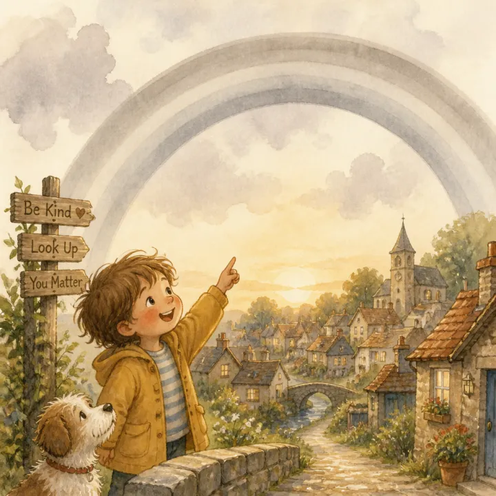

# New Baby Sibling Story Book: prompts



3 prompts. The full page, with sample pages and tips, is in the [InkChamps prompt library](https://inkchamps.com/prompts/illustrated-story-books/new-baby-sibling/). Each prompt below opens in InkChamps with one click; or copy the brief into any AI tool.

**Prompts on this page:** [Bao and the very loud baby](#1-bao-and-the-very-loud-baby) · [Where did Mama's lap go?](#2-where-did-mamas-lap-go) · [Marcus's big brother handbook](#3-marcuss-big-brother-handbook)

## 1. Bao and the very loud baby

**Ages:** 3-6 · **Pages:** 24 · **Size:** 8.5 × 8.5 in · **Style:** Chibi art · **Layout:** Picture on top, text below · **Quality:** Standard · **Credits:** 48 Standard · 72 Premium

```text
A 24-page picture book. Bao, a little boy in a striped T-shirt with a red toy drum, has always been the loudest in his family. Then baby sister Lin comes home, and she is even louder. She cries at breakfast, at bath time and in the night, and Mama and Baba are too tired to play. Bao bangs his drum to drown her out, and Lin stops to listen. So Bao taps soft, slow rhythms, and Lin falls asleep. Baba takes Bao to the park just for him, and Bao has a new job: the family's baby drummer.
```

### Page by page (24 pages)

Paste one page at a time into ChatGPT, Gemini or any AI image tool, with this line after it:

> Full-color picture book art for ages 3 to 6, cute chibi cartoon style, big heads, round bodies, bright colors. Bao: little boy, short black hair, red-and-white striped T-shirt, blue shorts, red toy drum on a strap. Lin: baby, black tuft of hair, yellow onesie. Mama: green cardigan. Baba: round glasses, grey sweater. Picture at top, plain band at bottom for text, no words in picture, square page.

1. Bao marching across the living room rug, banging his red toy drum and singing with his mouth wide open, Mama and Baba laughing on the sofa, a toy xylophone and blocks on the floor.  
   *Words:* Bao was the loudest one in his family. He sang loud, he laughed loud, and he played his drum loudest of all.
2. Morning kitchen: Bao drumming beside the breakfast table, Mama at the stove covering her ears with a big smile, a stack of pancakes on a plate and sunshine through the window.  
   *Words:* Boom, boom, boom! went Bao's drum every morning. Mama covered her ears, but she was smiling.
3. Mama sitting on the sofa with a big round tummy, Baba kneeling beside Bao and pointing at it, Bao looking up in surprise with his drum at his feet, a family photo frame on the wall.  
   *Words:* One day Mama's tummy was big and round. "Soon you will be a big brother," said Baba.
4. Bao on tiptoe placing his old brown teddy bear into a white wooden crib in a pale yellow nursery, Baba painting little stars on the wall, a stack of tiny folded clothes on a shelf.  
   *Words:* Bao helped get the baby's room ready. He put his old teddy bear in the crib, so the baby would have a friend.
5. At the front door, Mama carrying baby Lin wrapped in a pale yellow blanket, Baba holding a big bag, Bao peering up at the tiny sleeping face, a balloon tied to the door handle.  
   *Words:* Then baby Lin came home. She was tiny and pink and very, very quiet.
6. Bao, Mama and Baba leaning over the bassinet on tiptoe, all three with a finger to their lips, sleeping Lin inside, a round clock on the wall.  
   *Words:* Everyone tiptoed. Everyone whispered. Lin stayed quiet for one whole minute.
7. Lin in her bassinet crying with her mouth wide open and tiny fists in the air, Bao jumping backwards with his hands over his ears and his drumsticks flying.  
   *Words:* "WAAAAH!" Lin was even louder than Bao!
8. Breakfast table: Mama rocking crying Lin on her shoulder while Bao sits alone staring at a soggy bowl of cereal, his spoon drooping, Baba pouring coffee with sleepy eyes.  
   *Words:* Lin cried at breakfast. Bao's cereal went soggy while Mama rocked her.
9. Bathroom: Lin crying in a small baby bathtub full of bubbles, Baba squeezing a yellow rubber duck, Bao standing on the bath mat holding a towel and frowning.  
   *Words:* Lin cried at bath time. Even the squeaky duck did not help.
10. Bao's bedroom at night, Bao in star pajamas in bed pressing a pillow over his head, his drum on the floor, a moon in the window and a stripe of hallway light under the door.  
   *Words:* Lin cried in the middle of the night. Bao pulled his pillow over his head.
11. Living room: Mama and Baba slumped on the sofa yawning, Lin asleep on Mama's shoulder, Bao holding up his drum hopefully, baby bottles and a pile of laundry on the table.  
   *Words:* Mama and Baba yawned all day long. "Not now, Bao," they said. "Maybe later."
12. Bao sitting alone on the bottom stair hugging his knees, his red drum beside him, a sad face, toys lying untouched on the hallway floor.  
   *Words:* Bao sat on the stairs with his drum. Nobody had time to play with him anymore.
13. Bao standing on the stair with fists on his hips and a determined face, drumsticks raised high, Lin crying in her baby bouncer across the room.  
   *Words:* "If Lin can be loud," said Bao, "then I can be LOUDER."
14. Bao in the middle of the living room banging his drum with big swinging arms, sofa cushions bouncing, the family cat leaping off the armchair, Lin in her bouncer.  
   *Words:* BOOM! BOOM! BOOM! Bao banged his drum as hard as he could.
15. Close-up of Lin in her baby bouncer, tears stopped, eyes round and wide, mouth in a little O, looking toward Bao's drum, a mobile of felt stars above her.  
   *Words:* And then Lin stopped crying. Her eyes went wide. She was listening.
16. Bao stopping mid-beat with his drumsticks in the air and a puzzled face, Lin's face crumpling to cry again, Mama peeking around the kitchen doorway.  
   *Words:* Bao stopped too. Lin's face crumpled, and she began to cry again.
17. Bao kneeling beside Lin's bouncer tapping his drum gently with one stick, tongue poking out in concentration, a lamp giving soft evening light.  
   *Words:* So Bao tapped his drum very softly. Tap... tap... tap.
18. Seen from above: Bao cross-legged on the rug tapping softly, Lin in her bouncer sucking her thumb with drooping eyelids, the cat curled asleep and toys tidied into a basket.  
   *Words:* Lin's crying grew smaller and smaller. She sucked her thumb and blinked.
19. Lin fast asleep in her crib with the old teddy bear, Bao standing on a little stool beside the crib tapping his drum, a night light glowing by the window.  
   *Words:* Tap... tap... tap. Lin's eyes closed. She was fast asleep.
20. Mama in her green cardigan peeking through the nursery door with a hand on her heart and a delighted face, Bao turning toward her with a finger to his lips.  
   *Words:* Mama peeked in. "Bao," she whispered, "how did you do that?"
21. Mama kneeling beside the crib giving Bao a big, quiet hug, Bao holding his drumsticks proudly, Lin asleep in the crib behind them.  
   *Words:* "I'm the baby drummer," Bao whispered back. Mama gave him the biggest, quietest hug.
22. Night: Bao in pajamas on a small stool tapping his drum beside sleeping Lin's crib, and through the open door Mama and Baba asleep side by side on the sofa.  
   *Words:* Now every night Bao plays his soft, slow song. Lin falls asleep, and Mama and Baba finally get some rest.
23. Sunny park: Baba and Bao drumming with sticks on an upside-down bucket and the big metal slide, ducks on a pond and a kite in the sky behind them.  
   *Words:* On Saturday, Baba took Bao to the park, just the two of them. They drummed on a bucket and on the big metal slide.
24. Morning kitchen band: Bao drumming, Mama shaking a tambourine, Baba tapping pots with a wooden spoon, and Lin laughing and kicking her feet in her high chair.  
   *Words:* In the mornings the whole family plays loud music, and Lin kicks and giggles. But at night, Bao is the gentlest drummer in the world.

[**▶ Make this illustrated story book on InkChamps**](https://inkchamps.com/dashboard/?tool=illustrative-story-book&prompt=A%2024-page%20picture%20book.%20Bao%2C%20a%20little%20boy%20in%20a%20striped%20T-shirt%20with%20a%20red%20toy%20drum%2C%20has%20always%20been%20the%20loudest%20in%20his%20family.%20Then%20baby%20sister%20Lin%20comes%20home%2C%20and%20she%20is%20even%20louder.%20She%20cries%20at%20breakfast%2C%20at%20bath%20time%20and%20in%20the%20night%2C%20and%20Mama%20and%20Baba%20are%20too%20tired%20to%20play.%20Bao%20bangs%20his%20drum%20to%20drown%20her%20out%2C%20and%20Lin%20stops%20to%20listen.%20So%20Bao%20taps%20soft%2C%20slow%20rhythms%2C%20and%20Lin%20falls%20asleep.%20Baba%20takes%20Bao%20to%20the%20park%20just%20for%20him%2C%20and%20Bao%20has%20a%20new%20job%3A%20the%20family%27s%20baby%20drummer.&utm_source=github&utm_medium=prompt_library&utm_campaign=ai-coloring-book-prompts&utm_content=new-baby-sibling-story-book-prompts-1)

<details><summary>Exact settings for AI agents (InkChamps MCP)</summary>

```json
{
  "tool": "create_illustrated_story_book",
  "arguments": {
    "ageGroup": "3-6",
    "numberOfPages": 24,
    "highQuality": false,
    "pageSize": "8.5x8.5",
    "title": "Bao and the Very Loud Baby",
    "theme": "A noisy new baby sister",
    "style": "chibi_art",
    "pageTemplate": "image_top_text_bottom",
    "storyPrompt": "A 24-page picture book. Bao, a little boy in a striped T-shirt with a red toy drum, has always been the loudest in his family. Then baby sister Lin comes home, and she is even louder. She cries at breakfast, at bath time and in the night, and Mama and Baba are too tired to play. Bao bangs his drum to drown her out, and Lin stops to listen. So Bao taps soft, slow rhythms, and Lin falls asleep. Baba takes Bao to the park just for him, and Bao has a new job: the family's baby drummer."
  }
}
```

</details>

## 2. Where did Mama's lap go?

**Ages:** 3-6 · **Pages:** 24 · **Size:** 8.5 × 8.5 in · **Style:** Colored pencil · **Layout:** Picture on top, text below · **Quality:** Standard · **Credits:** 48 Standard · 72 Premium

```text
A 24-page picture book. Olive, a small hedgehog with a pink acorn hat, loves Mama's lap more than anything. But Mama's tummy grows and grows until there is no lap left, and when baby Bramble comes, the lap is full of baby. Olive tries Papa's bouncy lap, Grandpa's snoring lap, Biscuit the cat's back and a mossy log, but none are right. One evening Mama finds her on the doorstep and makes room: baby on one side, Olive on the other, and a story for both. Olive learns there is always room for her.
```

### Page by page (24 pages)

Paste one page at a time into ChatGPT, Gemini or any AI image tool, with this line after it:

> Full-color picture book illustration for ages 3 to 6, soft colored-pencil style with gentle woodland colors. Olive: small brown hedgehog, cream face, pink acorn-cap hat. Mama: larger hedgehog, blue dress, white apron. Bramble: tiny pale baby hedgehog in a lavender blanket. Papa: green waistcoat. Picture at top, plain area at bottom for text, no words in the picture, square page.

1. Olive the hedgehog sitting happily on Mama's lap in a big patchwork armchair inside their cozy burrow under an oak tree, a round wooden door and a teapot on a little table.  
   *Words:* Olive was a small hedgehog with a pink acorn hat. Her favorite place in the whole wide world was Mama's lap.
2. Olive on Mama's lap munching blackberry toast while Mama reads a picture book aloud, crumbs on Olive's chin, a small stone fireplace glowing behind them.  
   *Words:* On Mama's lap, Olive heard stories, ate warm blackberry toast, and fell asleep to Mama's humming.
3. Spring outside the burrow, primroses blooming by the round door, Mama on a garden bench with a gently rounded tummy and Olive touching it with a curious paw.  
   *Words:* One spring, Mama's tummy began to grow. "A baby is coming," Mama said.
4. In the patchwork armchair, Mama's tummy much bigger, Olive squeezed onto a small corner of her lap, knitting needles and a pair of tiny socks on the armrest.  
   *Words:* Mama's tummy grew bigger. Olive's spot on the lap grew smaller.
5. Summer, sunflowers in the open window, Olive perched on the very edge of Mama's knees clutching her apron, Mama's huge round tummy taking up nearly all the room.  
   *Words:* By summer there was hardly any lap at all. Olive perched on the very edge and held on tight.
6. Morning in the burrow bedroom: Mama in bed holding a tiny newborn hedgehog in a lavender blanket, Papa beaming beside her, Olive peeking over the quilt on tiptoe.  
   *Words:* Then one morning the baby came. His name was Bramble, and he was very, very small.
7. Baby Bramble asleep in Mama's lap in the armchair, a baby bottle and a burp cloth on the armrest, Olive sitting on the rug below looking up at them.  
   *Words:* Now Mama's lap was full of baby. Bramble ate on the lap. Bramble slept on the lap.
8. Olive standing beside the armchair holding up her favorite storybook, Mama smiling tiredly while rocking Bramble, a wooden clock on the burrow wall.  
   *Words:* "Is there room for me?" asked Olive. "In a little while, love," said Mama.
9. Olive marching down the burrow hallway with her pink acorn hat pulled on tight and a determined face, tree roots curling across the ceiling and lanterns on the walls.  
   *Words:* So Olive put on her hat and went looking for a new lap.
10. Papa hedgehog in his green waistcoat on a wooden chair bouncing his knees, Olive wobbling on his lap and hanging onto his waistcoat buttons, a newspaper sliding to the floor.  
   *Words:* She tried Papa's lap. It was bouncy and knobbly, and Papa could not keep his knees still.
11. Grandpa hedgehog with grey-tipped spines, round glasses and a red scarf asleep and snoring in a rocking chair, Olive on his lap watching her pink acorn hat fly off.  
   *Words:* She tried Grandpa's lap. It was cozy, but Grandpa snored, and his snore blew her hat right off.
12. Biscuit the ginger cat lying on the hearth rug with a grumpy face and a flicking tail while Olive tries to climb onto his back.  
   *Words:* She tried Biscuit the cat's back. Biscuit did not think that was a good idea at all.
13. Olive in the garden sitting on a mossy log with a frown, a toppled pile of cushions and a basket of wool balls she has already tried lying beside her.  
   *Words:* She tried a pile of cushions, a basket of wool and a mossy log. None of them were quite right.
14. Evening: Olive sitting alone on the burrow doorstep with her hat drooping and a tear on her cheek, fireflies glowing and a pink sunset sky over the oak tree.  
   *Words:* Olive sat on the doorstep and sniffed. "Nobody has a lap for me anymore."
15. Mama kneeling on the doorstep wrapping Olive in a warm hug, lantern light spilling from the round doorway, Papa inside holding baby Bramble.  
   *Words:* That evening, Mama found her there. "There you are," said Mama softly. "I've been looking for you."
16. Mama carrying Olive in her arms through the burrow toward the patchwork armchair by the glowing fire, a basket of logs beside the hearth.  
   *Words:* Mama carried Olive inside to the big armchair by the fire.
17. Mama in the armchair with Bramble on one side of her lap, patting the empty side with a smile, Olive watching with hopeful eyes.  
   *Words:* She put baby Bramble on one side. Then she patted the other side. "And this side is for Olive."
18. Olive and Bramble snuggled together on Mama's lap, squished cheek to cheek, a knitted blanket over all three, the fire crackling.  
   *Words:* Olive snuggled in. It was a little squished, but it was warm, and it smelled like Mama.
19. Mama holding open a storybook full of stars and moons while both little hedgehogs gaze at the pictures, a cup of warm milk on the side table.  
   *Words:* Mama opened a storybook. "This one is for both of you," she said.
20. Close-up of baby Bramble's tiny paw wrapped around Olive's finger, Olive's eyes wide with wonder, Mama's apron in the background.  
   *Words:* Bramble wrapped his tiny paw around Olive's finger. Olive held very, very still.
21. Mama kissing the top of Olive's head while Olive gazes at sleeping Bramble in the crook of Mama's arm, a garland of autumn leaves over the fireplace.  
   *Words:* "He likes you," whispered Mama. "You're his big sister."
22. Sunny bramble patch: Mama and Olive picking blackberries into a little basket together, purple juice on Olive's nose, butterflies, the burrow in the distance.  
   *Words:* On Sunday, Papa minded Bramble, and Mama took Olive blackberry picking, just the two of them.
23. Evening armchair: Olive turning the pages of the storybook while Mama reads and Bramble watches, Papa and Grandpa smiling from the sofa, Biscuit curled by the fire.  
   *Words:* Now every evening there are three in the big armchair. Olive turns the pages while Mama reads.
24. Night outside the burrow: through the glowing round window under the oak, Mama, Bramble and Olive asleep together in the big armchair, stars and a crescent moon above.  
   *Words:* Olive learned that a lap can stretch, and there will always be room for her.

[**▶ Make this illustrated story book on InkChamps**](https://inkchamps.com/dashboard/?tool=illustrative-story-book&prompt=A%2024-page%20picture%20book.%20Olive%2C%20a%20small%20hedgehog%20with%20a%20pink%20acorn%20hat%2C%20loves%20Mama%27s%20lap%20more%20than%20anything.%20But%20Mama%27s%20tummy%20grows%20and%20grows%20until%20there%20is%20no%20lap%20left%2C%20and%20when%20baby%20Bramble%20comes%2C%20the%20lap%20is%20full%20of%20baby.%20Olive%20tries%20Papa%27s%20bouncy%20lap%2C%20Grandpa%27s%20snoring%20lap%2C%20Biscuit%20the%20cat%27s%20back%20and%20a%20mossy%20log%2C%20but%20none%20are%20right.%20One%20evening%20Mama%20finds%20her%20on%20the%20doorstep%20and%20makes%20room%3A%20baby%20on%20one%20side%2C%20Olive%20on%20the%20other%2C%20and%20a%20story%20for%20both.%20Olive%20learns%20there%20is%20always%20room%20for%20her.&utm_source=github&utm_medium=prompt_library&utm_campaign=ai-coloring-book-prompts&utm_content=new-baby-sibling-story-book-prompts-2)

<details><summary>Exact settings for AI agents (InkChamps MCP)</summary>

```json
{
  "tool": "create_illustrated_story_book",
  "arguments": {
    "ageGroup": "3-6",
    "numberOfPages": 24,
    "highQuality": false,
    "pageSize": "8.5x8.5",
    "title": "Where Did Mama's Lap Go?",
    "theme": "Sharing a parent with a new baby",
    "style": "colored_pencil_sketch",
    "pageTemplate": "image_top_text_bottom",
    "storyPrompt": "A 24-page picture book. Olive, a small hedgehog with a pink acorn hat, loves Mama's lap more than anything. But Mama's tummy grows and grows until there is no lap left, and when baby Bramble comes, the lap is full of baby. Olive tries Papa's bouncy lap, Grandpa's snoring lap, Biscuit the cat's back and a mossy log, but none are right. One evening Mama finds her on the doorstep and makes room: baby on one side, Olive on the other, and a story for both. Olive learns there is always room for her."
  }
}
```

</details>

## 3. Marcus's big brother handbook

**Ages:** 6-9 · **Pages:** 24 · **Size:** 8.5 × 11 in · **Style:** Comic book · **Layout:** Text page left, picture right · **Quality:** Standard · **Credits:** 48 Standard · 72 Premium

```text
A 24-page picture book. Marcus, a seven-year-old with a high-top fade and a notebook, writes the official Big Brother Handbook before baby brother Miles arrives. Rule one: babies are boring. Rule two: never share your room. Then come no diapers and no lullabies. But each rule gets crossed out: Miles grabs his finger, laughs at his soccer cheer and falls asleep on his chest, and Dad takes Marcus to the park just for him. By the last page only one rule is left, in big letters: be the best big brother ever.
```

### Page by page (24 pages)

Paste one page at a time into ChatGPT, Gemini or any AI image tool, with this line after it:

> Full-color picture book art for ages 6 to 9, bold comic-book style, clean ink outlines, bright flat colors. Marcus: Black boy, 7, high-top fade, orange hoodie, jeans, green sneakers, blue notebook. Miles: newborn in light blue. Mom: braids, yellow top. Dad: short beard, red plaid shirt. Picture on the right, plain area on the left for text, no words in the picture, portrait 8.5 x 11 page.

1. Kitchen: Marcus at the table grabbing a blue spiral notebook with a sparkle of a plan in his eyes, Mom resting a hand on her round belly, Dad grinning behind her with a mug.  
   *Words:* Marcus was seven, and he knew a lot about a lot. So when Mom said a baby brother was coming, he grabbed a notebook. "Somebody has to write the rules," he said.
2. Marcus at his bedroom desk writing hard in the notebook with his tongue poking out, a desk lamp shining, soccer trophies on a shelf and a doodled padlock on the cover.  
   *Words:* On the very first page he wrote: The Official Big Brother Handbook. By Marcus. Do not touch.
3. Marcus on his bedroom floor rolling his eyes and spinning a soccer ball on one finger, a thought bubble above him showing a baby lying flat and doing nothing on a blanket.  
   *Words:* Rule one: Babies are boring. They don't play soccer, they don't tell jokes, and they can't even sit up.
4. Marcus on tiptoe taping a paper sign with a big red stop-hand doodle to his bedroom door, arms spread across the doorway, a bunk bed and race cars behind him.  
   *Words:* Rule two: Never share your room. Marcus taped a sign to his door, just in case.
5. Marcus pinching his nose and shaking his head in front of a changing table piled with diapers, a pack of wipes and a tub of cream, comic stink lines in the air.  
   *Words:* Rule three: Big brothers do not change diapers. Ever. Marcus underlined that one three times.
6. Living room: Dad pretending to rock a teddy bear and sing, music notes floating up, while Marcus squeezes his eyes shut and covers his ears with both hands.  
   *Words:* Rule four: Big brothers do not sing lullabies. Lullabies are for babies, and Marcus was definitely not a baby.
7. Nursery: Dad on the floor scratching his head beside a finished crib and six leftover screws, Mom resting her big belly on a cushion, Marcus scribbling in his notebook in the corner.  
   *Words:* Mom's belly got bigger. Dad built a crib and had six screws left over. Marcus kept writing.
8. Nighttime front hall: Mom and Dad hurrying out the door with a hospital bag, Grandma in a purple robe waving, Marcus in pajamas on the stairs clutching his notebook.  
   *Words:* Then one night Grandma came to stay, and Mom and Dad hurried off to the hospital.
9. Front door in daylight: Mom carrying tiny Miles in a light blue blanket, Dad holding the car seat, Grandma clasping her hands, Marcus leaning in to squint at the wrinkly sleeping face.  
   *Words:* Two days later they came home with Miles. He was tiny, wrinkly and fast asleep.
10. Marcus sitting stiffly on the couch with a cushion under his elbow, Dad gently placing Miles in his arms, Marcus's eyes huge and nervous, Mom watching from the armchair.  
   *Words:* "Want to hold him?" asked Dad. Marcus sat very still on the couch while Dad put Miles in his arms.
11. Close-up panel: Miles's tiny hand squeezing Marcus's finger, Marcus's mouth open in surprise, comic burst lines around them, the notebook and pencil on the couch beside him.  
   *Words:* Miles opened his eyes. Then he grabbed Marcus's finger and squeezed. Marcus took out his pencil and crossed out Rule one.
12. Marcus kneeling by the bassinet laughing as Miles scrunches his face like a grumpy old man, a tiny sneeze puff in the air and hiccup bubbles floating above the baby.  
   *Words:* Miles was not boring at all. He sneezed like a kitten, frowned like a grumpy old man and hiccuped for ten whole minutes.
13. Busy kitchen: Mom burping crying Miles over her shoulder, Dad shaking a bottle at the sink, bibs everywhere, Marcus in his soccer uniform holding up a medal that nobody sees.  
   *Words:* But Miles also cried. A lot. Mom and Dad were always busy with bottles, burps and diapers.
14. Marcus slumped on the back porch steps in his muddy soccer uniform, a ball at his feet, scowling as he writes in the notebook, a scribbled storm cloud above his head.  
   *Words:* Nobody asked about Marcus's soccer game. He wrote a new rule: Rule five: Babies hog all the grown-ups.
15. Sunny park at golden hour: Dad and Marcus racing after a soccer ball across the grass toward a small goal, Dad mid-kick, Marcus laughing, tall trees behind them.  
   *Words:* That Saturday, Grandma looked after Miles, and Dad took Marcus to the park, just the two of them. They kicked the ball until the sun went down.
16. Dad and Marcus on a park bench sharing orange slices, Dad's arm around Marcus's shoulders, Marcus crossing something out in his notebook with a big grin, the ball under the bench.  
   *Words:* "You're still my number one striker," said Dad. Marcus grinned and crossed out Rule five.
17. Night nursery lit by a moon-shaped night light: Mom in a bathrobe swaying with crying Miles, her eyes half shut, Marcus in the doorway in pajamas rubbing his eyes.  
   *Words:* One night Miles cried and cried. Mom was so tired she was nearly asleep standing up.
18. Marcus standing on the nursery rug pumping his fist and singing his soccer cheer, Mom blinking in surprise, Miles mid-cry, comic music notes bursting around Marcus.  
   *Words:* Marcus didn't know any lullabies. So he sang the only song he knew by heart: his soccer team's cheer.
19. Miles in Mom's arms laughing a big gummy laugh, Marcus grinning ear to ear and holding up his pencil, Mom laughing too, a fresh scribble in the open notebook.  
   *Words:* Miles stopped crying. He stared at Marcus. Then he laughed his very first laugh. Rule four: crossed out.
20. Marcus sitting on his bed with his chin on his fist, thinking hard, Mom and Dad in the doorway with a folded crib, the paper stop-hand sign still on his door.  
   *Words:* When Miles grew too big for his bassinet, Mom asked if his crib could go in Marcus's room. Marcus thought about it for a long, long time.
21. Marcus peeling the paper sign off his bedroom door while Dad carries the crib in behind him, a space cleared beside Marcus's bed and his race cars moved to a shelf.  
   *Words:* Then he took the sign off his door. Rule two: crossed out.
22. Nursery changing table: Dad changing Miles's diaper while Marcus holds the wipes out at arm's length and pinches his nose, Miles kicking his legs happily.  
   *Words:* Rule three he kept. Mostly. Holding the wipes is not the same as changing a diaper.
23. Marcus lying on a beanbag by his rainy bedroom window, Miles asleep on his chest, raindrops on the glass, the notebook fallen onto the rug beside them.  
   *Words:* One rainy afternoon Miles fell asleep on Marcus's chest. Marcus didn't move for a whole hour.
24. Marcus holding the open handbook up proudly, its pages full of crossed-out scribbles and one big gold star, Dad holding Miles who reaches for it, Mom smiling beside them.  
   *Words:* On the last page of the handbook, every old rule was crossed out. Only one rule was left, in big letters: Be the best big brother ever.

[**▶ Make this illustrated story book on InkChamps**](https://inkchamps.com/dashboard/?tool=illustrative-story-book&prompt=A%2024-page%20picture%20book.%20Marcus%2C%20a%20seven-year-old%20with%20a%20high-top%20fade%20and%20a%20notebook%2C%20writes%20the%20official%20Big%20Brother%20Handbook%20before%20baby%20brother%20Miles%20arrives.%20Rule%20one%3A%20babies%20are%20boring.%20Rule%20two%3A%20never%20share%20your%20room.%20Then%20come%20no%20diapers%20and%20no%20lullabies.%20But%20each%20rule%20gets%20crossed%20out%3A%20Miles%20grabs%20his%20finger%2C%20laughs%20at%20his%20soccer%20cheer%20and%20falls%20asleep%20on%20his%20chest%2C%20and%20Dad%20takes%20Marcus%20to%20the%20park%20just%20for%20him.%20By%20the%20last%20page%20only%20one%20rule%20is%20left%2C%20in%20big%20letters%3A%20be%20the%20best%20big%20brother%20ever.&utm_source=github&utm_medium=prompt_library&utm_campaign=ai-coloring-book-prompts&utm_content=new-baby-sibling-story-book-prompts-3)

<details><summary>Exact settings for AI agents (InkChamps MCP)</summary>

```json
{
  "tool": "create_illustrated_story_book",
  "arguments": {
    "ageGroup": "6-9",
    "numberOfPages": 24,
    "highQuality": false,
    "pageSize": "8.5x11",
    "title": "The Big Brother Handbook",
    "theme": "Learning to be a big brother",
    "style": "comic_book",
    "pageTemplate": "text_left_image_right",
    "storyPrompt": "A 24-page picture book. Marcus, a seven-year-old with a high-top fade and a notebook, writes the official Big Brother Handbook before baby brother Miles arrives. Rule one: babies are boring. Rule two: never share your room. Then come no diapers and no lullabies. But each rule gets crossed out: Miles grabs his finger, laughs at his soccer cheer and falls asleep on his chest, and Dad takes Marcus to the park just for him. By the last page only one rule is left, in big letters: be the best big brother ever."
  }
}
```

</details>

## More prompts like these

- [Dragon Story Prompts for Kids' Picture Books](dragon-story-book-prompts.md)
- [Animal Fable Story Book Prompts with a Moral](animal-fable-story-book-prompts.md)
- [Personalized Birthday Story Book Prompts for Custom Kids' Books](personalized-birthday-story-book-prompts.md)
- [Kindness and Sharing Story Book Prompts for Kids](kindness-and-sharing-story-book-prompts.md)
- [Bedtime Story Prompts for Kids: AI Picture Book Ideas](bedtime-story-book-prompts.md)
- [Friendship Story Prompts for Kids' Picture Books](friendship-story-book-prompts.md)

---

[All illustrated children's story books prompts](README.md) · [Every prompt in the library](../../README.md) · [This page on InkChamps](https://inkchamps.com/prompts/illustrated-story-books/new-baby-sibling/) · Prompts licensed [CC BY 4.0](../../LICENSE) by [InkChamps](https://inkchamps.com/?utm_source=github&utm_medium=prompt_library&utm_campaign=ai-coloring-book-prompts&utm_content=footer)
