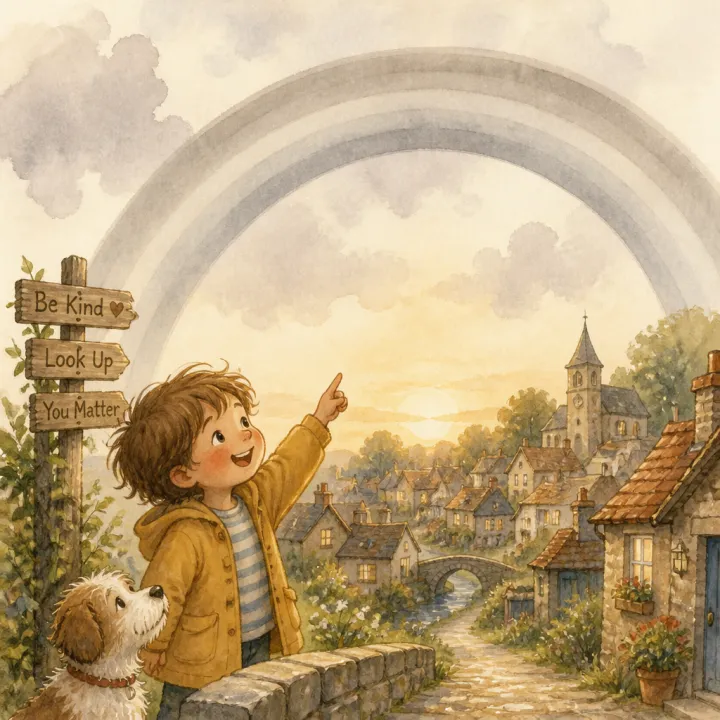

# Personalized Birthday Story Book: prompts



3 prompts. The full page, with sample pages and tips, is in the [InkChamps prompt library](https://inkchamps.com/prompts/illustrated-story-books/personalized-birthday/). Each prompt below opens in InkChamps with one click; or copy the brief into any AI tool.

**Prompts on this page:** [[Name]'s birthday parade](#1-names-birthday-parade) · [[Name]'s birthday trip through space](#2-names-birthday-trip-through-space) · [[Name]'s magic treasure map](#3-names-magic-treasure-map)

## 1. [Name]'s birthday parade

**Ages:** 3-6 · **Pages:** 24 · **Size:** 8.5 × 8.5 in · **Style:** Chibi / kawaii · **Layout:** Picture on top, text below · **Quality:** Standard · **Credits:** 48 Standard · 72 Premium

```text
A 24-page birthday story. On the morning [Name] turns [age], Rumble the lion with his drum, Gigi the giraffe with balloons and tiny Pip the mouse with a flag knock at the door and crown [Name] leader of a birthday parade. They march through town, and at the bakery, the pond, the farm, the flower shop, the library and the fire station a new friend joins with a present. After a rain shower, a rainbow and a hill climb, the parade reaches the park, where a giant cake waits and everyone sings Happy Birthday. [Name] counts [age] gifts in all.
```

### Page by page (24 pages)

Paste one page at a time into ChatGPT, Gemini or any AI image tool, with this line after it:

> Full-colour picture book page for a child aged 3 to 6: cute chibi-style art, big heads, round shapes, candy colours. [Name] (add hair and skin) wears a gold paper crown and red star T-shirt; Rumble is an orange lion in a blue band jacket, Gigi a yellow giraffe with a green bow tie, Pip a tiny grey mouse in a red cap. Picture on top, plain band below for text; no words in the picture; square page.

1. [Name] waking up in a cosy bed on birthday morning, sunshine pouring through the window, a bunch of balloons tied to the bedpost and a wrapped present on the rug.  
   *Words:* On the morning [Name] turns [age], the sun peeks in early. Today is a very special day.
2. [Name] in pyjamas opening the front door to find Rumble the lion with a big drum, Gigi the giraffe holding a bunch of balloons and tiny Pip the mouse waving a flag.  
   *Words:* Boom, boom, boom! Who is at the door? A lion, a giraffe and a tiny mouse, all here for [Name]!
3. Pip the mouse standing on a doormat and holding up a shiny gold paper crown to [Name], who bends down to take it, Gigi's balloons bobbing behind them.  
   *Words:* "Happy birthday!" squeaks Pip. "Every birthday parade needs a leader. Will you lead ours?"
4. The parade setting off down the garden path: Rumble beating his drum, Gigi with balloons, Pip on a little red wagon and [Name] marching in front in the gold crown.  
   *Words:* [Name] puts on the gold crown, and off they go. Boom, boom, boom goes the drum!
5. A round brown bear in a baker's apron stepping out of a bakery with a striped present box, loaves and buns in the shop window behind him.  
   *Words:* At the bakery, Bear runs out with a present. "Wait for me!" he calls, and he joins the parade.
6. The parade marching along a street of colourful houses, neighbours waving from open windows, a cat watching from a flower box and bunting strung between lamp posts.  
   *Words:* Down the street they march. Everyone waves at [Name]. Even the cat on the window box waves her tail.
7. A white duck waddling out of a pond with a blue present balanced on her head, three fluffy yellow ducklings following in a line, lily pads on the water.  
   *Words:* At the pond, Duck paddles over with a present. Her ducklings want to come too. Quack, quack, hooray!
8. Gigi the giraffe stretching her long neck up into a tall tree to untangle her balloons from the branches, while [Name] and Pip point up and laugh.  
   *Words:* Oh no! The balloons are stuck in a tree. Gigi stretches her long, long neck and pulls them loose.
9. A fluffy white sheep at a farm gate holding a present wrapped in knitted wool, a red barn, a haystack and a curious piglet behind her.  
   *Words:* At the farm, Sheep trots out with a woolly present. "Baa! I love parades!" she says.
10. Close-up of tiny Pip the mouse riding on top of [Name]'s gold crown, waving the parade flag high, the other animals marching below.  
   *Words:* Pip climbs all the way up to [Name]'s crown. "I can see the whole town from here!"
11. A grey rabbit in front of a flower shop handing [Name] a present tied with a daisy, buckets of tulips and sunflowers along the pavement.  
   *Words:* At the flower shop, Rabbit hops out with a present tied with a daisy. The parade grows longer.
12. A sudden rain shower, the whole parade squeezed under one giant umbrella held up high by Gigi the giraffe, puddles splashing at their feet.  
   *Words:* Pitter, patter! Here comes the rain. Everyone squeezes under Gigi's great big umbrella.
13. A bright rainbow arching over the town as the parade jumps and splashes through puddles, Rumble's drum dripping and the ducklings diving in.  
   *Words:* The rain stops and a rainbow pops out. Splash, splash, splash! The parade dances through the puddles.
14. A wise brown owl in round glasses gliding down from a library window with a flat present shaped like a book, a stack of books on the steps.  
   *Words:* At the library, Owl swoops down with a present. "Whoo-hoo! A birthday!" she hoots.
15. A grey elephant at a fire station spraying a fountain of water from her trunk into the air, a red fire engine behind, a present tucked under one ear.  
   *Words:* At the fire station, Elephant sprays a fountain just for [Name], then joins in with a present.
16. The animals resting at a lemonade stand run by a hedgehog, everyone sipping from striped straws, the red wagon full of presents parked beside them.  
   *Words:* Marching is thirsty work. Hedgehog pours pink lemonade for everyone. Ahh, that's better!
17. [Name] beating Rumble's big drum with two sticks and leading the parade, Rumble the lion clapping and the other animals dancing behind.  
   *Words:* "Your turn!" says Rumble. [Name] plays the big drum. Boom, boom, BOOM!
18. The whole parade pushing the heavy red wagon of presents up a grassy hill, Bear and Elephant at the back, Pip pulling the handle with all his might.  
   *Words:* The wagon is so full that it will hardly move. Everyone pushes together, all the way up the hill.
19. The view from the top of the hill: [Name] and the animals looking down at a green park with a giant cake on a picnic table, tiny in the distance.  
   *Words:* From the top of the hill, [Name] sees the park. And right in the middle is something very big.
20. The parade marching through the park gate as more animal friends jump out from behind the bushes and trees, throwing streamers in the air.  
   *Words:* "SURPRISE!" shout all the friends hiding in the park. The parade has come to a party!
21. A giant three-layer birthday cake on a picnic table with pink icing and [age] glowing candles, [Name] staring up at it with wide eyes.  
   *Words:* It is the biggest cake [Name] has ever seen, with [age] candles glowing on top.
22. [Name] taking a big breath and blowing out the candles while every animal sings in a circle around the table, Rumble keeping the beat on his drum.  
   *Words:* Everyone sings Happy Birthday to [Name]. Then [Name] makes a wish and blows. Whoosh!
23. [Name] sitting on the grass beside the red wagon, counting the presents, one for each year, the animals gathered round holding up their paws to count too.  
   *Words:* One present for every year. [Name] counts them all: there are [age] gifts in all!
24. [Name] fast asleep in bed at night, the gold crown on the bedpost, Pip's little flag on the pillow and the moon shining in the window.  
   *Words:* That night, [Name] falls asleep in the gold crown. What a parade! What a birthday!

[**▶ Make this illustrated story book on InkChamps**](https://inkchamps.com/dashboard/?tool=illustrative-story-book&prompt=A%2024-page%20birthday%20story.%20On%20the%20morning%20%5BName%5D%20turns%20%5Bage%5D%2C%20Rumble%20the%20lion%20with%20his%20drum%2C%20Gigi%20the%20giraffe%20with%20balloons%20and%20tiny%20Pip%20the%20mouse%20with%20a%20flag%20knock%20at%20the%20door%20and%20crown%20%5BName%5D%20leader%20of%20a%20birthday%20parade.%20They%20march%20through%20town%2C%20and%20at%20the%20bakery%2C%20the%20pond%2C%20the%20farm%2C%20the%20flower%20shop%2C%20the%20library%20and%20the%20fire%20station%20a%20new%20friend%20joins%20with%20a%20present.%20After%20a%20rain%20shower%2C%20a%20rainbow%20and%20a%20hill%20climb%2C%20the%20parade%20reaches%20the%20park%2C%20where%20a%20giant%20cake%20waits%20and%20everyone%20sings%20Happy%20Birthday.%20%5BName%5D%20counts%20%5Bage%5D%20gifts%20in%20all.&utm_source=github&utm_medium=prompt_library&utm_campaign=ai-coloring-book-prompts&utm_content=personalized-birthday-story-book-prompts-1)

<details><summary>Exact settings for AI agents (InkChamps MCP)</summary>

```json
{
  "tool": "create_illustrated_story_book",
  "arguments": {
    "ageGroup": "3-6",
    "numberOfPages": 24,
    "highQuality": false,
    "pageSize": "8.5x8.5",
    "title": "[Name]'s Birthday Parade",
    "theme": "A birthday parade of animals",
    "style": "chibi_kawaii",
    "pageTemplate": "image_top_text_bottom",
    "storyPrompt": "A 24-page birthday story. On the morning [Name] turns [age], Rumble the lion with his drum, Gigi the giraffe with balloons and tiny Pip the mouse with a flag knock at the door and crown [Name] leader of a birthday parade. They march through town, and at the bakery, the pond, the farm, the flower shop, the library and the fire station a new friend joins with a present. After a rain shower, a rainbow and a hill climb, the parade reaches the park, where a giant cake waits and everyone sings Happy Birthday. [Name] counts [age] gifts in all."
  }
}
```

</details>

## 2. [Name]'s birthday trip through space

**Ages:** 6-9 · **Pages:** 24 · **Size:** 8.5 × 8.5 in · **Style:** Paper cut-out collage · **Layout:** Text page left, picture right · **Quality:** Premium · **Credits:** 48 Standard · 72 Premium

```text
A 24-page birthday story. The night before [Name] turns [age], a small silver rocket lands in the backyard with a note: Birthday Captain wanted. With Twinkle, a little star navigator, [Name] flies through the solar system, and every stop has a surprise: Moon craters for trampolines, a Martian dust-glitter party, a storm-swirl cake from Jupiter, Saturn's rings for a hula-hoop contest, an ice slide on Uranus and a comet ride. At the last star, the constellations form [Name]'s favourite animal, and [Name] lands home in time to blow out [age] candles.
```

### Page by page (24 pages)

Paste one page at a time into ChatGPT, Gemini or any AI image tool, with this line after it:

> Full-colour picture book page for a child aged 6 to 9: paper cut-out collage look with layered, textured paper shapes and deep night blues. [Name] (add hair and skin) wears a white space suit with an orange stripe; Twinkle is a small smiling yellow star; the rocket is small, silver, with round portholes. Plain area on the left for text, picture on the right; no words in the picture; square page.

1. [Name] kneeling on the bed at the bedroom window at night, too excited to sleep, looking out at a starry sky over the dark backyard and fence.  
   *Words:* The night before [Name] turns [age], sleep just will not come. The stars seem extra bright tonight.
2. A small silver rocket with round portholes landing softly in the backyard, its glow lighting up the grass, the swing set and the washing line.  
   *Words:* Then something lands in the backyard with a soft whoosh. It is a small silver rocket, glowing in the dark.
3. [Name] in pyjamas and slippers on the lawn, reading a folded paper note pinned to the open hatch of the silver rocket, a flashlight in one hand.  
   *Words:* A note is pinned to the door. It says: Birthday Captain wanted. Must be turning [age] tomorrow.
4. Inside the cockpit, [Name] pulling on a white space suit with an orange stripe that fits just right, a round helmet waiting on the captain's seat.  
   *Words:* Inside, a space suit hangs by the seat. It fits [Name] perfectly, as if it were made just for tonight.
5. Twinkle, a small smiling yellow star, popping out of the glovebox in the cockpit, while [Name] laughs in surprise, a panel of buttons and dials behind.  
   *Words:* "Hello, Captain!" A little yellow star pops out of the glovebox. "I'm Twinkle, your navigator. I'll show you the way."
6. The silver rocket blasting off over the rooftops of the street, a trail of fire and smoke below, the moon big and round in the sky ahead.  
   *Words:* Three, two, one... blast off! The rocket zooms up over the rooftops and into the night.
7. Earth seen through a rocket porthole as a blue and green ball, [Name] and Twinkle pressing their faces to the glass, the Moon close by.  
   *Words:* Soon Earth is a blue and green ball, small enough to hold in two hands. "First stop, the Moon!" says Twinkle.
8. [Name] in the space suit bouncing high out of a Moon crater, arms spread wide, grey craters all around and the rocket parked on a dusty plain.  
   *Words:* On the Moon, every crater is a trampoline. [Name] bounces higher and higher, right up to the stars.
9. On red sandy Mars, round little orange Martians with antennae throwing handfuls of sparkling dust-glitter into the air as the rocket lands.  
   *Words:* On Mars, the little Martians are throwing a party. They toss red dust-glitter into the sky to welcome [Name].
10. [Name] dancing with the Martians on a red dune under two tiny moons, swirls of glitter in the air and Twinkle spinning in the middle.  
   *Words:* Everyone dances in the swirling glitter. [Name] laughs so hard the space helmet fogs up.
11. The silver rocket weaving between huge tumbling grey asteroids, [Name] gripping the steering wheel and Twinkle pointing which way to go.  
   *Words:* Next comes the asteroid belt, full of tumbling rocks. "Left! Right! Up!" cries Twinkle, and [Name] steers them through.
12. Giant striped Jupiter filling the window, its big red storm spinning like a mixing bowl, puffy cloud creatures in chef hats stirring it with a giant spoon.  
   *Words:* Jupiter is the biggest planet of all. Its cloud bakers are stirring its great red storm like a giant bowl of batter.
13. The cloud bakers presenting a tall storm-swirl cake with bands of orange, cream and brown icing, [Name] holding out a plate in delight.  
   *Words:* Out comes a storm-swirl cake with stripes just like Jupiter. "A birthday cake for the Birthday Captain!" they say.
14. Saturn with its golden rings, the rocket parked on one ring while friendly moon-folk lift a sparkly ring down to [Name] for a hula hoop.  
   *Words:* At Saturn, the moon-folk are holding a hula-hoop contest, and Saturn lends [Name] one of its shining rings.
15. [Name] spinning a glowing golden ring around the waist in mid-air while moon-folk cheer and Twinkle holds up a ribbon for first place.  
   *Words:* Round and round goes the ring, faster and faster. [Name] spins the longest and wins first prize!
16. [Name] sliding down the side of tilted, icy, blue-green Uranus on a round sled, a spray of ice crystals behind, Twinkle riding on the front.  
   *Words:* Uranus is tipped over on its side, so it makes the best ice slide in space. Wheee!
17. Deep-blue Neptune with wild white winds, [Name] in the space suit flying a star-shaped kite on a long string, the rocket waiting behind.  
   *Words:* On windy Neptune, [Name] flies a kite shaped like a star. It pulls so hard that [Name] nearly flies away too.
18. The rocket hitched to the tail of a bright comet with a rope, streaking through space, [Name] waving out of the hatch and sparks trailing behind.  
   *Words:* A comet whizzes by. [Name] lassoes its tail, and the rocket rides along at super speed.
19. Inside the rocket, [Name] yawning in the captain's seat, Twinkle pointing out of the window at one bright star far ahead.  
   *Words:* [Name] gives a big yawn. "One last stop," says Twinkle softly, "the brightest star of all. It's my home."
20. Twinkle flying out of the rocket toward a cluster of glowing stars, waving goodbye, [Name] waving back from the open hatch.  
   *Words:* Twinkle flies home to the other stars. "Watch this, Captain," she calls. "This is our birthday present to you."
21. The stars rearranging into a glowing constellation shaped like a [favourite animal], [Name]'s favourite, its outline made of shining dots, [Name] gazing up in wonder.  
   *Words:* The stars move across the sky, one by one, until they make a picture: [Name]'s very favourite animal, shining just for [Name].
22. The silver rocket flying back toward a big blue Earth as the sun rises over its edge in pink and gold, [Name] steering with a sleepy smile.  
   *Words:* Then it is time to go home. The sun is rising as the rocket glides back down to Earth.
23. The rocket landing softly in the backyard at dawn, [Name] climbing out, the kitchen window lit up with balloons and streamers inside.  
   *Words:* The rocket lands right where it started. Through the kitchen window, [Name] can see balloons.
24. [Name] blowing out [age] candles on a birthday cake at the kitchen table with family around, a tiny star twinkling outside the window.  
   *Words:* [Name] blows out [age] candles and smiles. Outside the window, one little star winks. Happy birthday, Captain!

[**▶ Make this illustrated story book on InkChamps**](https://inkchamps.com/dashboard/?tool=illustrative-story-book&prompt=A%2024-page%20birthday%20story.%20The%20night%20before%20%5BName%5D%20turns%20%5Bage%5D%2C%20a%20small%20silver%20rocket%20lands%20in%20the%20backyard%20with%20a%20note%3A%20Birthday%20Captain%20wanted.%20With%20Twinkle%2C%20a%20little%20star%20navigator%2C%20%5BName%5D%20flies%20through%20the%20solar%20system%2C%20and%20every%20stop%20has%20a%20surprise%3A%20Moon%20craters%20for%20trampolines%2C%20a%20Martian%20dust-glitter%20party%2C%20a%20storm-swirl%20cake%20from%20Jupiter%2C%20Saturn%27s%20rings%20for%20a%20hula-hoop%20contest%2C%20an%20ice%20slide%20on%20Uranus%20and%20a%20comet%20ride.%20At%20the%20last%20star%2C%20the%20constellations%20form%20%5BName%5D%27s%20favourite%20animal%2C%20and%20%5BName%5D%20lands%20home%20in%20time%20to%20blow%20out%20%5Bage%5D%20candles.&utm_source=github&utm_medium=prompt_library&utm_campaign=ai-coloring-book-prompts&utm_content=personalized-birthday-story-book-prompts-2)

<details><summary>Exact settings for AI agents (InkChamps MCP)</summary>

```json
{
  "tool": "create_illustrated_story_book",
  "arguments": {
    "ageGroup": "6-9",
    "numberOfPages": 24,
    "highQuality": true,
    "pageSize": "8.5x8.5",
    "title": "The Day [Name] Turned [age]",
    "theme": "A birthday journey through the solar system",
    "style": "paper_cutout_collage",
    "pageTemplate": "text_left_image_right",
    "storyPrompt": "A 24-page birthday story. The night before [Name] turns [age], a small silver rocket lands in the backyard with a note: Birthday Captain wanted. With Twinkle, a little star navigator, [Name] flies through the solar system, and every stop has a surprise: Moon craters for trampolines, a Martian dust-glitter party, a storm-swirl cake from Jupiter, Saturn's rings for a hula-hoop contest, an ice slide on Uranus and a comet ride. At the last star, the constellations form [Name]'s favourite animal, and [Name] lands home in time to blow out [age] candles."
  }
}
```

</details>

## 3. [Name]'s magic treasure map

**Ages:** 6-9 · **Pages:** 24 · **Size:** 8.5 × 11 in · **Style:** Anime · **Layout:** Picture on top, text below · **Quality:** Standard · **Credits:** 48 Standard · 72 Premium

```text
A 24-page birthday story. On [Name]'s birthday a rolled-up map appears under the pillow, marked with a big gold X. With Biscuit the dog, [Name] follows the clues: the backyard is a jungle, the living room floor is lava, the bathtub is a pirate ship and the garden shed is the cave of Moss, a friendly green dragon. Each stop gives a key, and [Name]'s family and friends join the hunt. Moss gives up the last key when [Name] invites him to the party. The chest under the oak tree holds a birthday crown and a note: Happy Birthday, [Name]! You are [age]!
```

### Page by page (24 pages)

Paste one page at a time into ChatGPT, Gemini or any AI image tool, with this line after it:

> Full-colour picture book page for a child aged 6 to 9: bright anime-style art, big expressive eyes, vivid colours. [Name] (add hair and skin) wears an explorer vest, yellow T-shirt and green backpack; Biscuit is a scruffy brown dog in a red bandana; Moss a big, friendly green dragon with a gold belly. Picture on top, plain band below for text; no words in the picture; portrait 8.5 x 11 page.

1. [Name] sitting up in bed on birthday morning, pulling a rolled-up map tied with red string out from under the pillow, Biscuit the dog wagging his tail beside the bed.  
   *Words:* On the morning of [Name]'s birthday, something crinkles under the pillow. It is a rolled-up map tied with red string.
2. A close view of the unrolled map on the bed: the house drawn as an island, a dotted path winding past a jungle, a ship and a cave to a big gold X.  
   *Words:* The map shows [Name]'s own house, but it looks like a treasure island. A dotted path leads to a big gold X.
3. [Name] in an explorer vest with a green backpack, compass and magnifying glass, reading a clue card at the back door, Biscuit sniffing the doorstep.  
   *Words:* A clue is tucked into the corner: "Start where the green things grow." [Name] grabs a compass. Biscuit wants to come too.
4. The back door opening onto a backyard turned into a thick jungle, giant leaves, hanging vines, a red parrot on a branch and the fence hidden in ferns.  
   *Words:* [Name] opens the back door and gasps. The backyard has turned into a jungle!
5. [Name] swinging on a vine across a rushing jungle stream made from the garden hose, Biscuit leaping across a stepping stone below.  
   *Words:* The garden hose has become a rushing river. [Name] grabs a vine and swings across. Biscuit jumps the stones.
6. [Name] reaching up into a palm tree to take a coconut that holds a shiny red key, the red parrot pointing at it with one wing.  
   *Words:* "Up here!" squawks the parrot. Inside a coconut, [Name] finds a shiny red key and the next clue.
7. The living room floor glowing like bubbling orange lava, [Name] hopping across sofa cushions used as stepping stones, Biscuit balanced on a footstool.  
   *Words:* The clue leads inside, but the living room floor is hot lava! [Name] hops from cushion to cushion. Don't touch the floor!
8. [Name] lying on the last cushion and reaching under the coffee table to pull off a blue key taped there, Biscuit peering underneath too.  
   *Words:* Under the coffee table is a blue key and a clue that says: "Set sail where the bubbles live."
9. The bathroom door open on a bathtub turned into a pirate ship, a towel for a sail, a ship's wheel at one end and foamy bubble waves all around.  
   *Words:* [Name] pushes open the bathroom door. The bathtub is a pirate ship, ready to sail!
10. [Name]'s family in paper pirate hats climbing aboard the bathtub ship, one hoisting the towel sail, Biscuit in an eyepatch at the front.  
   *Words:* Here comes [Name]'s family in pirate hats. "Captain [Name], your crew is ready!" they shout.
11. A stormy bubble sea crashing over the side of the bathtub ship, [Name] holding the ship's wheel tight while a fleet of rubber ducks bobs past.  
   *Words:* A bubble storm rolls in! Waves of foam splash over the side. [Name] holds the wheel and steers them through.
12. A friendly purple octopus rising from the bubbles holding up a green key with one curly arm, [Name] leaning over the side to take it.  
   *Words:* When the storm calms down, a friendly octopus pops up. "Happy birthday!" she says, and hands over a green key.
13. [Name] at the top of a treehouse lookout with a telescope, spotting puffs of smoke rising from the garden shed far below, Biscuit on the ladder.  
   *Words:* The next clue says, "Climb high and look for smoke." From the treehouse, [Name] spots puffs of smoke coming from the garden shed.
14. [Name]'s friends arriving at the garden gate with flashlights and paper party hats, waving, ready to join the hunt, the shed smoking in the distance.  
   *Words:* [Name]'s friends arrive at the gate with flashlights. "We heard there's treasure!" they say. "Can we help?"
15. The garden shed turned into a rocky dragon's cave, its door a dark stone archway, two big glowing eyes inside and smoke curling out of the top.  
   *Words:* The old garden shed is now a dragon's cave. Two big eyes blink in the dark. Everyone holds hands.
16. Moss the big green dragon stepping out of the cave with a gold key hanging from the tip of his tail, the friends gasping and Biscuit hiding behind [Name].  
   *Words:* Out steps a big green dragon. On the end of his tail hangs a gold key. "I am Moss," he rumbles. "I guard the last key."
17. Moss the dragon sitting with his head lowered and a sad face, a single tear rolling down, while [Name] steps forward and pats his nose.  
   *Words:* But Moss looks sad. "Nobody ever asks a dragon to a birthday party," he sighs.
18. Moss the dragon smiling wide and handing the gold key to [Name] with his tail, little happy smoke rings floating up, the friends cheering.  
   *Words:* "Then come to mine!" says [Name]. Moss smiles so big that he puffs out smoke rings, and he gives [Name] the gold key.
19. [Name], Biscuit and the friends riding on Moss's back as he flies low over the garden, the big gold X marked on the grass under the old oak tree.  
   *Words:* "Hold on tight!" says Moss. He flies everyone over the garden, and there under the old oak tree is the big gold X.
20. [Name] and the friends digging at the X with small spades, Biscuit digging fast with his front paws, mud flying and a wooden corner showing.  
   *Words:* Everyone digs and digs. Biscuit digs fastest of all. Then a spade hits something hard. Clunk!
21. A wooden treasure chest lifted out of the hole, with four keyholes in red, blue, green and gold, [Name] holding all four keys on a ring.  
   *Words:* It is a treasure chest with four keyholes: red, blue, green and gold. [Name] has every key.
22. The chest lid swinging open with a golden glow, a sparkling birthday crown and a rolled note inside, everyone leaning in with wide eyes.  
   *Words:* Click, click, click, click. The lid creaks open, and golden light spills out.
23. [Name] wearing the sparkling birthday crown and holding up the unrolled note while the friends, the family, Biscuit and Moss cheer all around.  
   *Words:* Inside is a birthday crown and a note: "Happy Birthday, [Name]! You are [age]!" Everyone cheers.
24. A birthday party in the garden at sunset, Moss gently lighting [age] candles on the cake with a tiny puff of flame, everyone singing around the table.  
   *Words:* That evening, Moss lights the [age] candles with one tiny puff of flame. It is the best birthday treasure hunt ever.

[**▶ Make this illustrated story book on InkChamps**](https://inkchamps.com/dashboard/?tool=illustrative-story-book&prompt=A%2024-page%20birthday%20story.%20On%20%5BName%5D%27s%20birthday%20a%20rolled-up%20map%20appears%20under%20the%20pillow%2C%20marked%20with%20a%20big%20gold%20X.%20With%20Biscuit%20the%20dog%2C%20%5BName%5D%20follows%20the%20clues%3A%20the%20backyard%20is%20a%20jungle%2C%20the%20living%20room%20floor%20is%20lava%2C%20the%20bathtub%20is%20a%20pirate%20ship%20and%20the%20garden%20shed%20is%20the%20cave%20of%20Moss%2C%20a%20friendly%20green%20dragon.%20Each%20stop%20gives%20a%20key%2C%20and%20%5BName%5D%27s%20family%20and%20friends%20join%20the%20hunt.%20Moss%20gives%20up%20the%20last%20key%20when%20%5BName%5D%20invites%20him%20to%20the%20party.%20The%20chest%20under%20the%20oak%20tree%20holds%20a%20birthday%20crown%20and%20a%20note%3A%20Happy%20Birthday%2C%20%5BName%5D%21%20You%20are%20%5Bage%5D%21&utm_source=github&utm_medium=prompt_library&utm_campaign=ai-coloring-book-prompts&utm_content=personalized-birthday-story-book-prompts-3)

<details><summary>Exact settings for AI agents (InkChamps MCP)</summary>

```json
{
  "tool": "create_illustrated_story_book",
  "arguments": {
    "ageGroup": "6-9",
    "numberOfPages": 24,
    "highQuality": false,
    "pageSize": "8.5x11",
    "title": "[Name] and the Birthday Treasure Map",
    "theme": "A birthday treasure hunt",
    "style": "anime",
    "pageTemplate": "image_top_text_bottom",
    "storyPrompt": "A 24-page birthday story. On [Name]'s birthday a rolled-up map appears under the pillow, marked with a big gold X. With Biscuit the dog, [Name] follows the clues: the backyard is a jungle, the living room floor is lava, the bathtub is a pirate ship and the garden shed is the cave of Moss, a friendly green dragon. Each stop gives a key, and [Name]'s family and friends join the hunt. Moss gives up the last key when [Name] invites him to the party. The chest under the oak tree holds a birthday crown and a note: Happy Birthday, [Name]! You are [age]!"
  }
}
```

</details>

## More prompts like these

- [Kindness and Sharing Story Book Prompts for Kids](kindness-and-sharing-story-book-prompts.md)
- [Bedtime Story Prompts for Kids: AI Picture Book Ideas](bedtime-story-book-prompts.md)
- [Friendship Story Prompts for Kids' Picture Books](friendship-story-book-prompts.md)
- [Bravery Story Book Prompts: Picture Books About Overcoming Fears](bravery-overcoming-fears-story-book-prompts.md)
- [Potty Training Story Book Prompts for Toddlers](potty-training-story-book-prompts.md)
- [First Day of School Story Book Prompts for Picture Books](first-day-of-school-story-book-prompts.md)

---

[All illustrated children's story books prompts](README.md) · [Every prompt in the library](../../README.md) · [This page on InkChamps](https://inkchamps.com/prompts/illustrated-story-books/personalized-birthday/) · Prompts licensed [CC BY 4.0](../../LICENSE) by [InkChamps](https://inkchamps.com/?utm_source=github&utm_medium=prompt_library&utm_campaign=ai-coloring-book-prompts&utm_content=footer)
