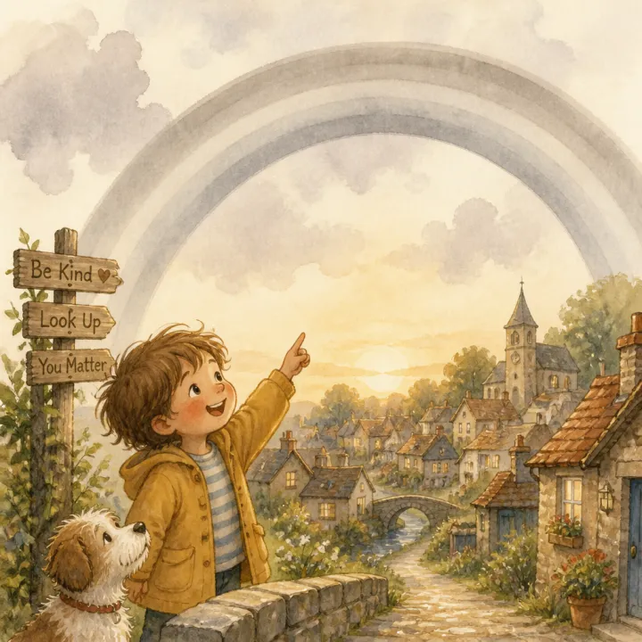

# Potty Training Story Book: prompts



3 prompts. The full page, with sample pages and tips, is in the [InkChamps prompt library](https://inkchamps.com/prompts/illustrated-story-books/potty-training/). Each prompt below opens in InkChamps with one click; or copy the brief into any AI tool.

**Prompts on this page:** [Momo the panda's big potty day](#1-momo-the-pandas-big-potty-day) · [Rory the dinosaur's mighty potty](#2-rory-the-dinosaurs-mighty-potty) · [Princess Plum's royal potty](#3-princess-plums-royal-potty)

## 1. Momo the panda's big potty day

**Ages:** 3-6 · **Pages:** 24 · **Size:** 8.5 × 8.5 in · **Style:** Chibi / kawaii · **Layout:** Words lettered into the art · **Quality:** Standard · **Credits:** 48 Standard · 72 Premium

```text
A 24-page potty story. Momo, a little panda in a red T-shirt, gets a shiny green potty. He sits and waits, and nothing happens. He builds a block tower and forgets, and oops, an accident. Mama Panda hugs him: That's okay, we try again. After lunch Momo listens to his tummy, runs to the potty just in time, and it works! He flushes, washes his paws with lots of bubbles, puts a star on his sticker chart and pulls on brand-new big-kid pants covered in bamboo leaves. Short, repetitive, encouraging lines.
```

### Page by page (24 pages)

Paste one page at a time into ChatGPT, Gemini or any AI image tool, with this line after it:

> Full-colour cute kawaii picture book illustration for ages 3 to 6: round chubby shapes, big heads, bright soft colours, simple cozy rooms. Momo is a small round panda cub in a red T-shirt; Mama Panda is a bigger panda in a yellow cardigan; the potty is shiny green. Potty scenes stay modest. Leave a plain area at the top for the page's words; no other writing in the picture. Square page.

1. Momo the little panda cub in his red T-shirt standing against a height chart on his bedroom wall, stretching up on tiptoe, a teddy bear and a toy drum on the floor beside him.  
   *Words:* This is Momo. Momo is a little panda, and Momo is getting big.
2. Mama Panda in her yellow cardigan holding out a big wrapped box with a red bow in the sunny living room, Momo running toward it with his arms wide, a sofa and a potted plant behind.  
   *Words:* One morning, Mama Panda has a surprise. A big box with a red bow!
3. Momo peeking into the opened box at a shiny green potty, torn wrapping paper and the red bow on the rug, his eyes wide and his mouth a happy round O.  
   *Words:* Inside is a shiny green potty. It is just for Momo.
4. Momo sitting on the green potty in the bathroom with his T-shirt and shorts still on, waving at it, a fluffy bath mat, a toothbrush cup on the sink and a little step stool nearby.  
   *Words:* Momo sits on his potty with his shorts on. Hello, potty!
5. Momo sitting his brown teddy bear on the green potty in the bathroom and patting its head, a stack of toilet paper rolls and a rubber duck on the edge of the bath.  
   *Words:* Teddy wants a turn too. Teddy sits on the potty. Good sitting, Teddy!
6. Mama Panda and Momo cuddled on the sofa reading a picture book with a drawing of a green potty on the open page, a cushion and a cup of milk beside them.  
   *Words:* Mama reads Momo a potty book. Wee and poo go in the potty, she says.
7. Momo sitting on the green potty with his T-shirt covering his lap, chin resting in his paws as he waits, a little round clock on the wall and a basket of board books beside him.  
   *Words:* Momo sits on the potty. He waits. And waits. Nothing happens.
8. Mama Panda kneeling beside Momo as he hops off the empty green potty, giving him a thumbs up and a gentle smile, the bathroom door open behind them.  
   *Words:* That's okay, says Mama. We try again later.
9. Momo on the playroom rug building a tall, wobbly tower of bright toy blocks, his tongue poking out as he concentrates, a toy train and a ball nearby.  
   *Words:* Momo plays with his blocks. He builds a tall, tall tower.
10. Momo on tiptoe placing one more block on top of his tower, so busy he does not notice his tummy, a faint thought cloud with a green potty floating unseen above his head.  
   *Words:* Momo is so busy. He forgets to listen to his tummy.
11. Momo standing on the playroom rug looking down at a wet patch on his shorts and a small puddle by his feet, ears drooping and lip wobbling, the block tower beside him.  
   *Words:* Oops! An accident. Momo's shorts are wet. Momo feels sad.
12. Mama Panda in her yellow cardigan kneeling on the playroom rug and wrapping Momo in a big warm hug, his teary face on her shoulder, the block tower behind them.  
   *Words:* Mama gives Momo a big hug. That's okay, Momo. Everybody has accidents. We try again.
13. Momo holding a little cloth and helping Mama Panda wipe the floor, a laundry basket with his wet shorts in it and a clean pair of shorts folded on a chair.  
   *Words:* Momo helps clean up. Clean shorts, dry socks. All better.
14. Momo at the kitchen table after lunch drinking water from a green cup with both paws, an empty plate with a bamboo shoot and a bib beside him.  
   *Words:* After lunch, Momo drinks his water. Glug, glug, glug.
15. Momo standing still in the hallway with both paws on his round tummy and one ear tilted as he listens, a speech bubble with a green potty above him, toy cars on the floor.  
   *Words:* Momo listens to his tummy. His tummy says, potty time!
16. Momo running down the hallway toward the open bathroom door, motion lines behind his feet, a rug sliding a little and Mama Panda smiling from the kitchen doorway.  
   *Words:* Run, Momo, run! Down the hall to the bathroom.
17. Momo climbing onto his green potty in the bathroom with his red T-shirt tugged down over his lap, a step stool and a fluffy towel on the rail behind him.  
   *Words:* Shorts down. Sit down. Momo sits on his green potty.
18. Momo sitting on the green potty singing with his eyes closed and paws in the air, little music notes floating around him and the rubber duck on the bath edge watching.  
   *Words:* Momo waits. He sings a little song. And then... it works!
19. Mama Panda jumping and clapping in the bathroom doorway while Momo stands beside his green potty with a huge proud grin, sparkles all around them.  
   *Words:* Momo did it! Momo used the potty! Mama claps and claps.
20. Momo on a step stool pressing the flush button on the big toilet with one paw, a swirl of water inside the bowl and Mama Panda's paw resting on his back.  
   *Words:* Momo pushes the button. Whoosh! Flush! Bye-bye!
21. Momo on the step stool at the bathroom sink washing his paws under the tap, a mountain of soap bubbles spilling over the sink and a towel hanging nearby.  
   *Words:* Wash, wash, wash your paws. Lots and lots of bubbles.
22. Mama Panda lifting Momo up to press a shiny gold star sticker onto a sticker chart on the fridge, a row of magnets and a crayon drawing beside the chart.  
   *Words:* Momo puts a shiny star on his sticker chart. One star for Momo!
23. Momo in his bedroom holding up a pair of white big-kid pants covered in green bamboo leaves, a gift bag at his feet and Mama Panda clapping behind him.  
   *Words:* Momo gets brand-new big-kid pants, with green bamboo leaves all over.
24. Momo standing proudly with his paws on his hips in his red T-shirt and bamboo-leaf pants, the green potty and the starred sticker chart behind him, confetti in the air.  
   *Words:* Momo listens to his tummy now. Momo is a big-kid panda!

[**▶ Make this illustrated story book on InkChamps**](https://inkchamps.com/dashboard/?tool=illustrative-story-book&prompt=A%2024-page%20potty%20story.%20Momo%2C%20a%20little%20panda%20in%20a%20red%20T-shirt%2C%20gets%20a%20shiny%20green%20potty.%20He%20sits%20and%20waits%2C%20and%20nothing%20happens.%20He%20builds%20a%20block%20tower%20and%20forgets%2C%20and%20oops%2C%20an%20accident.%20Mama%20Panda%20hugs%20him%3A%20That%27s%20okay%2C%20we%20try%20again.%20After%20lunch%20Momo%20listens%20to%20his%20tummy%2C%20runs%20to%20the%20potty%20just%20in%20time%2C%20and%20it%20works%21%20He%20flushes%2C%20washes%20his%20paws%20with%20lots%20of%20bubbles%2C%20puts%20a%20star%20on%20his%20sticker%20chart%20and%20pulls%20on%20brand-new%20big-kid%20pants%20covered%20in%20bamboo%20leaves.%20Short%2C%20repetitive%2C%20encouraging%20lines.&utm_source=github&utm_medium=prompt_library&utm_campaign=ai-coloring-book-prompts&utm_content=potty-training-story-book-prompts-1)

<details><summary>Exact settings for AI agents (InkChamps MCP)</summary>

```json
{
  "tool": "create_illustrated_story_book",
  "arguments": {
    "ageGroup": "3-6",
    "numberOfPages": 24,
    "highQuality": false,
    "pageSize": "8.5x8.5",
    "title": "Momo's Big Potty Day",
    "theme": "Learning to use the potty",
    "style": "chibi_kawaii",
    "pageTemplate": "text_in_image",
    "storyPrompt": "A 24-page potty story. Momo, a little panda in a red T-shirt, gets a shiny green potty. He sits and waits, and nothing happens. He builds a block tower and forgets, and oops, an accident. Mama Panda hugs him: That's okay, we try again. After lunch Momo listens to his tummy, runs to the potty just in time, and it works! He flushes, washes his paws with lots of bubbles, puts a star on his sticker chart and pulls on brand-new big-kid pants covered in bamboo leaves. Short, repetitive, encouraging lines."
  }
}
```

</details>

## 2. Rory the dinosaur's mighty potty

**Ages:** 3-6 · **Pages:** 24 · **Size:** 8.5 × 8.5 in · **Style:** Chibi art · **Layout:** Picture on top, text below · **Quality:** Standard · **Credits:** 48 Standard · 72 Premium

```text
A 24-page potty story. Rory, a little green dinosaur with orange spots and a big ROAR, is too busy stomping to use his orange potty. He stomps through the kitchen, roars at Pickle the cat and builds a tower, ignores his wiggly tail and has an accident; Dad hugs him and says next time, stomp to the potty. When the potty dance comes again he stomps so fast the potty jumps! He sits, sings a song, and does it. His family cheers so loudly the walls shake. Rory gets dinosaur undies and does his proudest roar ever. Silly and full of sound words.
```

### Page by page (24 pages)

Paste one page at a time into ChatGPT, Gemini or any AI image tool, with this line after it:

> Full-colour chunky cartoon picture book art for ages 3 to 6: big heads, small bodies, bold bright colours, simple backgrounds. Rory is a little green dinosaur with orange spots, yellow T-shirt and blue shorts; Mum is purple, Dad blue, Pickle a grey cat; the potty is orange. Potty scenes stay modest. Picture on top, plain band at the bottom for words; no words in the picture. Square page.

1. Rory the little green dinosaur with orange spots stomping across the living room rug with a giant roar, mouth wide open, toy cars bouncing on the floor and a lamp wobbling.  
   *Words:* STOMP, STOMP, ROAR! This is Rory. Rory is a little dinosaur with a very big roar.
2. Rory in the bathroom holding his orange-spotted arm up beside a brand-new orange potty to compare the colours, a bath mat and a stack of folded towels nearby.  
   *Words:* Rory has a brand-new potty. It is orange, just like his spots.
3. Mum, a purple dinosaur in a striped apron, pointing toward the bathroom while Rory stomps off the other way down the hallway, waving his arms and grinning.  
   *Words:* Potty time, Rory? asks Mum. No time! says Rory. I'm too busy stomping!
4. Rory stomping through the kitchen, spoons and pans rattling on their hooks, a cereal box tipping over on the counter and Mum lifting her teacup out of the way.  
   *Words:* Rory stomps through the kitchen. STOMP! The spoons rattle. CLATTER, CLATTER!
5. Rory roaring at Pickle the grey cat, who has leapt onto the top of the fridge with her fur puffed up, her food bowl skidding across the kitchen floor.  
   *Words:* Rory roars at Pickle the cat. ROAR! Pickle jumps up on the fridge. MEOW!
6. Rory in the playroom stacking chunky wooden blocks into a tower taller than he is, standing on tiptoe with his tail curled for balance, a toy truck parked nearby.  
   *Words:* Rory builds a tower. Block, block, block. Higher and higher!
7. Rory beside his block tower with his knees pressed together and his tail and feet wiggling, still holding up a block and shaking his head, Pickle the cat watching from the doorway.  
   *Words:* Rory's tail wiggles. His feet wiggle. But Rory keeps on building.
8. The block tower tumbled across the playroom floor and Rory standing among the blocks looking down at his wet shorts and a small puddle, his face sad and small.  
   *Words:* CRASH! Down comes the tower. Uh-oh. Rory's shorts are wet. Rory's roar is very small.
9. Dad, a big blue dinosaur in a cosy green jumper, kneeling on the playroom floor and hugging Rory close, patting his back, scattered blocks all around them.  
   *Words:* Dad gives Rory a big dino hug. That's okay, little dino. Next time, stomp to the potty!
10. Rory in his bedroom pulling on clean dry shorts while Dad holds out a pair of striped socks, a laundry basket with the wet clothes beside the bed.  
   *Words:* Clean shorts, dry socks. Rory is ready to stomp again.
11. Rory in red rain boots stomping in a muddy puddle in the back garden, mud splashing up high, a washing line and a bed of sunflowers behind him.  
   *Words:* Rory stomps in the garden. SPLASH! Right in a muddy puddle.
12. Rory standing in the garden doing the potty dance, tail and feet wiggling and eyes wide as he notices, muddy boots on and the back door open behind him.  
   *Words:* Then Rory's tail wiggles again. Wiggle, wiggle, wiggle! It's the potty dance!
13. Rory stomping down the hallway at top speed with dust puffs behind each foot, pictures tilting on the walls and Pickle the cat leaping out of the way.  
   *Words:* This time Rory knows. POTTY! STOMP, STOMP, STOMP, all the way down the hall.
14. The orange potty hopping up off the bathroom floor with little motion lines as Rory stomps in through the door, a toothbrush cup rattling on the sink.  
   *Words:* He stomps so fast that the potty jumps! BOING!
15. Rory sitting on his orange potty with his yellow T-shirt pulled down over his lap, smiling, his muddy boots kicked off by the bathroom door.  
   *Words:* Shorts down. Rory sits on his orange potty. Ahhh.
16. Rory on his potty singing with his claws in the air and music notes floating up, Mum sitting on the edge of the bath holding a picture book on her knee.  
   *Words:* Rory waits. Rory sings his dino song. Dino, dino, on the pot, waiting, waiting, quite a lot!
17. Rory standing beside his orange potty with both arms raised high in triumph, a bright starburst behind him and a big surprised smile on his face.  
   *Words:* And then... tinkle, tinkle! Rory did it!
18. Mum and Dad dinosaurs cheering and jumping in the bathroom doorway, the walls shaking with motion lines and a framed picture swinging on its hook.  
   *Words:* HOORAY! cheers Mum. HOORAY! cheers Dad. They cheer so loud the walls shake.
19. Pickle the grey cat rubbing against Rory's legs in the bathroom with her tail curled, Rory patting her head and grinning, the orange potty behind them.  
   *Words:* Even Pickle comes to see. Purr, purr, purr.
20. Rory on a step stool beside the big toilet pushing down the flush handle with both claws, a swirl of water in the bowl and Dad giving a thumbs up.  
   *Words:* Rory pushes the handle. FLUSH! WHOOSH! Bye-bye!
21. Rory scrubbing his hands at the bathroom sink, foamy bubbles covering his claws and floating up into the air, a green towel hanging on the rail.  
   *Words:* Scrub, scrub, splash! Rory washes his hands. Bubbles everywhere!
22. Rory sitting on his bedroom floor in a pile of wrapping paper, holding up dinosaur undies covered in little green footprints, Mum smiling beside him.  
   *Words:* Rory gets a present. Dinosaur undies, with little green footprints all over!
23. Rory at the playground tugging on Dad's hand and pointing toward a small toilet building, his tail wiggling, a slide and swings behind them.  
   *Words:* At the park, Rory's tail wiggles. He tells Dad right away. Potty, please!
24. Rory standing on a little stool doing the biggest roar of his life, arms up and mouth wide, Mum, Dad and Pickle cheering around him and confetti flying.  
   *Words:* Rory climbs up high and does his proudest roar ever. I'M A BIG DINO! ROAR!

[**▶ Make this illustrated story book on InkChamps**](https://inkchamps.com/dashboard/?tool=illustrative-story-book&prompt=A%2024-page%20potty%20story.%20Rory%2C%20a%20little%20green%20dinosaur%20with%20orange%20spots%20and%20a%20big%20ROAR%2C%20is%20too%20busy%20stomping%20to%20use%20his%20orange%20potty.%20He%20stomps%20through%20the%20kitchen%2C%20roars%20at%20Pickle%20the%20cat%20and%20builds%20a%20tower%2C%20ignores%20his%20wiggly%20tail%20and%20has%20an%20accident%3B%20Dad%20hugs%20him%20and%20says%20next%20time%2C%20stomp%20to%20the%20potty.%20When%20the%20potty%20dance%20comes%20again%20he%20stomps%20so%20fast%20the%20potty%20jumps%21%20He%20sits%2C%20sings%20a%20song%2C%20and%20does%20it.%20His%20family%20cheers%20so%20loudly%20the%20walls%20shake.%20Rory%20gets%20dinosaur%20undies%20and%20does%20his%20proudest%20roar%20ever.%20Silly%20and%20full%20of%20sound%20words.&utm_source=github&utm_medium=prompt_library&utm_campaign=ai-coloring-book-prompts&utm_content=potty-training-story-book-prompts-2)

<details><summary>Exact settings for AI agents (InkChamps MCP)</summary>

```json
{
  "tool": "create_illustrated_story_book",
  "arguments": {
    "ageGroup": "3-6",
    "numberOfPages": 24,
    "highQuality": false,
    "pageSize": "8.5x8.5",
    "title": "Rory Goes on the Potty",
    "theme": "A funny dinosaur potty story",
    "style": "chibi_art",
    "pageTemplate": "image_top_text_bottom",
    "storyPrompt": "A 24-page potty story. Rory, a little green dinosaur with orange spots and a big ROAR, is too busy stomping to use his orange potty. He stomps through the kitchen, roars at Pickle the cat and builds a tower, ignores his wiggly tail and has an accident; Dad hugs him and says next time, stomp to the potty. When the potty dance comes again he stomps so fast the potty jumps! He sits, sings a song, and does it. His family cheers so loudly the walls shake. Rory gets dinosaur undies and does his proudest roar ever. Silly and full of sound words."
  }
}
```

</details>

## 3. Princess Plum's royal potty

**Ages:** 3-6 · **Pages:** 24 · **Size:** 8.5 × 8.5 in · **Style:** 2D hand-drawn · **Layout:** Picture on top, text below · **Quality:** Standard · **Credits:** 48 Standard · 72 Premium

```text
A 24-page potty story. Princess Plum, a toddler with a lopsided golden crown, is given her very own royal throne: a tiny gold potty with a velvet cushion. But she's too busy feeding the castle ducks and having tea with Bramble the dragon to sit on it. After a royal accident in the ballroom, the Queen tells her a secret: even queens had accidents once. Plum tries again, waits, and makes it! The trumpets play, the court cheers and the ducks quack. Plum earns her big-girl crown pants. Plum is always shown in her dress, the potty scenes from the waist up.
```

### Page by page (24 pages)

Paste one page at a time into ChatGPT, Gemini or any AI image tool, with this line after it:

> Full-colour hand-drawn 2D storybook art for ages 3 to 6: soft warm colours, clean outlines. Plum is a toddler princess with curly brown hair, a lopsided gold crown and a lilac dress; the Queen wears a blue gown; Bramble is a small green dragon; the potty is gold. Potty scenes from the waist up. Picture on top, plain band below for words; no words in the art. Square page.

1. A pink-and-white castle on a green hill under a sunny sky, little Princess Plum waving from a tower window, her golden crown tipped to one side and a flag on the turret.  
   *Words:* In a castle on a hill lived a little princess called Plum. Her crown was always a little bit crooked.
2. The Queen in her blue gown holding out a present tied with a big purple bow in the castle throne room, Plum running toward it along the red carpet.  
   *Words:* One morning the Queen had a royal surprise. A present with a big purple bow!
3. Plum lifting a tiny gold potty with a purple velvet cushion out of the open present, wrapping paper at her feet and her crown slipping over one ear.  
   *Words:* Inside was a tiny golden throne with a soft velvet cushion. A potty, just for Plum!
4. The Queen kneeling in a pretty royal bathroom with a gold-framed mirror, setting the little gold potty down beside the big toilet while Plum watches.  
   *Words:* Every princess needs her own throne, said the Queen. This one is yours.
5. Plum patting her little gold potty on its cushion like a pet, already turning toward the door with a paper bag of duck food in her other hand.  
   *Words:* Plum patted her little throne. Hello, throne. But I'm very busy today!
6. Plum kneeling on the grassy bank of the castle moat tossing crumbs to a row of white ducks, one duck nibbling at the hem of her lilac dress.  
   *Words:* Plum fed the castle ducks by the moat. Quack, quack, quack!
7. Plum and Bramble the small green dragon at a tiny tea table in the castle garden, Bramble puffing a smoke ring over his teacup, a plate of cupcakes between them.  
   *Words:* Plum had tea with Bramble the dragon. More tea, Bramble? Bramble puffed a tiny smoke ring.
8. Plum twirling across the shiny floor of the grand ballroom under a glittering chandelier, her lilac dress spinning out wide, tall arched windows behind her.  
   *Words:* Plum danced in the ballroom. Twirl, twirl, twirl went her dress.
9. Plum pausing mid-twirl in the ballroom with a puzzled face and one hand on her tummy, the other arm still raised to spin, a golden harp in the corner.  
   *Words:* Then Plum felt a funny feeling in her tummy. But she kept on twirling.
10. Plum standing still in the middle of the ballroom floor looking down at a small puddle by her shoes, hands over her mouth, two knights peeking round the doorway.  
   *Words:* Oh no! A royal accident, right in the middle of the ballroom.
11. Plum sitting on the ballroom steps with her chin on her knees and a tear on her cheek, her golden crown fallen on the step beside her.  
   *Words:* Plum's lip wobbled. Princesses don't have accidents, she sniffed.
12. The Queen kneeling beside Plum on the ballroom steps, cupping a hand to whisper in her ear, Plum's eyes going wide with surprise.  
   *Words:* The Queen knelt down and whispered a secret. Even queens had accidents once.
13. The Queen and Plum laughing together on the steps, a thought cloud above the Queen showing a tiny girl in a crown on the castle stairs.  
   *Words:* When I was little, I had one on the castle stairs! said the Queen. Plum giggled.
14. Plum in her bedroom in a clean lilac dress, buckling her pink shoes, a laundry basket by the canopy bed and a wooden rocking horse in the corner.  
   *Words:* Plum put on a clean dress and her favourite pink shoes. All better.
15. The Queen holding Plum's hand as they walk along a castle corridor hung with tapestries, both smiling, a little gold potty waiting in the open doorway ahead.  
   *Words:* Accidents happen, said the Queen. We just try again.
16. The next morning, Plum standing in the castle garden with both hands on her tummy and her head tilted, listening, the white ducks gathered round her feet.  
   *Words:* The next day, Plum listened to her tummy. Tummy, do you need the throne?
17. Plum hurrying down a long castle corridor lined with suits of armour and portraits, holding up her skirt, a friendly guard stepping aside to let her pass.  
   *Words:* Yes! Plum hurried down the long hall, past the knights and the paintings.
18. Plum, shown from the waist up, sitting very straight and patient on her little gold potty with her hands folded, the gold mirror and a vase of roses behind her.  
   *Words:* Plum sat on her golden throne. She waited like a princess, very still and very patient.
19. Bramble the green dragon and three white ducks waiting in a line outside the royal bathroom door, Bramble's tail swishing, one duck pressing its head to the door.  
   *Words:* Bramble waited outside the door. The ducks waited too.
20. Plum, shown from the waist up beside her gold potty, throwing her arms in the air with joy, sparkles around her and her crown bouncing on her curls.  
   *Words:* And then... she did it! Plum made it to her throne in time!
21. Two trumpeters in red tunics blowing long golden trumpets in the throne room, courtiers cheering, ducks flapping and Bramble clapping his claws around Plum.  
   *Words:* Ta-ra-ra! The trumpets played. The whole court cheered. The ducks quacked!
22. Plum standing on a velvet stool at a gold washbasin, scrubbing her hands in a heap of soap bubbles that float up toward a stained-glass window.  
   *Words:* Plum washed her hands in the royal basin, with lots and lots of bubbles.
23. The Queen handing Plum a small golden box, Plum lifting the lid to find folded big-girl pants printed with tiny crowns, her face lit up with delight.  
   *Words:* The Queen gave Plum a little golden box. Inside were big-girl crown pants!
24. Plum standing tall on the castle balcony at sunset with her crown sitting perfectly straight, arms raised, the Queen, Bramble and the ducks cheering behind her.  
   *Words:* Plum stood tall. I'm a big-girl princess now! And this time, her crown stayed perfectly straight.

[**▶ Make this illustrated story book on InkChamps**](https://inkchamps.com/dashboard/?tool=illustrative-story-book&prompt=A%2024-page%20potty%20story.%20Princess%20Plum%2C%20a%20toddler%20with%20a%20lopsided%20golden%20crown%2C%20is%20given%20her%20very%20own%20royal%20throne%3A%20a%20tiny%20gold%20potty%20with%20a%20velvet%20cushion.%20But%20she%27s%20too%20busy%20feeding%20the%20castle%20ducks%20and%20having%20tea%20with%20Bramble%20the%20dragon%20to%20sit%20on%20it.%20After%20a%20royal%20accident%20in%20the%20ballroom%2C%20the%20Queen%20tells%20her%20a%20secret%3A%20even%20queens%20had%20accidents%20once.%20Plum%20tries%20again%2C%20waits%2C%20and%20makes%20it%21%20The%20trumpets%20play%2C%20the%20court%20cheers%20and%20the%20ducks%20quack.%20Plum%20earns%20her%20big-girl%20crown%20pants.%20Plum%20is%20always%20shown%20in%20her%20dress%2C%20the%20potty%20scenes%20from%20the%20waist%20up.&utm_source=github&utm_medium=prompt_library&utm_campaign=ai-coloring-book-prompts&utm_content=potty-training-story-book-prompts-3)

<details><summary>Exact settings for AI agents (InkChamps MCP)</summary>

```json
{
  "tool": "create_illustrated_story_book",
  "arguments": {
    "ageGroup": "3-6",
    "numberOfPages": 24,
    "highQuality": false,
    "pageSize": "8.5x8.5",
    "title": "Princess Plum's Royal Throne",
    "theme": "A royal potty-training story",
    "style": "hand_drawn_2d",
    "pageTemplate": "image_top_text_bottom",
    "storyPrompt": "A 24-page potty story. Princess Plum, a toddler with a lopsided golden crown, is given her very own royal throne: a tiny gold potty with a velvet cushion. But she's too busy feeding the castle ducks and having tea with Bramble the dragon to sit on it. After a royal accident in the ballroom, the Queen tells her a secret: even queens had accidents once. Plum tries again, waits, and makes it! The trumpets play, the court cheers and the ducks quack. Plum earns her big-girl crown pants. Plum is always shown in her dress, the potty scenes from the waist up."
  }
}
```

</details>

## More prompts like these

- [First Day of School Story Book Prompts for Picture Books](first-day-of-school-story-book-prompts.md)
- [New Baby Sibling Story Book Prompts for Big Brothers and Sisters](new-baby-sibling-story-book-prompts.md)
- [Dragon Story Prompts for Kids' Picture Books](dragon-story-book-prompts.md)
- [Animal Fable Story Book Prompts with a Moral](animal-fable-story-book-prompts.md)
- [Personalized Birthday Story Book Prompts for Custom Kids' Books](personalized-birthday-story-book-prompts.md)
- [Kindness and Sharing Story Book Prompts for Kids](kindness-and-sharing-story-book-prompts.md)

---

[All illustrated children's story books prompts](README.md) · [Every prompt in the library](../../README.md) · [This page on InkChamps](https://inkchamps.com/prompts/illustrated-story-books/potty-training/) · Prompts licensed [CC BY 4.0](../../LICENSE) by [InkChamps](https://inkchamps.com/?utm_source=github&utm_medium=prompt_library&utm_campaign=ai-coloring-book-prompts&utm_content=footer)
