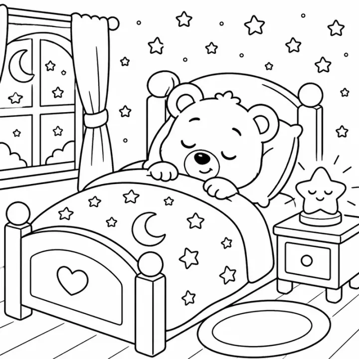

# Bedtime Story Coloring Book: prompts



5 prompts. The full page, with sample pages and tips, is in the [InkChamps prompt library](https://inkchamps.com/prompts/story-coloring-books/bedtime/). Each prompt below opens in InkChamps with one click; or copy the brief into any AI tool.

**Prompts on this page:** [Bramble the badger cub's lost blanket](#1-bramble-the-badger-cubs-lost-blanket) · [Noor's goodnight walk around the block](#2-noors-goodnight-walk-around-the-block) · [Theo's overnight sleeper train](#3-theos-overnight-sleeper-train) · [Marigold the lighthouse cat](#4-marigold-the-lighthouse-cat) · [Ivy and the hundredth sheep](#5-ivy-and-the-hundredth-sheep)

## 1. Bramble the badger cub's lost blanket

**Ages:** 3-6 · **Pages:** 24 · **Size:** 8.5 × 11 in · **Style:** Story · **Quality:** Standard · **Credits:** 48 Standard · 72 Premium

```text
A 24-page bedtime story. Bramble, a badger cub with a white stripe and pajamas too big for him, cannot find his patchwork blanket at bedtime. He searches the twilight wood: under the ferns, at the rabbits' burrow, the frog pond, the owl's oak, the hedgehogs' leaf pile, the squirrels' nest, the fireflies' meadow and the old stone wall where the moths sleep. Each friend points him onward. In a hollow log he finds the blanket, now a nest for five baby mice. He shares it, they all fall asleep, and Mama Badger finds them under the moon.
```

### Page by page (24 pages)

Paste one page at a time into ChatGPT, Gemini or any AI image tool, with this line after it:

> Black-and-white story coloring page for a child aged 3 to 6. Bramble is a small round badger cub with a white stripe down his face and baggy striped pajamas with rolled-up sleeves; his blanket is a patchwork of squares. Thick bold outlines, big simple shapes, little background, no shading or grey, no words in the picture, a plain blank band at the bottom for text, portrait 8.5 x 11 page.

1. Bramble the badger cub standing at the round door of his burrow under a big oak tree at sunset, yawning wide, his long pajama sleeves flopping over his paws.  
   *Words:* The sun was going down over the wood, and Bramble the badger cub gave a great big yawn.
2. Bramble in his little bedroom inside the burrow, staring at his empty moss bed with his paws on his cheeks, a pillow and a tiny lamp but no blanket anywhere.  
   *Words:* It was bedtime, but his patchwork blanket was not on his bed. "Where is my blanket?" said Bramble.
3. Bramble on his tummy peeking under a big bed of curly ferns outside the burrow, his striped tail in the air, a ladybird asleep on one leaf.  
   *Words:* He looked under the ferns. No blanket there, just a ladybird fast asleep.
4. Bramble at the rabbits' burrow in a grassy bank, a mother rabbit tucking three bunnies into a row of tiny beds and pointing a paw down the path.  
   *Words:* He asked Mother Rabbit. "We haven't seen it," she said. "Ask the frogs at the pond."
5. Bramble trotting along a winding woodland path, holding up the too-long legs of his pajamas, mushrooms and a fallen pine cone beside the path.  
   *Words:* So Bramble set off down the path, holding up his too-long pajamas.
6. Bramble at the edge of the frog pond, three frogs on round lily pads with their mouths open in a goodnight song, cattails along the bank.  
   *Words:* The frogs were singing their goodnight song. "Ribbit, goodnight! Ribbit, sleep tight!"
7. A big frog on a stone in the pond pointing toward a huge oak tree, Bramble beside him on the bank, a dragonfly asleep on a reed.  
   *Words:* "No blanket here," said Big Frog. "Ask the owl in the old oak."
8. Bramble at the bottom of the owl's big oak looking up, a round owl in a nightcap leaning out of a hole in the trunk, a crescent moon behind the branches.  
   *Words:* Owl was just waking up. "I go to work at night," said Owl, "but I have not seen a blanket. Try the hedgehogs."
9. Bramble watching four little hedgehogs curl up into balls in a cozy pile of autumn leaves, a mother hedgehog patting the leaves smooth.  
   *Words:* The hedgehogs were curling up in their leaves. "No blanket in here," they yawned.
10. A squirrel family snuggled in a round nest of twigs high in a tree, Bramble waving up at them from the roots, a pile of acorns at his feet.  
   *Words:* High in the tree, the squirrels called down, "Follow the fireflies! They see everything."
11. Bramble at the edge of a meadow full of tall grass and daisies, dozens of fireflies drawn as little glowing dots floating around him.  
   *Words:* In the meadow, the fireflies lit up one by one, like tiny lamps.
12. Bramble following a line of fireflies across a little wooden bridge over a stream, holding the rail, a fish jumping in the water below.  
   *Words:* They led Bramble over the little bridge, blink, blink, blink.
13. Bramble at an old mossy stone wall where big soft moths sleep in the cracks, one moth fluttering down to land on his nose.  
   *Words:* At the old stone wall, a soft moth landed on his nose. "I know where it is," she whispered.
14. A moth with patterned wings pointing its feeler at a hollow log lying in the ferns, Bramble tiptoeing toward it with his paw raised.  
   *Words:* "Look in the hollow log," said the moth. Bramble tiptoed closer.
15. Bramble spotting a corner of his patchwork blanket poking out of the end of the hollow log, his eyes wide and his mouth open in surprise.  
   *Words:* There it was! A corner of his patchwork blanket, poking out of the log.
16. Bramble kneeling and peeking into the hollow log, five baby mice snuggled together on his patchwork blanket like a nest, one tiny mouse waving.  
   *Words:* Bramble peeked inside. Five baby mice were snuggled up on his blanket, warm and cozy.
17. A mother mouse standing on the log beside her babies, holding her paws together, Bramble listening with his head tilted, an acorn cap cup beside her.  
   *Words:* "I'm sorry," said Mother Mouse. "My babies were so cold tonight."
18. Bramble sitting on the ground with his paws on his knees, thinking, the hollow log beside him and the baby mice peeking out at him.  
   *Words:* Bramble sat down and thought. It was his blanket. But the mice were so small.
19. Bramble smiling and crawling into the big hollow log on his hands and knees, the five baby mice making room for him on the blanket.  
   *Words:* "There is room for everyone," said Bramble, and he crawled inside.
20. Inside the log, Bramble lying on his side with the patchwork blanket pulled over him and all five baby mice tucked under it with their ears showing.  
   *Words:* He pulled the blanket over himself and all five baby mice. It was the coziest bed in the wood.
21. Mama Badger walking through the dark wood carrying a lantern on a pole, peering ahead, a sleepy owl watching her from a branch.  
   *Words:* Back home, Mama Badger took her lantern and went looking for Bramble.
22. Mama Badger kneeling at the end of the hollow log, smiling at Bramble and the mice asleep inside, her lantern set down on a flat stone.  
   *Words:* She found him in the hollow log, fast asleep with his new friends. She smiled.
23. The hollow log in a little clearing under a big round moon and stars, Mama Badger lying curled beside it, the ferns and mushrooms quiet all around.  
   *Words:* Mama Badger curled up beside the log, and the big moon kept watch over them all.
24. Bramble fast asleep and smiling, filling the page, the patchwork blanket up to his chin and a baby mouse asleep on his paw, a few stars around them.  
   *Words:* Goodnight, Bramble. Goodnight, little mice. Goodnight, wood.

[**▶ Make this story coloring book on InkChamps**](https://inkchamps.com/dashboard/?tool=coloring-book-story&prompt=A%2024-page%20bedtime%20story.%20Bramble%2C%20a%20badger%20cub%20with%20a%20white%20stripe%20and%20pajamas%20too%20big%20for%20him%2C%20cannot%20find%20his%20patchwork%20blanket%20at%20bedtime.%20He%20searches%20the%20twilight%20wood%3A%20under%20the%20ferns%2C%20at%20the%20rabbits%27%20burrow%2C%20the%20frog%20pond%2C%20the%20owl%27s%20oak%2C%20the%20hedgehogs%27%20leaf%20pile%2C%20the%20squirrels%27%20nest%2C%20the%20fireflies%27%20meadow%20and%20the%20old%20stone%20wall%20where%20the%20moths%20sleep.%20Each%20friend%20points%20him%20onward.%20In%20a%20hollow%20log%20he%20finds%20the%20blanket%2C%20now%20a%20nest%20for%20five%20baby%20mice.%20He%20shares%20it%2C%20they%20all%20fall%20asleep%2C%20and%20Mama%20Badger%20finds%20them%20under%20the%20moon.&utm_source=github&utm_medium=prompt_library&utm_campaign=ai-coloring-book-prompts&utm_content=bedtime-story-coloring-book-prompts-1)

<details><summary>Exact settings for AI agents (InkChamps MCP)</summary>

```json
{
  "tool": "create_story_coloring_book",
  "arguments": {
    "ageGroup": "3-6",
    "numberOfPages": 24,
    "highQuality": false,
    "pageSize": "8.5x11",
    "title": "Where Is Bramble's Blanket?",
    "theme": "Bedtime in the woods",
    "style": "story",
    "description": "A 24-page bedtime story. Bramble, a badger cub with a white stripe and pajamas too big for him, cannot find his patchwork blanket at bedtime. He searches the twilight wood: under the ferns, at the rabbits' burrow, the frog pond, the owl's oak, the hedgehogs' leaf pile, the squirrels' nest, the fireflies' meadow and the old stone wall where the moths sleep. Each friend points him onward. In a hollow log he finds the blanket, now a nest for five baby mice. He shares it, they all fall asleep, and Mama Badger finds them under the moon."
  }
}
```

</details>

## 2. Noor's goodnight walk around the block

**Ages:** 3-6 · **Pages:** 24 · **Size:** 8.5 × 11 in · **Style:** Story · **Quality:** Standard · **Credits:** 48 Standard · 72 Premium

```text
A 24-page bedtime story. Noor, a five-year-old with two puffs of curly hair and star-print pajamas under her coat, takes an evening walk around the block with her dad. They pass the baker closing his shutter, the florist bringing in buckets, the grocer's crates, the bus driver ending her last route, pigeons on the bridge rail, the park being locked, a window cat, the night nurse heading to work and the streetlights coming on one by one. Back home come bath, teeth, pajamas, a story with Dad and a last wave to the Moon before she sleeps.
```

### Page by page (24 pages)

Paste one page at a time into ChatGPT, Gemini or any AI image tool, with this line after it:

> Black-and-white story coloring page for a child aged 3 to 6. Noor is a small five-year-old girl with two round puffs of curly hair, wearing pajamas printed with stars; her dad is tall with a short beard and knit cap. Thick bold outlines, big simple shapes, simple background, no shading or grey, no words in the picture, a plain blank band at the bottom for text, portrait 8.5 x 11 page.

1. Noor in the hallway of her apartment while her dad zips her coat over her star-print pajamas, a row of keys on hooks and a pair of little boots by the door.  
   *Words:* After dinner, Dad zipped Noor's coat right over her star pajamas. "Time for our goodnight walk," he said.
2. Noor holding her dad's hand as they walk down the front steps of their brick apartment building, a potted plant on each step and a lit lamp above the door.  
   *Words:* Down the front steps they went, hand in hand, out into the evening street.
3. The baker in an apron pulling down the shutter of his bakery, a last loaf and a tray of buns in the window, Noor waving to him from the sidewalk.  
   *Words:* Mr. Hamid the baker was pulling down his shutter. "Goodnight, Noor! Fresh bread tomorrow!"
4. The florist carrying big buckets of tulips and sunflowers in from the sidewalk, Noor holding the shop door open for her, petals on the ground.  
   *Words:* The florist was carrying her flowers inside. Noor held the door for the sunflowers.
5. The grocer stacking empty fruit crates in a tall tower outside his corner shop, one apple left on top, Noor's dad pointing at it and smiling.  
   *Words:* At the corner shop, the grocer stacked his crates up high. One apple sat on top like a hat.
6. A city bus pulled up at the last stop, the bus driver stepping down with her lunchbox and stretching, Noor and Dad at the bus shelter.  
   *Words:* The bus came to its very last stop. The driver stretched her arms. Her day was done.
7. Noor and Dad crossing a little bridge over a canal, a row of pigeons on the bridge rail tucking their heads under their wings.  
   *Words:* On the bridge, the pigeons tucked their heads under their wings. Goodnight, pigeons.
8. The corner park with empty swings and a slide, the park keeper locking the tall iron gate, one last leaf floating down beside Noor.  
   *Words:* At the park, the swings were empty. The park keeper locked the gate. Goodnight, park.
9. A dog walker heading home with three dogs of different sizes on leashes, the smallest dog stopping to sniff Noor's boots.  
   *Words:* Three dogs trotted home for supper. The smallest one sniffed Noor's boots to say goodnight.
10. A fat cat sitting on a second-floor windowsill between two flowerpots, Noor looking up at it from the sidewalk, one curtain half open behind the cat.  
   *Words:* A sleepy cat watched from her window. Noor waved, and the cat blinked slowly back.
11. A night nurse in a long coat with a bag over her shoulder walking to work, waving at Noor and Dad as they pass a mailbox.  
   *Words:* A nurse walked past on her way to work. "Some people work while we sleep," said Dad.
12. Noor pointing up as a row of streetlights flicks on one by one along the street, Dad holding her other hand, parked bicycles by the curb.  
   *Words:* Click, click, click! The streetlights came on, one after another, all down the street.
13. Noor riding on Dad's shoulders, both looking at a big round Moon rising between two tall buildings, a water tower on one roof.  
   *Words:* From up on Dad's shoulders, Noor saw the Moon rise between the buildings.
14. Noor and Dad climbing the stairs back up to their apartment, Noor holding the banister and counting steps, a doormat at the top.  
   *Words:* Then it was home again, up the stairs. Noor counted every step.
15. Noor in a bubble bath in a claw-foot tub, a toy boat floating beside her and a stack of folded towels on a stool.  
   *Words:* Splish, splash! Noor had a warm bubble bath with her little boat.
16. Dad drying Noor's curly hair with a big fluffy towel while she sits on the bath mat and giggles, a little hairbrush on the shelf.  
   *Words:* Dad dried her curly hair with the fluffiest towel. It tickled!
17. Noor standing on a step stool at the bathroom sink brushing her teeth, a cup with two toothbrushes and a round mirror above the sink.  
   *Words:* Brush, brush, brush. Top teeth, bottom teeth, all clean.
18. Noor putting her star-print pajamas back on in her bedroom, one arm through a sleeve, her toy elephant waiting on the bed.  
   *Words:* On went the star pajamas again, and Ellie the elephant waited on the bed.
19. Noor choosing a picture book from a low bookshelf crowded with books, a toy drum and a stuffed bear on the bottom shelf.  
   *Words:* Noor chose one story from the shelf. Just one, because it was late.
20. Dad sitting on the edge of Noor's bed reading the picture book aloud, Noor tucked under the quilt holding her toy elephant.  
   *Words:* Dad read the story, and Noor's eyes grew heavy.
21. Noor kneeling at her bedroom window waving goodnight to the Moon, the rooftops and the row of streetlights below.  
   *Words:* Noor knelt at the window. "Goodnight, Moon. Goodnight, street."
22. The view from Noor's window: her quiet street with the bakery shutter down, the florist dark and just a few windows still lit in the building opposite.  
   *Words:* Down below, the shops were dark and the street was quiet.
23. Dad switching on a moon-shaped night light and stepping out of the bedroom, the door left a little open and a strip of hall light on the floor.  
   *Words:* Dad turned on the little moon light. "Goodnight, Noor," he whispered.
24. Noor fast asleep in her bed hugging her toy elephant, her two curly puffs on the pillow and the Moon shining through the window.  
   *Words:* And Noor was fast asleep, with Ellie in her arms and the Moon in her window.

[**▶ Make this story coloring book on InkChamps**](https://inkchamps.com/dashboard/?tool=coloring-book-story&prompt=A%2024-page%20bedtime%20story.%20Noor%2C%20a%20five-year-old%20with%20two%20puffs%20of%20curly%20hair%20and%20star-print%20pajamas%20under%20her%20coat%2C%20takes%20an%20evening%20walk%20around%20the%20block%20with%20her%20dad.%20They%20pass%20the%20baker%20closing%20his%20shutter%2C%20the%20florist%20bringing%20in%20buckets%2C%20the%20grocer%27s%20crates%2C%20the%20bus%20driver%20ending%20her%20last%20route%2C%20pigeons%20on%20the%20bridge%20rail%2C%20the%20park%20being%20locked%2C%20a%20window%20cat%2C%20the%20night%20nurse%20heading%20to%20work%20and%20the%20streetlights%20coming%20on%20one%20by%20one.%20Back%20home%20come%20bath%2C%20teeth%2C%20pajamas%2C%20a%20story%20with%20Dad%20and%20a%20last%20wave%20to%20the%20Moon%20before%20she%20sleeps.&utm_source=github&utm_medium=prompt_library&utm_campaign=ai-coloring-book-prompts&utm_content=bedtime-story-coloring-book-prompts-2)

<details><summary>Exact settings for AI agents (InkChamps MCP)</summary>

```json
{
  "tool": "create_story_coloring_book",
  "arguments": {
    "ageGroup": "3-6",
    "numberOfPages": 24,
    "highQuality": false,
    "pageSize": "8.5x11",
    "title": "Goodnight, Noor's Street",
    "theme": "Bedtime in the city",
    "style": "story",
    "description": "A 24-page bedtime story. Noor, a five-year-old with two puffs of curly hair and star-print pajamas under her coat, takes an evening walk around the block with her dad. They pass the baker closing his shutter, the florist bringing in buckets, the grocer's crates, the bus driver ending her last route, pigeons on the bridge rail, the park being locked, a window cat, the night nurse heading to work and the streetlights coming on one by one. Back home come bath, teeth, pajamas, a story with Dad and a last wave to the Moon before she sleeps."
  }
}
```

</details>

## 3. Theo's overnight sleeper train

**Ages:** 6-9 · **Pages:** 24 · **Size:** 8.5 × 11 in · **Style:** Story · **Quality:** Standard · **Credits:** 48 Standard · 72 Premium

```text
A 24-page bedtime story. Theo, seven, red-haired and holding a stuffed rabbit called Parsnip, rides the overnight sleeper train with his mom to his grandma's house in the mountains. He finds his little cabin, eats soup in the dining car, watches fields and a sunset, meets the conductor with her brass lantern, sees a sleeping town glide past, climbs into the top bunk, counts tunnel lights, spots deer by a moonlit lake and drifts off as the train climbs. He wakes at dawn to snowy peaks, and Grandma is waiting on the platform with a thermos of cocoa.
```

### Page by page (24 pages)

Paste one page at a time into ChatGPT, Gemini or any AI image tool, with this line after it:

> Black-and-white story coloring page for a child aged 6 to 9. Theo is a seven-year-old boy with messy hair, freckles and a striped sweater or pajamas, with Parsnip, a stuffed rabbit with one floppy ear. Clean medium outlines, moderate detail, simple background, no shading or grey, no words in the picture, a plain blank band at the bottom for text, portrait 8.5 x 11 page.

1. Theo and his mom on a busy station platform in the evening, a big round station clock overhead, the long sleeper train waiting with its carriage doors open.  
   *Words:* The big station clock said seven o'clock. Theo held his mom's hand and stared at the long night train.
2. The conductor in her peaked cap holding up a brass lantern at the carriage door, checking Theo's ticket while he hugs Parsnip, his mom with a suitcase behind.  
   *Words:* The conductor held up her brass lantern. "Tickets, please! And who is this?" "This is Parsnip," said Theo.
3. Theo bouncing on the bottom bunk of a tiny train cabin with a fold-down table, a little sink in the corner and a window with a pull-down blind.  
   *Words:* Their cabin was tiny, with two bunks, a sink and a window. Theo bounced on the bed. It was perfect.
4. Theo unpacking his backpack in the cabin, setting Parsnip on the top-bunk pillow, a toothbrush, a flashlight and folded pajamas on the bunk.  
   *Words:* He unpacked his toothbrush, his flashlight and his pajamas, and gave Parsnip the top pillow.
5. Theo pressing his hands to the cabin window as the train pulls out, people waving on the platform and the station lamps sliding away.  
   *Words:* With a jolt and a whistle, the train began to move. Theo waved until the station was gone.
6. The view from the train window of city backyards sliding past: washing lines, garden sheds, a trampoline and a boy waving from a fence.  
   *Words:* Back gardens rushed by: washing lines, sheds and a boy on a fence who waved back.
7. Wide fields with round hay bales and a windmill under a setting sun, seen through the train window, Theo's elbow on the sill in the foreground.  
   *Words:* Then came the fields, gold and wide, and the sun sank down behind the hills.
8. Theo and his mom in the dining car eating bowls of soup at a small table with a white cloth, a little table lamp and a basket of bread rolls.  
   *Words:* In the dining car, they ate warm soup with crusty rolls while the world went by.
9. A country level crossing at dusk with its barrier down, one car and a farmer on a tractor waiting, the train rushing past with lit windows.  
   *Words:* At a crossing, a farmer on a tractor waited for them. Ding, ding, ding went the bell.
10. A small sleeping town gliding past the window: a church steeple, rooftops, a few lit windows and a cat on a garden wall.  
   *Words:* A little town slid past, sleepy and still, with only a few lights left on.
11. The conductor kneeling in the narrow corridor to show Theo her brass lantern up close, its little flame behind the glass, Parsnip peeking over his arm.  
   *Words:* The conductor let Theo look at her lantern. "It has lit the way on this train for forty years," she said.
12. Theo brushing his teeth at the tiny cabin sink while the train sways, holding the edge with one hand, a cup sliding gently on the shelf.  
   *Words:* Brushing your teeth on a train is tricky. The whole cabin swayed, and Theo giggled.
13. Theo in pajamas climbing the little ladder to the top bunk with Parsnip under one arm, a reading light clipped to the wall.  
   *Words:* Up the ladder he climbed to the top bunk, with Parsnip under his arm.
14. Theo lying on the top bunk counting on his fingers as the lights of a tunnel flash past the window in a row of bright dots.  
   *Words:* Whoosh! Into a tunnel. Theo counted the lights. Ten, eleven, twelve...
15. A moonlit lake beside the track with two deer drinking at the edge, pine trees around the shore and the Moon reflected in the water.  
   *Words:* Out by a lake, two deer lifted their heads as the train went by in the moonlight.
16. The sleeper train crossing a tall stone bridge over a deep river valley at night, a row of glowing windows along its carriages.  
   *Words:* The train rumbled over a tall stone bridge, high above a river far below.
17. Theo's mom reading a chapter book aloud from the bottom bunk, Theo leaning over the edge of the top bunk to listen, Parsnip dangling from his hand.  
   *Words:* Mom read a chapter from his book. Theo listened, and his eyes grew heavy.
18. An owl sitting on a wooden fence post beside the track, its eyes wide as the train goes by, a farmhouse with one light far behind it.  
   *Words:* An owl on a fence post watched the train go by. Hoo, hoo, goodnight.
19. Theo asleep on the top bunk with Parsnip tucked under his chin, the blind half down and a sliver of moonlight across his blanket.  
   *Words:* Clickety-clack, clickety-clack. The train rocked Theo gently to sleep.
20. The conductor walking softly down the dark corridor at midnight with her brass lantern, the cabin doors closed on both sides.  
   *Words:* At midnight, the conductor walked softly down the corridor with her lantern. All was well.
21. The long train winding up into the mountains in the moonlight, the track curving around a cliff and tall pine trees below.  
   *Words:* All night long, the train climbed up and up into the mountains.
22. Theo waking at dawn and pulling up the blind, snowy mountain peaks filling the window and Parsnip propped on the sill.  
   *Words:* In the morning, Theo pulled up the blind. Snow! Mountains everywhere, pink in the sunrise.
23. The train pulling into a small mountain station with a wooden roof and snow on the platform, a sign post and a bench, smoke rising from a chimney.  
   *Words:* The train slowed and stopped at a little snowy station.
24. Grandma on the snowy platform hugging Theo, holding a thermos of cocoa with two cups, Parsnip squeezed between them and his mom smiling behind.  
   *Words:* And there was Grandma, with a big hug and a thermos of hot cocoa. "You made it!"

[**▶ Make this story coloring book on InkChamps**](https://inkchamps.com/dashboard/?tool=coloring-book-story&prompt=A%2024-page%20bedtime%20story.%20Theo%2C%20seven%2C%20red-haired%20and%20holding%20a%20stuffed%20rabbit%20called%20Parsnip%2C%20rides%20the%20overnight%20sleeper%20train%20with%20his%20mom%20to%20his%20grandma%27s%20house%20in%20the%20mountains.%20He%20finds%20his%20little%20cabin%2C%20eats%20soup%20in%20the%20dining%20car%2C%20watches%20fields%20and%20a%20sunset%2C%20meets%20the%20conductor%20with%20her%20brass%20lantern%2C%20sees%20a%20sleeping%20town%20glide%20past%2C%20climbs%20into%20the%20top%20bunk%2C%20counts%20tunnel%20lights%2C%20spots%20deer%20by%20a%20moonlit%20lake%20and%20drifts%20off%20as%20the%20train%20climbs.%20He%20wakes%20at%20dawn%20to%20snowy%20peaks%2C%20and%20Grandma%20is%20waiting%20on%20the%20platform%20with%20a%20thermos%20of%20cocoa.&utm_source=github&utm_medium=prompt_library&utm_campaign=ai-coloring-book-prompts&utm_content=bedtime-story-coloring-book-prompts-3)

<details><summary>Exact settings for AI agents (InkChamps MCP)</summary>

```json
{
  "tool": "create_story_coloring_book",
  "arguments": {
    "ageGroup": "6-9",
    "numberOfPages": 24,
    "highQuality": false,
    "pageSize": "8.5x11",
    "title": "The Night Train to Grandma's",
    "theme": "Bedtime on a sleeper train",
    "style": "story",
    "description": "A 24-page bedtime story. Theo, seven, red-haired and holding a stuffed rabbit called Parsnip, rides the overnight sleeper train with his mom to his grandma's house in the mountains. He finds his little cabin, eats soup in the dining car, watches fields and a sunset, meets the conductor with her brass lantern, sees a sleeping town glide past, climbs into the top bunk, counts tunnel lights, spots deer by a moonlit lake and drifts off as the train climbs. He wakes at dawn to snowy peaks, and Grandma is waiting on the platform with a thermos of cocoa."
  }
}
```

</details>

## 4. Marigold the lighthouse cat

**Ages:** 6-9 · **Pages:** 24 · **Size:** 8.5 × 11 in · **Style:** Story · **Quality:** Standard · **Credits:** 48 Standard · 72 Premium

```text
A 24-page bedtime story. Marigold, an orange cat with one white paw, lives in a lighthouse on a rocky island with the keeper, Mr. Penrose. Every evening she climbs the 99 spiral steps to watch him light the lamp, then follows the beam across the sea. Tonight it sweeps over fishing boats heading in, seals on the rocks, the late ferry, puffins in their burrows, a sailboat with a torn sail that the beam guides into the harbor, a whale and leaping dolphins, and the village going dark window by window. When every boat is tied up, Marigold curls up on the keeper's armchair and sleeps.
```

### Page by page (24 pages)

Paste one page at a time into ChatGPT, Gemini or any AI image tool, with this line after it:

> Black-and-white story coloring page for a child aged 6 to 9. Marigold is a slim tabby-striped cat with one plain white front paw; Mr. Penrose is an old keeper with a white beard, a knitted sweater and a flat cap. Clean medium outlines, moderate detail, simple sea background, no shading or grey, no words in the picture, a plain blank band at the bottom for text, portrait 8.5 x 11 page.

1. A tall striped lighthouse on a rocky island at sunset, a little keeper's cottage beside it and Marigold the cat sitting on the doorstep, gulls overhead.  
   *Words:* On a rocky island far out at sea lived Marigold, an orange cat with one white paw, and Mr. Penrose, the lighthouse keeper.
2. Mr. Penrose in the cottage kitchen filling Marigold's bowl with fish, a kettle on the stove and a ship's clock on the wall, Marigold rubbing against his boots.  
   *Words:* Every evening began the same way: fish for Marigold and a pot of tea for Mr. Penrose.
3. Marigold bounding up the spiral iron staircase inside the lighthouse ahead of Mr. Penrose, who carries an oil can, the steps curling up and out of sight.  
   *Words:* Then up they went, ninety-nine spiral steps. Marigold always got to the top first.
4. Mr. Penrose polishing the giant ribbed glass lens in the lamp room with a cloth, Marigold sitting on a stool watching her reflection in the glass.  
   *Words:* Mr. Penrose polished the great glass lens until it shone. Marigold watched a hundred little cats look back at her.
5. Mr. Penrose striking a long match to light the great lamp, bright lines shining out from the lens, Marigold's ears pricked up.  
   *Words:* He struck a long match, and the lamp burst into light. The night's work had begun.
6. Marigold perched on the railing of the lighthouse gallery, her tail curled around a post, watching a long beam of light sweep out across the sea.  
   *Words:* Marigold sat on the railing and followed the beam as it swept round and round across the sea.
7. Three fishing boats chugging home toward the island in the lighthouse beam, nets piled on deck and gulls following behind.  
   *Words:* The beam found the fishing boats coming home, with full nets and hungry gulls behind them.
8. Seals hauled out on flat rocks below the lighthouse, one pup lifting its head into the beam, waves splashing around the rocks.  
   *Words:* It passed over the seals on the rocks. A little pup blinked up at the light.
9. The late ferry crossing the bay with a row of round lit portholes, passengers waving from the deck rail and a flag flying at the stern.  
   *Words:* The late ferry crossed the bay, its windows glowing like a string of beads.
10. Puffins standing outside their burrows on a grassy cliff top, one with a beakful of small fish, the beam passing over their heads.  
   *Words:* On the cliff, the puffins were going to bed in their burrows, one with a last fishy snack.
11. Dark clouds blowing in and the waves growing tall, Mr. Penrose on the gallery looking through binoculars, Marigold's fur ruffled by the wind.  
   *Words:* Then the wind picked up and the waves grew tall. Mr. Penrose lifted his binoculars. "Look, Marigold. Someone's out there."
12. A small sailboat with a torn sail tossing on the rough waves far out at sea, its lone sailor holding the tiller and a lantern swinging on the mast.  
   *Words:* A little sailboat was tossing on the waves, its sail torn, its sailor all alone.
13. The lighthouse beam shining a straight path across the waves to the little sailboat, the sailor looking up at it with relief.  
   *Words:* Round came the beam, and it shone a bright path straight across the water. "Follow the light!" Marigold seemed to say.
14. The sailboat gliding safely into the stone harbor, the harbor master throwing a rope from the quay and a coil of rope on the bollard.  
   *Words:* The sailboat followed the beam all the way into the harbor, safe and sound.
15. A whale rising out of the calm sea in the moonlight, a tall spout of water above it, Marigold staring from the gallery with wide eyes.  
   *Words:* Later, when the sea was calm again, a whale rose up in the moonlight and blew a great spout.
16. Two dolphins leaping through the lighthouse beam over silvery water, splashes and droplets around them and the Moon behind.  
   *Words:* Two dolphins leaped right through the beam, as if they were playing in it.
17. The harbor village on the shore going dark window by window, a row of little cottages with only two windows still lit.  
   *Words:* Across the bay, the village went to sleep, one window at a time.
18. The last fisherman tying his boat to the quay and walking home along the harbor wall with a lantern and a basket of fish.  
   *Words:* The last fisherman tied up his boat and walked home with his lantern. Every boat was in.
19. Mr. Penrose at a small desk in the lamp room writing in the big logbook with a pen, Marigold lying across the open page.  
   *Words:* Mr. Penrose wrote it all in the logbook. Marigold helped by lying on the page.
20. Mr. Penrose holding out a sardine to Marigold, who sits up on her back legs to take it, the beam still turning behind them.  
   *Words:* "Good work tonight, Marigold," he said, and gave her a sardine.
21. Marigold padding down the spiral stairs in the dim light, a small window halfway down showing the Moon over the sea.  
   *Words:* Then Marigold padded back down the ninety-nine steps, much more slowly this time.
22. The cottage sitting room with a big worn armchair by a pot-bellied stove, a knitted blanket over the arm and a pair of slippers on the rug.  
   *Words:* Her favorite chair was waiting by the warm stove.
23. Marigold curled up asleep on the armchair while Mr. Penrose tucks the knitted blanket around her, his reading glasses pushed up on his head.  
   *Words:* She curled up, and Mr. Penrose tucked the blanket around her. "Goodnight, little keeper."
24. The lighthouse at night on its rocky island, the beam crossing a calm sea under a full Moon and stars, every boat tied up in the harbor across the bay.  
   *Words:* And the light kept turning all night long, over a calm sea where every boat was safely home.

[**▶ Make this story coloring book on InkChamps**](https://inkchamps.com/dashboard/?tool=coloring-book-story&prompt=A%2024-page%20bedtime%20story.%20Marigold%2C%20an%20orange%20cat%20with%20one%20white%20paw%2C%20lives%20in%20a%20lighthouse%20on%20a%20rocky%20island%20with%20the%20keeper%2C%20Mr.%20Penrose.%20Every%20evening%20she%20climbs%20the%2099%20spiral%20steps%20to%20watch%20him%20light%20the%20lamp%2C%20then%20follows%20the%20beam%20across%20the%20sea.%20Tonight%20it%20sweeps%20over%20fishing%20boats%20heading%20in%2C%20seals%20on%20the%20rocks%2C%20the%20late%20ferry%2C%20puffins%20in%20their%20burrows%2C%20a%20sailboat%20with%20a%20torn%20sail%20that%20the%20beam%20guides%20into%20the%20harbor%2C%20a%20whale%20and%20leaping%20dolphins%2C%20and%20the%20village%20going%20dark%20window%20by%20window.%20When%20every%20boat%20is%20tied%20up%2C%20Marigold%20curls%20up%20on%20the%20keeper%27s%20armchair%20and%20sleeps.&utm_source=github&utm_medium=prompt_library&utm_campaign=ai-coloring-book-prompts&utm_content=bedtime-story-coloring-book-prompts-4)

<details><summary>Exact settings for AI agents (InkChamps MCP)</summary>

```json
{
  "tool": "create_story_coloring_book",
  "arguments": {
    "ageGroup": "6-9",
    "numberOfPages": 24,
    "highQuality": false,
    "pageSize": "8.5x11",
    "title": "Marigold Keeps the Light",
    "theme": "Bedtime by the sea",
    "style": "story",
    "description": "A 24-page bedtime story. Marigold, an orange cat with one white paw, lives in a lighthouse on a rocky island with the keeper, Mr. Penrose. Every evening she climbs the 99 spiral steps to watch him light the lamp, then follows the beam across the sea. Tonight it sweeps over fishing boats heading in, seals on the rocks, the late ferry, puffins in their burrows, a sailboat with a torn sail that the beam guides into the harbor, a whale and leaping dolphins, and the village going dark window by window. When every boat is tied up, Marigold curls up on the keeper's armchair and sleeps."
  }
}
```

</details>

## 5. Ivy and the hundredth sheep

**Ages:** 9-13 · **Pages:** 24 · **Size:** 8.5 × 11 in · **Style:** Story · **Quality:** Standard · **Credits:** 48 Standard · 72 Premium

```text
A 24-page bedtime story. Ivy, ten, with a long braid and round glasses, can't fall asleep and starts counting sheep. The hundredth one, a sheep named Woolsey in a nightcap, stops, steps into her room and offers her a ride on a cloud. They float over the sleeping town to the dream islands: a library with pillow shelves, a night bakery making moon-shaped rolls, a river of warm milk with paper boats, an observatory where owls polish the stars, a garden of glowing night flowers and a hammock field. As the sky turns grey, Woolsey tucks Ivy back into bed, and she is asleep before he leaves.
```

### Page by page (24 pages)

Paste one page at a time into ChatGPT, Gemini or any AI image tool, with this line after it:

> Black-and-white story coloring page for a child aged 9 to 13. Ivy is a ten-year-old girl with a long single braid, round glasses and striped pajamas; Woolsey is a big fluffy sheep in a long nightcap with a tassel. Fine clean outlines, detailed scenes with full backgrounds to color, no shading or grey, no words in the picture, a plain blank band at the bottom for text, portrait 8.5 x 11 page.

1. Ivy lying wide awake in bed at night, staring at the ceiling, an alarm clock on the nightstand, a full bookshelf and a crescent Moon in the window.  
   *Words:* It was way past bedtime, and Ivy was wide awake. The clock ticked. The Moon stared in. Sleep would not come.
2. Ivy with her eyes closed, a dream bubble above her bed full of fluffy sheep leaping one after another over a wooden fence.  
   *Words:* "Fine," Ivy sighed. "I'll count sheep." One sheep jumped the fence. Then two. Then three.
3. A long line of sheep jumping the dream fence, and the last one, Woolsey in his nightcap, stopping on top of the fence and looking straight at Ivy.  
   *Words:* Ninety-seven, ninety-eight, ninety-nine... but sheep number one hundred did not jump. He stopped right on top of the fence and looked at her.
4. Woolsey stepping down off the dream fence onto Ivy's bedroom rug, Ivy sitting bolt upright in bed clutching her quilt and pushing her glasses up her nose.  
   *Words:* Then he stepped down onto her bedroom rug. "Good evening," said the sheep. "I'm Woolsey. You seem to be having trouble sleeping."
5. Woolsey at the open bedroom window bowing toward a big fluffy cloud parked against the windowsill like a boat, the curtains blowing inward.  
   *Words:* Woolsey opened the window. A cloud was waiting there, soft as a pillow. "Shall we go for a ride?"
6. Ivy in her slippers and dressing gown climbing out of the window onto the soft cloud, holding Woolsey's woolly shoulder for balance.  
   *Words:* Ivy pulled on her dressing gown and slippers and climbed out onto the cloud. It was like stepping into whipped cream.
7. Ivy and Woolsey sailing on the cloud over the rooftops of the sleeping town, chimneys, TV aerials and a cat walking along a ridge tile below.  
   *Words:* They floated over the rooftops of her town. Everyone she knew was asleep down there.
8. The cloud drifting past a tall clock tower at midnight, its hands pointing to twelve, a river with a stone bridge winding below.  
   *Words:* They passed the clock tower just as it struck midnight, and the river shone silver below.
9. A chain of small floating islands appearing in the starry sky ahead, each with its own little buildings, rope bridges linking them together.  
   *Words:* Then, ahead in the stars, Ivy saw them: the dream islands, floating in the sky and joined by little rope bridges.
10. A dream library with tall shelves made of stacked pillows holding hundreds of books, a rolling ladder and Ivy pulling down a thick book.  
   *Words:* The first island was a library where the shelves were made of pillows, so the books could rest too.
11. Ivy curled in a pillow reading nook in the dream library, books with open pages fluttering above her like birds, Woolsey reading beside her.  
   *Words:* Ivy found a cozy nook and read. Around her, books flapped their pages and flew from shelf to shelf.
12. A night bakery on a floating island, a round-bellied mole baker in an apron sliding a tray of crescent-moon rolls from a brick oven.  
   *Words:* On the next island was a bakery that only opened at night. The mole baker made rolls shaped like the Moon.
13. Ivy and Woolsey sitting on a bench outside the bakery sharing warm moon-shaped rolls, a basket on the bench and steam curling up.  
   *Words:* Ivy and Woolsey shared a warm roll. It tasted like honey and sleepy Sunday mornings.
14. A wide river of warm milk winding between islands, dozens of little folded paper boats floating on it and a wooden jetty on the bank.  
   *Words:* Beyond the bakery flowed a river of warm milk, carrying hundreds of tiny paper boats.
15. Ivy kneeling on the jetty launching a paper boat she has folded, Woolsey holding a stack of paper squares, ripples spreading on the milk.  
   *Words:* "Every boat is someone's wish for tomorrow," said Woolsey. Ivy folded one of her own and set it sailing.
16. A domed observatory where owls in aprons stand on ladders polishing stars with cloths, a basket of shiny stars on the floor.  
   *Words:* On the highest island stood an observatory, where owls worked all night polishing the stars.
17. Ivy holding a star in both hands and polishing it with an owl beside her showing how, other stars hung on strings around them.  
   *Words:* An owl handed Ivy a star and a cloth. She rubbed until it glowed, and the owl hung it back in the sky.
18. Ivy looking through a giant brass telescope in the observatory, the craters of the Moon filling the round lens view beside her.  
   *Words:* Through the great telescope, Ivy could see every crater on the Moon, close enough to touch.
19. A garden of tall glowing night flowers with big round petals and curling vines, moths drifting between them and Ivy walking down the path.  
   *Words:* In the night garden, flowers glowed softly, and moths drifted from bloom to bloom.
20. A field of hammocks strung between slender trees on a hill, Woolsey already lying in one with his nightcap over his eyes.  
   *Words:* The last island was a field of hammocks. Woolsey flopped into one and pulled his nightcap over his eyes.
21. Ivy stretched out in a hammock and yawning, her braid hanging over the side, Woolsey standing up and pointing toward the sky.  
   *Words:* Ivy climbed into a hammock and gave an enormous yawn. "Time to go home," said Woolsey gently.
22. Ivy and Woolsey riding the cloud home as the sky turns pale grey at the edges, the sleeping town and the river coming into view below.  
   *Words:* They floated back over the town as the sky turned grey at the edges. Morning was on its way.
23. Woolsey tucking Ivy back into her bed under her quilt, the cloud waiting outside the open window and her slippers lined up on the rug.  
   *Words:* Woolsey tucked Ivy into her own bed and smoothed the quilt. "Sleep well, Ivy."
24. Ivy fast asleep and smiling, her glasses folded on the nightstand, Woolsey slipping out of the window on his cloud, one tuft of wool left on her pillow.  
   *Words:* She was asleep before he reached the window. In the morning, there was a tuft of wool on her pillow.

[**▶ Make this story coloring book on InkChamps**](https://inkchamps.com/dashboard/?tool=coloring-book-story&prompt=A%2024-page%20bedtime%20story.%20Ivy%2C%20ten%2C%20with%20a%20long%20braid%20and%20round%20glasses%2C%20can%27t%20fall%20asleep%20and%20starts%20counting%20sheep.%20The%20hundredth%20one%2C%20a%20sheep%20named%20Woolsey%20in%20a%20nightcap%2C%20stops%2C%20steps%20into%20her%20room%20and%20offers%20her%20a%20ride%20on%20a%20cloud.%20They%20float%20over%20the%20sleeping%20town%20to%20the%20dream%20islands%3A%20a%20library%20with%20pillow%20shelves%2C%20a%20night%20bakery%20making%20moon-shaped%20rolls%2C%20a%20river%20of%20warm%20milk%20with%20paper%20boats%2C%20an%20observatory%20where%20owls%20polish%20the%20stars%2C%20a%20garden%20of%20glowing%20night%20flowers%20and%20a%20hammock%20field.%20As%20the%20sky%20turns%20grey%2C%20Woolsey%20tucks%20Ivy%20back%20into%20bed%2C%20and%20she%20is%20asleep%20before%20he%20leaves.&utm_source=github&utm_medium=prompt_library&utm_campaign=ai-coloring-book-prompts&utm_content=bedtime-story-coloring-book-prompts-5)

<details><summary>Exact settings for AI agents (InkChamps MCP)</summary>

```json
{
  "tool": "create_story_coloring_book",
  "arguments": {
    "ageGroup": "9-13",
    "numberOfPages": 24,
    "highQuality": false,
    "pageSize": "8.5x11",
    "title": "The Hundredth Sheep",
    "theme": "A dream journey before sleep",
    "style": "story",
    "description": "A 24-page bedtime story. Ivy, ten, with a long braid and round glasses, can't fall asleep and starts counting sheep. The hundredth one, a sheep named Woolsey in a nightcap, stops, steps into her room and offers her a ride on a cloud. They float over the sleeping town to the dream islands: a library with pillow shelves, a night bakery making moon-shaped rolls, a river of warm milk with paper boats, an observatory where owls polish the stars, a garden of glowing night flowers and a hammock field. As the sky turns grey, Woolsey tucks Ivy back into bed, and she is asleep before he leaves."
  }
}
```

</details>

## More prompts like these

- [First Day of School Story Coloring Book Prompts](first-day-of-school-story-coloring-book-prompts.md)
- [New Baby Sibling Story Coloring Book Prompts](new-baby-sibling-story-coloring-book-prompts.md)
- [Dinosaur Adventure Story Coloring Book Prompts](dinosaur-adventure-story-coloring-book-prompts.md)
- [Space Adventure Story Coloring Book Prompts](space-adventure-story-coloring-book-prompts.md)
- [Kindness and Friendship Story Coloring Book Prompts](kindness-friendship-story-coloring-book-prompts.md)
- [Christmas Story Coloring Book Prompts for Kids](christmas-story-coloring-book-prompts.md)

---

[All story coloring books prompts](README.md) · [Every prompt in the library](../../README.md) · [This page on InkChamps](https://inkchamps.com/prompts/story-coloring-books/bedtime/) · Prompts licensed [CC BY 4.0](../../LICENSE) by [InkChamps](https://inkchamps.com/?utm_source=github&utm_medium=prompt_library&utm_campaign=ai-coloring-book-prompts&utm_content=footer)
