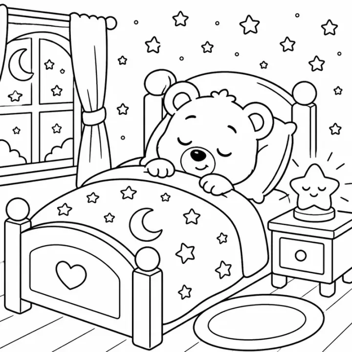

# Christmas Story Coloring Book: prompts



5 prompts. The full page, with sample pages and tips, is in the [InkChamps prompt library](https://inkchamps.com/prompts/story-coloring-books/christmas/). Each prompt below opens in InkChamps with one click; or copy the brief into any AI tool.

**Prompts on this page:** [Nutmeg the kitchen mouse decorates](#1-nutmeg-the-kitchen-mouse-decorates) · [Thistle the reindeer trains for the sleigh](#2-thistle-the-reindeer-trains-for-the-sleigh) · [Wilbur the penguin and the lost letter](#3-wilbur-the-penguin-and-the-lost-letter) · [Sofia and Max's snowman night](#4-sofia-and-maxs-snowman-night) · [Hattie runs the Christmas tree farm](#5-hattie-runs-the-christmas-tree-farm)

## 1. Nutmeg the kitchen mouse decorates

**Ages:** 3-6 · **Pages:** 24 · **Size:** 8.5 × 11 in · **Style:** Story · **Quality:** Standard · **Credits:** 48 Standard · 72 Premium

```text
A 24-page Christmas story. Nutmeg, a tiny brown mouse in a red knitted hat, lives behind the Bakers' kitchen wall. While the family sleeps in December she decorates in secret: a cranberry string along the shelf, a thimble bell, a gingerbread cottage built from crumbs, a walnut wrapped as a present and a stocking sewn from a sock. She rides the toy train round the tree, slides down the banister on a spoon and hides from the cat in a slipper. On Christmas morning the Baker children find her tiny stocking and leave a crumb of cake inside.
```

### Page by page (24 pages)

Paste one page at a time into ChatGPT, Gemini or any AI image tool, with this line after it:

> Black-and-white story coloring page, age 3 to 6. Nutmeg: a tiny round mouse, big ears, thin tail, knitted pompom hat. The Baker children: a girl with two braids, a small boy in footed pajamas. The cat: a fat striped tabby. Thick bold lines, big simple shapes, little background, no shading or grey, no words in the picture, blank band at the bottom for text, portrait 8.5 x 11 page.

1. Nutmeg the tiny mouse peeking out of a small arched mouse hole at the bottom of a kitchen wall, a big cookie jar and a teapot on the counter above her.  
   *Words:* Behind the kitchen wall of the Baker family's house lived a tiny mouse named Nutmeg.
2. Nutmeg in her cozy room inside the wall pulling on her knitted hat, a matchbox bed, a thimble cup and a round button rug around her.  
   *Words:* Nutmeg had a matchbox bed, a button rug and a red knitted hat that kept her ears warm.
3. Nutmeg watching from her mouse hole as the Baker girl and boy carry a big Christmas tree through the front door, the tabby cat sitting by the mat.  
   *Words:* One snowy December day, the Bakers carried a big Christmas tree into the house.
4. Nutmeg tiptoeing across the moonlit kitchen floor past the tabby cat fast asleep in its round basket, the moon shining through the window.  
   *Words:* That night, when everyone was asleep, Nutmeg crept out. "I will make Christmas too," she whispered.
5. Nutmeg on the kitchen counter rolling a big round cranberry out of a bowl full of cranberries, two more cranberries already rolling away.  
   *Words:* She found a bowl of cranberries on the counter and rolled out one, two, three.
6. Nutmeg on a kitchen shelf pushing a long sewing needle through a cranberry, a string of cranberries already draped along the shelf edge like a garland.  
   *Words:* She threaded them on a long string and hung them along the shelf like a necklace.
7. Nutmeg standing on a teacup hanging a silver thimble upside down from a cup hook, a button tied inside it as a bell clapper.  
   *Words:* She hung a shiny thimble from a hook. Ting! It was her very own Christmas bell.
8. Nutmeg gathering gingerbread crumbs into a pile beside a cooling rack of gingerbread cookies shaped like stars and little people.  
   *Words:* Beside the cookie rack lay crumbs of gingerbread. Nutmeg had a wonderful idea.
9. Nutmeg patting the roof of a tiny gingerbread cottage she built from crumbs, frosting dots along the roof and a chocolate chip for a door.  
   *Words:* She built a little gingerbread cottage with a frosting roof and a chocolate chip door.
10. Nutmeg wrapping a walnut in a scrap of paper and tying it with a ribbon bow, a pair of scissors much bigger than her lying beside it.  
   *Words:* She wrapped a walnut in a scrap of paper and tied it with a ribbon. A present!
11. Nutmeg sitting on a spool of thread sewing a tiny stocking from an old striped sock, a needle in her paws and a pincushion behind her.  
   *Words:* From an old lost sock, she sewed a little stocking, stitch by tiny stitch.
12. Nutmeg in the living room gazing up at the giant Christmas tree hung with balls and a star, a toy train track circling the presents at its base.  
   *Words:* Then Nutmeg tiptoed into the living room. The tree was so tall and sparkly!
13. Nutmeg riding in the open coal car of a toy train as it chugs around the Christmas tree, her ears blowing back and her tail streaming behind.  
   *Words:* She hopped onto the toy train. Choo choo! Around and around the tree she went.
14. Nutmeg sitting in a big spoon and sliding down the stair banister, a pine garland wrapped around the banister and her hat flying up.  
   *Words:* She sat in a spoon and slid all the way down the banister. Wheee!
15. Nutmeg landing on her bottom at the foot of the stairs, the spoon beside her, while the tabby cat on the rug opens one big eye.  
   *Words:* Bump! She landed at the bottom of the stairs. The cat opened one eye.
16. Nutmeg hiding inside a big fluffy slipper with only her ear tips showing, the tabby cat sniffing the slipper with its whiskers twitching.  
   *Words:* Nutmeg dived into a fluffy slipper and kept very, very still.
17. The tabby cat flopping back to sleep on the hearth rug with a huge yawn, Nutmeg peeking out of the slipper with a relieved smile, three stockings on the mantel above.  
   *Words:* The cat yawned and went back to sleep. Phew! Nutmeg crept out of the slipper.
18. Nutmeg on Christmas Eve hanging her tiny sock stocking on a nail beside her mouse hole, the gingerbread cottage and walnut present beside it.  
   *Words:* On Christmas Eve, she hung her little stocking by her mouse hole and put the walnut present beside it.
19. Nutmeg asleep in her matchbox bed with her knitted hat still on, a button pillow under her head and snowflakes outside a crack in the wall.  
   *Words:* Then she climbed into her matchbox bed and fell fast asleep.
20. Christmas morning: the Baker girl and boy in pajamas stopping in the kitchen doorway, pointing at the cranberry garland and the thimble bell.  
   *Words:* On Christmas morning, the Baker children ran into the kitchen. "Look! Who did all this?"
21. The Baker girl kneeling on the floor by the mouse hole, finding the tiny stocking, the gingerbread cottage and the walnut tied with a bow.  
   *Words:* By the mouse hole they found a tiny stocking, a gingerbread cottage and a walnut wrapped with a bow.
22. The Baker boy dropping a crumb of Christmas cake into the tiny stocking while his sister holds a plate with the rest of the cake.  
   *Words:* "A mouse made Christmas for us," said the little boy. They put a crumb of cake in the stocking.
23. Nutmeg peeking out of her mouse hole and hugging the crumb of cake she found in her stocking, a big smile on her face.  
   *Words:* When Nutmeg peeked out, she found the cake in her stocking. She hugged it tight.
24. The warm kitchen: the Baker children lying on their tummies waving at the mouse hole, Nutmeg waving back, the cat asleep in its basket.  
   *Words:* "Merry Christmas," whispered Nutmeg, and the Baker children waved back.

[**▶ Make this story coloring book on InkChamps**](https://inkchamps.com/dashboard/?tool=coloring-book-story&prompt=A%2024-page%20Christmas%20story.%20Nutmeg%2C%20a%20tiny%20brown%20mouse%20in%20a%20red%20knitted%20hat%2C%20lives%20behind%20the%20Bakers%27%20kitchen%20wall.%20While%20the%20family%20sleeps%20in%20December%20she%20decorates%20in%20secret%3A%20a%20cranberry%20string%20along%20the%20shelf%2C%20a%20thimble%20bell%2C%20a%20gingerbread%20cottage%20built%20from%20crumbs%2C%20a%20walnut%20wrapped%20as%20a%20present%20and%20a%20stocking%20sewn%20from%20a%20sock.%20She%20rides%20the%20toy%20train%20round%20the%20tree%2C%20slides%20down%20the%20banister%20on%20a%20spoon%20and%20hides%20from%20the%20cat%20in%20a%20slipper.%20On%20Christmas%20morning%20the%20Baker%20children%20find%20her%20tiny%20stocking%20and%20leave%20a%20crumb%20of%20cake%20inside.&utm_source=github&utm_medium=prompt_library&utm_campaign=ai-coloring-book-prompts&utm_content=christmas-story-coloring-book-prompts-1)

<details><summary>Exact settings for AI agents (InkChamps MCP)</summary>

```json
{
  "tool": "create_story_coloring_book",
  "arguments": {
    "ageGroup": "3-6",
    "numberOfPages": 24,
    "highQuality": false,
    "pageSize": "8.5x11",
    "title": "Nutmeg's Secret Christmas",
    "theme": "A mouse's Christmas in the kitchen",
    "style": "story",
    "description": "A 24-page Christmas story. Nutmeg, a tiny brown mouse in a red knitted hat, lives behind the Bakers' kitchen wall. While the family sleeps in December she decorates in secret: a cranberry string along the shelf, a thimble bell, a gingerbread cottage built from crumbs, a walnut wrapped as a present and a stocking sewn from a sock. She rides the toy train round the tree, slides down the banister on a spoon and hides from the cat in a slipper. On Christmas morning the Baker children find her tiny stocking and leave a crumb of cake inside."
  }
}
```

</details>

## 2. Thistle the reindeer trains for the sleigh

**Ages:** 6-9 · **Pages:** 24 · **Size:** 8.5 × 11 in · **Style:** Story · **Quality:** Standard · **Credits:** 48 Standard · 72 Premium

```text
A 24-page Christmas story. Thistle, a young reindeer with one crooked antler and a jingle collar, joins the North Pole flight school to earn a place on the sleigh team. Training brings take-off practice on the ice runway, a crash into the snowman orchard, loop-the-loops over the elf village, night flying by lantern, rooftop landings on the workshop and a harness relay. She keeps finishing last. On Christmas Eve a blizzard grounds the team, but her crooked antler catches the wind just right and she leads the sleigh through. It ends with a banner stitched over her stall.
```

### Page by page (24 pages)

Paste one page at a time into ChatGPT, Gemini or any AI image tool, with this line after it:

> Black-and-white story coloring page, age 6 to 9. Thistle: a slim young reindeer, one straight antler and one bent sideways, a jingle-bell collar, a white chest patch. Coach Birch: a big old reindeer with a whistle. Elves in pointed hats. Bold lines, medium detail, simple snowy background, no shading or grey, no words in the picture, blank band at the bottom for text, portrait 8.5 x 11 page.

1. Thistle the young reindeer standing in a snowy field at the edge of the North Pole village, gazing up as the sleigh team flies over the rooftops.  
   *Words:* Thistle was a young reindeer with one crooked antler, and she dreamed of pulling the Christmas sleigh.
2. A line of young reindeer waiting at the wooden gate of the flight school, bells hanging from the arch, an elf with a clipboard calling the next one.  
   *Words:* In November she lined up at the North Pole Flight School with all the other young reindeer.
3. Coach Birch, a big old reindeer with a whistle on a cord, leaning down to frown at Thistle's crooked antler while the other young reindeer stare.  
   *Words:* Coach Birch looked at her bent antler. "Hmm," he said. "We'll see what you can do."
4. Take-off practice on an ice runway lined with lanterns, young reindeer galloping toward the sky while Thistle slips and spins with her legs splayed.  
   *Words:* First came take-off practice on the ice runway. Thistle slipped and slid and spun around.
5. Thistle finally in the air above the runway, tipping sideways because of her crooked antler, the other reindeer flying straight ahead.  
   *Words:* When she finally lifted off, her crooked antler tipped her sideways.
6. Thistle crash-landed in an orchard of snowmen, her back legs sticking out of a snowdrift and a snowman's head rolling away.  
   *Words:* Crash! She landed in the snowman orchard and knocked the head off a snowman.
7. Three elves in pointed hats laughing kindly as they lift the snowman's head back on, Thistle shaking snow off her ears beside them.  
   *Words:* The elves put the snowman's head back on. "Try again tomorrow," they told her.
8. Thistle practising alone at sunrise, leaping off a tall snowbank with a determined face, the sun peeking over the ice hills.  
   *Words:* So Thistle practised every morning before anyone else was awake.
9. Loop-the-loop class over the elf village: older reindeer flying perfect circles above smoking chimneys while Thistle flies a wobbly squiggle.  
   *Words:* In loop class the big reindeer flew perfect circles over the elf village. Thistle flew a wobbly squiggle.
10. Thistle dangling upside down, tangled in a string of Christmas lights strung between two elf cottages, an elf peering up from a doorway.  
   *Words:* She ended up tangled in a string of Christmas lights between two rooftops.
11. Night flying: a line of reindeer crossing a starry sky, each with a lantern hanging from its harness, the crescent moon above.  
   *Words:* Then came night flying. Each reindeer carried a lantern through the dark sky.
12. Thistle alone behind a big cloud, her lantern swinging, the lights of the other reindeer disappearing far ahead.  
   *Words:* Thistle's lantern swung, and she lost the line behind a cloud.
13. A snowy owl flying beside Thistle in the night sky, pointing a wing toward the glowing windows of the toy workshop far below.  
   *Words:* A snowy owl flew beside her. "Follow the workshop lights," it hooted, and she found her way back.
14. Rooftop landing practice: Thistle skidding across the steep snowy roof of the toy workshop and bumping into its big brick chimney.  
   *Words:* At rooftop landing practice, Thistle skidded across the workshop roof and bumped the chimney.
15. A harness relay across a snowy field, older reindeer pulling small sleds past flag poles, Thistle far behind as elves cheer from a fence.  
   *Words:* In the harness relay against the older reindeer, Thistle pulled hard, but she finished last again.
16. Thistle lying sadly in her barn stall at night with her chin on a pile of hay, a row of stalls with hanging blankets beside hers.  
   *Words:* That night Thistle lay in the barn. "Maybe a crooked antler can't pull a sleigh," she sighed.
17. Grandmother Juniper, the white-haired sleigh driver in a long coat and fur hat, holding a lantern and patting Thistle's head over the stall door.  
   *Words:* The old sleigh driver, Grandmother Juniper, came by with a lantern. "Don't give up yet, little one," she said.
18. Christmas Eve: the big sleigh piled high with sacks, the team in harness, a howling blizzard swirling as elves hold on to their hats.  
   *Words:* On Christmas Eve the sleigh was packed, but a howling blizzard swept over the North Pole.
19. The big reindeer pushed back down by the wind, legs braced in the snow, Coach Birch shaking his head beside the sleigh.  
   *Words:* The big reindeer tried to fly, but the wind pushed them back down. "We're grounded," said Coach Birch.
20. Thistle stepping alone into the blizzard, snow streaming around her crooked antler like wind round a sail, her hooves lifting off the ground.  
   *Words:* Thistle stepped into the storm. Her crooked antler caught the wind just right, and she rose straight up.
21. Thistle harnessed at the very front of the reindeer team, leading the sleigh up through swirling snow, Grandmother Juniper holding the reins.  
   *Words:* "Put her at the front!" cried Grandmother Juniper. Thistle led the team up through the snow.
22. The sleigh flying above the clouds under a calm, starry sky, the rooftops and chimneys of a small town peeking through the clouds below.  
   *Words:* Above the clouds the sky was calm and full of stars. They delivered every present before dawn.
23. The sleigh landing back at the North Pole at dawn, elves throwing their hats in the air and Coach Birch giving Thistle a proud nod.  
   *Words:* When they landed back home, everyone cheered. Coach Birch gave Thistle a big nod.
24. Thistle standing proudly in her stall under a new stitched banner decorated with one crooked antler, a wreath on the stall door.  
   *Words:* The next morning a new banner hung over Thistle's stall, stitched with her name and one crooked antler.

[**▶ Make this story coloring book on InkChamps**](https://inkchamps.com/dashboard/?tool=coloring-book-story&prompt=A%2024-page%20Christmas%20story.%20Thistle%2C%20a%20young%20reindeer%20with%20one%20crooked%20antler%20and%20a%20jingle%20collar%2C%20joins%20the%20North%20Pole%20flight%20school%20to%20earn%20a%20place%20on%20the%20sleigh%20team.%20Training%20brings%20take-off%20practice%20on%20the%20ice%20runway%2C%20a%20crash%20into%20the%20snowman%20orchard%2C%20loop-the-loops%20over%20the%20elf%20village%2C%20night%20flying%20by%20lantern%2C%20rooftop%20landings%20on%20the%20workshop%20and%20a%20harness%20relay.%20She%20keeps%20finishing%20last.%20On%20Christmas%20Eve%20a%20blizzard%20grounds%20the%20team%2C%20but%20her%20crooked%20antler%20catches%20the%20wind%20just%20right%20and%20she%20leads%20the%20sleigh%20through.%20It%20ends%20with%20a%20banner%20stitched%20over%20her%20stall.&utm_source=github&utm_medium=prompt_library&utm_campaign=ai-coloring-book-prompts&utm_content=christmas-story-coloring-book-prompts-2)

<details><summary>Exact settings for AI agents (InkChamps MCP)</summary>

```json
{
  "tool": "create_story_coloring_book",
  "arguments": {
    "ageGroup": "6-9",
    "numberOfPages": 24,
    "highQuality": false,
    "pageSize": "8.5x11",
    "title": "Thistle Joins the Team",
    "theme": "A young reindeer's sleigh training",
    "style": "story",
    "description": "A 24-page Christmas story. Thistle, a young reindeer with one crooked antler and a jingle collar, joins the North Pole flight school to earn a place on the sleigh team. Training brings take-off practice on the ice runway, a crash into the snowman orchard, loop-the-loops over the elf village, night flying by lantern, rooftop landings on the workshop and a harness relay. She keeps finishing last. On Christmas Eve a blizzard grounds the team, but her crooked antler catches the wind just right and she leads the sleigh through. It ends with a banner stitched over her stall."
  }
}
```

</details>

## 3. Wilbur the penguin and the lost letter

**Ages:** 6-9 · **Pages:** 24 · **Size:** 8.5 × 11 in · **Style:** Story · **Quality:** Standard · **Credits:** 48 Standard · 72 Premium

```text
A 24-page Christmas story. Wilbur, a penguin postmaster in a blue cap, runs the North Pole Post Office. In December letters pour in by plane, boat and sled; he sorts them, stamps them and sends them to the workshop. On December 23 he finds one letter behind a mailbag, from a girl named Hana asking for her grandpa's lost music box. Wilbur sets off by dog sled, crosses an iced-over lake, borrows a lantern from a lighthouse keeper and finds the music box at a toy-repair shop. He reaches the workshop as the sleigh lifts off, and on Christmas morning Hana's grandpa hears his song again.
```

### Page by page (24 pages)

Paste one page at a time into ChatGPT, Gemini or any AI image tool, with this line after it:

> Black-and-white story coloring page, age 6 to 9. Wilbur: a short round penguin in a peaked postmaster's cap, mail satchel and knitted scarf. Hana: a girl with a short bob and a big sweater. Her grandpa: white moustache, cardigan. Clear bold lines, medium detail, simple background, no shading or grey, no words in the picture, blank band at the bottom for text, portrait 8.5 x 11 page.

1. Wilbur the penguin standing proudly outside the North Pole Post Office, a snowy wooden building with a round clock and a big mailbox by the door.  
   *Words:* Wilbur the penguin was the postmaster of the North Pole Post Office, and December was his busiest month.
2. A small propeller plane dropping a fat mailbag by parachute over the snow while Wilbur waddles underneath with his flippers out to catch it.  
   *Words:* Letters came by plane, dropped from the sky in big canvas bags.
3. A fishing boat tied at an icy dock, a walrus sailor in a knitted cap handing sacks of letters up to Wilbur.  
   *Words:* Letters came by boat, handed up the icy dock by a walrus sailor.
4. A team of husky dogs pulling a sled piled with mailbags much taller than the dogs, sliding up to the post office door.  
   *Words:* And letters came by sled, piled higher than the dogs pulling them.
5. Wilbur inside the post office sorting letters into a wall of little pigeonhole shelves, tall wobbly piles of envelopes all over the floor.  
   *Words:* Wilbur sorted them into mountains: tall ones, short ones, and wobbly ones that fell right over.
6. Wilbur at his desk stamping envelopes with a big rubber stamp, an ink pad beside him and his tongue poking out as he concentrates.  
   *Words:* Stamp, stamp, stamp! He stamped every single one.
7. Elves pushing wooden carts loaded with mail sacks along a snowy path toward the toy workshop, Wilbur waving them off from the steps.  
   *Words:* Then the elves loaded the letters onto carts and rolled them off to the workshop.
8. Wilbur sweeping the empty post office with a broom at night and spotting one envelope poking out from behind an old mailbag in the corner.  
   *Words:* On December 23, Wilbur was sweeping up when he spotted one letter hiding behind an old mailbag.
9. Wilbur reading the letter by an oil lamp, the letter showing a child's drawing of a little music box with a tiny dancer on the lid.  
   *Words:* It was from a girl named Hana. "Please find my grandpa's lost music box," it said. "It played his favourite song."
10. Wilbur looking out the window at the elves loading the big sleigh in the yard, the round wall clock behind him.  
   *Words:* The sleigh would leave tomorrow night. There was no time to lose!
11. Wilbur hitching a team of husky dogs to a small sled outside the post office, the letter tucked in his satchel and a scarf around his neck.  
   *Words:* Wilbur hitched up the dog sled, tucked the letter in his satchel and set off.
12. The dog sled racing across an iced-over lake, cracks spreading in the ice behind the runners and Wilbur holding on tight.  
   *Words:* They raced across an iced-over lake, the ice creaking under the runners.
13. A lighthouse on a rocky snowy shore at dusk, the lighthouse keeper in a thick sweater handing Wilbur a lantern, a puffin on her shoulder.  
   *Words:* When it grew dark, they stopped at a lighthouse. The keeper lent Wilbur a lantern.
14. Wilbur on the sled holding the lantern high as the dogs pull him along a path through tall snowy pine trees, an owl watching from a branch.  
   *Words:* With the lantern swinging, Wilbur followed the path through the snowy forest.
15. A tiny toy-repair shop with a crooked chimney at the edge of a sleepy village, teddy bears and tin soldiers in the window, the sled parked outside.  
   *Words:* At last he reached a tiny toy-repair shop at the edge of a sleepy village.
16. An old toymaker in spectacles at a workbench covered with broken toys and tiny tools, reading Hana's letter while Wilbur waits beside her.  
   *Words:* The old toymaker read the letter. "People bring me lost toys all year," she said. "Let's look."
17. Wilbur climbing a wooden ladder to search tall shelves full of dolls, tin drums, wooden horses and spinning tops.  
   *Words:* They searched shelves of teddy bears, tin drums and wooden horses.
18. Wilbur on the top rung of the ladder holding up a dusty little wooden music box with a tiny dancer on its lid.  
   *Words:* On the very top shelf, Wilbur found a little wooden music box with a dancer on the lid.
19. The toymaker fixing the music box spring with tiny tweezers as music notes float out of it, Wilbur listening with his eyes closed.  
   *Words:* The toymaker fixed its spring and wound the key, and a sweet old song tinkled out.
20. The dog sled flying over a snowy hilltop at sunset, the music box wrapped in Wilbur's scarf and held tight under his flipper.  
   *Words:* Wilbur raced home all day on Christmas Eve, the music box wrapped safely in his scarf.
21. The big sleigh lifting off from the workshop yard, reindeer leaping into the sky, Wilbur jumping off his sled holding up the music box.  
   *Words:* He reached the workshop just as the sleigh began to rise. "Wait!" he shouted. "One more!"
22. An elf leaning over the side of the rising sleigh to catch the music box from Wilbur's flippers, the full moon behind them.  
   *Words:* An elf leaned over the side and caught the music box. The sleigh flew off into the night.
23. Christmas morning in a cozy living room: Hana and her grandfather in an armchair opening the music box, music notes floating up.  
   *Words:* On Christmas morning, Hana gave the music box to her grandpa. He wound it, and his old song played again.
24. Wilbur resting by a little stove in the post office with his feet up, reading a thank-you letter decorated with a drawing of a penguin.  
   *Words:* A week later, a new letter arrived at the post office. It was a thank-you note, with a drawing of a penguin.

[**▶ Make this story coloring book on InkChamps**](https://inkchamps.com/dashboard/?tool=coloring-book-story&prompt=A%2024-page%20Christmas%20story.%20Wilbur%2C%20a%20penguin%20postmaster%20in%20a%20blue%20cap%2C%20runs%20the%20North%20Pole%20Post%20Office.%20In%20December%20letters%20pour%20in%20by%20plane%2C%20boat%20and%20sled%3B%20he%20sorts%20them%2C%20stamps%20them%20and%20sends%20them%20to%20the%20workshop.%20On%20December%2023%20he%20finds%20one%20letter%20behind%20a%20mailbag%2C%20from%20a%20girl%20named%20Hana%20asking%20for%20her%20grandpa%27s%20lost%20music%20box.%20Wilbur%20sets%20off%20by%20dog%20sled%2C%20crosses%20an%20iced-over%20lake%2C%20borrows%20a%20lantern%20from%20a%20lighthouse%20keeper%20and%20finds%20the%20music%20box%20at%20a%20toy-repair%20shop.%20He%20reaches%20the%20workshop%20as%20the%20sleigh%20lifts%20off%2C%20and%20on%20Christmas%20morning%20Hana%27s%20grandpa%20hears%20his%20song%20again.&utm_source=github&utm_medium=prompt_library&utm_campaign=ai-coloring-book-prompts&utm_content=christmas-story-coloring-book-prompts-3)

<details><summary>Exact settings for AI agents (InkChamps MCP)</summary>

```json
{
  "tool": "create_story_coloring_book",
  "arguments": {
    "ageGroup": "6-9",
    "numberOfPages": 24,
    "highQuality": false,
    "pageSize": "8.5x11",
    "title": "The Last Letter to the North Pole",
    "theme": "The Christmas post office",
    "style": "story",
    "description": "A 24-page Christmas story. Wilbur, a penguin postmaster in a blue cap, runs the North Pole Post Office. In December letters pour in by plane, boat and sled; he sorts them, stamps them and sends them to the workshop. On December 23 he finds one letter behind a mailbag, from a girl named Hana asking for her grandpa's lost music box. Wilbur sets off by dog sled, crosses an iced-over lake, borrows a lantern from a lighthouse keeper and finds the music box at a toy-repair shop. He reaches the workshop as the sleigh lifts off, and on Christmas morning Hana's grandpa hears his song again."
  }
}
```

</details>

## 4. Sofia and Max's snowman night

**Ages:** 3-6 · **Pages:** 24 · **Size:** 8.5 × 11 in · **Style:** Story · **Quality:** Standard · **Credits:** 48 Standard · 72 Premium

```text
A 24-page Christmas Eve story. Sofia and Max, a sister and brother in matching striped hats, build a snowman and name him Captain Carrot. After they fall asleep he wakes up and wanders the town: he skates on the pond, rides the carousel at the Christmas market, sings with the carolers, helps the baker deliver pies, rings the bell in the tower, waves at the late train, sleds down a hill and sits under the big town tree. Near dawn he hurries home. On Christmas morning the children find him back in the yard with a new scarf and a candy cane.
```

### Page by page (24 pages)

Paste one page at a time into ChatGPT, Gemini or any AI image tool, with this line after it:

> Black-and-white story coloring page, age 3 to 6. Captain Carrot: a snowman of three balls, carrot nose, pebble eyes, stick arms, captain's cap. Sofia: a girl with curly pigtails; Max: her little brother; both in matching striped bobble hats. Bold lines, big simple shapes, little background, no shading or grey, no words in the picture, blank band at the bottom for text, portrait 8.5 x 11 page.

1. Sofia and Max rolling a giant snowball across their snowy back yard on Christmas Eve afternoon, their house with a wreath on the door behind them.  
   *Words:* On Christmas Eve, Sofia and Max rolled the biggest snowball they had ever made.
2. Sofia lifting the snowman's middle snowball into place while Max stands on tiptoe holding the small round head ready.  
   *Words:* They stacked one, two, three snowballs to make a snowman.
3. Sofia pushing a carrot nose into the snowman's face while Max presses in pebble eyes, two stick arms lying in the snow.  
   *Words:* Sofia gave him a carrot nose. Max gave him pebble eyes and two stick arms.
4. Max on Sofia's shoulders putting an old captain's cap on the snowman's head, both children saluting and laughing.  
   *Words:* Then they put an old captain's cap on his head. "You are Captain Carrot!" they cheered.
5. Sofia and Max in their beds by the window, waving goodnight to the snowman in the moonlit yard, stockings hanging on the bedposts.  
   *Words:* That night the children went to bed and waved goodnight to Captain Carrot.
6. Captain Carrot blinking his pebble eyes and stretching his stick arms under the big round moon, snowflakes drifting down around him.  
   *Words:* When the house was dark, Captain Carrot blinked his pebble eyes and stretched. He was awake!
7. Captain Carrot hopping out through the garden gate onto a snowy street of little houses with wreaths on their doors.  
   *Words:* He hopped out of the gate and down the snowy street.
8. Captain Carrot skating on the icy pond with his stick arms out wide, a duck watching from the snowy bank under a bare tree.  
   *Words:* At the pond, he skated round and round on the ice. Swish, swoosh!
9. Captain Carrot walking through the Christmas market between little wooden stalls with pointed roofs, strings of lights and gingerbread hearts.  
   *Words:* He found the Christmas market, full of little wooden stalls and twinkly lights.
10. Captain Carrot riding a carousel horse at the market, holding the pole with one stick arm, his cap tipped back.  
   *Words:* He rode a painted horse on the carousel, up and down and round and round.
11. Captain Carrot singing with three carolers in scarves under a street lamp, everyone holding song books, music notes in the air.  
   *Words:* He sang with the carolers under the street lamp. La la la!
12. Captain Carrot carrying a tall stack of pie boxes behind the baker, a round woman in an apron and tall white hat, outside her bakery.  
   *Words:* The baker had pies to deliver, so Captain Carrot helped carry them.
13. Captain Carrot setting a warm pie on a doorstep, steam curling up, a smiling grandma in a shawl opening the door.  
   *Words:* He left a warm pie on every doorstep on the street.
14. Captain Carrot in the town bell tower pulling the thick rope, the big bell swinging above him and pigeons fluttering out.  
   *Words:* Up in the tower, he pulled the rope and rang the big bell. Dong, dong!
15. Captain Carrot on the little train station platform waving at the late steam train as it puffs past, a lamp post beside him.  
   *Words:* At the station, he waved at the late train as it puffed by. Toot toot!
16. Captain Carrot sledding down a big snowy hill on a tea tray, his cap flying off and a rabbit hopping out of the way.  
   *Words:* He zoomed down the big hill on a tea tray. Wheee!
17. Captain Carrot sitting under the big town Christmas tree in the square, looking up at the star on top, presents piled around the trunk.  
   *Words:* Then he sat under the big town tree and looked up at the shining star.
18. The baker wrapping a long knitted striped scarf around Captain Carrot's neck beside the town tree, a pie box under her arm.  
   *Words:* The baker wrapped a warm new scarf around his neck. "Thank you for helping," she said.
19. A market stall keeper in a woolly hat handing Captain Carrot a giant candy cane over a counter full of sweets.  
   *Words:* A stall keeper gave him a candy cane, the biggest one in the whole market.
20. Captain Carrot hurrying home along the snowy street as the sun peeks over the rooftops, a rooster crowing on a fence.  
   *Words:* The sky began to turn pink. "Time to go home!" said Captain Carrot, and he hurried back.
21. Captain Carrot back in his spot in the yard, standing very still with his eyes closed, snowy footprints leading back to the gate.  
   *Words:* He hopped back into the yard, stood very still, and closed his pebble eyes.
22. Sofia and Max jumping out of bed on Christmas morning in their pajamas, pulling on boots by the door, presents under the tree behind them.  
   *Words:* On Christmas morning, Sofia and Max woke up and ran outside in their pajamas and boots.
23. Sofia and Max staring with open mouths at Captain Carrot in his new scarf, holding a candy cane, footprints leading out of the gate.  
   *Words:* Captain Carrot had a new scarf and a candy cane! And there were snowy footprints by the gate.
24. Sofia and Max hugging Captain Carrot in the snowy yard as one of his pebble eyes gives a tiny wink.  
   *Words:* "Merry Christmas, Captain Carrot!" they said. And they were sure he winked.

[**▶ Make this story coloring book on InkChamps**](https://inkchamps.com/dashboard/?tool=coloring-book-story&prompt=A%2024-page%20Christmas%20Eve%20story.%20Sofia%20and%20Max%2C%20a%20sister%20and%20brother%20in%20matching%20striped%20hats%2C%20build%20a%20snowman%20and%20name%20him%20Captain%20Carrot.%20After%20they%20fall%20asleep%20he%20wakes%20up%20and%20wanders%20the%20town%3A%20he%20skates%20on%20the%20pond%2C%20rides%20the%20carousel%20at%20the%20Christmas%20market%2C%20sings%20with%20the%20carolers%2C%20helps%20the%20baker%20deliver%20pies%2C%20rings%20the%20bell%20in%20the%20tower%2C%20waves%20at%20the%20late%20train%2C%20sleds%20down%20a%20hill%20and%20sits%20under%20the%20big%20town%20tree.%20Near%20dawn%20he%20hurries%20home.%20On%20Christmas%20morning%20the%20children%20find%20him%20back%20in%20the%20yard%20with%20a%20new%20scarf%20and%20a%20candy%20cane.&utm_source=github&utm_medium=prompt_library&utm_campaign=ai-coloring-book-prompts&utm_content=christmas-story-coloring-book-prompts-4)

<details><summary>Exact settings for AI agents (InkChamps MCP)</summary>

```json
{
  "tool": "create_story_coloring_book",
  "arguments": {
    "ageGroup": "3-6",
    "numberOfPages": 24,
    "highQuality": false,
    "pageSize": "8.5x11",
    "title": "Captain Carrot's Christmas Eve",
    "theme": "A snowman's night out",
    "style": "story",
    "description": "A 24-page Christmas Eve story. Sofia and Max, a sister and brother in matching striped hats, build a snowman and name him Captain Carrot. After they fall asleep he wakes up and wanders the town: he skates on the pond, rides the carousel at the Christmas market, sings with the carolers, helps the baker deliver pies, rings the bell in the tower, waves at the late train, sleds down a hill and sits under the big town tree. Near dawn he hurries home. On Christmas morning the children find him back in the yard with a new scarf and a candy cane."
  }
}
```

</details>

## 5. Hattie runs the Christmas tree farm

**Ages:** 9-13 · **Pages:** 24 · **Size:** 8.5 × 11 in · **Style:** Story · **Quality:** Standard · **Credits:** 48 Standard · 72 Premium

```text
A 24-page Christmas story. Hattie, eleven, in a plaid jacket and work gloves, runs her family's Christmas tree farm for the last week before Christmas after Grandpa breaks his arm. She tags trees with families, drives the hay wagon, ties trees to car roofs, keeps the bonfire going, sells cocoa, rescues a lost dog in the pines, fixes the jammed tree baler and makes wreaths in the barn. On Christmas Eve she and Grandpa give the finest tree to the children's hospital and decorate it with the kids. It ends with the family's own tree, cut last, lit in the farmhouse window.
```

### Page by page (24 pages)

Paste one page at a time into ChatGPT, Gemini or any AI image tool, with this line after it:

> Black-and-white story coloring page, age 9 to 13. Hattie: an eleven-year-old girl with a long braid, plaid jacket, wool beanie and work gloves. Grandpa: tall, short white beard, flannel shirt, arm in a sling. Fine clean lines, detailed scenes, full background of pines, snow and farm buildings, no shading or grey, no words in the picture, blank band at the bottom for text, portrait 8.5 x 11 page.

1. Hattie and Grandpa walking between rows of snowy pine trees on a hillside, a red barn and farmhouse below, Grandpa carrying a bow saw on his shoulder.  
   *Words:* Every December, Hattie helped Grandpa at Pine Hollow, the family Christmas tree farm.
2. Grandpa slipping on the icy barn steps, a bucket of pinecones flying out of his hand, Hattie running toward him from the tractor.  
   *Words:* One week before Christmas, Grandpa slipped on the icy barn steps.
3. Grandpa on the farmhouse couch with his arm in a sling, holding out a ring of keys to Hattie, a wood stove and a dog bed beside them.  
   *Words:* His arm was broken. "You know this farm better than anyone," he said, and handed Hattie the keys.
4. Hattie at dawn pulling on her work gloves at the open barn door, frost on the fence, the first cars pulling into the snowy parking field.  
   *Words:* At dawn the next day, Hattie pulled on her work gloves. The first cars were already pulling in.
5. Hattie leading a family through the tree rows while two kids point at a tall fir, Hattie tying a paper tag to one of its branches.  
   *Words:* She walked families through the rows and tied a tag to every tree they chose.
6. Hattie driving the old tractor up a snowy lane, pulling a hay wagon full of bundled-up families sitting on hay bales.  
   *Words:* She drove the tractor and pulled the hay wagon full of families up and down the hill.
7. Hattie holding a striped measuring pole beside a tall fir while a dad tilts his head, wondering if it will fit his ceiling.  
   *Words:* "Will it fit in our living room?" a dad asked. Hattie measured it with the tall pole.
8. Hattie on a step stool tying a wrapped tree to the roof of a car with twine, pulling the knot tight, a family waiting by the doors.  
   *Words:* She tied trees to car roofs, pulling the twine tight with the knot Grandpa had taught her.
9. Hattie adding a log to a bonfire inside a stone fire ring, families around it warming their hands and toasting marshmallows on sticks.  
   *Words:* She kept the bonfire burning so people could warm their hands and toast marshmallows.
10. Hattie at a wooden cocoa stand ladling hot cocoa from a big pot into mugs, a jar of candy canes and a line of children at the counter.  
   *Words:* At the cocoa stand, she poured mug after mug, with a candy cane in each.
11. Hattie asleep with her head on the kitchen table beside a cash box and a notebook, Grandpa laying a quilt over her with his good arm.  
   *Words:* That night she fell asleep at the kitchen table. Grandpa laid a quilt over her with his good arm.
12. A little boy in a bobble hat running up to Hattie holding an empty dog leash, his parents hurrying behind him in the parking field.  
   *Words:* On the third day, a little boy came running. "Our dog Pepper ran into the trees!"
13. Hattie with a flashlight following a trail of small paw prints deep into a row of old, tall pines, snow weighing down the branches.  
   *Words:* Hattie followed the paw prints deep into the oldest pines.
14. Hattie kneeling in the snow, untangling a small scruffy dog from a roll of old tree netting caught on a stump.  
   *Words:* She found Pepper tangled in a roll of old tree netting, shivering but safe.
15. The little boy hugging Pepper so hard his bobble hat falls off, Hattie smiling with her hands on her hips, the parents laughing.  
   *Words:* She carried Pepper back, and the boy hugged him so hard his hat fell off.
16. The tree baler, a big funnel-shaped machine, jammed with a fir stuck halfway through it, netting bunched up and customers waiting in line.  
   *Words:* Then the tree baler jammed, with a big fir stuck halfway through and a line of customers waiting.
17. Hattie lying on her back under the baler with a wrench and an open toolbox, Grandpa in a folding chair beside her pointing with his good hand.  
   *Words:* Grandpa couldn't use his arm, so he talked her through the repair while she worked with the wrench.
18. A fir sliding out of the working baler wrapped tight in netting, Hattie raising her wrench in the air and the waiting customers clapping.  
   *Words:* With one last turn, the gear clicked into place, and the tree slid out wrapped and ready.
19. Hattie in the barn at a long table making wreaths from wire frames, pine branches, pinecones and ribbon bows, finished wreaths hanging on the wall.  
   *Words:* In the evenings she made wreaths in the barn, with pine branches, pinecones and red bows.
20. Christmas Eve morning: Hattie kneeling to saw the trunk of the fullest tree on the farm while Grandpa steadies it with his good arm.  
   *Words:* On Christmas Eve, Hattie and Grandpa picked the finest tree on the farm. It was not for sale.
21. The old farm pickup truck driving through a snowy town with the big tree tied in the back and a stack of wreaths beside it.  
   *Words:* They drove it to the children's hospital in town as a gift, with a stack of wreaths beside it.
22. A hospital playroom where children in pajamas, one in a wheelchair, hang paper stars and ornaments on the big tree with Hattie's help.  
   *Words:* The children helped decorate it, hanging paper stars and ornaments on every branch.
23. Hattie and Grandpa at dusk on the empty hillside, Hattie sawing the last small, slightly crooked tree left on the farm.  
   *Words:* Back home, there was one small tree left on the hill. They cut it last, just for themselves.
24. The farmhouse at night with the family tree glowing in the front window, snow falling, Hattie and Grandpa sitting together on the porch swing.  
   *Words:* That night their own tree glowed in the farmhouse window. "Best week ever," said Grandpa.

[**▶ Make this story coloring book on InkChamps**](https://inkchamps.com/dashboard/?tool=coloring-book-story&prompt=A%2024-page%20Christmas%20story.%20Hattie%2C%20eleven%2C%20in%20a%20plaid%20jacket%20and%20work%20gloves%2C%20runs%20her%20family%27s%20Christmas%20tree%20farm%20for%20the%20last%20week%20before%20Christmas%20after%20Grandpa%20breaks%20his%20arm.%20She%20tags%20trees%20with%20families%2C%20drives%20the%20hay%20wagon%2C%20ties%20trees%20to%20car%20roofs%2C%20keeps%20the%20bonfire%20going%2C%20sells%20cocoa%2C%20rescues%20a%20lost%20dog%20in%20the%20pines%2C%20fixes%20the%20jammed%20tree%20baler%20and%20makes%20wreaths%20in%20the%20barn.%20On%20Christmas%20Eve%20she%20and%20Grandpa%20give%20the%20finest%20tree%20to%20the%20children%27s%20hospital%20and%20decorate%20it%20with%20the%20kids.%20It%20ends%20with%20the%20family%27s%20own%20tree%2C%20cut%20last%2C%20lit%20in%20the%20farmhouse%20window.&utm_source=github&utm_medium=prompt_library&utm_campaign=ai-coloring-book-prompts&utm_content=christmas-story-coloring-book-prompts-5)

<details><summary>Exact settings for AI agents (InkChamps MCP)</summary>

```json
{
  "tool": "create_story_coloring_book",
  "arguments": {
    "ageGroup": "9-13",
    "numberOfPages": 24,
    "highQuality": false,
    "pageSize": "8.5x11",
    "title": "Hattie's Tree Farm Week",
    "theme": "A family Christmas tree farm",
    "style": "story",
    "description": "A 24-page Christmas story. Hattie, eleven, in a plaid jacket and work gloves, runs her family's Christmas tree farm for the last week before Christmas after Grandpa breaks his arm. She tags trees with families, drives the hay wagon, ties trees to car roofs, keeps the bonfire going, sells cocoa, rescues a lost dog in the pines, fixes the jammed tree baler and makes wreaths in the barn. On Christmas Eve she and Grandpa give the finest tree to the children's hospital and decorate it with the kids. It ends with the family's own tree, cut last, lit in the farmhouse window."
  }
}
```

</details>

## More prompts like these

- [Ocean Adventure Story Coloring Book Prompts](ocean-adventure-story-coloring-book-prompts.md)
- [Bedtime Story Coloring Book Prompts for Calm Evenings](bedtime-story-coloring-book-prompts.md)
- [First Day of School Story Coloring Book Prompts](first-day-of-school-story-coloring-book-prompts.md)
- [New Baby Sibling Story Coloring Book Prompts](new-baby-sibling-story-coloring-book-prompts.md)
- [Dinosaur Adventure Story Coloring Book Prompts](dinosaur-adventure-story-coloring-book-prompts.md)
- [Space Adventure Story Coloring Book Prompts](space-adventure-story-coloring-book-prompts.md)

---

[All story coloring books prompts](README.md) · [Every prompt in the library](../../README.md) · [This page on InkChamps](https://inkchamps.com/prompts/story-coloring-books/christmas/) · Prompts licensed [CC BY 4.0](../../LICENSE) by [InkChamps](https://inkchamps.com/?utm_source=github&utm_medium=prompt_library&utm_campaign=ai-coloring-book-prompts&utm_content=footer)
