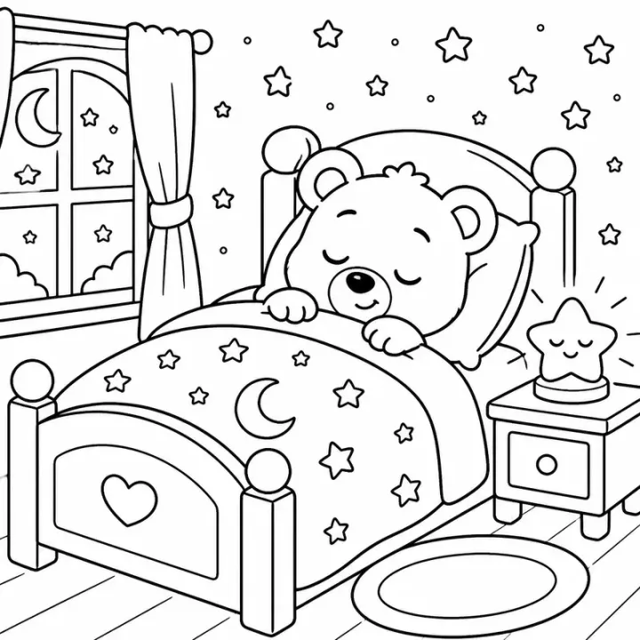

# Christmas Story Coloring Book: prompts



5 prompts. The full page, with sample pages and tips, is in the [InkChamps prompt library](https://inkchamps.com/prompts/story-coloring-books/christmas/). Each prompt below opens in InkChamps with one click; or copy the brief into any AI tool.

**Prompts on this page:** [Nutmeg the kitchen mouse decorates](#1-nutmeg-the-kitchen-mouse-decorates) · [Thistle the reindeer trains for the sleigh](#2-thistle-the-reindeer-trains-for-the-sleigh) · [Wilbur the penguin and the lost letter](#3-wilbur-the-penguin-and-the-lost-letter) · [Sofia and Max's snowman night](#4-sofia-and-maxs-snowman-night) · [Hattie runs the Christmas tree farm](#5-hattie-runs-the-christmas-tree-farm)

## 1. Nutmeg the kitchen mouse decorates

**Ages:** 3-6 · **Pages:** 40 · **Size:** 8.5 × 11 in · **Style:** Story · **Quality:** Standard · **Credits:** 80 Standard · 120 Premium

```text
Nutmeg, a tiny brown mouse in a red knitted hat, lives behind the kitchen wall of the Baker family's house. While the family sleeps in December, she decorates in secret: strings cranberries along the shelf, hangs a thimble bell, builds a gingerbread cottage from crumbs, wraps a walnut as a present and stitches a stocking from a sock. She rides the toy train around the tree, sledges down the banister on a spoon and hides from the cat. On Christmas morning the Baker children find a tiny stocking by the mouse hole, and they leave a crumb of cake inside for Nutmeg.
```

[**▶ Make this story coloring book on InkChamps**](https://inkchamps.com/dashboard/?tool=coloring-book-story&prompt=Nutmeg%2C%20a%20tiny%20brown%20mouse%20in%20a%20red%20knitted%20hat%2C%20lives%20behind%20the%20kitchen%20wall%20of%20the%20Baker%20family%27s%20house.%20While%20the%20family%20sleeps%20in%20December%2C%20she%20decorates%20in%20secret%3A%20strings%20cranberries%20along%20the%20shelf%2C%20hangs%20a%20thimble%20bell%2C%20builds%20a%20gingerbread%20cottage%20from%20crumbs%2C%20wraps%20a%20walnut%20as%20a%20present%20and%20stitches%20a%20stocking%20from%20a%20sock.%20She%20rides%20the%20toy%20train%20around%20the%20tree%2C%20sledges%20down%20the%20banister%20on%20a%20spoon%20and%20hides%20from%20the%20cat.%20On%20Christmas%20morning%20the%20Baker%20children%20find%20a%20tiny%20stocking%20by%20the%20mouse%20hole%2C%20and%20they%20leave%20a%20crumb%20of%20cake%20inside%20for%20Nutmeg.&utm_source=github&utm_medium=prompt_library&utm_campaign=ai-coloring-book-prompts&utm_content=christmas-story-coloring-book-prompts-1)

<details><summary>Exact settings for AI agents (InkChamps MCP)</summary>

```json
{
  "tool": "create_story_coloring_book",
  "arguments": {
    "ageGroup": "3-6",
    "numberOfPages": 40,
    "highQuality": false,
    "pageSize": "8.5x11",
    "title": "Nutmeg's Secret Christmas",
    "theme": "A mouse's Christmas in the kitchen",
    "style": "story",
    "description": "Nutmeg, a tiny brown mouse in a red knitted hat, lives behind the kitchen wall of the Baker family's house. While the family sleeps in December, she decorates in secret: strings cranberries along the shelf, hangs a thimble bell, builds a gingerbread cottage from crumbs, wraps a walnut as a present and stitches a stocking from a sock. She rides the toy train around the tree, sledges down the banister on a spoon and hides from the cat. On Christmas morning the Baker children find a tiny stocking by the mouse hole, and they leave a crumb of cake inside for Nutmeg."
  }
}
```

</details>

## 2. Thistle the reindeer trains for the sleigh

**Ages:** 6-9 · **Pages:** 40 · **Size:** 8.5 × 11 in · **Style:** Story · **Quality:** Standard · **Credits:** 80 Standard · 120 Premium

```text
Thistle, a young reindeer with one crooked antler and a jingle collar, enters flight school at the North Pole to join the sleigh team. Training brings take-off practice on the ice runway, a crash into the snowman orchard, loop-the-loops over the elf village, night flying by lantern, rooftop landings on the workshop and a harness relay against the older reindeer. Thistle keeps finishing last. On Christmas Eve a blizzard grounds the team, but Thistle's crooked antler catches the wind just right, and she leads the sleigh through. The book ends with her name stitched on a stall.
```

[**▶ Make this story coloring book on InkChamps**](https://inkchamps.com/dashboard/?tool=coloring-book-story&prompt=Thistle%2C%20a%20young%20reindeer%20with%20one%20crooked%20antler%20and%20a%20jingle%20collar%2C%20enters%20flight%20school%20at%20the%20North%20Pole%20to%20join%20the%20sleigh%20team.%20Training%20brings%20take-off%20practice%20on%20the%20ice%20runway%2C%20a%20crash%20into%20the%20snowman%20orchard%2C%20loop-the-loops%20over%20the%20elf%20village%2C%20night%20flying%20by%20lantern%2C%20rooftop%20landings%20on%20the%20workshop%20and%20a%20harness%20relay%20against%20the%20older%20reindeer.%20Thistle%20keeps%20finishing%20last.%20On%20Christmas%20Eve%20a%20blizzard%20grounds%20the%20team%2C%20but%20Thistle%27s%20crooked%20antler%20catches%20the%20wind%20just%20right%2C%20and%20she%20leads%20the%20sleigh%20through.%20The%20book%20ends%20with%20her%20name%20stitched%20on%20a%20stall.&utm_source=github&utm_medium=prompt_library&utm_campaign=ai-coloring-book-prompts&utm_content=christmas-story-coloring-book-prompts-2)

<details><summary>Exact settings for AI agents (InkChamps MCP)</summary>

```json
{
  "tool": "create_story_coloring_book",
  "arguments": {
    "ageGroup": "6-9",
    "numberOfPages": 40,
    "highQuality": false,
    "pageSize": "8.5x11",
    "title": "Thistle Joins the Team",
    "theme": "A young reindeer's sleigh training",
    "style": "story",
    "description": "Thistle, a young reindeer with one crooked antler and a jingle collar, enters flight school at the North Pole to join the sleigh team. Training brings take-off practice on the ice runway, a crash into the snowman orchard, loop-the-loops over the elf village, night flying by lantern, rooftop landings on the workshop and a harness relay against the older reindeer. Thistle keeps finishing last. On Christmas Eve a blizzard grounds the team, but Thistle's crooked antler catches the wind just right, and she leads the sleigh through. The book ends with her name stitched on a stall."
  }
}
```

</details>

## 3. Wilbur the penguin and the lost letter

**Ages:** 6-9 · **Pages:** 40 · **Size:** 8.5 × 11 in · **Style:** Story · **Quality:** Standard · **Credits:** 80 Standard · 120 Premium

```text
Wilbur, a penguin postmaster in a blue cap, runs the North Pole Post Office. In December the letters pour in: by plane, by boat, by sled. He sorts them into mountains, stamps them and loads the elves' carts. On December 23 he finds one letter that slipped behind a mailbag, from a girl named Hana asking for her grandfather's lost music box to be found. Wilbur sets off by dog sled, crosses an iced-over lake, borrows a lantern from a lighthouse keeper, searches a toy-repair shop and finds the music box. He delivers it to the workshop just as the sleigh takes off.
```

[**▶ Make this story coloring book on InkChamps**](https://inkchamps.com/dashboard/?tool=coloring-book-story&prompt=Wilbur%2C%20a%20penguin%20postmaster%20in%20a%20blue%20cap%2C%20runs%20the%20North%20Pole%20Post%20Office.%20In%20December%20the%20letters%20pour%20in%3A%20by%20plane%2C%20by%20boat%2C%20by%20sled.%20He%20sorts%20them%20into%20mountains%2C%20stamps%20them%20and%20loads%20the%20elves%27%20carts.%20On%20December%2023%20he%20finds%20one%20letter%20that%20slipped%20behind%20a%20mailbag%2C%20from%20a%20girl%20named%20Hana%20asking%20for%20her%20grandfather%27s%20lost%20music%20box%20to%20be%20found.%20Wilbur%20sets%20off%20by%20dog%20sled%2C%20crosses%20an%20iced-over%20lake%2C%20borrows%20a%20lantern%20from%20a%20lighthouse%20keeper%2C%20searches%20a%20toy-repair%20shop%20and%20finds%20the%20music%20box.%20He%20delivers%20it%20to%20the%20workshop%20just%20as%20the%20sleigh%20takes%20off.&utm_source=github&utm_medium=prompt_library&utm_campaign=ai-coloring-book-prompts&utm_content=christmas-story-coloring-book-prompts-3)

<details><summary>Exact settings for AI agents (InkChamps MCP)</summary>

```json
{
  "tool": "create_story_coloring_book",
  "arguments": {
    "ageGroup": "6-9",
    "numberOfPages": 40,
    "highQuality": false,
    "pageSize": "8.5x11",
    "title": "The Last Letter to the North Pole",
    "theme": "The Christmas post office",
    "style": "story",
    "description": "Wilbur, a penguin postmaster in a blue cap, runs the North Pole Post Office. In December the letters pour in: by plane, by boat, by sled. He sorts them into mountains, stamps them and loads the elves' carts. On December 23 he finds one letter that slipped behind a mailbag, from a girl named Hana asking for her grandfather's lost music box to be found. Wilbur sets off by dog sled, crosses an iced-over lake, borrows a lantern from a lighthouse keeper, searches a toy-repair shop and finds the music box. He delivers it to the workshop just as the sleigh takes off."
  }
}
```

</details>

## 4. Sofia and Max's snowman night

**Ages:** 3-6 · **Pages:** 40 · **Size:** 8.5 × 11 in · **Style:** Story · **Quality:** Standard · **Credits:** 80 Standard · 120 Premium

```text
Sofia and Max, a sister and brother in matching striped hats, build a snowman on Christmas Eve and name him Captain Carrot. After they fall asleep, Captain Carrot wakes up and wanders the town: he skates on the icy pond, rides the carousel at the Christmas market, sings with the carolers, helps the baker deliver pies, rings the church bell, waves at the late train and sits under the big town tree. Near dawn the children wake and run outside. Captain Carrot is back in the yard, wearing a new scarf, with a candy cane in his hand.
```

[**▶ Make this story coloring book on InkChamps**](https://inkchamps.com/dashboard/?tool=coloring-book-story&prompt=Sofia%20and%20Max%2C%20a%20sister%20and%20brother%20in%20matching%20striped%20hats%2C%20build%20a%20snowman%20on%20Christmas%20Eve%20and%20name%20him%20Captain%20Carrot.%20After%20they%20fall%20asleep%2C%20Captain%20Carrot%20wakes%20up%20and%20wanders%20the%20town%3A%20he%20skates%20on%20the%20icy%20pond%2C%20rides%20the%20carousel%20at%20the%20Christmas%20market%2C%20sings%20with%20the%20carolers%2C%20helps%20the%20baker%20deliver%20pies%2C%20rings%20the%20church%20bell%2C%20waves%20at%20the%20late%20train%20and%20sits%20under%20the%20big%20town%20tree.%20Near%20dawn%20the%20children%20wake%20and%20run%20outside.%20Captain%20Carrot%20is%20back%20in%20the%20yard%2C%20wearing%20a%20new%20scarf%2C%20with%20a%20candy%20cane%20in%20his%20hand.&utm_source=github&utm_medium=prompt_library&utm_campaign=ai-coloring-book-prompts&utm_content=christmas-story-coloring-book-prompts-4)

<details><summary>Exact settings for AI agents (InkChamps MCP)</summary>

```json
{
  "tool": "create_story_coloring_book",
  "arguments": {
    "ageGroup": "3-6",
    "numberOfPages": 40,
    "highQuality": false,
    "pageSize": "8.5x11",
    "title": "Captain Carrot's Christmas Eve",
    "theme": "A snowman's night out",
    "style": "story",
    "description": "Sofia and Max, a sister and brother in matching striped hats, build a snowman on Christmas Eve and name him Captain Carrot. After they fall asleep, Captain Carrot wakes up and wanders the town: he skates on the icy pond, rides the carousel at the Christmas market, sings with the carolers, helps the baker deliver pies, rings the church bell, waves at the late train and sits under the big town tree. Near dawn the children wake and run outside. Captain Carrot is back in the yard, wearing a new scarf, with a candy cane in his hand."
  }
}
```

</details>

## 5. Hattie runs the Christmas tree farm

**Ages:** 9-13 · **Pages:** 40 · **Size:** 8.5 × 11 in · **Style:** Story · **Quality:** Standard · **Credits:** 80 Standard · 120 Premium

```text
Hattie, eleven, in a plaid jacket and work gloves, has to run her family's Christmas tree farm for the last week before Christmas when Grandpa breaks his arm. She tags trees with families, drives the hay wagon, ties trees to car roofs, keeps the bonfire going, sells cocoa at the stand, rescues a lost dog in the pines, fixes the jammed tree baler and wraps wreaths in the barn. On Christmas Eve she and Grandpa deliver a free tree to the children's hospital and decorate it with the kids. The book ends with the family's own tree, cut last, lit up in the farmhouse window.
```

[**▶ Make this story coloring book on InkChamps**](https://inkchamps.com/dashboard/?tool=coloring-book-story&prompt=Hattie%2C%20eleven%2C%20in%20a%20plaid%20jacket%20and%20work%20gloves%2C%20has%20to%20run%20her%20family%27s%20Christmas%20tree%20farm%20for%20the%20last%20week%20before%20Christmas%20when%20Grandpa%20breaks%20his%20arm.%20She%20tags%20trees%20with%20families%2C%20drives%20the%20hay%20wagon%2C%20ties%20trees%20to%20car%20roofs%2C%20keeps%20the%20bonfire%20going%2C%20sells%20cocoa%20at%20the%20stand%2C%20rescues%20a%20lost%20dog%20in%20the%20pines%2C%20fixes%20the%20jammed%20tree%20baler%20and%20wraps%20wreaths%20in%20the%20barn.%20On%20Christmas%20Eve%20she%20and%20Grandpa%20deliver%20a%20free%20tree%20to%20the%20children%27s%20hospital%20and%20decorate%20it%20with%20the%20kids.%20The%20book%20ends%20with%20the%20family%27s%20own%20tree%2C%20cut%20last%2C%20lit%20up%20in%20the%20farmhouse%20window.&utm_source=github&utm_medium=prompt_library&utm_campaign=ai-coloring-book-prompts&utm_content=christmas-story-coloring-book-prompts-5)

<details><summary>Exact settings for AI agents (InkChamps MCP)</summary>

```json
{
  "tool": "create_story_coloring_book",
  "arguments": {
    "ageGroup": "9-13",
    "numberOfPages": 40,
    "highQuality": false,
    "pageSize": "8.5x11",
    "title": "Hattie's Tree Farm Week",
    "theme": "A family Christmas tree farm",
    "style": "story",
    "description": "Hattie, eleven, in a plaid jacket and work gloves, has to run her family's Christmas tree farm for the last week before Christmas when Grandpa breaks his arm. She tags trees with families, drives the hay wagon, ties trees to car roofs, keeps the bonfire going, sells cocoa at the stand, rescues a lost dog in the pines, fixes the jammed tree baler and wraps wreaths in the barn. On Christmas Eve she and Grandpa deliver a free tree to the children's hospital and decorate it with the kids. The book ends with the family's own tree, cut last, lit up in the farmhouse window."
  }
}
```

</details>

## More prompts like these

- [Ocean Adventure Story Coloring Book Prompts](ocean-adventure-story-coloring-book-prompts.md)
- [Bedtime Story Coloring Book Prompts for Calm Evenings](bedtime-story-coloring-book-prompts.md)
- [First Day of School Story Coloring Book Prompts](first-day-of-school-story-coloring-book-prompts.md)
- [New Baby Sibling Story Coloring Book Prompts](new-baby-sibling-story-coloring-book-prompts.md)
- [Dinosaur Adventure Story Coloring Book Prompts](dinosaur-adventure-story-coloring-book-prompts.md)
- [Space Adventure Story Coloring Book Prompts](space-adventure-story-coloring-book-prompts.md)

---

[All story coloring books prompts](README.md) · [Every prompt in the library](../../README.md) · [This page on InkChamps](https://inkchamps.com/prompts/story-coloring-books/christmas/) · Prompts licensed [CC BY 4.0](../../LICENSE) by [InkChamps](https://inkchamps.com/?utm_source=github&utm_medium=prompt_library&utm_campaign=ai-coloring-book-prompts&utm_content=footer)
