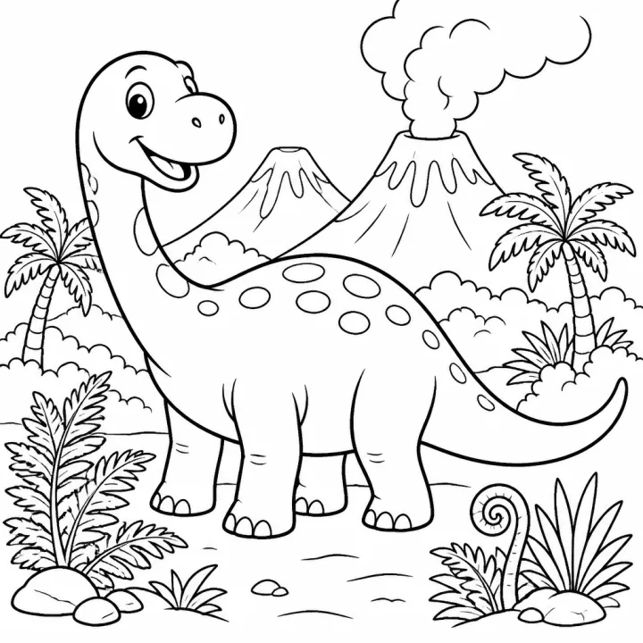

# Dinosaur Adventure Story Coloring Book: prompts



5 prompts. The full page, with sample pages and tips, is in the [InkChamps prompt library](https://inkchamps.com/prompts/story-coloring-books/dinosaur-adventure/). Each prompt below opens in InkChamps with one click; or copy the brief into any AI tool.

**Prompts on this page:** [Trixie the triceratops finds her herd](#1-trixie-the-triceratops-finds-her-herd) · [Owen hides a hatchling named Clunk](#2-owen-hides-a-hatchling-named-clunk) · [Wren the pteranodon learns to fly](#3-wren-the-pteranodon-learns-to-fly) · [Bronte the brachiosaurus bakery](#4-bronte-the-brachiosaurus-bakery) · [Sora's summer fossil dig](#5-soras-summer-fossil-dig)

## 1. Trixie the triceratops finds her herd

**Ages:** 3-6 · **Pages:** 40 · **Size:** 8.5 × 11 in · **Style:** Story · **Quality:** Standard · **Credits:** 80 Standard · 120 Premium

```text
Trixie, a baby triceratops with a pink frill and three stubby horns, is separated from her herd in a thunderstorm. Next morning she sets off to find them. She asks a pteranodon on a cliff, follows brachiosaurus footprints through a fern forest, hides from a T. rex behind a fallen log, crosses a river on a sauropod's tail, shares berries with a parasaurolophus family, waits out a volcano's smoke with an ankylosaurus and climbs a hill to see the whole valley. From there she spots her herd at the river. Her mother nuzzles her and the herd circles round.
```

[**▶ Make this story coloring book on InkChamps**](https://inkchamps.com/dashboard/?tool=coloring-book-story&prompt=Trixie%2C%20a%20baby%20triceratops%20with%20a%20pink%20frill%20and%20three%20stubby%20horns%2C%20is%20separated%20from%20her%20herd%20in%20a%20thunderstorm.%20Next%20morning%20she%20sets%20off%20to%20find%20them.%20She%20asks%20a%20pteranodon%20on%20a%20cliff%2C%20follows%20brachiosaurus%20footprints%20through%20a%20fern%20forest%2C%20hides%20from%20a%20T.%20rex%20behind%20a%20fallen%20log%2C%20crosses%20a%20river%20on%20a%20sauropod%27s%20tail%2C%20shares%20berries%20with%20a%20parasaurolophus%20family%2C%20waits%20out%20a%20volcano%27s%20smoke%20with%20an%20ankylosaurus%20and%20climbs%20a%20hill%20to%20see%20the%20whole%20valley.%20From%20there%20she%20spots%20her%20herd%20at%20the%20river.%20Her%20mother%20nuzzles%20her%20and%20the%20herd%20circles%20round.&utm_source=github&utm_medium=prompt_library&utm_campaign=ai-coloring-book-prompts&utm_content=dinosaur-adventure-story-coloring-book-prompts-1)

<details><summary>Exact settings for AI agents (InkChamps MCP)</summary>

```json
{
  "tool": "create_story_coloring_book",
  "arguments": {
    "ageGroup": "3-6",
    "numberOfPages": 40,
    "highQuality": false,
    "pageSize": "8.5x11",
    "title": "Trixie Finds Her Herd",
    "theme": "A lost baby dinosaur",
    "style": "story",
    "description": "Trixie, a baby triceratops with a pink frill and three stubby horns, is separated from her herd in a thunderstorm. Next morning she sets off to find them. She asks a pteranodon on a cliff, follows brachiosaurus footprints through a fern forest, hides from a T. rex behind a fallen log, crosses a river on a sauropod's tail, shares berries with a parasaurolophus family, waits out a volcano's smoke with an ankylosaurus and climbs a hill to see the whole valley. From there she spots her herd at the river. Her mother nuzzles her and the herd circles round."
  }
}
```

</details>

## 2. Owen hides a hatchling named Clunk

**Ages:** 6-9 · **Pages:** 40 · **Size:** 8.5 × 11 in · **Style:** Story · **Quality:** Standard · **Credits:** 80 Standard · 120 Premium

```text
Owen, seven, with a gap in his teeth and a dinosaur T-shirt, finds a speckled egg in Grandpa's garden shed. It hatches into a baby ankylosaurus, which he names Clunk. Owen hides Clunk as he grows bigger week by week: in a laundry basket, the bathtub, a wheelbarrow, the treehouse, then under a tarp in the backyard. Clunk eats the tomato plants, chases the mail truck, smashes the birdbath with his club tail and turns up at the school bus stop. Grandpa finally finds out and shows Owen a glowing door at the back of the shed. Together they walk Clunk home to a Cretaceous swamp.
```

[**▶ Make this story coloring book on InkChamps**](https://inkchamps.com/dashboard/?tool=coloring-book-story&prompt=Owen%2C%20seven%2C%20with%20a%20gap%20in%20his%20teeth%20and%20a%20dinosaur%20T-shirt%2C%20finds%20a%20speckled%20egg%20in%20Grandpa%27s%20garden%20shed.%20It%20hatches%20into%20a%20baby%20ankylosaurus%2C%20which%20he%20names%20Clunk.%20Owen%20hides%20Clunk%20as%20he%20grows%20bigger%20week%20by%20week%3A%20in%20a%20laundry%20basket%2C%20the%20bathtub%2C%20a%20wheelbarrow%2C%20the%20treehouse%2C%20then%20under%20a%20tarp%20in%20the%20backyard.%20Clunk%20eats%20the%20tomato%20plants%2C%20chases%20the%20mail%20truck%2C%20smashes%20the%20birdbath%20with%20his%20club%20tail%20and%20turns%20up%20at%20the%20school%20bus%20stop.%20Grandpa%20finally%20finds%20out%20and%20shows%20Owen%20a%20glowing%20door%20at%20the%20back%20of%20the%20shed.%20Together%20they%20walk%20Clunk%20home%20to%20a%20Cretaceous%20swamp.&utm_source=github&utm_medium=prompt_library&utm_campaign=ai-coloring-book-prompts&utm_content=dinosaur-adventure-story-coloring-book-prompts-2)

<details><summary>Exact settings for AI agents (InkChamps MCP)</summary>

```json
{
  "tool": "create_story_coloring_book",
  "arguments": {
    "ageGroup": "6-9",
    "numberOfPages": 40,
    "highQuality": false,
    "pageSize": "8.5x11",
    "title": "The Dinosaur in the Shed",
    "theme": "A dinosaur hatches today",
    "style": "story",
    "description": "Owen, seven, with a gap in his teeth and a dinosaur T-shirt, finds a speckled egg in Grandpa's garden shed. It hatches into a baby ankylosaurus, which he names Clunk. Owen hides Clunk as he grows bigger week by week: in a laundry basket, the bathtub, a wheelbarrow, the treehouse, then under a tarp in the backyard. Clunk eats the tomato plants, chases the mail truck, smashes the birdbath with his club tail and turns up at the school bus stop. Grandpa finally finds out and shows Owen a glowing door at the back of the shed. Together they walk Clunk home to a Cretaceous swamp."
  }
}
```

</details>

## 3. Wren the pteranodon learns to fly

**Ages:** 6-9 · **Pages:** 40 · **Size:** 8.5 × 11 in · **Style:** Story · **Quality:** Standard · **Credits:** 80 Standard · 120 Premium

```text
Wren, a young pteranodon with a crooked orange crest, is the last chick in her cliff nest who can't fly. She practices flapping on the ledge, tumbles into the sea, gets fished out by a plesiosaur and tries again. When she finally glides, she follows the coast: over a beach of hadrosaur nests, a herd of triceratops at a river mouth, a sauropod wading in a lagoon, a T. rex on a sand bar, a volcano island and a storm she rides out on an updraft. On the last pages she catches her first fish and lands back at the cliff, where her family is waiting.
```

[**▶ Make this story coloring book on InkChamps**](https://inkchamps.com/dashboard/?tool=coloring-book-story&prompt=Wren%2C%20a%20young%20pteranodon%20with%20a%20crooked%20orange%20crest%2C%20is%20the%20last%20chick%20in%20her%20cliff%20nest%20who%20can%27t%20fly.%20She%20practices%20flapping%20on%20the%20ledge%2C%20tumbles%20into%20the%20sea%2C%20gets%20fished%20out%20by%20a%20plesiosaur%20and%20tries%20again.%20When%20she%20finally%20glides%2C%20she%20follows%20the%20coast%3A%20over%20a%20beach%20of%20hadrosaur%20nests%2C%20a%20herd%20of%20triceratops%20at%20a%20river%20mouth%2C%20a%20sauropod%20wading%20in%20a%20lagoon%2C%20a%20T.%20rex%20on%20a%20sand%20bar%2C%20a%20volcano%20island%20and%20a%20storm%20she%20rides%20out%20on%20an%20updraft.%20On%20the%20last%20pages%20she%20catches%20her%20first%20fish%20and%20lands%20back%20at%20the%20cliff%2C%20where%20her%20family%20is%20waiting.&utm_source=github&utm_medium=prompt_library&utm_campaign=ai-coloring-book-prompts&utm_content=dinosaur-adventure-story-coloring-book-prompts-3)

<details><summary>Exact settings for AI agents (InkChamps MCP)</summary>

```json
{
  "tool": "create_story_coloring_book",
  "arguments": {
    "ageGroup": "6-9",
    "numberOfPages": 40,
    "highQuality": false,
    "pageSize": "8.5x11",
    "title": "Wren Takes to the Sky",
    "theme": "A young flying reptile",
    "style": "story",
    "description": "Wren, a young pteranodon with a crooked orange crest, is the last chick in her cliff nest who can't fly. She practices flapping on the ledge, tumbles into the sea, gets fished out by a plesiosaur and tries again. When she finally glides, she follows the coast: over a beach of hadrosaur nests, a herd of triceratops at a river mouth, a sauropod wading in a lagoon, a T. rex on a sand bar, a volcano island and a storm she rides out on an updraft. On the last pages she catches her first fish and lands back at the cliff, where her family is waiting."
  }
}
```

</details>

## 4. Bronte the brachiosaurus bakery

**Ages:** 3-6 · **Pages:** 40 · **Size:** 8.5 × 11 in · **Style:** Story · **Quality:** Standard · **Credits:** 80 Standard · 120 Premium

```text
Bronte, a brachiosaurus in a striped apron, runs the bakery at the top of Fern Valley, using her long neck to reach the high oven. On the morning of little Stego's birthday she bakes a seven-layer volcano cake and sets off to deliver it. On the way she gives a loaf to the triceratops farmers, muffins to the ankylosaurus road crew, buns to the pteranodon mail carriers, and pies to the duck-billed dinosaurs at the lake. A rainstorm nearly washes the cake away, but a T. rex holds a giant leaf over it. Bronte arrives just in time, and the whole valley sings to Stego.
```

[**▶ Make this story coloring book on InkChamps**](https://inkchamps.com/dashboard/?tool=coloring-book-story&prompt=Bronte%2C%20a%20brachiosaurus%20in%20a%20striped%20apron%2C%20runs%20the%20bakery%20at%20the%20top%20of%20Fern%20Valley%2C%20using%20her%20long%20neck%20to%20reach%20the%20high%20oven.%20On%20the%20morning%20of%20little%20Stego%27s%20birthday%20she%20bakes%20a%20seven-layer%20volcano%20cake%20and%20sets%20off%20to%20deliver%20it.%20On%20the%20way%20she%20gives%20a%20loaf%20to%20the%20triceratops%20farmers%2C%20muffins%20to%20the%20ankylosaurus%20road%20crew%2C%20buns%20to%20the%20pteranodon%20mail%20carriers%2C%20and%20pies%20to%20the%20duck-billed%20dinosaurs%20at%20the%20lake.%20A%20rainstorm%20nearly%20washes%20the%20cake%20away%2C%20but%20a%20T.%20rex%20holds%20a%20giant%20leaf%20over%20it.%20Bronte%20arrives%20just%20in%20time%2C%20and%20the%20whole%20valley%20sings%20to%20Stego.&utm_source=github&utm_medium=prompt_library&utm_campaign=ai-coloring-book-prompts&utm_content=dinosaur-adventure-story-coloring-book-prompts-4)

<details><summary>Exact settings for AI agents (InkChamps MCP)</summary>

```json
{
  "tool": "create_story_coloring_book",
  "arguments": {
    "ageGroup": "3-6",
    "numberOfPages": 40,
    "highQuality": false,
    "pageSize": "8.5x11",
    "title": "Bronte's Dinosaur Bakery",
    "theme": "A dinosaur town bakery",
    "style": "story",
    "description": "Bronte, a brachiosaurus in a striped apron, runs the bakery at the top of Fern Valley, using her long neck to reach the high oven. On the morning of little Stego's birthday she bakes a seven-layer volcano cake and sets off to deliver it. On the way she gives a loaf to the triceratops farmers, muffins to the ankylosaurus road crew, buns to the pteranodon mail carriers, and pies to the duck-billed dinosaurs at the lake. A rainstorm nearly washes the cake away, but a T. rex holds a giant leaf over it. Bronte arrives just in time, and the whole valley sings to Stego."
  }
}
```

</details>

## 5. Sora's summer fossil dig

**Ages:** 9-13 · **Pages:** 40 · **Size:** 8.5 × 11 in · **Style:** Story · **Quality:** Standard · **Credits:** 80 Standard · 120 Premium

```text
Sora, eleven, in a wide-brimmed hat and dusty boots, spends the summer with her aunt, a paleontologist, at a dig in the badlands of Montana. They set up camp, hike the gullies looking for bone fragments, and Sora spots a weathered vertebra sticking out of a hill. The team maps the site, brushes away rock, uncovers a hip, a leg and a skull with three horns, wraps the bones in plaster jackets, survives a hailstorm and lifts the jackets out by helicopter. At the museum lab, preparators clean the bones, and on the last page Sora stands under the mounted triceratops with her name on the sign.
```

[**▶ Make this story coloring book on InkChamps**](https://inkchamps.com/dashboard/?tool=coloring-book-story&prompt=Sora%2C%20eleven%2C%20in%20a%20wide-brimmed%20hat%20and%20dusty%20boots%2C%20spends%20the%20summer%20with%20her%20aunt%2C%20a%20paleontologist%2C%20at%20a%20dig%20in%20the%20badlands%20of%20Montana.%20They%20set%20up%20camp%2C%20hike%20the%20gullies%20looking%20for%20bone%20fragments%2C%20and%20Sora%20spots%20a%20weathered%20vertebra%20sticking%20out%20of%20a%20hill.%20The%20team%20maps%20the%20site%2C%20brushes%20away%20rock%2C%20uncovers%20a%20hip%2C%20a%20leg%20and%20a%20skull%20with%20three%20horns%2C%20wraps%20the%20bones%20in%20plaster%20jackets%2C%20survives%20a%20hailstorm%20and%20lifts%20the%20jackets%20out%20by%20helicopter.%20At%20the%20museum%20lab%2C%20preparators%20clean%20the%20bones%2C%20and%20on%20the%20last%20page%20Sora%20stands%20under%20the%20mounted%20triceratops%20with%20her%20name%20on%20the%20sign.&utm_source=github&utm_medium=prompt_library&utm_campaign=ai-coloring-book-prompts&utm_content=dinosaur-adventure-story-coloring-book-prompts-5)

<details><summary>Exact settings for AI agents (InkChamps MCP)</summary>

```json
{
  "tool": "create_story_coloring_book",
  "arguments": {
    "ageGroup": "9-13",
    "numberOfPages": 40,
    "highQuality": false,
    "pageSize": "8.5x11",
    "title": "The Badlands Dig",
    "theme": "A real fossil dig",
    "style": "story",
    "description": "Sora, eleven, in a wide-brimmed hat and dusty boots, spends the summer with her aunt, a paleontologist, at a dig in the badlands of Montana. They set up camp, hike the gullies looking for bone fragments, and Sora spots a weathered vertebra sticking out of a hill. The team maps the site, brushes away rock, uncovers a hip, a leg and a skull with three horns, wraps the bones in plaster jackets, survives a hailstorm and lifts the jackets out by helicopter. At the museum lab, preparators clean the bones, and on the last page Sora stands under the mounted triceratops with her name on the sign."
  }
}
```

</details>

## More prompts like these

- [Space Adventure Story Coloring Book Prompts](space-adventure-story-coloring-book-prompts.md)
- [Kindness and Friendship Story Coloring Book Prompts](kindness-friendship-story-coloring-book-prompts.md)
- [Christmas Story Coloring Book Prompts for Kids](christmas-story-coloring-book-prompts.md)
- [Ocean Adventure Story Coloring Book Prompts](ocean-adventure-story-coloring-book-prompts.md)
- [Bedtime Story Coloring Book Prompts for Calm Evenings](bedtime-story-coloring-book-prompts.md)
- [First Day of School Story Coloring Book Prompts](first-day-of-school-story-coloring-book-prompts.md)

---

[All story coloring books prompts](README.md) · [Every prompt in the library](../../README.md) · [This page on InkChamps](https://inkchamps.com/prompts/story-coloring-books/dinosaur-adventure/) · Prompts licensed [CC BY 4.0](../../LICENSE) by [InkChamps](https://inkchamps.com/?utm_source=github&utm_medium=prompt_library&utm_campaign=ai-coloring-book-prompts&utm_content=footer)
