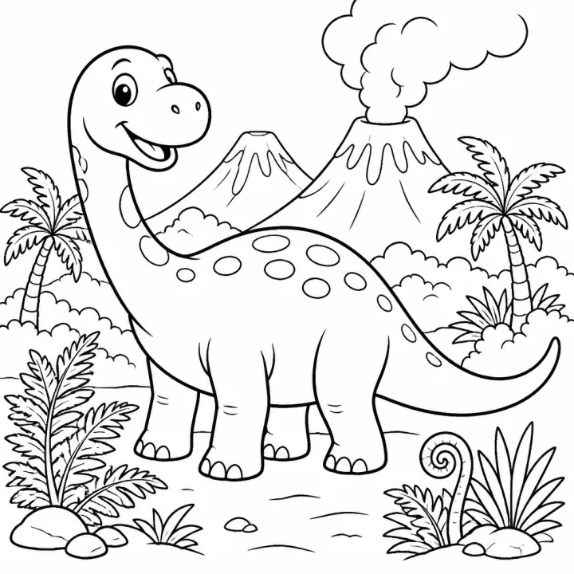

# Dinosaur Adventure Story Coloring Book: prompts



5 prompts. The full page, with sample pages and tips, is in the [InkChamps prompt library](https://inkchamps.com/prompts/story-coloring-books/dinosaur-adventure/). Each prompt below opens in InkChamps with one click; or copy the brief into any AI tool.

**Prompts on this page:** [Trixie the triceratops finds her herd](#1-trixie-the-triceratops-finds-her-herd) · [Owen hides a hatchling named Clunk](#2-owen-hides-a-hatchling-named-clunk) · [Wren the pteranodon learns to fly](#3-wren-the-pteranodon-learns-to-fly) · [Bronte the brachiosaurus bakery](#4-bronte-the-brachiosaurus-bakery) · [Sora's summer fossil dig](#5-soras-summer-fossil-dig)

## 1. Trixie the triceratops finds her herd

**Ages:** 3-6 · **Pages:** 24 · **Size:** 8.5 × 11 in · **Style:** Story · **Quality:** Standard · **Credits:** 48 Standard · 72 Premium

```text
A 24-page story for ages 3 to 6. Trixie, a baby triceratops, is separated from her herd in a thunderstorm and sets off to find them. A pteranodon on a cliff points the way, she follows brachiosaurus footprints through a fern forest, hides behind a log while a sleepy T. rex walks past, crosses a river on a diplodocus's tail, shares berries with a parasaurolophus family and waits out volcano smoke with an ankylosaurus. From a hilltop she spots her herd, runs down to her mother and sleeps safe in the circle of the herd.
```

### Page by page (24 pages)

Paste one page at a time into ChatGPT, Gemini or any AI image tool, with this line after it:

> Black-and-white coloring page for ages 3 to 6. Trixie: a small chubby baby triceratops, big round eyes, three stubby horns, scalloped frill; her mother: a large triceratops with long horns. Thick bold outlines, big simple shapes, little background, nothing scary, no shading or grey, no words in the picture, a plain blank band at the bottom for the story text, portrait 8.5 x 11 page.

1. Trixie the baby triceratops splashing at the edge of a wide river while her big mother and two other triceratops of the herd drink nearby, round pebbles and reeds along the bank.  
   *Words:* Trixie was the smallest triceratops in the herd. Every morning she splashed in the river while her mother drank beside her.
2. Dark storm clouds and big raindrops over the valley, the herd running away across the grass while Trixie ducks under a huge fern leaf, a jagged lightning bolt in the sky.  
   *Words:* One afternoon a thunderstorm crashed over the valley. The herd ran for shelter, and Trixie hid under a big fern.
3. Trixie standing alone in a quiet clearing the next morning, puddles on the ground, broken fern leaves around her and a rising sun peeking over the hills.  
   *Words:* When the rain stopped, the valley was quiet. Trixie looked all around, but her herd was gone.
4. Trixie stepping off along a muddy path between rocks and ferns, head held high, a line of her own small footprints behind her and a butterfly flying ahead.  
   *Words:* Trixie took a deep breath. "I will find them," she said, and she set off on her short, strong legs.
5. Trixie looking up at a tall rocky cliff where a friendly pteranodon sits on a ledge beside its nest of twigs, its wings folded and its long beak pointing down at her.  
   *Words:* On a tall cliff sat a pteranodon. "Have you seen my herd?" Trixie called up.
6. The pteranodon flying over Trixie with its wide wings spread, pointing one wingtip toward a thick forest of giant ferns on the far side of a meadow.  
   *Words:* "I saw big dinosaurs walking that way," said the pteranodon, and it pointed to the fern forest.
7. Trixie inside a fern forest standing in one giant round brachiosaurus footprint, a trail of more huge footprints leading off between the tall fern trunks.  
   *Words:* In the fern forest Trixie found footprints so big she could stand inside one. She followed them, step by step.
8. A gentle brachiosaurus lowering its very long neck down through the treetops to smile at Trixie, its huge legs like tree trunks beside her.  
   *Words:* The footprints belonged to a kind brachiosaurus. "Your herd went toward the river," she said softly.
9. Trixie crouched behind a big fallen log covered in moss, peeking over the top with wide eyes, a mushroom and a beetle on the log beside her.  
   *Words:* Stomp, stomp! The ground began to shake. Trixie hid behind a fallen log and kept very still.
10. A big T. rex walking past the log with a sleepy yawn, looking the other way at a dragonfly, while Trixie stays hidden and only her horns show above the log.  
   *Words:* A big T. rex wandered past, yawning a giant yawn. It never saw Trixie at all.
11. Trixie standing on a riverbank looking at a wide rushing river with no way across, a few rocks sticking out of the water and the far bank in the distance.  
   *Words:* At last Trixie reached the river, but it was wide and fast. How could a little triceratops get across?
12. A long-necked diplodocus standing in the river and laying its long tail across the water to the bank like a bridge, smiling back at Trixie.  
   *Words:* A diplodocus was wading nearby. "Hop on," it said, and it laid its long tail across the water like a bridge.
13. Trixie carefully walking across the diplodocus's long tail over the river, little fish jumping in the water below and the far bank just ahead.  
   *Words:* Trixie walked along the tail, one careful step at a time, all the way to the other side.
14. Trixie sniffing a round bush covered in plump berries, her tummy rumbling, a few berries fallen on the ground and a snail climbing a stem.  
   *Words:* By now Trixie was very hungry. She found a bush full of juicy berries, just out of reach.
15. A parasaurolophus family of a mother, a father and a baby with long tube crests sharing berries with Trixie on a big leaf like a plate, sitting in the grass together.  
   *Words:* A parasaurolophus family pulled the berries down for her. "Share with us," they said, and they all ate together.
16. The baby parasaurolophus tooting through its long head crest like a trumpet, round music notes floating up, while Trixie laughs and bounces beside it.  
   *Words:* The baby parasaurolophus blew through its crest. Toot, toot! Trixie laughed so hard her frill wiggled.
17. Trixie on a path looking at puffy smoke clouds rising from a far-off volcano, a friendly ankylosaurus with a bumpy back and club tail standing beside her.  
   *Words:* Further on, smoke puffed from a far-off volcano. An ankylosaurus stood on the path. "Wait here with me until it clears," he said.
18. Trixie and the ankylosaurus sitting together under a wide rock ledge, watching gentle smoke drift past outside, a small pile of leaves for a bed between them.  
   *Words:* They sat under a rock ledge and told each other stories while the smoke drifted by.
19. The ankylosaurus waving its club tail goodbye as Trixie trots away under a clear sky, the volcano small and quiet in the distance behind them.  
   *Words:* Soon the sky was clear again. "Good luck, little one," said the ankylosaurus, and Trixie trotted on.
20. Trixie climbing up a tall grassy hill dotted with round flowers, puffing hard, a few small rocks rolling down the slope behind her.  
   *Words:* Trixie climbed a tall hill. It was steep, but she kept going, up and up and up.
21. Trixie standing on the hilltop looking down over the whole valley: the winding river, the fern forest and a group of tiny triceratops by the water far below.  
   *Words:* From the top she could see the whole valley. And there, by the river, was her herd!
22. Trixie running and sliding happily down the grassy hill toward the river, flowers bouncing around her and her small feet kicking up the grass.  
   *Words:* Trixie ran down the hill as fast as her legs could go.
23. Trixie's big mother bending her head down to nuzzle Trixie nose to nose at the river's edge, Trixie's eyes closed and smiling, reeds around them.  
   *Words:* Her mother saw her and came running. She nuzzled Trixie's nose and held her close.
24. The whole triceratops herd standing in a circle around Trixie and her mother under a starry night sky, Trixie curled up asleep against her mother's side.  
   *Words:* The herd circled round, happy to have Trixie home. That night she slept safe and warm beside her mother.

[**▶ Make this story coloring book on InkChamps**](https://inkchamps.com/dashboard/?tool=coloring-book-story&prompt=A%2024-page%20story%20for%20ages%203%20to%206.%20Trixie%2C%20a%20baby%20triceratops%2C%20is%20separated%20from%20her%20herd%20in%20a%20thunderstorm%20and%20sets%20off%20to%20find%20them.%20A%20pteranodon%20on%20a%20cliff%20points%20the%20way%2C%20she%20follows%20brachiosaurus%20footprints%20through%20a%20fern%20forest%2C%20hides%20behind%20a%20log%20while%20a%20sleepy%20T.%20rex%20walks%20past%2C%20crosses%20a%20river%20on%20a%20diplodocus%27s%20tail%2C%20shares%20berries%20with%20a%20parasaurolophus%20family%20and%20waits%20out%20volcano%20smoke%20with%20an%20ankylosaurus.%20From%20a%20hilltop%20she%20spots%20her%20herd%2C%20runs%20down%20to%20her%20mother%20and%20sleeps%20safe%20in%20the%20circle%20of%20the%20herd.&utm_source=github&utm_medium=prompt_library&utm_campaign=ai-coloring-book-prompts&utm_content=dinosaur-adventure-story-coloring-book-prompts-1)

<details><summary>Exact settings for AI agents (InkChamps MCP)</summary>

```json
{
  "tool": "create_story_coloring_book",
  "arguments": {
    "ageGroup": "3-6",
    "numberOfPages": 24,
    "highQuality": false,
    "pageSize": "8.5x11",
    "title": "Trixie Finds Her Herd",
    "theme": "A lost baby dinosaur",
    "style": "story",
    "description": "A 24-page story for ages 3 to 6. Trixie, a baby triceratops, is separated from her herd in a thunderstorm and sets off to find them. A pteranodon on a cliff points the way, she follows brachiosaurus footprints through a fern forest, hides behind a log while a sleepy T. rex walks past, crosses a river on a diplodocus's tail, shares berries with a parasaurolophus family and waits out volcano smoke with an ankylosaurus. From a hilltop she spots her herd, runs down to her mother and sleeps safe in the circle of the herd."
  }
}
```

</details>

## 2. Owen hides a hatchling named Clunk

**Ages:** 6-9 · **Pages:** 24 · **Size:** 8.5 × 11 in · **Style:** Story · **Quality:** Standard · **Credits:** 48 Standard · 72 Premium

```text
A 24-page story for ages 6 to 9. Owen, seven, finds a speckled egg in Grandpa's shed. It hatches into a baby ankylosaurus he names Clunk, and Owen hides him as he grows: in a laundry basket, the bathtub, a wheelbarrow, the treehouse, then under a tarp. Clunk eats the tomato plants, chases the mail truck, smashes the birdbath and follows Owen to the bus stop. Grandpa finds out and shows Owen a glowing door at the back of the shed, and together they walk Clunk home to a Cretaceous swamp and his ankylosaurus family.
```

### Page by page (24 pages)

Paste one page at a time into ChatGPT, Gemini or any AI image tool, with this line after it:

> Black-and-white coloring page for ages 6 to 9. Owen: a boy of seven, messy hair, gap-toothed grin, dinosaur T-shirt, shorts, sneakers. Clunk: an ankylosaurus with a bumpy back and club tail, bigger each week. Grandpa: glasses, cardigan, flat cap. Bold outlines, medium detail, simple background, no shading or grey, no words in the art, blank band at the bottom for text, portrait 8.5 x 11 page.

1. Owen, a seven-year-old boy, in Grandpa's dusty garden shed finding a big speckled egg in a bucket of straw, flowerpots, a rake and a watering can on the shelves around him.  
   *Words:* Owen was hunting for a fishing net in Grandpa's shed when he found something strange: a big speckled egg in a bucket of straw.
2. Owen in his bedroom tucking the egg into a shoebox nest of socks under a warm desk lamp, dinosaur posters on the wall and a toy rocket on the shelf.  
   *Words:* He carried it to his room, wrapped it in socks and set it under his desk lamp to keep it warm.
3. The egg cracking open in the shoebox and a baby ankylosaurus poking its bumpy head out, Owen kneeling beside the desk with his mouth open in surprise.  
   *Words:* Crack! Out popped a baby ankylosaurus with a bumpy back and a tiny club on the end of its tail.
4. Owen sitting cross-legged on the bedroom rug feeding the baby ankylosaurus a lettuce leaf, the little dinosaur wagging its club tail and a bowl of water beside it.  
   *Words:* "I'll call you Clunk," Owen whispered, because that was the sound his tail made on the floor.
5. Owen in the upstairs hallway carrying a laundry basket piled with socks and shirts, Clunk's bumpy head peeking out the top, Mom walking past with a vacuum cleaner.  
   *Words:* Owen kept Clunk a secret. The first week he hid him in the laundry basket, right under Mom's nose.
6. Clunk, now as big as a dog, sitting in a bubble bath in the bathtub with a toy boat, Owen holding a towel and a wet floor with a rubber duck on it.  
   *Words:* Clunk grew fast. By the second week he only fit in the bathtub, and he loved the bubbles.
7. Owen pushing a wheelbarrow across the backyard with Clunk curled inside it under an old blanket, his club tail sticking out the end, a clothesline overhead.  
   *Words:* Soon the bathtub was too small, so Owen wheeled Clunk out to the yard in Grandpa's wheelbarrow.
8. A wooden treehouse in a big oak tree with Clunk's head poking out of its little window and his tail out the door, Owen climbing the rope ladder with a snack bag.  
   *Words:* For a few days Clunk lived in the treehouse, until he was too big to turn around.
9. Clunk, now the size of a pony, lying under a big tarp tied between two trees in the backyard, Owen bringing him a bucket of apples, a wooden fence behind.  
   *Words:* Now Clunk was as big as a pony. Owen built him a tent from a tarp and brought him apples every day.
10. Clunk munching on Grandpa's tomato plants in the vegetable garden, tomato cages knocked over and a squashed tomato on his nose, Owen running up with his hands on his head.  
   *Words:* One morning Clunk ate every one of Grandpa's tomato plants. "Clunk!" groaned Owen.
11. Clunk galloping down the street after a little mail truck, envelopes flying out of its open door, Owen running behind waving his arms, houses and mailboxes along the street.  
   *Words:* The next day Clunk chased the mail truck all the way down the street. Letters flew everywhere.
12. Clunk swinging his club tail and smashing a stone birdbath in the garden, water splashing and three little birds fluttering away in surprise.  
   *Words:* Then he spotted the birdbath. Swing, smash! Clunk's tail was a lot stronger than it used to be.
13. Owen sweeping up broken pieces of the birdbath with a broom and dustpan while Clunk sits beside him with his head down looking sorry.  
   *Words:* Owen swept up the pieces. Clunk hung his head. "You can't help being a dinosaur," Owen sighed.
14. Owen at the school bus stop with his backpack, Clunk standing right behind him, two other kids staring with wide eyes and the yellow school bus coming down the road.  
   *Words:* On Monday Owen walked to the school bus stop, and Clunk followed him there.
15. Owen pushing Clunk behind a tall hedge with both hands while the bus driver leans out of the bus door looking puzzled, Clunk's tail still poking out of the leaves.  
   *Words:* "Hide!" Owen said, pushing Clunk into the hedge. The bus driver scratched his head.
16. Owen and Clunk at night under the backyard tarp, Owen reading a dinosaur book by flashlight, a picture of a swamp in the open book and Clunk listening closely.  
   *Words:* That night Owen read his dinosaur book to Clunk. Ankylosaurs lived in warm swamps, it said, long ago. Clunk looked homesick.
17. Grandpa, an older man with glasses, a cardigan and a flat cap, lifting the corner of the tarp and finding Clunk, his coffee mug tipping in his hand, Owen beside him looking guilty.  
   *Words:* The next morning Grandpa lifted the tarp. He looked at Clunk. He looked at Owen. Then he started to smile.
18. Grandpa leading Owen and Clunk back into the garden shed and pushing aside old boxes and a rusty bicycle to show the back wall.  
   *Words:* "So that's where my egg went," said Grandpa. "Come with me. I have a secret too."
19. A round door glowing at the back of the shed, light rays spilling out around its edges, Owen and Clunk staring at it and Grandpa holding it open.  
   *Words:* Behind the boxes was a door that glowed. Grandpa opened it, and warm air rushed in.
20. Owen, Grandpa and Clunk stepping through the door into a Cretaceous swamp with giant ferns, tall reeds, big dragonflies and a still pond.  
   *Words:* On the other side was a steamy swamp full of giant ferns and dragonflies as big as birds.
21. A family of big grown-up ankylosaurus wading out of the tall reeds toward Clunk, Clunk stepping forward to meet them while Owen and Grandpa watch from a log.  
   *Words:* Out of the reeds came a family of ankylosaurs. Clunk lifted his head and gave a happy rumble.
22. Owen hugging Clunk around his bumpy neck to say goodbye, Clunk nudging a small round stone into Owen's hand, the ankylosaurus family waiting in the swamp behind.  
   *Words:* Owen hugged Clunk goodbye. Clunk nudged a smooth round stone into his hand, like a present.
23. Back in the garden shed, Owen and Grandpa looking at the cracked eggshell and the smooth stone on a shelf, the shed door open to a sunny garden, the glowing door now closed.  
   *Words:* Back home, Owen put the stone beside the eggshell on Grandpa's shelf. "Can we visit him?" he asked. Grandpa winked.
24. Owen in pajamas in bed holding the round stone and smiling, his window open to a starry sky, a dinosaur nightlight on the table and the shed seen outside in the garden.  
   *Words:* That night Owen fell asleep with the stone in his hand, dreaming of a little dinosaur splashing in a faraway swamp.

[**▶ Make this story coloring book on InkChamps**](https://inkchamps.com/dashboard/?tool=coloring-book-story&prompt=A%2024-page%20story%20for%20ages%206%20to%209.%20Owen%2C%20seven%2C%20finds%20a%20speckled%20egg%20in%20Grandpa%27s%20shed.%20It%20hatches%20into%20a%20baby%20ankylosaurus%20he%20names%20Clunk%2C%20and%20Owen%20hides%20him%20as%20he%20grows%3A%20in%20a%20laundry%20basket%2C%20the%20bathtub%2C%20a%20wheelbarrow%2C%20the%20treehouse%2C%20then%20under%20a%20tarp.%20Clunk%20eats%20the%20tomato%20plants%2C%20chases%20the%20mail%20truck%2C%20smashes%20the%20birdbath%20and%20follows%20Owen%20to%20the%20bus%20stop.%20Grandpa%20finds%20out%20and%20shows%20Owen%20a%20glowing%20door%20at%20the%20back%20of%20the%20shed%2C%20and%20together%20they%20walk%20Clunk%20home%20to%20a%20Cretaceous%20swamp%20and%20his%20ankylosaurus%20family.&utm_source=github&utm_medium=prompt_library&utm_campaign=ai-coloring-book-prompts&utm_content=dinosaur-adventure-story-coloring-book-prompts-2)

<details><summary>Exact settings for AI agents (InkChamps MCP)</summary>

```json
{
  "tool": "create_story_coloring_book",
  "arguments": {
    "ageGroup": "6-9",
    "numberOfPages": 24,
    "highQuality": false,
    "pageSize": "8.5x11",
    "title": "The Dinosaur in the Shed",
    "theme": "A dinosaur hatches today",
    "style": "story",
    "description": "A 24-page story for ages 6 to 9. Owen, seven, finds a speckled egg in Grandpa's shed. It hatches into a baby ankylosaurus he names Clunk, and Owen hides him as he grows: in a laundry basket, the bathtub, a wheelbarrow, the treehouse, then under a tarp. Clunk eats the tomato plants, chases the mail truck, smashes the birdbath and follows Owen to the bus stop. Grandpa finds out and shows Owen a glowing door at the back of the shed, and together they walk Clunk home to a Cretaceous swamp and his ankylosaurus family."
  }
}
```

</details>

## 3. Wren the pteranodon learns to fly

**Ages:** 6-9 · **Pages:** 24 · **Size:** 8.5 × 11 in · **Style:** Story · **Quality:** Standard · **Credits:** 48 Standard · 72 Premium

```text
A 24-page story for ages 6 to 9. Wren, a young pteranodon with a crooked crest, is the last chick in her cliff nest who can't fly. She practices on the ledge, tumbles into the sea, is lifted out by a plesiosaur and climbs back to try again. When the wind finally catches her she follows the coast over a beach of hadrosaur nests, triceratops at a river mouth, a sauropod in a lagoon, a T. rex on a sandbar and a volcano island, rides out a storm on a rising draft, catches her first fish and flies home to her waiting family.
```

### Page by page (24 pages)

Paste one page at a time into ChatGPT, Gemini or any AI image tool, with this line after it:

> Black-and-white coloring page for ages 6 to 9. Wren: a small young pteranodon, long pointed beak, a crooked crest bent to one side, big eyes, wide leathery wings; her family: larger pteranodons with straight crests. Clear bold outlines, medium detail, simple sea and sky, no shading or grey, no words in the picture, a plain blank band at the bottom for the story text, portrait 8.5 x 11 page.

1. Four pteranodon chicks in a twig nest on a high sea cliff ledge, three flapping their wings while one small chick with a crooked crest watches, waves crashing far below.  
   *Words:* High on a sea cliff lived a family of pteranodons. Wren, the smallest, had a crooked crest and wings that would not lift her.
2. Wren's three brothers and sisters gliding away from the cliff over the sea while Wren sits alone in the nest next to her mother, seabirds and clouds in the sky.  
   *Words:* One by one her brothers and sisters jumped off the ledge and soared away. Wren stayed behind.
3. Wren standing on the cliff ledge flapping her wings as hard as she can, dust and bits of moss blowing up, a pebble falling off the edge.  
   *Words:* Every day Wren practiced. Flap, flap, flap! But her feet never left the rock.
4. Wren tumbling head over tail off the cliff toward the sea, wings tangled, her mother leaning over the ledge above with her beak wide open.  
   *Words:* One windy morning she tried a big jump. Down, down, down she tumbled.
5. Wren splashing into the sea and floating with her wings spread on the water, a long-necked plesiosaur rising up beneath her, fish swimming around.  
   *Words:* Splash! Wren landed in the sea. Then something big rose up underneath her.
6. The plesiosaur lifting Wren out of the water on top of its head and carrying her toward a flat rock near the cliff, water dripping off them both.  
   *Words:* It was a plesiosaur with a long, long neck. "Up you come," it said, and it carried her to a rock.
7. Wren sitting on a flat sunny rock with her wings stretched out to dry, two crabs scuttling beside her and the plesiosaur swimming away with a wave of its flipper.  
   *Words:* Wren spread her wings to dry in the sun. "Don't give up," called the plesiosaur as it swam away.
8. Wren climbing back up the cliff using the claws on her wings, hopping from ledge to ledge past nesting seabirds and tufts of grass.  
   *Words:* So Wren climbed all the way back up the cliff, claw over claw, ledge by ledge.
9. Wren leaping off the ledge again with her wings spread wide as a gust of wind lifts her, swirling wind lines under her wings and her mother cheering from the nest.  
   *Words:* She stood at the edge, spread her wings wide and jumped. This time the wind caught her!
10. Wren gliding along the coast with her wings stretched out, the tall cliffs behind her, waves curling on the rocks below and a few seabirds flying alongside.  
   *Words:* Wren was flying! She glided along the coast, looking down at the whole wide world.
11. A view from above of a sandy beach covered in round hadrosaur nests full of eggs, duck-billed mothers sitting on them, and Wren flying overhead.  
   *Words:* She flew over a beach where duck-billed dinosaurs were sitting on their nests of eggs.
12. A herd of triceratops drinking where a river flows into the sea, the young ones splashing in the shallows, and Wren gliding low over their horns.  
   *Words:* At the river mouth, a herd of triceratops looked up and waved their tails as she went by.
13. A huge sauropod wading in a calm lagoon with its long neck held high, Wren landing on top of its head to rest, lily pads and reeds around its legs.  
   *Words:* Wren was tired, so she rested on the head of a sauropod wading in a lagoon. It didn't mind at all.
14. A T. rex standing on a long sandbar looking up as Wren flaps higher into the sky, waves on both sides of the sandbar and driftwood at its feet.  
   *Words:* On a sandbar a T. rex looked up and snapped its jaws. Wren flapped higher, far out of reach.
15. Wren flying past a small volcano island with puffs of smoke rising from its top, cycad trees on its slopes and waves breaking around its shore.  
   *Words:* She flew past a smoking volcano island, where the air was warm and smelled of ash.
16. Storm clouds rolling over the sea, lightning bolts, slanting rain and big waves, Wren pushed sideways by the wind with her wings bent.  
   *Words:* Then dark clouds rolled in. Rain lashed down and the wind pushed Wren this way and that.
17. Wren riding a spiral of rising warm air high up through the clouds, curling wind lines around her and the storm far below.  
   *Words:* Wren remembered the wind at the cliff. She found a rising draft of warm air and rode it up, up, up through the storm.
18. Wren soaring above the clouds in calm air, the sun shining, a rainbow arching over the sea as the storm drifts away beneath her.  
   *Words:* Above the clouds the sky was calm. Below her, the storm drifted away and a rainbow appeared.
19. Wren gliding down low over a calm sea, looking at a school of small fish swimming in a tight swirl just under the water's surface.  
   *Words:* Now Wren was hungry. Down below she spotted a shining school of fish.
20. Wren diving straight down toward the sea with her wings folded back and her long beak pointed at the water, a ring of ripples where the fish are.  
   *Words:* She folded her wings and dove, straight as an arrow.
21. Wren bursting up out of the water with a fish held in her long beak, water drops spraying around her and the school of fish scattering below.  
   *Words:* Splash! When she came up, a fish was wriggling in her beak. Her very first catch!
22. Wren flying home along the coastline at sunset with the fish in her beak, the setting sun half sunk into the sea and her family's tall cliff ahead.  
   *Words:* As the sun went down, Wren flew home along the coast with her fish.
23. Wren landing on the cliff ledge beside the nest while her mother and her brothers and sisters crowd around her, flapping their wings with joy.  
   *Words:* Her family was waiting on the ledge. "You flew!" they cried, crowding around her.
24. Wren and her whole family soaring together over the sea the next morning, wings spread side by side, the cliff and nest behind them and the sun rising.  
   *Words:* The next morning, the whole family flew out over the sea together, and Wren, the smallest, led the way.

[**▶ Make this story coloring book on InkChamps**](https://inkchamps.com/dashboard/?tool=coloring-book-story&prompt=A%2024-page%20story%20for%20ages%206%20to%209.%20Wren%2C%20a%20young%20pteranodon%20with%20a%20crooked%20crest%2C%20is%20the%20last%20chick%20in%20her%20cliff%20nest%20who%20can%27t%20fly.%20She%20practices%20on%20the%20ledge%2C%20tumbles%20into%20the%20sea%2C%20is%20lifted%20out%20by%20a%20plesiosaur%20and%20climbs%20back%20to%20try%20again.%20When%20the%20wind%20finally%20catches%20her%20she%20follows%20the%20coast%20over%20a%20beach%20of%20hadrosaur%20nests%2C%20triceratops%20at%20a%20river%20mouth%2C%20a%20sauropod%20in%20a%20lagoon%2C%20a%20T.%20rex%20on%20a%20sandbar%20and%20a%20volcano%20island%2C%20rides%20out%20a%20storm%20on%20a%20rising%20draft%2C%20catches%20her%20first%20fish%20and%20flies%20home%20to%20her%20waiting%20family.&utm_source=github&utm_medium=prompt_library&utm_campaign=ai-coloring-book-prompts&utm_content=dinosaur-adventure-story-coloring-book-prompts-3)

<details><summary>Exact settings for AI agents (InkChamps MCP)</summary>

```json
{
  "tool": "create_story_coloring_book",
  "arguments": {
    "ageGroup": "6-9",
    "numberOfPages": 24,
    "highQuality": false,
    "pageSize": "8.5x11",
    "title": "Wren Takes to the Sky",
    "theme": "A young flying reptile",
    "style": "story",
    "description": "A 24-page story for ages 6 to 9. Wren, a young pteranodon with a crooked crest, is the last chick in her cliff nest who can't fly. She practices on the ledge, tumbles into the sea, is lifted out by a plesiosaur and climbs back to try again. When the wind finally catches her she follows the coast over a beach of hadrosaur nests, triceratops at a river mouth, a sauropod in a lagoon, a T. rex on a sandbar and a volcano island, rides out a storm on a rising draft, catches her first fish and flies home to her waiting family."
  }
}
```

</details>

## 4. Bronte the brachiosaurus bakery

**Ages:** 3-6 · **Pages:** 24 · **Size:** 8.5 × 11 in · **Style:** Story · **Quality:** Standard · **Credits:** 48 Standard · 72 Premium

```text
A 24-page story for ages 3 to 6. Bronte, a brachiosaurus in a striped apron, runs the bakery at the top of Fern Valley and uses her long neck to reach the high oven. For little Stego's birthday she bakes a seven-layer volcano cake and sets off to deliver it, giving bread to the triceratops farmers, muffins to the ankylosaurus road crew, buns to the pteranodon mail carriers and pies to the duck-billed dinosaurs at the lake. A rainstorm nearly spoils the cake, but a kind T. rex holds a giant leaf over it, and the whole valley sings to Stego.
```

### Page by page (24 pages)

Paste one page at a time into ChatGPT, Gemini or any AI image tool, with this line after it:

> Black-and-white coloring page for ages 3 to 6. Bronte: a friendly brachiosaurus, very long neck, round smiling face, striped apron, baker's hat; Stego: a little stegosaurus with back plates. Thick bold outlines, big simple shapes, little background, nothing scary, no shading or grey, no words in the picture, a plain blank band at the bottom for the story text, portrait 8.5 x 11 page.

1. A round bakery with a tall chimney at the top of a green valley full of ferns, Bronte the brachiosaurus's long neck poking out of a high window, smoke curling up from the chimney.  
   *Words:* At the top of Fern Valley there was a bakery, and the baker was Bronte the brachiosaurus.
2. Bronte in her striped apron and baker's hat stretching her long neck up to a tall oven high on the wall, pulling out a tray of round loaves.  
   *Words:* Bronte's oven was very high up, but her long neck reached it easily.
3. Bronte stirring a giant mixing bowl of cake batter with a wooden spoon held in her mouth, flour sacks, eggs and a jug of milk on the table beside her.  
   *Words:* Today was little Stego's birthday, so Bronte mixed the biggest bowl of batter she had ever made.
4. Bronte stacking seven round cake layers into a tall cone shaped like a volcano, each layer a little smaller than the last, a step ladder next to the table.  
   *Words:* She baked seven cake layers and stacked them up, one on top of another, into a volcano cake.
5. Bronte squeezing thick drips of frosting down the sides of the volcano cake like lava, sprinkles on top and a row of birthday candles around the peak.  
   *Words:* She drizzled frosting down the sides like lava and added candles on the top.
6. Bronte pulling a wooden wagon down a path from the bakery, the volcano cake in the middle and baskets of bread, muffins, buns and pies packed around it.  
   *Words:* Bronte packed the cake into her wagon with bread, muffins, buns and pies, and off she went.
7. Two triceratops farmers in straw hats in a field of tall grain, smiling as Bronte hands them a big round loaf of bread, a plow resting behind them.  
   *Words:* First she stopped at the farm. "A fresh loaf for the farmers!" The triceratops cheered.
8. Three ankylosaurus road workers in hard hats beside a pile of stones and traffic cones, taking muffins from Bronte's basket, a shovel leaning on a rock.  
   *Words:* Next came the ankylosaurus road crew, fixing the bumpy path. Bronte gave them warm muffins.
9. Two pteranodon mail carriers with little satchels perched on the roof of a mail hut, catching sticky buns that Bronte tosses up, letters sticking out of their bags.  
   *Words:* At the mail hut, the pteranodon mail carriers swooped down for sticky buns.
10. Bronte stepping carefully across a stream on big flat stepping stones, the volcano cake balanced high on her head, little fish jumping in the water.  
   *Words:* At the stream Bronte lifted the cake high on her head and stepped across, stone by stone.
11. Duck-billed dinosaurs having a picnic on a blanket by a lake, Bronte setting down two big pies, a small boat on the water and cattails along the shore.  
   *Words:* By the lake, the duck-billed dinosaurs were having a picnic. Bronte brought them two big pies.
12. Bronte looking up at big puffy dark clouds gathering over the path, the wagon beside her and a leaf blowing past in the wind.  
   *Words:* Then the sky grew dark. "Oh no," said Bronte. "Not rain, not today!"
13. Rain pouring down as Bronte bends her long neck over the wagon to shelter the volcano cake, puddles forming on the path around her feet.  
   *Words:* Down came the rain. Bronte bent her long neck over the cake, but the rain kept coming.
14. A smiling T. rex stepping out from behind the trees holding a giant leaf over the cake like an umbrella, Bronte looking up at it in happy surprise.  
   *Words:* Then a big T. rex stepped out of the trees and held a giant leaf over the cake. "I'll help," he said.
15. Bronte and the T. rex walking side by side down the path in the rain, the T. rex holding the giant leaf over the wagon, both splashing through puddles.  
   *Words:* Together they walked through the rain, splashing in every puddle, and the cake stayed dry.
16. The rain stopping and a big rainbow arching over the valley, the T. rex waving goodbye with the leaf, Bronte smiling and shaking drops off her neck.  
   *Words:* Soon the rain stopped and a rainbow came out. "Thank you!" Bronte called as the T. rex waved goodbye.
17. Bronte pulling the wagon past a field of flowers toward a little house in the distance, the cake safe in the wagon and a snail riding on the wagon's edge.  
   *Words:* Bronte hurried on with the wagon. Stego's party was about to begin.
18. Little Stego's round house with balloons tied to the door, a string of flags along the roof and a gift box on the doorstep, Bronte arriving with the wagon.  
   *Words:* There was Stego's house, with balloons on the door and flags on the roof. Bronte was just in time!
19. Stego, a small stegosaurus in a party hat, opening the front door and jumping with surprise at the sight of the tall volcano cake.  
   *Words:* Stego opened the door and gasped. "A volcano cake! For me?"
20. Bronte setting the volcano cake on a long party table while dinosaur friends gather around, plates, cups and a bowl of fruit on the table.  
   *Words:* Bronte set the cake on the table, and all of Stego's friends gathered round.
21. All the valley's dinosaurs, the farmers, the road crew, the mail carriers, the lake picnickers and the T. rex, singing around Stego at the party table with their mouths open wide.  
   *Words:* Everyone from the valley came: the farmers, the road crew, the mail carriers, the picnickers and the kind T. rex. They all sang "Happy Birthday" to Stego.
22. Stego leaning over the volcano cake and blowing out all the candles at once, puffs of breath and little smoke curls rising from the candles, friends clapping behind.  
   *Words:* Stego made a wish and blew out all the candles with one big puff.
23. The party dinosaurs each eating a slice of volcano cake from a plate, crumbs on their faces, Stego with frosting on his nose and Bronte smiling.  
   *Words:* Then everyone had a slice. It was the best cake in all of Fern Valley.
24. Bronte pulling her empty wagon back up the hill at dusk, the round bakery on the hilltop with a lit window, a crescent moon and stars coming out.  
   *Words:* When the party was over, Bronte pulled her empty wagon home under the stars, happy and tired.

[**▶ Make this story coloring book on InkChamps**](https://inkchamps.com/dashboard/?tool=coloring-book-story&prompt=A%2024-page%20story%20for%20ages%203%20to%206.%20Bronte%2C%20a%20brachiosaurus%20in%20a%20striped%20apron%2C%20runs%20the%20bakery%20at%20the%20top%20of%20Fern%20Valley%20and%20uses%20her%20long%20neck%20to%20reach%20the%20high%20oven.%20For%20little%20Stego%27s%20birthday%20she%20bakes%20a%20seven-layer%20volcano%20cake%20and%20sets%20off%20to%20deliver%20it%2C%20giving%20bread%20to%20the%20triceratops%20farmers%2C%20muffins%20to%20the%20ankylosaurus%20road%20crew%2C%20buns%20to%20the%20pteranodon%20mail%20carriers%20and%20pies%20to%20the%20duck-billed%20dinosaurs%20at%20the%20lake.%20A%20rainstorm%20nearly%20spoils%20the%20cake%2C%20but%20a%20kind%20T.%20rex%20holds%20a%20giant%20leaf%20over%20it%2C%20and%20the%20whole%20valley%20sings%20to%20Stego.&utm_source=github&utm_medium=prompt_library&utm_campaign=ai-coloring-book-prompts&utm_content=dinosaur-adventure-story-coloring-book-prompts-4)

<details><summary>Exact settings for AI agents (InkChamps MCP)</summary>

```json
{
  "tool": "create_story_coloring_book",
  "arguments": {
    "ageGroup": "3-6",
    "numberOfPages": 24,
    "highQuality": false,
    "pageSize": "8.5x11",
    "title": "Bronte's Dinosaur Bakery",
    "theme": "A dinosaur town bakery",
    "style": "story",
    "description": "A 24-page story for ages 3 to 6. Bronte, a brachiosaurus in a striped apron, runs the bakery at the top of Fern Valley and uses her long neck to reach the high oven. For little Stego's birthday she bakes a seven-layer volcano cake and sets off to deliver it, giving bread to the triceratops farmers, muffins to the ankylosaurus road crew, buns to the pteranodon mail carriers and pies to the duck-billed dinosaurs at the lake. A rainstorm nearly spoils the cake, but a kind T. rex holds a giant leaf over it, and the whole valley sings to Stego."
  }
}
```

</details>

## 5. Sora's summer fossil dig

**Ages:** 9-13 · **Pages:** 24 · **Size:** 8.5 × 11 in · **Style:** Story · **Quality:** Standard · **Credits:** 48 Standard · 72 Premium

```text
A 24-page story for ages 9 to 13. Sora, eleven, spends the summer with her aunt, a paleontologist, at a dig in the badlands of Montana. They set up camp, hike the gullies, and Sora spots a weathered vertebra in a hillside. The team maps the site, brushes away rock and uncovers a hip, a leg and a three-horned skull, wraps the bones in plaster jackets, shelters from a hailstorm and lifts the skull out by helicopter. In the museum lab the bones are cleaned and mounted, and on the last page Sora stands under the triceratops with her name on the sign.
```

### Page by page (24 pages)

Paste one page at a time into ChatGPT, Gemini or any AI image tool, with this line after it:

> Black-and-white coloring page for ages 9 to 13, realistic detailed line art. Sora: a girl of eleven, short dark ponytail, wide-brimmed hat, T-shirt, cargo shorts, dusty boots; her aunt: a tall woman in a bandana. Fine clean outlines, detailed rocks, bones and tools, no shading or grey, no words in the picture, a plain blank band at the bottom for the story text, portrait 8.5 x 11 page.

1. A pickup truck driving along a dirt road into the badlands, striped buttes and layered rock hills ahead, Sora leaning out of the passenger window holding her hat.  
   *Words:* Sora was eleven the summer her aunt, a paleontologist, took her to a fossil dig in the badlands of Montana.
2. Sora and her aunt setting up camp in a flat spot between rock hills: two canvas tents, a folding table, water jugs and a camp stove, the truck parked beside them.  
   *Words:* They set up camp between the striped hills, with tents, a camp stove and enough water for weeks.
3. Sora's aunt laying out dig tools on the truck's tailgate for Sora: a rock hammer, brushes, dental picks, an awl, a hand lens, a GPS unit and a field notebook.  
   *Words:* Her aunt showed her the tools: rock hammers, brushes, dental picks and a notebook for writing down everything.
4. Sora and her aunt hiking down a narrow dry gully at dawn, scanning the eroded ground, sagebrush clumps along the sides and their long shadows stretching ahead.  
   *Words:* Each morning they hiked the dry gullies, eyes on the ground, looking for anything that was not just rock.
5. Sora crouching on a steep crumbly hillside pointing at a weathered vertebra sticking out of the rock, bits of broken bone scattered on the slope below it.  
   *Words:* On the fourth day Sora spotted it: a round, weathered bone poking out of a hill. A vertebra!
6. Sora's aunt kneeling on the slope studying the vertebra through a hand lens, Sora beside her, and three more team members climbing up the hill with packs and shovels.  
   *Words:* Her aunt studied it through her lens and grinned. "This is a big one. Let's get the team."
7. The team laying a grid of string and wooden stakes over the hillside, one person holding a tape measure while Sora sketches the grid in her field notebook.  
   *Words:* First they mapped the site, with string and stakes, so every bone could be recorded exactly where it lay.
8. Sora and two diggers on their knees brushing and picking away rock around the bones with small tools, buckets of loose dirt and a sieve beside them.  
   *Words:* Then came the slow part: brushing away the rock, a little at a time, for days.
9. A huge hip bone emerging from the rock in the grid, Sora brushing dust from its curved edge while her aunt measures it, a sun umbrella shading the spot.  
   *Words:* Slowly a giant hip bone appeared, wider than Sora's arms could reach.
10. A long thigh bone exposed on the ground with Sora lying down beside it to show it is as long as she is tall, her aunt laughing and taking a photo.  
   *Words:* Next came a leg bone. Sora lay down beside it. It was as long as she was.
11. The team taking a lunch break under a tarp tied to poles for shade, eating sandwiches and drinking from water bottles, heat waves rising from the rocks beyond.  
   *Words:* At noon it was too hot to dig, so they ate lunch in the shade and guessed what the dinosaur might be.
12. A huge skull with two long brow horns, a short nose horn and a wide frill half uncovered in the rock, Sora and her aunt kneeling in awe on either side of it.  
   *Words:* Then, under a rock ledge, Sora brushed away the dust and found a horn. Then another, and another. It was a triceratops skull!
13. Night at camp under a sky full of stars, the team sitting around a small campfire, Sora's aunt holding up a sketch of a triceratops as she tells the story.  
   *Words:* That night by the campfire, her aunt explained how triceratops lived here 66 million years ago, when this dry land was a green river plain.
14. A dream scene of a triceratops herd walking across a green river plain with ferns and palms, the same striped hills faintly behind, Sora's tent small in the corner.  
   *Words:* In her tent Sora dreamed of the herd walking across a warm, green land, right where she was sleeping.
15. Team members dipping strips of burlap into buckets of wet plaster and wrapping them over the skull and bones, Sora smoothing a strip with her hands.  
   *Words:* To move the bones safely, they wrapped each one in burlap soaked in plaster, like a cast for a broken arm.
16. A hailstorm hitting the dig: hailstones bouncing off the rocks, dark clouds overhead, the team huddled under a tarp held over the white plaster jackets.  
   *Words:* One afternoon a hailstorm swept in. The team held a tarp over the jackets while hailstones bounced all around.
17. The muddy gully after the storm, a little stream running down it, Sora and her aunt checking the plaster jackets, which are safe and dry under the tarp.  
   *Words:* When it passed, the gully was running with muddy water, but every jacket was safe.
18. A helicopter hovering over the badlands lifting a big plaster jacket on a long cable, the team on the ground guiding it with ropes and waving.  
   *Words:* The skull jacket was too heavy to carry out, so a helicopter came and lifted it over the hills.
19. The team strapping plaster jackets onto the back of a flatbed truck with ratchet straps, Sora handing up a strap, the badlands and camp tents behind.  
   *Words:* They loaded every jacket onto a flatbed truck, packed up camp and drove the bones to the museum.
20. A museum lab with workbenches, magnifier lamps and shelves of jackets, a preparator cleaning a horn with a small air tool while Sora watches through safety glasses.  
   *Words:* In the museum lab, preparators spent months cleaning the bones, grain by grain, with tiny air-powered tools.
21. Sora at a lab table sorting small bone fragments into trays with tweezers, a hand lens, a jar of glue and a tray of tiny numbered tags beside her.  
   *Words:* Sora came back to help on weekends, sorting small fragments and gluing broken pieces back together.
22. A team assembling the triceratops skeleton on a steel frame in a high museum hall, scaffolding around it, one worker raising the skull with a chain hoist.  
   *Words:* At last the skeleton was ready to stand. The team built a steel frame and raised it piece by piece.
23. Opening day in the museum hall, a crowd of families and kids gathered around the mounted triceratops, a ribbon cut on the floor and kids pointing at the horns.  
   *Words:* On opening day, hundreds of people came to see the triceratops that Sora found.
24. Sora standing under the mounted triceratops skeleton looking up at its horns, her aunt's hand on her shoulder, a blank display plaque on the platform beside them.  
   *Words:* Sora stood beneath it and read the sign: Discovered by Sora, age eleven. She was already planning next summer's dig.

[**▶ Make this story coloring book on InkChamps**](https://inkchamps.com/dashboard/?tool=coloring-book-story&prompt=A%2024-page%20story%20for%20ages%209%20to%2013.%20Sora%2C%20eleven%2C%20spends%20the%20summer%20with%20her%20aunt%2C%20a%20paleontologist%2C%20at%20a%20dig%20in%20the%20badlands%20of%20Montana.%20They%20set%20up%20camp%2C%20hike%20the%20gullies%2C%20and%20Sora%20spots%20a%20weathered%20vertebra%20in%20a%20hillside.%20The%20team%20maps%20the%20site%2C%20brushes%20away%20rock%20and%20uncovers%20a%20hip%2C%20a%20leg%20and%20a%20three-horned%20skull%2C%20wraps%20the%20bones%20in%20plaster%20jackets%2C%20shelters%20from%20a%20hailstorm%20and%20lifts%20the%20skull%20out%20by%20helicopter.%20In%20the%20museum%20lab%20the%20bones%20are%20cleaned%20and%20mounted%2C%20and%20on%20the%20last%20page%20Sora%20stands%20under%20the%20triceratops%20with%20her%20name%20on%20the%20sign.&utm_source=github&utm_medium=prompt_library&utm_campaign=ai-coloring-book-prompts&utm_content=dinosaur-adventure-story-coloring-book-prompts-5)

<details><summary>Exact settings for AI agents (InkChamps MCP)</summary>

```json
{
  "tool": "create_story_coloring_book",
  "arguments": {
    "ageGroup": "9-13",
    "numberOfPages": 24,
    "highQuality": false,
    "pageSize": "8.5x11",
    "title": "The Badlands Dig",
    "theme": "A real fossil dig",
    "style": "story",
    "description": "A 24-page story for ages 9 to 13. Sora, eleven, spends the summer with her aunt, a paleontologist, at a dig in the badlands of Montana. They set up camp, hike the gullies, and Sora spots a weathered vertebra in a hillside. The team maps the site, brushes away rock and uncovers a hip, a leg and a three-horned skull, wraps the bones in plaster jackets, shelters from a hailstorm and lifts the skull out by helicopter. In the museum lab the bones are cleaned and mounted, and on the last page Sora stands under the triceratops with her name on the sign."
  }
}
```

</details>

## More prompts like these

- [Space Adventure Story Coloring Book Prompts](space-adventure-story-coloring-book-prompts.md)
- [Kindness and Friendship Story Coloring Book Prompts](kindness-friendship-story-coloring-book-prompts.md)
- [Christmas Story Coloring Book Prompts for Kids](christmas-story-coloring-book-prompts.md)
- [Ocean Adventure Story Coloring Book Prompts](ocean-adventure-story-coloring-book-prompts.md)
- [Bedtime Story Coloring Book Prompts for Calm Evenings](bedtime-story-coloring-book-prompts.md)
- [First Day of School Story Coloring Book Prompts](first-day-of-school-story-coloring-book-prompts.md)

---

[All story coloring books prompts](README.md) · [Every prompt in the library](../../README.md) · [This page on InkChamps](https://inkchamps.com/prompts/story-coloring-books/dinosaur-adventure/) · Prompts licensed [CC BY 4.0](../../LICENSE) by [InkChamps](https://inkchamps.com/?utm_source=github&utm_medium=prompt_library&utm_campaign=ai-coloring-book-prompts&utm_content=footer)
