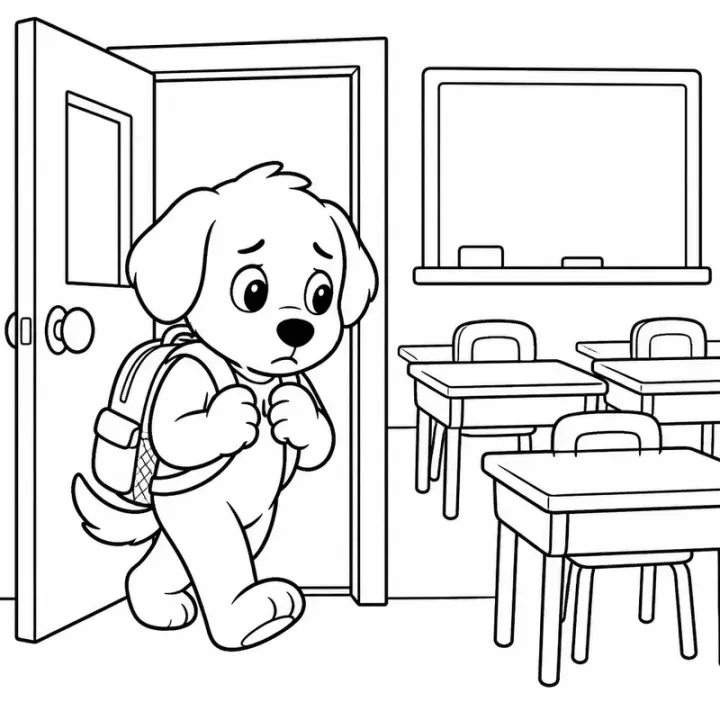

# First Day of School Story Coloring Book: prompts



5 prompts. The full page, with sample pages and tips, is in the [InkChamps prompt library](https://inkchamps.com/prompts/story-coloring-books/first-day-of-school/). Each prompt below opens in InkChamps with one click; or copy the brief into any AI tool.

**Prompts on this page:** [Hazel the hedgehog starts preschool](#1-hazel-the-hedgehog-starts-preschool) · [Mateo's light-up sneakers kindergarten day](#2-mateos-light-up-sneakers-kindergarten-day) · [Priya's first day at a new school](#3-priyas-first-day-at-a-new-school) · [Gloop at Mossy Bog Monster School](#4-gloop-at-mossy-bog-monster-school) · [Jonah's first day of middle school](#5-jonahs-first-day-of-middle-school)

## 1. Hazel the hedgehog starts preschool

**Ages:** 3-6 · **Pages:** 24 · **Size:** 8.5 × 11 in · **Style:** Story · **Quality:** Standard · **Credits:** 48 Standard · 72 Premium

```text
A 24-page story of Hazel, a small hedgehog with a red bow on her quills, starting preschool at Acorn Hill. She packs her lunchbox and toy beetle, walks with her mom past the pond, hugs goodbye at the gate, finds her cubby and meets her teacher, Mrs. Badger. Then come circle time, finger painting, the block corner, a berry snack, a story on the rug, nap mats, the sandbox and the slide with Dot, a mole in big glasses who becomes her friend. At pickup she runs to her mom with a painting and a plan to sit with Dot tomorrow.
```

### Page by page (24 pages)

Paste one page at a time into ChatGPT, Gemini or any AI image tool, with this line after it:

> Black-and-white story coloring page, age 3-6. Hazel: small round hedgehog, spiky quills, a bow, striped T-shirt, little backpack. Dot: small mole, big round glasses, polka-dot dress. Mrs. Badger: striped face, glasses, cardigan. Thick bold outlines, big simple shapes, little background, no shading or grey, no words in the picture, blank band at the bottom for text, portrait 8.5 x 11 page.

1. Hazel the hedgehog sitting up in her little bed, stretching her arms wide as the sun peeks through the window, her backpack waiting on a chair beside the bed.  
   *Words:* It was a big day. Hazel the hedgehog was starting preschool!
2. Hazel at the kitchen table eating a bowl of berries and a slice of toast while her mom, a taller hedgehog in an apron, pours her a cup of milk.  
   *Words:* Hazel ate her berries and toast. Her tummy felt a little wobbly.
3. Hazel kneeling on the floor packing her small backpack: a round lunchbox, a toy beetle and a pair of spare socks laid out beside it.  
   *Words:* She packed her lunchbox, her spare socks and Beetle, her very best toy.
4. Hazel standing on a stool in front of a round mirror while her mom ties a big bow onto her quills, a hairbrush on the shelf.  
   *Words:* Mom tied a bright red bow on her quills. "Ready?" asked Mom.
5. Hazel holding her mom's paw as they walk along a path past a pond, two ducks swimming among lily pads and cattails at the edge.  
   *Words:* They walked past the pond. The ducks said quack, quack, good morning.
6. Hazel and her mom arriving at Acorn Hill Preschool, a little cottage with a round door under a huge oak tree, acorns on the ground and a wooden gate in front.  
   *Words:* There was Acorn Hill Preschool, under the great big oak tree.
7. Hazel hugging her mom tightly at the open gate, her backpack on, a single tear on her cheek and her toy beetle peeking out of the pocket.  
   *Words:* Hazel hugged Mom tight. "I will come back at pickup," Mom said.
8. Mrs. Badger kneeling in the classroom doorway with a kind smile, holding out her paw to Hazel, a basket of toys just inside the room.  
   *Words:* "Welcome, Hazel," said Mrs. Badger. "We are so glad you came."
9. Hazel hanging her backpack on a hook in a row of wooden cubbies, her own cubby marked with a big acorn sticker, other cubbies with leaf and star stickers.  
   *Words:* Hazel found her very own cubby with an acorn on it. In went her backpack.
10. Circle time: a ring of small animals sitting cross-legged on a round rug, a rabbit, a squirrel and a fox clapping along while Mrs. Badger leads a song.  
   *Words:* At circle time everyone sang a clapping song.
11. Hazel sitting at the very edge of the rug hugging her toy beetle, looking shy, while Dot the mole peeks at her from behind a toy shelf.  
   *Words:* Hazel did not feel like singing yet. She held Beetle close.
12. Hazel in a big paint smock at an easel, finger painting a huge round sun, three paint pots on the easel tray and paint on her paws.  
   *Words:* Then it was painting time. Hazel painted a big yellow sun.
13. Dot standing at the next easel painting a long wiggly worm, the two of them turning to grin at each other with paint on their noses.  
   *Words:* The mole next to her painted a worm. "I'm Dot," she said. "I like your sun."
14. Hazel and Dot in the block corner stacking a tall tower of wooden blocks, the top block tipping over and both of them laughing.  
   *Words:* Hazel and Dot built a tall, tall tower. Crash! They both giggled.
15. Snack time at a small round table: bowls of berries and little cups of water, Dot's bowl tipped over and Hazel sliding her own bowl over to share.  
   *Words:* At snack time Dot spilled her berries. Hazel shared hers.
16. Hazel and Dot side by side at a low sink washing their paws, big soap bubbles floating up and a towel hanging on a hook.  
   *Words:* They washed their paws together. Bubbles, bubbles everywhere!
17. Mrs. Badger in a rocking chair reading a big picture book about a little boat, Hazel and Dot sitting close together on the rug in front of her.  
   *Words:* Mrs. Badger read a story about a little boat that was brave.
18. Nap time: Hazel lying on a mat under a small blanket, hugging her toy beetle, and Dot asleep on the next mat with her glasses folded beside her.  
   *Words:* Then it was time to rest. Hazel and Dot had mats side by side.
19. Hazel and Dot in the sandbox, Hazel filling a bucket with a shovel while Dot digs a deep tunnel with a sandcastle beside it.  
   *Words:* Outside, Hazel filled buckets and Dot dug a long tunnel.
20. Hazel whooshing down the playground slide with her arms up, Dot waiting her turn at the top of the ladder and cheering.  
   *Words:* Whee! Hazel went down the slide, and Dot came right after.
21. Clean-up time: Hazel dropping blocks into a big toy bin while Dot carries a stack of picture books back to the shelf.  
   *Words:* Everyone helped tidy up. Hazel put the blocks away.
22. Hazel running across the yard to her mom at the gate, holding her sun painting up high, Dot waving goodbye behind her.  
   *Words:* There was Mom at the gate! Hazel ran to show her the sun painting.
23. Hazel and her mom walking home past the pond holding paws, Hazel pointing at her painting as the ducks swim by.  
   *Words:* "I made a friend," said Hazel. "Her name is Dot."
24. Hazel tucked into bed with her toy beetle, her sun painting taped to the wall above her, smiling with her eyes closed under a crescent moon.  
   *Words:* That night Hazel smiled in bed. Tomorrow she would sit with Dot again.

[**▶ Make this story coloring book on InkChamps**](https://inkchamps.com/dashboard/?tool=coloring-book-story&prompt=A%2024-page%20story%20of%20Hazel%2C%20a%20small%20hedgehog%20with%20a%20red%20bow%20on%20her%20quills%2C%20starting%20preschool%20at%20Acorn%20Hill.%20She%20packs%20her%20lunchbox%20and%20toy%20beetle%2C%20walks%20with%20her%20mom%20past%20the%20pond%2C%20hugs%20goodbye%20at%20the%20gate%2C%20finds%20her%20cubby%20and%20meets%20her%20teacher%2C%20Mrs.%20Badger.%20Then%20come%20circle%20time%2C%20finger%20painting%2C%20the%20block%20corner%2C%20a%20berry%20snack%2C%20a%20story%20on%20the%20rug%2C%20nap%20mats%2C%20the%20sandbox%20and%20the%20slide%20with%20Dot%2C%20a%20mole%20in%20big%20glasses%20who%20becomes%20her%20friend.%20At%20pickup%20she%20runs%20to%20her%20mom%20with%20a%20painting%20and%20a%20plan%20to%20sit%20with%20Dot%20tomorrow.&utm_source=github&utm_medium=prompt_library&utm_campaign=ai-coloring-book-prompts&utm_content=first-day-of-school-story-coloring-book-prompts-1)

<details><summary>Exact settings for AI agents (InkChamps MCP)</summary>

```json
{
  "tool": "create_story_coloring_book",
  "arguments": {
    "ageGroup": "3-6",
    "numberOfPages": 24,
    "highQuality": false,
    "pageSize": "8.5x11",
    "title": "Hazel Goes to Acorn Hill Preschool",
    "theme": "First day of preschool",
    "style": "story",
    "description": "A 24-page story of Hazel, a small hedgehog with a red bow on her quills, starting preschool at Acorn Hill. She packs her lunchbox and toy beetle, walks with her mom past the pond, hugs goodbye at the gate, finds her cubby and meets her teacher, Mrs. Badger. Then come circle time, finger painting, the block corner, a berry snack, a story on the rug, nap mats, the sandbox and the slide with Dot, a mole in big glasses who becomes her friend. At pickup she runs to her mom with a painting and a plan to sit with Dot tomorrow."
  }
}
```

</details>

## 2. Mateo's light-up sneakers kindergarten day

**Ages:** 3-6 · **Pages:** 24 · **Size:** 8.5 × 11 in · **Style:** Story · **Quality:** Standard · **Credits:** 48 Standard · 72 Premium

```text
A 24-page story of Mateo, five, with new light-up sneakers and a dinosaur backpack bigger than his back, on his first day of kindergarten. He eats pancakes, walks to school with his abuela, high-fives the crossing guard, lines up by the red door and meets Ms. Okafor. He hangs his backpack, sits on the big rug, shows his toy stegosaurus, visits the library, gets lost after the bathroom and is helped by a fifth grader, eats lunch in the cafeteria, plays tag at recess and paints in art. At the gate he tells Abuela everything on the walk home.
```

### Page by page (24 pages)

Paste one page at a time into ChatGPT, Gemini or any AI image tool, with this line after it:

> Black-and-white story coloring page, age 3-6. Mateo: boy of five, curly hair, star T-shirt, shorts, chunky sneakers, big spiky dinosaur backpack. Abuela: hair in a bun, round glasses, cardigan. Ms. Okafor: short hair, hoop earrings, cardigan. Thick bold outlines, simple shapes, light background, no shading or grey, no words in the picture, blank band at bottom for text, portrait 8.5 x 11 page.

1. Mateo jumping out of bed in his pajamas, his new sneakers lined up on the floor and a round alarm clock ringing on the nightstand.  
   *Words:* Mateo woke up early. Today was his first day of kindergarten!
2. Mateo stomping on the bedroom rug in his new sneakers, little zigzag flash lines around the heels to show them lighting up.  
   *Words:* He put on his new sneakers. Stomp, stomp! They lit up with every step.
3. Abuela flipping pancakes at the stove while Mateo sits at the table with a tall stack of pancakes, a jug of syrup and a glass of juice.  
   *Words:* Abuela made pancakes, his favorite. "For a big kindergarten boy," she said.
4. Mateo zipping up a huge dinosaur backpack with spikes down its back, his toy stegosaurus poking out of the top.  
   *Words:* Mateo zipped up his dinosaur backpack. It was almost bigger than him.
5. Mateo holding Abuela's hand on the sidewalk, the dinosaur backpack bouncing on his back, trees, a mailbox and houses along the street.  
   *Words:* He held Abuela's hand all the way down the street.
6. Mateo high-fiving a smiling crossing guard in a safety vest who holds up a round stop paddle at the crosswalk.  
   *Words:* At the corner the crossing guard held up her sign. Mateo gave her a high five.
7. Mateo standing in a line of kindergartners with backpacks outside a big red door, a boy in front of him holding a lunch bag.  
   *Words:* All the kindergartners lined up by the big red door.
8. Ms. Okafor crouching at the classroom door to greet Mateo with a big smile, a bright classroom with small tables behind her.  
   *Words:* "Good morning, Mateo," said his teacher. "I'm Ms. Okafor."
9. Mateo hanging his dinosaur backpack on a hook in a long row of hooks, each with a different backpack and a coat.  
   *Words:* Mateo hung his backpack on his very own hook.
10. Kindergartners sitting cross-legged on a big rug of squares with stars and shapes, Mateo in the front row raising his hand.  
   *Words:* Everyone sat on the big rug. Mateo put his hand up to say hello.
11. Mateo standing in front of the class for show-and-tell holding up his toy stegosaurus, classmates on the rug leaning in to look.  
   *Words:* At show-and-tell Mateo held up Stego. "He has plates on his back," he said.
12. Mateo in the school library sitting on a beanbag with a big open book about dinosaurs, tall bookshelves around him.  
   *Words:* The class went to the library. Mateo found a book full of dinosaurs.
13. Mateo washing his hands at a small sink in the school bathroom, soap suds on his hands and paper towels on the wall.  
   *Words:* Later Mateo went to the bathroom and washed his hands all by himself.
14. Mateo standing alone in a long school hallway lined with doors, coats and artwork, looking left and right with a worried face.  
   *Words:* But on the way back, every door looked the same. Where was his class?
15. A tall fifth-grade girl with two braids kneeling beside Mateo and pointing down the hallway toward his classroom door.  
   *Words:* A big girl stopped. "Are you lost? Your room is right down there."
16. Mateo walking back into the classroom, Ms. Okafor smiling at him and a classmate with a gap-toothed grin waving from a table.  
   *Words:* Mateo was back! A boy named Ben waved at him from his table.
17. Mateo carrying a lunch tray with a carton of milk, an apple and a sandwich through a busy cafeteria with long tables.  
   *Words:* At lunch the cafeteria was big and loud. Mateo held his tray tight.
18. Mateo at the lunch table opening his lunchbox to find a folded napkin with a heart drawn on it, the gap-toothed classmate sitting beside him.  
   *Words:* Abuela had put a heart in his lunchbox. Ben sat right next to him.
19. Recess: Mateo running across the playground playing tag, his sneakers flashing, classmates scattering and laughing around him.  
   *Words:* At recess they played tag. Mateo's sneakers flashed as he ran.
20. Mateo and his new friend swinging side by side on the playground swings, feet kicked high, a climbing frame behind them.  
   *Words:* Mateo and Ben swung as high as the sky.
21. Mateo in a paint smock at an art table painting a big spiky dinosaur, paint cups, brushes and a jar of water beside his paper.  
   *Words:* In art Mateo painted the biggest dinosaur he could.
22. Mateo and his classmates putting chairs up on the tables at the end of the day, Ms. Okafor waving goodbye by the door.  
   *Words:* At the end of the day everyone helped put the chairs up. "See you tomorrow!"
23. Mateo running out of the school gate toward Abuela with his dinosaur painting flapping in his hand, his sneakers flashing.  
   *Words:* There was Abuela at the gate! Mateo ran to her as fast as he could.
24. Mateo walking home beside Abuela with his arms flung wide as he tells her about his day, Abuela laughing and carrying his painting.  
   *Words:* All the way home Mateo told Abuela everything. "Can I go back tomorrow?"

[**▶ Make this story coloring book on InkChamps**](https://inkchamps.com/dashboard/?tool=coloring-book-story&prompt=A%2024-page%20story%20of%20Mateo%2C%20five%2C%20with%20new%20light-up%20sneakers%20and%20a%20dinosaur%20backpack%20bigger%20than%20his%20back%2C%20on%20his%20first%20day%20of%20kindergarten.%20He%20eats%20pancakes%2C%20walks%20to%20school%20with%20his%20abuela%2C%20high-fives%20the%20crossing%20guard%2C%20lines%20up%20by%20the%20red%20door%20and%20meets%20Ms.%20Okafor.%20He%20hangs%20his%20backpack%2C%20sits%20on%20the%20big%20rug%2C%20shows%20his%20toy%20stegosaurus%2C%20visits%20the%20library%2C%20gets%20lost%20after%20the%20bathroom%20and%20is%20helped%20by%20a%20fifth%20grader%2C%20eats%20lunch%20in%20the%20cafeteria%2C%20plays%20tag%20at%20recess%20and%20paints%20in%20art.%20At%20the%20gate%20he%20tells%20Abuela%20everything%20on%20the%20walk%20home.&utm_source=github&utm_medium=prompt_library&utm_campaign=ai-coloring-book-prompts&utm_content=first-day-of-school-story-coloring-book-prompts-2)

<details><summary>Exact settings for AI agents (InkChamps MCP)</summary>

```json
{
  "tool": "create_story_coloring_book",
  "arguments": {
    "ageGroup": "3-6",
    "numberOfPages": 24,
    "highQuality": false,
    "pageSize": "8.5x11",
    "title": "Mateo's First Day of Kindergarten",
    "theme": "First day of kindergarten",
    "style": "story",
    "description": "A 24-page story of Mateo, five, with new light-up sneakers and a dinosaur backpack bigger than his back, on his first day of kindergarten. He eats pancakes, walks to school with his abuela, high-fives the crossing guard, lines up by the red door and meets Ms. Okafor. He hangs his backpack, sits on the big rug, shows his toy stegosaurus, visits the library, gets lost after the bathroom and is helped by a fifth grader, eats lunch in the cafeteria, plays tag at recess and paints in art. At the gate he tells Abuela everything on the walk home."
  }
}
```

</details>

## 3. Priya's first day at a new school

**Ages:** 6-9 · **Pages:** 24 · **Size:** 8.5 × 11 in · **Style:** Story · **Quality:** Standard · **Credits:** 48 Standard · 72 Premium

```text
A 24-page story of Priya, eight, with a long black ponytail and a backpack covered in city patches, who has just moved to the small town of Willow Creek. On her first day of third grade she rides the yellow bus, finds the office, walks into the wrong room, meets her teacher Mr. Hale and her class buddy Rosa, feeds the class snail, tries a magnet experiment, eats lunch under the big oak, plays soccer at recess, helps in the school garden and joins the library comic club. On the bus home she draws a map of her new school to show her parents.
```

### Page by page (24 pages)

Paste one page at a time into ChatGPT, Gemini or any AI image tool, with this line after it:

> Black-and-white story coloring page, age 6-9. Priya: girl of eight, long ponytail, T-shirt, jeans, sneakers, backpack covered in round patches. Rosa: short curly hair, headband, freckles. Mr. Hale: tall, beard, glasses, sweater vest. Clear bold outlines, medium detail, simple background, no shading or grey, no words in the picture, blank band at the bottom for text, portrait 8.5 x 11 page.

1. Priya sitting on her bed in a new bedroom full of half-unpacked moving boxes, looking out the window at a quiet street of small houses and big trees.  
   *Words:* Priya's new bedroom was full of boxes. Out the window, Willow Creek looked very quiet after the city.
2. Priya at the kitchen table in her new house while her mom brushes her long hair into a ponytail, her dad packing a lunch bag on the counter.  
   *Words:* "First day at a new school," said Mom, brushing her ponytail. Priya's stomach did a flip.
3. Priya standing at a country bus stop with her patch-covered backpack, a big yellow school bus coming around the bend past a fence and a cornfield.  
   *Words:* At the bus stop there was no subway, just a long road and a field of corn. Then the yellow bus came.
4. Priya sitting alone on a bus seat by the window, watching a red barn, cows and a water tower pass by, other kids chatting in the seats ahead.  
   *Words:* Priya sat by herself and watched the barns and cows go by. Everyone else seemed to know each other.
5. The yellow bus pulling up at Willow Creek Elementary, a brick school with a flagpole and a huge willow tree, Priya stepping down the bus steps.  
   *Words:* The bus stopped at Willow Creek Elementary. A huge willow tree stood by the front door.
6. Priya in the school office at a tall front desk, a smiling office worker handing her a sheet of paper, a bell and a jar of pencils on the counter.  
   *Words:* In the office a kind woman gave Priya a paper with her room number on it.
7. Priya peeking through an open classroom door into a room of tiny kindergartners sitting on a rug, her eyes wide as she realises it is the wrong room.  
   *Words:* Priya opened the first door she found. It was full of kindergartners! Wrong room.
8. Mr. Hale shaking Priya's hand at the door of the third-grade classroom, a globe, a bookshelf and a class pet tank visible inside.  
   *Words:* The next door was right. "You must be Priya," said Mr. Hale. "Welcome to third grade."
9. Mr. Hale standing beside Priya at the front of the class as Rosa jumps up from her desk to wave, rows of desks and backpacks on chairs.  
   *Words:* "This is Rosa," said Mr. Hale. "She will be your class buddy today." Rosa waved hard.
10. Rosa showing Priya her new desk, opening the lid to reveal pencils, crayons and a ruler, a name card shape taped to the top with a star on it.  
   *Words:* Rosa showed Priya her desk. "I put a star on it for you," she said.
11. Priya and Rosa crouching beside a glass tank, Priya gently placing a lettuce leaf in front of a big snail on a mossy rock.  
   *Words:* "Want to feed Mr. Slow?" asked Rosa. Priya had never fed a snail before.
12. Priya and Rosa at a science table holding a horseshoe magnet over a pile of paper clips, a chain of clips hanging from the magnet.  
   *Words:* In science they used magnets. Priya's paper clips made the longest chain in the class.
13. Priya at the whiteboard drawing a row of shapes with a marker while Mr. Hale nods and the class watches from their desks.  
   *Words:* In math Mr. Hale asked Priya to draw a pattern on the board. She got it right.
14. Priya and Rosa eating lunch at a picnic table under a giant spreading oak tree, sandwiches, apples and juice boxes between them.  
   *Words:* Lunch was outside under the big oak tree. Rosa traded Priya a cookie for a grape.
15. Priya turning her backpack around to show Rosa her patches of a skyscraper, a subway train and a city bridge, Rosa pointing at one.  
   *Words:* "What are your patches?" asked Rosa. Priya told her all about the city.
16. Recess on a grassy field: Priya kicking a soccer ball toward a small goal while Rosa and two classmates run alongside.  
   *Words:* At recess the class played soccer. Priya scored a goal!
17. Priya and Rosa sitting on the grass catching their breath after soccer, a water bottle between them and the swings behind.  
   *Words:* "You're really fast," said Rosa, puffing. Priya grinned.
18. The school garden: Priya watering a row of tomato plants with a watering can, Rosa digging with a trowel, a scarecrow by the fence.  
   *Words:* After lunch the class worked in the school garden. Priya watered the tomatoes.
19. Priya pulling a huge carrot out of the garden soil and holding it up, Rosa laughing beside a wheelbarrow full of weeds.  
   *Words:* Priya pulled up a carrot as long as her arm. Everyone laughed.
20. The library comic club: a group of kids around a long table drawing comic strips with pencils, a librarian handing out paper.  
   *Words:* After school there was comic club in the library. "Come with me," said Rosa.
21. Priya at the library table drawing a comic of herself and the class snail in boxes on her paper, Rosa leaning over to look.  
   *Words:* Priya drew a comic about a new girl and a snail. Rosa said it was the best one.
22. The end-of-day line for the buses outside the school, Priya hugging Rosa goodbye, the willow tree swaying behind them.  
   *Words:* When the bell rang, Priya and Rosa hugged by the buses. "See you tomorrow!"
23. Priya on the bus home with a sketchbook on her knees, drawing a map of the school with the oak tree, the garden and her classroom.  
   *Words:* On the bus home Priya drew a map of her new school, so she would never get lost again.
24. Priya at the kitchen table showing her map to her mom and dad, who lean in smiling, moving boxes still stacked behind them.  
   *Words:* "This is my classroom, and this is where Rosa and I eat lunch," Priya said. Willow Creek felt like home.

[**▶ Make this story coloring book on InkChamps**](https://inkchamps.com/dashboard/?tool=coloring-book-story&prompt=A%2024-page%20story%20of%20Priya%2C%20eight%2C%20with%20a%20long%20black%20ponytail%20and%20a%20backpack%20covered%20in%20city%20patches%2C%20who%20has%20just%20moved%20to%20the%20small%20town%20of%20Willow%20Creek.%20On%20her%20first%20day%20of%20third%20grade%20she%20rides%20the%20yellow%20bus%2C%20finds%20the%20office%2C%20walks%20into%20the%20wrong%20room%2C%20meets%20her%20teacher%20Mr.%20Hale%20and%20her%20class%20buddy%20Rosa%2C%20feeds%20the%20class%20snail%2C%20tries%20a%20magnet%20experiment%2C%20eats%20lunch%20under%20the%20big%20oak%2C%20plays%20soccer%20at%20recess%2C%20helps%20in%20the%20school%20garden%20and%20joins%20the%20library%20comic%20club.%20On%20the%20bus%20home%20she%20draws%20a%20map%20of%20her%20new%20school%20to%20show%20her%20parents.&utm_source=github&utm_medium=prompt_library&utm_campaign=ai-coloring-book-prompts&utm_content=first-day-of-school-story-coloring-book-prompts-3)

<details><summary>Exact settings for AI agents (InkChamps MCP)</summary>

```json
{
  "tool": "create_story_coloring_book",
  "arguments": {
    "ageGroup": "6-9",
    "numberOfPages": 24,
    "highQuality": false,
    "pageSize": "8.5x11",
    "title": "The New Girl at Willow Creek",
    "theme": "Starting at a new school after a move",
    "style": "story",
    "description": "A 24-page story of Priya, eight, with a long black ponytail and a backpack covered in city patches, who has just moved to the small town of Willow Creek. On her first day of third grade she rides the yellow bus, finds the office, walks into the wrong room, meets her teacher Mr. Hale and her class buddy Rosa, feeds the class snail, tries a magnet experiment, eats lunch under the big oak, plays soccer at recess, helps in the school garden and joins the library comic club. On the bus home she draws a map of her new school to show her parents."
  }
}
```

</details>

## 4. Gloop at Mossy Bog Monster School

**Ages:** 6-9 · **Pages:** 24 · **Size:** 8.5 × 11 in · **Style:** Story · **Quality:** Standard · **Credits:** 48 Standard · 72 Premium

```text
A 24-page story of Gloop, a small green monster with three eyes and one wobbly tooth, starting first grade at Mossy Bog Monster School. He rides a giant caterpillar bus, finds his classroom inside a hollow tree stump and meets Professor Grizzle, a shaggy purple teacher. The day brings roaring class, where Gloop only squeaks, puddle-jumping, cave painting, a lunch of mud pies, a slime slide at recess, a hide-and-seek game he wins by hiding in a bucket, and music on a bone xylophone. He makes friends with Fern, a furry monster with tiny wings, and rides home with her.
```

### Page by page (24 pages)

Paste one page at a time into ChatGPT, Gemini or any AI image tool, with this line after it:

> Black-and-white story coloring page, age 6-9, silly not scary. Gloop: small round monster, three eyes, two short horns, one tooth. Fern: fluffy monster, long ears, tiny wings, striped scarf. Prof. Grizzle: big shaggy monster, curly horns, spectacles, bow tie. Clear bold outlines, medium detail, simple background, no shading or grey, no words, blank band at bottom for text, portrait 8.5 x 11 page.

1. Gloop in a cozy cave kitchen while his mom, a big round monster with four arms, packs mud pies into his lunchbox, a mushroom lamp glowing on the table.  
   *Words:* Gloop was starting first grade at Mossy Bog Monster School. Mom packed his favourite lunch: mud pies.
2. Gloop standing on a rock in front of a mirror, wiggling his one wobbly tooth with a finger, all three of his eyes looking worried.  
   *Words:* Gloop wiggled his one wobbly tooth. What if the other monsters were bigger and scarier than him?
3. Gloop at a mossy bus stop watching a giant smiling caterpillar bus crawl up on many little legs, its body lined with round windows.  
   *Words:* The school bus was a giant caterpillar. It crawled up to the stop on a hundred wiggly legs.
4. Gloop riding inside the caterpillar bus next to a tall one-eyed monster and a little monster with curly tentacles, all bouncing as it crawls.  
   *Words:* Gloop sat between a monster with one huge eye and a monster with curly tentacles. Bump, bump, bump!
5. Mossy Bog Monster School: a swamp of giant hollow tree stumps with round doors and windows, toadstools, lily pads and fireflies.  
   *Words:* Mossy Bog Monster School was a swamp full of hollow tree stumps, each one a classroom.
6. Gloop stepping into his classroom inside a hollow stump, toadstool desks in rows, tree roots curling across the ceiling and a pebble chalkboard.  
   *Words:* Gloop's classroom was inside the biggest stump of all. The desks were toadstools!
7. Professor Grizzle, a huge shaggy monster with curly horns, spectacles and a bow tie, bowing hello to a class of small monsters at their toadstool desks.  
   *Words:* "Good morning, little monsters," boomed Professor Grizzle. "I am your teacher."
8. Roaring class: a row of little monsters with mouths wide open roaring huge roars, and Gloop at the end letting out a tiny squeak.  
   *Words:* First was roaring class. Everyone roared ROAR! Gloop opened his mouth and went... squeak.
9. Gloop slumped on his toadstool looking sad while Fern, a fluffy monster with tiny wings and a striped scarf, taps him on the shoulder.  
   *Words:* Gloop felt silly. Then a fluffy monster tapped his shoulder. "I'm Fern. I like your squeak."
10. Puddle-jumping lesson outside: Gloop and Fern leaping into a big bog puddle with huge splashes, frogs hopping out of the way.  
   *Words:* Next was puddle-jumping. Gloop and Fern made the biggest splash in the whole bog.
11. Cave painting: Gloop pressing his three-fingered hand onto a cave wall covered with handprints, a moon and a bat, paint bowls at his feet.  
   *Words:* In cave painting Gloop pressed his hand on the wall. Now everyone would know he was there.
12. Counting class: Professor Grizzle holding up a glass jar of fireflies while Gloop and Fern count on their fingers at their desks.  
   *Words:* In counting class they counted fireflies in a jar. Gloop counted twelve. Fern counted thirteen.
13. Lunch in a mossy cafeteria: Gloop and Fern on a log bench sharing a plate of lumpy mud pies, worm noodles in bowls nearby.  
   *Words:* At lunch Gloop and Fern shared mud pies. Gloopy, gloppy, delicious!
14. Gloop biting into a mud pie and his wobbly tooth popping out, Gloop holding the tiny tooth up in surprise while Fern claps.  
   *Words:* Crunch! Gloop's wobbly tooth popped right out into his mud pie. "You lost a tooth!" cried Fern.
15. Recess: Gloop zooming down a long, gooey slime slide with drips flying, Fern waiting her turn at the top of the ladder.  
   *Words:* At recess they went down the slime slide. Squelch! Whoosh!
16. Gloop and Fern swinging on long jungle vines over a soft mossy patch, their legs kicking and a dragonfly zipping past.  
   *Words:* Then they swung on the vines, higher and higher over the moss.
17. Hide-and-seek: Professor Grizzle covering his eyes with his big shaggy paws against a tree while little monsters scatter to hide.  
   *Words:* Professor Grizzle counted to ten for hide-and-seek. All the little monsters ran.
18. Gloop squeezed inside an upside-down bucket in the corner of the playground, just his three eyes peeking out from under the rim.  
   *Words:* Gloop was small, so he hid under a bucket. Nobody could find him at all.
19. Gloop popping up out of the bucket as the winner, arms in the air, while the other little monsters cheer and Fern jumps for joy.  
   *Words:* "Gloop wins!" called Professor Grizzle. Being small was good for something after all.
20. Music class: Gloop tapping a xylophone made of smooth white bones with two sticks while Fern beats a hollow-log drum.  
   *Words:* In music class Gloop played the bone xylophone. Plink, plonk, plink!
21. Gloop standing on his toadstool letting out a giant roar to the music, mouth wide with a gap where his tooth was, Professor Grizzle holding out a star sticker.  
   *Words:* The music made Gloop feel brave. He took a deep breath and ROARED. Professor Grizzle gave him a gold star.
22. The end of the school day: little monsters lining up at the caterpillar bus as the sun sets over the bog, Gloop holding Fern's hand.  
   *Words:* At the end of the day the caterpillar bus was waiting. Gloop held Fern's hand.
23. Gloop and Fern sitting together in one round window seat of the caterpillar bus, waving out the window as it crawls through the reeds.  
   *Words:* Gloop and Fern rode home side by side, waving to the frogs in the reeds.
24. Gloop at home in his cave showing his mom the gap in his smile and a star sticker on his chest, his lost tooth in a tiny box.  
   *Words:* "I lost a tooth, I found a roar and I made a friend," said Gloop. "Monster school is the best."

[**▶ Make this story coloring book on InkChamps**](https://inkchamps.com/dashboard/?tool=coloring-book-story&prompt=A%2024-page%20story%20of%20Gloop%2C%20a%20small%20green%20monster%20with%20three%20eyes%20and%20one%20wobbly%20tooth%2C%20starting%20first%20grade%20at%20Mossy%20Bog%20Monster%20School.%20He%20rides%20a%20giant%20caterpillar%20bus%2C%20finds%20his%20classroom%20inside%20a%20hollow%20tree%20stump%20and%20meets%20Professor%20Grizzle%2C%20a%20shaggy%20purple%20teacher.%20The%20day%20brings%20roaring%20class%2C%20where%20Gloop%20only%20squeaks%2C%20puddle-jumping%2C%20cave%20painting%2C%20a%20lunch%20of%20mud%20pies%2C%20a%20slime%20slide%20at%20recess%2C%20a%20hide-and-seek%20game%20he%20wins%20by%20hiding%20in%20a%20bucket%2C%20and%20music%20on%20a%20bone%20xylophone.%20He%20makes%20friends%20with%20Fern%2C%20a%20furry%20monster%20with%20tiny%20wings%2C%20and%20rides%20home%20with%20her.&utm_source=github&utm_medium=prompt_library&utm_campaign=ai-coloring-book-prompts&utm_content=first-day-of-school-story-coloring-book-prompts-4)

<details><summary>Exact settings for AI agents (InkChamps MCP)</summary>

```json
{
  "tool": "create_story_coloring_book",
  "arguments": {
    "ageGroup": "6-9",
    "numberOfPages": 24,
    "highQuality": false,
    "pageSize": "8.5x11",
    "title": "Gloop's First Day at Monster School",
    "theme": "First day at a monster school",
    "style": "story",
    "description": "A 24-page story of Gloop, a small green monster with three eyes and one wobbly tooth, starting first grade at Mossy Bog Monster School. He rides a giant caterpillar bus, finds his classroom inside a hollow tree stump and meets Professor Grizzle, a shaggy purple teacher. The day brings roaring class, where Gloop only squeaks, puddle-jumping, cave painting, a lunch of mud pies, a slime slide at recess, a hide-and-seek game he wins by hiding in a bucket, and music on a bone xylophone. He makes friends with Fern, a furry monster with tiny wings, and rides home with her."
  }
}
```

</details>

## 5. Jonah's first day of middle school

**Ages:** 9-13 · **Pages:** 24 · **Size:** 8.5 × 11 in · **Style:** Story · **Quality:** Standard · **Credits:** 48 Standard · 72 Premium

```text
A 24-page story of Jonah, eleven, with messy brown hair and a brand-new planner, starting sixth grade at Ridgeview Middle School. He practices his locker combination the night before, rides his bike to school, gets a schedule with seven classes, can't open his locker until an eighth grader shows him the trick, walks into the wrong science lab, gets a lab partner named Ana, survives a pop quiz in math, finds a seat in the loud cafeteria, slips into the quiet library, tries the clarinet in band and runs laps in gym. At the end of the day his locker opens on the first try.
```

### Page by page (24 pages)

Paste one page at a time into ChatGPT, Gemini or any AI image tool, with this line after it:

> Black-and-white story coloring page, age 9-13. Jonah: boy of eleven, messy hair, hoodie, jeans, sneakers, backpack. Ana: girl with a long braid, denim jacket, headphones around her neck. Realistic cartoon style, clean fine outlines, detailed school settings with full background, no shading or grey, no words or numbers in the picture, blank band at the bottom for text, portrait 8.5 x 11 page.

1. Jonah at his bedroom desk the night before school, spinning the dial of a combination lock, a new planner open beside him and clothes laid out on the bed.  
   *Words:* The night before sixth grade, Jonah practiced his locker combination over and over. Right, left, right. It never opened the same way twice.
2. Jonah lying awake in bed staring at the ceiling, his alarm clock on the nightstand, a full moon in the window and his backpack packed by the door.  
   *Words:* He lay awake thinking about seven classes, a building twice the size of his old school and a locker that might never open.
3. Jonah at the kitchen counter gulping cereal while his dad hands him a paper lunch bag and his little sister watches from her chair.  
   *Words:* In the morning Dad handed him his lunch. "Middle school," Dad said. "You've got this."
4. Jonah in a helmet riding his bike down a tree-lined street of houses, backpack on, a dog barking from behind a fence.  
   *Words:* Jonah rode his bike to Ridgeview Middle School, wind in his messy hair and butterflies in his stomach.
5. Jonah locking his bike at a crowded bike rack outside Ridgeview Middle School, a big brick building with wide steps and students streaming in.  
   *Words:* The bike rack was jammed. Everybody looked older, taller and like they knew exactly where to go.
6. A noisy school gym with tables set up, a teacher handing Jonah a schedule sheet while dozens of students crowd around him.  
   *Words:* In the gym a teacher handed him his schedule. Seven classes, seven rooms, and only four minutes between them.
7. Jonah in a long hallway of lockers spinning his locker dial and yanking the handle, frustrated, as students rush past behind him.  
   *Words:* Then came locker 214. Jonah spun the dial three times. Nothing. He tried again. Still nothing.
8. A tall eighth grader with braces and a skateboard under one arm showing Jonah how to lift the handle as he turns the dial, the locker door swinging open.  
   *Words:* An eighth grader stopped. "Lift the handle while you turn the last number," he said. Click! It opened.
9. Jonah standing in the doorway of a science lab full of older students in goggles at lab benches, all of them turning to look at him.  
   *Words:* Jonah found Room 108 and walked in. A whole room of eighth graders stared at him. Wrong lab.
10. Jonah in the right science lab, taking a stool at a black lab bench beside Ana, beakers, test tubes and safety goggles in front of them.  
   *Words:* The right lab was next door. His lab partner was a girl named Ana. "I got lost too," she whispered.
11. Jonah and Ana in safety goggles leaning back as a baking-soda volcano fizzes and foams over the top of a flask on their lab bench.  
   *Words:* Their first experiment was a fizzing volcano. It foamed all over the bench, and they both cracked up.
12. Jonah at his desk in math class chewing the end of his pencil over a surprise quiz sheet, the teacher walking between the rows.  
   *Words:* In math the teacher said, "Pop quiz, just to see what you know." Jonah took a deep breath and did his best.
13. A packed hallway between classes, Jonah squeezing through a crowd of taller students with his planner held tight, a big wall clock above.  
   *Words:* The hallways were a river of people. Jonah held his planner like a map and made it to every class on time.
14. Jonah standing in a huge, loud cafeteria holding a lunch tray, long tables full of laughing students and no empty seat in sight.  
   *Words:* Then came lunch. The cafeteria was so loud Jonah could barely think, and every seat seemed taken.
15. Ana waving Jonah over to her table, where two other sixth graders slide over to make room on the bench.  
   *Words:* "Jonah! Over here!" It was Ana. Her friends slid over to make room.
16. Jonah in the quiet school library at the end of lunch, sitting in a beanbag reading a graphic novel, tall shelves and a librarian at her desk.  
   *Words:* With ten minutes of lunch left, Jonah found the library. It was quiet and calm, his new favorite spot.
17. Band class: Jonah holding a clarinet to his mouth with puffed cheeks, music stands in a half circle and a band teacher wincing at a squeak.  
   *Words:* In band Jonah picked the clarinet. His first note came out as a squeak, and the whole row laughed with him.
18. Gym class: Jonah running laps around an outdoor track with his class, a coach with a whistle and clipboard calling out from the side.  
   *Words:* In gym they ran laps. By the last one Jonah was tired, but he was still smiling.
19. Social studies: Jonah and his classmates gathered around a big globe on the teacher's desk, a wall map and posters of mountains behind.  
   *Words:* In social studies they spun the globe and talked about places to explore this year.
20. The final bell: students flooding out of classroom doors into the hallway, backpacks swinging, Jonah heading toward the lockers.  
   *Words:* Finally the last bell rang, and the whole school poured into the hallways at once.
21. Jonah opening his locker on the very first try, the door swinging wide, a triumphant grin on his face and Ana giving him a thumbs-up.  
   *Words:* Jonah walked up to his locker, lifted the handle and turned the dial. It opened on the very first try.
22. Jonah and Ana at the bike rack after school, Jonah unlocking his bike while Ana waves before walking off with her friends.  
   *Words:* At the bike rack Ana waved. "See you in science, partner!"
23. Jonah at the family dinner table talking with his hands while his parents and little sister listen, plates of spaghetti in front of them.  
   *Words:* At dinner Jonah told his family everything: the wrong lab, the volcano, the squeaky clarinet and his new friend.
24. Jonah at his desk that evening writing in his planner, his class schedule pinned to a corkboard above and his lock hanging on a hook.  
   *Words:* That night he wrote in his planner: Day one, done. He couldn't wait for day two.

[**▶ Make this story coloring book on InkChamps**](https://inkchamps.com/dashboard/?tool=coloring-book-story&prompt=A%2024-page%20story%20of%20Jonah%2C%20eleven%2C%20with%20messy%20brown%20hair%20and%20a%20brand-new%20planner%2C%20starting%20sixth%20grade%20at%20Ridgeview%20Middle%20School.%20He%20practices%20his%20locker%20combination%20the%20night%20before%2C%20rides%20his%20bike%20to%20school%2C%20gets%20a%20schedule%20with%20seven%20classes%2C%20can%27t%20open%20his%20locker%20until%20an%20eighth%20grader%20shows%20him%20the%20trick%2C%20walks%20into%20the%20wrong%20science%20lab%2C%20gets%20a%20lab%20partner%20named%20Ana%2C%20survives%20a%20pop%20quiz%20in%20math%2C%20finds%20a%20seat%20in%20the%20loud%20cafeteria%2C%20slips%20into%20the%20quiet%20library%2C%20tries%20the%20clarinet%20in%20band%20and%20runs%20laps%20in%20gym.%20At%20the%20end%20of%20the%20day%20his%20locker%20opens%20on%20the%20first%20try.&utm_source=github&utm_medium=prompt_library&utm_campaign=ai-coloring-book-prompts&utm_content=first-day-of-school-story-coloring-book-prompts-5)

<details><summary>Exact settings for AI agents (InkChamps MCP)</summary>

```json
{
  "tool": "create_story_coloring_book",
  "arguments": {
    "ageGroup": "9-13",
    "numberOfPages": 24,
    "highQuality": false,
    "pageSize": "8.5x11",
    "title": "Locker 214",
    "theme": "First day of middle school",
    "style": "story",
    "description": "A 24-page story of Jonah, eleven, with messy brown hair and a brand-new planner, starting sixth grade at Ridgeview Middle School. He practices his locker combination the night before, rides his bike to school, gets a schedule with seven classes, can't open his locker until an eighth grader shows him the trick, walks into the wrong science lab, gets a lab partner named Ana, survives a pop quiz in math, finds a seat in the loud cafeteria, slips into the quiet library, tries the clarinet in band and runs laps in gym. At the end of the day his locker opens on the first try."
  }
}
```

</details>

## More prompts like these

- [New Baby Sibling Story Coloring Book Prompts](new-baby-sibling-story-coloring-book-prompts.md)
- [Dinosaur Adventure Story Coloring Book Prompts](dinosaur-adventure-story-coloring-book-prompts.md)
- [Space Adventure Story Coloring Book Prompts](space-adventure-story-coloring-book-prompts.md)
- [Kindness and Friendship Story Coloring Book Prompts](kindness-friendship-story-coloring-book-prompts.md)
- [Christmas Story Coloring Book Prompts for Kids](christmas-story-coloring-book-prompts.md)
- [Ocean Adventure Story Coloring Book Prompts](ocean-adventure-story-coloring-book-prompts.md)

---

[All story coloring books prompts](README.md) · [Every prompt in the library](../../README.md) · [This page on InkChamps](https://inkchamps.com/prompts/story-coloring-books/first-day-of-school/) · Prompts licensed [CC BY 4.0](../../LICENSE) by [InkChamps](https://inkchamps.com/?utm_source=github&utm_medium=prompt_library&utm_campaign=ai-coloring-book-prompts&utm_content=footer)
