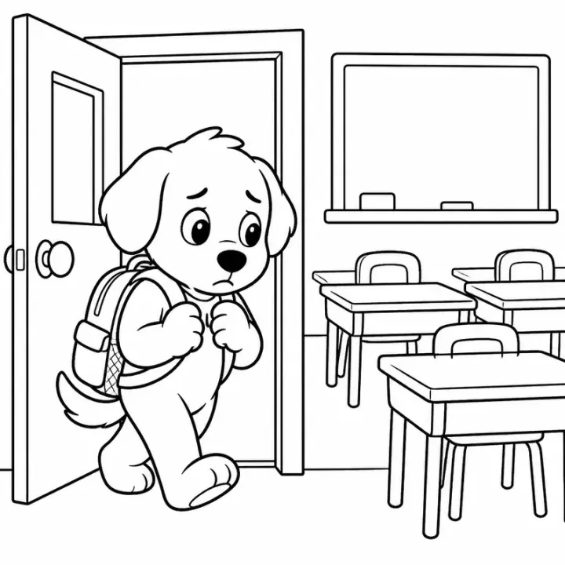

# First Day of School Story Coloring Book: prompts



5 prompts. The full page, with sample pages and tips, is in the [InkChamps prompt library](https://inkchamps.com/prompts/story-coloring-books/first-day-of-school/). Each prompt below opens in InkChamps with one click; or copy the brief into any AI tool.

**Prompts on this page:** [Hazel the hedgehog starts preschool](#1-hazel-the-hedgehog-starts-preschool) · [Mateo's light-up sneakers kindergarten day](#2-mateos-light-up-sneakers-kindergarten-day) · [Priya's first day at a new school](#3-priyas-first-day-at-a-new-school) · [Gloop at Mossy Bog Monster School](#4-gloop-at-mossy-bog-monster-school) · [Jonah's first day of middle school](#5-jonahs-first-day-of-middle-school)

## 1. Hazel the hedgehog starts preschool

**Ages:** 3-6 · **Pages:** 40 · **Size:** 8.5 × 11 in · **Style:** Story · **Quality:** Standard · **Credits:** 80 Standard · 120 Premium

```text
Hazel, a small hedgehog with a red bow on her quills, starts preschool at Acorn Hill. She packs a backpack with her lunchbox and a toy beetle, walks with her mom past the pond, hugs goodbye at the gate, finds the cubby with her name on it and meets her teacher, Mrs. Badger. Then come circle time, finger painting, the block corner, snack of berries, a story on the rug, nap mats, sandbox digging and the slide with Dot, a mole in big glasses who becomes her friend. At pickup she runs to her mom with a painting and a plan to sit with Dot tomorrow.
```

[**▶ Make this story coloring book on InkChamps**](https://inkchamps.com/dashboard/?tool=coloring-book-story&prompt=Hazel%2C%20a%20small%20hedgehog%20with%20a%20red%20bow%20on%20her%20quills%2C%20starts%20preschool%20at%20Acorn%20Hill.%20She%20packs%20a%20backpack%20with%20her%20lunchbox%20and%20a%20toy%20beetle%2C%20walks%20with%20her%20mom%20past%20the%20pond%2C%20hugs%20goodbye%20at%20the%20gate%2C%20finds%20the%20cubby%20with%20her%20name%20on%20it%20and%20meets%20her%20teacher%2C%20Mrs.%20Badger.%20Then%20come%20circle%20time%2C%20finger%20painting%2C%20the%20block%20corner%2C%20snack%20of%20berries%2C%20a%20story%20on%20the%20rug%2C%20nap%20mats%2C%20sandbox%20digging%20and%20the%20slide%20with%20Dot%2C%20a%20mole%20in%20big%20glasses%20who%20becomes%20her%20friend.%20At%20pickup%20she%20runs%20to%20her%20mom%20with%20a%20painting%20and%20a%20plan%20to%20sit%20with%20Dot%20tomorrow.&utm_source=github&utm_medium=prompt_library&utm_campaign=ai-coloring-book-prompts&utm_content=first-day-of-school-story-coloring-book-prompts-1)

<details><summary>Exact settings for AI agents (InkChamps MCP)</summary>

```json
{
  "tool": "create_story_coloring_book",
  "arguments": {
    "ageGroup": "3-6",
    "numberOfPages": 40,
    "highQuality": false,
    "pageSize": "8.5x11",
    "title": "Hazel Goes to Acorn Hill Preschool",
    "theme": "First day of preschool",
    "style": "story",
    "description": "Hazel, a small hedgehog with a red bow on her quills, starts preschool at Acorn Hill. She packs a backpack with her lunchbox and a toy beetle, walks with her mom past the pond, hugs goodbye at the gate, finds the cubby with her name on it and meets her teacher, Mrs. Badger. Then come circle time, finger painting, the block corner, snack of berries, a story on the rug, nap mats, sandbox digging and the slide with Dot, a mole in big glasses who becomes her friend. At pickup she runs to her mom with a painting and a plan to sit with Dot tomorrow."
  }
}
```

</details>

## 2. Mateo's light-up sneakers kindergarten day

**Ages:** 3-6 · **Pages:** 40 · **Size:** 8.5 × 11 in · **Style:** Story · **Quality:** Standard · **Credits:** 80 Standard · 120 Premium

```text
Mateo, five, has new light-up sneakers and a dinosaur backpack bigger than his back. On his first day of kindergarten he eats pancakes, walks to school with his abuela, high-fives the crossing guard, lines up by the red door and meets Ms. Okafor. He hangs his backpack, sits on the alphabet rug, brings his toy stegosaurus for show-and-tell, visits the library, gets lost on the way back from the bathroom and is helped by a fifth grader, eats lunch in the cafeteria, plays tag at recess and paints in art. At the gate he tells Abuela everything on the walk home.
```

[**▶ Make this story coloring book on InkChamps**](https://inkchamps.com/dashboard/?tool=coloring-book-story&prompt=Mateo%2C%20five%2C%20has%20new%20light-up%20sneakers%20and%20a%20dinosaur%20backpack%20bigger%20than%20his%20back.%20On%20his%20first%20day%20of%20kindergarten%20he%20eats%20pancakes%2C%20walks%20to%20school%20with%20his%20abuela%2C%20high-fives%20the%20crossing%20guard%2C%20lines%20up%20by%20the%20red%20door%20and%20meets%20Ms.%20Okafor.%20He%20hangs%20his%20backpack%2C%20sits%20on%20the%20alphabet%20rug%2C%20brings%20his%20toy%20stegosaurus%20for%20show-and-tell%2C%20visits%20the%20library%2C%20gets%20lost%20on%20the%20way%20back%20from%20the%20bathroom%20and%20is%20helped%20by%20a%20fifth%20grader%2C%20eats%20lunch%20in%20the%20cafeteria%2C%20plays%20tag%20at%20recess%20and%20paints%20in%20art.%20At%20the%20gate%20he%20tells%20Abuela%20everything%20on%20the%20walk%20home.&utm_source=github&utm_medium=prompt_library&utm_campaign=ai-coloring-book-prompts&utm_content=first-day-of-school-story-coloring-book-prompts-2)

<details><summary>Exact settings for AI agents (InkChamps MCP)</summary>

```json
{
  "tool": "create_story_coloring_book",
  "arguments": {
    "ageGroup": "3-6",
    "numberOfPages": 40,
    "highQuality": false,
    "pageSize": "8.5x11",
    "title": "Mateo's First Day of Kindergarten",
    "theme": "First day of kindergarten",
    "style": "story",
    "description": "Mateo, five, has new light-up sneakers and a dinosaur backpack bigger than his back. On his first day of kindergarten he eats pancakes, walks to school with his abuela, high-fives the crossing guard, lines up by the red door and meets Ms. Okafor. He hangs his backpack, sits on the alphabet rug, brings his toy stegosaurus for show-and-tell, visits the library, gets lost on the way back from the bathroom and is helped by a fifth grader, eats lunch in the cafeteria, plays tag at recess and paints in art. At the gate he tells Abuela everything on the walk home."
  }
}
```

</details>

## 3. Priya's first day at a new school

**Ages:** 6-9 · **Pages:** 40 · **Size:** 8.5 × 11 in · **Style:** Story · **Quality:** Standard · **Credits:** 80 Standard · 120 Premium

```text
Priya, eight, with a long black ponytail and a backpack covered in city patches, has just moved from the city to the small town of Willow Creek. On her first day of third grade she gets on the yellow bus, finds the office, gets the wrong room, meets her teacher Mr. Hale and her class buddy Rosa, feeds the class snail, does a science experiment with magnets, eats lunch under the big oak, plays soccer at recess, helps in the school garden and joins the library's comic club. On the bus home she draws a map of her new school to show her parents.
```

[**▶ Make this story coloring book on InkChamps**](https://inkchamps.com/dashboard/?tool=coloring-book-story&prompt=Priya%2C%20eight%2C%20with%20a%20long%20black%20ponytail%20and%20a%20backpack%20covered%20in%20city%20patches%2C%20has%20just%20moved%20from%20the%20city%20to%20the%20small%20town%20of%20Willow%20Creek.%20On%20her%20first%20day%20of%20third%20grade%20she%20gets%20on%20the%20yellow%20bus%2C%20finds%20the%20office%2C%20gets%20the%20wrong%20room%2C%20meets%20her%20teacher%20Mr.%20Hale%20and%20her%20class%20buddy%20Rosa%2C%20feeds%20the%20class%20snail%2C%20does%20a%20science%20experiment%20with%20magnets%2C%20eats%20lunch%20under%20the%20big%20oak%2C%20plays%20soccer%20at%20recess%2C%20helps%20in%20the%20school%20garden%20and%20joins%20the%20library%27s%20comic%20club.%20On%20the%20bus%20home%20she%20draws%20a%20map%20of%20her%20new%20school%20to%20show%20her%20parents.&utm_source=github&utm_medium=prompt_library&utm_campaign=ai-coloring-book-prompts&utm_content=first-day-of-school-story-coloring-book-prompts-3)

<details><summary>Exact settings for AI agents (InkChamps MCP)</summary>

```json
{
  "tool": "create_story_coloring_book",
  "arguments": {
    "ageGroup": "6-9",
    "numberOfPages": 40,
    "highQuality": false,
    "pageSize": "8.5x11",
    "title": "The New Girl at Willow Creek",
    "theme": "Starting at a new school after a move",
    "style": "story",
    "description": "Priya, eight, with a long black ponytail and a backpack covered in city patches, has just moved from the city to the small town of Willow Creek. On her first day of third grade she gets on the yellow bus, finds the office, gets the wrong room, meets her teacher Mr. Hale and her class buddy Rosa, feeds the class snail, does a science experiment with magnets, eats lunch under the big oak, plays soccer at recess, helps in the school garden and joins the library's comic club. On the bus home she draws a map of her new school to show her parents."
  }
}
```

</details>

## 4. Gloop at Mossy Bog Monster School

**Ages:** 6-9 · **Pages:** 40 · **Size:** 8.5 × 11 in · **Style:** Story · **Quality:** Standard · **Credits:** 80 Standard · 120 Premium

```text
Gloop, a small green monster with three eyes and one wobbly tooth, starts first grade at Mossy Bog Monster School. He rides a giant caterpillar bus, finds his classroom inside a hollow tree stump and meets Professor Grizzle, a shaggy purple teacher. The day brings roaring class, where Gloop only squeaks, puddle-jumping, cave painting, a lunch of mud pies, a slime slide at recess, a hide-and-seek game he wins because he can hide in a bucket, and music class with bone xylophones. He makes friends with Fern, a furry monster with tiny wings, and rides home with her on the caterpillar.
```

[**▶ Make this story coloring book on InkChamps**](https://inkchamps.com/dashboard/?tool=coloring-book-story&prompt=Gloop%2C%20a%20small%20green%20monster%20with%20three%20eyes%20and%20one%20wobbly%20tooth%2C%20starts%20first%20grade%20at%20Mossy%20Bog%20Monster%20School.%20He%20rides%20a%20giant%20caterpillar%20bus%2C%20finds%20his%20classroom%20inside%20a%20hollow%20tree%20stump%20and%20meets%20Professor%20Grizzle%2C%20a%20shaggy%20purple%20teacher.%20The%20day%20brings%20roaring%20class%2C%20where%20Gloop%20only%20squeaks%2C%20puddle-jumping%2C%20cave%20painting%2C%20a%20lunch%20of%20mud%20pies%2C%20a%20slime%20slide%20at%20recess%2C%20a%20hide-and-seek%20game%20he%20wins%20because%20he%20can%20hide%20in%20a%20bucket%2C%20and%20music%20class%20with%20bone%20xylophones.%20He%20makes%20friends%20with%20Fern%2C%20a%20furry%20monster%20with%20tiny%20wings%2C%20and%20rides%20home%20with%20her%20on%20the%20caterpillar.&utm_source=github&utm_medium=prompt_library&utm_campaign=ai-coloring-book-prompts&utm_content=first-day-of-school-story-coloring-book-prompts-4)

<details><summary>Exact settings for AI agents (InkChamps MCP)</summary>

```json
{
  "tool": "create_story_coloring_book",
  "arguments": {
    "ageGroup": "6-9",
    "numberOfPages": 40,
    "highQuality": false,
    "pageSize": "8.5x11",
    "title": "Gloop's First Day at Monster School",
    "theme": "First day at a monster school",
    "style": "story",
    "description": "Gloop, a small green monster with three eyes and one wobbly tooth, starts first grade at Mossy Bog Monster School. He rides a giant caterpillar bus, finds his classroom inside a hollow tree stump and meets Professor Grizzle, a shaggy purple teacher. The day brings roaring class, where Gloop only squeaks, puddle-jumping, cave painting, a lunch of mud pies, a slime slide at recess, a hide-and-seek game he wins because he can hide in a bucket, and music class with bone xylophones. He makes friends with Fern, a furry monster with tiny wings, and rides home with her on the caterpillar."
  }
}
```

</details>

## 5. Jonah's first day of middle school

**Ages:** 9-13 · **Pages:** 40 · **Size:** 8.5 × 11 in · **Style:** Story · **Quality:** Standard · **Credits:** 80 Standard · 120 Premium

```text
Jonah, eleven, with messy brown hair and a brand-new planner, starts sixth grade at Ridgeview Middle School. He practices his locker combination the night before, rides his bike to school, gets a schedule with seven classes, can't open locker 214 until an eighth grader shows him the trick, walks into the wrong science lab, gets a lab partner named Ana, survives a pop quiz in math, finds a seat in the loud cafeteria, tries out the clarinet in band, runs laps in gym and finds the library at lunch. At the end of the day he opens his locker on the first try.
```

[**▶ Make this story coloring book on InkChamps**](https://inkchamps.com/dashboard/?tool=coloring-book-story&prompt=Jonah%2C%20eleven%2C%20with%20messy%20brown%20hair%20and%20a%20brand-new%20planner%2C%20starts%20sixth%20grade%20at%20Ridgeview%20Middle%20School.%20He%20practices%20his%20locker%20combination%20the%20night%20before%2C%20rides%20his%20bike%20to%20school%2C%20gets%20a%20schedule%20with%20seven%20classes%2C%20can%27t%20open%20locker%20214%20until%20an%20eighth%20grader%20shows%20him%20the%20trick%2C%20walks%20into%20the%20wrong%20science%20lab%2C%20gets%20a%20lab%20partner%20named%20Ana%2C%20survives%20a%20pop%20quiz%20in%20math%2C%20finds%20a%20seat%20in%20the%20loud%20cafeteria%2C%20tries%20out%20the%20clarinet%20in%20band%2C%20runs%20laps%20in%20gym%20and%20finds%20the%20library%20at%20lunch.%20At%20the%20end%20of%20the%20day%20he%20opens%20his%20locker%20on%20the%20first%20try.&utm_source=github&utm_medium=prompt_library&utm_campaign=ai-coloring-book-prompts&utm_content=first-day-of-school-story-coloring-book-prompts-5)

<details><summary>Exact settings for AI agents (InkChamps MCP)</summary>

```json
{
  "tool": "create_story_coloring_book",
  "arguments": {
    "ageGroup": "9-13",
    "numberOfPages": 40,
    "highQuality": false,
    "pageSize": "8.5x11",
    "title": "Locker 214",
    "theme": "First day of middle school",
    "style": "story",
    "description": "Jonah, eleven, with messy brown hair and a brand-new planner, starts sixth grade at Ridgeview Middle School. He practices his locker combination the night before, rides his bike to school, gets a schedule with seven classes, can't open locker 214 until an eighth grader shows him the trick, walks into the wrong science lab, gets a lab partner named Ana, survives a pop quiz in math, finds a seat in the loud cafeteria, tries out the clarinet in band, runs laps in gym and finds the library at lunch. At the end of the day he opens his locker on the first try."
  }
}
```

</details>

## More prompts like these

- [New Baby Sibling Story Coloring Book Prompts](new-baby-sibling-story-coloring-book-prompts.md)
- [Dinosaur Adventure Story Coloring Book Prompts](dinosaur-adventure-story-coloring-book-prompts.md)
- [Space Adventure Story Coloring Book Prompts](space-adventure-story-coloring-book-prompts.md)
- [Kindness and Friendship Story Coloring Book Prompts](kindness-friendship-story-coloring-book-prompts.md)
- [Christmas Story Coloring Book Prompts for Kids](christmas-story-coloring-book-prompts.md)
- [Ocean Adventure Story Coloring Book Prompts](ocean-adventure-story-coloring-book-prompts.md)

---

[All story coloring books prompts](README.md) · [Every prompt in the library](../../README.md) · [This page on InkChamps](https://inkchamps.com/prompts/story-coloring-books/first-day-of-school/) · Prompts licensed [CC BY 4.0](../../LICENSE) by [InkChamps](https://inkchamps.com/?utm_source=github&utm_medium=prompt_library&utm_campaign=ai-coloring-book-prompts&utm_content=footer)
