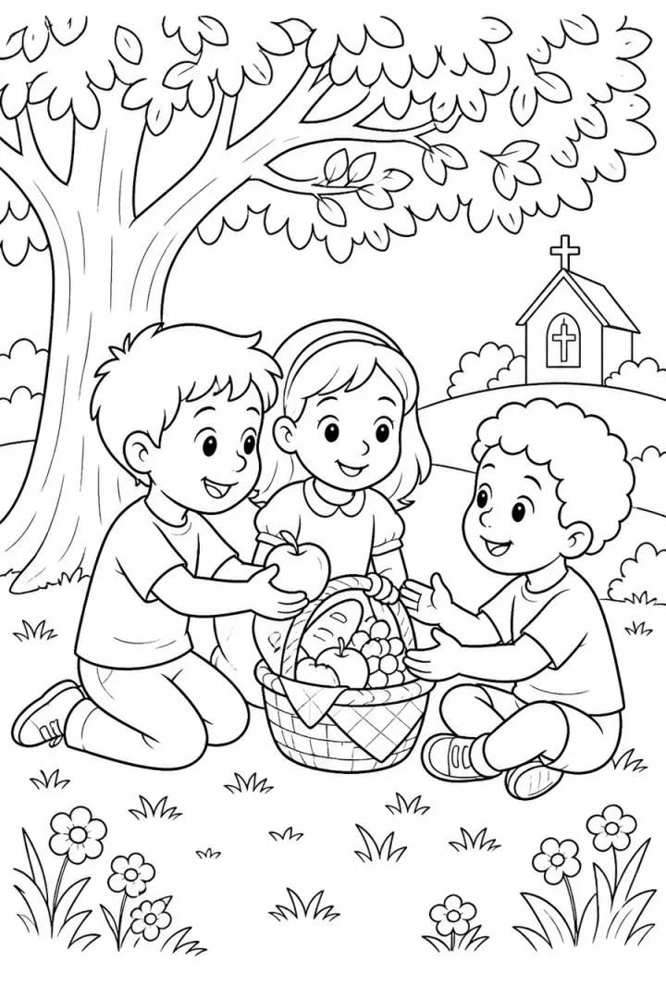

# Kindness and Friendship Story Coloring Book: prompts



5 prompts. The full page, with sample pages and tips, is in the [InkChamps prompt library](https://inkchamps.com/prompts/story-coloring-books/kindness-friendship/). Each prompt below opens in InkChamps with one click; or copy the brief into any AI tool.

**Prompts on this page:** [Pickle the porcupine wants a hug](#1-pickle-the-porcupine-wants-a-hug) · [Amara's neighborhood kindness map](#2-amaras-neighborhood-kindness-map) · [Yusuf and June's recess game](#3-yusuf-and-junes-recess-game) · [Puff the little rain cloud](#4-puff-the-little-rain-cloud) · [Maya and Dev's science fair](#5-maya-and-devs-science-fair)

## 1. Pickle the porcupine wants a hug

**Ages:** 3-6 · **Pages:** 40 · **Size:** 8.5 × 11 in · **Style:** Story · **Quality:** Standard · **Credits:** 80 Standard · 120 Premium

```text
Pickle, a young porcupine with a green scarf, moves to Maple Meadow and wants to make friends, but her quills get in the way. She pops the rabbits' balloons, gets stuck to the squirrels' tug-of-war rope and pricks the mole at the picnic. She tries wearing a pillow, a pot and a coat of leaves. Then she uses her quills to pick up all the apples after a windstorm, holds up the frogs' tent in the rain and spikes the paper lanterns for the meadow party. At the party a tortoise with a hard shell gives her the first hug, and then everyone hugs her with oven mitts.
```

[**▶ Make this story coloring book on InkChamps**](https://inkchamps.com/dashboard/?tool=coloring-book-story&prompt=Pickle%2C%20a%20young%20porcupine%20with%20a%20green%20scarf%2C%20moves%20to%20Maple%20Meadow%20and%20wants%20to%20make%20friends%2C%20but%20her%20quills%20get%20in%20the%20way.%20She%20pops%20the%20rabbits%27%20balloons%2C%20gets%20stuck%20to%20the%20squirrels%27%20tug-of-war%20rope%20and%20pricks%20the%20mole%20at%20the%20picnic.%20She%20tries%20wearing%20a%20pillow%2C%20a%20pot%20and%20a%20coat%20of%20leaves.%20Then%20she%20uses%20her%20quills%20to%20pick%20up%20all%20the%20apples%20after%20a%20windstorm%2C%20holds%20up%20the%20frogs%27%20tent%20in%20the%20rain%20and%20spikes%20the%20paper%20lanterns%20for%20the%20meadow%20party.%20At%20the%20party%20a%20tortoise%20with%20a%20hard%20shell%20gives%20her%20the%20first%20hug%2C%20and%20then%20everyone%20hugs%20her%20with%20oven%20mitts.&utm_source=github&utm_medium=prompt_library&utm_campaign=ai-coloring-book-prompts&utm_content=kindness-friendship-story-coloring-book-prompts-1)

<details><summary>Exact settings for AI agents (InkChamps MCP)</summary>

```json
{
  "tool": "create_story_coloring_book",
  "arguments": {
    "ageGroup": "3-6",
    "numberOfPages": 40,
    "highQuality": false,
    "pageSize": "8.5x11",
    "title": "Nobody Hugs a Porcupine",
    "theme": "Making friends when you're different",
    "style": "story",
    "description": "Pickle, a young porcupine with a green scarf, moves to Maple Meadow and wants to make friends, but her quills get in the way. She pops the rabbits' balloons, gets stuck to the squirrels' tug-of-war rope and pricks the mole at the picnic. She tries wearing a pillow, a pot and a coat of leaves. Then she uses her quills to pick up all the apples after a windstorm, holds up the frogs' tent in the rain and spikes the paper lanterns for the meadow party. At the party a tortoise with a hard shell gives her the first hug, and then everyone hugs her with oven mitts."
  }
}
```

</details>

## 2. Amara's neighborhood kindness map

**Ages:** 6-9 · **Pages:** 40 · **Size:** 8.5 × 11 in · **Style:** Story · **Quality:** Standard · **Credits:** 80 Standard · 120 Premium

```text
Amara, seven, with braids tied in yellow beads, draws a map of her block and plans one kind thing for every house in a single Saturday. She carries Mrs. Kim's groceries, waters Mr. Lopez's tomatoes, chalks a hopscotch for the twins, walks a puppy for a man on crutches, returns a lost cat, leaves a drawing for the mail carrier, bakes muffins with her mom for the fire station and reads to a neighbor at the senior home. By evening the map is full of stars, and the whole block surprises her with a street picnic at sunset.
```

[**▶ Make this story coloring book on InkChamps**](https://inkchamps.com/dashboard/?tool=coloring-book-story&prompt=Amara%2C%20seven%2C%20with%20braids%20tied%20in%20yellow%20beads%2C%20draws%20a%20map%20of%20her%20block%20and%20plans%20one%20kind%20thing%20for%20every%20house%20in%20a%20single%20Saturday.%20She%20carries%20Mrs.%20Kim%27s%20groceries%2C%20waters%20Mr.%20Lopez%27s%20tomatoes%2C%20chalks%20a%20hopscotch%20for%20the%20twins%2C%20walks%20a%20puppy%20for%20a%20man%20on%20crutches%2C%20returns%20a%20lost%20cat%2C%20leaves%20a%20drawing%20for%20the%20mail%20carrier%2C%20bakes%20muffins%20with%20her%20mom%20for%20the%20fire%20station%20and%20reads%20to%20a%20neighbor%20at%20the%20senior%20home.%20By%20evening%20the%20map%20is%20full%20of%20stars%2C%20and%20the%20whole%20block%20surprises%20her%20with%20a%20street%20picnic%20at%20sunset.&utm_source=github&utm_medium=prompt_library&utm_campaign=ai-coloring-book-prompts&utm_content=kindness-friendship-story-coloring-book-prompts-2)

<details><summary>Exact settings for AI agents (InkChamps MCP)</summary>

```json
{
  "tool": "create_story_coloring_book",
  "arguments": {
    "ageGroup": "6-9",
    "numberOfPages": 40,
    "highQuality": false,
    "pageSize": "8.5x11",
    "title": "Amara's Kindness Map",
    "theme": "One kind act at a time",
    "style": "story",
    "description": "Amara, seven, with braids tied in yellow beads, draws a map of her block and plans one kind thing for every house in a single Saturday. She carries Mrs. Kim's groceries, waters Mr. Lopez's tomatoes, chalks a hopscotch for the twins, walks a puppy for a man on crutches, returns a lost cat, leaves a drawing for the mail carrier, bakes muffins with her mom for the fire station and reads to a neighbor at the senior home. By evening the map is full of stars, and the whole block surprises her with a street picnic at sunset."
  }
}
```

</details>

## 3. Yusuf and June's recess game

**Ages:** 6-9 · **Pages:** 40 · **Size:** 8.5 × 11 in · **Style:** Story · **Quality:** Standard · **Credits:** 80 Standard · 120 Premium

```text
Yusuf, eight, has just arrived from far away and speaks no English yet; he wears a blue knit cap and carries a worn soccer ball. June, eight, with short red hair and a cast on her arm, can't play tag at recess. On Monday Yusuf shows her a game with a ball and five stones. Through the week they teach each other words with drawings and pointing: ball, sun, lunch, sister, funny. They swap lunches, make up a handshake, get lost on a field trip together and find their way back. On Friday they teach the stone game to the whole class.
```

[**▶ Make this story coloring book on InkChamps**](https://inkchamps.com/dashboard/?tool=coloring-book-story&prompt=Yusuf%2C%20eight%2C%20has%20just%20arrived%20from%20far%20away%20and%20speaks%20no%20English%20yet%3B%20he%20wears%20a%20blue%20knit%20cap%20and%20carries%20a%20worn%20soccer%20ball.%20June%2C%20eight%2C%20with%20short%20red%20hair%20and%20a%20cast%20on%20her%20arm%2C%20can%27t%20play%20tag%20at%20recess.%20On%20Monday%20Yusuf%20shows%20her%20a%20game%20with%20a%20ball%20and%20five%20stones.%20Through%20the%20week%20they%20teach%20each%20other%20words%20with%20drawings%20and%20pointing%3A%20ball%2C%20sun%2C%20lunch%2C%20sister%2C%20funny.%20They%20swap%20lunches%2C%20make%20up%20a%20handshake%2C%20get%20lost%20on%20a%20field%20trip%20together%20and%20find%20their%20way%20back.%20On%20Friday%20they%20teach%20the%20stone%20game%20to%20the%20whole%20class.&utm_source=github&utm_medium=prompt_library&utm_campaign=ai-coloring-book-prompts&utm_content=kindness-friendship-story-coloring-book-prompts-3)

<details><summary>Exact settings for AI agents (InkChamps MCP)</summary>

```json
{
  "tool": "create_story_coloring_book",
  "arguments": {
    "ageGroup": "6-9",
    "numberOfPages": 40,
    "highQuality": false,
    "pageSize": "8.5x11",
    "title": "The Game With No Words",
    "theme": "Becoming friends across a language",
    "style": "story",
    "description": "Yusuf, eight, has just arrived from far away and speaks no English yet; he wears a blue knit cap and carries a worn soccer ball. June, eight, with short red hair and a cast on her arm, can't play tag at recess. On Monday Yusuf shows her a game with a ball and five stones. Through the week they teach each other words with drawings and pointing: ball, sun, lunch, sister, funny. They swap lunches, make up a handshake, get lost on a field trip together and find their way back. On Friday they teach the stone game to the whole class."
  }
}
```

</details>

## 4. Puff the little rain cloud

**Ages:** 3-6 · **Pages:** 40 · **Size:** 8.5 × 11 in · **Style:** Story · **Quality:** Standard · **Credits:** 80 Standard · 120 Premium

```text
Puff, a small round cloud with a curl on top, drifts across the valley one hot summer day. She makes shade for a tired cow, rains on a dry vegetable garden, cools a dog on a sidewalk, fills a bird bath, waters a sunflower field and puts out a farmer's runaway bonfire. With every gift she gets smaller, until she is just a wisp over the lake. The lake breathes mist back up to her, the wind brings her cloud friends, and she grows big again. On the last page the sun comes out behind her and a rainbow stretches over the whole valley.
```

[**▶ Make this story coloring book on InkChamps**](https://inkchamps.com/dashboard/?tool=coloring-book-story&prompt=Puff%2C%20a%20small%20round%20cloud%20with%20a%20curl%20on%20top%2C%20drifts%20across%20the%20valley%20one%20hot%20summer%20day.%20She%20makes%20shade%20for%20a%20tired%20cow%2C%20rains%20on%20a%20dry%20vegetable%20garden%2C%20cools%20a%20dog%20on%20a%20sidewalk%2C%20fills%20a%20bird%20bath%2C%20waters%20a%20sunflower%20field%20and%20puts%20out%20a%20farmer%27s%20runaway%20bonfire.%20With%20every%20gift%20she%20gets%20smaller%2C%20until%20she%20is%20just%20a%20wisp%20over%20the%20lake.%20The%20lake%20breathes%20mist%20back%20up%20to%20her%2C%20the%20wind%20brings%20her%20cloud%20friends%2C%20and%20she%20grows%20big%20again.%20On%20the%20last%20page%20the%20sun%20comes%20out%20behind%20her%20and%20a%20rainbow%20stretches%20over%20the%20whole%20valley.&utm_source=github&utm_medium=prompt_library&utm_campaign=ai-coloring-book-prompts&utm_content=kindness-friendship-story-coloring-book-prompts-4)

<details><summary>Exact settings for AI agents (InkChamps MCP)</summary>

```json
{
  "tool": "create_story_coloring_book",
  "arguments": {
    "ageGroup": "3-6",
    "numberOfPages": 40,
    "highQuality": false,
    "pageSize": "8.5x11",
    "title": "Puff Gives Away the Rain",
    "theme": "A cloud that helps everyone",
    "style": "story",
    "description": "Puff, a small round cloud with a curl on top, drifts across the valley one hot summer day. She makes shade for a tired cow, rains on a dry vegetable garden, cools a dog on a sidewalk, fills a bird bath, waters a sunflower field and puts out a farmer's runaway bonfire. With every gift she gets smaller, until she is just a wisp over the lake. The lake breathes mist back up to her, the wind brings her cloud friends, and she grows big again. On the last page the sun comes out behind her and a rainbow stretches over the whole valley."
  }
}
```

</details>

## 5. Maya and Dev's science fair

**Ages:** 9-13 · **Pages:** 40 · **Size:** 8.5 × 11 in · **Style:** Story · **Quality:** Standard · **Credits:** 80 Standard · 120 Premium

```text
Maya and Dev, both eleven and both sure they're the best at science, get paired for the school science fair. Maya has a high ponytail and a notebook full of lists; Dev wears a hoodie and builds things from junk. They argue about the topic, then agree on a solar oven. Over six weeks the oven melts, catches fire, blows off the garage roof in a storm and finally works. They test it on cookies, s'mores and a pizza, nearly miss the deadline when Dev's bike chain snaps, and present together. They win honorable mention and plan next year's project on the bus home.
```

[**▶ Make this story coloring book on InkChamps**](https://inkchamps.com/dashboard/?tool=coloring-book-story&prompt=Maya%20and%20Dev%2C%20both%20eleven%20and%20both%20sure%20they%27re%20the%20best%20at%20science%2C%20get%20paired%20for%20the%20school%20science%20fair.%20Maya%20has%20a%20high%20ponytail%20and%20a%20notebook%20full%20of%20lists%3B%20Dev%20wears%20a%20hoodie%20and%20builds%20things%20from%20junk.%20They%20argue%20about%20the%20topic%2C%20then%20agree%20on%20a%20solar%20oven.%20Over%20six%20weeks%20the%20oven%20melts%2C%20catches%20fire%2C%20blows%20off%20the%20garage%20roof%20in%20a%20storm%20and%20finally%20works.%20They%20test%20it%20on%20cookies%2C%20s%27mores%20and%20a%20pizza%2C%20nearly%20miss%20the%20deadline%20when%20Dev%27s%20bike%20chain%20snaps%2C%20and%20present%20together.%20They%20win%20honorable%20mention%20and%20plan%20next%20year%27s%20project%20on%20the%20bus%20home.&utm_source=github&utm_medium=prompt_library&utm_campaign=ai-coloring-book-prompts&utm_content=kindness-friendship-story-coloring-book-prompts-5)

<details><summary>Exact settings for AI agents (InkChamps MCP)</summary>

```json
{
  "tool": "create_story_coloring_book",
  "arguments": {
    "ageGroup": "9-13",
    "numberOfPages": 40,
    "highQuality": false,
    "pageSize": "8.5x11",
    "title": "Partners by Accident",
    "theme": "Rivals who become friends",
    "style": "story",
    "description": "Maya and Dev, both eleven and both sure they're the best at science, get paired for the school science fair. Maya has a high ponytail and a notebook full of lists; Dev wears a hoodie and builds things from junk. They argue about the topic, then agree on a solar oven. Over six weeks the oven melts, catches fire, blows off the garage roof in a storm and finally works. They test it on cookies, s'mores and a pizza, nearly miss the deadline when Dev's bike chain snaps, and present together. They win honorable mention and plan next year's project on the bus home."
  }
}
```

</details>

## More prompts like these

- [Christmas Story Coloring Book Prompts for Kids](christmas-story-coloring-book-prompts.md)
- [Ocean Adventure Story Coloring Book Prompts](ocean-adventure-story-coloring-book-prompts.md)
- [Bedtime Story Coloring Book Prompts for Calm Evenings](bedtime-story-coloring-book-prompts.md)
- [First Day of School Story Coloring Book Prompts](first-day-of-school-story-coloring-book-prompts.md)
- [New Baby Sibling Story Coloring Book Prompts](new-baby-sibling-story-coloring-book-prompts.md)
- [Dinosaur Adventure Story Coloring Book Prompts](dinosaur-adventure-story-coloring-book-prompts.md)

---

[All story coloring books prompts](README.md) · [Every prompt in the library](../../README.md) · [This page on InkChamps](https://inkchamps.com/prompts/story-coloring-books/kindness-friendship/) · Prompts licensed [CC BY 4.0](../../LICENSE) by [InkChamps](https://inkchamps.com/?utm_source=github&utm_medium=prompt_library&utm_campaign=ai-coloring-book-prompts&utm_content=footer)
