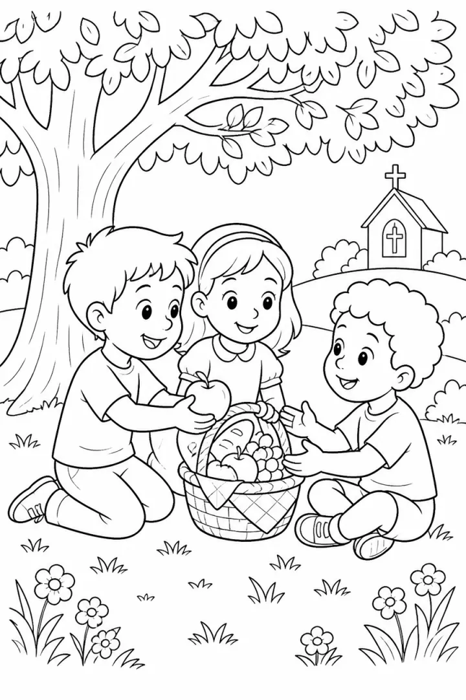

# Kindness and Friendship Story Coloring Book: prompts



5 prompts. The full page, with sample pages and tips, is in the [InkChamps prompt library](https://inkchamps.com/prompts/story-coloring-books/kindness-friendship/). Each prompt below opens in InkChamps with one click; or copy the brief into any AI tool.

**Prompts on this page:** [Pickle the porcupine wants a hug](#1-pickle-the-porcupine-wants-a-hug) · [Amara's neighborhood kindness map](#2-amaras-neighborhood-kindness-map) · [Yusuf and June's recess game](#3-yusuf-and-junes-recess-game) · [Puff the little rain cloud](#4-puff-the-little-rain-cloud) · [Maya and Dev's science fair](#5-maya-and-devs-science-fair)

## 1. Pickle the porcupine wants a hug

**Ages:** 3-6 · **Pages:** 24 · **Size:** 8.5 × 11 in · **Style:** Story · **Quality:** Standard · **Credits:** 48 Standard · 72 Premium

```text
A 24-page story. Pickle, a young porcupine with a green scarf, moves to Maple Meadow and wants a friend, but her quills get in the way: she pops the rabbits' balloons, gets stuck in the squirrels' tug-of-war rope and pricks Mole at a picnic. She tries a pillow, a pot and a coat of leaves. Then she rolls up the apples after a windstorm, holds up the frogs' tent in the rain and carries paper lanterns for the meadow party. There an old tortoise gives her the first hug, and everyone else hugs her in oven mitts.
```

### Page by page (24 pages)

Paste one page at a time into ChatGPT, Gemini or any AI image tool, with this line after it:

> Black-and-white story coloring page for a child aged 3 to 6. Pickle is a small round young porcupine with big eyes, a short snout, spiky quills on her back and a striped knitted scarf, the same on every page. Thick bold outlines, big simple shapes, very little background, no shading, no grey, no words in the picture, a blank band at the bottom for the story text, portrait 8.5 x 11 page.

1. Pickle the porcupine pulling a little wooden wagon of boxes and a teapot into a sunny meadow, a signpost by the path and a big oak tree on a hill.  
   *Words:* Pickle the porcupine pulled her little wagon into Maple Meadow. "I hope I make a friend here," she said.
2. Pickle unpacking at her new burrow under the roots of the oak, a round front door, a welcome mat and a box of teacups at her feet.  
   *Words:* Her new home was a cozy burrow under the old oak tree. Pickle unpacked her teacups and wished for someone to share them with.
3. Pickle peeking over a hedge at three rabbits holding bunches of balloons around a carrot cake set on a tree stump.  
   *Words:* Over the hedge, the rabbits were having a balloon party. Pickle hurried over to say hello.
4. Pickle hugging a surprised rabbit while balloons burst on her quills, scraps of balloon flying and the other rabbits' ears standing straight up.  
   *Words:* She gave the biggest rabbit a hug. Pop! Pop! Pop! Every balloon burst on her quills.
5. Pickle walking away with her nose drooping and a burst balloon string caught on one quill, the rabbits waving behind her by the stump.  
   *Words:* "Sorry," said Pickle, and her nose drooped. The rabbits said it was all right, but the party was very quiet after that.
6. Four squirrels pulling a long rope in a tug-of-war between two trees, Pickle running up eagerly to grab the end of it.  
   *Words:* Next she found the squirrels playing tug-of-war. "I can pull!" said Pickle, and she grabbed the rope.
7. Pickle tangled in the rope stuck fast in her quills, the squirrels tumbled in a heap on the grass and acorns scattered around them.  
   *Words:* The rope stuck fast in her quills. The squirrels tumbled into a heap, and nobody could get the rope out.
8. A mole in round glasses jumping up off a checked picnic blanket as Pickle sits down close beside him, sandwiches and a honey jar on the blanket.  
   *Words:* At the picnic, Pickle sat down close to Mole. "Ouch!" said Mole, and he jumped right off the blanket.
9. Pickle sitting all alone on a fallen log at dusk with her chin in her paws, a single firefly and a crescent moon above her.  
   *Words:* That night Pickle sat alone on a log. "Everyone runs away from my prickles," she sighed.
10. Pickle marching proudly with a big fluffy pillow tied onto her back with string, a little bird watching from a fence post.  
   *Words:* In the morning she had a plan. She tied her fluffiest pillow onto her back.
11. Pickle's pillow bursting open on a bramble bush, feathers floating everywhere and a bird catching one in its beak.  
   *Words:* But the pillow caught on a bramble and burst. Feathers floated all over the meadow.
12. Pickle wearing a big cooking pot upside down on her back like a shell, a ladle dangling from it, two birds covering their ears with their wings.  
   *Words:* Then she tried a big cooking pot. Clank, clonk, clank! It was much too noisy for hugging.
13. Pickle covered in big leaves stuck all over her quills so she looks like a bush, a young deer leaning down to nibble one.  
   *Words:* Last she covered her quills with leaves. A deer tried to nibble her, because she looked just like a bush!
14. Pickle shaking off the last leaves with a small brave smile, the cooking pot and the torn pillow lying in the grass beside her.  
   *Words:* Pickle shook off every leaf. "Maybe I can't stop being prickly," she said. "But maybe I can be prickly and kind."
15. A big wind blowing through an apple orchard, the trees bending, apples falling and a rabbit holding on to its hat.  
   *Words:* That afternoon a great wind blew through Maple Meadow. Apples tumbled from every tree in the orchard.
16. Pickle curled into a spiky ball rolling through the grass with apples stuck all over her quills, two squirrels staring with their mouths open.  
   *Words:* Pickle curled up and rolled through the grass. The apples stuck to her quills, ten at a time!
17. Pickle tipping apples off her quills into a row of baskets outside the rabbits' house, the rabbits and squirrels cheering.  
   *Words:* She filled every basket in the meadow. "Thank you, Pickle!" cheered the rabbits and the squirrels.
18. Rain pouring on four frogs huddled under a sagging tent with a snapped tent pole, Pickle running toward them through the puddles.  
   *Words:* Then the rain came, and the frogs' tent pole snapped. The wet tent sagged down onto their heads.
19. Pickle standing tall in the middle of the frogs' tent, her quills holding up the roof like a pole, the frogs dry inside sipping from mugs.  
   *Words:* Pickle stood up tall in the middle. Her quills held the tent up, and the frogs stayed warm and dry.
20. The meadow animals making paper lanterns at a long table, Mole holding up a lantern and scratching his head, a tall tree with bare branches behind.  
   *Words:* Everyone was getting ready for the meadow party. "How will we hang all these lanterns?" asked Mole.
21. Pickle walking under the tree with paper lanterns spiked on every quill while squirrels take them off and hang them on the branches.  
   *Words:* Pickle carried twenty lanterns on her quills at once, and the squirrels hung them on every branch.
22. An evening party under lantern-hung trees, tables of pies and lemonade, an old tortoise with a big patterned shell walking slowly up to Pickle.  
   *Words:* At the party, an old tortoise came slowly up to Pickle. "My shell is very hard," he said with a smile.
23. The old tortoise and Pickle in a big hug, his hard shell pressed against her quills, both smiling, a lantern glowing above them.  
   *Words:* He gave her a great big hug, and nothing poked at all. It was Pickle's very first hug in Maple Meadow.
24. All the meadow animals wearing oven mitts on their paws in one big group hug around Pickle, lanterns in the trees and a full moon above.  
   *Words:* Then the rabbits, the squirrels, Mole and the frogs put on oven mitts, and everybody hugged Pickle at once!

[**▶ Make this story coloring book on InkChamps**](https://inkchamps.com/dashboard/?tool=coloring-book-story&prompt=A%2024-page%20story.%20Pickle%2C%20a%20young%20porcupine%20with%20a%20green%20scarf%2C%20moves%20to%20Maple%20Meadow%20and%20wants%20a%20friend%2C%20but%20her%20quills%20get%20in%20the%20way%3A%20she%20pops%20the%20rabbits%27%20balloons%2C%20gets%20stuck%20in%20the%20squirrels%27%20tug-of-war%20rope%20and%20pricks%20Mole%20at%20a%20picnic.%20She%20tries%20a%20pillow%2C%20a%20pot%20and%20a%20coat%20of%20leaves.%20Then%20she%20rolls%20up%20the%20apples%20after%20a%20windstorm%2C%20holds%20up%20the%20frogs%27%20tent%20in%20the%20rain%20and%20carries%20paper%20lanterns%20for%20the%20meadow%20party.%20There%20an%20old%20tortoise%20gives%20her%20the%20first%20hug%2C%20and%20everyone%20else%20hugs%20her%20in%20oven%20mitts.&utm_source=github&utm_medium=prompt_library&utm_campaign=ai-coloring-book-prompts&utm_content=kindness-friendship-story-coloring-book-prompts-1)

<details><summary>Exact settings for AI agents (InkChamps MCP)</summary>

```json
{
  "tool": "create_story_coloring_book",
  "arguments": {
    "ageGroup": "3-6",
    "numberOfPages": 24,
    "highQuality": false,
    "pageSize": "8.5x11",
    "title": "Nobody Hugs a Porcupine",
    "theme": "Making friends when you're different",
    "style": "story",
    "description": "A 24-page story. Pickle, a young porcupine with a green scarf, moves to Maple Meadow and wants a friend, but her quills get in the way: she pops the rabbits' balloons, gets stuck in the squirrels' tug-of-war rope and pricks Mole at a picnic. She tries a pillow, a pot and a coat of leaves. Then she rolls up the apples after a windstorm, holds up the frogs' tent in the rain and carries paper lanterns for the meadow party. There an old tortoise gives her the first hug, and everyone else hugs her in oven mitts."
  }
}
```

</details>

## 2. Amara's neighborhood kindness map

**Ages:** 6-9 · **Pages:** 24 · **Size:** 8.5 × 11 in · **Style:** Story · **Quality:** Standard · **Credits:** 48 Standard · 72 Premium

```text
A 24-page story. Amara, seven, with braids tied in beads, draws a map of her block and plans one kind thing for every house in a single Saturday. She carries Mrs. Kim's groceries, waters Mr. Lopez's tomatoes, chalks a hopscotch for the twins, walks a puppy for a man on crutches, returns a lost cat, leaves a drawing for the mail carrier, bakes muffins with her mom for the fire station and reads to a neighbor at the senior home. By evening every house has a star, and the whole block surprises her with a street picnic at sunset.
```

### Page by page (24 pages)

Paste one page at a time into ChatGPT, Gemini or any AI image tool, with this line after it:

> Black-and-white story coloring page for a child aged 6 to 9. Amara is a seven-year-old girl with long braids tied with round beads, a striped T-shirt, overalls and sneakers, the same on every page. Clear bold outlines, medium detail, a simple street or home background, no shading, no grey, no words in the picture, a blank band at the bottom for the story text, portrait 8.5 x 11 page.

1. Amara at the kitchen table on a Saturday morning drawing a map of her street with crayons, a bowl of cereal beside her and row houses outside the window.  
   *Words:* On Saturday morning, Amara drew a map of her whole block. There were eight houses on it, and she knew someone in every one.
2. Amara holding up her finished map of eight little houses along one street, a pencil behind her ear, her mom smiling over a coffee mug.  
   *Words:* "Today I'm going to do one kind thing for every house," she told Mom. "Each time I do one, I'll draw a star."
3. Amara stepping out of her front door onto the stoop with the folded map in her pocket, a potted geranium on the step and the quiet street ahead.  
   *Words:* She tucked the map in her pocket and stepped outside. The street was sunny and still a little sleepy.
4. An older neighbor at the open trunk of her car looking at six full grocery bags, Amara reaching in to lift one with a loaf of bread and celery poking out.  
   *Words:* Next door, Mrs. Kim was looking at six heavy bags of groceries. "I can carry those," said Amara.
5. Amara and Mrs. Kim in a sunny kitchen putting oranges into a fruit bowl, the grocery bags on the counter, Mrs. Kim handing Amara a clementine.  
   *Words:* They carried every bag up the steps together. Mrs. Kim gave her a clementine, and Amara drew her first star.
6. Amara watering a row of staked tomato plants with a big watering can while an older man rests on a garden bench holding his sore back.  
   *Words:* Mr. Lopez's back was sore, and his tomatoes were thirsty. Amara watered every plant down the row.
7. Mr. Lopez handing Amara a big round tomato over the garden fence while she draws a star on her map against the fence post.  
   *Words:* "The best tomato is yours," said Mr. Lopez. Star number two went on the map.
8. Amara kneeling on the sidewalk chalking a long hopscotch, a bucket of chalk beside her, two small twins watching from their front stoop.  
   *Words:* The twins at the yellow house were bored. Amara chalked the longest hopscotch on the whole street.
9. The twins hopping along the hopscotch while Amara cheers, chalk flowers and a smiling sun drawn on the sidewalk around them.  
   *Words:* Soon all three of them were hopping and laughing. The twins added chalk flowers, and Amara added star number three.
10. A man on crutches with a cast on his leg at his garden gate, a bouncy puppy straining on its leash, Amara reaching out to take the leash.  
   *Words:* Mr. Osei had a broken leg and a puppy who wanted to run. "May I walk him for you?" asked Amara.
11. The puppy pulling Amara at a run down the sidewalk past a fire hydrant and a tree, her braids flying out behind her.  
   *Words:* Biscuit the puppy pulled her all the way around the block and back again. Star number four!
12. Amara crouching to find a fluffy cat hiding under a park bench, a lamppost behind her with a lost-cat poster showing a picture of the same cat.  
   *Words:* In the park, Amara spotted a fluffy cat hiding under a bench. It looked just like the picture on the lamppost.
13. Amara carrying the fluffy cat up to a front door as a young woman opens it with her arms wide and a big happy face.  
   *Words:* She carried the cat home to the blue house. Its owner hugged it tight, and Amara drew star number five.
14. Amara at the kitchen table at lunchtime drawing a picture of the mail carrier with his satchel, crayons and a sandwich on the table.  
   *Words:* At lunch, Amara drew a picture of the mail carrier, who walks their block in sun, rain and snow.
15. The mail carrier opening a mailbox and finding Amara's drawing, smiling at it, while Amara peeks out from behind a hedge.  
   *Words:* She left it in the mailbox with a thank-you note. When he found it, he smiled all the way down the street. Star six!
16. Amara and her mom baking blueberry muffins, Amara stirring a big mixing bowl with flour on her nose and a muffin tin ready on the counter.  
   *Words:* In the afternoon, Amara and Mom baked two dozen blueberry muffins. Amara got flour on her nose.
17. Amara and her mom carrying a basket of muffins up to the open doors of a fire station, a fire engine inside and two firefighters waving.  
   *Words:* They carried the muffins to the fire station on the corner. "Thank you for keeping our block safe," said Amara.
18. Amara sitting in the driver's seat of the fire engine wearing a firefighter's helmet much too big for her, a firefighter grinning beside the door.  
   *Words:* The firefighters let her sit in the big truck and try on a helmet. Star number seven went on the map.
19. Amara reading a picture book aloud to an elderly woman in an armchair at a senior home, a cup of tea and a potted fern beside them.  
   *Words:* Her last stop was the senior home at the end of the street. Amara read Mrs. Petrova her favorite book about the sea.
20. The elderly woman teaching Amara to knit, Amara holding two needles with a short row of stitches, a ball of yarn rolling off her lap.  
   *Words:* Then Mrs. Petrova taught Amara how to knit one whole row. Star number eight!
21. Amara sitting on her front stoop at sunset looking at her map covered with stars, a streetlight just coming on above her.  
   *Words:* As the sun went down, Amara sat on her stoop and looked at her map. Every house had a star.
22. Amara looking up in surprise as neighbors carry folding tables and chairs into the street, one with a tablecloth and one with a bowl of tomatoes.  
   *Words:* Then she heard chairs scraping. All her neighbors were carrying tables and food into the street.
23. A street picnic at sunset with long tables, string lights between the houses, the twins, the man on crutches, the puppy and the firefighters all there.  
   *Words:* "Surprise!" called Mrs. Kim. "You were kind to all of us today, so now it's our turn."
24. Amara at the end of the long picnic table drawing one big star in the middle of her map while all the neighbors clap around her.  
   *Words:* That night Amara drew one more star, the biggest of all, right in the middle of the map, for the whole block.

[**▶ Make this story coloring book on InkChamps**](https://inkchamps.com/dashboard/?tool=coloring-book-story&prompt=A%2024-page%20story.%20Amara%2C%20seven%2C%20with%20braids%20tied%20in%20beads%2C%20draws%20a%20map%20of%20her%20block%20and%20plans%20one%20kind%20thing%20for%20every%20house%20in%20a%20single%20Saturday.%20She%20carries%20Mrs.%20Kim%27s%20groceries%2C%20waters%20Mr.%20Lopez%27s%20tomatoes%2C%20chalks%20a%20hopscotch%20for%20the%20twins%2C%20walks%20a%20puppy%20for%20a%20man%20on%20crutches%2C%20returns%20a%20lost%20cat%2C%20leaves%20a%20drawing%20for%20the%20mail%20carrier%2C%20bakes%20muffins%20with%20her%20mom%20for%20the%20fire%20station%20and%20reads%20to%20a%20neighbor%20at%20the%20senior%20home.%20By%20evening%20every%20house%20has%20a%20star%2C%20and%20the%20whole%20block%20surprises%20her%20with%20a%20street%20picnic%20at%20sunset.&utm_source=github&utm_medium=prompt_library&utm_campaign=ai-coloring-book-prompts&utm_content=kindness-friendship-story-coloring-book-prompts-2)

<details><summary>Exact settings for AI agents (InkChamps MCP)</summary>

```json
{
  "tool": "create_story_coloring_book",
  "arguments": {
    "ageGroup": "6-9",
    "numberOfPages": 24,
    "highQuality": false,
    "pageSize": "8.5x11",
    "title": "Amara's Kindness Map",
    "theme": "One kind act at a time",
    "style": "story",
    "description": "A 24-page story. Amara, seven, with braids tied in beads, draws a map of her block and plans one kind thing for every house in a single Saturday. She carries Mrs. Kim's groceries, waters Mr. Lopez's tomatoes, chalks a hopscotch for the twins, walks a puppy for a man on crutches, returns a lost cat, leaves a drawing for the mail carrier, bakes muffins with her mom for the fire station and reads to a neighbor at the senior home. By evening every house has a star, and the whole block surprises her with a street picnic at sunset."
  }
}
```

</details>

## 3. Yusuf and June's recess game

**Ages:** 6-9 · **Pages:** 24 · **Size:** 8.5 × 11 in · **Style:** Story · **Quality:** Standard · **Credits:** 48 Standard · 72 Premium

```text
A 24-page story over one school week. Yusuf, eight, has just arrived from far away and speaks no English yet; he wears a knit cap and carries a worn soccer ball. June, eight, has short hair and a cast on her arm, so she can't play tag at recess. On Monday Yusuf shows her a game with a ball and five stones. Through the week they teach each other words with drawings and pointing: ball, sun, lunch, sister, funny. They swap lunches, make up a handshake, get lost on a field trip and find their way back. On Friday they teach the stone game to the whole class.
```

### Page by page (24 pages)

Paste one page at a time into ChatGPT, Gemini or any AI image tool, with this line after it:

> Black-and-white story coloring page for a child aged 6 to 9. Yusuf: eight-year-old boy, knit cap, zip-up jacket, scuffed soccer ball. June: eight-year-old girl, short straight hair, freckles, cast on her left arm. Same look on every page. Clear bold outlines, medium detail, simple background, no shading, no grey, no words in the picture, blank band at the bottom for text, portrait 8.5 x 11 page.

1. Yusuf holding his mother's hand at the gate of a big brick school on a Monday morning, his soccer ball under one arm and children running past with backpacks.  
   *Words:* On Monday, Yusuf came to a new school in a new country. He didn't know a single word of English yet.
2. Yusuf standing at the front of a classroom beside the teacher, holding his cap in both hands, the class waving from their desks and a globe on the teacher's desk.  
   *Words:* The teacher said his name, and the class waved. Yusuf held his cap tight and waved back.
3. June sitting on a playground bench with her cast in her lap and her chin in her other hand, watching a group of children play tag across the yard.  
   *Words:* At recess, June sat on the bench. Her arm was in a cast, so she couldn't play tag.
4. Yusuf sitting at the far end of the same bench with his soccer ball on his knees, the two children glancing at each other shyly.  
   *Words:* Yusuf sat down at the other end of the bench. Neither of them said anything, because neither knew what to say.
5. Yusuf kneeling on the ground setting five smooth stones in a row, the soccer ball bouncing beside him, June leaning forward to watch.  
   *Words:* Then Yusuf picked up five smooth stones and set them in a row. He bounced his ball and scooped up a stone before he caught it.
6. June playing the stone game with her good hand, the ball in the air and a stone in her fingers, Yusuf clapping beside her.  
   *Words:* June tried it with her good hand. Bounce, scoop, catch! Yusuf clapped, and June laughed out loud.
7. June and Yusuf on the bench on Tuesday with an open notebook, June pointing from a drawing of a ball to the real soccer ball.  
   *Words:* On Tuesday, June brought a notebook. She drew a ball, pointed and said, "Ball." Yusuf said, "Ball!"
8. Yusuf drawing a big sun with rays in the notebook and pointing up at the real sun, June trying to say his word with a puzzled smile.  
   *Words:* Yusuf drew a sun and said the word in his language. June tried it, and he grinned at the way she said it.
9. Yusuf and June at a cafeteria table swapping lunches, his tin of flatbread and dates sliding one way and her cheese sandwich and apple the other.  
   *Words:* On Wednesday they learned "lunch," and then they swapped. June loved the flatbread. Yusuf loved the sandwich.
10. Yusuf showing June a drawing of a little girl with pigtails while June draws a baby in a high chair on the facing page.  
   *Words:* Yusuf drew a girl with pigtails. "Sister," said June, and she drew her baby brother in his high chair.
11. June pulling her silliest face with her tongue out and her eyes crossed while Yusuf laughs so hard he is sliding off the bench.  
   *Words:* Then June made her silliest face. "Funny!" she said. Yusuf laughed so hard he nearly fell off the bench.
12. Yusuf and June doing a made-up handshake, thumbs hooked together, fingers wiggling and a gentle fist bump against June's cast.  
   *Words:* They made up a secret handshake: a thumb hook, a wiggle and a gentle bump on June's cast.
13. Yusuf carefully drawing a sun and a soccer ball on June's cast with a marker, other doodles and hearts already covering it.  
   *Words:* Yusuf drew a sun and a soccer ball on June's cast. June said it was the best drawing on it.
14. The class climbing onto a school bus for a field trip, children with lunch bags, Yusuf and June sharing a window seat near the back.  
   *Words:* On Thursday, the class took a bus to the city park. Yusuf and June shared a seat by the window.
15. Yusuf and June crouching at the edge of a duck pond in a city park watching a line of ducklings, the rest of the class walking away behind them.  
   *Words:* They stopped to watch a line of ducklings. When they looked up, the class was gone.
16. Yusuf and June alone where three garden paths split between tall hedges, looking around worriedly, Yusuf hugging his ball.  
   *Words:* The paths all looked the same. June's tummy went tight, and Yusuf held his ball close.
17. June drawing a quick map in the notebook showing the school bus beside a big fountain while Yusuf points up at the sun.  
   *Words:* June opened the notebook and drew the bus beside the big fountain. Yusuf nodded and pointed at the sun.
18. Yusuf and June walking hand in hand along a path past a rose garden, June checking her notebook map and Yusuf leading the way.  
   *Words:* They walked toward the sun, past the roses and around the hedges, checking June's map as they went.
19. A big tiered fountain ahead of them, the teacher hurrying toward the two children with her arms out and the class waving beside the bus.  
   *Words:* There was the fountain, and there was their teacher running to meet them. "You found your way back!" she said.
20. Yusuf and June asleep on the bus ride home, leaning on each other, the notebook on June's lap and the ball on Yusuf's.  
   *Words:* On the bus home they were so tired they fell asleep, still holding the notebook and the ball.
21. Yusuf and June at the front of the classroom on Friday holding up the five stones and the soccer ball while the class leans forward.  
   *Words:* On Friday, the teacher asked if they had something to share. Yusuf and June looked at each other and nodded.
22. The whole class sitting in a circle on the playground while Yusuf bounces the ball and June shows how to scoop a stone one-handed.  
   *Words:* At recess, Yusuf showed everyone the stone game, and June showed them how to play it with just one hand.
23. Children all over the playground in small groups playing the stone game, balls bouncing, stones in rows and a teacher smiling by the fence.  
   *Words:* Soon the whole playground was bouncing and scooping. Even the tag players wanted a turn.
24. Yusuf and June on their bench at the end of the day doing their secret handshake, the school doors behind them and a parent waving at the gate.  
   *Words:* At the end of the day, Yusuf said his first English sentence: "June is my friend." June said it back in his language.

[**▶ Make this story coloring book on InkChamps**](https://inkchamps.com/dashboard/?tool=coloring-book-story&prompt=A%2024-page%20story%20over%20one%20school%20week.%20Yusuf%2C%20eight%2C%20has%20just%20arrived%20from%20far%20away%20and%20speaks%20no%20English%20yet%3B%20he%20wears%20a%20knit%20cap%20and%20carries%20a%20worn%20soccer%20ball.%20June%2C%20eight%2C%20has%20short%20hair%20and%20a%20cast%20on%20her%20arm%2C%20so%20she%20can%27t%20play%20tag%20at%20recess.%20On%20Monday%20Yusuf%20shows%20her%20a%20game%20with%20a%20ball%20and%20five%20stones.%20Through%20the%20week%20they%20teach%20each%20other%20words%20with%20drawings%20and%20pointing%3A%20ball%2C%20sun%2C%20lunch%2C%20sister%2C%20funny.%20They%20swap%20lunches%2C%20make%20up%20a%20handshake%2C%20get%20lost%20on%20a%20field%20trip%20and%20find%20their%20way%20back.%20On%20Friday%20they%20teach%20the%20stone%20game%20to%20the%20whole%20class.&utm_source=github&utm_medium=prompt_library&utm_campaign=ai-coloring-book-prompts&utm_content=kindness-friendship-story-coloring-book-prompts-3)

<details><summary>Exact settings for AI agents (InkChamps MCP)</summary>

```json
{
  "tool": "create_story_coloring_book",
  "arguments": {
    "ageGroup": "6-9",
    "numberOfPages": 24,
    "highQuality": false,
    "pageSize": "8.5x11",
    "title": "The Game With No Words",
    "theme": "Becoming friends across a language",
    "style": "story",
    "description": "A 24-page story over one school week. Yusuf, eight, has just arrived from far away and speaks no English yet; he wears a knit cap and carries a worn soccer ball. June, eight, has short hair and a cast on her arm, so she can't play tag at recess. On Monday Yusuf shows her a game with a ball and five stones. Through the week they teach each other words with drawings and pointing: ball, sun, lunch, sister, funny. They swap lunches, make up a handshake, get lost on a field trip and find their way back. On Friday they teach the stone game to the whole class."
  }
}
```

</details>

## 4. Puff the little rain cloud

**Ages:** 3-6 · **Pages:** 24 · **Size:** 8.5 × 11 in · **Style:** Story · **Quality:** Standard · **Credits:** 48 Standard · 72 Premium

```text
A 24-page story. Puff, a small round cloud with a curl on top, drifts across the valley on a hot summer day. She makes shade for a tired cow, rains on a dry vegetable garden, cools a little dog on the sidewalk, fills a bird bath, waters a field of sunflowers and puts out a farmer's runaway bonfire. With every gift she gets smaller, until she is just a wisp over the lake. The lake breathes mist back up to her, the wind brings her cloud friends, and she grows big again. On the last page the sun comes out behind her and a rainbow stretches over the valley.
```

### Page by page (24 pages)

Paste one page at a time into ChatGPT, Gemini or any AI image tool, with this line after it:

> Black-and-white story coloring page for a child aged 3 to 6. Puff is a puffy round cartoon cloud with one curl on top, big round eyes and a small smile, the same on every page; she shrinks as she gives rain away. Thick bold outlines, big simple shapes, very little background, no shading, no grey, no words in the picture, a blank band at the bottom for the story text, portrait 8.5 x 11 page.

1. Puff waking up over a green valley at sunrise, round hills, a red-roofed farmhouse and a winding river below, a big sun rising behind the hills.  
   *Words:* Puff was a little round cloud with a curl on top. One summer morning, she woke up over a sunny valley.
2. A big blazing sun with long rays over the valley, Puff drifting below it, a drooping daisy and a dusty road beneath them.  
   *Words:* It was a very hot day. The sun shone and shone, and everything in the valley felt thirsty.
3. A tired cow lying in a hot field with her tongue out, Puff floating right above her and making a big round shadow on the grass.  
   *Words:* A tired cow was lying in the hot field. Puff floated over her and made a big, cool shadow.
4. The cow standing up happily munching grass in Puff's shade, a wooden fence and a few buttercups beside her.  
   *Words:* "Moo, thank you!" said the cow, and she munched her grass in the shade.
5. A dry vegetable garden with droopy carrot tops, wilted cabbages and a scarecrow, a rabbit sadly holding a floppy lettuce leaf.  
   *Words:* Next Puff saw a vegetable garden. The carrots and cabbages were droopy and dry.
6. Puff raining big round drops over the garden, the cabbages perking up, a snail on a leaf and Puff a little smaller than before.  
   *Words:* Puff rained a gentle rain, pitter-patter. The cabbages perked right up. Puff got a little bit smaller.
7. A little dog panting on a hot town sidewalk next to an empty water bowl, shop awnings and a lamppost behind him.  
   *Words:* In the town, a little dog was panting on the hot sidewalk. His water bowl was empty.
8. Puff sprinkling cool drops on the little dog, who jumps up wagging his tail while his water bowl fills to the top.  
   *Words:* Puff sprinkled cool drops on his back and filled his bowl to the top. The little dog wagged and wagged.
9. An empty stone bird bath in a garden, three little birds sitting on its rim looking down into it.  
   *Words:* Three little birds sat on an empty bird bath. "No splashing today," they peeped.
10. Puff filling the bird bath while the three birds splash and flutter in the water, drops flying, Puff smaller again.  
   *Words:* Puff filled it to the brim. Splish, splash! The birds had the best bath ever. Puff got smaller again.
11. A whole field of tall sunflowers with their big heads hanging down, a bee sitting on a drooping leaf.  
   *Words:* Over the hill was a field of sunflowers with their big heads hanging low.
12. Puff raining over the sunflower field, every flower lifting its big face up toward her, two bees buzzing between them.  
   *Words:* Puff rained and rained until every sunflower stood up tall and turned its face to the sky.
13. A farmer in a straw hat and overalls running with a small bucket toward a bonfire blowing toward his haystack, little sparks in the air.  
   *Words:* Down below, the wind blew the farmer's bonfire toward his haystack. His little bucket was not enough.
14. Puff pouring a big shower onto the bonfire, clouds of steam puffing up, the farmer throwing his straw hat in the air.  
   *Words:* Puff squeezed out a big shower. Whoosh! The fire went out in a puff of steam, and the farmer cheered.
15. Puff now only a thin, tiny wisp drifting low over a calm lake, lily pads and a duck swimming below her.  
   *Words:* Now Puff was not round at all. She was just a tiny wisp floating over the lake.
16. Tiny Puff drooping sadly over the lake while a frog on a lily pad looks up at her, tall reeds at the water's edge.  
   *Words:* "I gave all my rain away," she whispered. "Now I'm too small to help anyone."
17. Soft curly ribbons of mist rising up from the lake toward tiny Puff, two fish peeking up out of the water.  
   *Words:* But the lake had been watching. It breathed up soft, curly mist, all the way to Puff.
18. Puff growing round again as the mist swirls into her, her curl popping back up on top, the lake shining below.  
   *Words:* The mist joined Puff, and she grew rounder and rounder. Her curl popped back up on top.
19. The wind drawn as a big swirl with puffed-out cheeks blowing over the hills, pushing a group of clouds toward Puff, leaves twirling along.  
   *Words:* Then the wind came whistling over the hills. "Puff! I brought your friends!" it called.
20. Cloud friends of every shape floating in to meet Puff, one long and thin, one tall, one bumpy, all smiling at her.  
   *Words:* Big clouds and little clouds floated in to meet her, long ones and tall ones and bumpy ones.
21. Big Puff floating together with her cloud friends in one fluffy cloud family over the valley, a flock of birds flying past.  
   *Words:* Together they made one big, fluffy cloud family, and Puff was the biggest she had ever been.
22. Gentle rain falling from Puff and her friends over the whole valley, the cow, the garden, the sunflowers and the farmhouse all below.  
   *Words:* They rained a soft, happy rain over the whole valley, on the cow, the garden and the sunflowers.
23. The sun peeking out from behind Puff, long rays shining down through the last falling raindrops.  
   *Words:* Then the sun peeked out from behind Puff, and its light sparkled in every raindrop.
24. A huge rainbow arching over the whole valley with Puff smiling at one end, the cow, the dog, the birds and the farmer waving below.  
   *Words:* A great big rainbow stretched across the valley. "Thank you, Puff!" called everyone she had helped.

[**▶ Make this story coloring book on InkChamps**](https://inkchamps.com/dashboard/?tool=coloring-book-story&prompt=A%2024-page%20story.%20Puff%2C%20a%20small%20round%20cloud%20with%20a%20curl%20on%20top%2C%20drifts%20across%20the%20valley%20on%20a%20hot%20summer%20day.%20She%20makes%20shade%20for%20a%20tired%20cow%2C%20rains%20on%20a%20dry%20vegetable%20garden%2C%20cools%20a%20little%20dog%20on%20the%20sidewalk%2C%20fills%20a%20bird%20bath%2C%20waters%20a%20field%20of%20sunflowers%20and%20puts%20out%20a%20farmer%27s%20runaway%20bonfire.%20With%20every%20gift%20she%20gets%20smaller%2C%20until%20she%20is%20just%20a%20wisp%20over%20the%20lake.%20The%20lake%20breathes%20mist%20back%20up%20to%20her%2C%20the%20wind%20brings%20her%20cloud%20friends%2C%20and%20she%20grows%20big%20again.%20On%20the%20last%20page%20the%20sun%20comes%20out%20behind%20her%20and%20a%20rainbow%20stretches%20over%20the%20valley.&utm_source=github&utm_medium=prompt_library&utm_campaign=ai-coloring-book-prompts&utm_content=kindness-friendship-story-coloring-book-prompts-4)

<details><summary>Exact settings for AI agents (InkChamps MCP)</summary>

```json
{
  "tool": "create_story_coloring_book",
  "arguments": {
    "ageGroup": "3-6",
    "numberOfPages": 24,
    "highQuality": false,
    "pageSize": "8.5x11",
    "title": "Puff Gives Away the Rain",
    "theme": "A cloud that helps everyone",
    "style": "story",
    "description": "A 24-page story. Puff, a small round cloud with a curl on top, drifts across the valley on a hot summer day. She makes shade for a tired cow, rains on a dry vegetable garden, cools a little dog on the sidewalk, fills a bird bath, waters a field of sunflowers and puts out a farmer's runaway bonfire. With every gift she gets smaller, until she is just a wisp over the lake. The lake breathes mist back up to her, the wind brings her cloud friends, and she grows big again. On the last page the sun comes out behind her and a rainbow stretches over the valley."
  }
}
```

</details>

## 5. Maya and Dev's science fair

**Ages:** 9-13 · **Pages:** 24 · **Size:** 8.5 × 11 in · **Style:** Story · **Quality:** Standard · **Credits:** 48 Standard · 72 Premium

```text
A 24-page story. Maya and Dev, both eleven and both sure they're the best at science, get paired for the school science fair. Maya has a high ponytail and a notebook full of lists; Dev wears a hoodie and builds things from junk. They argue about the topic, then agree on a solar oven. Over six weeks the oven melts, starts to smoke, rides out a storm that tears the garage roof and finally works. They test it on cookies, s'mores and a pizza, nearly miss the deadline when Dev's bike chain snaps, and present together. They win honorable mention and plan next year's project on the bus home.
```

### Page by page (24 pages)

Paste one page at a time into ChatGPT, Gemini or any AI image tool, with this line after it:

> Black-and-white story coloring page for ages 9 to 13: detailed line art, fine to medium outlines, a full background. Maya: eleven-year-old girl, high ponytail, cardigan, spiral notebook. Dev: eleven-year-old boy, messy short hair, hoodie. Same look on every page. No shading, no grey, no words in the picture, a blank band at the bottom for the story text, portrait 8.5 x 11 page.

1. A classroom with Maya and Dev at desks on opposite sides of the room, both stretching their hands up high to answer, classmates rolling their eyes and a model volcano on a shelf.  
   *Words:* Maya and Dev were both sure they were the best at science in Room 12. They had never agreed on anything.
2. The teacher pulling paper slips from a glass jar at the front of the class, Maya and Dev turning in their seats to stare at each other in horror.  
   *Words:* Then Ms. Okafor drew names for science fair partners. "Maya and Dev," she read. Both of them groaned.
3. A library table with Maya's notebook of lists and sticky tabs on one side and Dev's pile of junk on the other: an old toaster, coiled wires and a bike bell.  
   *Words:* Maya wanted to test which paper towel was strongest. Dev wanted to build a robot out of an old toaster.
4. Maya and Dev slumped at the library table in silence, a beam of sunlight from the window falling on a chocolate bar that is melting into a puddle.  
   *Words:* They argued until neither of them had anything left to say. That was when they noticed the chocolate bar melting in the window.
5. Maya and Dev leaning over the melted chocolate with the same excited look, Dev already sketching a box with angled flaps on a scrap of paper.  
   *Words:* "A solar oven," they said at the exact same time. It was the first thing they had ever agreed on.
6. A cluttered garage workshop with a workbench, stacked cardboard boxes, rolls of foil, an old window pane against the wall and Maya holding a clipboard plan.  
   *Words:* They set up a workshop in Dev's garage. Maya made a six-week plan, and Dev collected boxes, foil and an old window.
7. Maya in safety goggles taping foil to the flaps of a pizza box while Dev stretches plastic wrap over the top, scissors and tape rolls on the bench.  
   *Words:* Version one went together in an afternoon: a pizza box, foil flaps, black paper and plastic wrap on top.
8. Maya and Dev staring at their first oven in the sun on the driveway, the plastic wrap melted and sagging and a crayon puddle inside.  
   *Words:* It got hot, all right. The plastic wrap melted into goo, and so did the crayon they used to test it.
9. A bigger cardboard oven with one flap starting to smoke, Maya's dad rushing in with the garden hose and the two kids stepping back.  
   *Words:* Version two got even hotter. A cardboard flap began to smoke, and Maya's dad came running with the hose.
10. Maya and Dev sitting on the garage step beside a soggy, scorched cardboard box, Maya writing in her notebook and Dev laughing with his head back.  
   *Words:* They sat on the step with a soggy, scorched box. "Note: cardboard burns," Maya wrote, and Dev laughed so hard he snorted.
11. A sturdy wooden crate oven with the old window as its lid and folding wings covered in mirror tiles, a thermometer inside and Dev tightening a hinge.  
   *Words:* Version three had a wooden crate, the old window for a lid and mirror tiles Dev found at a yard sale.
12. A night storm with rain lashing and a sheet of the garage's metal roof lifting in the wind, Maya and Dev watching wide-eyed from the kitchen window.  
   *Words:* That night a storm blew in. The wind tore a sheet of roof right off Dev's garage.
13. The morning after, Dev's grandpa on a ladder nailing the roof back while the kids hand up tools, the oven safe under a tarp on the workbench.  
   *Words:* In the morning they helped Dev's grandpa fix the roof. Under its tarp, the oven didn't have a scratch.
14. Maya drawing the sun's angle with a protractor in her notebook while Dev tilts a mirror wing to match, sun rays drawn as straight lines.  
   *Words:* Maya worked out the sun's angle, and Dev tilted every mirror to match. Teamwork, it turned out, worked.
15. Maya and Dev cheering over the oven on the sunny driveway, Dev pointing at the high thermometer and Maya mid-dance, a neighbor's dog watching.  
   *Words:* The thermometer climbed and climbed. "It's working!" yelled Dev, and Maya did a dance on the driveway.
16. A tray of cookie dough inside the solar oven, Maya holding a stopwatch and Dev waiting in oven mitts on both hands.  
   *Words:* First test: cookies. Maya timed them to the second, and Dev waited with an oven mitt on each hand.
17. Marshmallows puffing up on crackers inside the oven, Dev's little sister reaching in with a s'more in each hand and chocolate on her chin.  
   *Words:* Second test: s'mores. The marshmallows puffed up like clouds, and Dev's little sister ate four.
18. A small pizza with bubbling cheese in the oven, Dev slicing it on a cutting board while Maya fills in a data table in her notebook.  
   *Words:* Third test: a whole pizza. Maya wrote every number in her chart. Dev called it delicious data.
19. Maya and Dev on a living room floor building a tri-fold display board with photos of every oven, glue sticks and markers spread around them.  
   *Words:* They built their display board on Maya's living room floor, with photos of every oven, even the burned one.
20. Dev on a curb beside his bike with a snapped chain hanging loose, the solar oven strapped in a trailer behind and the school roof in the distance.  
   *Words:* On fair morning, Dev's bike chain snapped halfway to school, with the oven in the trailer behind him.
21. Maya running down the sidewalk pulling a little red wagon, Dev lifting the oven into it, both of them breathless with their backpacks bouncing.  
   *Words:* Maya ran six blocks with her brother's wagon. They loaded the oven and raced to school together.
22. A busy school gym science fair with rows of project tables, Maya pointing to a chart and Dev to the mirrors while two judges taste pizza.  
   *Words:* They made it with two minutes to spare. Maya explained the numbers, Dev explained the build, and the judges ate pizza.
23. Maya and Dev holding one honorable mention ribbon between them at the awards, classmates clapping and a stage with a banner behind.  
   *Words:* They won honorable mention. Maya and Dev held the ribbon together, and neither one let go first.
24. Maya and Dev sharing a school bus seat, Maya's notebook open to a fresh sketch and Dev pointing out the window at a hilltop wind turbine.  
   *Words:* On the bus home, Maya turned to a fresh page. "Next year," said Dev, "a wind turbine." Maya was already making a list.

[**▶ Make this story coloring book on InkChamps**](https://inkchamps.com/dashboard/?tool=coloring-book-story&prompt=A%2024-page%20story.%20Maya%20and%20Dev%2C%20both%20eleven%20and%20both%20sure%20they%27re%20the%20best%20at%20science%2C%20get%20paired%20for%20the%20school%20science%20fair.%20Maya%20has%20a%20high%20ponytail%20and%20a%20notebook%20full%20of%20lists%3B%20Dev%20wears%20a%20hoodie%20and%20builds%20things%20from%20junk.%20They%20argue%20about%20the%20topic%2C%20then%20agree%20on%20a%20solar%20oven.%20Over%20six%20weeks%20the%20oven%20melts%2C%20starts%20to%20smoke%2C%20rides%20out%20a%20storm%20that%20tears%20the%20garage%20roof%20and%20finally%20works.%20They%20test%20it%20on%20cookies%2C%20s%27mores%20and%20a%20pizza%2C%20nearly%20miss%20the%20deadline%20when%20Dev%27s%20bike%20chain%20snaps%2C%20and%20present%20together.%20They%20win%20honorable%20mention%20and%20plan%20next%20year%27s%20project%20on%20the%20bus%20home.&utm_source=github&utm_medium=prompt_library&utm_campaign=ai-coloring-book-prompts&utm_content=kindness-friendship-story-coloring-book-prompts-5)

<details><summary>Exact settings for AI agents (InkChamps MCP)</summary>

```json
{
  "tool": "create_story_coloring_book",
  "arguments": {
    "ageGroup": "9-13",
    "numberOfPages": 24,
    "highQuality": false,
    "pageSize": "8.5x11",
    "title": "Partners by Accident",
    "theme": "Rivals who become friends",
    "style": "story",
    "description": "A 24-page story. Maya and Dev, both eleven and both sure they're the best at science, get paired for the school science fair. Maya has a high ponytail and a notebook full of lists; Dev wears a hoodie and builds things from junk. They argue about the topic, then agree on a solar oven. Over six weeks the oven melts, starts to smoke, rides out a storm that tears the garage roof and finally works. They test it on cookies, s'mores and a pizza, nearly miss the deadline when Dev's bike chain snaps, and present together. They win honorable mention and plan next year's project on the bus home."
  }
}
```

</details>

## More prompts like these

- [Christmas Story Coloring Book Prompts for Kids](christmas-story-coloring-book-prompts.md)
- [Ocean Adventure Story Coloring Book Prompts](ocean-adventure-story-coloring-book-prompts.md)
- [Bedtime Story Coloring Book Prompts for Calm Evenings](bedtime-story-coloring-book-prompts.md)
- [First Day of School Story Coloring Book Prompts](first-day-of-school-story-coloring-book-prompts.md)
- [New Baby Sibling Story Coloring Book Prompts](new-baby-sibling-story-coloring-book-prompts.md)
- [Dinosaur Adventure Story Coloring Book Prompts](dinosaur-adventure-story-coloring-book-prompts.md)

---

[All story coloring books prompts](README.md) · [Every prompt in the library](../../README.md) · [This page on InkChamps](https://inkchamps.com/prompts/story-coloring-books/kindness-friendship/) · Prompts licensed [CC BY 4.0](../../LICENSE) by [InkChamps](https://inkchamps.com/?utm_source=github&utm_medium=prompt_library&utm_campaign=ai-coloring-book-prompts&utm_content=footer)
