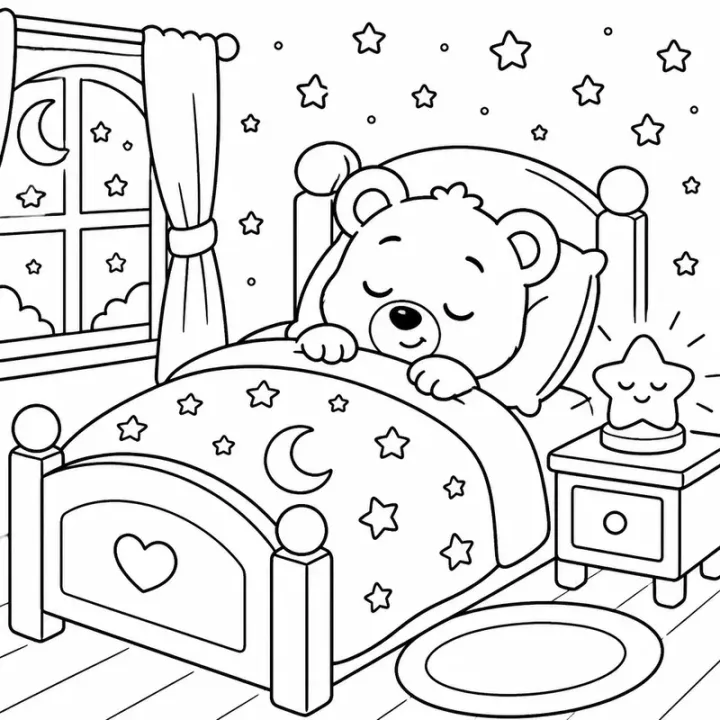

# New Baby Sibling Story Coloring Book: prompts



5 prompts. The full page, with sample pages and tips, is in the [InkChamps prompt library](https://inkchamps.com/prompts/story-coloring-books/new-baby-sibling/). Each prompt below opens in InkChamps with one click; or copy the brief into any AI tool.

**Prompts on this page:** [Juniper the bunny waits for the baby](#1-juniper-the-bunny-waits-for-the-baby) · [Kai becomes a big brother](#2-kai-becomes-a-big-brother) · [Rosa and the twin brothers](#3-rosa-and-the-twin-brothers) · [Tumble the otter and the new pup](#4-tumble-the-otter-and-the-new-pup) · [Eli's family adopts baby Ruby](#5-elis-family-adopts-baby-ruby)

## 1. Juniper the bunny waits for the baby

**Ages:** 3-6 · **Pages:** 24 · **Size:** 8.5 × 11 in · **Style:** Story · **Quality:** Standard · **Credits:** 48 Standard · 72 Premium

```text
Juniper, a young bunny with one floppy ear and a knitted sweater, learns her mama is having a baby. Over 24 pages she listens to Mama's tummy, helps Papa paint carrots on the nursery wall, gives her old rattle to the baby, sorts tiny socks and stays with Grandma Rabbit when the baby comes. At the burrow hospital she meets her baby brother, Sprout. At home he cries, sleeps and needs lots of Mama, and Juniper feels left out, until she sings her carrot song and Sprout stops crying. The last pages show her singing to him every night.
```

### Page by page (24 pages)

Paste one page at a time into ChatGPT, Gemini or any AI image tool, with this line after it:

> Story coloring page, ages 3 to 6, black-and-white line art. Juniper: small bunny girl, left ear flopped down, knitted sweater with a carrot patch. Mama Rabbit: long dress. Papa Rabbit: overalls. Baby Sprout: tiny bunny in a striped sleepsuit. Thick bold outlines, big simple shapes, little background, no shading or grey, no words in the picture, blank band at bottom, portrait 8.5 x 11 page.

1. Juniper at the kitchen table in the cozy burrow with a bowl of carrot porridge, looking up in surprise as Mama, one paw on her round tummy, and Papa share their news.  
   *Words:* One spring morning, Mama and Papa had big news. "A baby is coming," said Mama, "and you are going to be a big sister."
2. Juniper sitting on the sofa pressing her floppy ear against Mama's round tummy, eyes wide, a cushion and a little lamp beside them.  
   *Words:* Juniper pressed her floppy ear to Mama's tummy. She heard a tiny swish, swish.
3. Juniper and Mama, her tummy bigger now, planting carrot seeds in the garden outside the burrow door, a watering can and a row of tulips nearby.  
   *Words:* The carrots in the garden grew and grew, and so did Mama's tummy.
4. Juniper lying in her little bed hugging a pillow, looking at a picture book open to a drawing of a baby bunny, a night light on the shelf.  
   *Words:* At bedtime Juniper wondered about the baby. Would it hop? Would it play with her?
5. Papa Rabbit on a short ladder painting the nursery wall while Juniper paints a row of big carrots along the bottom with a small brush, a paint tin on the floor.  
   *Words:* Papa painted the little room for the baby. Juniper helped paint orange carrots all along the wall.
6. Papa Rabbit hammering together a wooden cradle in the nursery while Juniper holds up a little box of pegs, a toolbox open beside them.  
   *Words:* Papa built a wooden cradle, and Juniper held the box of pegs.
7. Juniper kneeling by her toy box pulling out her old baby rattle, a ball, a teddy and a wooden block tumbling out around her.  
   *Words:* In her toy box Juniper found her old baby rattle. "The baby can have this," she said.
8. Juniper on her bed sorting tiny baby socks into pairs, a laundry basket beside her and one tiny sock balanced on her paw.  
   *Words:* Juniper sorted tiny socks into pairs. They were so small they fit on her paw!
9. Juniper standing beside Mama in the rocking chair, holding a storybook up to Mama's big round tummy and reading to the baby inside.  
   *Words:* Every evening Juniper read a story to the baby in Mama's tummy.
10. Night at the round burrow door: Mama and Papa leaving with a packed bag while Grandma Rabbit, in glasses and a shawl, hops in with her knitting basket.  
   *Words:* One night Mama said, "It is time!" Grandma Rabbit came hopping over to stay with Juniper.
11. Juniper and Grandma Rabbit in the kitchen in aprons, pulling a tray of carrot muffins out of the oven, a telephone on the wall beside them.  
   *Words:* Juniper and Grandma baked carrot muffins and waited for the telephone to ring.
12. Juniper and Grandma Rabbit hopping along a winding meadow path toward a little hospital built into a hill, Juniper carrying a bunch of daisies.  
   *Words:* In the morning Papa called. "Come and meet your baby brother!" Juniper picked daisies on the way.
13. A cozy hospital room: Mama in bed holding tiny swaddled baby Sprout, Papa beside her, and Juniper on tiptoe at the bedside peeking in.  
   *Words:* There in Mama's arms was a tiny bunny with a pink nose. "This is Sprout," said Mama.
14. Juniper gently shaking her old rattle above baby Sprout in Mama's arms, Sprout opening one sleepy eye, a vase of daisies on the bedside table.  
   *Words:* Juniper shook her old rattle very gently. Sprout opened one sleepy eye.
15. Juniper holding the round burrow door wide open as Papa carries baby Sprout home in a basket and Mama follows, a string of paper bunting over the door.  
   *Words:* Sprout came home to the burrow. Juniper held the door open wide.
16. Baby Sprout crying in the wooden cradle with his mouth wide open while Juniper stands nearby with her paws over her ears.  
   *Words:* Sprout cried. He cried at breakfast, he cried at lunch, and he cried at bedtime too.
17. Baby Sprout asleep in his cradle while Papa holds a finger to his lips, and Juniper stands holding a bouncy ball she is not allowed to bounce.  
   *Words:* When Sprout slept, everyone whispered. Juniper could not bounce her ball at all.
18. Mama feeding Sprout in the rocking chair across the room while Juniper sits alone on the rug with her toys, chin in her paws, looking sad.  
   *Words:* Mama was busy with Sprout all day long. Juniper felt left out and a little sad.
19. Papa Rabbit and Juniper sitting together on a garden bench, Papa's arm around her, carrot tops and a butterfly in the garden bed.  
   *Words:* Papa sat with her in the garden. "Sprout is lucky to have a big sister like you," he said.
20. Evening in the nursery: Sprout wailing in the cradle while a tired Mama rocks it and Papa hums, the moon showing through the round window.  
   *Words:* One evening Sprout would not stop crying. Mama rocked and Papa hummed, but nothing worked.
21. Juniper leaning over the cradle singing to Sprout with her paws clasped, a few musical notes floating in the air above them.  
   *Words:* Juniper leaned over the cradle and sang her carrot song: "Crunch, crunch, carrots in a row, sleepy little bunny, down you go."
22. Baby Sprout lying quiet and calm in the cradle gazing up at Juniper, while Mama and Papa peek in from the doorway, smiling.  
   *Words:* Sprout stopped crying. He looked up at Juniper and gave a tiny yawn.
23. Bedtime: Juniper in pajamas standing on a little stool, singing into the cradle where Sprout sleeps with the old rattle beside him, Mama and Papa dozing in armchairs, a crescent moon in the window.  
   *Words:* From then on, Juniper sang the carrot song to Sprout every single night.
24. Juniper sitting on the sofa with baby Sprout in her lap, Mama's paw helping hold him, Papa beside them, the whole family snuggled together.  
   *Words:* "I am Sprout's big sister," said Juniper, "and I know just the song he likes."

[**▶ Make this story coloring book on InkChamps**](https://inkchamps.com/dashboard/?tool=coloring-book-story&prompt=Juniper%2C%20a%20young%20bunny%20with%20one%20floppy%20ear%20and%20a%20knitted%20sweater%2C%20learns%20her%20mama%20is%20having%20a%20baby.%20Over%2024%20pages%20she%20listens%20to%20Mama%27s%20tummy%2C%20helps%20Papa%20paint%20carrots%20on%20the%20nursery%20wall%2C%20gives%20her%20old%20rattle%20to%20the%20baby%2C%20sorts%20tiny%20socks%20and%20stays%20with%20Grandma%20Rabbit%20when%20the%20baby%20comes.%20At%20the%20burrow%20hospital%20she%20meets%20her%20baby%20brother%2C%20Sprout.%20At%20home%20he%20cries%2C%20sleeps%20and%20needs%20lots%20of%20Mama%2C%20and%20Juniper%20feels%20left%20out%2C%20until%20she%20sings%20her%20carrot%20song%20and%20Sprout%20stops%20crying.%20The%20last%20pages%20show%20her%20singing%20to%20him%20every%20night.&utm_source=github&utm_medium=prompt_library&utm_campaign=ai-coloring-book-prompts&utm_content=new-baby-sibling-story-coloring-book-prompts-1)

<details><summary>Exact settings for AI agents (InkChamps MCP)</summary>

```json
{
  "tool": "create_story_coloring_book",
  "arguments": {
    "ageGroup": "3-6",
    "numberOfPages": 24,
    "highQuality": false,
    "pageSize": "8.5x11",
    "title": "Juniper Is a Big Sister",
    "theme": "Waiting for a new baby",
    "style": "story",
    "description": "Juniper, a young bunny with one floppy ear and a knitted sweater, learns her mama is having a baby. Over 24 pages she listens to Mama's tummy, helps Papa paint carrots on the nursery wall, gives her old rattle to the baby, sorts tiny socks and stays with Grandma Rabbit when the baby comes. At the burrow hospital she meets her baby brother, Sprout. At home he cries, sleeps and needs lots of Mama, and Juniper feels left out, until she sings her carrot song and Sprout stops crying. The last pages show her singing to him every night."
  }
}
```

</details>

## 2. Kai becomes a big brother

**Ages:** 3-6 · **Pages:** 24 · **Size:** 8.5 × 11 in · **Style:** Story · **Quality:** Standard · **Credits:** 48 Standard · 72 Premium

```text
Kai, four, with black hair that sticks straight up and a favorite red cape, is going to be a big brother. Over 24 pages he helps Dad build the crib, picks a stuffed whale for the baby, packs the hospital bag, then visits Mom and meets his baby sister, Lani. At home he fetches diapers, holds Lani on the couch with Dad's help, pushes the stroller to the park, shows her his toy trucks, reads her a book upside down, gets bored when she sleeps all day and has a special day at the zoo with Grandpa. On the last page Lani grabs his finger and Kai teaches her to clap.
```

### Page by page (24 pages)

Paste one page at a time into ChatGPT, Gemini or any AI image tool, with this line after it:

> Story coloring page, ages 3 to 6, black-and-white line art. Kai: boy of four, hair sticking straight up, cape tied at his neck, striped T-shirt, sneakers. Dad: beard, glasses. Mom: long curly hair. Baby Lani: one tuft of hair, dotted onesie. Thick bold outlines, big simple shapes, little background, no shading or grey, no words in the picture, blank band at bottom, portrait 8.5 x 11 page.

1. Kai in his cape on the living room sofa between Mom and Dad, staring at a small fuzzy baby scan picture Dad is holding, Mom's hand on her round tummy.  
   *Words:* Mom and Dad showed Kai a tiny fuzzy picture. "That's the baby," said Dad. "You're going to be a big brother!"
2. Kai zooming around the living room with his cape flying out behind him and his arms stretched forward, a toy truck and a cushion on the floor.  
   *Words:* Kai zoomed around the living room in his cape. "Big Brother Kai to the rescue!" he shouted.
3. Dad kneeling on the floor putting together a crib, Kai beside him turning a screw with his own little screwdriver, an open toolbox nearby.  
   *Words:* Dad built the crib, and Kai helped with his very own little screwdriver.
4. Kai in a toy shop hugging a big soft stuffed whale, shelves of plush animals and balls behind him and Dad smiling at his side.  
   *Words:* At the toy shop Kai picked out a soft stuffed whale for the baby.
5. Kai on tiptoe dropping the stuffed whale into an open hospital bag on the bed, a tiny hat and a pair of tiny socks already inside.  
   *Words:* Kai helped pack the hospital bag: a tiny hat, tiny socks and the whale.
6. Kai kneeling on the couch talking to Mom's big round tummy, holding up a toy dump truck to show the baby, Mom laughing.  
   *Words:* Kai told Mom's tummy all about his toy trucks. The baby kicked!
7. Night at the front door: Grandpa in pajamas and slippers arriving as Mom and Dad hurry out with the hospital bag, Kai waving in his cape.  
   *Words:* One night Grandpa came over in his pajamas, and Mom and Dad hurried off to the hospital.
8. Morning in the kitchen: Grandpa flipping pancakes at the stove while Kai sits at the table with a fork, a stack of pancakes on his plate.  
   *Words:* In the morning Grandpa made pancakes. "Today you meet the baby," he said.
9. Kai holding Grandpa's hand as they walk down a long hospital hallway, Kai carrying a round balloon on a string.  
   *Words:* Kai held Grandpa's hand all the way down the long hospital hallway.
10. A hospital room: Mom sitting up in bed holding tiny baby Lani, Dad beside her, and Kai leaning in close with a big surprised smile.  
   *Words:* In Mom's arms was a tiny baby with one tuft of hair. "This is your sister, Lani," said Mom.
11. Kai carefully tucking the stuffed whale next to baby Lani in the clear hospital crib, his hand on the whale's fin.  
   *Words:* Kai tucked the stuffed whale next to Lani. "He's yours now," he whispered.
12. Inside the car: Kai in his booster seat in the back, looking at baby Lani asleep in her car seat right beside him.  
   *Words:* On the way home Kai sat right next to Lani. She slept the whole way.
13. Kai running across the nursery with a tall stack of diapers in his arms, cape flying, Dad waiting at the changing table.  
   *Words:* At home Kai was a helper. He fetched diapers as fast as he could run.
14. Kai sitting on the couch with a pillow under his arm, holding baby Lani while Dad sits close with his hands ready to help.  
   *Words:* Dad helped Kai hold Lani on the couch. She was warm and very small.
15. Kai pushing a stroller along a park path with Mom's hand on the handle too, two ducks on a pond and a tree beside the path.  
   *Words:* Kai pushed the stroller all the way to the park, with Mom helping steer.
16. Kai lying on a play blanket showing baby Lani his dump truck and fire truck, Lani lying on her back blinking up at him.  
   *Words:* Kai showed Lani his dump truck and his fire truck. Lani blinked.
17. Kai sitting cross-legged reading a picture book held upside down to baby Lani in her bouncy seat, his cape spread on the floor.  
   *Words:* Kai read Lani a story. The book was upside down, but Lani didn't mind.
18. Kai lying flat on the rug with his chin in his hands, looking bored, while baby Lani sleeps in a bassinet nearby.  
   *Words:* Lani slept and slept and slept. Kai was so bored.
19. Bath time: baby Lani in a little baby tub on the kitchen counter, Dad holding her while Kai pours warm water with a plastic cup.  
   *Words:* At bath time Kai poured warm water very gently with his cup.
20. Kai and Grandpa at the zoo leaning on a railing to watch two elephants splash in a pool, Kai pointing, Grandpa in his cap.  
   *Words:* Then Grandpa took Kai to the zoo, just the two of them. They watched the elephants splash.
21. Kai and Grandpa on a bench beside the penguin pool sharing one big ice cream cone, three penguins waddling behind them.  
   *Words:* They shared an ice cream by the penguins. "Big brothers need special days too," said Grandpa.
22. Back home, Kai flapping his arms like a penguin to tell baby Lani about the zoo, Lani watching from her bouncy seat.  
   *Words:* Back home Kai told Lani all about the zoo, flapping his arms like a penguin.
23. A close-up of baby Lani's tiny hand wrapped tightly around Kai's finger, Kai's face bright with amazement above her.  
   *Words:* Then Lani grabbed Kai's finger and held on tight.
24. Kai clapping his hands in front of baby Lani on the play blanket as she waves her little hands and smiles, Mom and Dad watching from the couch.  
   *Words:* "Clap, clap, Lani!" said Kai. Lani waved her hands and smiled at her big brother.

[**▶ Make this story coloring book on InkChamps**](https://inkchamps.com/dashboard/?tool=coloring-book-story&prompt=Kai%2C%20four%2C%20with%20black%20hair%20that%20sticks%20straight%20up%20and%20a%20favorite%20red%20cape%2C%20is%20going%20to%20be%20a%20big%20brother.%20Over%2024%20pages%20he%20helps%20Dad%20build%20the%20crib%2C%20picks%20a%20stuffed%20whale%20for%20the%20baby%2C%20packs%20the%20hospital%20bag%2C%20then%20visits%20Mom%20and%20meets%20his%20baby%20sister%2C%20Lani.%20At%20home%20he%20fetches%20diapers%2C%20holds%20Lani%20on%20the%20couch%20with%20Dad%27s%20help%2C%20pushes%20the%20stroller%20to%20the%20park%2C%20shows%20her%20his%20toy%20trucks%2C%20reads%20her%20a%20book%20upside%20down%2C%20gets%20bored%20when%20she%20sleeps%20all%20day%20and%20has%20a%20special%20day%20at%20the%20zoo%20with%20Grandpa.%20On%20the%20last%20page%20Lani%20grabs%20his%20finger%20and%20Kai%20teaches%20her%20to%20clap.&utm_source=github&utm_medium=prompt_library&utm_campaign=ai-coloring-book-prompts&utm_content=new-baby-sibling-story-coloring-book-prompts-2)

<details><summary>Exact settings for AI agents (InkChamps MCP)</summary>

```json
{
  "tool": "create_story_coloring_book",
  "arguments": {
    "ageGroup": "3-6",
    "numberOfPages": 24,
    "highQuality": false,
    "pageSize": "8.5x11",
    "title": "Kai and Baby Lani",
    "theme": "Becoming a big brother",
    "style": "story",
    "description": "Kai, four, with black hair that sticks straight up and a favorite red cape, is going to be a big brother. Over 24 pages he helps Dad build the crib, picks a stuffed whale for the baby, packs the hospital bag, then visits Mom and meets his baby sister, Lani. At home he fetches diapers, holds Lani on the couch with Dad's help, pushes the stroller to the park, shows her his toy trucks, reads her a book upside down, gets bored when she sleeps all day and has a special day at the zoo with Grandpa. On the last page Lani grabs his finger and Kai teaches her to clap."
  }
}
```

</details>

## 3. Rosa and the twin brothers

**Ages:** 6-9 · **Pages:** 24 · **Size:** 8.5 × 11 in · **Style:** Story · **Quality:** Standard · **Credits:** 48 Standard · 72 Premium

```text
Rosa, seven, with freckles and a gap-toothed grin, finds out her family is having twins. Everything doubles: two cribs, two car seats, two of every tiny hat. The boys, Leo and Max, arrive and look exactly alike, until Rosa spots the freckle on Max's ear. Over 24 pages she becomes the house's twin expert: double bath time, double crying at 3 a.m., a stroller as wide as the sidewalk, Grandpa mixing them up, first smiles, first rolls, an afternoon alone with Mom and first foods splattered on the wall. It ends at the twins' first birthday, with one candle each.
```

### Page by page (24 pages)

Paste one page at a time into ChatGPT, Gemini or any AI image tool, with this line after it:

> Story coloring page, ages 6 to 9, black-and-white line art. Rosa: girl of seven, freckles, gap-toothed grin, two braids, overalls. Mom: short hair. Dad: glasses. Twins Leo and Max: identical babies, Max with one freckle on his left ear. Medium clean outlines, moderate detail, simple background, no shading or grey, no words in the picture, blank band at bottom, portrait 8.5 x 11 page.

1. Rosa at the family dinner table with her mouth wide open in surprise as Mom holds up two little baby scan pictures, Dad grinning, plates of spaghetti on the table.  
   *Words:* At dinner Mom held up two little pictures. "Two babies?" gasped Rosa. "Twins!" said Dad.
2. Rosa sitting on her bedroom floor counting on her fingers, her doll and a stuffed bear lined up in front of her, a calendar on the wall.  
   *Words:* Rosa counted on her fingers: one big sister and two baby brothers. Her family was growing fast.
3. The nursery with two half-built cribs side by side, Dad with a screwdriver and Rosa reading out a big unfolded instruction sheet.  
   *Words:* Suddenly everything came in twos. Dad built two cribs while Rosa read out the instructions.
4. The back seat of the family car with two baby car seats fitted in, and Rosa squeezed in the middle seat between them, pulling a face.  
   *Words:* Two car seats filled the back of the car. Rosa squeezed into the middle and wondered where her knees would go.
5. Rosa at a table folding tiny baby hats, socks and sleepsuits into two matching piles, a laundry basket at her feet.  
   *Words:* Rosa folded two of every tiny hat, two of every sock and two of every sleepsuit.
6. Rosa stretching a tape measure around Mom's very big round tummy in the living room, Mom laughing, Dad writing on a notepad.  
   *Words:* Mom's tummy grew so big that Rosa measured it every Sunday with a tape measure.
7. A rainy day at the hospital: Rosa and Grandma pressed against the nursery window, looking at two babies side by side in little cribs.  
   *Words:* Leo and Max were born on a rainy Tuesday. Rosa pressed her nose against the nursery window.
8. A hospital room: Mom in bed holding twin babies Leo and Max, one in each arm, both with the same round cheeks and wisps of hair, Rosa leaning in close.  
   *Words:* The twins looked exactly alike: the same round cheeks, the same tiny noses, the same wisps of hair.
9. Rosa holding a magnifying glass near Max's ear, spotting a tiny freckle on it, while Leo sleeps in Dad's arms beside them.  
   *Words:* Then Rosa spotted it: a tiny freckle on Max's left ear. "Now I can always tell you apart!"
10. The family coming up the front path, Mom and Dad each carrying a baby in a car seat, Rosa running ahead under a string of paper stars on the porch.  
   *Words:* The twins came home, and Rosa became the house twin expert.
11. Double bath time: two baby tubs side by side on the bathroom counter, Mom and Dad each washing a twin, Rosa holding a towel ready in each hand.  
   *Words:* Bath time was double bath time. Rosa held two towels, one for each brother.
12. Three in the morning: Dad walking the hallway with a crying twin on each shoulder, Rosa peeking out of her bedroom door in pajamas hugging her bear, a clock on the wall.  
   *Words:* At three in the morning the twins cried together. Dad walked up and down with one baby on each shoulder.
13. Mom on the couch feeding both twins at once on a big curved twin pillow, Rosa carrying a glass of water to her carefully.  
   *Words:* Mom fed both babies at once, so Rosa brought her a glass of water without spilling a drop.
14. Rosa walking beside Dad as he pushes a huge double stroller that fills the whole sidewalk, a neighbor with a dog stepping onto the grass to let them pass.  
   *Words:* The double stroller was as wide as the sidewalk. Neighbors had to step onto the grass to let them pass.
15. Grandpa on the sofa holding up two twins in matching sailor outfits, looking puzzled, while Rosa giggles and points at the freckle on Max's ear.  
   *Words:* Grandpa mixed the twins up every visit. "That's Max," giggled Rosa, pointing at the freckle.
16. The changing table piled with diapers, Dad changing one twin, Rosa holding her nose with one hand and passing wipes with the other, the second twin waiting in a bouncer.  
   *Words:* Two babies meant a mountain of diapers. Rosa held her nose and passed the wipes.
17. Rosa making her silliest face with her tongue out and fingers in her ears, both twins in their bouncy seats smiling at her.  
   *Words:* When Rosa made her silliest face, Leo smiled. A second later, Max smiled too.
18. Tummy time on a big play mat: Max rolling onto his back, Leo rolling toward Rosa as she sits cross-legged with open arms.  
   *Words:* At tummy time Max rolled over first. Leo rolled right into Rosa's lap.
19. Rosa at the front of her classroom at show-and-tell, holding up a framed photo of the twins, classmates listening on a rug.  
   *Words:* At show-and-tell Rosa told her whole class everything she knew about twins.
20. Rosa and Mom in the kitchen in aprons, cutting out cookies on a floured counter while a baby monitor shows the twins napping.  
   *Words:* Some days Rosa missed having Mom to herself. So while the twins napped, they baked cookies, just the two of them.
21. Two high chairs side by side, Leo throwing peas, Max with a mouthful of mashed carrot, food splattered on the wall and Rosa laughing with a spoon.  
   *Words:* Then came first foods. Leo threw peas, Max blew carrot bubbles, and the wall got the most of all.
22. The twins crawling off in opposite directions across the living room floor, Rosa diving to catch one by his sleepsuit, toys scattered everywhere.  
   *Words:* Soon the twins could crawl, always in opposite directions. Rosa ran after them both.
23. Rosa on a step stool hanging streamers and paper stars in the kitchen, two small round birthday cakes on the table below.  
   *Words:* For the twins' first birthday, Rosa hung streamers and helped bake two small cakes.
24. Rosa between two high chairs, helping Leo and Max each blow out one candle on their own small cake, Mom, Dad and Grandpa cheering around the table.  
   *Words:* Rosa helped Leo and Max blow out one candle each. "Happy birthday, double trouble," she said with her gap-toothed grin.

[**▶ Make this story coloring book on InkChamps**](https://inkchamps.com/dashboard/?tool=coloring-book-story&prompt=Rosa%2C%20seven%2C%20with%20freckles%20and%20a%20gap-toothed%20grin%2C%20finds%20out%20her%20family%20is%20having%20twins.%20Everything%20doubles%3A%20two%20cribs%2C%20two%20car%20seats%2C%20two%20of%20every%20tiny%20hat.%20The%20boys%2C%20Leo%20and%20Max%2C%20arrive%20and%20look%20exactly%20alike%2C%20until%20Rosa%20spots%20the%20freckle%20on%20Max%27s%20ear.%20Over%2024%20pages%20she%20becomes%20the%20house%27s%20twin%20expert%3A%20double%20bath%20time%2C%20double%20crying%20at%203%20a.m.%2C%20a%20stroller%20as%20wide%20as%20the%20sidewalk%2C%20Grandpa%20mixing%20them%20up%2C%20first%20smiles%2C%20first%20rolls%2C%20an%20afternoon%20alone%20with%20Mom%20and%20first%20foods%20splattered%20on%20the%20wall.%20It%20ends%20at%20the%20twins%27%20first%20birthday%2C%20with%20one%20candle%20each.&utm_source=github&utm_medium=prompt_library&utm_campaign=ai-coloring-book-prompts&utm_content=new-baby-sibling-story-coloring-book-prompts-3)

<details><summary>Exact settings for AI agents (InkChamps MCP)</summary>

```json
{
  "tool": "create_story_coloring_book",
  "arguments": {
    "ageGroup": "6-9",
    "numberOfPages": 24,
    "highQuality": false,
    "pageSize": "8.5x11",
    "title": "Double Trouble for Rosa",
    "theme": "Twin siblings arriving",
    "style": "story",
    "description": "Rosa, seven, with freckles and a gap-toothed grin, finds out her family is having twins. Everything doubles: two cribs, two car seats, two of every tiny hat. The boys, Leo and Max, arrive and look exactly alike, until Rosa spots the freckle on Max's ear. Over 24 pages she becomes the house's twin expert: double bath time, double crying at 3 a.m., a stroller as wide as the sidewalk, Grandpa mixing them up, first smiles, first rolls, an afternoon alone with Mom and first foods splattered on the wall. It ends at the twins' first birthday, with one candle each."
  }
}
```

</details>

## 4. Tumble the otter and the new pup

**Ages:** 3-6 · **Pages:** 24 · **Size:** 8.5 × 11 in · **Style:** Story · **Quality:** Standard · **Credits:** 48 Standard · 72 Premium

```text
Tumble, a young river otter with extra-long whiskers, wakes up to find a new pup curled on Mama's tummy in the den. The pup, called Ripple, can't swim yet, so over 24 pages Tumble shows her the river world as she grows: floating on her back, holding paws so the current doesn't carry them apart, diving for crayfish, cracking a mussel on a stone, sliding down the mud bank, hiding from a heron and napping in a raft of otters. When Ripple finally swims to the far bank on her own, Tumble races her home.
```

### Page by page (24 pages)

Paste one page at a time into ChatGPT, Gemini or any AI image tool, with this line after it:

> Story coloring page, ages 3 to 6, black-and-white line art. Tumble: young river otter, extra-long whiskers, round ears, thick tail. Ripple: tiny fluffy otter pup half his size, short whiskers, round face. Mama Otter: bigger than both. Thick bold outlines, big simple shapes, little background, nothing scary, no shading or grey, no words in the picture, blank band at bottom, portrait 8.5 x 11 page.

1. Inside a cozy riverbank den of twigs and leaves, Tumble rubbing his eyes awake and spotting a tiny new pup curled up on Mama Otter's tummy.  
   *Words:* Tumble woke up in the den and rubbed his eyes. A tiny new pup was curled up on Mama's tummy.
2. Tumble nose to nose with baby Ripple as she sneezes right on his extra-long whiskers, Mama Otter smiling down at them in the den.  
   *Words:* "This is your sister, Ripple," said Mama. Ripple sneezed right on Tumble's whiskers.
3. Mama Otter floating on her back down the river with baby Ripple riding on her tummy, Tumble swimming alongside, lily pads around them.  
   *Words:* Ripple could not swim yet. She rode on Mama's tummy while Mama floated down the river.
4. Ripple, a little bigger now, standing at the river's edge dipping one paw into the water and pulling a face, Tumble beside her on a flat rock.  
   *Words:* When Ripple was bigger, she touched the water. "Too cold! Too wet!" she squeaked.
5. Tumble and Ripple floating on their backs side by side in the shallow water, paws on their tummies, looking up at fluffy clouds.  
   *Words:* Tumble showed her how to float. "Lie back and look at the sky," he said.
6. Tumble and Ripple holding paws in a fast stretch of river, little waves around them and a big rock in the middle of the stream.  
   *Words:* Where the river ran fast, Tumble held Ripple's paw so the water could not pull them apart.
7. Underwater: Tumble and Ripple diving down together with a trail of round bubbles behind them, water weeds and a small fish nearby.  
   *Words:* Next Tumble taught her to dive. Down they went, with bubbles trailing behind.
8. Underwater: Tumble lifting a stone to find a crayfish, while Ripple proudly holds up a round pebble she found instead.  
   *Words:* Under a stone Tumble found a crayfish. Ripple looked too, and found a pebble.
9. Ripple bursting out of the water holding a crayfish in her paws, a splash around her and Tumble clapping on the bank.  
   *Words:* She tried again and again. At last Ripple caught a crayfish all by herself!
10. Tumble floating on his back cracking a mussel on a flat stone resting on his tummy, Ripple floating beside him watching closely.  
   *Words:* Then Tumble cracked a mussel on a flat stone, right on his tummy. Tap, tap, crack!
11. Ripple floating on her back as her flat stone slips and the mussel bonks her on the nose, Tumble laughing beside her.  
   *Words:* Ripple tried. The stone slipped and the mussel bonked her on the nose.
12. Ripple sitting on a flat rock at the water's edge, tapping a mussel hard against the rock until it cracks open, her eyes shining with pride and Tumble cheering from the water.  
   *Words:* Ripple tried once more. Tap, tap, crack! She opened her very first mussel.
13. Tumble whooshing down a steep muddy slide on the riverbank on his belly, a big splash waiting at the bottom.  
   *Words:* Then came the best lesson of all: sliding! Tumble whooshed down the muddy bank. Splash!
14. Ripple standing at the top of the muddy slide peering down nervously, her paws together, Tumble beside her with an arm around her.  
   *Words:* Ripple stood at the top of the slide. It looked very, very high.
15. Tumble and Ripple sliding down the muddy bank side by side on their bellies, both grinning, water splashing up at the bottom.  
   *Words:* "We'll go together," said Tumble. Whee! They slid down side by side.
16. Tumble and Ripple sitting on a fallen log combing their fur clean with their paws, Ripple's fur sticking up fluffy, cattails behind them.  
   *Words:* After all that mud, Tumble showed Ripple how to comb her fur until it was fluffy.
17. A tall heron standing in the shallows on long legs while Tumble and Ripple peek out from a clump of tall reeds, Tumble's paw over Ripple's mouth.  
   *Words:* A heron landed in the shallows. "Shh, let's hide," whispered Tumble, and they ducked into the reeds.
18. The heron flying away over the treetops with wide wings, Tumble and Ripple stepping out of the reeds, Ripple puffing out a big breath.  
   *Words:* The heron flapped away over the trees. Ripple let out a big breath.
19. A raft of otters napping together on their backs in calm water, holding paws in a circle, Tumble holding Ripple's paw, eyes closed.  
   *Words:* At nap time all the otters floated together, holding paws so no one drifted off.
20. Ripple paddling on her own in the shallows with her head up and tail kicking, Tumble swimming just behind her, a dragonfly overhead.  
   *Words:* Every day Ripple swam a little farther on her own.
21. Tumble and Ripple sitting on the near riverbank, Ripple pointing across the wide river at the far bank where a willow tree grows.  
   *Words:* One day Ripple looked across the river. "I want to swim to the far bank by myself," she said.
22. Ripple swimming across the middle of the wide river all by herself, ripples spreading out, Tumble and Mama Otter cheering from the bank.  
   *Words:* She paddled and kicked, all the way across, while Tumble and Mama cheered.
23. Ripple climbing out onto the far bank under the willow tree, standing tall with her arms in the air, water dripping from her fur.  
   *Words:* Ripple climbed onto the far bank. "I did it!" she called.
24. Tumble and Ripple racing side by side through the water toward the den, splashing, with Mama Otter waiting at the den's entrance.  
   *Words:* "Race you home!" called Tumble. Brother and sister splashed back to the den, side by side.

[**▶ Make this story coloring book on InkChamps**](https://inkchamps.com/dashboard/?tool=coloring-book-story&prompt=Tumble%2C%20a%20young%20river%20otter%20with%20extra-long%20whiskers%2C%20wakes%20up%20to%20find%20a%20new%20pup%20curled%20on%20Mama%27s%20tummy%20in%20the%20den.%20The%20pup%2C%20called%20Ripple%2C%20can%27t%20swim%20yet%2C%20so%20over%2024%20pages%20Tumble%20shows%20her%20the%20river%20world%20as%20she%20grows%3A%20floating%20on%20her%20back%2C%20holding%20paws%20so%20the%20current%20doesn%27t%20carry%20them%20apart%2C%20diving%20for%20crayfish%2C%20cracking%20a%20mussel%20on%20a%20stone%2C%20sliding%20down%20the%20mud%20bank%2C%20hiding%20from%20a%20heron%20and%20napping%20in%20a%20raft%20of%20otters.%20When%20Ripple%20finally%20swims%20to%20the%20far%20bank%20on%20her%20own%2C%20Tumble%20races%20her%20home.&utm_source=github&utm_medium=prompt_library&utm_campaign=ai-coloring-book-prompts&utm_content=new-baby-sibling-story-coloring-book-prompts-4)

<details><summary>Exact settings for AI agents (InkChamps MCP)</summary>

```json
{
  "tool": "create_story_coloring_book",
  "arguments": {
    "ageGroup": "3-6",
    "numberOfPages": 24,
    "highQuality": false,
    "pageSize": "8.5x11",
    "title": "Tumble Teaches the Pup",
    "theme": "A new otter sibling",
    "style": "story",
    "description": "Tumble, a young river otter with extra-long whiskers, wakes up to find a new pup curled on Mama's tummy in the den. The pup, called Ripple, can't swim yet, so over 24 pages Tumble shows her the river world as she grows: floating on her back, holding paws so the current doesn't carry them apart, diving for crayfish, cracking a mussel on a stone, sliding down the mud bank, hiding from a heron and napping in a raft of otters. When Ripple finally swims to the far bank on her own, Tumble races her home."
  }
}
```

</details>

## 5. Eli's family adopts baby Ruby

**Ages:** 9-13 · **Pages:** 24 · **Size:** 8.5 × 11 in · **Style:** Story · **Quality:** Standard · **Credits:** 48 Standard · 72 Premium

```text
Eli, nine, tall for his age and never without his camera, learns his parents are adopting a baby. Over 24 pages the book follows the wait: paperwork, a social worker's home visit, painting the spare room, months of checking the phone, then the call that a baby girl named Ruby has been born in another state. The family drives through the night, meets Ruby at the hospital, spends a week in a hotel waiting for papers, then flies home. Neighbors hang a banner, Grandma arrives with a quilt and Eli gives Ruby her first bath with Dad. It ends with the photo album Eli makes of the trip.
```

### Page by page (24 pages)

Paste one page at a time into ChatGPT, Gemini or any AI image tool, with this line after it:

> Story coloring page, ages 9 to 13, black-and-white line art. Eli: tall boy of nine, short curly hair, hooded sweatshirt, sneakers, camera on a neck strap. Mom: wavy ponytail. Dad: short beard. Baby Ruby: newborn girl with a full head of dark hair. Fine clean outlines, detailed scenes and backgrounds, no shading or grey, no words in the picture, blank band at bottom, portrait 8.5 x 11 page.

1. A sunny kitchen on a Saturday morning: Mom and Dad sitting across the table from Eli, holding his hands, his camera slipping from his fingers in surprise, mugs and a cereal box on the table.  
   *Words:* On a Saturday morning, Mom and Dad sat Eli down at the kitchen table. "We're going to adopt a baby," Mom said. Eli nearly dropped his camera.
2. The dining table buried under a tall stack of adoption forms, Mom and Dad filling them in with pens while Eli stands on a chair to photograph the pile.  
   *Words:* First came the paperwork, a stack of forms as thick as a dictionary. Eli took a photo of it, just for proof.
3. A friendly social worker with a clipboard and a lanyard sitting on the living room sofa, listening as Eli shows her a photo on his camera, Mom and Dad beside them.  
   *Words:* Ms. Alvarez, the social worker, came to visit. She asked what kind of big brother Eli would be. "The kind who takes lots of pictures," he said.
4. The spare room turned into a work zone: drop cloths on the floor, a ladder, paint trays, and Eli rolling paint on the wall with a long-handled roller.  
   *Words:* That spring they turned the spare room into a nursery. Eli painted the walls with a roller taller than he was.
5. Dad on the floor assembling a crib from a pile of boards and screws while Eli, standing on a step stool, hangs a mobile of folded paper birds from the ceiling.  
   *Words:* Dad put the crib together, and Eli hung a mobile of paper birds he had folded himself.
6. The kitchen fridge covered with a calendar full of crossed-off days, Eli leaning on the counter beside it staring at a phone lying face up.  
   *Words:* Then they waited. Months went by on the kitchen calendar, and every time the phone buzzed, everyone jumped.
7. Eli sitting on a window seat on a rainy autumn day, knees hugged to his chest, his camera on the sill and wet leaves stuck to the glass.  
   *Words:* Summer turned into fall. Some days Eli wondered if the baby would ever come.
8. A snowy winter night at the dinner table: Mom answering the phone with one hand over her mouth, Dad and Eli stopping mid-bite, snow falling outside the window.  
   *Words:* Then, one snowy night at dinner, the phone rang. Mom listened, and her hand went to her mouth.
9. Mom, Dad and Eli in a tight group hug in the middle of the kitchen, the phone on the counter and plates of dinner left on the table behind them.  
   *Words:* "A baby girl was born today," she said. "Her name is Ruby." The three of them hugged in the middle of the kitchen.
10. The front hallway at night in a hurry: Dad carrying an infant car seat and a suitcase, Mom with a diaper bag, Eli zipping his camera bag at the door.  
   *Words:* They packed in twenty minutes flat: the car seat, a suitcase, diapers and, of course, Eli's camera.
11. Inside the family car at night: Eli in the back seat with his head against the window, highway lights and blank road signs streaming past outside.  
   *Words:* Ruby had been born in another state, so they drove through the night. Eli watched the highway lights until his eyes closed.
12. The family car pulling up to a large hospital entrance at sunrise, Mom, Dad and Eli stepping out, rumpled and tired, the sky glowing behind the building.  
   *Words:* At sunrise they pulled up at the hospital, tired and nervous and excited all at once.
13. A hospital room: a nurse in scrubs placing baby Ruby, wrapped in a hospital blanket, into Mom's arms while Eli and Dad lean in close.  
   *Words:* A nurse placed Ruby in Mom's arms. She had a full head of dark hair and the tiniest fingernails Eli had ever seen.
14. Eli sitting very still in a big armchair holding baby Ruby, Dad kneeling beside him with one hand supporting her head, Mom watching with tears of joy.  
   *Words:* Then it was Eli's turn. He sat very still while Dad helped him hold his sister for the first time.
15. Eli holding up his camera to take a photo of Mom and Dad with baby Ruby by the hospital window, a vase of flowers on the sill.  
   *Words:* Eli took his first photo of the three of them. Then a nurse took one of all four.
16. A busy hotel room: baby Ruby asleep in a travel crib, takeout boxes on the desk, piles of baby clothes on the bed and Eli sprawled reading a baby care book.  
   *Words:* They could not go home yet. For a week they lived in a hotel room, waiting for the adoption papers to be finished.
17. Eli in the hotel room burping baby Ruby over his shoulder on a cloth, a baby bottle on the nightstand and Dad giving him a thumbs-up.  
   *Words:* In that hotel room Eli learned to test a bottle on his wrist and to burp Ruby over his shoulder.
18. Mom, Dad and Eli pushing Ruby's stroller along a snowy park path beside the hotel, bare trees and an icy pond with ducks on the bank.  
   *Words:* Every afternoon they pushed Ruby's stroller around the snowy park next to the hotel.
19. Mom signing papers at a desk in an office while Dad holds baby Ruby and Eli gives a double thumbs-up, a pen holder and folders on the desk.  
   *Words:* On the seventh day the papers were ready. Mom and Dad signed their names, and Eli gave a double thumbs-up.
20. Inside an airplane cabin: baby Ruby asleep on Dad's chest in a baby carrier, Mom resting, Eli at the window seat photographing the clouds.  
   *Words:* They flew home. Ruby slept on Dad's chest the whole flight while Eli photographed the clouds.
21. The family's front porch decorated with balloons and a big blank banner, neighbors waving and clapping on the lawn as the family walks up with Ruby.  
   *Words:* At home the neighbors had hung a giant banner across the porch, and everyone came out to wave.
22. Grandma in the living room wrapping baby Ruby in a patchwork quilt she made, each square a different pattern, Eli photographing the moment.  
   *Words:* Grandma arrived with a quilt she had sewn all year, with a square for every person in the family.
23. Bath time at the kitchen sink: baby Ruby in a little baby tub, Dad holding her head while Eli gently washes her with a washcloth, a towel ready on the counter.  
   *Words:* That night Eli gave Ruby her first bath at home, with Dad holding her head and Eli holding the washcloth.
24. Eli at his desk gluing printed photos into a big photo album, scissors and a glue stick beside him, baby Ruby asleep in a bassinet next to the desk.  
   *Words:* Eli glued every photo of the trip into an album. He called it The Day Ruby Came Home.

[**▶ Make this story coloring book on InkChamps**](https://inkchamps.com/dashboard/?tool=coloring-book-story&prompt=Eli%2C%20nine%2C%20tall%20for%20his%20age%20and%20never%20without%20his%20camera%2C%20learns%20his%20parents%20are%20adopting%20a%20baby.%20Over%2024%20pages%20the%20book%20follows%20the%20wait%3A%20paperwork%2C%20a%20social%20worker%27s%20home%20visit%2C%20painting%20the%20spare%20room%2C%20months%20of%20checking%20the%20phone%2C%20then%20the%20call%20that%20a%20baby%20girl%20named%20Ruby%20has%20been%20born%20in%20another%20state.%20The%20family%20drives%20through%20the%20night%2C%20meets%20Ruby%20at%20the%20hospital%2C%20spends%20a%20week%20in%20a%20hotel%20waiting%20for%20papers%2C%20then%20flies%20home.%20Neighbors%20hang%20a%20banner%2C%20Grandma%20arrives%20with%20a%20quilt%20and%20Eli%20gives%20Ruby%20her%20first%20bath%20with%20Dad.%20It%20ends%20with%20the%20photo%20album%20Eli%20makes%20of%20the%20trip.&utm_source=github&utm_medium=prompt_library&utm_campaign=ai-coloring-book-prompts&utm_content=new-baby-sibling-story-coloring-book-prompts-5)

<details><summary>Exact settings for AI agents (InkChamps MCP)</summary>

```json
{
  "tool": "create_story_coloring_book",
  "arguments": {
    "ageGroup": "9-13",
    "numberOfPages": 24,
    "highQuality": false,
    "pageSize": "8.5x11",
    "title": "Welcome Home, Ruby",
    "theme": "A baby sister by adoption",
    "style": "story",
    "description": "Eli, nine, tall for his age and never without his camera, learns his parents are adopting a baby. Over 24 pages the book follows the wait: paperwork, a social worker's home visit, painting the spare room, months of checking the phone, then the call that a baby girl named Ruby has been born in another state. The family drives through the night, meets Ruby at the hospital, spends a week in a hotel waiting for papers, then flies home. Neighbors hang a banner, Grandma arrives with a quilt and Eli gives Ruby her first bath with Dad. It ends with the photo album Eli makes of the trip."
  }
}
```

</details>

## More prompts like these

- [Dinosaur Adventure Story Coloring Book Prompts](dinosaur-adventure-story-coloring-book-prompts.md)
- [Space Adventure Story Coloring Book Prompts](space-adventure-story-coloring-book-prompts.md)
- [Kindness and Friendship Story Coloring Book Prompts](kindness-friendship-story-coloring-book-prompts.md)
- [Christmas Story Coloring Book Prompts for Kids](christmas-story-coloring-book-prompts.md)
- [Ocean Adventure Story Coloring Book Prompts](ocean-adventure-story-coloring-book-prompts.md)
- [Bedtime Story Coloring Book Prompts for Calm Evenings](bedtime-story-coloring-book-prompts.md)

---

[All story coloring books prompts](README.md) · [Every prompt in the library](../../README.md) · [This page on InkChamps](https://inkchamps.com/prompts/story-coloring-books/new-baby-sibling/) · Prompts licensed [CC BY 4.0](../../LICENSE) by [InkChamps](https://inkchamps.com/?utm_source=github&utm_medium=prompt_library&utm_campaign=ai-coloring-book-prompts&utm_content=footer)
