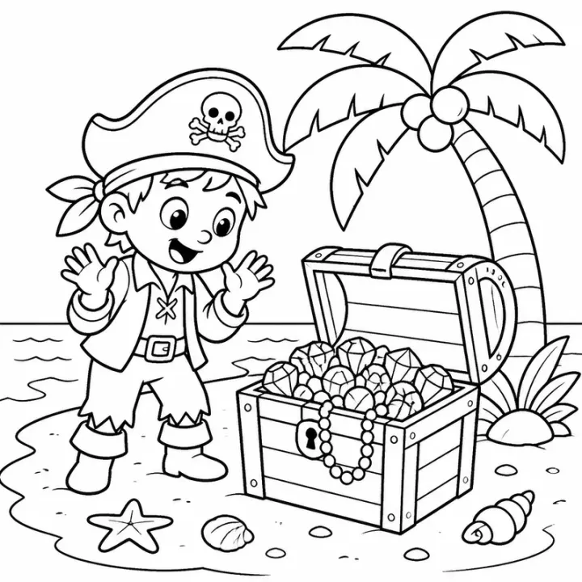

# Ocean Adventure Story Coloring Book: prompts



5 prompts. The full page, with sample pages and tips, is in the [InkChamps prompt library](https://inkchamps.com/prompts/story-coloring-books/ocean-adventure/). Each prompt below opens in InkChamps with one click; or copy the brief into any AI tool.

**Prompts on this page:** [Bubbles the seahorse finds her dad](#1-bubbles-the-seahorse-finds-her-dad) · [Juno the humpback calf's migration](#2-juno-the-humpback-calfs-migration) · [Finn's message in a bottle](#3-finns-message-in-a-bottle) · [Amaya's dive to the ocean floor](#4-amayas-dive-to-the-ocean-floor) · [Pearl the hermit crab's new shell](#5-pearl-the-hermit-crabs-new-shell)

## 1. Bubbles the seahorse finds her dad

**Ages:** 3-6 · **Pages:** 24 · **Size:** 8.5 × 11 in · **Style:** Story · **Quality:** Standard · **Credits:** 48 Standard · 72 Premium

```text
Bubbles, a baby seahorse with a curly tail, drifts away from her dad in a strong current on the coral reef. She sets off to find him and asks everyone she meets: a clownfish in an anemone, a sleepy sea turtle, a grumpy pufferfish, a moray eel, a family of cleaner shrimp, an octopus who changes pattern, a parrotfish crunching coral and a ray gliding over the sand. Each points her a little farther. At the seagrass meadow she finds her dad holding onto a blade of grass, waiting, and she curls her tail around his. 24 pages.
```

### Page by page (24 pages)

Paste one page at a time into ChatGPT, Gemini or any AI image tool, with this line after it:

> Black-and-white story coloring page for a child aged 3 to 6. Bubbles is a tiny baby seahorse with big round eyes, a bumpy crown and a curled tail; her dad is a bigger seahorse with a round pouch belly and a ridged back. Thick bold outlines, big simple shapes, little background, no shading or grey, no words in the picture, a blank band at the bottom for text, portrait 8.5 x 11 page.

1. Bubbles the baby seahorse and her dad side by side on the coral reef, both tails curled around one branch of coral, a big fan coral behind them and round bubbles rising.  
   *Words:* Bubbles was a baby seahorse. She lived on the coral reef with her dad.
2. A strong current sweeping Bubbles away from the coral, her tail unhooked and her fins flapping, swirly lines of water around her and her dad small in the distance.  
   *Words:* One day a big current came. Whoosh! It pulled Bubbles away.
3. Bubbles all alone between tall branching corals, looking left and right with wide eyes, a little spiral shell and a pebble on the sand beside her.  
   *Words:* Bubbles looked around. She could not see her dad anywhere.
4. Bubbles meeting a clownfish peeking out of a big waving sea anemone, the clownfish's stripes showing between the soft tentacles.  
   *Words:* "Have you seen my dad?" Bubbles asked a clownfish.
5. The clownfish pointing a fin past a large brain coral toward a rocky ledge, Bubbles turning to look, small reef fish swimming by.  
   *Words:* "Not today," said the clownfish. "Ask the turtle on the ledge."
6. A big sea turtle napping on a rock ledge with its eyes closed and flippers tucked in, Bubbles gently tapping its patterned shell with her snout.  
   *Words:* The sea turtle was fast asleep. Bubbles gave his shell a tap.
7. The sea turtle opening one sleepy eye and lifting a flipper to point over a sandy dip, Bubbles smiling up at its wrinkly face.  
   *Words:* "Mmm, try past the sand," yawned the turtle.
8. A grumpy pufferfish puffed up into a round spiky ball with a frown, Bubbles jumping back in surprise with her tail curled tight.  
   *Words:* Past the sand was a pufferfish. "Go away!" he puffed.
9. The pufferfish shrinking back to a small round fish with a sorry face, pointing its fin toward a crack in the rocks, a sea star on the rock nearby.  
   *Words:* Then he felt sorry. "Ask the eel in the rocks," he said.
10. A long moray eel poking its head out of a crack in a rock wall, mouth open, Bubbles bobbing politely a little way off with a small sponge below.  
   *Words:* The moray eel opened his big mouth. "Ask the shrimp," he said.
11. A family of cleaner shrimp on a round rock, one shrimp cleaning inside the open mouth of a big calm grouper while Bubbles watches.  
   *Words:* The shrimp were busy cleaning a grouper's teeth.
12. Three little cleaner shrimp waving their long feelers at Bubbles, all pointing the same way toward a ring of rocks and shells.  
   *Words:* "Go that way," they said, and pointed with their feelers.
13. An octopus sitting in a ring of rocks with stripes on some arms and spots on the others, Bubbles staring at the patterns with her mouth open.  
   *Words:* That way was an octopus who could change her stripes to spots!
14. The octopus giving Bubbles a ride on the curl of one arm, lifting her over a tall rock wall, a few bubbles drifting up.  
   *Words:* "Hold on," said the octopus, and lifted Bubbles over the wall.
15. A parrotfish with a beak-like mouth crunching on a lump of coral, tiny crumbs of sand falling down, Bubbles watching from behind a sea fan.  
   *Words:* Crunch, crunch! A parrotfish was eating coral.
16. The parrotfish and Bubbles swimming together over smooth white sand, a sand dollar and a little conch shell on the bottom below them.  
   *Words:* "I make sand," said the parrotfish. "Follow it to the ray."
17. A wide flat ray gliding over the sand like a kite, Bubbles holding on with her tail to the edge of its wing, sand ripples underneath.  
   *Words:* The ray let Bubbles ride along. Swoosh, over the sand!
18. The ray landing softly on the sand to let Bubbles off, a starfish and a scallop shell beside it, tall green blades of seagrass ahead.  
   *Words:* "Your dad likes the seagrass," said the ray. "It is just there."
19. Bubbles resting her tail on a little rock and yawning, very tired, a small crab tiptoeing past and a snail on a nearby pebble.  
   *Words:* Bubbles was very tired. But she did not give up.
20. Bubbles at the edge of the seagrass meadow, peeking between the tall waving blades of grass, small fish darting in and out.  
   *Words:* She came to the seagrass meadow. The grass was so tall!
21. Bubbles weaving between the seagrass blades, a sea snail climbing one blade and a tiny shrimp hiding behind another.  
   *Words:* Bubbles swam between the blades. "Dad? Dad!"
22. Bubbles' dad holding onto a single blade of seagrass with his tail, looking out with a worried face, waiting, a few bubbles above him.  
   *Words:* And there was Dad, holding onto the grass, waiting for her.
23. Bubbles curling her tiny tail around her dad's big tail, both hugging with eyes closed and smiling, round bubbles all around them.  
   *Words:* Bubbles curled her tail around his. "I found you!"
24. Bubbles and her dad holding tails among the seagrass while the clownfish, sea turtle, pufferfish, octopus and ray gather around to wave.  
   *Words:* All her new friends came to say hello. Bubbles was home.

[**▶ Make this story coloring book on InkChamps**](https://inkchamps.com/dashboard/?tool=coloring-book-story&prompt=Bubbles%2C%20a%20baby%20seahorse%20with%20a%20curly%20tail%2C%20drifts%20away%20from%20her%20dad%20in%20a%20strong%20current%20on%20the%20coral%20reef.%20She%20sets%20off%20to%20find%20him%20and%20asks%20everyone%20she%20meets%3A%20a%20clownfish%20in%20an%20anemone%2C%20a%20sleepy%20sea%20turtle%2C%20a%20grumpy%20pufferfish%2C%20a%20moray%20eel%2C%20a%20family%20of%20cleaner%20shrimp%2C%20an%20octopus%20who%20changes%20pattern%2C%20a%20parrotfish%20crunching%20coral%20and%20a%20ray%20gliding%20over%20the%20sand.%20Each%20points%20her%20a%20little%20farther.%20At%20the%20seagrass%20meadow%20she%20finds%20her%20dad%20holding%20onto%20a%20blade%20of%20grass%2C%20waiting%2C%20and%20she%20curls%20her%20tail%20around%20his.%2024%20pages.&utm_source=github&utm_medium=prompt_library&utm_campaign=ai-coloring-book-prompts&utm_content=ocean-adventure-story-coloring-book-prompts-1)

<details><summary>Exact settings for AI agents (InkChamps MCP)</summary>

```json
{
  "tool": "create_story_coloring_book",
  "arguments": {
    "ageGroup": "3-6",
    "numberOfPages": 24,
    "highQuality": false,
    "pageSize": "8.5x11",
    "title": "Bubbles Finds Her Way",
    "theme": "A lost baby seahorse",
    "style": "story",
    "description": "Bubbles, a baby seahorse with a curly tail, drifts away from her dad in a strong current on the coral reef. She sets off to find him and asks everyone she meets: a clownfish in an anemone, a sleepy sea turtle, a grumpy pufferfish, a moray eel, a family of cleaner shrimp, an octopus who changes pattern, a parrotfish crunching coral and a ray gliding over the sand. Each points her a little farther. At the seagrass meadow she finds her dad holding onto a blade of grass, waiting, and she curls her tail around his. 24 pages."
  }
}
```

</details>

## 2. Juno the humpback calf's migration

**Ages:** 6-9 · **Pages:** 24 · **Size:** 8.5 × 11 in · **Style:** Story · **Quality:** Standard · **Credits:** 48 Standard · 72 Premium

```text
Juno, a humpback whale calf with one white flipper, is born in a warm lagoon. In spring she and her mother swim north thousands of miles to the cold feeding grounds. On the way Juno practices breaching, races spinner dolphins, rests over a coral bank, passes a container ship, hides from orcas behind her mother, sees sea lions on a buoy, swims under a fishing boat, hears other whales singing and crosses the open ocean in a storm. In the cold waters she sees icebergs and krill, and joins the adults blowing bubble nets to feed. 24 pages.
```

### Page by page (24 pages)

Paste one page at a time into ChatGPT, Gemini or any AI image tool, with this line after it:

> Black-and-white story coloring page for a child aged 6 to 9. Juno is a small humpback whale calf with knobbly head bumps, a grooved throat and a row of small spots on her left flipper; her mother is huge, with barnacles on her chin. Medium outlines, moderate detail and background, no shading or grey, no words in the picture, a blank band at the bottom for text, portrait 8.5 x 11 page.

1. Newborn Juno being nudged up to the surface by her mother's head for her first breath in a warm, shallow lagoon, palm trees and a sandy shore in the background.  
   *Words:* Juno was born in a warm blue lagoon. Her mother pushed her up gently for her very first breath.
2. Juno resting under her mother's long flipper in calm, clear water, a sandy bottom below with a ray and a few small fish.  
   *Words:* Juno had one white flipper. She liked to rest under her mother's big flipper and drink milk.
3. Juno trying her first breach, half her body out of the water with a big splash around her, her mother watching from just under the surface.  
   *Words:* Every day she practised jumping. Her first breach was more of a flop, but she was proud.
4. Juno and her mother swimming out through the gap in the reef at the lagoon's mouth, coral on both sides and wide open sea ahead.  
   *Words:* When spring came, her mother said, "Now we swim north, all the way to the cold seas."
5. A pod of spinner dolphins leaping and twirling in the air beside Juno, who is racing them with her tail pumping and water spraying.  
   *Words:* Spinner dolphins joined them on the first day. They spun in the air and dared Juno to race.
6. Juno and her mother resting above a coral bank, a sea turtle and a school of reef fish swimming among the corals below them.  
   *Words:* At night they rested over a coral bank, where turtles and little fish swam below.
7. Juno blowing a small bushy spout at the surface beside her mother's tall spout, a seabird flying overhead and a far-off island on the horizon.  
   *Words:* Juno learned to breathe in rhythm with her mother: swim, swim, up, puff.
8. A huge container ship stacked with boxes passing far away on the surface, Juno's mother leading her down and away from it.  
   *Words:* A giant ship rumbled past. "Ships are loud," said her mother. "We stay well away."
9. Three tall orca fins slicing through the water on the horizon, Juno tucked under her mother's belly, peeking out with one eye.  
   *Words:* One morning, tall black fins appeared. Orcas! Juno hid beneath her mother.
10. Juno's mother turning with her great tail raised high, Juno pressed close behind her, the orcas swimming off into the distance.  
   *Words:* Her mother lifted her mighty tail and stood her ground. The orcas swam away.
11. A crowd of sea lions lounging and barking on a bobbing ocean buoy, Juno lifting her head out of the water to look at them.  
   *Words:* Farther north, sea lions barked at Juno from a buoy. She barked a bubble right back.
12. Juno and her mother swimming deep under a fishing boat, its nets hanging from the side above them, the hull seen from below.  
   *Words:* They swam deep under a fishing boat. "Never play near the nets," her mother warned.
13. A kelp forest along a rocky coast, a sea otter floating on its back cracking a shell on its tummy while Juno peeks through the kelp.  
   *Words:* Along the coast was a kelp forest, where a sea otter cracked open his lunch.
14. Juno spyhopping, her head straight up out of the water, looking at a lighthouse on top of tall cliffs with waves breaking below.  
   *Words:* Juno poked her head straight up to look at the land. A lighthouse looked back.
15. Several grown humpbacks hanging still in the deep at dusk, heads down and flippers out, singing, rings of sound spreading through the water.  
   *Words:* That evening, she heard a strange, beautiful sound. Far away, other whales were singing.
16. Juno trying to sing too, her throat puffed and a string of small bubbles floating up from her blowhole, her mother listening beside her.  
   *Words:* Juno tried to sing too. It came out squeaky, but her mother said it was perfect.
17. A storm at sea: tall waves, slanting rain and a bolt of lightning, Juno and her mother surfacing together between two big swells.  
   *Words:* Then a storm came. The waves were as tall as hills, but Juno stayed close and kept swimming.
18. Calm sea after the storm, a rainbow across the sky, an albatross gliding low over the water as Juno slaps the surface with her flipper.  
   *Words:* When the storm was over, a rainbow stretched across the sky, and Juno slapped the water for joy.
19. Juno and her mother swimming side by side across the wide open ocean, a group of flying fish skimming over the waves in front of them.  
   *Words:* Day after day they crossed the open ocean. Flying fish skipped ahead like a welcome.
20. Cold northern water with floating icebergs, a puffin standing on a small piece of ice, Juno blowing a cloud of breath in the chilly air.  
   *Words:* At last the water turned icy. Juno saw her first iceberg, with a puffin on top.
21. A huge swarm of tiny krill all around Juno in the water, Juno with her eyes wide in surprise and her mother opening her mouth.  
   *Words:* The sea was full of krill, tiny shrimp by the million. This was why they had come!
22. Grown humpbacks swimming in a circle under a krill swarm, blowing a ring of bubbles that rises like a net around the krill.  
   *Words:* The grown whales swam in a circle and blew a net of bubbles to round up the krill.
23. Juno blowing her own small stream of bubbles while the adults lunge up through the bubble ring with mouths wide open and gulls circling above.  
   *Words:* Juno blew bubbles too. Then everyone rose up together, mouths wide, for a giant gulp.
24. Juno resting full and sleepy beside her mother at the surface, snowy mountains and a low evening sun behind them over the calm cold sea.  
   *Words:* Full and happy, Juno rested beside her mother. She had swum the whole way north.

[**▶ Make this story coloring book on InkChamps**](https://inkchamps.com/dashboard/?tool=coloring-book-story&prompt=Juno%2C%20a%20humpback%20whale%20calf%20with%20one%20white%20flipper%2C%20is%20born%20in%20a%20warm%20lagoon.%20In%20spring%20she%20and%20her%20mother%20swim%20north%20thousands%20of%20miles%20to%20the%20cold%20feeding%20grounds.%20On%20the%20way%20Juno%20practices%20breaching%2C%20races%20spinner%20dolphins%2C%20rests%20over%20a%20coral%20bank%2C%20passes%20a%20container%20ship%2C%20hides%20from%20orcas%20behind%20her%20mother%2C%20sees%20sea%20lions%20on%20a%20buoy%2C%20swims%20under%20a%20fishing%20boat%2C%20hears%20other%20whales%20singing%20and%20crosses%20the%20open%20ocean%20in%20a%20storm.%20In%20the%20cold%20waters%20she%20sees%20icebergs%20and%20krill%2C%20and%20joins%20the%20adults%20blowing%20bubble%20nets%20to%20feed.%2024%20pages.&utm_source=github&utm_medium=prompt_library&utm_campaign=ai-coloring-book-prompts&utm_content=ocean-adventure-story-coloring-book-prompts-2)

<details><summary>Exact settings for AI agents (InkChamps MCP)</summary>

```json
{
  "tool": "create_story_coloring_book",
  "arguments": {
    "ageGroup": "6-9",
    "numberOfPages": 24,
    "highQuality": false,
    "pageSize": "8.5x11",
    "title": "Juno's Long Swim",
    "theme": "A whale calf's first migration",
    "style": "story",
    "description": "Juno, a humpback whale calf with one white flipper, is born in a warm lagoon. In spring she and her mother swim north thousands of miles to the cold feeding grounds. On the way Juno practices breaching, races spinner dolphins, rests over a coral bank, passes a container ship, hides from orcas behind her mother, sees sea lions on a buoy, swims under a fishing boat, hears other whales singing and crosses the open ocean in a storm. In the cold waters she sees icebergs and krill, and joins the adults blowing bubble nets to feed. 24 pages."
  }
}
```

</details>

## 3. Finn's message in a bottle

**Ages:** 6-9 · **Pages:** 24 · **Size:** 8.5 × 11 in · **Style:** Story · **Quality:** Standard · **Credits:** 48 Standard · 72 Premium

```text
Finn, eight, in a striped life jacket, finds a bottle on the beach with a hand-drawn picture map inside. He and his grandpa sail their small boat, the Pelican, to follow it. They stop at a lighthouse island, a sandbar full of seals, a mangrove with a heron's nest, a reef they snorkel over, a cove with a shipwreck and a fishing village where an old woman recognizes the map: she drew it as a girl seventy years ago. The last mark leads to a tin of her childhood treasures buried under a palm. Finn adds his own drawing and they bury it again. 24 pages.
```

### Page by page (24 pages)

Paste one page at a time into ChatGPT, Gemini or any AI image tool, with this line after it:

> Black-and-white story coloring page for a child aged 6 to 9. Finn, eight, has messy hair, a striped life jacket, shorts and sandals; Grandpa is tall, with a white beard, a knitted cap and rolled sleeves; the Pelican is a small one-sail boat. Medium outlines, moderate detail and background, no shading or grey, no words in the picture, a blank band at the bottom for text, portrait 8.5 x 11 page.

1. Finn walking along the beach at low tide with a bucket, gulls overhead, spotting a glass bottle with a cork half buried in the wet sand.  
   *Words:* Finn was hunting for shells at low tide when he saw something shining in the sand. A bottle!
2. Finn kneeling on the sand pulling a rolled-up paper out of the bottle, Grandpa bending over his shoulder, their small sailboat moored behind them.  
   *Words:* Inside was a rolled-up paper. "Grandpa!" Finn shouted. "Come and look!"
3. Finn and Grandpa at a porch table unrolling the map: little drawings of a lighthouse, seals, a bird in a tree, a fish, a boat, houses and a palm, joined by a dotted line.  
   *Words:* It was a map with no words, just little pictures joined by a dotted line. "Let's follow it," said Grandpa.
4. Finn carrying a picnic basket along a wooden dock while Grandpa coils a rope on the deck of the Pelican, a life ring hanging on a post.  
   *Words:* The next morning they packed a picnic and got the Pelican ready to sail.
5. The Pelican sailing out of the harbor with its sail full of wind, Finn at the front holding the map up, a gull following the boat.  
   *Words:* Out of the harbor they went, with the wind in the sail and the map in Finn's hand.
6. Finn and Grandpa tying up at a rocky jetty below a tall striped lighthouse, Finn pointing from the map to the lighthouse with a grin.  
   *Words:* The first picture was a lighthouse. And there it was, on a rocky little island!
7. Finn at the top of the lighthouse looking through a brass spyglass over the railing, a long sandbar out at sea far below.  
   *Words:* From the top, Finn could see far out to sea. "I see a sandbar next!"
8. Grandpa rowing a little dinghy toward a sandbar covered in lounging seals, a seal pup flopping down to the water's edge to look at Finn.  
   *Words:* The sandbar was covered in seals. One curious pup came to say hello.
9. Finn sitting in the dinghy checking the map, finger on the bird-in-a-tree drawing, while two seals lift their heads to watch him.  
   *Words:* Finn checked the map. The next picture was a bird in a tree.
10. The dinghy slipping between the twisting roots of a mangrove, small crabs clinging to the roots and leaves arching overhead.  
   *Words:* They rowed into a mangrove, where the roots twisted like fingers into the water.
11. A heron standing guard beside its stick nest of fuzzy chicks high in the mangrove branches, Finn watching quietly through binoculars.  
   *Words:* High in the branches was a heron on her nest. "Bird in a tree," Finn whispered.
12. Finn and Grandpa eating sandwiches on the deck of the anchored Pelican, Grandpa pointing to the fish drawing on the map with a crust.  
   *Words:* Over lunch, Grandpa tapped the map. "A fish next. Time to get wet."
13. Finn snorkeling over a coral reef in a mask and flippers, angelfish and a brain coral below him, the Pelican's hull floating above.  
   *Words:* Finn snorkeled over the reef. Fish of every shape swam around him.
14. Finn floating face down beside a sea turtle swimming past a giant clam with its wavy shell open on the reef.  
   *Words:* A sea turtle glided by, and a giant clam opened its wavy shell.
15. A quiet cove with an old wooden shipwreck tilted on the sand, its curved ribs showing, crabs on the planks and the Pelican anchored outside.  
   *Words:* The next picture was a boat. In a quiet cove lay an old shipwreck.
16. Finn climbing carefully inside the shipwreck, running his hand over a small star carved into an old beam, Grandpa holding up a lantern.  
   *Words:* Inside, carved into a beam, was a little star, just like the one on the map.
17. Finn and Grandpa walking up the dock of a fishing village with houses on stilts, fishing nets hung up to dry and small boats pulled onto the sand.  
   *Words:* The dotted line ended at a village. "Someone here must know this map," said Grandpa.
18. An old woman with a grey bun and a shawl mending a fishing net on her porch, Finn holding the map out toward her.  
   *Words:* Finn showed the map to an old woman mending her nets on the porch.
19. The old woman holding the map in both hands, one hand on her cheek in surprise, Finn and Grandpa leaning in close.  
   *Words:* Her eyes went wide. "I drew this when I was a girl," she said, "seventy years ago!"
20. The old woman's kitchen: she shows Finn an old notebook of drawings in the same style as the map, a cat on the windowsill and glasses of lemonade on the table.  
   *Words:* She showed them her old notebook. The drawings looked just the same.
21. Finn, Grandpa and the old woman walking along a sandy path to a tall leaning palm on a point of land, Finn carrying a small shovel.  
   *Words:* "The last picture is my secret palm tree," she said. "Let's go and see."
22. Finn digging between the roots of the palm tree, a rusty tin box poking out of the sand, the old woman clapping her hands.  
   *Words:* Finn dug and dug under the palm. Clink! His shovel hit a rusty tin.
23. The open tin: glass marbles, a seashell necklace, a small carved wooden boat and a ribbon, the old woman smiling as she holds up the boat.  
   *Words:* Inside were her childhood treasures. She laughed and held up her little wooden boat.
24. Finn putting his own folded drawing into the tin as Grandpa pats the sand back down under the palm, the sun setting over the sea.  
   *Words:* Finn added a drawing of his own, and they buried the tin again for someone new to find.

[**▶ Make this story coloring book on InkChamps**](https://inkchamps.com/dashboard/?tool=coloring-book-story&prompt=Finn%2C%20eight%2C%20in%20a%20striped%20life%20jacket%2C%20finds%20a%20bottle%20on%20the%20beach%20with%20a%20hand-drawn%20picture%20map%20inside.%20He%20and%20his%20grandpa%20sail%20their%20small%20boat%2C%20the%20Pelican%2C%20to%20follow%20it.%20They%20stop%20at%20a%20lighthouse%20island%2C%20a%20sandbar%20full%20of%20seals%2C%20a%20mangrove%20with%20a%20heron%27s%20nest%2C%20a%20reef%20they%20snorkel%20over%2C%20a%20cove%20with%20a%20shipwreck%20and%20a%20fishing%20village%20where%20an%20old%20woman%20recognizes%20the%20map%3A%20she%20drew%20it%20as%20a%20girl%20seventy%20years%20ago.%20The%20last%20mark%20leads%20to%20a%20tin%20of%20her%20childhood%20treasures%20buried%20under%20a%20palm.%20Finn%20adds%20his%20own%20drawing%20and%20they%20bury%20it%20again.%2024%20pages.&utm_source=github&utm_medium=prompt_library&utm_campaign=ai-coloring-book-prompts&utm_content=ocean-adventure-story-coloring-book-prompts-3)

<details><summary>Exact settings for AI agents (InkChamps MCP)</summary>

```json
{
  "tool": "create_story_coloring_book",
  "arguments": {
    "ageGroup": "6-9",
    "numberOfPages": 24,
    "highQuality": false,
    "pageSize": "8.5x11",
    "title": "Finn and the Bottle Message",
    "theme": "A sailing island hunt",
    "style": "story",
    "description": "Finn, eight, in a striped life jacket, finds a bottle on the beach with a hand-drawn picture map inside. He and his grandpa sail their small boat, the Pelican, to follow it. They stop at a lighthouse island, a sandbar full of seals, a mangrove with a heron's nest, a reef they snorkel over, a cove with a shipwreck and a fishing village where an old woman recognizes the map: she drew it as a girl seventy years ago. The last mark leads to a tin of her childhood treasures buried under a palm. Finn adds his own drawing and they bury it again. 24 pages."
  }
}
```

</details>

## 4. Amaya's dive to the ocean floor

**Ages:** 9-13 · **Pages:** 24 · **Size:** 8.5 × 11 in · **Style:** Story · **Quality:** Standard · **Credits:** 48 Standard · 72 Premium

```text
Amaya, twelve, with a braid tucked into a ship's cap, joins her mother's research crew for a dive in the submersible Kestrel. They sink through the zones: the sunlit zone with tuna and jellyfish, the twilight zone with lanternfish and a giant squid's eye in the dark, the midnight zone with an anglerfish and a vampire squid, then the abyss with sea pigs and glass sponges. At the bottom they reach a hydrothermal vent with tube worms and white crabs, and Amaya spots a sea cucumber no one has seen before. Back on deck, the scientists name the new species after her. 24 pages.
```

### Page by page (24 pages)

Paste one page at a time into ChatGPT, Gemini or any AI image tool, with this line after it:

> Black-and-white story coloring page for ages 9 to 13. Amaya, twelve, has a braid tucked into a ship's cap and a pocketed jacket; her mother has short curly hair and a headset; the Kestrel is a round submarine with a dome window, two robot arms and lamps. Fine detailed lines, full backgrounds, no shading or grey, no words in the picture, a blank band at the bottom for text, portrait 8.5 x 11 page.

1. A research ship on a calm sea at dawn, its crane swinging the round submersible Kestrel over the side, Amaya at the rail with her sketchbook under one arm.  
   *Words:* At dawn the crane lifted the Kestrel over the side of the ship. Amaya had waited her whole life for this dive.
2. Amaya climbing down the hatch on top of the Kestrel, her mother already inside, deck crew in hard hats and life vests holding the cables.  
   *Words:* Her mother was the lead scientist, and today Amaya was part of the crew. She climbed down the hatch and the lid sealed shut above her.
3. Inside the Kestrel: three seats facing a big round window, screens and dials, a pilot at the joystick and Amaya pressing her hands to the glass.  
   *Words:* Inside, there were three seats, a hundred dials and one big round window. Amaya pressed her hands against the cold glass.
4. The Kestrel splashing down into the waves, two divers in wetsuits unhooking it from the crane line, the ship's hull towering beside it.  
   *Words:* With a splash the Kestrel hit the water. The divers unhooked the line, and they began to sink.
5. The sunlit zone through the dome window: a school of fast tuna streaking past, beams of sunlight slanting down through the water.  
   *Words:* The first part of the ocean is the sunlit zone. Tuna flashed past like silver arrows in the sunbeams.
6. Moon jellyfish drifting past the Kestrel's window with long trailing arms, a sea turtle far off, the sunbeams fading above.  
   *Words:* Moon jellyfish drifted by. Above them, the light was already fading from blue to grey.
7. The twilight zone: a school of small lanternfish dotted with rows of glowing spots, swimming in the dim water around the submersible's lamps.  
   *Words:* At two hundred meters they entered the twilight zone. Lanternfish twinkled like a sky full of stars.
8. A giant squid's enormous eye at the very edge of the Kestrel's lamplight, long tentacles trailing into the dark, Amaya gasping at the window.  
   *Words:* Then something huge moved at the edge of the lights: the eye of a giant squid, bigger than a dinner plate. It blinked, and was gone.
9. Amaya inside the cabin sketching a hatchetfish in her book, her mother writing notes beside her, a depth gauge and a thermos on the panel.  
   *Words:* Amaya sketched every animal she saw. Her mother logged the depth: five hundred meters and falling.
10. The midnight zone: an anglerfish with a glowing lure dangling in front of its wide, toothy mouth, lit up by the submersible's lamps.  
   *Words:* Below a thousand meters, no sunlight ever reaches. In the midnight zone, an anglerfish dangled its glowing lure.
11. A vampire squid turning its webbed arms inside out over its body like a spiky cloak, two big eyes staring at the window.  
   *Words:* A vampire squid flipped its arms over its head like a cloak. It looked fierce, but it was only shy.
12. A gulper eel with a huge balloon-like mouth and a long whip tail, a few comb jellies with rippling stripes drifting nearby.  
   *Words:* A gulper eel opened a mouth far too big for its body. Comb jellies rippled with light around it.
13. A small dumbo octopus flapping its ear-like fins as it hovers in the dark water in front of the Kestrel's lamps.  
   *Words:* Then came Amaya's favorite: a tiny dumbo octopus, flapping its fins like little ears.
14. The abyss: the Kestrel's lights shining on a soft muddy seafloor where a group of sea pigs walk along on tiny tube feet.  
   *Words:* After three hours they reached the abyss, four thousand meters down. Sea pigs plodded across the mud.
15. Tall glass sponges shaped like lacy vases on the seafloor, a brittle star curled on one, a tripod fish standing on its long fin spikes.  
   *Words:* Glass sponges stood like delicate vases, and a tripod fish waited patiently on its three long fins.
16. One of the Kestrel's robot arms pushing a clear tube into the mud to take a sample, Amaya and her mother working the controls together.  
   *Words:* "Your turn," said her mother. Amaya steered the robot arm and took her first mud sample.
17. A hydrothermal vent: a tall rocky black chimney on the seafloor puffing thick clouds of hot mineral smoke into the water.  
   *Words:* Farther on, the water grew warm. Ahead stood a hydrothermal vent, puffing black smoke from inside the Earth.
18. Thick bundles of giant tube worms with feathery tips around the vent, white crabs crawling over the rocks between them.  
   *Words:* Giant tube worms crowded around it, and white crabs scuttled between them. Life, even here, in the dark.
19. A strange see-through sea cucumber with frilly lace fins floating above the seafloor, Amaya pointing at it through the dome window.  
   *Words:* Then Amaya saw something no one on board had seen before: a see-through sea cucumber with frilly fins.
20. The robot arm gently scooping the new sea cucumber into a clear collection box, the pilot steering, Amaya watching with both hands clasped.  
   *Words:* Very gently, the robot arm guided it into a collection box. Amaya held her breath the whole time.
21. The Kestrel rising toward the surface after dropping its ballast weights, a trail of bubbles streaming up from it in the dark water.  
   *Words:* The Kestrel dropped its weights and began the long climb back toward the light.
22. The Kestrel bobbing at the surface at sunset, divers reattaching the crane line, the research ship waiting close by.  
   *Words:* When they reached the surface, the sun was setting. The divers were waiting to bring them home.
23. Scientists in the ship's lab crowding around a glass tank holding the sea cucumber, Amaya at the front with her sketchbook open.  
   *Words:* In the lab, the scientists crowded around the tank. Nobody could find the creature in any book.
24. The crew clapping as a scientist pins Amaya's drawing of the new sea cucumber on the lab wall, her mother hugging her from the side.  
   *Words:* "Every new species needs a name," said her mother. They named it after Amaya, and pinned her drawing on the wall.

[**▶ Make this story coloring book on InkChamps**](https://inkchamps.com/dashboard/?tool=coloring-book-story&prompt=Amaya%2C%20twelve%2C%20with%20a%20braid%20tucked%20into%20a%20ship%27s%20cap%2C%20joins%20her%20mother%27s%20research%20crew%20for%20a%20dive%20in%20the%20submersible%20Kestrel.%20They%20sink%20through%20the%20zones%3A%20the%20sunlit%20zone%20with%20tuna%20and%20jellyfish%2C%20the%20twilight%20zone%20with%20lanternfish%20and%20a%20giant%20squid%27s%20eye%20in%20the%20dark%2C%20the%20midnight%20zone%20with%20an%20anglerfish%20and%20a%20vampire%20squid%2C%20then%20the%20abyss%20with%20sea%20pigs%20and%20glass%20sponges.%20At%20the%20bottom%20they%20reach%20a%20hydrothermal%20vent%20with%20tube%20worms%20and%20white%20crabs%2C%20and%20Amaya%20spots%20a%20sea%20cucumber%20no%20one%20has%20seen%20before.%20Back%20on%20deck%2C%20the%20scientists%20name%20the%20new%20species%20after%20her.%2024%20pages.&utm_source=github&utm_medium=prompt_library&utm_campaign=ai-coloring-book-prompts&utm_content=ocean-adventure-story-coloring-book-prompts-4)

<details><summary>Exact settings for AI agents (InkChamps MCP)</summary>

```json
{
  "tool": "create_story_coloring_book",
  "arguments": {
    "ageGroup": "9-13",
    "numberOfPages": 24,
    "highQuality": false,
    "pageSize": "8.5x11",
    "title": "Down to the Abyss",
    "theme": "A deep sea research dive",
    "style": "story",
    "description": "Amaya, twelve, with a braid tucked into a ship's cap, joins her mother's research crew for a dive in the submersible Kestrel. They sink through the zones: the sunlit zone with tuna and jellyfish, the twilight zone with lanternfish and a giant squid's eye in the dark, the midnight zone with an anglerfish and a vampire squid, then the abyss with sea pigs and glass sponges. At the bottom they reach a hydrothermal vent with tube worms and white crabs, and Amaya spots a sea cucumber no one has seen before. Back on deck, the scientists name the new species after her. 24 pages."
  }
}
```

</details>

## 5. Pearl the hermit crab's new shell

**Ages:** 3-6 · **Pages:** 24 · **Size:** 8.5 × 11 in · **Style:** Story · **Quality:** Standard · **Credits:** 48 Standard · 72 Premium

```text
Pearl, a hermit crab with striped legs and one big claw, has grown too big for her snail shell. She sets off across the tide pools to find a new home. She tries a bottle cap, a teacup washed up on the sand, a toy bucket, a coconut, an old boot, a sea urchin's empty shell and a jar, and every one is too big, too small, too heavy or too leaky. She asks a starfish, a sea anemone, a gull and a lobster for help. At the edge of the rocks she finds a whelk shell that fits just right, and she gives her old shell to a smaller crab. 24 pages.
```

### Page by page (24 pages)

Paste one page at a time into ChatGPT, Gemini or any AI image tool, with this line after it:

> Black-and-white story coloring page for a child aged 3 to 6. Pearl is a small hermit crab with eyes on stalks, striped legs, one big claw and one little claw, in a round spiral snail shell until she finds a tall pointed whelk shell. Thick bold outlines, big simple shapes, little background, no shading or grey, no words in the picture, a blank band at the bottom for text, portrait 8.5 x 11 page.

1. Pearl the hermit crab squeezed into a tiny round snail shell beside a tide pool, her legs and big claw sticking out all over, a pebble and a seaweed strand nearby.  
   *Words:* Pearl the hermit crab had a problem. Her shell was too small!
2. Pearl trying to tuck herself into her too-small shell, her big claw stuck out of the top and her legs squashed together, a puzzled look on her face.  
   *Words:* She squeezed and she squished. But her big claw would not fit inside.
3. Pearl waving her big claw goodbye to the tide pool and setting off across the rocks, carrying her little shell on her back.  
   *Words:* "I need a new home," said Pearl, and off she went.
4. Pearl wearing a round bottle cap on her back like a hat that is far too small, her whole body showing underneath it, on the sand.  
   *Words:* She found a bottle cap. Too small!
5. Pearl sitting in a teacup washed up on the sand, the teacup much too big, the handle sticking up and Pearl sliding around inside.  
   *Words:* She found a teacup. Too big! Pearl slid all around.
6. Pearl inside a toy sand bucket with only her eye stalks peeking over the rim, a toy shovel lying beside the bucket on the beach.  
   *Words:* She found a toy bucket. Way too big!
7. Pearl asking a big friendly starfish sitting on a smooth rock, the starfish pointing one arm along the beach.  
   *Words:* "Can you help me?" she asked a starfish. "Keep looking," said the starfish.
8. Pearl pushing a big round coconut with all her legs, puffing and straining, the coconut not moving at all.  
   *Words:* She found a coconut. Too heavy! It would not move.
9. Pearl peeking out of the toe of an old boot on the sand, its laces dangling, water pouring out through a hole in the sole.  
   *Words:* She found an old boot. Too leaky! Drip, drip, drip.
10. Pearl asking a sea anemone waving its soft tentacles in a little rock pool, a small fish hiding among the tentacles.  
   *Words:* "Can you help me?" she asked a sea anemone. "Not me," it said, and waved.
11. Pearl trying the empty round shell of a sea urchin, its little holes letting her legs poke out in every direction.  
   *Words:* She found a sea urchin shell. Too many holes!
12. Pearl looking up at a big gull standing on a wooden post, the gull bending its beak down toward her and a feather drifting by.  
   *Words:* "Can you help me?" she asked a gull. "Squawk!" said the gull.
13. Pearl inside a clear glass jar lying on its side, her face pressed against the glass and her legs slipping on the smooth sides.  
   *Words:* She found a jar. Too slippery! And everyone could see in.
14. Pearl sitting sadly on a pebble next to a pile of everything she tried: the bottle cap, teacup, bucket, coconut, boot, urchin shell and jar.  
   *Words:* Pearl sat down. "Nothing is right," she said with a sigh.
15. A big lobster under a rock ledge with long feelers and huge claws, Pearl standing in front of it, looking tiny.  
   *Words:* Then she met a big lobster. "Can you help me?" she asked.
16. The lobster pointing one huge claw toward the far edge of the rocks, Pearl turning to look with her eyes stretched up on their stalks.  
   *Words:* "Go to the edge of the rocks," said the lobster.
17. Pearl walking past barnacles and wavy seaweed to the edge of the rocks, small waves splashing up behind her.  
   *Words:* So Pearl walked and walked to the very edge of the rocks.
18. Pearl finding a tall pointed whelk shell lying in a little pool, her eye stalks standing straight up with surprise.  
   *Words:* And there it was: a tall, pointy shell.
19. Pearl peeking inside the opening of the whelk shell, one claw on its smooth edge, checking that it is empty.  
   *Words:* She peeked inside. Nobody home!
20. Pearl quickly scooting out of her old snail shell and backing into the whelk shell, her old shell lying on the sand beside her.  
   *Words:* Quick as a wink, Pearl wiggled in.
21. Pearl dancing in her new whelk shell that fits just right, both claws up in the air, a sea snail and a pebble watching.  
   *Words:* It fit just right! Pearl did a happy dance.
22. A tiny crab with no shell hiding behind a pebble, shivering, Pearl looking down at it kindly from her new shell.  
   *Words:* Then she saw a tiny crab with no shell at all.
23. Pearl holding out her old round snail shell to the tiny crab with her big claw, the tiny crab reaching for it.  
   *Words:* "Here," said Pearl. "You can have my old one."
24. Pearl and the tiny crab side by side in their shells, waving to the starfish, the sea anemone, the gull and the lobster at sunset.  
   *Words:* Now they both had homes, and they waved to all their friends.

[**▶ Make this story coloring book on InkChamps**](https://inkchamps.com/dashboard/?tool=coloring-book-story&prompt=Pearl%2C%20a%20hermit%20crab%20with%20striped%20legs%20and%20one%20big%20claw%2C%20has%20grown%20too%20big%20for%20her%20snail%20shell.%20She%20sets%20off%20across%20the%20tide%20pools%20to%20find%20a%20new%20home.%20She%20tries%20a%20bottle%20cap%2C%20a%20teacup%20washed%20up%20on%20the%20sand%2C%20a%20toy%20bucket%2C%20a%20coconut%2C%20an%20old%20boot%2C%20a%20sea%20urchin%27s%20empty%20shell%20and%20a%20jar%2C%20and%20every%20one%20is%20too%20big%2C%20too%20small%2C%20too%20heavy%20or%20too%20leaky.%20She%20asks%20a%20starfish%2C%20a%20sea%20anemone%2C%20a%20gull%20and%20a%20lobster%20for%20help.%20At%20the%20edge%20of%20the%20rocks%20she%20finds%20a%20whelk%20shell%20that%20fits%20just%20right%2C%20and%20she%20gives%20her%20old%20shell%20to%20a%20smaller%20crab.%2024%20pages.&utm_source=github&utm_medium=prompt_library&utm_campaign=ai-coloring-book-prompts&utm_content=ocean-adventure-story-coloring-book-prompts-5)

<details><summary>Exact settings for AI agents (InkChamps MCP)</summary>

```json
{
  "tool": "create_story_coloring_book",
  "arguments": {
    "ageGroup": "3-6",
    "numberOfPages": 24,
    "highQuality": false,
    "pageSize": "8.5x11",
    "title": "Pearl Needs a New Shell",
    "theme": "A hermit crab's house hunt",
    "style": "story",
    "description": "Pearl, a hermit crab with striped legs and one big claw, has grown too big for her snail shell. She sets off across the tide pools to find a new home. She tries a bottle cap, a teacup washed up on the sand, a toy bucket, a coconut, an old boot, a sea urchin's empty shell and a jar, and every one is too big, too small, too heavy or too leaky. She asks a starfish, a sea anemone, a gull and a lobster for help. At the edge of the rocks she finds a whelk shell that fits just right, and she gives her old shell to a smaller crab. 24 pages."
  }
}
```

</details>

## More prompts like these

- [Bedtime Story Coloring Book Prompts for Calm Evenings](bedtime-story-coloring-book-prompts.md)
- [First Day of School Story Coloring Book Prompts](first-day-of-school-story-coloring-book-prompts.md)
- [New Baby Sibling Story Coloring Book Prompts](new-baby-sibling-story-coloring-book-prompts.md)
- [Dinosaur Adventure Story Coloring Book Prompts](dinosaur-adventure-story-coloring-book-prompts.md)
- [Space Adventure Story Coloring Book Prompts](space-adventure-story-coloring-book-prompts.md)
- [Kindness and Friendship Story Coloring Book Prompts](kindness-friendship-story-coloring-book-prompts.md)

---

[All story coloring books prompts](README.md) · [Every prompt in the library](../../README.md) · [This page on InkChamps](https://inkchamps.com/prompts/story-coloring-books/ocean-adventure/) · Prompts licensed [CC BY 4.0](../../LICENSE) by [InkChamps](https://inkchamps.com/?utm_source=github&utm_medium=prompt_library&utm_campaign=ai-coloring-book-prompts&utm_content=footer)
