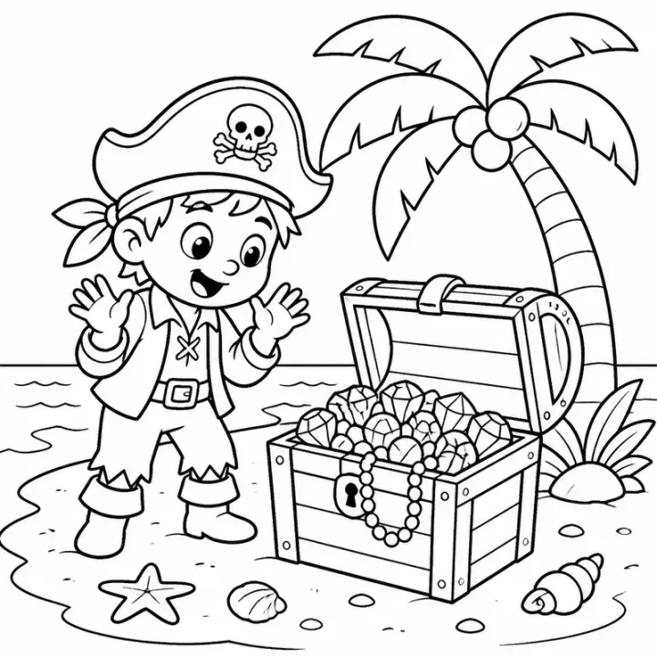

# Ocean Adventure Story Coloring Book: prompts



5 prompts. The full page, with sample pages and tips, is in the [InkChamps prompt library](https://inkchamps.com/prompts/story-coloring-books/ocean-adventure/). Each prompt below opens in InkChamps with one click; or copy the brief into any AI tool.

**Prompts on this page:** [Bubbles the seahorse finds her dad](#1-bubbles-the-seahorse-finds-her-dad) · [Juno the humpback calf's migration](#2-juno-the-humpback-calfs-migration) · [Finn's message in a bottle](#3-finns-message-in-a-bottle) · [Amaya's dive to the ocean floor](#4-amayas-dive-to-the-ocean-floor) · [Pearl the hermit crab's new shell](#5-pearl-the-hermit-crabs-new-shell)

## 1. Bubbles the seahorse finds her dad

**Ages:** 3-6 · **Pages:** 40 · **Size:** 8.5 × 11 in · **Style:** Story · **Quality:** Standard · **Credits:** 80 Standard · 120 Premium

```text
Bubbles, a baby seahorse with a curly pink tail, drifts away from her dad in a strong current on the coral reef. She sets off to find him and asks everyone she meets: a clownfish in an anemone, a sea turtle napping on a ledge, a grumpy pufferfish, a moray eel in a crack, a family of shrimp at a cleaning station, an octopus who changes color, a parrotfish crunching coral and a ray gliding over the sand. Each points her a little farther. At the seagrass meadow she finds her dad holding onto a blade of grass, waiting, and she curls her tail around his.
```

[**▶ Make this story coloring book on InkChamps**](https://inkchamps.com/dashboard/?tool=coloring-book-story&prompt=Bubbles%2C%20a%20baby%20seahorse%20with%20a%20curly%20pink%20tail%2C%20drifts%20away%20from%20her%20dad%20in%20a%20strong%20current%20on%20the%20coral%20reef.%20She%20sets%20off%20to%20find%20him%20and%20asks%20everyone%20she%20meets%3A%20a%20clownfish%20in%20an%20anemone%2C%20a%20sea%20turtle%20napping%20on%20a%20ledge%2C%20a%20grumpy%20pufferfish%2C%20a%20moray%20eel%20in%20a%20crack%2C%20a%20family%20of%20shrimp%20at%20a%20cleaning%20station%2C%20an%20octopus%20who%20changes%20color%2C%20a%20parrotfish%20crunching%20coral%20and%20a%20ray%20gliding%20over%20the%20sand.%20Each%20points%20her%20a%20little%20farther.%20At%20the%20seagrass%20meadow%20she%20finds%20her%20dad%20holding%20onto%20a%20blade%20of%20grass%2C%20waiting%2C%20and%20she%20curls%20her%20tail%20around%20his.&utm_source=github&utm_medium=prompt_library&utm_campaign=ai-coloring-book-prompts&utm_content=ocean-adventure-story-coloring-book-prompts-1)

<details><summary>Exact settings for AI agents (InkChamps MCP)</summary>

```json
{
  "tool": "create_story_coloring_book",
  "arguments": {
    "ageGroup": "3-6",
    "numberOfPages": 40,
    "highQuality": false,
    "pageSize": "8.5x11",
    "title": "Bubbles Finds Her Way",
    "theme": "A lost baby seahorse",
    "style": "story",
    "description": "Bubbles, a baby seahorse with a curly pink tail, drifts away from her dad in a strong current on the coral reef. She sets off to find him and asks everyone she meets: a clownfish in an anemone, a sea turtle napping on a ledge, a grumpy pufferfish, a moray eel in a crack, a family of shrimp at a cleaning station, an octopus who changes color, a parrotfish crunching coral and a ray gliding over the sand. Each points her a little farther. At the seagrass meadow she finds her dad holding onto a blade of grass, waiting, and she curls her tail around his."
  }
}
```

</details>

## 2. Juno the humpback calf's migration

**Ages:** 6-9 · **Pages:** 40 · **Size:** 8.5 × 11 in · **Style:** Story · **Quality:** Standard · **Credits:** 80 Standard · 120 Premium

```text
Juno, a humpback whale calf with one white flipper, is born in a warm lagoon. In spring she and her mother swim north thousands of miles to the cold feeding grounds. On the way Juno practices breaching, races spinner dolphins, rests over a coral bank, passes a container ship, hides from orcas behind her mother, sees sea lions on a buoy, swims under a fishing boat, meets other whales singing in the deep and crosses the open ocean in a storm. At the cold waters she sees icebergs and swarms of krill, and joins the adults blowing bubble nets to feed.
```

[**▶ Make this story coloring book on InkChamps**](https://inkchamps.com/dashboard/?tool=coloring-book-story&prompt=Juno%2C%20a%20humpback%20whale%20calf%20with%20one%20white%20flipper%2C%20is%20born%20in%20a%20warm%20lagoon.%20In%20spring%20she%20and%20her%20mother%20swim%20north%20thousands%20of%20miles%20to%20the%20cold%20feeding%20grounds.%20On%20the%20way%20Juno%20practices%20breaching%2C%20races%20spinner%20dolphins%2C%20rests%20over%20a%20coral%20bank%2C%20passes%20a%20container%20ship%2C%20hides%20from%20orcas%20behind%20her%20mother%2C%20sees%20sea%20lions%20on%20a%20buoy%2C%20swims%20under%20a%20fishing%20boat%2C%20meets%20other%20whales%20singing%20in%20the%20deep%20and%20crosses%20the%20open%20ocean%20in%20a%20storm.%20At%20the%20cold%20waters%20she%20sees%20icebergs%20and%20swarms%20of%20krill%2C%20and%20joins%20the%20adults%20blowing%20bubble%20nets%20to%20feed.&utm_source=github&utm_medium=prompt_library&utm_campaign=ai-coloring-book-prompts&utm_content=ocean-adventure-story-coloring-book-prompts-2)

<details><summary>Exact settings for AI agents (InkChamps MCP)</summary>

```json
{
  "tool": "create_story_coloring_book",
  "arguments": {
    "ageGroup": "6-9",
    "numberOfPages": 40,
    "highQuality": false,
    "pageSize": "8.5x11",
    "title": "Juno's Long Swim",
    "theme": "A whale calf's first migration",
    "style": "story",
    "description": "Juno, a humpback whale calf with one white flipper, is born in a warm lagoon. In spring she and her mother swim north thousands of miles to the cold feeding grounds. On the way Juno practices breaching, races spinner dolphins, rests over a coral bank, passes a container ship, hides from orcas behind her mother, sees sea lions on a buoy, swims under a fishing boat, meets other whales singing in the deep and crosses the open ocean in a storm. At the cold waters she sees icebergs and swarms of krill, and joins the adults blowing bubble nets to feed."
  }
}
```

</details>

## 3. Finn's message in a bottle

**Ages:** 6-9 · **Pages:** 40 · **Size:** 8.5 × 11 in · **Style:** Story · **Quality:** Standard · **Credits:** 80 Standard · 120 Premium

```text
Finn, eight, with sun-bleached hair and a striped life jacket, finds a bottle on the beach with a hand-drawn map inside. He and his grandpa sail their small boat, the Pelican, to follow it. They stop at a lighthouse island, a sandbar full of seals, a mangrove with a heron's nest, a reef they snorkel over, a cove with a shipwreck and a fishing village where an old woman recognizes the map: she drew it as a girl seventy years ago. The last mark leads to a tin of her childhood treasures buried under a palm. Finn adds his own drawing and they bury it again.
```

[**▶ Make this story coloring book on InkChamps**](https://inkchamps.com/dashboard/?tool=coloring-book-story&prompt=Finn%2C%20eight%2C%20with%20sun-bleached%20hair%20and%20a%20striped%20life%20jacket%2C%20finds%20a%20bottle%20on%20the%20beach%20with%20a%20hand-drawn%20map%20inside.%20He%20and%20his%20grandpa%20sail%20their%20small%20boat%2C%20the%20Pelican%2C%20to%20follow%20it.%20They%20stop%20at%20a%20lighthouse%20island%2C%20a%20sandbar%20full%20of%20seals%2C%20a%20mangrove%20with%20a%20heron%27s%20nest%2C%20a%20reef%20they%20snorkel%20over%2C%20a%20cove%20with%20a%20shipwreck%20and%20a%20fishing%20village%20where%20an%20old%20woman%20recognizes%20the%20map%3A%20she%20drew%20it%20as%20a%20girl%20seventy%20years%20ago.%20The%20last%20mark%20leads%20to%20a%20tin%20of%20her%20childhood%20treasures%20buried%20under%20a%20palm.%20Finn%20adds%20his%20own%20drawing%20and%20they%20bury%20it%20again.&utm_source=github&utm_medium=prompt_library&utm_campaign=ai-coloring-book-prompts&utm_content=ocean-adventure-story-coloring-book-prompts-3)

<details><summary>Exact settings for AI agents (InkChamps MCP)</summary>

```json
{
  "tool": "create_story_coloring_book",
  "arguments": {
    "ageGroup": "6-9",
    "numberOfPages": 40,
    "highQuality": false,
    "pageSize": "8.5x11",
    "title": "Finn and the Bottle Message",
    "theme": "A sailing island hunt",
    "style": "story",
    "description": "Finn, eight, with sun-bleached hair and a striped life jacket, finds a bottle on the beach with a hand-drawn map inside. He and his grandpa sail their small boat, the Pelican, to follow it. They stop at a lighthouse island, a sandbar full of seals, a mangrove with a heron's nest, a reef they snorkel over, a cove with a shipwreck and a fishing village where an old woman recognizes the map: she drew it as a girl seventy years ago. The last mark leads to a tin of her childhood treasures buried under a palm. Finn adds his own drawing and they bury it again."
  }
}
```

</details>

## 4. Amaya's dive to the ocean floor

**Ages:** 9-13 · **Pages:** 40 · **Size:** 8.5 × 11 in · **Style:** Story · **Quality:** Standard · **Credits:** 80 Standard · 120 Premium

```text
Amaya, twelve, with a braid tucked into a ship's cap, joins her mother's research crew for a dive in the submersible Kestrel. They sink through the zones: the sunlit zone with tuna and jellyfish, the twilight zone with lanternfish and a giant squid's eye in the dark, the midnight zone with an anglerfish and a vampire squid, then the abyss with sea pigs and glass sponges. At the bottom they reach a hydrothermal vent with tube worms and white crabs, and Amaya spots a sea cucumber no one has seen before. Back on deck, the scientists name the new species after her.
```

[**▶ Make this story coloring book on InkChamps**](https://inkchamps.com/dashboard/?tool=coloring-book-story&prompt=Amaya%2C%20twelve%2C%20with%20a%20braid%20tucked%20into%20a%20ship%27s%20cap%2C%20joins%20her%20mother%27s%20research%20crew%20for%20a%20dive%20in%20the%20submersible%20Kestrel.%20They%20sink%20through%20the%20zones%3A%20the%20sunlit%20zone%20with%20tuna%20and%20jellyfish%2C%20the%20twilight%20zone%20with%20lanternfish%20and%20a%20giant%20squid%27s%20eye%20in%20the%20dark%2C%20the%20midnight%20zone%20with%20an%20anglerfish%20and%20a%20vampire%20squid%2C%20then%20the%20abyss%20with%20sea%20pigs%20and%20glass%20sponges.%20At%20the%20bottom%20they%20reach%20a%20hydrothermal%20vent%20with%20tube%20worms%20and%20white%20crabs%2C%20and%20Amaya%20spots%20a%20sea%20cucumber%20no%20one%20has%20seen%20before.%20Back%20on%20deck%2C%20the%20scientists%20name%20the%20new%20species%20after%20her.&utm_source=github&utm_medium=prompt_library&utm_campaign=ai-coloring-book-prompts&utm_content=ocean-adventure-story-coloring-book-prompts-4)

<details><summary>Exact settings for AI agents (InkChamps MCP)</summary>

```json
{
  "tool": "create_story_coloring_book",
  "arguments": {
    "ageGroup": "9-13",
    "numberOfPages": 40,
    "highQuality": false,
    "pageSize": "8.5x11",
    "title": "Down to the Abyss",
    "theme": "A deep sea research dive",
    "style": "story",
    "description": "Amaya, twelve, with a braid tucked into a ship's cap, joins her mother's research crew for a dive in the submersible Kestrel. They sink through the zones: the sunlit zone with tuna and jellyfish, the twilight zone with lanternfish and a giant squid's eye in the dark, the midnight zone with an anglerfish and a vampire squid, then the abyss with sea pigs and glass sponges. At the bottom they reach a hydrothermal vent with tube worms and white crabs, and Amaya spots a sea cucumber no one has seen before. Back on deck, the scientists name the new species after her."
  }
}
```

</details>

## 5. Pearl the hermit crab's new shell

**Ages:** 3-6 · **Pages:** 40 · **Size:** 8.5 × 11 in · **Style:** Story · **Quality:** Standard · **Credits:** 80 Standard · 120 Premium

```text
Pearl, a hermit crab with purple legs and one big claw, has grown too big for her snail shell. She sets off across the tide pools to find a new home. She tries a bottle cap, a teacup washed up on the sand, a toy bucket, a coconut, an old boot, a sea urchin's empty shell and a jar, and every one is too big, too small, too heavy or too leaky. She asks a starfish, a sea anemone, a gull and a lobster for help. At the edge of the rocks she finds a whelk shell that fits just right, and she gives her old shell to a smaller crab.
```

[**▶ Make this story coloring book on InkChamps**](https://inkchamps.com/dashboard/?tool=coloring-book-story&prompt=Pearl%2C%20a%20hermit%20crab%20with%20purple%20legs%20and%20one%20big%20claw%2C%20has%20grown%20too%20big%20for%20her%20snail%20shell.%20She%20sets%20off%20across%20the%20tide%20pools%20to%20find%20a%20new%20home.%20She%20tries%20a%20bottle%20cap%2C%20a%20teacup%20washed%20up%20on%20the%20sand%2C%20a%20toy%20bucket%2C%20a%20coconut%2C%20an%20old%20boot%2C%20a%20sea%20urchin%27s%20empty%20shell%20and%20a%20jar%2C%20and%20every%20one%20is%20too%20big%2C%20too%20small%2C%20too%20heavy%20or%20too%20leaky.%20She%20asks%20a%20starfish%2C%20a%20sea%20anemone%2C%20a%20gull%20and%20a%20lobster%20for%20help.%20At%20the%20edge%20of%20the%20rocks%20she%20finds%20a%20whelk%20shell%20that%20fits%20just%20right%2C%20and%20she%20gives%20her%20old%20shell%20to%20a%20smaller%20crab.&utm_source=github&utm_medium=prompt_library&utm_campaign=ai-coloring-book-prompts&utm_content=ocean-adventure-story-coloring-book-prompts-5)

<details><summary>Exact settings for AI agents (InkChamps MCP)</summary>

```json
{
  "tool": "create_story_coloring_book",
  "arguments": {
    "ageGroup": "3-6",
    "numberOfPages": 40,
    "highQuality": false,
    "pageSize": "8.5x11",
    "title": "Pearl Needs a New Shell",
    "theme": "A hermit crab's house hunt",
    "style": "story",
    "description": "Pearl, a hermit crab with purple legs and one big claw, has grown too big for her snail shell. She sets off across the tide pools to find a new home. She tries a bottle cap, a teacup washed up on the sand, a toy bucket, a coconut, an old boot, a sea urchin's empty shell and a jar, and every one is too big, too small, too heavy or too leaky. She asks a starfish, a sea anemone, a gull and a lobster for help. At the edge of the rocks she finds a whelk shell that fits just right, and she gives her old shell to a smaller crab."
  }
}
```

</details>

## More prompts like these

- [Bedtime Story Coloring Book Prompts for Calm Evenings](bedtime-story-coloring-book-prompts.md)
- [First Day of School Story Coloring Book Prompts](first-day-of-school-story-coloring-book-prompts.md)
- [New Baby Sibling Story Coloring Book Prompts](new-baby-sibling-story-coloring-book-prompts.md)
- [Dinosaur Adventure Story Coloring Book Prompts](dinosaur-adventure-story-coloring-book-prompts.md)
- [Space Adventure Story Coloring Book Prompts](space-adventure-story-coloring-book-prompts.md)
- [Kindness and Friendship Story Coloring Book Prompts](kindness-friendship-story-coloring-book-prompts.md)

---

[All story coloring books prompts](README.md) · [Every prompt in the library](../../README.md) · [This page on InkChamps](https://inkchamps.com/prompts/story-coloring-books/ocean-adventure/) · Prompts licensed [CC BY 4.0](../../LICENSE) by [InkChamps](https://inkchamps.com/?utm_source=github&utm_medium=prompt_library&utm_campaign=ai-coloring-book-prompts&utm_content=footer)
