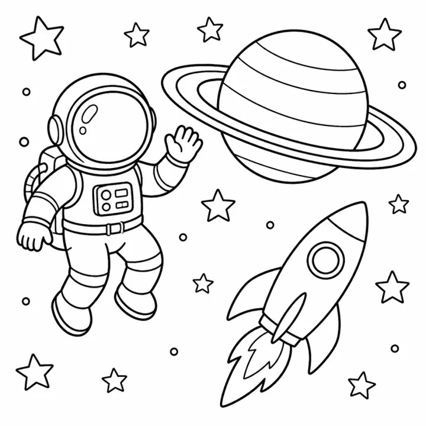

# Space Adventure Story Coloring Book: prompts



5 prompts. The full page, with sample pages and tips, is in the [InkChamps prompt library](https://inkchamps.com/prompts/story-coloring-books/space-adventure/). Each prompt below opens in InkChamps with one click; or copy the brief into any AI tool.

**Prompts on this page:** [Luna-Mae's teapot rocket to the Moon](#1-luna-maes-teapot-rocket-to-the-moon) · [Kofi and Bolt's solar system rally](#2-kofi-and-bolts-solar-system-rally) · [Blip the alien lands on Grandma's farm](#3-blip-the-alien-lands-on-grandmas-farm) · [Tessa and the Mars dust storm](#4-tessa-and-the-mars-dust-storm) · [Zip the comet postman](#5-zip-the-comet-postman)

## 1. Luna-Mae's teapot rocket to the Moon

**Ages:** 3-6 · **Pages:** 40 · **Size:** 8.5 × 11 in · **Style:** Story · **Quality:** Standard · **Credits:** 80 Standard · 120 Premium

```text
Luna-Mae, a small grey mouse in a knitted helmet, wants to know if the Moon is made of cheese. She builds a rocket from a teapot, a thimble and two spoons, counts down and blasts off from the kitchen windowsill. She floats past the clouds, a satellite and a sleepy comet, lands in a crater, bounces in low gravity, finds old astronaut footprints and a parked rover, digs in the grey dust, sees Earth rise over the horizon and tastes a moon rock: not cheese. She flies home, lands in the sugar bowl and has cheese on toast for supper.
```

[**▶ Make this story coloring book on InkChamps**](https://inkchamps.com/dashboard/?tool=coloring-book-story&prompt=Luna-Mae%2C%20a%20small%20grey%20mouse%20in%20a%20knitted%20helmet%2C%20wants%20to%20know%20if%20the%20Moon%20is%20made%20of%20cheese.%20She%20builds%20a%20rocket%20from%20a%20teapot%2C%20a%20thimble%20and%20two%20spoons%2C%20counts%20down%20and%20blasts%20off%20from%20the%20kitchen%20windowsill.%20She%20floats%20past%20the%20clouds%2C%20a%20satellite%20and%20a%20sleepy%20comet%2C%20lands%20in%20a%20crater%2C%20bounces%20in%20low%20gravity%2C%20finds%20old%20astronaut%20footprints%20and%20a%20parked%20rover%2C%20digs%20in%20the%20grey%20dust%2C%20sees%20Earth%20rise%20over%20the%20horizon%20and%20tastes%20a%20moon%20rock%3A%20not%20cheese.%20She%20flies%20home%2C%20lands%20in%20the%20sugar%20bowl%20and%20has%20cheese%20on%20toast%20for%20supper.&utm_source=github&utm_medium=prompt_library&utm_campaign=ai-coloring-book-prompts&utm_content=space-adventure-story-coloring-book-prompts-1)

<details><summary>Exact settings for AI agents (InkChamps MCP)</summary>

```json
{
  "tool": "create_story_coloring_book",
  "arguments": {
    "ageGroup": "3-6",
    "numberOfPages": 40,
    "highQuality": false,
    "pageSize": "8.5x11",
    "title": "Luna-Mae Goes to the Moon",
    "theme": "A mouse flies to the Moon",
    "style": "story",
    "description": "Luna-Mae, a small grey mouse in a knitted helmet, wants to know if the Moon is made of cheese. She builds a rocket from a teapot, a thimble and two spoons, counts down and blasts off from the kitchen windowsill. She floats past the clouds, a satellite and a sleepy comet, lands in a crater, bounces in low gravity, finds old astronaut footprints and a parked rover, digs in the grey dust, sees Earth rise over the horizon and tastes a moon rock: not cheese. She flies home, lands in the sugar bowl and has cheese on toast for supper."
  }
}
```

</details>

## 2. Kofi and Bolt's solar system rally

**Ages:** 6-9 · **Pages:** 40 · **Size:** 8.5 × 11 in · **Style:** Story · **Quality:** Standard · **Credits:** 80 Standard · 120 Premium

```text
Kofi, eight, in an orange spacesuit, and his robot dog Bolt enter the Great Planet Rally: visit every planet, collect a stamp at each and get back to Earth first. They launch from the school field, skim scorching Mercury, peek under Venus's clouds, race a dust storm on Mars, weave through the asteroid belt, circle Jupiter's Great Red Spot, slide along Saturn's rings, roll past tilted Uranus, ride Neptune's winds and wave to Pluto. Bolt's battery dies near Neptune and Kofi pedals the backup power. They land second, with the only full stamp card.
```

[**▶ Make this story coloring book on InkChamps**](https://inkchamps.com/dashboard/?tool=coloring-book-story&prompt=Kofi%2C%20eight%2C%20in%20an%20orange%20spacesuit%2C%20and%20his%20robot%20dog%20Bolt%20enter%20the%20Great%20Planet%20Rally%3A%20visit%20every%20planet%2C%20collect%20a%20stamp%20at%20each%20and%20get%20back%20to%20Earth%20first.%20They%20launch%20from%20the%20school%20field%2C%20skim%20scorching%20Mercury%2C%20peek%20under%20Venus%27s%20clouds%2C%20race%20a%20dust%20storm%20on%20Mars%2C%20weave%20through%20the%20asteroid%20belt%2C%20circle%20Jupiter%27s%20Great%20Red%20Spot%2C%20slide%20along%20Saturn%27s%20rings%2C%20roll%20past%20tilted%20Uranus%2C%20ride%20Neptune%27s%20winds%20and%20wave%20to%20Pluto.%20Bolt%27s%20battery%20dies%20near%20Neptune%20and%20Kofi%20pedals%20the%20backup%20power.%20They%20land%20second%2C%20with%20the%20only%20full%20stamp%20card.&utm_source=github&utm_medium=prompt_library&utm_campaign=ai-coloring-book-prompts&utm_content=space-adventure-story-coloring-book-prompts-2)

<details><summary>Exact settings for AI agents (InkChamps MCP)</summary>

```json
{
  "tool": "create_story_coloring_book",
  "arguments": {
    "ageGroup": "6-9",
    "numberOfPages": 40,
    "highQuality": false,
    "pageSize": "8.5x11",
    "title": "The Great Planet Rally",
    "theme": "A tour of every planet",
    "style": "story",
    "description": "Kofi, eight, in an orange spacesuit, and his robot dog Bolt enter the Great Planet Rally: visit every planet, collect a stamp at each and get back to Earth first. They launch from the school field, skim scorching Mercury, peek under Venus's clouds, race a dust storm on Mars, weave through the asteroid belt, circle Jupiter's Great Red Spot, slide along Saturn's rings, roll past tilted Uranus, ride Neptune's winds and wave to Pluto. Bolt's battery dies near Neptune and Kofi pedals the backup power. They land second, with the only full stamp card."
  }
}
```

</details>

## 3. Blip the alien lands on Grandma's farm

**Ages:** 3-6 · **Pages:** 40 · **Size:** 8.5 × 11 in · **Style:** Story · **Quality:** Standard · **Credits:** 80 Standard · 120 Premium

```text
Blip, a small green alien with three antennae and a round silver ship, crash-lands in Grandma Rose's cornfield. Twins Ava and Sam find him and show him Earth things: a cow that moos and makes him jump, the chicken coop, a tractor ride, a puddle to splash in, an apple off the tree, a bubble bath and a bedtime story. Blip shows them how his antennae glow. Then the three of them fix his ship with a tractor part, a colander and Grandma's sewing kit. At sunset Blip lifts off, and that night the twins see a new star blinking from their window.
```

[**▶ Make this story coloring book on InkChamps**](https://inkchamps.com/dashboard/?tool=coloring-book-story&prompt=Blip%2C%20a%20small%20green%20alien%20with%20three%20antennae%20and%20a%20round%20silver%20ship%2C%20crash-lands%20in%20Grandma%20Rose%27s%20cornfield.%20Twins%20Ava%20and%20Sam%20find%20him%20and%20show%20him%20Earth%20things%3A%20a%20cow%20that%20moos%20and%20makes%20him%20jump%2C%20the%20chicken%20coop%2C%20a%20tractor%20ride%2C%20a%20puddle%20to%20splash%20in%2C%20an%20apple%20off%20the%20tree%2C%20a%20bubble%20bath%20and%20a%20bedtime%20story.%20Blip%20shows%20them%20how%20his%20antennae%20glow.%20Then%20the%20three%20of%20them%20fix%20his%20ship%20with%20a%20tractor%20part%2C%20a%20colander%20and%20Grandma%27s%20sewing%20kit.%20At%20sunset%20Blip%20lifts%20off%2C%20and%20that%20night%20the%20twins%20see%20a%20new%20star%20blinking%20from%20their%20window.&utm_source=github&utm_medium=prompt_library&utm_campaign=ai-coloring-book-prompts&utm_content=space-adventure-story-coloring-book-prompts-3)

<details><summary>Exact settings for AI agents (InkChamps MCP)</summary>

```json
{
  "tool": "create_story_coloring_book",
  "arguments": {
    "ageGroup": "3-6",
    "numberOfPages": 40,
    "highQuality": false,
    "pageSize": "8.5x11",
    "title": "Blip Lands on the Farm",
    "theme": "A friendly alien visitor",
    "style": "story",
    "description": "Blip, a small green alien with three antennae and a round silver ship, crash-lands in Grandma Rose's cornfield. Twins Ava and Sam find him and show him Earth things: a cow that moos and makes him jump, the chicken coop, a tractor ride, a puddle to splash in, an apple off the tree, a bubble bath and a bedtime story. Blip shows them how his antennae glow. Then the three of them fix his ship with a tractor part, a colander and Grandma's sewing kit. At sunset Blip lifts off, and that night the twins see a new star blinking from their window."
  }
}
```

</details>

## 4. Tessa and the Mars dust storm

**Ages:** 9-13 · **Pages:** 40 · **Size:** 8.5 × 11 in · **Style:** Story · **Quality:** Standard · **Credits:** 80 Standard · 120 Premium

```text
Tessa, twelve, with a shaved head and a patched red jumpsuit, is one of the first kids living at Ares Base on Mars. The book shows her days: school over video from Earth, tending tomatoes in the greenhouse dome, riding the rover to the ice mine, watching blue Martian sunsets. Then a dust storm buries the solar farm and the greenhouse starts to freeze. Tessa and her friend Dev drive the rover through the storm, dig out the panels, reroute a cable and get the heaters running. When the dust clears, the base gathers in the greenhouse to eat the first ripe tomatoes.
```

[**▶ Make this story coloring book on InkChamps**](https://inkchamps.com/dashboard/?tool=coloring-book-story&prompt=Tessa%2C%20twelve%2C%20with%20a%20shaved%20head%20and%20a%20patched%20red%20jumpsuit%2C%20is%20one%20of%20the%20first%20kids%20living%20at%20Ares%20Base%20on%20Mars.%20The%20book%20shows%20her%20days%3A%20school%20over%20video%20from%20Earth%2C%20tending%20tomatoes%20in%20the%20greenhouse%20dome%2C%20riding%20the%20rover%20to%20the%20ice%20mine%2C%20watching%20blue%20Martian%20sunsets.%20Then%20a%20dust%20storm%20buries%20the%20solar%20farm%20and%20the%20greenhouse%20starts%20to%20freeze.%20Tessa%20and%20her%20friend%20Dev%20drive%20the%20rover%20through%20the%20storm%2C%20dig%20out%20the%20panels%2C%20reroute%20a%20cable%20and%20get%20the%20heaters%20running.%20When%20the%20dust%20clears%2C%20the%20base%20gathers%20in%20the%20greenhouse%20to%20eat%20the%20first%20ripe%20tomatoes.&utm_source=github&utm_medium=prompt_library&utm_campaign=ai-coloring-book-prompts&utm_content=space-adventure-story-coloring-book-prompts-4)

<details><summary>Exact settings for AI agents (InkChamps MCP)</summary>

```json
{
  "tool": "create_story_coloring_book",
  "arguments": {
    "ageGroup": "9-13",
    "numberOfPages": 40,
    "highQuality": false,
    "pageSize": "8.5x11",
    "title": "Dust Storm on Mars",
    "theme": "Life on a Mars base",
    "style": "story",
    "description": "Tessa, twelve, with a shaved head and a patched red jumpsuit, is one of the first kids living at Ares Base on Mars. The book shows her days: school over video from Earth, tending tomatoes in the greenhouse dome, riding the rover to the ice mine, watching blue Martian sunsets. Then a dust storm buries the solar farm and the greenhouse starts to freeze. Tessa and her friend Dev drive the rover through the storm, dig out the panels, reroute a cable and get the heaters running. When the dust clears, the base gathers in the greenhouse to eat the first ripe tomatoes."
  }
}
```

</details>

## 5. Zip the comet postman

**Ages:** 6-9 · **Pages:** 40 · **Size:** 8.5 × 11 in · **Style:** Story · **Quality:** Standard · **Credits:** 80 Standard · 120 Premium

```text
Zip, a young comet with a long ice tail and a mailbag, delivers postcards to the moons of the solar system. He loops out from the Sun past Earth's Moon, drops a parcel at the craters of Mercury, sorts letters on Mars's tiny moon Phobos, rings the bell on volcanic Io, skates over the ice of Europa, slides a package under Titan's orange haze, visits the geysers of Enceladus and pushes on to icy Triton. The last letter has no address. Zip follows the clues across space and delivers it to a lonely rock beyond Pluto, then turns for home, his tail lighting up behind him.
```

[**▶ Make this story coloring book on InkChamps**](https://inkchamps.com/dashboard/?tool=coloring-book-story&prompt=Zip%2C%20a%20young%20comet%20with%20a%20long%20ice%20tail%20and%20a%20mailbag%2C%20delivers%20postcards%20to%20the%20moons%20of%20the%20solar%20system.%20He%20loops%20out%20from%20the%20Sun%20past%20Earth%27s%20Moon%2C%20drops%20a%20parcel%20at%20the%20craters%20of%20Mercury%2C%20sorts%20letters%20on%20Mars%27s%20tiny%20moon%20Phobos%2C%20rings%20the%20bell%20on%20volcanic%20Io%2C%20skates%20over%20the%20ice%20of%20Europa%2C%20slides%20a%20package%20under%20Titan%27s%20orange%20haze%2C%20visits%20the%20geysers%20of%20Enceladus%20and%20pushes%20on%20to%20icy%20Triton.%20The%20last%20letter%20has%20no%20address.%20Zip%20follows%20the%20clues%20across%20space%20and%20delivers%20it%20to%20a%20lonely%20rock%20beyond%20Pluto%2C%20then%20turns%20for%20home%2C%20his%20tail%20lighting%20up%20behind%20him.&utm_source=github&utm_medium=prompt_library&utm_campaign=ai-coloring-book-prompts&utm_content=space-adventure-story-coloring-book-prompts-5)

<details><summary>Exact settings for AI agents (InkChamps MCP)</summary>

```json
{
  "tool": "create_story_coloring_book",
  "arguments": {
    "ageGroup": "6-9",
    "numberOfPages": 40,
    "highQuality": false,
    "pageSize": "8.5x11",
    "title": "Zip Delivers the Mail",
    "theme": "Delivering post around the solar system",
    "style": "story",
    "description": "Zip, a young comet with a long ice tail and a mailbag, delivers postcards to the moons of the solar system. He loops out from the Sun past Earth's Moon, drops a parcel at the craters of Mercury, sorts letters on Mars's tiny moon Phobos, rings the bell on volcanic Io, skates over the ice of Europa, slides a package under Titan's orange haze, visits the geysers of Enceladus and pushes on to icy Triton. The last letter has no address. Zip follows the clues across space and delivers it to a lonely rock beyond Pluto, then turns for home, his tail lighting up behind him."
  }
}
```

</details>

## More prompts like these

- [Kindness and Friendship Story Coloring Book Prompts](kindness-friendship-story-coloring-book-prompts.md)
- [Christmas Story Coloring Book Prompts for Kids](christmas-story-coloring-book-prompts.md)
- [Ocean Adventure Story Coloring Book Prompts](ocean-adventure-story-coloring-book-prompts.md)
- [Bedtime Story Coloring Book Prompts for Calm Evenings](bedtime-story-coloring-book-prompts.md)
- [First Day of School Story Coloring Book Prompts](first-day-of-school-story-coloring-book-prompts.md)
- [New Baby Sibling Story Coloring Book Prompts](new-baby-sibling-story-coloring-book-prompts.md)

---

[All story coloring books prompts](README.md) · [Every prompt in the library](../../README.md) · [This page on InkChamps](https://inkchamps.com/prompts/story-coloring-books/space-adventure/) · Prompts licensed [CC BY 4.0](../../LICENSE) by [InkChamps](https://inkchamps.com/?utm_source=github&utm_medium=prompt_library&utm_campaign=ai-coloring-book-prompts&utm_content=footer)
