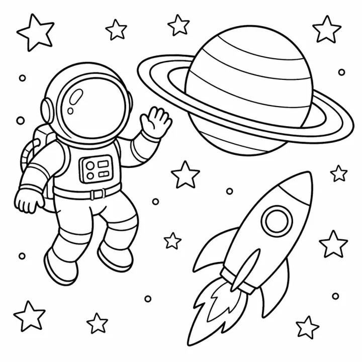

# Space Adventure Story Coloring Book: prompts



5 prompts. The full page, with sample pages and tips, is in the [InkChamps prompt library](https://inkchamps.com/prompts/story-coloring-books/space-adventure/). Each prompt below opens in InkChamps with one click; or copy the brief into any AI tool.

**Prompts on this page:** [Luna-Mae's teapot rocket to the Moon](#1-luna-maes-teapot-rocket-to-the-moon) · [Kofi and Bolt's solar system rally](#2-kofi-and-bolts-solar-system-rally) · [Blip the alien lands on Grandma's farm](#3-blip-the-alien-lands-on-grandmas-farm) · [Tessa and the Mars dust storm](#4-tessa-and-the-mars-dust-storm) · [Zip the comet postman](#5-zip-the-comet-postman)

## 1. Luna-Mae's teapot rocket to the Moon

**Ages:** 3-6 · **Pages:** 24 · **Size:** 8.5 × 11 in · **Style:** Story · **Quality:** Standard · **Credits:** 48 Standard · 72 Premium

```text
Luna-Mae, a small mouse in a knitted helmet, wants to know if the Moon is made of cheese. In 24 pages she builds a rocket from a teapot, a thimble and two spoons, blasts off from the kitchen windowsill, floats past clouds, a satellite and a sleepy comet, lands in a crater, bounces in low gravity, finds old astronaut footprints and a parked moon buggy, digs in the dust, watches Earth rise and licks a moon rock: not cheese. She flies home, lands in the sugar bowl and has cheese on toast for supper.
```

### Page by page (24 pages)

Paste one page at a time into ChatGPT, Gemini or any AI image tool, with this line after it:

> Black-and-white coloring page, ages 3 to 6. Luna-Mae is a small cartoon mouse with big round ears, a thin tail and a knitted pom-pom helmet; her rocket is a round teapot with a thimble nose and two spoon fins; same look on every page. Thick bold outlines, big shapes, little background, no shading, no grey, no words in the picture, blank band at the bottom for text, portrait 8.5 x 11 page.

1. Luna-Mae the little mouse standing on the kitchen windowsill at night, gazing up at a big round full Moon, a wedge of cheese and a flowerpot beside her.  
   *Words:* Luna-Mae the mouse looked up at the big round Moon. "I think it is made of cheese," she said.
2. Luna-Mae tucked into her matchbox bed with a picture book about the Moon open on her lap, a candle stub glowing on a button table.  
   *Words:* She could not stop wondering. There was only one way to find out for sure.
3. Luna-Mae pushing an old round teapot across the kitchen counter with both paws, a thimble and two spoons waiting in a pile beside the bread bin.  
   *Words:* She found an old teapot, a silver thimble and two shiny spoons.
4. Luna-Mae on a step of cotton reels tying two spoons to the sides of the teapot with string, the thimble set on top of the lid like a pointed nose.  
   *Words:* She tied on the spoons for fins and put the thimble on top. Her rocket was ready!
5. Luna-Mae pulling on her knitted helmet with a pom-pom and packing a cracker into a tiny backpack, her teapot rocket standing on the windowsill behind her.  
   *Words:* Luna-Mae put on her knitted helmet and packed a cracker for the trip.
6. Luna-Mae waving from the open teapot lid on the windowsill, one paw raised, the window open and the curtains tied back.  
   *Words:* She climbed in and counted down. Three, two, one...
7. The teapot rocket blasting off out of the open kitchen window, big puffy clouds of steam underneath and the curtains flapping.  
   *Words:* Whoosh! The teapot rocket blasted off out of the window.
8. The teapot rocket zooming up through fluffy clouds, a surprised bird flapping beside it and Luna-Mae waving from the spout window.  
   *Words:* Up she flew, past the fluffy clouds and one very surprised bird.
9. The teapot rocket gliding past a satellite with wide square solar panels and a round dish, little stars dotted around them.  
   *Words:* She waved to a satellite turning slowly in the dark.
10. A sleepy cartoon comet with closed eyes and a long swishing tail yawning as the teapot rocket zips past, Luna-Mae giggling at the window.  
   *Words:* A sleepy comet gave a big yawn as she zoomed by.
11. Luna-Mae floating upside down inside the round teapot rocket, her tail curled, cracker crumbs and her backpack floating around her.  
   *Words:* Inside the rocket, Luna-Mae floated upside down. Her cracker crumbs floated too!
12. Luna-Mae pressing her nose to the round window as the huge Moon fills the view, covered in big and small round craters.  
   *Words:* The Moon grew bigger and bigger. It was covered in round holes.
13. The teapot rocket landing on its spoon fins in the middle of a big round crater, a puff of moon dust rising around it.  
   *Words:* Bump! The rocket landed in a big round crater.
14. Luna-Mae climbing down a little rope ladder from the teapot and stepping onto the dusty Moon, leaving her first tiny footprint.  
   *Words:* Luna-Mae climbed down and made her very first tiny footprint.
15. Luna-Mae bouncing high above the Moon's surface with her arms spread wide and her tail streaming, round rocks and craters far below.  
   *Words:* On the Moon she could jump so high! Boing, boing, boing!
16. Luna-Mae standing inside one giant old astronaut boot print, a long trail of the same huge prints stretching away across the dust.  
   *Words:* She found giant old footprints. Someone had been here before!
17. Luna-Mae sitting in the big seat of a parked moon buggy with four wire wheels and a round antenna, her feet dangling far above the floor.  
   *Words:* Next to them was a parked moon buggy. She sat in the big seat and pretended to drive.
18. Luna-Mae digging in the soft moon dust with a teaspoon, a small pile of dust and a thimble bucket beside her, sniffing the air.  
   *Words:* She dug in the dust with a spoon. It did not smell like cheese at all.
19. Luna-Mae sitting on a moon rock watching the round Earth rise over the edge of the Moon, swirls of clouds on it and stars all around.  
   *Words:* Then she saw Earth rising over the edge of the Moon. Home looked beautiful.
20. Luna-Mae licking a lumpy moon rock and pulling a funny scrunched-up face, her tongue out and her ears flat.  
   *Words:* At last she licked a moon rock. Yuck! The Moon is not made of cheese.
21. The teapot rocket flying back toward the big round Earth, the Moon getting smaller behind it, Luna-Mae laughing at the window.  
   *Words:* Luna-Mae laughed, climbed back into her rocket and flew home.
22. The teapot rocket landing nose-first in the sugar bowl on the kitchen table, sugar cubes flying up and a milk jug beside it.  
   *Words:* Plop! She landed right in the sugar bowl.
23. Luna-Mae at a table made from a cotton reel eating a slice of cheese on toast, her knitted helmet hanging on a nail behind her.  
   *Words:* For supper she had cheese on toast. Earth cheese is the best cheese of all.
24. Luna-Mae fast asleep in her matchbox bed, the teapot rocket parked by the wall and the full Moon smiling in through the window.  
   *Words:* That night the Moon shone in at her window, and Luna-Mae smiled in her sleep.

[**▶ Make this story coloring book on InkChamps**](https://inkchamps.com/dashboard/?tool=coloring-book-story&prompt=Luna-Mae%2C%20a%20small%20mouse%20in%20a%20knitted%20helmet%2C%20wants%20to%20know%20if%20the%20Moon%20is%20made%20of%20cheese.%20In%2024%20pages%20she%20builds%20a%20rocket%20from%20a%20teapot%2C%20a%20thimble%20and%20two%20spoons%2C%20blasts%20off%20from%20the%20kitchen%20windowsill%2C%20floats%20past%20clouds%2C%20a%20satellite%20and%20a%20sleepy%20comet%2C%20lands%20in%20a%20crater%2C%20bounces%20in%20low%20gravity%2C%20finds%20old%20astronaut%20footprints%20and%20a%20parked%20moon%20buggy%2C%20digs%20in%20the%20dust%2C%20watches%20Earth%20rise%20and%20licks%20a%20moon%20rock%3A%20not%20cheese.%20She%20flies%20home%2C%20lands%20in%20the%20sugar%20bowl%20and%20has%20cheese%20on%20toast%20for%20supper.&utm_source=github&utm_medium=prompt_library&utm_campaign=ai-coloring-book-prompts&utm_content=space-adventure-story-coloring-book-prompts-1)

<details><summary>Exact settings for AI agents (InkChamps MCP)</summary>

```json
{
  "tool": "create_story_coloring_book",
  "arguments": {
    "ageGroup": "3-6",
    "numberOfPages": 24,
    "highQuality": false,
    "pageSize": "8.5x11",
    "title": "Luna-Mae Goes to the Moon",
    "theme": "A mouse flies to the Moon",
    "style": "story",
    "description": "Luna-Mae, a small mouse in a knitted helmet, wants to know if the Moon is made of cheese. In 24 pages she builds a rocket from a teapot, a thimble and two spoons, blasts off from the kitchen windowsill, floats past clouds, a satellite and a sleepy comet, lands in a crater, bounces in low gravity, finds old astronaut footprints and a parked moon buggy, digs in the dust, watches Earth rise and licks a moon rock: not cheese. She flies home, lands in the sugar bowl and has cheese on toast for supper."
  }
}
```

</details>

## 2. Kofi and Bolt's solar system rally

**Ages:** 6-9 · **Pages:** 24 · **Size:** 8.5 × 11 in · **Style:** Story · **Quality:** Standard · **Credits:** 48 Standard · 72 Premium

```text
Kofi, eight, and his robot dog Bolt enter the Great Planet Rally: visit every planet, collect a stamp at each and get back to Earth first. In 24 pages they launch from the school field, skim hot Mercury, peek under Venus's clouds, race a dust storm on Mars, weave through the asteroid belt, circle Jupiter's Great Red Spot, slide along Saturn's rings, pass tilted Uranus and ride Neptune's winds. Bolt's battery dies and Kofi pedals the backup power. A rival, Mira, lands first, but only Kofi's stamp card is full, and they win the Explorer's Cup.
```

### Page by page (24 pages)

Paste one page at a time into ChatGPT, Gemini or any AI image tool, with this line after it:

> Black-and-white coloring page, ages 6 to 9. Kofi: boy of eight, short curly hair, puffy spacesuit, round clear helmet, lightning badge. Bolt: small robot dog, boxy body, round head, antenna ears. Same look on every page. Clear medium outlines, moderate detail, simple space background, no shading, no grey, no words in the picture, blank band at the bottom for text, portrait 8.5 x 11 page.

1. Kofi and his robot dog Bolt at the school field looking at a big notice board with a poster of planets in a line and a rocket racing past them.  
   *Words:* Kofi, eight, and his robot dog Bolt signed up for the Great Planet Rally: visit every planet, get a stamp at each and be the first one home.
2. A row of different racing rockets lined up on the school field, Kofi and Bolt climbing the ladder into theirs while classmates cheer behind a rope.  
   *Words:* On race day, rockets lined up on the school field. Kofi and Bolt climbed into theirs.
3. Kofi and Bolt's rocket blasting up off the school field in a huge cloud of smoke, the school roof and goalposts below and other rockets rising beside it.  
   *Words:* Three, two, one, go! The rockets roared up into the sky.
4. The rocket skimming low over Mercury's cratered surface, a giant Sun filling one corner, Kofi fanning himself inside the cockpit.  
   *Words:* First stop was Mercury, closest to the Sun. It was so hot that Bolt's metal ears steamed.
5. A little stamp robot on a crater rim reaching up to press a big stamp onto the card Kofi holds out of the rocket window, Bolt wagging beside him.  
   *Words:* A stamp robot stamped their card. One planet down, plenty more to go.
6. The rocket dipping under the thick, swirling clouds of Venus, volcanoes and rocky plains far below, Kofi and Bolt peering down from the window.  
   *Words:* At Venus they dipped under thick, swirling clouds and spotted volcanoes far below.
7. The rocket racing across a rocky Mars canyon while a giant rolling dust storm chases it from behind, Kofi gripping the steering stick.  
   *Words:* On Mars a huge dust storm chased them across the rocks. Kofi steered as fast as he could.
8. Kofi and Bolt in front of a small dome stamp station at the foot of a giant flat-topped volcano, the dust storm coming over the hills.  
   *Words:* They grabbed the Mars stamp beside a giant volcano just before the dust rolled in.
9. The rocket zigzagging between big tumbling space rocks in the asteroid belt, Kofi leaning hard on the controls and Bolt holding on with his paws.  
   *Words:* Next came the asteroid belt. Kofi zigzagged between the tumbling rocks.
10. A zippy round saucer flown by a girl named Mira zooming past Kofi's rocket, Mira waving from her bubble window with goggles on.  
   *Words:* A zippy saucer flown by a girl named Mira whizzed past. "See you at the finish!" she called.
11. The tiny rocket flying in front of enormous Jupiter, its striped bands and the swirling oval of the Great Red Spot filling the page.  
   *Words:* Jupiter was enormous. Its Great Red Spot is a storm bigger than the whole Earth.
12. A floating stamp drone meeting the rocket near Jupiter, four round moons in a line behind it, Kofi holding up the card with three stamps on it.  
   *Words:* A stamp drone met them beside Jupiter's moons. Stamp!
13. The rocket sliding along Saturn's wide rings past chunks of ice as big as houses, the planet curving huge behind them.  
   *Words:* At Saturn, Kofi slid the rocket along the rings, past chunks of ice as big as houses.
14. Bolt leaning out of the rocket's hatch on a safety line, catching a small ice chunk in his mouth like a ball, Kofi laughing in the doorway.  
   *Words:* Bolt leaned out on his safety line and caught a little ice chunk, like a game of fetch.
15. The rocket passing Uranus spinning on its side with its thin rings standing up and down, Kofi tilting his head sideways to look at it.  
   *Words:* Uranus spins on its side. Kofi tipped his head to see it the right way up.
16. The rocket being pushed about by swirling wind streaks around Neptune, Kofi's helmet bumping the window and loose snacks flying around the cabin.  
   *Words:* Neptune has the fastest winds of all. They shoved the rocket this way and that.
17. Bolt slumped on the cockpit floor with his eyes closed and his antenna drooping, the cabin lights off and Kofi kneeling beside him with a flashlight.  
   *Words:* Then Bolt's battery ran out. The lights flickered and went dark.
18. Kofi pedaling hard on a backup pedal generator under the dashboard, cables running to the controls and Bolt plugged in beside him.  
   *Words:* Kofi found the backup pedal power and pedaled with all his might.
19. Bolt bouncing up with his eyes lit, licking Kofi's helmet visor, while a stamp drone presses the Neptune stamp on the card at the window.  
   *Words:* Bolt beeped back to life, and they got the last stamp at Neptune.
20. The rocket heading home past little icy Pluto with its big heart-shaped plain and its moon nearby, Kofi and Bolt waving.  
   *Words:* On the way home they waved to little Pluto with its heart-shaped plain.
21. The rocket racing toward the round Earth, Mira's saucer just ahead of them, a trail of stars behind both ships.  
   *Words:* They raced back toward Earth. Mira's saucer was just ahead.
22. Mira's saucer already parked on the school field and Kofi's rocket landing beside it in a puff of smoke, the crowd cheering behind the rope.  
   *Words:* Mira landed first. Kofi and Bolt came in second.
23. A smiling judge with a clipboard holding up two stamp cards side by side, Mira's with empty gaps and Kofi's with every box stamped.  
   *Words:* Then the judge checked the cards. Only Kofi's had a stamp from every planet.
24. Kofi holding up a big star-shaped trophy with Bolt on his shoulders, Mira clapping beside them and planet flags strung above the field.  
   *Words:* Kofi and Bolt won the Explorer's Cup, and Mira asked if they could fly the rally together next year.

[**▶ Make this story coloring book on InkChamps**](https://inkchamps.com/dashboard/?tool=coloring-book-story&prompt=Kofi%2C%20eight%2C%20and%20his%20robot%20dog%20Bolt%20enter%20the%20Great%20Planet%20Rally%3A%20visit%20every%20planet%2C%20collect%20a%20stamp%20at%20each%20and%20get%20back%20to%20Earth%20first.%20In%2024%20pages%20they%20launch%20from%20the%20school%20field%2C%20skim%20hot%20Mercury%2C%20peek%20under%20Venus%27s%20clouds%2C%20race%20a%20dust%20storm%20on%20Mars%2C%20weave%20through%20the%20asteroid%20belt%2C%20circle%20Jupiter%27s%20Great%20Red%20Spot%2C%20slide%20along%20Saturn%27s%20rings%2C%20pass%20tilted%20Uranus%20and%20ride%20Neptune%27s%20winds.%20Bolt%27s%20battery%20dies%20and%20Kofi%20pedals%20the%20backup%20power.%20A%20rival%2C%20Mira%2C%20lands%20first%2C%20but%20only%20Kofi%27s%20stamp%20card%20is%20full%2C%20and%20they%20win%20the%20Explorer%27s%20Cup.&utm_source=github&utm_medium=prompt_library&utm_campaign=ai-coloring-book-prompts&utm_content=space-adventure-story-coloring-book-prompts-2)

<details><summary>Exact settings for AI agents (InkChamps MCP)</summary>

```json
{
  "tool": "create_story_coloring_book",
  "arguments": {
    "ageGroup": "6-9",
    "numberOfPages": 24,
    "highQuality": false,
    "pageSize": "8.5x11",
    "title": "The Great Planet Rally",
    "theme": "A tour of every planet",
    "style": "story",
    "description": "Kofi, eight, and his robot dog Bolt enter the Great Planet Rally: visit every planet, collect a stamp at each and get back to Earth first. In 24 pages they launch from the school field, skim hot Mercury, peek under Venus's clouds, race a dust storm on Mars, weave through the asteroid belt, circle Jupiter's Great Red Spot, slide along Saturn's rings, pass tilted Uranus and ride Neptune's winds. Bolt's battery dies and Kofi pedals the backup power. A rival, Mira, lands first, but only Kofi's stamp card is full, and they win the Explorer's Cup."
  }
}
```

</details>

## 3. Blip the alien lands on Grandma's farm

**Ages:** 3-6 · **Pages:** 24 · **Size:** 8.5 × 11 in · **Style:** Story · **Quality:** Standard · **Credits:** 48 Standard · 72 Premium

```text
Blip, a small alien with three antennae and a round saucer ship, crash-lands in Grandma Rose's cornfield. In 24 pages twins Ava and Sam find him and show him Earth things: a cow that moos and makes him jump, the chicken coop, a tractor ride, a puddle, an apple off the tree, the piglets, hide and seek, a bubble bath and a bedtime story while his antennae glow. Next day they fix his ship with a tractor part, a colander and Grandma's sewing kit. At sunset Blip lifts off, and that night the twins see a new star blinking from their window.
```

### Page by page (24 pages)

Paste one page at a time into ChatGPT, Gemini or any AI image tool, with this line after it:

> Black-and-white coloring page, ages 3 to 6. Blip: small round alien, big eyes, three ball-tipped antennae, saucer ship. Twins Ava (pigtails, overalls) and Sam (cap, striped shirt); Grandma Rose (glasses, bun, apron). Same look on every page. Thick bold outlines, big shapes, little background, no shading, no grey, no words in the picture, blank band at the bottom for text, portrait 8.5 x 11 page.

1. A little round spaceship wobbling down out of a starry night sky toward a farm with a big barn, a silo and a tall cornfield.  
   *Words:* One night a little round spaceship wobbled down from the stars toward Grandma Rose's farm.
2. The round saucer ship tipped over in the cornfield with one bent leg, flattened corn stalks around it and a small puff of smoke.  
   *Words:* Bump! It landed in the cornfield with a bent leg and a puff of smoke.
3. Twins Ava and Sam peeking through tall corn stalks at the ship as its hatch opens and Blip the alien peeks out with big eyes.  
   *Words:* In the morning, twins Ava and Sam found it. Out peeked Blip, a little alien with three antennae.
4. Blip standing in front of his ship waving all three antennae while Ava and Sam wave back, a basket of corn cobs at their feet.  
   *Words:* "Hello," said Ava. "Blip," said Blip, and waved all three antennae.
5. A big friendly cow mooing over a fence while Blip jumps high in the air in surprise, Ava and Sam laughing beside a milk pail.  
   *Words:* They showed Blip a cow. "Moo!" Blip jumped right up in the air.
6. Blip inside the chicken coop with a fluffy hen sitting on his head like a hat, eggs in the nest boxes and the twins giggling at the door.  
   *Words:* In the chicken coop, a hen sat on Blip's head like a hat.
7. Grandma Rose driving the big tractor along a farm track, Ava, Sam and Blip riding in the little trailer behind with hay bales.  
   *Words:* Grandma Rose gave them a bumpy ride on the big tractor.
8. Blip and the twins in rain boots jumping into a big muddy puddle together, big splashes flying up and a duck watching nearby.  
   *Words:* They found a big muddy puddle. Splash! Blip loved puddles.
9. Sam on a ladder under an apple tree handing an apple down to Blip, who takes a big crunchy bite with wide surprised eyes.  
   *Words:* Sam picked Blip an apple off the tree. Crunch! Blip's eyes went wide.
10. Blip kneeling by the pigpen fence as three little piglets sniff his toes, Ava holding a bucket of scraps.  
   *Words:* The piglets snuffled Blip's toes, and he giggled and giggled.
11. Blip hiding in a big haystack with only his three antennae sticking out while Sam searches with his hands over his eyes.  
   *Words:* They played hide and seek. Blip hid well, except for his antennae.
12. Blip, Ava and Sam lying on the grass at night pointing up at the stars, Blip showing them which tiny star is his home.  
   *Words:* Before bed they lay on the grass, and Blip pointed to the tiny star that was his home.
13. Blip in an old claw-foot bathtub full of bubbles, a rubber duck on his head and Grandma Rose holding a fluffy towel.  
   *Words:* At bath time Blip tried bubbles for the very first time.
14. Grandma Rose reading a bedtime story to Ava, Sam and Blip tucked up in a big bed, Blip's three antennae glowing like little lamps.  
   *Words:* At bedtime Grandma read a story, and Blip's antennae glowed like night-lights.
15. The next morning, Blip standing sadly by his broken ship in the cornfield, looking up at the sky, the twins holding his hands.  
   *Words:* In the morning Blip looked at his broken ship and then at the sky. He wanted to go home.
16. Grandma Rose walking up with a toolbox, a metal colander and her sewing basket, a pencil behind her ear and the twins running beside her.  
   *Words:* "We can fix it," said Grandma Rose, and she fetched her toolbox, a colander and her sewing kit.
17. Sam and Blip bolting a spare tractor part onto the ship where the bent leg was, a spanner in Sam's hand and Blip holding the bolts.  
   *Words:* Sam and Blip fitted a tractor part where the bent leg had been.
18. Ava on a stepladder fixing the colander upside down on top of the ship's dome as a new antenna dish, Blip clapping below.  
   *Words:* Ava put the colander on top as a brand-new antenna dish.
19. Grandma Rose sitting on an upturned bucket sewing a patch over a tear in the ship's seat cushion, a pincushion on her wrist.  
   *Words:* Grandma Rose sewed a neat patch over a tear in the seat.
20. Blip in the cockpit pressing buttons as the fixed ship hovers just above the corn, Ava, Sam and Grandma cheering below.  
   *Words:* Blip pressed the buttons. The ship hummed and lifted off the ground!
21. Blip hugging Ava and Sam beside his ship at sunset, Grandma Rose holding out a basket of apples for his trip.  
   *Words:* It was time to say goodbye. Grandma gave Blip a basket of apples for the trip.
22. The ship lifting up over the farm at sunset, the cow, the hen and the piglets looking up and the twins waving from the fence.  
   *Words:* At sunset Blip lifted off, and all the farm animals watched him go.
23. Ava and Sam in pajamas at their bedroom window pointing at one new star blinking in the night sky above the barn.  
   *Words:* That night the twins saw a new star blinking at them from the sky.
24. Blip inside his ship far out in space, munching one of Grandma's apples and waving down at the round Earth through his window.  
   *Words:* Far away, Blip munched an apple, blinked his ship's light and said goodnight to his friends.

[**▶ Make this story coloring book on InkChamps**](https://inkchamps.com/dashboard/?tool=coloring-book-story&prompt=Blip%2C%20a%20small%20alien%20with%20three%20antennae%20and%20a%20round%20saucer%20ship%2C%20crash-lands%20in%20Grandma%20Rose%27s%20cornfield.%20In%2024%20pages%20twins%20Ava%20and%20Sam%20find%20him%20and%20show%20him%20Earth%20things%3A%20a%20cow%20that%20moos%20and%20makes%20him%20jump%2C%20the%20chicken%20coop%2C%20a%20tractor%20ride%2C%20a%20puddle%2C%20an%20apple%20off%20the%20tree%2C%20the%20piglets%2C%20hide%20and%20seek%2C%20a%20bubble%20bath%20and%20a%20bedtime%20story%20while%20his%20antennae%20glow.%20Next%20day%20they%20fix%20his%20ship%20with%20a%20tractor%20part%2C%20a%20colander%20and%20Grandma%27s%20sewing%20kit.%20At%20sunset%20Blip%20lifts%20off%2C%20and%20that%20night%20the%20twins%20see%20a%20new%20star%20blinking%20from%20their%20window.&utm_source=github&utm_medium=prompt_library&utm_campaign=ai-coloring-book-prompts&utm_content=space-adventure-story-coloring-book-prompts-3)

<details><summary>Exact settings for AI agents (InkChamps MCP)</summary>

```json
{
  "tool": "create_story_coloring_book",
  "arguments": {
    "ageGroup": "3-6",
    "numberOfPages": 24,
    "highQuality": false,
    "pageSize": "8.5x11",
    "title": "Blip Lands on the Farm",
    "theme": "A friendly alien visitor",
    "style": "story",
    "description": "Blip, a small alien with three antennae and a round saucer ship, crash-lands in Grandma Rose's cornfield. In 24 pages twins Ava and Sam find him and show him Earth things: a cow that moos and makes him jump, the chicken coop, a tractor ride, a puddle, an apple off the tree, the piglets, hide and seek, a bubble bath and a bedtime story while his antennae glow. Next day they fix his ship with a tractor part, a colander and Grandma's sewing kit. At sunset Blip lifts off, and that night the twins see a new star blinking from their window."
  }
}
```

</details>

## 4. Tessa and the Mars dust storm

**Ages:** 9-13 · **Pages:** 24 · **Size:** 8.5 × 11 in · **Style:** Story · **Quality:** Standard · **Credits:** 48 Standard · 72 Premium

```text
Tessa, twelve, with a shaved head and a patched jumpsuit, is one of the first kids living at Ares Base on Mars. In 24 pages the book shows her days: exercise in low gravity, school over video from Earth, tomatoes in the greenhouse dome, the rover ride to the ice mine, blue Martian sunsets. Then a dust storm buries the solar farm, the grown-ups are stuck at the mine and the greenhouse starts to freeze. Tessa and her friend Dev drive the rover through the storm, dig out the panels, reroute a snapped cable and get the heaters running. When the dust clears, the base eats the first ripe tomatoes.
```

### Page by page (24 pages)

Paste one page at a time into ChatGPT, Gemini or any AI image tool, with this line after it:

> Black-and-white coloring page, ages 9 to 13. Tessa: girl of twelve, shaved head, patched jumpsuit (pressure suit and clear helmet outside). Dev: boy of twelve, glasses, messy hair. Same look on every page. Fine clean outlines, realistic detail, full Mars base or terrain background, no shading, no grey, no words in the picture, blank band at the bottom for text, portrait 8.5 x 11 page.

1. Ares Base on Mars: round domes joined by tunnels on a rocky plain, with Tessa looking out through a round porthole window.  
   *Words:* Tessa is twelve, and she is one of the first kids to live on Mars, at a place called Ares Base.
2. Tessa running on a treadmill in her small cabin, straps holding her down, a bunk bed and a shelf of rock samples behind her.  
   *Words:* Every day starts with exercise, because Mars gravity is weak and muscles get lazy fast.
3. Tessa and her friend Dev at a desk in the base school room watching a teacher on a big video screen, tablets and headsets on the desk.  
   *Words:* School comes over video from Earth. Messages take up to twenty minutes to arrive, so questions have to wait.
4. Tessa in the greenhouse dome watering rows of tomato plants under hanging grow lights, plastic pipes and nearly ripe tomatoes all around.  
   *Words:* After school Tessa looks after the tomatoes in the greenhouse dome. They are almost ripe.
5. Tessa and Dev in the airlock pulling on pressure suits and locking their clear-visor helmets, suit racks and a hatch wheel behind them.  
   *Words:* To go outside, Tessa and Dev suit up in the airlock. The air on Mars is far too thin to breathe.
6. A big six-wheeled rover bouncing across rocky dunes, Tessa driving with Chief Engineer Okafor beside her and Dev in the back seat.  
   *Words:* They ride the six-wheeled rover out to the ice mine with Chief Engineer Okafor.
7. Inside the ice mine, Dev drilling blocks of ice from a tunnel wall while Tessa loads them onto a cart with rails.  
   *Words:* Ice dug from under the ground gives the base its water and the air everyone breathes.
8. Tessa and Dev sitting on the rover's roof at dusk watching a small sun set over the crater rim, a glow spreading around it.  
   *Words:* On Mars the sunsets glow blue. Tessa and Dev never get tired of them.
9. Tessa standing in the base control room staring at a big weather screen showing a huge swirling storm moving toward the base.  
   *Words:* One evening the weather screen showed a giant dust storm rolling toward the base.
10. A towering wall of dust swallowing the domes of Ares Base, the outside lights glowing faintly through the swirling sand.  
   *Words:* By morning the storm had swallowed the sky. Dust hid the sun completely.
11. Rows of solar panels half buried under drifts of dust, a power meter dial inside the base dropping close to empty.  
   *Words:* Dust buried the solar farm, and the base's power began to fall.
12. Tessa touching a frosty tomato leaf in the cold greenhouse, frost patterns spreading across the dome glass and the heaters switched off.  
   *Words:* Without power the greenhouse heaters stopped. Frost crept over the tomato leaves.
13. Tessa and Dev at the radio console talking to Chief Okafor on a small screen, the grown-ups sheltering in the ice mine tunnel.  
   *Words:* The grown-ups were stuck at the ice mine until the storm passed. Someone had to save the greenhouse.
14. Tessa and Dev leaning over a base map spread on a table, a flashlight on it and a finger tracing the path to the solar farm.  
   *Words:* Tessa and Dev knew the path to the solar farm by heart. They made a plan.
15. The rover driving into the storm, its headlights cutting through the dust, a row of tall marker poles leading the way.  
   *Words:* They drove the rover into the storm, following the marker poles one by one.
16. Dev digging sand from around a sunken rover wheel with a shovel while Tessa holds up a big lamp, dust whirling around them.  
   *Words:* A wheel sank into soft sand. Dev dug it out while Tessa held the lamp.
17. Tessa and Dev arriving at the solar farm, only the tops of the panels poking out of the dust drifts in long rows.  
   *Words:* At the solar farm, only the tops of the panels poked out of the dust.
18. Tessa and Dev sweeping dust off a solar panel with wide brooms, the wind blowing their safety lines sideways.  
   *Words:* They brushed and shoveled, panel after panel, while the wind howled.
19. Tessa kneeling at an open junction box rerouting a thick cable to a spare socket with a wrench, a snapped cable end beside her.  
   *Words:* A cable had snapped. Tessa rerouted it to a spare socket, just like she had practiced.
20. Small status lights shining on top of the cleared solar panels as Dev throws his arms up in a cheer beside the rover.  
   *Words:* The lights on the panels blinked on. Power was flowing again!
21. Back in the greenhouse, Tessa holding a tomato plant up to a warm heater as the frost drips off the leaves, Dev pulling off his helmet.  
   *Words:* Back at base the heaters hummed, and the frost melted from the tomatoes.
22. The dust thinning over the base as the sun shows again, the rover with the grown-ups driving home from the ice mine.  
   *Words:* Days later the dust cleared, and the grown-ups drove home from the ice mine.
23. Chief Engineer Okafor pinning round badges with a lightning bolt onto Tessa's and Dev's jumpsuits, the crew clapping around them.  
   *Words:* Chief Okafor pinned a Storm Crew badge on Tessa and on Dev.
24. The whole base crew gathered at a long table in the greenhouse dome, sharing a bowl of the first ripe tomatoes, Tessa holding one up.  
   *Words:* That night the whole base ate the first ripe tomatoes on Mars, and they tasted like home.

[**▶ Make this story coloring book on InkChamps**](https://inkchamps.com/dashboard/?tool=coloring-book-story&prompt=Tessa%2C%20twelve%2C%20with%20a%20shaved%20head%20and%20a%20patched%20jumpsuit%2C%20is%20one%20of%20the%20first%20kids%20living%20at%20Ares%20Base%20on%20Mars.%20In%2024%20pages%20the%20book%20shows%20her%20days%3A%20exercise%20in%20low%20gravity%2C%20school%20over%20video%20from%20Earth%2C%20tomatoes%20in%20the%20greenhouse%20dome%2C%20the%20rover%20ride%20to%20the%20ice%20mine%2C%20blue%20Martian%20sunsets.%20Then%20a%20dust%20storm%20buries%20the%20solar%20farm%2C%20the%20grown-ups%20are%20stuck%20at%20the%20mine%20and%20the%20greenhouse%20starts%20to%20freeze.%20Tessa%20and%20her%20friend%20Dev%20drive%20the%20rover%20through%20the%20storm%2C%20dig%20out%20the%20panels%2C%20reroute%20a%20snapped%20cable%20and%20get%20the%20heaters%20running.%20When%20the%20dust%20clears%2C%20the%20base%20eats%20the%20first%20ripe%20tomatoes.&utm_source=github&utm_medium=prompt_library&utm_campaign=ai-coloring-book-prompts&utm_content=space-adventure-story-coloring-book-prompts-4)

<details><summary>Exact settings for AI agents (InkChamps MCP)</summary>

```json
{
  "tool": "create_story_coloring_book",
  "arguments": {
    "ageGroup": "9-13",
    "numberOfPages": 24,
    "highQuality": false,
    "pageSize": "8.5x11",
    "title": "Dust Storm on Mars",
    "theme": "Life on a Mars base",
    "style": "story",
    "description": "Tessa, twelve, with a shaved head and a patched jumpsuit, is one of the first kids living at Ares Base on Mars. In 24 pages the book shows her days: exercise in low gravity, school over video from Earth, tomatoes in the greenhouse dome, the rover ride to the ice mine, blue Martian sunsets. Then a dust storm buries the solar farm, the grown-ups are stuck at the mine and the greenhouse starts to freeze. Tessa and her friend Dev drive the rover through the storm, dig out the panels, reroute a snapped cable and get the heaters running. When the dust clears, the base eats the first ripe tomatoes."
  }
}
```

</details>

## 5. Zip the comet postman

**Ages:** 6-9 · **Pages:** 24 · **Size:** 8.5 × 11 in · **Style:** Story · **Quality:** Standard · **Credits:** 48 Standard · 72 Premium

```text
Zip, a young comet with a long ice tail, a postman's cap and a mailbag, delivers post around the solar system in 24 pages. He loops out from the Sun to the craters of Mercury and Earth's Moon, sorts letters on Mars's tiny moon Phobos, rings a bell on volcanic Io, skates over the ice of Europa, lunches on Saturn's rings, leaves a package under Titan's haze, dodges the geysers of Enceladus and visits Miranda's giant cliff and icy Triton. The last letter has no address. Zip follows the clues past Pluto and delivers it to a lonely rock, then turns for home.
```

### Page by page (24 pages)

Paste one page at a time into ChatGPT, Gemini or any AI image tool, with this line after it:

> Black-and-white coloring page, ages 6 to 9. Zip is a young cartoon comet with a round icy head, a friendly face, a postman's cap, a mailbag on a strap and a long streaming tail, the same on every page. Clear medium outlines, moderate detail, simple background of planets, moons and stars, no shading, no grey, no words in the picture, blank band at the bottom for text, portrait 8.5 x 11 page.

1. Zip the young comet in a post office on a small asteroid near the Sun, sorting envelopes into rows of round cubbyholes.  
   *Words:* Zip is a young comet with a long icy tail, and he is the postman of the solar system.
2. Zip putting on his postman's cap and stuffing postcards and parcels into his big mailbag, a stack of boxes beside him.  
   *Words:* Every morning he puts on his cap and fills his mailbag with postcards and parcels.
3. Zip zooming away from the big round Sun in a wide loop, his long tail streaming behind him and a few planets far ahead.  
   *Words:* Off he zooms, looping away from the Sun with his tail shining behind him.
4. Zip handing a parcel of sun hats to a family of little rock creatures waiting on a crater rim on hot Mercury, the huge Sun close behind.  
   *Words:* First stop is Mercury. Zip drops off a parcel of sun hats at the hot, rocky craters.
5. Zip dropping a postcard into a mailbox on the rim of a crater on Earth's Moon, the round Earth hanging in the sky behind.  
   *Words:* Next he visits Earth's Moon and pops a postcard into the crater mailbox.
6. Zip sitting on lumpy, potato-shaped Phobos sorting letters into piles, the big planet Mars curving below.  
   *Words:* On Phobos, Mars's tiny lumpy moon, he stops to sort his letters.
7. Zip weaving between tumbling rocks in the asteroid belt, hugging his mailbag tight to his chest.  
   *Words:* He weaves through the asteroid belt, holding his mailbag tight.
8. Zip ringing the bell of a little round house on Io as a volcano puffs a tall plume behind it, a parcel tucked under his tail.  
   *Words:* On Io, volcanoes puff and bubble. Zip rings the doorbell and hands over a parcel.
9. Zip skating across the cracked, criss-crossed ice of Europa and sliding a letter down a crack toward the hidden ocean, a fish peeking up.  
   *Words:* On Europa he skates over the cracked ice and slips a letter down to the ocean below.
10. Zip resting on the edge of Saturn's wide rings eating a snack from his lunchbox, ice chunks floating past and the planet huge behind him.  
   *Words:* At Saturn he sits on the rings for lunch and watches the ice drift by.
11. Zip sliding a package beside a door under the thick hazy clouds of Titan, a still dark lake and smooth hills around him.  
   *Words:* Under Titan's thick, hazy sky, he leaves a package beside a quiet lake.
12. Zip holding his mailbag high over his head while tall icy geysers spray up all around him on the snowy surface of Enceladus.  
   *Words:* On Enceladus, icy geysers shoot into space. Zip holds his mailbag high to keep it dry.
13. Zip delivering a postcard at the top of a giant cliff on Uranus's moon Miranda, the sideways-tipped planet Uranus in the sky.  
   *Words:* He delivers a postcard to the tallest cliff in the solar system, on Uranus's moon Miranda.
14. Zip posting a letter into a mailbox on icy Triton, dark streaks of frost on the ground and big round Neptune glowing behind.  
   *Words:* Far out at icy Triton, Neptune's biggest moon, he posts the last letter on his list.
15. Zip peering into his empty mailbag and pulling out one last envelope with no address on it, looking puzzled.  
   *Words:* But one letter is left at the bottom of the bag, and it has no address at all.
16. Zip holding up the envelope to show a drawing on the back of a small round rock and a dotted path leading past a tiny planet.  
   *Words:* On the back is a little drawing: a round rock and a dotted path leading past Pluto.
17. Zip asking small icy Pluto, with its heart-shaped plain, and its moon Charon for directions as they both point out into the dark.  
   *Words:* Pluto and its moon Charon point the way. "Out there, past everything," they say.
18. Zip flying into the cold, dark Kuiper Belt among scattered icy chunks, the Sun now just a tiny star far behind him.  
   *Words:* He flies on into the cold, dark Kuiper Belt, where the Sun looks like a tiny star.
19. Zip using his glowing tail like a lantern to check one icy rock after another, a rock with a sleepy face peeking back.  
   *Words:* His tail glows like a lantern as he checks rock after rock.
20. Zip finding a small round rock sitting all alone in the dark with a sad little face, no other rocks nearby.  
   *Words:* At last he finds a small round rock sitting all alone.
21. Zip holding out the envelope to the little rock, who reaches for it with tiny stubby arms and a hopeful smile.  
   *Words:* "This is for you," says Zip. The little rock has never had a letter before.
22. The little rock holding up a card with a drawing of the smiling Sun on it, Zip beaming beside it.  
   *Words:* It is a card from the Sun, who can see every rock, even the far-away ones. It says you are not forgotten.
23. The little rock handing Zip a reply envelope with a doodle of a smile on it, Zip tucking it into his mailbag.  
   *Words:* The rock writes a reply straight away, and Zip tucks it into his bag.
24. Zip zooming back toward the far-off Sun with his tail lighting up the dark, the little rock waving goodbye behind him.  
   *Words:* Then Zip turns for home, his tail lighting up the dark behind him.

[**▶ Make this story coloring book on InkChamps**](https://inkchamps.com/dashboard/?tool=coloring-book-story&prompt=Zip%2C%20a%20young%20comet%20with%20a%20long%20ice%20tail%2C%20a%20postman%27s%20cap%20and%20a%20mailbag%2C%20delivers%20post%20around%20the%20solar%20system%20in%2024%20pages.%20He%20loops%20out%20from%20the%20Sun%20to%20the%20craters%20of%20Mercury%20and%20Earth%27s%20Moon%2C%20sorts%20letters%20on%20Mars%27s%20tiny%20moon%20Phobos%2C%20rings%20a%20bell%20on%20volcanic%20Io%2C%20skates%20over%20the%20ice%20of%20Europa%2C%20lunches%20on%20Saturn%27s%20rings%2C%20leaves%20a%20package%20under%20Titan%27s%20haze%2C%20dodges%20the%20geysers%20of%20Enceladus%20and%20visits%20Miranda%27s%20giant%20cliff%20and%20icy%20Triton.%20The%20last%20letter%20has%20no%20address.%20Zip%20follows%20the%20clues%20past%20Pluto%20and%20delivers%20it%20to%20a%20lonely%20rock%2C%20then%20turns%20for%20home.&utm_source=github&utm_medium=prompt_library&utm_campaign=ai-coloring-book-prompts&utm_content=space-adventure-story-coloring-book-prompts-5)

<details><summary>Exact settings for AI agents (InkChamps MCP)</summary>

```json
{
  "tool": "create_story_coloring_book",
  "arguments": {
    "ageGroup": "6-9",
    "numberOfPages": 24,
    "highQuality": false,
    "pageSize": "8.5x11",
    "title": "Zip Delivers the Mail",
    "theme": "Delivering post around the solar system",
    "style": "story",
    "description": "Zip, a young comet with a long ice tail, a postman's cap and a mailbag, delivers post around the solar system in 24 pages. He loops out from the Sun to the craters of Mercury and Earth's Moon, sorts letters on Mars's tiny moon Phobos, rings a bell on volcanic Io, skates over the ice of Europa, lunches on Saturn's rings, leaves a package under Titan's haze, dodges the geysers of Enceladus and visits Miranda's giant cliff and icy Triton. The last letter has no address. Zip follows the clues past Pluto and delivers it to a lonely rock, then turns for home."
  }
}
```

</details>

## More prompts like these

- [Kindness and Friendship Story Coloring Book Prompts](kindness-friendship-story-coloring-book-prompts.md)
- [Christmas Story Coloring Book Prompts for Kids](christmas-story-coloring-book-prompts.md)
- [Ocean Adventure Story Coloring Book Prompts](ocean-adventure-story-coloring-book-prompts.md)
- [Bedtime Story Coloring Book Prompts for Calm Evenings](bedtime-story-coloring-book-prompts.md)
- [First Day of School Story Coloring Book Prompts](first-day-of-school-story-coloring-book-prompts.md)
- [New Baby Sibling Story Coloring Book Prompts](new-baby-sibling-story-coloring-book-prompts.md)

---

[All story coloring books prompts](README.md) · [Every prompt in the library](../../README.md) · [This page on InkChamps](https://inkchamps.com/prompts/story-coloring-books/space-adventure/) · Prompts licensed [CC BY 4.0](../../LICENSE) by [InkChamps](https://inkchamps.com/?utm_source=github&utm_medium=prompt_library&utm_campaign=ai-coloring-book-prompts&utm_content=footer)
